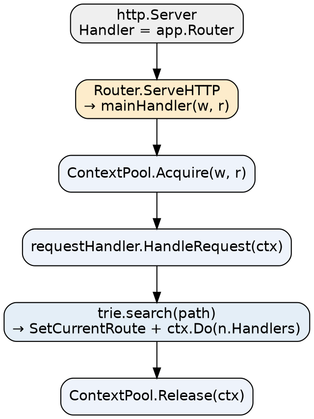

# Iris Architecture

## Introduction

理解 Iris 的入口是 `iris.Application`：它不是一个简单的 `http.Handler` 实现，而是一个**由三块拼起来的组合体**——注册期的 `APIBuilder`、运行期的 `Router`、以及贯穿两者的 `ContextPool`。搞清这三块的分工，Iris 那些"注册顺序敏感""中间件有四个挂载点"之类的行为就都能自解释了。

本文所有结论基于 tag **v12.2.11** 的源码（`github.com/kataras/iris/v12`），行号均指该 tag 原文。

## Application Composition

结构体定义在 `iris.go:57-115`，关键字段：

```go
type Application struct {
    *router.APIBuilder              // iris.go:59 —— 路由/中间件注册面
    *router.Router                  // iris.go:60 —— 运行时分发面
    router.HTTPErrorHandler         // iris.go:61 —— 错误码兜底
    ContextPool      *context.Pool  // iris.go:62 —— Context 对象池
    config           *Configuration
    logger           *golog.Logger
    I18n             *i18n.I18n
    Validator        context.Validator
    view             *view.View
    OnBuild          func() error
    Hosts            []*host.Supervisor  // iris.go:111 —— 多 Host 托管
}
```

三个要点：

1. **`ServeHTTP` 不在 Application 上**。全仓找不到 `func (app *Application) ServeHTTP`，它由嵌入的 `*router.Router` 提升而来：`func (router *Router) ServeHTTP(w http.ResponseWriter, r *http.Request)`（`core/router/router.go:340`）。所以 Application 满足 `http.Handler`，靠的是嵌入而非自实现——这也意味着 `app.Router` 可以单独拿出来当 Handler 用。
2. **`app.Get/Post/Use/Party` 全部来自 `APIBuilder`**，编译期有断言 `_ Party = (*APIBuilder)(nil)`（`core/router/api_builder.go:289-291`）。
3. **构建与运行分离**：`app.Build()` 时把 `APIBuilder` 作为 `RoutesProvider` 传给 `router.BuildRouter`（`iris.go:765`），运行期的 trie 由 `Router` 持有。

`iris.New()`（`iris.go:118`）只做最小装配；`iris.Default()`（`iris.go:145-187`）在其上追加三个中间件：

```go
// iris.go:171-183 的实际注册次序
app.UseRouter(requestid.New())   // :171
app.UseRouter(recover.New())     // :176
app.UseRouter(cors.New())        // :179
```

`iris.New()` 默认**不启用 recover**——这与 Gin 的 `gin.Default()` 一样，生产环境必须自己挂。

## Request Lifecycle

一次请求的完整链路：



逐步拆解（`core/router/router.go:98-104`、`core/router/handler.go:452`）：

1. `http.Server` 的 Handler 被设为 `app.Router`（`iris.go:556-557`）。
2. `Router.ServeHTTP` 直接转调 `mainHandler`，后者由 `buildMainHandler` 生成：
   `ctx := cPool.Acquire(w,r)` → `router.requestHandler.HandleRequest(ctx)` → `cPool.Release(ctx)`。
3. `HandleRequest`（`handler.go:452`）依次做：尾斜杠修正（`:456-483`，POST/PUT 用 307 重定向）→ trie 检索（`:495`）→ 命中则 `ctx.SetCurrentRoute` + `ctx.Do(n.Handlers)`（`:497-498`）；未命中则按 `FireMethodNotAllowed`（`:506`，会写 `Allow` 头）、`EnablePathIntelligence`（`:521`，仅 GET，301 到 `ctx.FindClosest(1)`）、最后 404（`:531`）逐级兜底。
4. `ctx.Do(handlers)` 替换整条链并从第 0 个执行（`context/context.go:525-531`）；`ctx.Next()` 只做 `currentHandlerIndex+1`（`:670-684`）。

带 `router.Filter` 的版本（`router.go:106-166`）会先跑 `ctx.Do(f.Handlers)`，这是 `UseRouter` 层能"连 404 都执行"的实现基础。

## Context and Pool

与 Echo 不同，Iris 的 Context 是**结构体**：

```go
type Context struct {  // context/context.go:131-161
    writer  ResponseWriter
    request *http.Request
    currentRoute  RouteReadOnly
    params  *RequestParams
    values  memstore.Store
    query   url.Values
    app     *Application
    handlers  Handlers
    currentHandlerIndex int
    proceeded bool
    manualRelease bool
}
```

池化在 `context/pool.go`：

```go
type Pool struct { pool *sync.Pool }   // :9-11
// Acquire : Get().(*Context) + BeginRequest   (:20)
// Release : EndRequest + Put                  (:28)
```

Application 侧装配：`app.ContextPool = context.New(func() interface{} { return context.NewContext(app) })`（`iris.go:131-133`）。**Context 每请求复用而非新建**，因此业务代码绝不能把 `*Context` 存到长生命周期结构里（逃逸到 goroutine 也不行）——这一点与 Gin 的 `sync.Pool` 陷阱完全同构。

## Startup and Shutdown

`Runner` 是启动的抽象（`iris.go:812`）：

```go
type Runner func(*Application) error
```

| 入口 | 签名/位置 | 说明 |
| :-- | :-- | :-- |
| `Run` | `Run(serve Runner, withOrWithout ...Configurator) error`（`iris.go:1050`） | 通用入口：Configure → Build → ConfigureHost → serve |
| `Listen` | `Listen(hostPort string, ...)`（`iris.go:1033`） | 等价于 `app.Run(Addr(hostPort), ...)` |
| `Addr` | `iris.go:875` | 构造 `&http.Server{...}`，非阻塞变体 `AddrNB` |
| `Listener` | `iris.go:827` | 用已有 `net.Listener`（便于接管 systemd socket / 自定义 listener） |
| `Server` | `iris.go:849` | 用已有 `*http.Server` |
| `TLS` | `iris.go:934` | 显式证书文件路径或证书内容 |
| `AutoTLS` | `iris.go:976` | 内置 autocrypt 自动签发（`golang.org/x/crypto/acme/autocert`） |
| `Raw` | `iris.go:997` | 完全自定义 `*http.Server` |
| `NewHost` | `NewHost(srv *http.Server) *host.Supervisor`（`iris.go:537`） | 拿到底层 Supervisor，可 `Serve/ListenAndServe/Shutdown` |

**HTTP/2 不是靠 `x/net/http2` 手动配置**：`Supervisor` 在 TLS 分支把 `NextProtos` 设为 `["h2", "http/1.1"]`（`core/host/supervisor.go:455-459`）后调 `Server.ServeTLS(ln, "", "")`，由标准库在 TLS 握手时协商 h2。所以**明文 HTTP/2（h2c）不是默认路径**，要 h2 就得走 TLS。

优雅关闭：`app.Shutdown(ctx)`（`iris.go:642`）遍历 `app.Hosts` 逐个 `su.Shutdown`；`DisableInterruptHandler` 默认为 false，即框架自带 SIGINT/SIGTERM 处理。

多 Host 托管：`app.NewHost` 可多次调用，结果进 `app.Hosts`；`host.Supervisor`（`core/host/supervisor.go:94`）抽象了 `Serve(l net.Listener)`(265)、`ListenAndServe`(277)、`Shutdown(ctx)`(512)。

## Configuration

`Configuration` 定义在 `configuration.go`，默认值读 `DefaultConfiguration()`（`:1397-1469`）。常用字段与**默认值**：

| 字段 | 默认值 | 说明 |
| :-- | :-- | :-- |
| `LogLevel` | `"info"` | 框架日志级别 |
| `DisableStartupLog` | `false` | 关掉启动横幅 |
| `DisableInterruptHandler` | `false` | 是否接管信号 |
| `DisablePathCorrection` | `false` | 尾斜杠自动修正（关掉则 `/a/` 与 `/a` 不同） |
| `EnablePathIntelligence` | `false`（未出现在默认函数里，即零值） | 404 时找最近路由并 301 |
| `FireMethodNotAllowed` | `false` | 405 处理 |
| `EnablePathEscape` | `false` | 路径转义 |
| `ForceLowercaseRouting` | `false` | 路径转小写匹配 |
| `TimeFormat` | `"Mon, 02 Jan 2006 15:04:05 GMT"` | 时间格式 |
| `Charset` | `"utf-8"` | 响应字符集 |
| `PostMaxMemory` | `32 << 20`（32 MB） | multipart 内存上限 |
| `RemoteAddrHeaders` | `nil` | 反向代理下取真实 IP 的头名 |
| `RemoteAddrPrivateSubnets` | 6 段内网段（`:1436-1461`） | 配合上一项过滤内网地址 |
| `Timeout` / `TimeoutMessage` | `0` / 一段 HTML | 请求超时（0 = 不限） |
| `EnableOptimizations` | `false` | 动态 handler（**与 JSON 编码无关**） |
| `EnableProtoJSON` / `EnableEasyJSON` | `false` / `false` | Protobuf/easyjson 编码开关 |
| `SocketSharding` / `KeepAlive` | `false` / `0` | 连接层调优 |
| `URLParamSeparator` | `","` | 多值参数分隔符 |
| `Other` | `map[string]interface{}{}` | 自定义挂载点 |

> [!TIP]
>
> `Configuration` **没有** JSON 缩进字段（没有 `Indent`/`JSONIndent` 之类）；要缩进输出请在 `ctx.JSON` 之外自行 Marshal。另外 `EnableOptimizations` 常被误读为"启用 jsoniter"，源码里它对应的是 dynamic request handler，`GetEnableOptimizations()` 在全仓没有调用点。

配置注入用 `Configurator`（`type Configurator func(*Application)`，`configuration.go:168`）：

```go
app := iris.New()
app.Configure(
    iris.WithConfiguration(iris.Configuration{Charset: "UTF-8"}),
    iris.WithoutStartupLog,
    iris.WithTimeFormat("2006-01-02 15:04:05"),
    iris.WithPostMaxMemory(8 << 20),
    iris.WithRemoteAddrHeader("X-Real-IP"),
    iris.WithLogLevel("warn"),
)
```

注意 `WithConfiguration`（`:1197`）是**按非零值合并**，不是整体替换——传零值字段不会覆盖默认（`if v := c.Charset; v != ""`，`:1306`）。其余便捷项：`WithoutBanner`（`:259`，等价于 `WithoutStartupLog`）、`WithPathIntelligence`(277)、`WithoutPathCorrection`(270)、`WithFireMethodNotAllowed`(350)、`WithResetOnFireErrorCode`(364)、`WithOtherValue`(483)、`WithTimeout`(210)、`WithCharset`(389)。

## Build and Host Lifecycle

`app.Build()` 的流程要点（`iris.go:762-766`）：构造 `router.NewDefaultHandler(app.config, app.logger)` 并赋给 `app.HTTPErrorHandler`；`OnBuild` 回调在此之前触发，可用于最后一批依赖就绪后的注册。

`app.Run` 内部顺序固定为 **Configure → Build → ConfigureHost → serve**，所以 `Configure` 里传的 Configurator 一定早于路由构建——这也是"中间件注册必须在路由之前"这类约束的实现背景。

## Links

- [Iris](/docs/CS/Go/Framework/Iris.md)
- [Iris Routing](/docs/CS/Go/Framework/Iris/Routing.md)
- [Iris Middleware](/docs/CS/Go/Framework/Iris/Middleware.md)
- [Gin Architecture](/docs/CS/Go/Framework/Gin/Architecture.md)
- [Go net](/docs/CS/Go/net.md)

## References

- <https://github.com/kataras/iris/blob/main/iris.go>
- <https://github.com/kataras/iris/blob/main/configuration.go>
- <https://github.com/kataras/iris/blob/main/core/router/router.go>
- <https://github.com/kataras/iris/blob/main/core/host/supervisor.go>
- <https://pkg.go.dev/github.com/kataras/iris/v12#Configuration>
