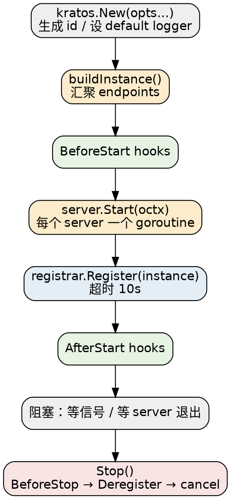

# Kratos

## Introduction

Kratos 是 bilibili 开源、**面向云原生微服务**的 Go 框架（MIT）。它与 [Gin](/docs/CS/Go/Framework/Gin.md)、[Hertz](/docs/CS/Go/Framework/Hertz.md) 处在不同的层级：后两者的核心命题是「HTTP 路由 + 中间件 + 绑定渲染」，而 Kratos 的命题是「**一份 Protobuf 契约，同时长出 HTTP 与 gRPC 两套服务，并把注册发现、配置、日志、熔断限流、链路追踪这些微服务边角 jsonify 成可插拔组件**」。官方自我定位是 "A Go framework for microservices"，Go 入口 `/app.go` 里唯一的导出类型是负责生命周期的 `App`。

三条产品主线，本目录所有分册都围绕它们展开：

1. **API 先行（Protobuf-first）**：业务先写 `.proto`，由 `protoc-gen-go-http` / `protoc-gen-go-errors` 生成 HTTP 与 gRPC 双协议的骨架代码与错误常量，而不是先写 handler 再补文档。
2. **传输层统一（`transport.Server` 抽象）**：HTTP 与 gRPC 只是同一套 Server 接口的两个实现，`App` 同时托管它们——所以「同一个 service struct 被 HTTP 和 gRPC 各注册一次」是常态。
3. **组件可插拔**：`registry`（注册发现）、`config`（配置源）、`selector`（负载均衡）、`encoding`（编解码）、`middleware`（中间件）都是接口 + 默认实现，注册中心与配置中心的适配以 `contrib/` 子模块形式外置。

> [!NOTE]
>
> 消歧：Kratos 指 `github.com/go-kratos/kratos`。不要与希腊神话泰坦、游戏《战神》（God of War）系列的 Kratos 混淆。同属 Go 微服务生态但层级不同的有 [Hertz](/docs/CS/Go/Framework/Hertz.md)（CloudWeGo HTTP 框架）与 Kitex（RPC 框架）——Kratos 与它们的关系是「微服务治理框架」对「传输层框架」，而非竞品。

版本基线（2026-10-26 现场核实 GitHub Releases + `go.mod` 一手来源）：

- 最新稳定版 **v3.0.0**，发布于 **2026-06-26**，是 Kratos 首个 v3 major。`version.go` 里 `const Release = "v3.0.0"` 与之对齐。
- **module path 升到 `/v3`**：`module github.com/go-kratos/kratos/v3`。v3.0.0 唯一列出的 Breaking Change 就是 `break: update kratos modules to v3 (#3822)`——所有 import 路径要从 `/v2` 改成 `/v3`，这是升级时唯一必改项。
- `go.mod` 声明 **`go 1.25.0`**——即 **Go 1.25 是最低要求**（一手来源：jsdelivr `go-kratos/kratos@v3.0.0/go.mod`）。
- 关键依赖：`google.golang.org/grpc v1.81.0`、`google.golang.org/protobuf v1.36.11`、`github.com/gorilla/mux v1.8.1`（HTTP 就是站在它之上）、`github.com/go-playground/form/v4 v4.3.0`（表单绑定与 path/query 绑定）、`github.com/google/uuid v1.6.0`（实例 ID）、`github.com/fsnotify/fsnotify v1.10.1`（配置文件监听）、`gopkg.in/yaml.v3 v3.0.1`、`golang.org/x/sync v0.20.0`。
- 许可证 **MIT**（`LICENSE`，Copyright (c) 2020 go-kratos）。

## Quick Start

Kratos 的最小骨架由 `App` + `Server` 两部分构成，`main` 只负责把二者组装起来：

```go
package main

import (
    "github.com/go-kratos/kratos/v3"
    "github.com/go-kratos/kratos/v3/transport/grpc"
    "github.com/go-kratos/kratos/v3/transport/http"
)

func main() {
    // HTTP 与 gRPC 两个 server 共用同一个 service 实现
    httpSrv := http.NewServer(http.Address(":8000"))
    grpcSrv := grpc.NewServer(grpc.Address(":9000"))

    app := kratos.New(
        kratos.Name("helloworld"),
        kratos.Version("v1.0.0"),
        kratos.Server(httpSrv, grpcSrv),
    )
    if err := app.Run(); err != nil {
        panic(err)
    }
}
```

注意 `kratos.New` 之后必须在 `Run` 之前把 server 传进去——`App` 不反射扫描任何东西，**所有 server 都由 `kratos.Server(...)` 显式登记**。`Run()` 会阻塞直到收到信号或一个 server 退出。

`kratos.New` 的默认行为（源码 `app.go`）：实例 ID 用 `uuid.NewUUID()` 生成；监听信号为 `SIGTERM`、`SIGQUIT`、`SIGINT`；注册中心超时 `registrarTimeout = 10 * time.Second`；`stopTimeout` 为零值，即关闭时不额外施加超时。

## Application Lifecycle

`App` 是「组件生命周期管理器」，它**不是 Web 引擎**——它不管路由、不管协议，只做四件事：登记 server、在合适时机调用钩子、把实例注册到注册中心、优雅关停。



四个钩子 `BeforeStart` / `AfterStart` / `BeforeStop` / `AfterStop` 都是 `func(context.Context) error`，并且**可以注册多个**（`options.go` 里它们是切片，逐次 append）。它们的语义差别值得留意：`AfterStart` 在注册中心注册完成之后才跑，而 `BeforeStop` 在反注册之前跑。

## Subtree Organization

本子树按「一个跨切面一件事」划分，枢纽页只做导航与结论，具体实现细节一律下沉到分册：

| 分册 | 负责的横切面 | 归属说明 |
| :-- | :-- | :-- |
| [Architecture](/docs/CS/Go/Framework/Kratos/Architecture.md) | `App` 生命周期、`transport.Server` / `Transporter` 抽象、分层架构与 Wire 依赖注入 | 只有本册讲 `app.go` 与 `transport.go` |
| [Transport_HTTP](/docs/CS/Go/Framework/Kratos/Transport_HTTP.md) | gorilla/mux 路由、Filter 与 Middleware 两套链、绑定与渲染、错误编码 | 只有本册讲 `transport/http` |
| [Transport_gRPC](/docs/CS/Go/Framework/Kratos/Transport_gRPC.md) | gRPC Server/Client、拦截器、resolver 与 balancer 接入 | 只有本册讲 `transport/grpc` |
| [Errors_and_Validation](/docs/CS/Go/Framework/Kratos/Errors_and_Validation.md) | `errors.Error`、HTTP↔gRPC 状态码映射、`protoc-gen-go-errors`、校验 | 状态码映射表只有本册列全 |
| [Config](/docs/CS/Go/Framework/Kratos/Config.md) | Source / Watcher / Reader、占位符解析、多源合并、热更新 | 只有本册讲 `config` |
| [Discovery_and_Selector](/docs/CS/Go/Framework/Kratos/Discovery_and_Selector.md) | `registry` 接口、`selector` 三大算法、p2c/eWMA 权重公式 | 只有本册讲 `registry` 与 `selector` |
| [Middleware_and_Observability](/docs/CS/Go/Framework/Kratos/Middleware_and_Observability.md) | 内置中间件、BBR 限流、SRE 熔断、OpenTelemetry | 只有本册讲 `middleware` 与 contrib/otel |
| [Protobuf_and_Codegen](/docs/CS/Go/Framework/Kratos/Protobuf_and_Codegen.md) | `kratos` CLI、`protoc-gen-go-http`、`protoc-gen-go-errors`、layout 骨架 | 只有本册讲 `cmd/` |

想快速判断「Kratos 到底解决了什么问题」：**如果你只需要写几个 HTTP 接口，Kratos 是杀鸡用牛刀，用 Gin 或 `net/http` 就够了；如果你要维护十几个互相调用的 Go 服务、希望它们的 proto 契约、错误码、配置源、注册中心、可观测性都统一，Kratos 的价值才成立。**

## Links

- [Go](/docs/CS/Go/Go.md)
- [Gin](/docs/CS/Go/Framework/Gin.md)
- [Hertz](/docs/CS/Go/Framework/Hertz.md)
- [Go net](/docs/CS/Go/net.md)
- [Apollo](/docs/CS/Framework/Apollo/Apollo.md)
- [Zipkin](/docs/CS/Distributed/Tracing/Zipkin.md)

## References

- <https://go-kratos.dev/>
- <https://github.com/go-kratos/kratos>
- <https://github.com/go-kratos/kratos/releases>
- <https://pkg.go.dev/github.com/go-kratos/kratos/v3>
- <https://github.com/go-kratos/kratos-layout>
