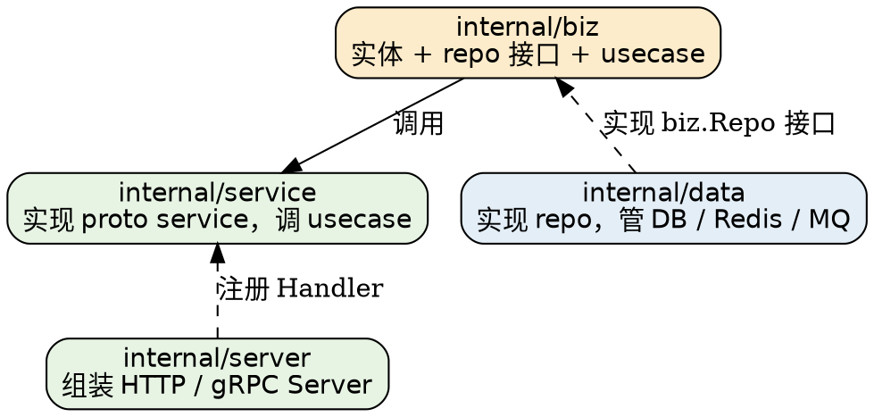

# Architecture

本册讲 Kratos 的骨架：`App` 这个生命周期管理器、它如何托管多个 `transport.Server`、HTTP 与 gRPC 共用一套抽象背后的取舍，以及官方 layout 的分层与依赖注入方式。路由细节在 [Transport_HTTP](/docs/CS/Go/Framework/Kratos/Transport_HTTP.md)，gRPC 侧在 [Transport_gRPC](/docs/CS/Go/Framework/Kratos/Transport_gRPC.md)。

## App Lifecycle

`App`（`app.go`）是整个框架唯一的核心类型，它**不理解 HTTP 也不理解 gRPC**，只认识三个东西：一组 `transport.Server`、一个可选的 `registry.Registrar`、若干生命周期钩子。

```go
type App struct {
	opts     options
	ctx      context.Context
	cancel   context.CancelFunc
	mu       sync.Mutex
	instance *registry.ServiceInstance
}
```

`kratos.New` 的默认值（`app.go`）：

| 字段 | 默认值 | 备注 |
| :-- | :-- | :-- |
| `ctx` | `context.Background()` | 可用 `kratos.Context(ctx)` 覆盖 |
| `sigs` | `SIGTERM, SIGQUIT, SIGINT` | 用 `kratos.Signal(...)` 覆盖 |
| `registrarTimeout` | `10 * time.Second` | 注册与反注册都用它 |
| `stopTimeout` | `0`（不限制） | 只有 > 0 时才给 Stop 套 `context.WithTimeout` |
| `id` | `uuid.NewUUID()` | UUID v1，失败则留空 |

`Run()` 的执行序列（`app.go`），按源码顺序：

1. `buildInstance()` 构造 `*registry.ServiceInstance`；
2. 依次执行 `beforeStart` 钩子，任一出错立即返回（**不会启动 server**）；
3. 对每个 server 起**两个 goroutine** 放进同一个 `errgroup`：
   - 一个 `<-ctx.Done()` 后调用 `server.Stop(stopCtx)`，其中 `stopCtx = context.WithoutCancel(octx)`——刻意脱钩，这样上游 ctx 已取消也不会把 Stop 变成空操作；
   - 一个执行 `server.Start(octx)`，并在开头 `wg.Done()`。
4. `wg.Wait()` 返回后才做第 5 步——**这个 Wait 的意义是「确保所有 server 的 Start 都已经真正开始执行」**，避免还没监听就对外注册；
5. 若有 `registrar`，带 `registrarTimeout` 超时执行 `Register`；
6. 依次执行 `afterStart`；
7. 起一个 goroutine 等信号，收到则 `a.Stop()`；
8. `eg.Wait()`，忽略 `context.Canceled`；最后依次执行 `afterStop`。

> [!WARNING]
>
> `afterStop` 的返回值处理有个坑：`app.go` 里是 `for ... { err = fn(sctx) }` —— **循环没有中途退出，也没有累积错误**，最终返回的是**最后一个** hook 的返回值。写了多个清理钩子时，除最后一个之外的错误会被静默吞掉。要保证自己清理成功，得在 hook 内部自己记录。

`Stop()` 的顺序是：`beforeStop` → `registrar.Deregister`（带 `registrarTimeout`）→ `cancel()` 取消根 ctx。注意**反注册先于 server 停止**，这是正确的顺序——先摘流量再关进程。

### buildInstance

```go
func (a *App) buildInstance() (*registry.ServiceInstance, error) {
	endpoints := make([]string, 0, len(a.opts.endpoints))
	for _, e := range a.opts.endpoints {
		endpoints = append(endpoints, e.String())
	}
	if len(endpoints) == 0 {
		for _, srv := range a.opts.servers {
			if r, ok := srv.(transport.Endpointer); ok {
				e, err := r.Endpoint()
				...
			}
		}
	}
	...
}
```

两个要点：显式 `kratos.Endpoint(url)` 优先；没显式传时才从实现了 `transport.Endpointer` 的 server 反查。这就是为什么 server 必须先 `NewServer` 拿到 listener 之后 `Endpoint()` 才有效——通常只有一个 httpx Server 真正监听时，`Start` 里才来得及填 endpoint，所以**注册动作被刻意安排在 server 启动之后**。

## Transport Abstraction

Kratos 用三个极小的接口把「HTTP」与「gRPC」统一了（`transport/transport.go`）：

```go
type Server interface {
	Start(context.Context) error
	Stop(context.Context) error
}

type Endpointer interface {
	Endpoint() (*url.URL, error)
}

type Transporter interface {
	Kind() Kind
	Endpoint() string
	Operation() string
	RequestHeader() Header
	ReplyHeader() Header
}
```

- **`Server`** 是 `App` 唯一要求的接口。`http.Server` 嵌入了标准库 `*http.Server`、`grpc.Server` 嵌入了 `*grpc.Server`，二者都实现 `Start/Stop`。
- **`Endpointer`** 是可选能力，`App` 用类型断言探测；注册中心里 `http://…` / `grpc://…` 的 URL 就是它产出的。
- **`Transporter`** 是「本次调用的传输元信息」，通过 `transport.NewServerContext` / `NewClientContext` 塞进 `context.Context`，用 `FromServerContext` / `FromClientContext` 取出。它的 `Operation()` 是关键——中间件匹配、熔断分组、日志都用它做标识。

`Kind` 只有两个值：`KindGRPC = "grpc"`、`KindHTTP = "http"`。

> [!NOTE]
>
> `transport` 包的 init 里空白导入了全部六个编解码器（form / json / proto / protojson / xml / yaml），所以**只要 import 了 transport 包，这些 codec 就都注册了**。这是 `CodecForRequest` 能按 Content-Type 查表的隐含前提：`encoding/encoding.go` 的 `RegisterCodec` 是全局注册表，谁被 import 谁才存在。

这种抽象换来的实际效果是：**中间件签名与协议无关**。

```go
type Handler func(ctx context.Context, req any) (any, error)
type Middleware func(Handler) Handler
```

同一个中间件能同时给 HTTP 和 gRPC 用，因为它看到的是 `any` 类型的请求，而不是 `*http.Request` 或 `grpc.MethodInfo`。代价是：想读 HTTP 头必须自己从 ctx 里取 `Transporter` 再断言，写起来不如 Gin 直接。

## Layered Project Structure

官方模板仓库 `go-kratos/kratos-layout` 在 Kratos v3 同步发布了 **v3.0.0** tag，依赖 `github.com/go-kratos/kratos/v3 v3.0.0` 与 `github.com/google/wire v0.6.0`。它的分层遵循依赖倒置：内层定义接口，外层实现。



箭头方向值得多看一眼：**`data` 依赖 `biz`，而不是反过来**。`biz` 里定义 `type TodoRepo interface`，`data` 里的 `NewTodoRepo` 返回该接口的实现。这样业务层完全不知道底下是 MySQL 还是 Redis，换实现只动 `data`。这是 layout 里最有价值的一条约束，比目录结构本身重要。

其余目录：`api/` 放 proto 与生成物、`cmd/server/` 放 `main.go` 与 wire、`configs/` 放配置文件、`internal/conf/` 放配置结构体（`conf.proto` 生成的 `conf.pb.go`）。

## Dependency Injection with Wire

v3 官方 layout **仍然使用 Google Wire**，没有换成自有 DI——`cmd/server/` 下同时有手写的 `wire.go` 和生成的 `wire_gen.go`。

```go
func wireApp(*conf.Server, *conf.Data, *slog.Logger) (*kratos.App, func(), error) {
	panic(wire.Build(server.ProviderSet, data.ProviderSet, biz.ProviderSet, service.ProviderSet, newApp))
}
```

每层各自暴露 `ProviderSet`（如 `server.ProviderSet = wire.NewSet(NewGRPCServer, NewHTTPServer)`），`wire.Build` 按构造函数签名递归分析依赖图并生成 `wire_gen.go`。那个 `panic(...)` 是 wire 的惯例写法——`wire.go` 本身用 `//go:build wireinject` 约束，正常编译时不参与，只由 `wire gen` 读取。

**Wire 是编译期代码生成，不是运行时反射容器。** 生成出来的 `wire_gen.go` 就是一堆按拓扑序手写的构造函数调用，没有 reflect、没有 DI 容器、编译期就会报缺失 provider。这与 Spring 的运行时 IoC 是完全不同的东西——对一个追求启动速度的微服务框架来说，这个选择是自洽的。

## Options Reference

`kratos.Option` 全列表（`options.go`）：

| Option | 作用 | 默认 |
| :-- | :-- | :-- |
| `ID(id)` | 实例 ID | UUID v1 |
| `Name(name)` | 服务名 | 空 |
| `Version(v)` | 服务版本 | 空 |
| `Metadata(md)` | 实例元数据（会进注册中心） | nil |
| `Endpoint(urls...)` | 显式端点 | nil（从 server 反查） |
| `Context(ctx)` | 根 ctx | `context.Background()` |
| `Logger(*slog.Logger)` | 设全局默认 logger | nil（不覆盖） |
| `Server(srv...)` | 登记传输服务器 | 空 |
| `Signal(sigs...)` | 退出信号 | TERM/QUIT/INT |
| `Registrar(r)` | 注册中心 | nil |
| `RegistrarTimeout(d)` | 注册超时 | 10s |
| `StopTimeout(d)` | 停止超时 | 0（不限） |
| `BeforeStart` / `AfterStart` / `BeforeStop` / `AfterStop` | 生命周期钩子 | 空 |

注意 `Logger` 的行为：`New` 里是 `if o.logger != nil { log.SetDefault(o.logger) }`——**传入 nil 不会重置全局 logger**，只是保持原状。v3 的日志接口已经换成标准库 `*slog.Logger`（这也是为什么 go 1.25 是硬要求），配套的 OTel bridge 在 `contrib/otel/log` 里，详见 [Middleware_and_Observability](/docs/CS/Go/Framework/Kratos/Middleware_and_Observability.md)。

## Links

- [Kratos](/docs/CS/Go/Framework/Kratos.md)
- [Transport_HTTP](/docs/CS/Go/Framework/Kratos/Transport_HTTP.md)
- [Transport_gRPC](/docs/CS/Go/Framework/Kratos/Transport_gRPC.md)
- [Protobuf_and_Codegen](/docs/CS/Go/Framework/Kratos/Protobuf_and_Codegen.md)
- [Discovery_and_Selector](/docs/CS/Go/Framework/Kratos/Discovery_and_Selector.md)

## References

- <https://github.com/go-kratos/kratos/blob/main/app.go>
- <https://go-kratos.dev/docs/getting-started/start/>
- <https://github.com/google/wire>
