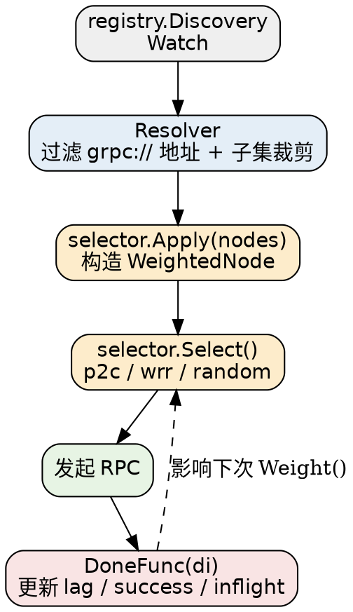

# Discovery and Selector

本册讲 Kratos 的服务注册发现（`registry`）与客户端负载均衡（`selector`）。这两块是 Kratos 相对 Gin / Hertz 最独特的地方——它不只是一个 Web 框架，它把「服务怎么找到彼此」也纳入了框架范围。

## Registry

只有三个极小接口（`registry/registry.go`）：

```go
type Registrar interface {
	Register(ctx context.Context, service *ServiceInstance) error
	Deregister(ctx context.Context, service *ServiceInstance) error
}

type Discovery interface {
	GetService(ctx context.Context, serviceName string) ([]*ServiceInstance, error)
	Watch(ctx context.Context, serviceName string) (Watcher, error)
}

type Watcher interface {
	Next() ([]*ServiceInstance, error)
	Stop() error
}
```

`ServiceInstance` 是唯一的载体模型：

```go
type ServiceInstance struct {
	ID        string            `json:"id"`
	Name      string            `json:"name"`
	Version   string            `json:"version"`
	Metadata  map[string]string `json:"metadata"`
	Endpoints []string          `json:"endpoints"`
}
```

`Endpoints` 的 scheme 编码了协议，注释里写得很清楚：

```
http://127.0.0.1:8000?isSecure=false
grpc://127.0.0.1:9000?isSecure=false
```

服务端侧由 `App` 在 `Run()` 里调用 `Register`（详见 [Architecture](/docs/CS/Go/Framework/Kratos/Architecture.md)），客户端侧由 `Discovery` 驱动 resolver（详见 [Transport_gRPC](/docs/CS/Go/Framework/Kratos/Transport_gRPC.md)）。**注意 `registry` 包本身不含任何注册中心实现**——它只有接口，全部实现在 `contrib/registry/`。

`Watcher.Next()` 的语义有一条容易忽略的约定：它在「首次 watch 且实例列表非空」或「发生任何变更」时返回，否则**阻塞直到 ctx 到期或取消**。实现自定义的 discovery 时必须遵守这个契约。

### contrib/registry

共 9 个：

| 子模块 | 关键依赖 |
| :-- | :-- |
| `consul` | `hashicorp/consul/api v1.34.2` |
| `etcd` | `go.etcd.io/etcd/client/v3 v3.6.11` |
| `nacos` | `nacos-group/nacos-sdk-go/v2 v2.3.5` |
| `zookeeper` | `go-zookeeper/zk v1.0.4` |
| `kubernetes` | `k8s.io/api` / `client-go` v0.36.1 |
| `eureka` | **无外部依赖**（纯 HTTP 自实现） |
| `discovery` | `go-resty/resty/v2 v2.17.2` |
| `polaris` | `polarismesh/polaris-go v1.7.0` |
| `servicecomb` | `go-chassis/cari v0.9.0` + `sc-client v0.7.0` |

## Selector

`selector` 是**客户端**负载均衡。核心四个类型：

```go
type Selector interface {
	Rebalancer
	Select(ctx context.Context, opts ...SelectOption) (selected Node, done DoneFunc, err error)
}

type Rebalancer interface {
	Apply(nodes []Node)
}

type Node interface {
	Scheme() string
	Address() string
	ServiceName() string
	InitialWeight() *int64
	Version() string
	Metadata() map[string]string
}

type DoneFunc func(ctx context.Context, di DoneInfo)
```

分工：

- **`Apply(nodes)`** 是「实例列表变了」，由 resolver 调用；
- **`Select(ctx)`** 是「给这次调用挑一个节点」，返回 node 与一个**必须被调用**的 `DoneFunc`；
- **`DoneFunc`** 是这次调用的反馈闭环——延迟、成功率、错误都在这里回收。

> [!WARNING]
>
> `DoneFunc` **必须调用**。它的意义是把 `inflight` 计数归还，并更新 eWMA 统计。忘了调用的话 `inflight` 永不下降，该节点的权重会持续劣化到事实上的永久不被选中。这在手写 transport 时是个极易漏掉的点。

`ErrNoAvailable` 是一个现成的错误值：`errors.ServiceUnavailable("no_available_node", "")`。

## Node Builders

Kratos 把「节点如何算权重」与「如何挑节点」分开。前者是 `WeightedNode` 的两种实现：

| Builder | 位置 | 行为 |
| :-- | :-- | :-- |
| `direct` | `selector/node/direct` | 只回显静态权重，`Pick()` 返回空 DoneFunc，不做任何统计 |
| `ewma` | `selector/node/ewma` | 按延迟 + 成功率动态算权重 |

### eWMA

这是 Kratos 招牌的自适应算法。常量：

```go
const (
	// The mean lifetime of `cost`, it reaches its half-life after Tau*ln(2).
	tau = int64(time.Millisecond * 600)
	// if statistic not collected,we add a big lag penalty to endpoint
	penalty = uint64(time.Microsecond * 100)
)
```

初始值刻意不是 0：

```go
func (b *Builder) Build(n selector.Node) selector.WeightedNode {
	s := &Node{Node: n, inflights: [200]atomic.Int64{}, errHandler: b.ErrHandler, cachedWeight: &atomic.Value{}}
	s.success.Store(1000)  // 成功率初值 1000
	s.inflight.Store(1)    // 在飞初值 1，避免除零
	return s
}
```

预测负载（注意那句 +5ms 与开方）：

```go
func (n *Node) load() (load uint64) {
	now := time.Now().UnixNano()
	avgLag := n.lag.Load()
	predict := n.predict(avgLag, now)
	if avgLag == 0 {
		load = penalty * uint64(n.inflight.Load())
		return
	}
	if predict > avgLag {
		avgLag = predict
	}
	// add 5ms to eliminate the latency gap between different zones
	avgLag += int64(time.Millisecond * 5)
	avgLag = int64(math.Sqrt(float64(avgLag)))
	load = uint64(avgLag) * uint64(n.inflight.Load())
	return
}
```

注释说明了 +5ms 的用途：**消除跨可用区之间的延迟差**，避免同城多活场景下低延迟机房被过度加权。开方则是为了让延迟分布不要太悬殊。

最终权重：

```go
weight = float64(health*uint64(time.Microsecond)*10) / float64(load)
```

即 **权重正比于成功率、反比于预测负载**。结果带 5ms 缓存避免高频重算。

反馈闭环在 `Pick()` 返回的闭包里：

```go
return func(_ context.Context, di selector.DoneInfo) {
	if swapped {
		n.inflights[slot].CompareAndSwap(start, 0)
	}
	n.inflight.Add(-1)

	now := time.Now().UnixNano()
	stamp := n.stamp.Swap(now)
	td := now - stamp
	if td < 0 { td = 0 }
	w := math.Exp(float64(-td) / float64(tau))   // 指数衰减，tau=600ms

	lag := now - start
	if lag < 0 { lag = 0 }
	oldLag := n.lag.Load()
	if oldLag == 0 { w = 0.0 }                  // 首次采样直接取值，不做平滑
	lag = int64(float64(oldLag)*w + float64(lag)*(1.0-w))
	n.lag.Store(lag)

	success := uint64(1000)
	if di.Err != nil {
		if n.errHandler != nil && n.errHandler(di.Err) {
			success = 0
		}
		var netErr net.Error
		if errors.Is(context.DeadlineExceeded, di.Err) || errors.Is(context.Canceled, di.Err) ||
			errors.IsServiceUnavailable(di.Err) || errors.IsGatewayTimeout(di.Err) ||
			errors.As(di.Err, &netErr) {
			success = 0
		}
	}
	oldSuc := n.success.Load()
	success = uint64(float64(oldSuc)*w + float64(success)*(1.0-w))
	n.success.Store(success)
}
```

- `predict()` 用一个 200 槽的环形窗口 `inflights [200]atomic.Int64`，若**超过半数**未完成请求已超过当前平均延迟，则用这些慢请求的均值作为预测值。
- **错误判定很窄**：只有 `DeadlineExceeded` / `Canceled` / `ServiceUnavailable` / `GatewayTimeout` / 任何 `net.Error` 才算失败。普通业务错误（比如返回 `NotFound`）**不影响健康度**——这是对的，业务错误不代表节点坏。想更严格就通过 `ewma.Builder.ErrHandler` 自定义。
- 源码注释 `// error value ,if error set 1` 与实现 `success = 0` 自相矛盾，照实现为准。

## Balancers

三种选点算法：

### p2c（Power of 2 Choices）

```go
const (
	forcePick = time.Second * 3
	Name      = "p2c"
)
```

随机取两个互异节点，取 `Weight()` 大者；若落选节点超过 **3 秒**没被选中过，则强制选它一次（用 CAS 的 `picked` 保证同一时刻只有一次强制）：

```go
func (s *Balancer) Pick(_ context.Context, nodes []selector.WeightedNode) (selector.WeightedNode, selector.DoneFunc, error) {
	if len(nodes) == 0 { return nil, nil, selector.ErrNoAvailable }
	if len(nodes) == 1 { done := nodes[0].Pick(); return nodes[0], done, nil }

	var pc, upc selector.WeightedNode
	nodeA, nodeB := s.prePick(nodes)
	if nodeB.Weight() > nodeA.Weight() {
		pc, upc = nodeB, nodeA
	} else {
		pc, upc = nodeA, nodeB
	}

	// If the failed node has never been selected once during forceGap, it is forced to be selected once
	if upc.PickElapsed() > forcePick && s.picked.CompareAndSwap(false, true) {
		defer s.picked.Store(false)
		pc = upc
	}
	done := pc.Pick()
	return pc, done, nil
}
```

那个 `forcePick` 是防止 `weight` 长时间不更新的节点彻底饿死——没有它，一个新启动但初始延迟未知的节点可能永远得不到反馈机会。随机数来自 `math/rand/v2` 的 `rand.NewPCG`。

p2c 绑定 **`ewma.Builder`**，所以它带完整的延迟自适应能力。

### wrr（Weighted Round Robin）

注释直接写明是 nginx 的平滑加权轮询算法（SWRR）：

```go
var totalWeight float64
var selected selector.WeightedNode
var selectWeight float64
for _, node := range nodes {
	totalWeight += node.Weight()
	cwt := p.currentWeight[node.Address()]
	cwt += node.Weight()
	p.currentWeight[node.Address()] = cwt
	if selected == nil || selectWeight < cwt {
		selectWeight = cwt
		selected = node
	}
}
p.currentWeight[selected.Address()] = selectWeight - totalWeight
```

不同于简单加权轮询，SWRR 会让高权重节点的请求均匀分散在整个时间轴上而不是一次打完。

wrr 绑定的是 **`direct.Builder`**——**不带延迟自适应**，只看静态权重。静态权重来自注册实例 metadata 里的 `weight` 键，缺失时退化到常量 `defaultWeight = 100`。

### random

`rand.IntN(len(nodes))` 直接选，**权重完全不参与**（虽然有 `Weight()` 方法也不用）。同样绑 `direct.Builder`。

## Node Filters

`selector/filter` 下只有一个：**version**。

```go
func Version(version string) selector.NodeFilter {
	return func(_ context.Context, nodes []selector.Node) []selector.Node {
		newNodes := make([]selector.Node, 0, len(nodes))
		for _, n := range nodes {
			if n.Version() == version {
				newNodes = append(newNodes, n)
			}
		}
		return newNodes
	}
}
```

> [!WARNING]
>
> 这是**纯字符串严格相等**，没有 `latest` 这类特殊值，也没有「无 version 兜底」的逻辑。节点没上报 version（空串）时，只有显式传 `filter.Version("")` 才能匹配到它。灰度按版本路由时，务必确认服务端确实配置了 version，否则会过滤出空集并得到 `ErrNoAvailable`。

## Global Selector

这是最容易搞错的一块。`selector/global.go` 全文**没有任何注册逻辑**：

```go
var globalSelector = &wrapSelector{}

func GlobalSelector() Builder {
	if globalSelector.Builder != nil {
		return globalSelector
	}
	return nil   // 未设置时返回 nil
}

func SetGlobalSelector(builder Builder) {
	globalSelector.Builder = builder
}
```

**默认值不在这里，而在两个客户端包的 `init()` 里，且默认是 wrr 而不是 p2c：**

```go
// transport/http/client.go 与 transport/grpc/client.go 各有一份
func init() {
	if selector.GlobalSelector() == nil {
		selector.SetGlobalSelector(wrr.NewBuilder())
	}
}
```

> [!WARNING]
>
> 三条实践结论：
>
> 1. **`p2c` 虽是 Kratos 的招牌算法，但 v3.0.0 里没有任何地方默认启用它**。想用的话必须显式 `selector.SetGlobalSelector(p2c.NewBuilder())`。
> 2. 默认拿到的其实是 **`wrr` + `direct` 节点**，也就是**不带延迟自适应**。想要自适应必须连 node builder 一起换掉（p2c 会自动带 ewma）。
> 3. gRPC 侧的 balancer 在包初始化期就快照了 `GlobalSelector()` 的返回值，存在取到 nil 的时序风险，详见 [Transport_gRPC](/docs/CS/Go/Framework/Kratos/Transport_gRPC.md)。稳妥做法是应用侧早期显式设置。

另外，无 discovery 时 selector 完全不参与：HTTP 客户端只有 `discovery != nil` 且 target scheme 是 `discovery` 时才创建 resolver 并走 `selector.Select`，否则直连 endpoint，`done` 为 nil。

## Feedback Loop

把整条链路串起来看，Kratos 的客户端负载均衡是**闭环自适应**的：



## Links

- [Kratos](/docs/CS/Go/Framework/Kratos.md)
- [Transport_gRPC](/docs/CS/Go/Framework/Kratos/Transport_gRPC.md)
- [Architecture](/docs/CS/Go/Framework/Kratos/Architecture.md)
- [Errors_and_Validation](/docs/CS/Go/Framework/Kratos/Errors_and_Validation.md)
- [Go net](/docs/CS/Go/net.md)

## References

- <https://pkg.go.dev/github.com/go-kratos/kratos/v3/selector>
- <https://pkg.go.dev/github.com/go-kratos/kratos/v3/registry>
- <https://nginx.org/en/docs/http/load_balancing.html>
