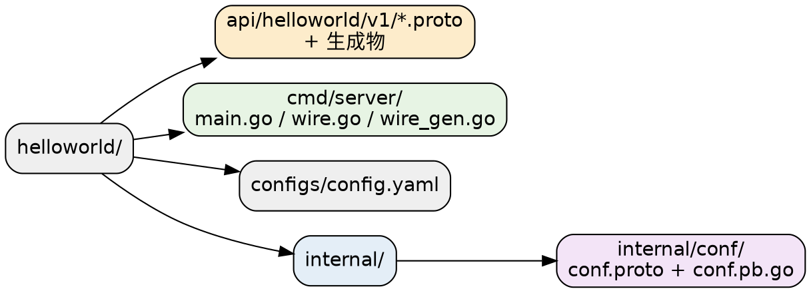
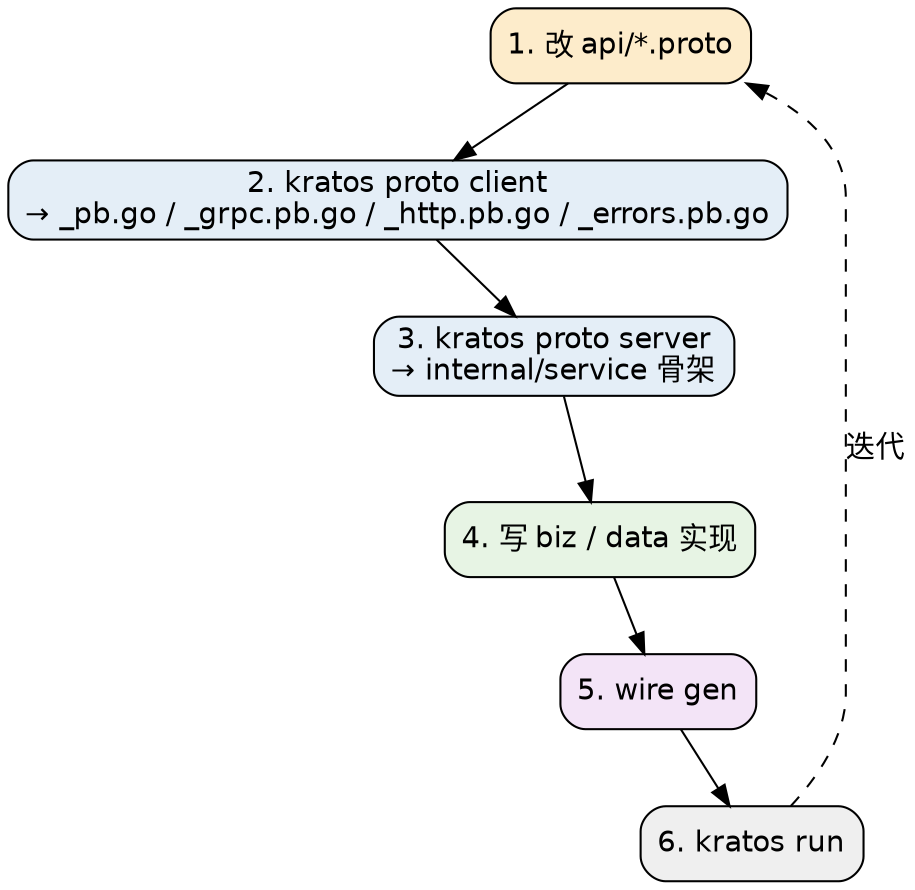

# Protobuf and Code Generation

本册讲 Kratos 的「API 先行」工作流：`kratos` CLI、`protoc-gen-go-http` 与 `protoc-gen-go-errors` 两个代码生成插件，以及官方 layout 骨架。**这是 Kratos 与其它 Go Web 框架差别最大的地方**——业务不是从 handler 写起，而是从 proto 写起。

## CLI

安装之后可用的一级命令只有 **5 个**（`cmd/kratos/main.go`）：`new`、`proto`、`upgrade`、`changelog`、`run`。

| 命令 | 作用 | 备注 |
| :-- | :-- | :-- |
| `new` | 从模板仓库创建项目 | 交互或 `--repo` 指定模板 |
| `proto add` | 生成一个 proto 模板文件 | |
| `proto client` | 调用 protoc 生成 Go/gRPC/HTTP/errors/OpenAPI 代码 | 检测到 validate import 时再生成 validate |
| `proto server` | 解析 proto 的 service/RPC，在 `internal/service` 生成实现骨架 | |
| `upgrade` | **升级 CLI 自身与各类插件**（执行 `go install ...@latest`） | 不是升级当前项目的依赖 |
| `changelog [latest\|dev\|version]` | 查 GitHub release / commit | 可用 `KRATOS_REPO` 或 `--repo-url` 改仓库 |
| `run [cmd-dir] -- [args]` | 在 `cmd/*` 下查找并执行 `go run` | `--work/-w` 改工作目录 |

> [!NOTE]
>
> `upgrade` 的语义最容易误解：它跑的是 `go install ...@latest`，更新的是 **CLI 本体、protoc-gen-go-http、protoc-gen-go-errors，以及官方 go/grpc/openapi 插件**，跟你的项目 go.mod 里的 kratos 依赖版本没关系。项目依赖该自己升级还是自己改。

CLI 本身的依赖很轻（`cmd/kratos/go.mod`）：`cobra v1.10.2`、`survey/v2 v2.3.7`、`charmbracelet/huh v1.0.0`（这两个做交互界面）、`emicklei/proto v1.14.3`（解析 proto）、`fatih/color v1.19.0`、`golang.org/x/mod v0.36.0`。**wire 和 protoc-gen-go 都不在这里**——它们是 `upgrade` 的安装目标而非编译依赖。

## kratos new

```bash
kratos new helloworld
kratos new helloworld -r https://github.com/go-kratos/kratos-layout.git
kratos new helloworld --branch v3.0.0
```

Flags：

| Flag | 默认 | 说明 |
| :-- | :-- | :-- |
| `--repo` / `-r` | 空 | 自定义模板 Git 仓库 URL；非空时跳过模板选择界面（v3.0.0 新增，#3789） |
| `--branch` / `-b` | **空字符串** | 模板仓库分支 |
| `--timeout` / `-t` | `"60s"` | 创建超时 |
| `--nomod` | false | 保留外层已有 Go module，把服务加进现有 module |

不传 `--repo` 时会进入交互选择，三个选项对应三个模板地址：

| 选项 | 仓库 |
| :-- | :-- |
| `Service` | `https://github.com/go-kratos/kratos-layout.git` |
| `Admin` | `https://github.com/go-kratos/kratos-admin.git` |
| `Custom` | 用户输入 |

生成过程除了复制模板，还会做两件事：替换 Go module 路径、把 `cmd/server` 重命名成项目名。

> [!NOTE]
>
> `--branch` 的**默认值是空字符串，不是 `main` 也不是 `v3`**。空值时执行的是普通 `git clone`，检出的是远程默认分支。虽然缓存目录名里带了 `@main`，但那不等于给 git 传了 `-b main`。想锁定 v3 模板请显式 `--branch v3.0.0`。

## protoc-gen-go-http

这个插件负责把 proto 里的 **HTTP 注解**（`google.api.http`）翻成 Kratos 的 HTTP handler 与路由注册代码。

### 它读什么

唯一读取的 protobuf extension 是 `annotations.E_Http`，即标准的 `google.api.http`。支持：

- `get` / `put` / `post` / `delete` / `patch` / `custom`（`custom.kind` + `custom.path`）；
- `body`、`response_body`、路径变量；
- `additional_bindings`（附加绑定先加入生成列表，主规则最后加入）。

> [!NOTE]
>
> 它**不读任何 Kratos 自定义的 proto 扩展**。所谓 `custom` 是 Google `HttpRule` 自带的 `Custom` 字段，不是 Kratos 发明的注解。这一点经常被人记错。

### 生成什么

输出文件名是 `file.GeneratedFilenamePrefix + "_http.pb.go"`——按 **proto 文件**而非 service 生成，同一 proto 里的多个 service 会落在同一个文件里。

产物包括：operation 常量、server 与 client 双端接口、注册函数、每个 binding 一个 handler wrapper、流式适配类型、以及 HTTP client 实现。

```go
type GreeterHTTPServer interface {
	SayHello(context.Context, *HelloRequest) (*HelloReply, error)
}

func RegisterGreeterHTTPServer(s *http.Server, srv GreeterHTTPServer) {
	r := s.Route("/")
	r.Handle("GET", "/helloworld/{name}", _Greeter_SayHello0_HTTP_Handler(srv))
}
```

核心的 unary wrapper（`httpTemplate.tpl`）：

```go
func _Greeter_SayHello0_HTTP_Handler(srv GreeterHTTPServer) func(ctx http.Context) error {
	return func(ctx http.Context) error {
		var in HelloRequest
		if err := ctx.BindQuery(&in); err != nil {
			return err
		}
		http.SetOperation(ctx, OperationGreeterSayHello)
		h := ctx.Middleware(func(ctx context.Context, req interface{}) (interface{}, error) {
			return srv.SayHello(ctx, req.(*HelloRequest))
		})
		out, err := h(ctx, &in)
		if err != nil {
			return err
		}
		reply := out.(*HelloReply)
		return ctx.Result(200, reply)
	}
}
```

这段代码解释了两件事：

1. **`ctx.Middleware(...)` 就是在这里被调用的**——这就是为什么生成的路由有中间件而手写的没有（见 [Transport_HTTP](/docs/CS/Go/Framework/Kratos/Transport_HTTP.md)）。
2. **`http.SetOperation(ctx, OperationGreeterSayHello)` 显式设置了 operation**，中间件匹配、熔断分组都依赖这个值。

### omitempty

默认 `--omitempty=true`：整个 proto 文件里没有任何 `google.api.http` 时**不生成** HTTP 文件。设成 `false` 时，无注解且非流式的 RPC 会生成默认的 POST 路由。

### 流式

- **客户端流式** → WebSocket，注册路由固定为 `GET`；
- **服务端流式** → Server-Sent Events。

## protoc-gen-go-errors

把 proto enum 上的错误定义生成 Go 侧的判断与构造函数。两个自定义扩展：

| 扩展 | 挂载目标 |
| :-- | :-- |
| `errors.default_code` | `google.protobuf.EnumOptions` |
| `errors.code` | `google.protobuf.EnumValueOptions` |

输出 `<proto-prefix>_errors.pb.go`。生成的**不是常量**，而是成对的函数：

```go
func IsUserNotFound(err error) bool {
	if err == nil {
		return false
	}
	e := errors.FromError(err)
	return e.Reason == ErrorReason_USER_NOT_FOUND.String() && e.Code == 404
}

func ErrorUserNotFound(format string, args ...interface{}) *errors.Error {
	return errors.New(404, ErrorReason_USER_NOT_FOUND.String(), fmt.Sprintf(format, args...))
}
```

code 的有效范围是 **1–600**：> 600 或 < 0 生成器直接 panic；code 为 0 的值跳过。模型细节见 [Errors_and_Validation](/docs/CS/Go/Framework/Kratos/Errors_and_Validation.md)。

## Third-party Protos

仓库自带 `third_party/`，供生成时 import：

- `google/api/`：`annotations.proto`、`client.proto`、`field_behavior.proto`、`http.proto`、`httpbody.proto`
- `google/protobuf/`：`descriptor.proto`
- `errors/errors.proto`：Kratos 的错误扩展定义
- `validate/validate.proto` 与 `buf/validate/validate.proto`：两套校验 proto（老的 PGV 与新的 protovalidate）

> [!NOTE]
>
> v3.0.0 的 `third_party/` 里**没有 openapiv2 proto**。

### buf 配置

根 `buf.yaml`：

```yaml
version: v2
modules:
  - path: .
    excludes:
      - cmd/protoc-gen-go-errors
      - third_party
lint:
  use:
    - DEFAULT
breaking:
  use:
    - FILE
```

根 `buf.gen.yaml` 只声明了本地 `protoc-gen-go`，输出到当前目录：

```yaml
version: v2
plugins:
  - local:
      - go
      - run
      - google.golang.org/protobuf/cmd/protoc-gen-go
    out: .
    opt:
      - paths=source_relative
```

> [!NOTE]
>
> 注意根 `buf.gen.yaml` 只管生成 `*.pb.go`，**没有声明 HTTP / gRPC / errors 插件**。这些插件是在 `kratos proto client` 命令里直接拼 protoc 参数调用的（`cmd/kratos/internal/proto/client/client.go`），不走 buf.gen.yaml。想用 buf 管理全链路得自己在项目里补齐。

## Project Layout

官方模板 `go-kratos/kratos-layout` 已发布 **v3.0.0** tag，依赖 `github.com/go-kratos/kratos/v3 v3.0.0` 与 `github.com/google/wire v0.6.0`——**layout 与本体同步升级到了 v3**。



`internal/` 下的四层是重点，分层原则（依赖倒置）详见 [Architecture](/docs/CS/Go/Framework/Kratos/Architecture.md)：

| 层 | 职责 |
| :-- | :-- |
| `internal/biz` | 实体定义、错误定义、**repository 接口**、usecase |
| `internal/data` | 实现 biz 的 repository 接口，管 DB / Redis / MQ 资源 |
| `internal/service` | 实现 proto 生成的 service 接口，调用 usecase |
| `internal/server` | 构造 HTTP / gRPC Server，注册 service |

> [!NOTE]
>
> 一个文档与实际的差异：**layout 的 README 目录说明里列出了 `third_party/`，但 v3.0.0 的实际目录树中没有它**（当前 `main` 也没有）。依赖 third_party proto 的话得自己从主仓库拷贝。这是 README 滞后于真实结构的例子。

## Wire

v3 layout **继续使用 Google Wire**，没有换成自有 DI。`cmd/server/` 下同时存在 `wire.go`（带 `//go:build wireinject`）与生成的 `wire_gen.go`。

```go
func wireApp(*conf.Server, *conf.Data, *slog.Logger) (*kratos.App, func(), error) {
	panic(wire.Build(server.ProviderSet, data.ProviderSet, biz.ProviderSet, service.ProviderSet, newApp))
}
```

每层暴露自己的 `ProviderSet`：

| 层 | ProviderSet 内容 |
| :-- | :-- |
| `server` | `NewGRPCServer`、`NewHTTPServer` |
| `data` | `NewData`、`NewTodoRepo` |
| `biz` | `NewTodoUsecase` |
| `service` | `NewTodoService` |

那个 `panic(...)` 不是 bug 而是 wire 的惯例：`wire.go` 正常编译时被 build tag 排除，只由 `wire gen` 读取用于分析依赖图。**Wire 是编译期代码生成而非运行时反射容器**——生成的 `wire_gen.go` 就是按拓扑序排好的手写式构造调用，没有 reflect 开销，缺失 provider 在编译期报错。

## Workflow Summary

完整的日常开发循环：



一句话总结这套工作流的取舍：**牺牲了「想到哪儿写到哪儿」的自由度，换来了「HTTP 与 gRPC 双协议 + 错误码 + 文档」从同一份契约自动产出的确定性**。服务数量少时这是负担，服务数量多时这是收益。

## Links

- [Kratos](/docs/CS/Go/Framework/Kratos.md)
- [Architecture](/docs/CS/Go/Framework/Kratos/Architecture.md)
- [Errors_and_Validation](/docs/CS/Go/Framework/Kratos/Errors_and_Validation.md)
- [Transport_HTTP](/docs/CS/Go/Framework/Kratos/Transport_HTTP.md)
- [Config](/docs/CS/Go/Framework/Kratos/Config.md)

## References

- <https://github.com/go-kratos/kratos-layout>
- <https://github.com/googleapis/googleapis/blob/master/google/api/http.proto>
- <https://buf.build/docs>
- <https://github.com/google/wire>
