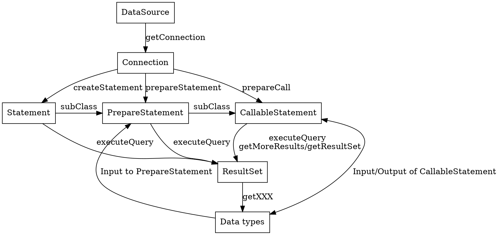

## Introduction

Java Database Connectivity（JDBC）是 Java SE 标准的数据库访问 API，定义于 `java.sql` 与 `javax.sql` 两包（模块 `java.sql` / `java.sql.rowset`）。它是一组**接口与规范**而非实现：应用面向 `Connection`/`Statement`/`ResultSet` 等接口编程，具体行为由各数据库厂商的驱动（Driver）在运行时提供。



## Specification Version

JDBC 规范由 JSR 221 维护，至今**最新版本仍是 JDBC 4.3（Java SE 9 引入），JDK 25 未再升级**——常见误解「每个 JDK 都会升 JDBC 版本」并不成立。

| JDBC 版本 | 所属 JDK | 关键新增 |
| --- | --- | --- |
| 1.0 / 1.1 | JDK 1.1 | 初版 |
| 2.0 / 2.1 | JDK 1.2 | `ResultSet` 滚动/更新、批处理 |
| 3.0 | J2SE 1.4 (JSR 54) | `Savepoint`、自增键 |
| 4.0 | Java SE 6 (JSR 221) | **Driver 经 ServiceLoader 自动加载**、`ROWID`、SQL/XML |
| 4.1 | Java SE 7 | `try-with-resources`、增强 `Date/Timestamp.valueOf` |
| 4.2 | Java SE 8 | `JDBCType` 枚举、`SQLType` 接口、REF CURSOR |
| **4.3** | **Java SE 9** | `ConnectionBuilder`/`ShardingKey`、`PooledConnectionBuilder`、分片支持 |

> 向后兼容：JDK 9+ 完全可用 4.2/4.1 驱动，只要不使用 4.3 新增方法。

## Architecture

JDBC 提供**两条**获取 `Connection` 的路径：

1. **`DriverManager`（遗留/简单场景）**：JDK 6 起 `java.sql.Driver` 实现通过 [SPI](/docs/CS/Java/JDK/Basic/SPI.md) 的 ServiceLoader 机制**自动注册**，无需 `Class.forName("xxx.Driver")`；`DriverManager.getConnection(url, user, pwd)` 按 URL 前缀匹配已注册驱动。
2. **`DataSource`（首选）**：工厂接口，返回的连接来自连接池或中间件，**不暴露驱动细节**。应用服务器/框架（如 [HikariCP](/docs/CS/Java/ConnectionPool/HiKariCP.md)、Tomcat JDBC Pool）注入 `DataSource` 即可。连接池的选型、参数与生命周期见 [ConnectionPool](/docs/CS/Java/ConnectionPool/ConnectionPool.md)。

```java
// 路径一：DriverManager（自动加载 Driver）
Connection c1 = DriverManager.getConnection(
    "jdbc:mysql://localhost:3306/app", "u", "p");

// 路径二：DataSource（连接池，首选）
HikariDataSource ds = new HikariDataSource();
ds.setJdbcUrl("jdbc:mysql://localhost:3306/app");
try (Connection c2 = ds.getConnection()) { /* ... */ }
```

`Connection.isClosed()` / `isValid(int timeout)` 用于探活；连接必须显式关闭（优先 `try-with-resources`，JDBC 4.1+ 的 `Connection` 实现了 `AutoCloseable`）。

It's safety to use `#{}` replace `${}` (MyBatis 语境下参数占位符防注入)。

## Statement Family

| 接口 | 用途 | 特点 |
| --- | --- | --- |
| `Statement` | 静态 SQL | 每次发送完整 SQL，易被注入 |
| `PreparedStatement` | 预编译参数化 SQL | **服务端预编译执行计划、参数占位符防注入** |
| `CallableStatement` | 调用存储过程 | 支持 `IN`/`OUT`/`INOUT` 参数 |

```java
String sql = "SELECT id, name FROM users WHERE age > ?";
try (PreparedStatement ps = conn.prepareStatement(sql)) {
    ps.setInt(1, 18);                  // 参数绑定，杜绝 SQL 注入
    try (ResultSet rs = ps.executeQuery()) {
        while (rs.next()) { /* rs.getInt("id") ... */ }
    }
}
```

`PreparedStatement` 的优势来自两点：**执行计划预编译**（性能）+ **参数与语句分离**（安全，等价于 MyBatis 的 `#{}`）。

## Transaction

`Connection` 默认 `autoCommit = true`（每条语句独立提交）。手动事务需关闭自动提交：

```java
conn.setAutoCommit(false);
try {
    // ... 多条 DML
    conn.commit();
} catch (SQLException e) {
    conn.rollback();   // 可传 Savepoint 做部分回滚
}
```

- **隔离级别**：`TRANSACTION_READ_UNCOMMITTED` / `READ_COMMITTED` / `REPEATABLE_READ` / `SERIALIZABLE`，经 `setTransactionIsolation` 设置（需驱动支持）。
- **`Savepoint`**（JDBC 3.0+）：`conn.setSavepoint()` 打点，`rollback(sp)` 回退到该点而不放弃整个事务。

## ResultSet

`ResultSet` 是查询返回的表状游标。关键维度：

| 维度 | 取值 | 说明 |
| --- | --- | --- |
| 可滚动性 | `TYPE_FORWARD_ONLY` / `TYPE_SCROLL_INSENSITIVE` / `TYPE_SCROLL_SENSITIVE` | 能否前后移动、是否反映并发修改 |
| 可更新性 | `CONCUR_READ_ONLY` / `CONCUR_UPDATABLE` | 能否通过 `updateRow` 写回 |
| 持有性 | `HOLD_CURSORS_OVER_COMMIT` / `CLOSE_CURSORS_AT_COMMIT` | 提交后游标是否仍可用 |

通过 `getInt/getString/getObject(...)` 按列名或列序取值；`SQLException` 容错由行号/类型映射决定。**游标必须在使用后关闭**，否则占用数据库资源。

## Exception Hierarchy

JDBC 异常以受检的 **`SQLException`** 为根，链式携带多条错误：

```java
catch (SQLException e) {
    for (Throwable t : e) {           // SQLException 实现 Iterable<Throwable>
        log.error(t.getMessage());
    }
    String sqlState  = e.getSQLState();  // 5 字符 X/Open 或 SQL:2003 码
    int    vendorCode = e.getErrorCode(); // 厂商特定错误码
}
```

- `SQLWarning`：**非致命**告警，经 `getWarnings()` 获取（不抛异常）。
- `BatchUpdateException`：批处理部分失败时携带已成功计数。
- `SQLTimeoutException`（JDBC 4.0+）：查询超时被单独归类。

## Type Mapping

JDBC 定义 SQL 类型 ↔ Java 类型的标准映射（`java.sql.Types` 常量）。JDBC 4.2 引入 `SQLType` 接口与 `JDBCType` 枚举，统一类型标识，避免魔法数字：

| SQL | Java | SQL | Java |
| --- | --- | --- | --- |
| `VARCHAR` | `String` | `BLOB` | `Blob` |
| `INTEGER` | `int` | `CLOB` | `Clob` |
| `DECIMAL` | `BigDecimal` | `TIMESTAMP` | `java.sql.Timestamp` |
| `DATE` | `java.sql.Date` | `ARRAY` / `STRUCT` | `Array` / `Struct` |

## javax.sql Extensions

`javax.sql` 把 JDBC 从「客户端 API」扩展为「服务端/企业级 API」：

- **连接池**：`DataSource` → `PooledConnection`（连接复用，应用拿到的 `Connection` 是逻辑代理，关闭即归还池）。
- **分布式事务**：`XADataSource` / `XAConnection` 接入 JTA 两阶段提交。
- **`RowSet`**：可断开（disconnected）的结果集，`CachedRowSet` 可在无连接时操作并写回；`javax.sql.rowset` 包提供 `WebRowSet`/`JoinRowSet` 等。

## JDBC and JNDI

在 Java EE / Jakarta EE 容器中，`DataSource` 通常由服务器声明并经由 **[JNDI](/docs/CS/Java/JDK/Basic/JNDI.md)** 暴露，应用只按名查找、不感知连接池配置：

```java
Context ctx = new InitialContext();
DataSource ds = (DataSource) ctx.lookup("java:comp/env/jdbc/AppDB");
```

这是 JDBC 与 JNDI 最典型的集成方式（详见 JNDI 篇的 DataSource 查找示例）。

## Links

- [JDK basics](/docs/CS/Java/JDK/Basic/Basic.md)
- [JNDI](/docs/CS/Java/JDK/Basic/JNDI.md)
- [Service Provider Interface](/docs/CS/Java/JDK/Basic/SPI.md)
- [MyBatis](/docs/CS/Framework/MyBatis/MyBatis.md)

## References

1. [JDBC 4.3 Specification (JSR 221 MR3)](https://jcp.org/en/jsr/detail?id=221)
2. [Package java.sql (Java SE 25)](https://docs.oracle.com/en/java/javase/25/docs/api/java.sql/java/sql/package-summary.html)
3. [Package javax.sql (Java SE 25)](https://docs.oracle.com/en/java/javase/25/docs/api/java.sql/javax/sql/package-summary.html)
