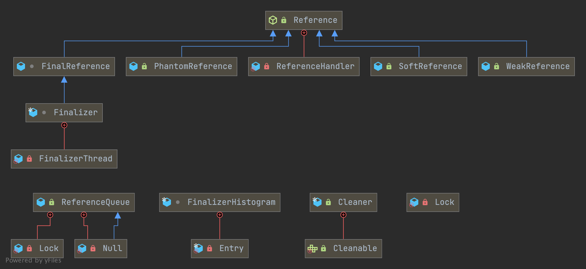

## Introduction

Java 在强引用之外提供 `SoftReference` / `WeakReference` / `PhantomReference`，以及用于 finalization 的 `FinalReference`，目的是把对象的生命周期管理与 GC 解耦，支撑内存敏感缓存、规范化映射（canonicalizing map）、堆外资源回收等场景。

- 强引用由语言默认提供，GC 不会主动回收其可达对象。
- 其余四种位于 `java.lang.ref` 包，与 GC 协同工作；`Reference` 抽象类不允许直接子类化（只能由 JDK 内部使用）。

Java 提供的引用类型（强引用无需显式定义）：

- **Strong**：普通 `Object o = new Object()`，可达即不回收。
- **Soft** (`SoftReference`)：内存不足时由 GC 按需清除，常用于内存敏感缓存。
- **Weak** (`WeakReference`)：下一次 GC 一旦判定 weakly reachable 即清除，常用于规范化映射（`WeakHashMap`）。
- **Phantom** (`PhantomReference`)：`get()` 恒返回 null，仅用于对象被回收前的 post-mortem 清理。
- **Final** (`FinalReference`)：为 finalization 机制服务，不由用户直接创建。

## Reference Class Hierarchy

<div style="text-align: center;">



</div>

<p style="text-align: center;">
Fig.1. Reference hierarchy.
</p>

调试开关（按 GC 阶段打印引用处理信息）：

```text
-XX:+PrintReferenceGC
-XX:+TraceReferenceGC
```

## Abstract Reference

`java.lang.ref.Reference<T>` 是所有引用对象的抽象基类，定义了引用对象共有的字段与状态机；它必须与垃圾收集器协同工作，因此不能被直接子类化。

```java
public abstract class Reference<T> {

    private T referent;         /* Treated specially by GC */

    volatile ReferenceQueue<? super T> queue;

    /* When active:   NULL
     *     pending:   this
     *    Enqueued:   next reference in queue (or this if last)
     *    Inactive:   this
     */
    @SuppressWarnings("rawtypes")
    volatile Reference next;

    /* When active:   next element in a discovered reference list maintained by GC (or this if last)
     *     pending:   next element in the pending list (or null if last)
     *   otherwise:   NULL
     */
    transient private Reference<T> discovered;  /* used by VM */


    /* Object used to synchronize with the garbage collector.  The collector
     * must acquire this lock at the beginning of each collection cycle.  It is
     * therefore critical that any code holding this lock complete as quickly
     * as possible, allocate no new objects, and avoid calling user code.
     */
    static private class Lock { }
    private static Lock lock = new Lock();


    /* List of References waiting to be enqueued.  The collector adds
     * References to this list, while the Reference-handler thread removes
     * them.  This list is protected by the above lock object. The
     * list uses the discovered field to link its elements.
     */
    private static Reference<Object> pending = null;
}
```

### Reference State

`Reference` 对象的状态由两个维度刻画：可达性维度为 `Active` / `Pending` / `Inactive`；队列维度为 `Registered` / `Enqueued` / `Dequeued` / `Unregistered`。

- **Active:** 受 GC 特殊处理。referent != null；discovered = null，或在 GC 的 discovered 链表中。
- **Pending:** pending-Reference 链表中的元素，等待 `ReferenceHandler` 线程处理；通过 discovered 字段串成链表。
- **Inactive:** 既非 Active 也非 Pending；referent = null。
- **Registered:** 创建时关联了队列，尚未入队；queue = 关联的队列。
- **Enqueued:** 已加入关联队列，尚未被取走；queue = `ReferenceQueue.ENQUEUE`；next = 链表下一节点或自身（尾）。
- **Dequeued:** 已入队并已被取走；queue = `ReferenceQueue.NULL`；next = this。
- **Unregistered:** 创建时未关联队列；queue = `ReferenceQueue.NULL`。

GC 只需检查 `referent` 与 `discovered` 两个字段即可判断一个（非 Final）Reference 是否需要特殊处理：referent 非 null 且未知存活 → 可能被 discover；discovered 非 null → 已被 discover。

`FinalReference`（为 finalization 服务）与其它引用不同：被 notify 时**不会**清除 referent，因此不能以 referent 是否为 null 区分 active/pending/inactive；其 `next` 在进入 pending 链表时被置为 `this`，需额外检查 `next == null` 才能确定 active。且 `FinalReference` 不支持 `enqueue()`。

```text
    /**
     * Initial states:
     *   [active/registered]
     *   [active/unregistered] [1]
     *
     * Transitions:
     *                            clear [2]
     *   [active/registered]     ------->   [inactive/registered]
     *          |                                 |
     *          |                                 | enqueue
     *          | GC              enqueue [2]     |
     *          |                -----------------|
     *          |                                 |
     *          v                                 |
     *   [pending/registered]    ---              v
     *          |                   | ReferenceHandler
     *          | enqueue [2]       |--->   [inactive/enqueued]
     *          v                   |             |
     *   [pending/enqueued]      ---              |
     *          |                                 | poll/remove
     *          | poll/remove                     | + clear [4]
     *          |                                 |
     *          v            ReferenceHandler     v
     *   [pending/dequeued]      ------>    [inactive/dequeued]
     *
     *
     *                           clear/enqueue/GC [3]
     *   [active/unregistered]   ------
     *          |                      |
     *          | GC                   |
     *          |                      |--> [inactive/unregistered]
     *          v                      |
     *   [pending/unregistered]  ------
     *                           ReferenceHandler
     *
     * Terminal states:
     *   [inactive/dequeued]
     *   [inactive/unregistered]
     *
     * Unreachable states (because enqueue also clears):
     *   [active/enqeued]
     *   [active/dequeued]
     *
     * [1] Unregistered is not permitted for FinalReferences.
     *
     * [2] These transitions are not possible for FinalReferences, making
     * [pending/enqueued], [pending/dequeued], and [inactive/registered]
     * unreachable.
     *
     * [3] The garbage collector may directly transition a Reference
     * from [active/unregistered] to [inactive/unregistered],
     * bypassing the pending-Reference list.
     *
     * [4] The queue handler for FinalReferences also clears the reference.
     */
```

## ReferenceHandler Thread

GC 发现引用对象可达性变化后，把它们挂到 pending 链表；`ReferenceHandler` 单线程循环把 pending 中的引用搬到对应的 `ReferenceQueue`。若该引用是 `Cleaner`，则直接调用 `Cleaner.clean()`（例如 `DirectByteBuffer` 的堆外内存在此释放，见 [Direct Buffer](/docs/CS/Java/JDK/IO/Direct_Buffer.md?id=cleaner)）。

### ReferenceHandler

```java
private static class ReferenceHandler extends Thread {

  private static void ensureClassInitialized(Class<?> clazz) {
    try {
      Class.forName(clazz.getName(), true, clazz.getClassLoader());
    } catch (ClassNotFoundException e) {
      throw (Error) new NoClassDefFoundError(e.getMessage()).initCause(e);
    }
  }

  static {
    // pre-load and initialize Cleaner class so that we don't
    // get into trouble later in the run loop if there's
    // memory shortage while loading/initializing it lazily.
    ensureClassInitialized(Cleaner.class);
  }

  ReferenceHandler(ThreadGroup g, String name) {
    super(g, null, name, 0, false);
  }

  public void run() {
    while (true) {
      processPendingReferences();
    }
  }
}
```

### processPendingReferences

```java
public abstract class Reference<T> {
  private static void processPendingReferences() {
    // Only the singleton reference processing thread calls
    // waitForReferencePendingList() and getAndClearReferencePendingList().
    // These are separate operations to avoid a race with other threads
    // that are calling waitForReferenceProcessing().
    waitForReferencePendingList();
    Reference<?> pendingList;
    synchronized (processPendingLock) {
      pendingList = getAndClearReferencePendingList();
      processPendingActive = true;
    }
    while (pendingList != null) {
      Reference<?> ref = pendingList;
      pendingList = ref.discovered;
      ref.discovered = null;

      if (ref instanceof Cleaner) {
        ((Cleaner) ref).clean();
        // Notify any waiters that progress has been made.
        // This improves latency for nio.Bits waiters, which
        // are the only important ones.
        synchronized (processPendingLock) {
          processPendingLock.notifyAll();
        }
      } else {
        ref.enqueueFromPending();
      }
    }
    // Notify any waiters of completion of current round.
    synchronized (processPendingLock) {
      processPendingActive = false;
      processPendingLock.notifyAll();
    }
  }
}
```

GC 侧的对象发现流程（HotSpot `referenceProcessor`）：GC 标记阶段找到引用对象 → 若需回收则加入 Discovered 链表（`referenceProcessor::process_discovered_references`）→ 把 Discovered 链表元素搬到 Pending 链表（`enqueue_discovered_ref_helper`）→ `ReferenceHandler` 把 Pending 搬到 `ReferenceQueue`。

## Strong Reference

强引用直接持有目标对象，只要强引用可达，对象就不会被回收。它是 Java 默认的对象访问方式，无需 `java.lang.ref` 中的任何类型。

## Soft Reference

软引用对象由 GC 在内存不足时按需清除，最常用于实现内存敏感缓存。当 GC 判定某对象 softly reachable 时，会原子清除到该对象及其 softly-reachable 闭包上的所有软引用，并随后把注册了队列的软引用入队。

规范保证：在 JVM 抛出 `OutOfMemoryError` 之前，所有软引用都已被清除；其余清除时机与顺序不受约束。但实现被鼓励偏向保留最近创建/使用的软引用（LRU 策略）。

```java
public class SoftReference<T> extends Reference<T> {

    // Timestamp clock, updated by the garbage collector
    static private long clock;

    /**
     * Timestamp updated by each invocation of the get method.  The VM may use
     * this field when selecting soft references to be cleared, but it is not
     * required to do so.
     */
    private long timestamp;

    // Creates a new soft reference that refers to the given object and is
    // registered with the given queue.
    public SoftReference(T referent, ReferenceQueue<? super T> q) {
        super(referent, q);
        this.timestamp = clock;
    }

    /**
     * Returns this reference object's referent.  If this reference object has
     * been cleared, either by the program or by the garbage collector, then
     * this method returns <code>null</code>.
     */
    public T get() {
        T o = super.get();
        if (o != null && this.timestamp != clock)
            this.timestamp = clock;
        return o;
    }

}
```

GC 处理软引用（HotSpot `referenceProcessor`）：遍历 discovered 链表，移除 referent 已死且按策略应保留的软引用，并对其余做 keep-alive。

```cpp
// referenceProcessor.cpp
size_t ReferenceProcessor::process_soft_ref_reconsider_work(DiscoveredList&    refs_list,
                                                            ReferencePolicy*   policy,
                                                            BoolObjectClosure* is_alive,
                                                            OopClosure*        keep_alive,
                                                            VoidClosure*       complete_gc) {
  DiscoveredListIterator iter(refs_list, keep_alive, is_alive);
  // Decide which softly reachable refs should be kept alive.
  while (iter.has_next()) {
    iter.load_ptrs(DEBUG_ONLY(!discovery_is_atomic() /* allow_null_referent */));
    bool referent_is_dead = (iter.referent() != NULL) && !iter.is_referent_alive();
    if (referent_is_dead &&
        !policy->should_clear_reference(iter.obj(), _soft_ref_clock)) {
      log_dropped_ref(iter, "by policy");
      // Remove Reference object from list
      iter.remove();
      // keep the referent around
      iter.make_referent_alive();
      iter.move_to_next();
    } else {
      iter.next();
    }
  }
  // Close the reachable set
  complete_gc->do_void();
  return iter.removed();
}
```

> 注：下文 `referencePolicy` 与 `init_statics` 片段来自早期 JDK 的 `referenceProcessor`（供理解策略设计，具体符号以所用 JDK 源码为准）。

### Reference Policy

`referencePolicy` 决定软引用何时被清除。Server 编译模式下使用 `LRUMaxHeapPolicy`，否则使用 `LRUCurrentHeapPolicy`。

```cpp
// referencePolicy.hpp
class NeverClearPolicy : public ReferencePolicy {
 public:
  virtual bool should_clear_reference(oop p, jlong timestamp_clock) {
    return false;
  }
};

class AlwaysClearPolicy : public ReferencePolicy {
 public:
  virtual bool should_clear_reference(oop p, jlong timestamp_clock) {
    return true;
  }
};

class LRUCurrentHeapPolicy : public ReferencePolicy {
 private:
  jlong _max_interval;
 public:
  LRUCurrentHeapPolicy();
  // state (of-the-VM) information needed to evaluate the policy
  void setup();
  virtual bool should_clear_reference(oop p, jlong timestamp_clock);
};

class LRUMaxHeapPolicy : public ReferencePolicy {
 private:
  jlong _max_interval;
 public:
  LRUMaxHeapPolicy();
  // state (of-the-VM) information needed to evaluate the policy
  void setup();
  virtual bool should_clear_reference(oop p, jlong timestamp_clock);
};
```

```cpp
// referenceProcessor.cpp
void ReferenceProcessor::init_statics() {
  // We need a monotonically non-decreasing time in ms but
  // os::javaTimeMillis() does not guarantee monotonicity.
  jlong now = os::javaTimeNanos() / NANOSECS_PER_MILLISEC;

  // Initialize the soft ref timestamp clock.
  _soft_ref_clock = now;
  // Also update the soft ref clock in j.l.r.SoftReference
  java_lang_ref_SoftReference::set_clock(_soft_ref_clock);

  _always_clear_soft_ref = new AlwaysClearPolicy();
  if (is_server_compilation_mode_vm()) {
    _default_soft_ref_policy = new LRUMaxHeapPolicy();
  } else {
    _default_soft_ref_policy = new LRUCurrentHeapPolicy();
  }
  if (_always_clear_soft_ref == NULL || _default_soft_ref_policy == NULL) {
    vm_exit_during_initialization("Could not allocate reference_policies object");
  }
  guarantee(RefDiscoveryPolicy == ReferenceBasedDiscovery ||
            RefDiscoveryPolicy == ReferentBasedDiscovery,
            "Unrecognized RefDiscoveryPolicy");
}
```

## Weak Reference

弱引用对象不会阻止其 referent 被置为 finalizable、复活并最终回收，最常用于实现规范化映射。`WeakHashMap` 的 key 即用弱引用，entry 在其 key 被回收后随之失效。

当 GC 判定对象 weakly reachable 时，原子清除到该对象及其 weakly-reachable 闭包上的所有弱引用，并随后把注册了队列的弱引用入队。

```java
public class WeakReference<T> extends Reference<T> {

    public WeakReference(T referent) {
        super(referent);
    }

    public WeakReference(T referent, ReferenceQueue<? super T> q) {
        super(referent, q);
    }

}
```

GC 处理软/弱/终引用共用的通用路径：移除 referent 已死或仍存活的引用，其余在 `do_enqueue_and_clear` 时清除并入队。

```cpp
size_t ReferenceProcessor::process_soft_weak_final_refs_work(DiscoveredList&    refs_list,
                                                             BoolObjectClosure* is_alive,
                                                             OopClosure*        keep_alive,
                                                             bool               do_enqueue_and_clear) {
  DiscoveredListIterator iter(refs_list, keep_alive, is_alive);
  while (iter.has_next()) {
    iter.load_ptrs(DEBUG_ONLY(!discovery_is_atomic() /* allow_null_referent */));
    if (iter.referent() == NULL) {
      // Reference has been cleared since discovery; only possible if
      // discovery is not atomic (checked by load_ptrs).  Remove
      // reference from list.
      log_dropped_ref(iter, "cleared");
      iter.remove();
      iter.move_to_next();
    } else if (iter.is_referent_alive()) {
      // The referent is reachable after all.
      // Remove reference from list.
      log_dropped_ref(iter, "reachable");
      iter.remove();
      // Update the referent pointer as necessary.  Note that this
      // should not entail any recursive marking because the
      // referent must already have been traversed.
      iter.make_referent_alive();
      iter.move_to_next();
    } else {
      if (do_enqueue_and_clear) {
        iter.clear_referent();
        iter.enqueue();
        log_enqueued_ref(iter, "cleared");
      }
      // Keep in discovered list
      iter.next();
    }
  }
  if (do_enqueue_and_clear) {
    iter.complete_enqueue();
    refs_list.clear();
  }
  return iter.removed();
}
```

## Phantom Reference

虚引用对象的 `get()` 始终返回 null；当 GC 判定对象 phantom reachable 时，会原子清除该虚引用并随后入队（见 `java.lang.ref.PhantomReference` 文档）。它最常用于对象被回收前的 post-mortem 清理，且由于 `get()` 恒返回 null，不会意外令已"死亡"的对象复活。

```java
public class PhantomReference<T> extends Reference<T> {
    public T get() {
        return null;
    }

    public PhantomReference(T referent, ReferenceQueue<? super T> q) {
        super(referent, q);
    }

}
```

GC 处理虚引用：referent 为 null 或仍存活则移除，否则清除并入队。

```cpp
size_t ReferenceProcessor::process_phantom_refs_work(DiscoveredList&    refs_list,
                                          BoolObjectClosure* is_alive,
                                          OopClosure*        keep_alive,
                                          VoidClosure*       complete_gc) {
  DiscoveredListIterator iter(refs_list, keep_alive, is_alive);
  while (iter.has_next()) {
    iter.load_ptrs(DEBUG_ONLY(!discovery_is_atomic() /* allow_null_referent */));

    oop const referent = iter.referent();

    if (referent == NULL || iter.is_referent_alive()) {
      iter.make_referent_alive();
      iter.remove();
      iter.move_to_next();
    } else {
      iter.clear_referent();
      iter.enqueue();
      log_enqueued_ref(iter, "cleared Phantom");
      iter.next();
    }
  }
  iter.complete_enqueue();
  // Close the reachable set; needed for collectors which keep_alive_closure do
  // not immediately complete their work.
  complete_gc->do_void();
  refs_list.clear();

  return iter.removed();
}
```

```cpp
void DiscoveredListIterator::complete_enqueue() {
  if (_prev_discovered != NULL) {
    // This is the last object.
    // Swap refs_list into pending list and set obj's
    // discovered to what we read from the pending list.
    oop old = Universe::swap_reference_pending_list(_refs_list.head());
    HeapAccess<AS_NO_KEEPALIVE>::oop_store_at(_prev_discovered, java_lang_ref_Reference::discovered_offset, old);
  }
}
```

## Final Reference

终引用用于实现 finalization 机制。与其它引用不同，它不支持 `enqueue()`，被 notify 时也不清除 referent。

```java
class FinalReference<T> extends Reference<T> {

    public FinalReference(T referent, ReferenceQueue<? super T> q) {
        super(referent, q);
    }

    @Override
    public boolean enqueue() {
        throw new InternalError("should never reach here");
    }
}
```

### Finalizer

`Finalizer` 与 `Reference` 同包（package-private），由 VM 在对象创建/初始化时注册。

```java
final class Finalizer extends FinalReference<Object> {

    private static ReferenceQueue<Object> queue = new ReferenceQueue<>();

    /** Head of doubly linked list of Finalizers awaiting finalization. */
    private static Finalizer unfinalized = null;

    /** Lock guarding access to unfinalized list. */
    private static final Object lock = new Object();

    private Finalizer next, prev;


    static {
        ThreadGroup tg = Thread.currentThread().getThreadGroup();
        for (ThreadGroup tgn = tg;
             tgn != null;
             tg = tgn, tgn = tg.getParent())
            ;
        Thread finalizer = new FinalizerThread(tg);
        finalizer.setPriority(Thread.MAX_PRIORITY - 2);
        finalizer.setDaemon(true);
        finalizer.start();
    }

    /* Invoked by VM */
    static void register(Object finalizee) {
        new Finalizer(finalizee);
    }

    private Finalizer(Object finalizee) {
        super(finalizee, queue);
        // push onto unfinalized
        synchronized (lock) {
            if (unfinalized != null) {
                this.next = unfinalized;
                unfinalized.prev = this;
            }
            unfinalized = this;
        }
    }

    static ReferenceQueue<Object> getQueue() {
        return queue;
    }
}
```

#### register_finalizer

在 `Object.<init>` 默认路径（或分配后）通过 `InterpreterRuntime::register_finalizer` 调用 `Finalizer#register()`。

```cpp
IRT_ENTRY(void, InterpreterRuntime::register_finalizer(JavaThread* thread, oopDesc* obj))
  InstanceKlass::register_finalizer(instanceOop(obj), CHECK);
IRT_END
```

注册时机：

- `Object.<init>`（默认路径）
- 或分配之后

```text
-XX:+/-RegisterFinalizersAtInit
```

```cpp
// instanceKlass.cpp
instanceOop InstanceKlass::allocate_instance(TRAPS) {
  bool has_finalizer_flag = has_finalizer(); // Query before possible GC
  int size = size_helper();  // Query before forming handle.

  instanceOop i;

  i = (instanceOop)Universe::heap()->obj_allocate(this, size, CHECK_NULL);
  if (has_finalizer_flag && !RegisterFinalizersAtInit) {
    i = register_finalizer(i, CHECK_NULL);
  }
  return i;
}
```

```cpp
instanceOop InstanceKlass::register_finalizer(instanceOop i, TRAPS) {
  instanceHandle h_i(THREAD, i);
  // Pass the handle as argument, JavaCalls::call expects oop as jobjects
  JavaValue result(T_VOID);
  JavaCallArguments args(h_i);
  methodHandle mh (THREAD, Universe::finalizer_register_method());
  JavaCalls::call(&result, mh, &args, CHECK_NULL);
  return h_i();
}
```

### FinalizerThread

```java
private static class FinalizerThread extends Thread {
        private volatile boolean running;
        FinalizerThread(ThreadGroup g) {
            super(g, null, "Finalizer", 0, false);
        }
        public void run() {
            // in case of recursive call to run()
            if (running)
                return;

            // Finalizer thread starts before System.initializeSystemClass
            // is called.  Wait until JavaLangAccess is available
            while (VM.initLevel() == 0) {
                // delay until VM completes initialization
                try {
                    VM.awaitInitLevel(1);
                } catch (InterruptedException x) {
                    // ignore and continue
                }
            }
            final JavaLangAccess jla = SharedSecrets.getJavaLangAccess();
            running = true;
            for (;;) {
                try {
                    Finalizer f = (Finalizer)queue.remove();
                    f.runFinalizer(jla);
                } catch (InterruptedException x) {
                    // ignore and continue
                }
            }
        }
    }
```

#### runFinalizer

通过 `JavaLangAccess#invokeFinalize()` 执行 `finalize`；执行后把 referent 置 null，保证 `finalize` 不会被调用两次。

```java
final class Finalizer extends FinalReference<Object> {
    private void runFinalizer(JavaLangAccess jla) {
        synchronized (lock) {
            if (this.next == this)      // already finalized
                return;
            // unlink from unfinalized
            if (unfinalized == this)
                unfinalized = this.next;
            else
                this.prev.next = this.next;
            if (this.next != null)
                this.next.prev = this.prev;
            this.prev = null;
            this.next = this;           // mark as finalized
        }

        try {
            Object finalizee = this.get();
            if (finalizee != null && !(finalizee instanceof java.lang.Enum)) {
                jla.invokeFinalize(finalizee); // Invokes the finalize method of the given object.

                // Clear stack slot containing this variable, to decrease the chances of false retention with a conservative GC
                finalizee = null;
            }
        } catch (Throwable x) {
        }
        super.clear();
    }
}
```

GC 处理 Final 引用的 keep-alive 阶段（保留 referent 及其 follower，等待 FinalizerThread 执行 finalize）：

```cpp
size_t ReferenceProcessor::process_final_keep_alive_work(DiscoveredList& refs_list,
                                                         OopClosure*     keep_alive,
                                                         VoidClosure*    complete_gc) {
  DiscoveredListIterator iter(refs_list, keep_alive, NULL);
  while (iter.has_next()) {
    iter.load_ptrs(DEBUG_ONLY(false /* allow_null_referent */));
    // keep the referent and followers around
    iter.make_referent_alive();

    // Self-loop next, to mark the FinalReference not active.
    java_lang_ref_Reference::set_next_raw(iter.obj(), iter.obj());

    iter.enqueue();
    log_enqueued_ref(iter, "Final");
    iter.next();
  }
  iter.complete_enqueue();
  // Close the reachable set
  complete_gc->do_void();
  refs_list.clear();

  return iter.removed();
}
```

## Cleaner

`Cleaner` 继承 `PhantomReference<Object>`，用于在对象回收前执行一段清理动作（如释放堆外内存）。它注册了一个"哑"队列：因为 `ReferenceHandler` 会显式调用 `Cleaner.clean()`，引用本身永远不会进入该队列。

```java
public class Cleaner
    extends PhantomReference<Object>
{

    // Dummy reference queue, needed because the PhantomReference constructor
    // insists that we pass a queue.  Nothing will ever be placed on this queue
    // since the reference handler invokes cleaners explicitly.
    //
    private static final ReferenceQueue<Object> dummyQueue = new ReferenceQueue<>();

    // Doubly-linked list of live cleaners, which prevents the cleaners
    // themselves from being GC'd before their referents
    //
    static private Cleaner first = null;

    private Cleaner
        next = null,
        prev = null;

    private static synchronized Cleaner add(Cleaner cl) {
        if (first != null) {
            cl.next = first;
            first.prev = cl;
        }
        first = cl;
        return cl;
    }

    private static synchronized boolean remove(Cleaner cl) {

        // If already removed, do nothing
        if (cl.next == cl)
            return false;

        // Update list
        if (first == cl) {
            if (cl.next != null)
                first = cl.next;
            else
                first = cl.prev;
        }
        if (cl.next != null)
            cl.next.prev = cl.prev;
        if (cl.prev != null)
            cl.prev.next = cl.next;

        // Indicate removal by pointing the cleaner to itself
        cl.next = cl;
        cl.prev = cl;
        return true;
    }

    private final Runnable thunk;

    private Cleaner(Object referent, Runnable thunk) {
        super(referent, dummyQueue);
        this.thunk = thunk;
    }

    /**
     * Creates a new cleaner.
     */
    public static Cleaner create(Object ob, Runnable thunk) {
        if (thunk == null)
            return null;
        return add(new Cleaner(ob, thunk));
    }

    /**
     * Runs this cleaner, if it has not been run before.
     */
    public void clean() {
        if (!remove(this))
            return;
        try {
            thunk.run();
        } catch (final Throwable x) {
            AccessController.doPrivileged(new PrivilegedAction<Void>() {
                    public Void run() {
                        if (System.err != null)
                            new Error("Cleaner terminated abnormally", x)
                                .printStackTrace();
                        System.exit(1);
                        return null;
                    }});
        }
    }

}
```

## ReferenceProcessor (GC Side)

GC 侧的 `ReferenceProcessor` 负责发现（discover）与处理（process）引用对象。下面两段来自 HotSpot，展示发现策略与处理编排。引用处理在 GC 整体流程中的位置，见 [GC 中的引用处理阶段](/docs/CS/Java/JDK/JVM/GC/GC.md?id=reference-processing)。

### discover_reference

发现策略有两种：`ReferenceBasedDiscovery`（引用对象必须位于正在收集的代/span 内）与 `ReferentBasedDiscovery`（引用对象可在任意代，只要其 referent 位于正在收集的 span 内即可更早被发现）。

```cpp
bool ReferenceProcessor::discover_reference(oop obj, ReferenceType rt) {
  // Make sure we are discovering refs (rather than processing discovered refs).
  if (!_discovering_refs || !RegisterReferences) {
    return false;
  }

  if ((rt == REF_FINAL) && (java_lang_ref_Reference::next(obj) != NULL)) {
    // Don't rediscover non-active FinalReferences.
    return false;
  }

  if (RefDiscoveryPolicy == ReferenceBasedDiscovery &&
      !is_subject_to_discovery(obj)) {
    // Reference is not in the originating generation;
    // don't treat it specially (i.e. we want to scan it as a normal
    // object with strong references).
    return false;
  }

  // We only discover references whose referents are not (yet)
  // known to be strongly reachable.
  if (is_alive_non_header() != NULL) {
    verify_referent(obj);
    oop referent = java_lang_ref_Reference::unknown_referent_no_keepalive(obj);
    if (is_alive_non_header()->do_object_b(referent)) {
      return false;  // referent is reachable
    }
  }
  if (rt == REF_SOFT) {
    // For soft refs we can decide now if these are not
    // current candidates for clearing, in which case we
    // can mark through them now, rather than delaying that
    // to the reference-processing phase.
    if (!_current_soft_ref_policy->should_clear_reference(obj, _soft_ref_timestamp_clock)) {
      return false;
    }
  }

  ResourceMark rm;      // Needed for tracing.

  HeapWord* const discovered_addr = java_lang_ref_Reference::discovered_addr_raw(obj);
  const oop  discovered = java_lang_ref_Reference::discovered(obj);
  assert(oopDesc::is_oop_or_null(discovered), "Expected an oop or NULL for discovered field at " PTR_FORMAT, p2i(discovered));
  if (discovered != NULL) {
    // The reference has already been discovered...
    log_develop_trace(gc, ref)("Already discovered reference (" INTPTR_FORMAT ": %s)",
                               p2i(obj), obj->klass()->internal_name());
    if (RefDiscoveryPolicy == ReferentBasedDiscovery) {
      // assumes that an object is not processed twice;
      // if it's been already discovered it must be on another
      // generation's discovered list; so we won't discover it.
      return false;
    } else {
      assert(RefDiscoveryPolicy == ReferenceBasedDiscovery,
             "Unrecognized policy");
      // Check assumption that an object is not potentially
      // discovered twice except by concurrent collectors that potentially
      // trace the same Reference object twice.
      assert(UseG1GC, "Only possible with a concurrent marking collector");
      return true;
    }
  }

  if (RefDiscoveryPolicy == ReferentBasedDiscovery) {
    verify_referent(obj);
    // Discover if and only if EITHER:
    // .. reference is in our span, OR
    // .. we are a stw discoverer and referent is in our span
    if (is_subject_to_discovery(obj) ||
        (discovery_is_stw() &&
         is_subject_to_discovery(java_lang_ref_Reference::unknown_referent_no_keepalive(obj)))) {
      // discover
    } else {
      return false;
    }
  } else {
    assert(RefDiscoveryPolicy == ReferenceBasedDiscovery &&
           is_subject_to_discovery(obj), "code inconsistency");
  }

  // Get the right type of discovered queue head.
  DiscoveredList* list = get_discovered_list(rt);
  if (list == NULL) {
    return false;   // nothing special needs to be done
  }

  add_to_discovered_list(*list, obj, discovered_addr);

  assert(oopDesc::is_oop(obj), "Discovered a bad reference");
  verify_referent(obj);
  return true;
}
```

### process_discovered_references

```cpp
ReferenceProcessorStats ReferenceProcessor::process_discovered_references(RefProcProxyTask& proxy_task,
                                                                          ReferenceProcessorPhaseTimes& phase_times) {

  double start_time = os::elapsedTime();

  // Stop treating discovered references specially.
  disable_discovery();

  phase_times.set_ref_discovered(REF_SOFT, total_count(_discoveredSoftRefs));
  phase_times.set_ref_discovered(REF_WEAK, total_count(_discoveredWeakRefs));
  phase_times.set_ref_discovered(REF_FINAL, total_count(_discoveredFinalRefs));
  phase_times.set_ref_discovered(REF_PHANTOM, total_count(_discoveredPhantomRefs));

  update_soft_ref_master_clock();

  phase_times.set_processing_is_mt(processing_is_mt());

  {
    RefProcTotalPhaseTimesTracker tt(SoftWeakFinalRefsPhase, &phase_times);
    process_soft_weak_final_refs(proxy_task, phase_times);
  }

  {
    RefProcTotalPhaseTimesTracker tt(KeepAliveFinalRefsPhase, &phase_times);
    process_final_keep_alive(proxy_task, phase_times);
  }

  {
    RefProcTotalPhaseTimesTracker tt(PhantomRefsPhase, &phase_times);
    process_phantom_refs(proxy_task, phase_times);
  }

  phase_times.set_total_time_ms((os::elapsedTime() - start_time) * 1000);

  // Elements on discovered lists were pushed to the pending list.
  verify_no_references_recorded();

  ReferenceProcessorStats stats(phase_times.ref_discovered(REF_SOFT),
                                phase_times.ref_discovered(REF_WEAK),
                                phase_times.ref_discovered(REF_FINAL),
                                phase_times.ref_discovered(REF_PHANTOM));
  return stats;
}
```

## Summary

| Reference Type | Cleared when | Enqueued on GC | `get()` returns | Typical use |
| - | --------------- | ------------------ | ---------------------- | ----- |
| Strong | never (while strongly reachable) | no | the object | normal object access |
| Soft | on memory demand (LRU-biased) | yes (if registered) | object or null | memory-sensitive cache |
| Weak | on next GC after weakly reachable | yes (if registered) | object or null | canonicalizing map (`WeakHashMap`) |
| Phantom | when phantom reachable (atomically) | yes (if registered) | always null | post-mortem cleanup |
| Final | not cleared (for finalization) | no (`Finalizer` queue) | object | `finalize()` mechanism |

## Links

- [JDK basics](/docs/CS/Java/JDK/Basic/Basic.md)
- [Garbage Collector](/docs/CS/Java/JDK/JVM/GC/GC.md)
- [Direct Buffer](/docs/CS/Java/JDK/IO/Direct_Buffer.md)
- [ClassLoader](/docs/CS/Java/JDK/JVM/ClassLoader.md)

## References

- [Java引用类型原理剖析](https://github.com/farmerjohngit/myblog/issues/10)
- [Reference (Java SE 25 API)](https://docs.oracle.com/en/java/javase/25/docs/api/java.base/java/lang/ref/Reference.html)
- [PhantomReference (Java SE 25 API)](https://docs.oracle.com/en/java/javase/25/docs/api/java.base/java/lang/ref/PhantomReference.html)
