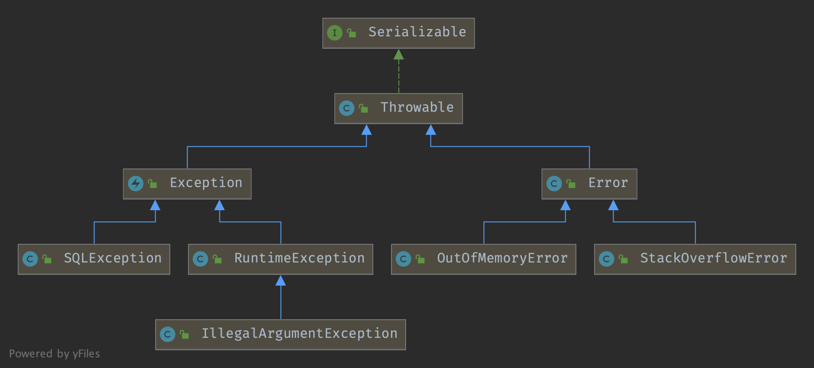

## Introduction

Java 用 `Throwable` 统一表示「可被抛出」的对象，其下分为 **`Error`**（严重、通常不可恢复、不应被捕获）与 **`Exception`**（程序可合理处理的异常条件）。`Exception` 又分**受检（checked）**与 **`RuntimeException`（非受检，unchecked）**。`NullPointerException` 是日常最高频的 unchecked 异常——Java 层面的 NPE 分为两类：代码中主动抛出并被 JVM 捕获，或隐式 NPE（JVM 内部遇空指针访问产生 SIGSEGV，再在运行时检查处理）。



## Hierarchy

```text
Throwable
├── Error                 （严重错误，非代码性，不应捕获/实现子类）
│   └── VirtualMachineError
│       ├── StackOverflowError
│       ├── OutOfMemoryError
│       ├── InternalError
│       └── UnknownError
└── Exception
    ├── RuntimeException  （unchecked：编程错误）
    │   ├── NullPointerException
    │   ├── IllegalArgumentException
    │   ├── IllegalStateException
    │   └── ...
    └── 受检异常（checked：可合理恢复）
        ├── IOException
        ├── SQLException
        └── ...
```

`NullPointerException` 的规避：用 `==`/`!=` 显式判空，或用 `Optional` 包装；对集合/流处理优先用 `Objects.requireNonNull` 或 `Optional`。

## Error and Its Subclasses

`Error` 类及其子类表示运行应用中出现的严重错误，是非受检且非代码性的——应用程序既不应捕获也不应实现新的 `Error` 子类。最关心的是 `VirtualMachineError` 与其下的 `OutOfMemoryError` 家族。

`OutOfMemoryError` 的细分与排查方向：

| 错误信息 | 触发原因 | 排查方向 |
| --- | --- | --- |
| `Java heap space` | 堆对象过多/泄漏，GC 无法回收 | 堆转储、对象保留链分析 |
| `unable to create native thread` | 线程数达 OS/`ulimit` 上限 | 减小线程栈、限流、改用虚拟线程 |
| `GC Overhead limit exceeded` | GC 耗时占比过高而回收极少 | 内存泄漏、调大堆 |
| `Direct buffer memory` | 堆外 `DirectByteBuffer` 超限（`-XX:MaxDirectMemorySize`） | 减少直接缓冲、显式 `cleaner` |
| `Map failed` | `FileChannel.map` 系统内存不足 | 文件分块、减小单次 mmap 大小 |
| `Requested array size exceeds VM limit` | 申请数组超堆限制 | 改分批/流式处理 |
| `Metaspace` / `Compressed class space` | 类元数据/Klass 占用超限 | 类加载泄漏、调大 `-XX:MaxMetaspaceSize` |
| `reason: stack_trace_with_native_method` | JNI 调用中内存不足 | native 内存排查 |

> 打开 `-XX:+HeapDumpOnOutOfMemoryError` 后，并非所有 `OutOfMemoryError` 都会触发堆转储（例如由 JNI/native 侧触发的部分类型不会）。

`StackOverflowError` 多因递归过深，修改代码解决；若调用栈确实过深（如 Netty + Reactor 的回调背压模型），需调大线程栈。

## Checked vs Unchecked

Effective Java 的设计哲学：

- **用受检异常表达可合理恢复的条件**（调用方应当且能够处理）；**用运行时异常表示编程错误**。
- 所有自定义的 unchecked throwable 都应继承 `RuntimeException`。
- 避免不必要的受检异常（过重的负担会迫使调用方吞噬或包装）；优先使用标准异常（`IllegalArgumentException`、`IllegalStateException`、`NullPointerException`、`UnsupportedOperationException`）；API 应声明每个受检异常（`@throws` 精确描述条件），uncheck 异常只用文档而非 `throws`。
- 异常只应用于异常条件，绝不当普通控制流；文档化每个方法抛出的异常；失败原子性（failed invocation 后应让对象保持调用前状态）；忽略异常时 `catch` 块需注释理由且变量命名 `ignored`。

## Chained Exceptions

异常链（cause）让底层异常被包装进高层异常而不丢失根因：

```java
try {
    lowLevelOp();
} catch (LowerException e) {
    throw new HigherException("context", e);   // 通过构造器或 initCause 设置 cause
}
```

`Throwable.getCause()` 沿链回溯，`Throwable(Throwable cause)` 与 `initCause` 建立链接；标准受检/非受检异常大多提供带 `cause` 的构造器。日志与框架（如 Spring 的 `ApplicationContextException`）据此保留完整根因栈。

## Suppressed Exceptions

`try-with-resources` 关闭资源时若抛出异常，原异常（被抑制）会通过 `addSuppressed` 挂到主异常上，而非被覆盖：

```java
try (Resource r = open()) {
    r.use();          // 假设此处抛主异常
} catch (Exception e) {
    for (Throwable s : e.getSuppressed()) { /* 关闭阶段被抑制的异常 */ }
}
```

> [!TIP]
> 不要在 `finally` 中 `throw new Exception` 掩盖原异常；正确做法是让 try-with-resources 自动 `addSuppressed`，或用显式 `addSuppressed` 收集。

## finally and Control Flow

`finally` 的语义存在隐蔽陷阱：若 `finally` 块中含 `return` 或 `throw`，它会**抑制** try/catch 中待传播的值（异常屏蔽），这与 [semantics](/docs/CS/Java/JDK/Basic/semantics.md) 中「异常屏蔽」规则同源。因此 `finally` 只应用于资源清理，绝不承载返回值或异常。

## Creating and Throwing

异常实例的构造十分昂贵：构造时需生成**栈轨迹（stack trace）**，逐一访问当前线程 Java 栈帧并记录调试信息（方法名、类名、文件名、行号）。`Throwable.fillInStackTrace` 会忽略异常构造器与填充栈帧的 Java 方法，从新建位置算起，并忽略标记为不可见的栈帧。

可缓存异常实例复用（如静态常量），但会让栈轨迹指向复用点，可能误导定位。

在编译生成的字节码中，每个方法都附带**异常表**，每个条目含 `from`/`to`/`target` 指针与捕获类型（值为 bytecode index）。触发异常时 JVM 自上而下遍历异常表，匹配则跳转 `target`；遍历完仍未匹配则弹栈并在调用者重复，最坏情况遍历整条调用栈。解释器侧 `athrow` 实现：

```cpp
// Exceptions
void TemplateTable::athrow() {
  transition(atos, vtos);
  __ null_check(rax);
  __ jump(ExternalAddress(Interpreter::throw_exception_entry()));
}
```

## InterruptedException

见 [Interrupts](/docs/CS/Java/JDK/Concurrency/Thread.md?id=interruptions) in Thread：阻塞方法（`Object.wait`/`Thread.sleep`/`BlockingQueue.take` 等）在中断时被唤醒并清除中断状态、抛出此异常，调用方应据需恢复中断标志或向上传递。

## Tips for Using Exceptions

Effective Java（Item 64–73）要点摘录：

1. 异常处理不应替代简单测试。
2. 不要过度微观管理异常（不要为每条语句单独 try）。
3. 善用异常体系层级。
4. 不要压制异常（squelch）。
5. 检测到错误时「严厉之爱」优于纵容。
6. 传播异常不是羞耻。
7. 用标准方法报告 NPE / 越界异常。
8. 不要把栈轨迹展示给终端用户。

## Links

- [JDK basics](/docs/CS/Java/JDK/Basic/Basic.md)

## References

1. [Checked exceptions: Java’s biggest mistake](http://literatejava.com/exceptions/checked-exceptions-javas-biggest-mistake/)
2. [Java Language Specification — Chapter 11 Exceptions](https://docs.oracle.com/javase/specs/jls/se25/html/jls-11.html)
