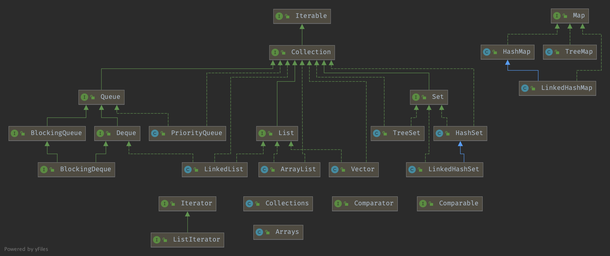
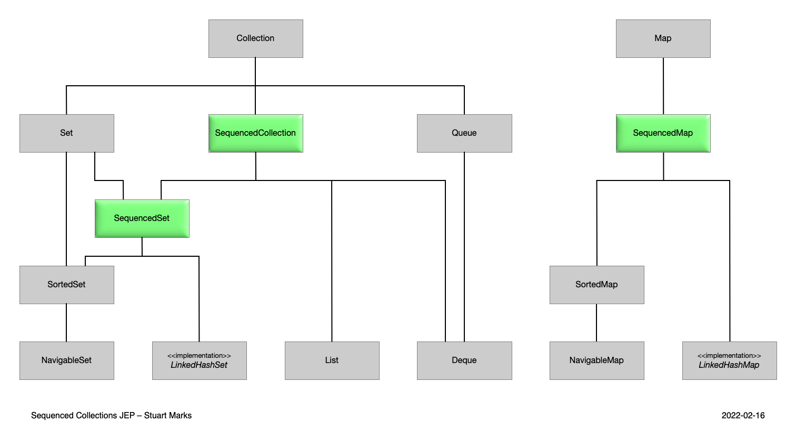

## Introduction

集合就是一个放数据的容器，准确的说是放数据对象引用的容器
集合类存放的都是对象的引用，而不是对象的本身
集合类型主要有3种：set(集）、list(列表）和map(映射)

数组与集合区别

- 数组长度是固定的 集合长度可以动态扩展或缩小
- 数组可以包含基本数据类型和对象，而集合只能包含对象
- 数组可以直接访问元素 集合需要迭代器或者其它方式来访问
- 数组存储的元素必须是同一个数据类型；集合存储的对象可以是不同数据类型


与现代数据结构库常见的做法一样，Java 集合库将接口和实现分开
常见的集合类关系图如下:

<div style="text-align: center;">



</div>

<p style="text-align: center;">Fig.1. Collection</p>

Map接口和Collection接口是所有集合框架的父接口

[List](/docs/CS/Java/JDK/Collection/List.md) 是有序的Collection，使用此接口能够精确的控制每个元素的插入位置, 用户能根据索引访问List中元素
常用的实现List的类有LinkedList，ArrayList，Vector，Stack

[Set](/docs/CS/Java/JDK/Collection/Set.md) 不允许存在重复的元素，与List不同，set中的元素是无序的 
常用的实现有 HashSet、LinkedHashSet 和 TreeSet

[Queue](/docs/CS/Java/JDK/Collection/Queue.md) 是一种特殊的线性表 只允许 FIFO 操作


[Map](/docs/CS/Java/JDK/Collection/Map.md) 是一个键值对集合，存储键、值和之间的映射。Key 无序，唯一；value 不要求有序，允许重复

Map 没有继承于 Collection 接口，通过Key从 Map 集合中检索出Value 
主要实现有 HashMap、ConcurrentHashMap、LinkedHashMap、TreeMap、EnumMap 和 HashTable


## Iterable

```java
public interface Iterable<T> {

    Iterator<T> iterator();

    default void forEach(Consumer<? super T> action) {
        Objects.requireNonNull(action);
        for (T t : this) {
            action.accept(t);
        }
    }

    default Spliterator<T> spliterator() {
        return Spliterators.spliteratorUnknownSize(iterator(), 0);
    }
}
```

### Iterator

```java
public interface Iterator<E> {

    boolean hasNext();

    E next();

    default void remove() {
        throw new UnsupportedOperationException("remove");
    }

    default void forEachRemaining(Consumer<? super E> action) {
        Objects.requireNonNull(action);
        while (hasNext())
            action.accept(next());
    }
}
```

### ListIterator

*An iterator for lists that allows the programmer to **traverse the list in either direction, modify the list during iteration**, and **obtain the iterator's current position in the list**.
A ListIterator has no current element; its cursor position always lies between the element that would be returned by a call to previous() and the element that would be returned by a call to next().
**An iterator for a list of length n has n+1 possible cursor positions**, as illustrated by the carets (^) below:*
*Element(0)   Element(1)   Element(2)   ... Element(n-1)*
*cursor positions:  ^            ^            ^            ^                  ^*

*Note that **the remove and set(Object) methods are not defined in terms of the cursor position**; they are defined to operate on the last element returned by a call to next or previous().*

```java
public interface ListIterator<E> extends Iterator<E> {
    // Query Operations

    boolean hasNext();

    E next();

    boolean hasPrevious();

    E previous();

    int nextIndex();

    int previousIndex();


    // Modification Operations

    void remove();

    void set(E e);

    void add(E e);
}
```


### Spliterator

`Spliterator`（**spl**ittable **iterator**）是 JDK 8 为并行流引入的「可分割迭代器」。`Collection` 的默认实现把它架在 `Iterator` 之上：

```java
default Spliterator<E> spliterator() {
    return Spliterators.spliterator(this, 0);
}
```

但真正有价值的用法是各集合自己重写的版本——**能否高效地并行，全看 `trySplit` 怎么切**。

```java
public interface Spliterator<T> {
    boolean tryAdvance(Consumer<? super T> action);   // 处理一个，有则 true
    Spliterator<T> trySplit();                        // 切出一半返回，剩下留在本对象；不能再切返回 null
    long estimateSize();                              // 估算剩余量（不一定是精确值）
    int characteristics();

    default void forEachRemaining(Consumer<? super T> action) { ... }
}
```

`characteristics()` 返回一组位标志，决定流框架敢做什么优化：

| 标志           | 含义                             |
| :----------- | :----------------------------- |
| `ORDERED`    | 有确定的遭遇顺序（并行也要保持）                |
| `DISTINCT`   | 元素互不相等（`Set` 才有）                |
| `SORTED`     | 按某种顺序排好（`getComparator()` 可用）   |
| `SIZED`      | `estimateSize()` 是精确值           |
| `NONNULL`    | 不会有 null 元素                    |
| `IMMUTABLE`  | 元素来源不可变                        |
| `CONCURRENT` | 源可被并发修改且已有安全保证                 |
| `SUBSIZED`   | 切出来的子 spliterator 也满足 `SIZED`  |

对比两个 `List` 实现的 `spliterator()` 很有意思——它们的 **`characteristics()` 完全相同**：

```java
// ArrayList.ArrayListSpliterator
public int characteristics() {
    return Spliterator.ORDERED | Spliterator.SIZED | Spliterator.SUBSIZED;
}

// LinkedList.LLSpliterator
public int characteristics() {
    return Spliterator.ORDERED | Spliterator.SIZED | Spliterator.SUBSIZED;
}
```

差别全在 `trySplit`。`ArrayList` 直接对下标折半，`O(1)`：

```java
public ArrayListSpliterator trySplit() {
    int hi = getFence(), lo = index, mid = (lo + hi) >>> 1;
    return (lo >= mid) ? null : // divide range in half unless too small
        new ArrayListSpliterator(lo, index = mid, expectedModCount);
}
```

`LinkedList` 没有下标可用，只能**按批把节点拷进一个临时数组**，再把数组交给数组版 spliterator：

```java
public Spliterator<E> trySplit() {
    Node<E> p;
    int s = getEst();
    if (s > 1 && (p = current) != null) {
        int n = batch + BATCH_UNIT;      // 批大小逐次递增
        if (n > s) n = s;
        if (n > MAX_BATCH) n = MAX_BATCH;
        Object[] a = new Object[n];
        int j = 0;
        do { a[j++] = p.item; } while ((p = p.next) != null && j < n);
        current = p;
        batch = j;
        est = s - j;
        return Spliterators.spliterator(a, 0, j, Spliterator.ORDERED);
    }
    return null;
}
```

> [!WARNING]
>
> 常见误解：「`LinkedList` 并行流慢是因为它的 spliterator 没有 `SUBSIZED`」。源码里它**有** `SUBSIZED`，和 `ArrayList` 一模一样。真实原因是**每次切分都要分配数组并遍历拷贝节点**，链表的指针追逐成本远高于数组的连续访问。结论不变（要并行就用数组型集合），但**理由得写对**。

### Collection

```java
public interface Collection<E> extends Iterable<E> {
    // Query Operations

    //Alaways returns the number of elements in this collection
  	// <= Integer.MAX_VALUE
    int size();

    //Returns true if this collection contains no elements.
    boolean isEmpty();

    boolean contains(Object o);

    Iterator<E> iterator();

    Object[] toArray();

    <T> T[] toArray(T[] a);

    default <T> T[] toArray(IntFunction<T[]> generator) {
        return toArray(generator.apply(0));
    }

    // Modification Operations

    boolean add(E e);

    boolean remove(Object o);


    // Bulk Operations

    boolean containsAll(Collection<?> c);

    boolean addAll(Collection<? extends E> c);

    boolean removeAll(Collection<?> c);

    default boolean removeIf(Predicate<? super E> filter) {
        Objects.requireNonNull(filter);
        boolean removed = false;
        final Iterator<E> each = iterator();
        while (each.hasNext()) {
            if (filter.test(each.next())) {
                each.remove();
                removed = true;
            }
        }
        return removed;
    }

    boolean retainAll(Collection<?> c);

    void clear();


    // Comparison and hashing

    boolean equals(Object o);

    int hashCode();
   
    // Creates a Spliterator over the elements in this collection.
		@Override
    default Spliterator<E> spliterator() {
        return Spliterators.spliterator(this, 0);
    }

    //Returns a sequential Stream with this collection as its source.
    default Stream<E> stream() {
        return StreamSupport.stream(spliterator(), false);
    }

    //Returns a possibly parallel Stream with this collection as its source.  
		//It is allowable for this method to return a sequential stream.
    default Stream<E> parallelStream() {
        return StreamSupport.stream(spliterator(), true);
    }
}
```

Allocate  memory when first element added.

## Sequenced

A collection that has a well-defined *encounter order*, that supports operations at both ends, and that is reversible.
The elements of a sequenced collection have an encounter order, where conceptually the elements have a linear arrangement from the first element to the last element.
Given any two elements, one element is either before (closer to the first element) or after (closer to the last element) the other element.
(**Note that this definition does not imply anything about physical positioning of elements, such as their locations in a computer's memory.**)

<div style="text-align: center;">



</div>

<p style="text-align: center;">Fig.2. SequencedCollection</p>

```java
public interface SequencedCollection<E> extends Collection<E> {

    SequencedCollection<E> reversed();

    default void addFirst(E e) {
        throw new UnsupportedOperationException();
    }

    default void addLast(E e) {
        throw new UnsupportedOperationException();
    }

    default E getFirst() {
        return this.iterator().next();
    }

    default E getLast() {
        return this.reversed().iterator().next();
    }

    default E removeFirst() {
        var it = this.iterator();
        E e = it.next();
        it.remove();
        return e;
    }

    default E removeLast() {
        var it = this.reversed().iterator();
        E e = it.next();
        it.remove();
        return e;
    }
}
```


### SequencedSet

`SequencedSet` 在 `SequencedCollection` 之上只加一件事——**`reversed()` 返回的也是 `Set`**（否则反转一个 `Set` 得到 `Collection`，`equals` 语义就丢了）：

```java
public interface SequencedSet<E> extends SequencedCollection<E>, Set<E> {
    SequencedSet<E> reversed();
}
```

`addFirst` / `addLast` 的行为受 `Set` 约束：**若元素已存在则不插入，位置也不变**；对 `SortedSet` 实现类（`TreeSet`、`ConcurrentSkipListSet`）这两个方法还会抛 `UnsupportedOperationException`——因为顺序由比较器决定，不能人为插到头尾。

JDK 21 起的实现情况：

| 类型                      | 是否 `SequencedSet` | `reversed()` 后 `add` 的落点 |
| :---------------------- | :--------------- | :---------------------- |
| `LinkedHashSet`         | 是               | 原集合头部（`addFirst`）        |
| `TreeSet` / `ConcurrentSkipListSet` | 是（经 `NavigableSet`） | 抛 `UnsupportedOperationException` |
| `HashSet`               | 否               | 无 `reversed()`           |
| `EnumSet`               | 否               | 无 `reversed()`           |

### SequencedMap

`SequencedMap` 是 `Map` 侧的对等物，JDK 21 引入，把「有序 Map 的两端操作」从 `NavigableMap` 下沉了一层：

```java
public interface SequencedMap<K, V> extends Map<K, V> {
    SequencedMap<K, V> reversed();

    default Map.Entry<K,V> firstEntry() { ... }
    default Map.Entry<K,V> lastEntry() { ... }
    default Map.Entry<K,V> pollFirstEntry() { ... }
    default Map.Entry<K,V> pollLastEntry() { ... }

    default V putFirst(K k, V v) { ... }
    default V putLast(K k, V v) { ... }

    default SequencedSet<K> sequencedKeySet() { ... }
    default SequencedCollection<V> sequencedValues() { ... }
    default SequencedSet<Map.Entry<K, V>> sequencedEntrySet() { ... }
}
```

两组概念要分清：

- **`keySet()` vs `sequencedKeySet()`**：前者返回 `Set`（无序语义），后者返回 `SequencedSet`（可 `reversed()`、可 `getFirst()`）。`LinkedHashMap` 两者返回的是同一个对象的不同静态类型视图。
- **`putFirst` vs `put`**：`putFirst` 保证「插到最前面」，若键已存在则**只改值、不改位置**；`putLast` 同理。

`equals` 有个容易忽略的点：**`SequencedMap` 与 `Map` 的 `equals` 只看映射关系、不看顺序**（javadoc 明写 "irrespective of ordering"）。所以 `LinkedHashMap` 与其 `reversed()` 视图是 `equals` 的。

## Concurrent

### Fail-Fast

#### ConcurrentModificationException

*This exception may be thrown by methods that have detected concurrent modification of an object when such modification is not permissible.*

1. *For example, **it is not generally permissible for one thread to modify a Collection while another thread is iterating over it**.
   In general, the results of the iteration are undefined under these circumstances.
   Some Iterator implementations (including those of all the general purpose collection implementations provided by the JRE) may choose to throw this exception if this behavior is detected.
   Iterators that do this are known as fail-fast iterators, as they fail quickly and cleanly, rather that risking arbitrary, non-deterministic behavior at an undetermined time in the future.*
2. If **a single thread issues a sequence of method invocations that violates the contract of an object, the object may throw this exception**.
   For example, if a thread modifies a collection directly while it is iterating over the collection with a fail-fast iterator, the iterator will throw this exception.*

*Note that fail-fast behavior cannot be guaranteed as it is, generally speaking, impossible to make any hard guarantees in the presence of unsynchronized concurrent modification.
Fail-fast operations throw ConcurrentModificationException on a best-effort basis.
Therefore, it would be wrong to write a program that depended on this exception for its correctness: **ConcurrentModificationException should be used only to detect bugs**.*

```java
//for example in removeIf of ArrayList, check if the modCount == expectedModCount 
if (modCount != expectedModCount) {
    throw new ConcurrentModificationException();
}
```

### Fail-Safe

For example [CopyOnWriteArrayList](/docs/CS/Java/JDK/Collection/List.md?id=copyonwritearraylist).

ConcurrentHashMap UNSAFE.getObjectVolatile

## Arrays

#### asList

Returns a **fixed-size** list( **java.util.Arrays$ArrayList** ) backed by the specified array. (Changes to the returned list "write through" to the array.)
This method acts as bridge between array-based and collection-based APIs, in combination with Collection.toArray. The returned list is serializable and implements RandomAccess.

This method also provides a convenient way to create a fixed-size list initialized to contain several elements:
List<String> stooges = Arrays.asList("Larry", "Moe", "Curly");

```Java
public static <T> List<T> asList(T... a) {
    return new ArrayList<>(a);
}

private static class ArrayList<E> extends AbstractList<E>
        implements RandomAccess, java.io.Serializable
    {
         private final E[] a;
ArrayList(E[] array) {
            a = Objects.requireNonNull(array);
        }

                @Override
        public E set(int index, E element) {
            E oldValue = a[index];
            a[index] = element;
            return oldValue;
        }
}
```

> [!WARNING]
>
> When the parameter is primitiveType array, the List only has one element of this array.
> Please using Arrays#stream instead.
>
> And the java.util.Arrays$ArrayList not support to add/remove method.

## Collections

### sort

在 Java 7 之前，Arrays.sort()使用的是 归并排序算法。从 Java 7 开始使用的是 TimSort 算法

```java
//Collections.java
public static <T> void sort(List<T> list, Comparator<? super T> c) {
    list.sort(c);
}

//List.java
default void sort(Comparator<? super E> c) {
    Object[] a = this.toArray();
    Arrays.sort(a, (Comparator) c);
    ListIterator<E> i = this.listIterator();
    for (Object e : a) {
        i.next();
        i.set((E) e);
    }
}

//Arrays.java
public static <T> void sort(T[] a, Comparator<? super T> c) {
    if (c == null) {
        sort(a);
    } else {
        if (LegacyMergeSort.userRequested)
            legacyMergeSort(a, c);
        else
            TimSort.sort(a, 0, a.length, c, null, 0, 0);
    }
}
```

#### TimSort

#### DualPivotQuicksort

```java
public static void sort(int[] a) {
        DualPivotQuicksort.sort(a, 0, 0, a.length);
    }
```

[The new optimized version of Dual-Pivot Quicksort](https://mail.openjdk.org/pipermail/core-libs-dev/2018-January/051000.html)

### binarySearch

```java
public static <T>
int binarySearch(List<? extends Comparable<? super T>> list, T key) {
    if (list instanceof RandomAccess || list.size()<BINARYSEARCH_THRESHOLD)
        return Collections.indexedBinarySearch(list, key);
    else
        return Collections.iteratorBinarySearch(list, key);
}

private static <T>
int indexedBinarySearch(List<? extends Comparable<? super T>> list, T key) {
    int low = 0;
    int high = list.size()-1;

    while (low <= high) {
        int mid = (low + high) >>> 1;
        Comparable<? super T> midVal = list.get(mid);
        int cmp = midVal.compareTo(key);

        if (cmp < 0)
            low = mid + 1;
        else if (cmp > 0)
            high = mid - 1;
        else
            return mid; // key found
    }
    return -(low + 1);  // key not found
}

private static <T>
int iteratorBinarySearch(List<? extends Comparable<? super T>> list, T key)
{
    int low = 0;
    int high = list.size()-1;
    ListIterator<? extends Comparable<? super T>> i = list.listIterator();

    while (low <= high) {
        int mid = (low + high) >>> 1;
        Comparable<? super T> midVal = get(i, mid);
        int cmp = midVal.compareTo(key);

        if (cmp < 0)
            low = mid + 1;
        else if (cmp > 0)
            high = mid - 1;
        else
            return mid; // key found
    }
    return -(low + 1);  // key not found
}
```

### shuffle

```java
public static void shuffle(List<?> list, Random rnd) {
    int size = list.size();
    if (size < SHUFFLE_THRESHOLD || list instanceof RandomAccess) {
        for (int i=size; i>1; i--)
            swap(list, i-1, rnd.nextInt(i));
    } else {
        Object[] arr = list.toArray();

        // Shuffle array
        for (int i=size; i>1; i--)
            swap(arr, i-1, rnd.nextInt(i));

        // Dump array back into list
        // instead of using a raw type here, it's possible to capture
        // the wildcard but it will require a call to a supplementary
        // private method
        ListIterator it = list.listIterator();
        for (Object e : arr) {
            it.next();
            it.set(e);
        }
    }
}
```

### rarate

```java
public static void rotate(List<?> list, int distance) {
    if (list instanceof RandomAccess || list.size() < ROTATE_THRESHOLD)
        rotate1(list, distance);
    else
        rotate2(list, distance);
}

private static <T> void rotate1(List<T> list, int distance) {
    int size = list.size();
    if (size == 0)
        return;
    distance = distance % size;
    if (distance < 0)
        distance += size;
    if (distance == 0)
        return;

    for (int cycleStart = 0, nMoved = 0; nMoved != size; cycleStart++) {
        T displaced = list.get(cycleStart);
        int i = cycleStart;
        do {
            i += distance;
            if (i >= size)
                i -= size;
            displaced = list.set(i, displaced);
            nMoved ++;
        } while (i != cycleStart);
    }
}

private static void rotate2(List<?> list, int distance) {
    int size = list.size();
    if (size == 0)
        return;
    int mid =  -distance % size;
    if (mid < 0)
        mid += size;
    if (mid == 0)
        return;

    reverse(list.subList(0, mid));
    reverse(list.subList(mid, size));
    reverse(list);
}
```

### Wrappers

`Collections` 的静态工厂分成五大家族，语义差别很大：

| 家族                  | 代表方法                                                    | 语义                                     |
| :------------------ | :------------------------------------------------------ | :------------------------------------- |
| 空容器                 | `emptyList` / `emptySet` / `emptyMap`                     | 返回**共享的不可变空实例**（`EMPTY_LIST` 等常量），零分配   |
| 单元素/重复              | `singleton` / `singletonList` / `singletonMap` / `nCopies` | 不可变，`nCopies` 是「逻辑 n 份」的视图而非真实拷贝        |
| 同步                  | `synchronizedList` / `synchronizedMap` / ...              | **视图**，每个方法加 `synchronized`；迭代仍需手动加锁    |
| 不可修改                | `unmodifiableList` / `unmodifiableMap` / ...              | **视图**，写方法抛 `UnsupportedOperationException` |
| 类型检查                | `checkedList` / `checkedSet` / `checkedMap` / ...         | **视图**，插入时对元素做运行时类型检查                  |

`checkedXxx` 是五家里最少被用到的那个，但它解决的是泛型擦除留下的一个真实漏洞：

```java
List raw = new ArrayList<Integer>();
raw.add("a string");                       // 只有 warning，编译通过
List<Integer> safe = Collections.checkedList(raw, Integer.class);
safe.add("another");                       // 立刻 ClassCastException
```

用途是**把「什么时候炸」从下游消费点提前到写入点**——尤其是把集合交给不受信任的第三方代码时（SPI 插件、脚本引擎）。

三个 `unmodifiable` / `synchronized` 家族的共同注意点：**它们都是视图，不是快照**。原集合改了，包装后的对象跟着变，两个都不是线程安全或不可变的「终极解」。

## Immutable Collections

JDK 9 引入的 `List.of` / `Set.of` / `Map.of`（JEP 269）与上面的包装器**不是一回事**：

| 对比项     | `Collections.unmodifiableXxx` | `List.of` / `Set.of` / `Map.of` |
| :------ | :--------------------------- | :------------------------------ |
| 与原集合的关系 | 视图，共享数据                      | 快照，构造完就彻底解耦                     |
| 元素为 null | 允许（取决于原集合）                   | 一律 `NullPointerException`       |
| 重复元素    | 允许                           | `Set.of` / `Map.of` 抛 `IllegalArgumentException` |
| 实现      | 包装类，每次调用多一层                  | `ImmutableCollections` 里按规模特化的私有类 |

按规模特化是这套实现的要点：**0/1/2 个元素直接存在字段上，3 个以上才用开放寻址数组**，避免小集合的数组开销：

```java
// java.util.ImmutableCollections
static final class List12<E> ...   // 1~2 个：字段 e0 / e1
static final class ListN<E>  ...   // 3+ ：@Stable 数组
static final class Set12<E>  ...
static final class SetN<E>   ...   // EXPAND_FACTOR = 2，负载 0.5
static final class Map1<K,V> ...
static final class MapN<K,V> ...   // key/value 交替存一张表
```

另外 **`Set.of` / `Map.of` 的迭代顺序在每次 JVM 启动都是随机的**（`ImmutableCollections.SALT32L`），这是刻意的防御设计，细节见 [Set.md](/docs/CS/Java/JDK/Collection/Set.md?id=iteration-order)。

## This Directory Navigation

集合框架按**接口 → 实现 → 工具类**组织：

- 接口与总览：本页，含 `Iterable` / `Iterator` / `ListIterator` / `Spliterator`、`Sequenced` 三件套（JDK 21 起的顺序集合）、Fail-Fast 与 Fail-Safe、`Arrays` 与 `Collections` 工具类、不可变集合工厂
- 四类实现：[List](/docs/CS/Java/JDK/Collection/List.md)、[Set](/docs/CS/Java/JDK/Collection/Set.md)、[Queue](/docs/CS/Java/JDK/Collection/Queue.md)、[Map](/docs/CS/Java/JDK/Collection/Map.md)
- 特殊实现：[WeakHashMap](/docs/CS/Java/JDK/Collection/WeakHashMap.md)（键为弱引用的哈希表）

## Links

- [JDK](/docs/CS/Java/JDK/JDK.md)
- [Java](/docs/CS/Java/Java.md)

## References

1. [JEP 431: Sequenced Collections](https://openjdk.org/jeps/431)
2. [SequencedCollection (Java SE 25 & JDK 25)](https://docs.oracle.com/en/java/javase/25/docs/api/java.base/java/util/SequencedCollection.html)
3. [SequencedMap (Java SE 25 & JDK 25)](https://docs.oracle.com/en/java/javase/25/docs/api/java.base/java/util/SequencedMap.html)
4. [Immutable Collections (JEP 269 Convenience Factory Methods)](https://openjdk.org/jeps/269)
5. [Spliterator (Java SE 25 & JDK 25)](https://docs.oracle.com/en/java/javase/25/docs/api/java.base/java/util/Spliterator.html)
