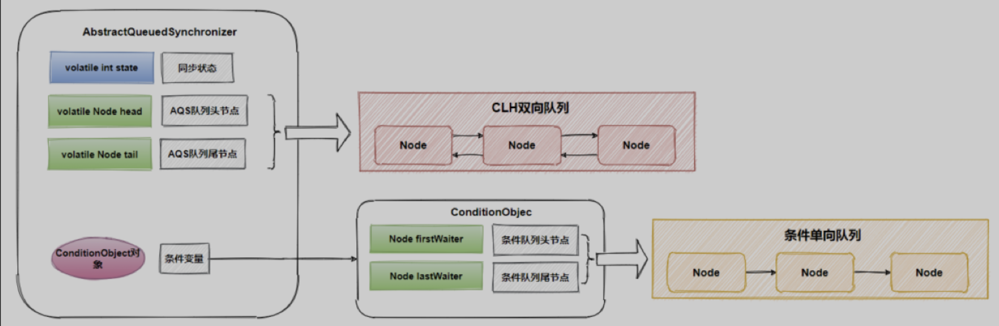

## Introduction

为[实现阻塞锁](/docs/CS/Java/JDK/Concurrency/Concurrency.md?id=locking)及相关[同步器](/docs/CS/Java/JDK/Concurrency/Concurrency.md?id=synchronizers)（信号量、事件等）提供了一个框架，这些同步器都依赖先进先出（**FIFO**）的[等待队列](/docs/CS/Java/JDK/Concurrency/AQS.md?id=wait-queue)。

该类被设计为大多数同步器的有用基础，这些同步器依赖单个原子 int 值来表示状态。

子类必须定义用于改变该状态的 protected 方法，并由这些方法定义该状态在本对象被获取或释放方面的含义。
有了这些方法，本类中的其他方法便可承担全部排队与阻塞机制。

子类可以维护其他状态字段，但只有通过 `getState`、`setState` 和 `compareAndSetState` 方法操作的、以原子方式更新的 int 值，才在同步方面被跟踪。

## Architecture




```java
/**
 * Head of the wait queue, lazily initialized.  Except for
 * initialization, it is modified only via method setHead.  Note:
 * If head exists, its waitStatus is guaranteed not to be
 * CANCELLED.
 */
private transient volatile Node head;

/**
 * Tail of the wait queue, lazily initialized.  Modified only via
 * method enq to add new wait node.
 */
private transient volatile Node tail;

/**
 * The synchronization state.
 */
private volatile int state;

/**
 * The number of nanoseconds for which it is faster to spin
 * rather than to use timed park. A rough estimate suffices
 * to improve responsiveness with very short timeouts.
 */
static final long spinForTimeoutThreshold = 1000L;
```


### hasQueuedPredecessors


```java
public final boolean hasQueuedPredecessors() {
  // The correctness of this depends on head being initialized
  // before tail and on head.next being accurate if the current
  // thread is first in queue.
  Node t = tail; // Read fields in reverse initialization order
  Node h = head;
  Node s;
  return h != t &&
    ((s = h.next) == null || s.thread != Thread.currentThread());
}
```

查询是否有线程等待获取的时间长于当前线程。
调用该方法等价于（但可能比以下写法更高效）：

 getFirstQueuedThread() != Thread.currentThread() && hasQueuedThreads()

需要注意的是，由于中断和超时引起的取消可能在任意时刻发生，返回 true 并不保证某个其他线程会先于当前线程获取。同样，由于队列为空，在该方法返回 false 之后，另一个线程仍有可能在入队竞争中获胜。

该方法供**公平同步器**使用，以避免插队（barging）。若该方法返回 true，则此类同步器的 tryAcquire 方法应返回 false，其 tryAcquireShared 方法应返回负值（除非是可重入获取）。例如，一个公平的、可重入的独占模式同步器，其 tryAcquire 方法可能如下：

```java
protected boolean tryAcquire(int arg) {
   if (isHeldExclusively()) {
     // A reentrant acquire; increment hold count
     return true;
   } else if (hasQueuedPredecessors()) {
     return false;
   } else {
     // try to acquire normally
   }
 }
```


### isHeldExclusively

若同步被当前（调用）线程独占持有，则返回 true。每次调用 AbstractQueuedSynchronizer.ConditionObject 的方法时，都会调用该方法。
默认实现抛出 UnsupportedOperationException。**该方法仅在 AbstractQueuedSynchronizer.ConditionObject 的方法内部被调用，因此若不使用条件，则无需定义它。**


## Wait Queue

| 队列          | 同步队列                   | 条件队列            |
| ------ | ----------------------- | ------------------- |
| 结构 | 使用 Node.prev/Node.next | 使用 Node.nextWaiter |


### Node

等待队列是 "CLH"（Craig、Landin 与 Hagersten）锁队列的一个变体。CLH 锁通常用于自旋锁。这里改为将它们用于阻塞同步器，方法是加入显式的（"prev" 和 "next"）链接以及一个 "status" 字段，使节点能够在释放锁时通知其后继，并处理因中断和超时导致的取消。
status 字段中包含若干位，用于跟踪线程是否需要被通知（借助 LockSupport.unpark）。尽管加入了这些机制，本实现仍保留了 CLH 大部分局部性性质。

要入队到 CLH 锁中，只需以原子方式将节点拼接为新的 tail；要出队，则设置 head 字段，使下一个符合条件的等待者成为队首。

```java
/**      +------+  prev +-----+       +-----+
 * head |      | <---- |     | <---- |     |  tail
 *      +------+       +-----+       +-----+
 */
```


插入 CLH 队列只需对 "tail" 做一次原子操作，因此从未入队到已入队之间存在一个简单的分界点。前驱节点的 "next" 链接由入队线程在 CAS 成功后设置。虽然该设置不是原子的，但这已足以保证任何被阻塞的线程在前驱变得可通知时被通知（在取消的情况下，可能还需要 cleanQueue 方法中发出的信号协助）。通知机制部分基于一种 Dekker 式方案：即将等待的线程先标记 WAITING 状态，然后重试获取，并在真正阻塞之前再次检查状态。通知方在 unpark 时以原子方式清除 WAITING 状态。


获取成功后的出队，涉及先摘除（置空）节点的 "prev"，然后更新 "head"。其他线程通过检查 "prev" 而非 head，来判断某节点是否已出队或曾经出队。必要时通过自旋等待来保证「先置空、后设置」的顺序。因此，该锁算法本身并非严格意义上的「无锁」（lock-free），因为获取线程可能需要等待此前的获取完成才能推进。在与独占锁配合使用时，这种推进本来就是必需的。不过 Shared 模式可能（少见地）在设置 head 字段之前需要自旋等待，以确保正确传播。（历史说明：与本类的早期版本相比，这样做可以简化实现并提升效率。）


节点的前驱可能因等待期间的取消而改变，直到该节点成为队首为止；一旦成为队首，前驱便不再改变。各 acquire 方法通过在等待之前重新检查 "prev" 来应对这一点。prev 与 next 字段只由 cleanQueue 方法中被取消的节点通过 CAS 修改。这种摘链策略与 Michael-Scott 队列类似：对 prev 字段 CAS 成功之后，由其他线程协助修复 next 字段。由于取消往往是成批发生的，会使「是否需要发出信号」的判断复杂化，因此每次调用 cleanQueue 都会遍历队列直到完成一次彻底清理。那些重新链接为队首的节点会被无条件地 unpark（有时确无必要，但不值得为此增加开销）。


当线程位于队首（最靠前）时，可能尝试获取，有时也在成为队首之前就尝试。位于队首并不能保证成功；它只是获得了参与竞争的权利。为在吞吐量、开销与公平性之间取得平衡，允许新到达的线程在入队过程中「插队」（barge）并直接获取同步器，此时被唤醒的队首线程可能需要重新等待。为抵消可能反复出现的不幸重等，线程每次被 unpark 时都按指数增加重试次数（上限为 256 次）。除这种情况外，AQS 锁并不自旋，而是把获取尝试与簿记步骤交替进行。（需要自旋锁的用户可以使用 tryAcquire。）

为提高可回收性，尚未入链的节点其字段均为 null。（创建随后又直接丢弃一个节点并不罕见。）出链节点的字段会尽快置空。这使得从外部确定首个等待线程（如 getFirstQueuedThread 方法所做的）变得更为困难。当字段显示为 null 时，有时需要退回到从已原子更新的 "tail" 开始反向遍历。（不过在发出信号的过程中绝不需要这样做。）


CLH 队列需要一个虚拟头节点才能启动。但这里不在构造时创建它们，因为若始终不存在竞争，这么做只是徒劳。取而代之的做法是，等到首次出现竞争时才构造该节点并设置 head 与 tail 指针。
Shared 模式的操作与 Exclusive 的不同之处在于：若下一个等待者同样处于 Shared 模式，则获取成功时会通知它去尝试获取。tryAcquireShared API 允许用户指定传播的程度，但在大多数应用中，忽略它更高效，让后继者无论如何都尝试获取即可。
在 Condition 上等待的线程使用带有一条额外链接的节点，以维护条件的（FIFO）链表。条件只需要在简单（非并发）的链式队列中链接节点，因为它们仅在独占持有时被访问。
调用 await 时，节点被插入条件队列。调用 signal 时，节点被放入主队列。
这里使用 status 字段的一个特殊取值来跟踪并以原子方式触发这一过程。对 head、tail 和 state 字段的访问采用完整的 Volatile 模式，并配合 CAS。节点的 status、prev 与 next 字段在线程可能被通知时也采用同样方式，其他时候则使用较弱的模式。对 "waiter" 字段（待通知的线程）的访问始终夹在其他原子访问之间，因此采用 Plain 模式。这里使用 jdk.internal 的 Unsafe 版原子访问方法而非 VarHandle，以避免潜在的 VM 引导期问题。


上述大部分工作由内部主要方法 acquire 完成，所有对外暴露的 acquire 方法都会以某种方式调用它。（在使用频繁时，编译器通常很容易优化调用点的特化。）
在 acquire 与 await 中，关于在阻塞之前和/或之后何时以及如何检查中断，存在若干处任意的决策。由于一些用户似乎以存在竞态的方式依赖原有的行为，因而在实现更新时这些决策的改动较小——虽然这些行为通常（尽管很少）并不正确，但很难有理由去改变。

感谢 Dave Dice、Mark Moir、Victor Luchangco、Bill Scherer 与 Michael Scott，以及 JSR-166 专家组的成员，感谢他们对本类设计提出的宝贵建议、讨论与批评意见。


```java
abstract static class Node {
    volatile Node prev;       // initially attached via casTail
    volatile Node next;       // visibly nonnull when signallable
    Thread waiter;            // visibly nonnull when enqueued
    volatile int status;      // written by owner, atomic bit ops by others

    // methods for atomic operations
    final boolean casPrev(Node c, Node v) {  // for cleanQueue
        return U.weakCompareAndSetReference(this, PREV, c, v);
    }
    final boolean casNext(Node c, Node v) {  // for cleanQueue
        return U.weakCompareAndSetReference(this, NEXT, c, v);
    }
    final int getAndUnsetStatus(int v) {     // for signalling
        return U.getAndBitwiseAndInt(this, STATUS, ~v);
    }
    final void setPrevRelaxed(Node p) {      // for off-queue assignment
        U.putReference(this, PREV, p);
    }
    final void setStatusRelaxed(int s) {     // for off-queue assignment
        U.putInt(this, STATUS, s);
    }
    final void clearStatus() {               // for reducing unneeded signals
        U.putIntOpaque(this, STATUS, 0);
    }

    private static final long STATUS
        = U.objectFieldOffset(Node.class, "status");
    private static final long NEXT
        = U.objectFieldOffset(Node.class, "next");
    private static final long PREV
        = U.objectFieldOffset(Node.class, "prev");
}
```


```java
// Concrete classes tagged by type
static final class ExclusiveNode extends Node { }
static final class SharedNode extends Node { }

static final class ConditionNode extends Node
    implements ForkJoinPool.ManagedBlocker {
    ConditionNode nextWaiter;            // link to next waiting node

    /**
     * Allows Conditions to be used in ForkJoinPools without risking fixed pool exhaustion. 
     * This is usable only for untimed Condition waits, not timed versions.
     */
    public final boolean isReleasable() {
        return status <= 1 || Thread.currentThread().isInterrupted();
    }

    public final boolean block() {
        while (!isReleasable()) LockSupport.park();
        return true;
    }
}
```


#### waitStatus

```java
/** waitStatus value to indicate thread has cancelled */
static final int CANCELLED =  1;
/** waitStatus value to indicate successor's thread needs unparking */
static final int SIGNAL    = -1;
/** waitStatus value to indicate thread is waiting on condition */
static final int CONDITION = -2;
/**
 * waitStatus value to indicate the next acquireShared should
 * unconditionally propagate
 */
static final int PROPAGATE = -3;
```

status 字段，仅取以下几种取值：

- SIGNAL：本节点的后继（或即将）已被阻塞（通过 park），因此当前节点在释放或取消时必须 unpark 其后继。为避免竞态，acquire 方法必须先表明自身需要被通知，再重试原子获取，失败后才阻塞。
- CANCELLED：本节点因超时或中断而被取消。节点永不离开此状态。特别地，持有一个已取消节点的线程不会再阻塞。
- CONDITION：本节点当前位于条件队列中。在被转移之前不会作为同步队列节点使用，转移时其 status 将被置为 0。（此处对该取值的使用与该字段的其他用途无关，但它简化了机制。）
- PROPAGATE：某次 `releaseShared` 需要传播到其他节点。在 `doReleaseShared` 中设置该值（仅用于 head 节点），以确保即使期间有其他操作介入，传播仍能继续。
- 0：以上皆非

这些取值在数值上的排列方式是为了简化使用。非负值意味着该节点不需要发出信号。因此，大多数代码无需检查具体取值，只需判断符号。

对普通同步节点，该字段初始化为 0；对条件节点则初始化为 CONDITION。它通过 CAS 修改（或在可能时，


#### nextWaiter

指向**下一个在条件上等待的节点**，或**特殊值 SHARED**。由于条件队列只在独占持有模式下被访问，这里只需一个简单的链式队列来容纳等待条件的节点，随后它们被转移到队列中重新获取。又因为条件只能是独占的，这里用一个特殊值来表示共享模式，从而省下一个字段。


## acquire

1. `tryAcquire` implement by subclass
2. addWaiter(Node.EXCLUSIVE)
3. acquireQueued
   1. shouldParkAfterFailedAcquire
   2. parkAndCheckInterrupt
4. selfInterrupt

以独占模式获取，忽略中断。实现方式是至少调用一次 tryAcquire，成功即返回。否则线程会被入队，可能反复阻塞与解除阻塞，不断调用 tryAcquire 直到成功。本方法可用于实现 `Lock.lock` 方法。

```java
public final void acquire(int arg) {
    if (!tryAcquire(arg) &&
        acquireQueued(addWaiter(Node.EXCLUSIVE), arg))
        selfInterrupt(); // give a interrupt signal
}

public final void acquireInterruptibly(int arg)
        throws InterruptedException {
    if (Thread.interrupted())
        throw new InterruptedException();
    if (!tryAcquire(arg))
        doAcquireInterruptibly(arg);// will throw new InterruptedException for cancelAcquire
}
```

#### addWaiter

先设置 node.prev，再在 `compareAndSetTail` 成功后设置 pred.node

因此不能安全地从 head 开始遍历，node.next 可能为 null

```java
/**
 * Creates and enqueues node for current thread and given mode.
 * Node.EXCLUSIVE for exclusive, Node.SHARED for shared
 */
private Node addWaiter(Node mode) {
    Node node = new Node(Thread.currentThread(), mode);
    // Try the fast path of enq; backup to full enq on failure
    Node pred = tail;
    if (pred != null) {
        node.prev = pred;
        if (compareAndSetTail(pred, node)) {
            pred.next = node;
            return node;
        }
    }
    enq(node);// loop cas enq if tail == null || cas fail
    return node;
}

// Inserts node into queue, initializing if necessary. See picture above.
private Node enq(final Node node) {
    for (;;) {
        Node t = tail;
        if (t == null) { // Must initialize
            if (compareAndSetHead(new Node()))
                tail = head;
        } else {
            node.prev = t;
            if (compareAndSetTail(t, node)) {
                t.next = node;
                return t;
            }
        }
    }
}
```


#### acquireQueued


```java
/**
 * Acquires in exclusive uninterruptible mode for thread already in
 * queue. Used by condition wait methods as well as acquire.
 */
final boolean acquireQueued(final Node node, int arg) {
    boolean failed = true;
    try {
        boolean interrupted = false;
        for (;;) {
            final Node p = node.predecessor(); // find prev node
            if (p == head && tryAcquire(arg)) { // prev node == head && tryAcquire success
                setHead(node);
                p.next = null; // help GC
                failed = false;
                return interrupted;
            }
            if (shouldParkAfterFailedAcquire(p, node) &&
                parkAndCheckInterrupt()) // park and interrupted
                interrupted = true;
        }
    } finally {
        if (failed)
            cancelAcquire(node);
    }
}


/**
 * Sets head of queue to be node, thus dequeuing. Called only by
 * acquire methods.  Also nulls out unused fields for sake of GC
 * and to suppress unnecessary signals and traversals.
 */
private void setHead(Node node) {
    head = node;
    node.thread = null;
    node.prev = null;
}
```


#### shouldParkAfterFailedAcquire


```java
/**
 * Checks and updates status for a node that failed to acquire.
 * Returns true if thread should block. This is the main signal
 * control in all acquire loops.  Requires that pred == node.prev.
 *
 * @param pred node's predecessor holding status
 * @param node the node
 * @return {@code true} if thread should block
 */
private static boolean shouldParkAfterFailedAcquire(Node pred, Node node) {
    int ws = pred.waitStatus;
    if (ws == Node.SIGNAL)
        /*
         * This node has already set status asking a release
         * to signal it, so it can safely park.
         */
        return true;
    if (ws > 0) {
        /*
         * Predecessor was cancelled. Skip over predecessors and
         * indicate retry.
         */
        do {
            node.prev = pred = pred.prev;
        } while (pred.waitStatus > 0);
        pred.next = node;
    } else {
        /*
         * waitStatus must be 0 or PROPAGATE.  Indicate that we
         * need a signal, but don't park yet.  Caller will need to
         * retry to make sure it cannot acquire before parking.
         */
        compareAndSetWaitStatus(pred, ws, Node.SIGNAL);
    }
    return false;
}
```


#### parkAndCheckInterrupt

为下一次 [park](/docs/CS/Java/JDK/Basic/unsafe.md?id=parker) 清除中断状态

```java
private final boolean parkAndCheckInterrupt() {
    LockSupport.park(this);
    return Thread.interrupted(); // clear interrupt avoid next park fail
}
```


#### cancelAcquire

何时会调用 cancelAcquire：

1. 抛出异常
2. 其余情况是超时，抛出 new InterruptedException 


```java
private void cancelAcquire(Node node) {
    // Ignore if node doesn't exist
    if (node == null)
        return;

    node.thread = null;

    // Skip cancelled predecessors
    Node pred = node.prev;
    while (pred.waitStatus > 0)
        node.prev = pred = pred.prev;

    // predNext is the apparent node to unsplice. CASes below will
    // fail if not, in which case, we lost race vs another cancel
    // or signal, so no further action is necessary.
    Node predNext = pred.next;

    // Can use unconditional write instead of CAS here.
    // After this atomic step, other Nodes can skip past us.
    // Before, we are free of interference from other threads.
    node.waitStatus = Node.CANCELLED;

    // If we are the tail, remove ourselves.
    if (node == tail && compareAndSetTail(node, pred)) {
        compareAndSetNext(pred, predNext, null);
    } else {
        // If successor needs signal, try to set pred's next-link
        // so it will get one. Otherwise wake it up to propagate.
        int ws;
        if (pred != head &&
            ((ws = pred.waitStatus) == Node.SIGNAL ||
             (ws <= 0 && compareAndSetWaitStatus(pred, ws, Node.SIGNAL))) &&
            pred.thread != null) {
            Node next = node.next;
            if (next != null && next.waitStatus <= 0)
                compareAndSetNext(pred, predNext, next);
        } else {
            unparkSuccessor(node);
        }

        node.next = node; // help GC
    }
}
```

## release

1. tryRelease
2. unparkSuccessor

```java
public final boolean release(int arg) {
    if (tryRelease(arg)) {
        Node h = head;
        if (h != null && h.waitStatus != 0)
            unparkSuccessor(h);
        return true;
    }
    return false;
}
```


### unparkSuccessor

```java
private void unparkSuccessor(Node node) {
    /*
     * If status is negative (i.e., possibly needing signal) try
     * to clear in anticipation of signalling.  It is OK if this
     * fails or if status is changed by waiting thread.
     */
    int ws = node.waitStatus;
    if (ws < 0)
        compareAndSetWaitStatus(node, ws, 0);

    /*
     * Thread to unpark is held in successor, which is normally
     * just the next node.  But if cancelled or apparently null,
     * traverse backwards from tail to find the actual
     * non-cancelled successor.
     */
    Node s = node.next;
    if (s == null || s.waitStatus > 0) {
        s = null;
        for (Node t = tail; t != null && t != node; t = t.prev)
            if (t.waitStatus <= 0)
                s = t;
    }
    if (s != null)
        LockSupport.unpark(s.thread);
}
```


## Shared

独占模式之外，AQS 的另一半是**共享获取**：`Semaphore`、`CountDownLatch`、`ReadWriteLock` 的读锁都走这条路径。
它与独占模式的根本差别不在「多个线程能否同时进来」，而在**唤醒的传播性**——一个线程释放后，
必须把唤醒沿着队列继续往后传，而不是只叫醒后继一个。

### Acquire

模板方法 `acquireShared` 现在只是薄薄一层，先试一次，不成则进入统一的 `acquire`：

```java
public final void acquireShared(int arg) {
    if (tryAcquireShared(arg) < 0)
        acquire(null, arg, true, false, false, 0L);
}
```

`acquire` 的六个参数分别是 `node`、`arg`、`shared`、`interruptible`、`timed`、`deadline`。
共享模式下关键的三个位置：

```java
if (shared)
    acquired = (tryAcquireShared(arg) >= 0);   // 1. 共享获取：>= 0 即成功
else
    acquired = tryAcquire(arg);                //    独占获取：布尔
...
if (acquired) {
    if (first) {
        node.prev = null;
        head = node;
        pred.next = null;
        node.waiter = null;
        if (shared)
            signalNextIfShared(node);           // 2. 传播唤醒
        ...
```

节点在入队时就按类型分好：

```java
node = (shared) ? new SharedNode() : new ExclusiveNode();
```

**共享获取的返回值语义与独占相反**：`tryAcquireShared` 返回**非负**值表示成功，负值表示失败。
这个约定正是为传播服务的——返回值同时承载了「还有多少资源」的信息，
`Semaphore` 直接把它返回给 `tryAcquireShared()` 的调用者作为许可数。

### Propagation

传播靠两个静态方法区分唤醒谁：

```java
private static void signalNext(Node h) {
    Node s;
    if (h != null && (s = h.next) != null && s.status != 0) {
        s.getAndUnsetStatus(WAITING);
        LockSupport.unpark(s.waiter);
    }
}

/** Wakes up the given node if in shared mode */
private static void signalNextIfShared(Node h) {
    Node s;
    if (h != null && (s = h.next) != null &&
        (s instanceof SharedNode) && s.status != 0) {
        s.getAndUnsetStatus(WAITING);
        LockSupport.unpark(s.waiter);
    }
}
```

差异只有一行 `(s instanceof SharedNode)`。这就是**节点类型化的收益**：
旧实现需要 `PROPAGATE` 这个特殊状态位来表达「唤醒要往后传」，
现在「要不要继续传」由后继节点的**类型**直接决定，`signalNext` 和 `signalNextIfShared` 一眼可辨。

链式传播的完整过程：共享线程 A 释放 → `signalNext(head)` 唤醒 B → B 拿到资源后又成为 head →
B 在 `first` 分支里调 `signalNextIfShared` → C 被唤醒。唤醒像多米诺一样传下去，
直到队列里没有共享节点为止。`Semaphore` 的许可充足时可以一次放行一批线程，靠的就是这条链。

`releaseShared` 本身同样被简化了，不再需要 `doReleaseShared` 这样的多层递归：

```java
public final boolean releaseShared(int arg) {
    if (tryReleaseShared(arg)) {
        signalNext(head);
        return true;
    }
    return false;
}
```

### Summary

| | Exclusive | Shared |
| --- | --- | --- |
| 模板方法 | `acquire` / `tryAcquire` | `acquireShared` / `acquireSharedInterruptibly` / `tryAcquireSharedNanos` |
| 钩子签名 | `tryAcquire` 返回 `boolean` | `tryAcquireShared` 返回 `int`，**非负即成功** |
| 节点类型 | `ExclusiveNode` | `SharedNode` |
| 唤醒 | `signalNext` | `signalNext` + `signalNextIfShared` 链式传播 |
| 能否同时多持 | 否 | 是（资源数由实现决定） |
| 典型实现 | `ReentrantLock` | `Semaphore` / `CountDownLatch` / `ReadWriteLock` 读锁 |

### Old Implementation

需要留意的是，上面这套代码是**当前 JDK 的形态**，与流传最广的 AQS 教程（基于 JDK 8）差别很大。
JDK 8 的写法在 `java.util.concurrent.locks` 里已经不存在：

| 旧（JDK 8） | 新（当前） |
| --- | --- |
| `PROPAGATE`（`-3`）状态位 | **已删除**，改由 `SharedNode` 类型表达 |
| `waitStatus` 字段 | 更名为 `status` |
| `doAcquireShared` / `doAcquireSharedInterruptibly` | 统一为 `acquire(node, arg, shared, ...)` |
| `doReleaseShared`（内含递归与循环） | 简化为 `signalNext(head)` |
| `setHeadAndPropagate` | `acquire` 内的 `first` 分支 + `signalNextIfShared` |
| `CANCELLED = 1` / `SIGNAL = -1` / `CONDITION = -2` | `WAITING = 1` / `CANCELLED = 0x80000000` / `COND = 2` |

状态位的语义整体被简化了：旧的四个负值常量变成了两个正数位，
并且大量原本靠 CAS 循环修改 `waitStatus` 的地方改用了 `Node` 上的专用原语
（`getAndUnsetStatus` / `setStatusRelaxed` / `clearStatus`），注释里直接写明了用途
（用于标记「需要 signal」「用于 off-queue 赋值」「用于削减多余 signal」）。
读旧代码里的 `waitStatus` 时要意识到这一点，否则会以为在读当前实现。

## ConditionObject

implements [Condition](/docs/CS/Java/JDK/Concurrency/Lock.md?id=multiple-conditions)

```java
public class ConditionObject implements Condition, java.io.Serializable {
    private static final long serialVersionUID = 1173984872572414699L;
    /** First node of condition queue. */
    private transient Node firstWaiter;
    /** Last node of condition queue. */
    private transient Node lastWaiter;

    /**
     * Creates a new {@code ConditionObject} instance.
     */
    public ConditionObject() {
    }

    // Internal methods

    /**
     * Adds a new waiter to wait queue.
     * @return its new wait node
     */
    private Node addConditionWaiter() {
        Node t = lastWaiter;
        // If lastWaiter is cancelled, clean out.
        if (t != null && t.waitStatus != Node.CONDITION) {
            unlinkCancelledWaiters();
            t = lastWaiter;
        }
        Node node = new Node(Thread.currentThread(), Node.CONDITION);
        if (t == null)
            firstWaiter = node;
        else
            t.nextWaiter = node;
        lastWaiter = node;
        return node;
    }
}
```


### await

实现可中断的条件等待。

1. 若当前线程已被中断，抛出 InterruptedException。
2. 保存 getState 返回的锁状态。
3. 以保存的状态为参数调用 release，若失败则抛出 IllegalMonitorStateException。
4. 阻塞直到被通知或被中断。
5. 以保存的状态为参数调用 acquire 的特化版本重新获取。
6. 若在第 4 步的阻塞期间被中断，抛出 InterruptedException。

```java
public final void await() throws InterruptedException {
    if (Thread.interrupted())
        throw new InterruptedException();
    Node node = addConditionWaiter();
    int savedState = fullyRelease(node);
    int interruptMode = 0;
    while (!isOnSyncQueue(node)) {
        LockSupport.park(this);
        if ((interruptMode = checkInterruptWhileWaiting(node)) != 0)
            break;
    }
    if (acquireQueued(node, savedState) && interruptMode != THROW_IE)
        interruptMode = REINTERRUPT;
    if (node.nextWaiter != null) // clean up if cancelled
        unlinkCancelledWaiters();
    if (interruptMode != 0)
        reportInterruptAfterWait(interruptMode);
}
```


#### addConditionWaiter
若 lastWaiter 已被取消，则清理掉，并添加 nextWaiter
```java
private Node addConditionWaiter() {
    Node t = lastWaiter;
    // If lastWaiter is cancelled, clean out.
    if (t != null && t.waitStatus != Node.CONDITION) {
        unlinkCancelledWaiters();
        t = lastWaiter;
    }
    Node node = new Node(Thread.currentThread(), Node.CONDITION);
    if (t == null)
        firstWaiter = node;
    else
        t.nextWaiter = node;
    lastWaiter = node;
    return node;
}
```


将已取消的等待节点从条件队列中摘除。仅在持有锁时调用。当条件等待期间发生取消时会调用它；当插入新等待者时若发现 lastWaiter 已被取消，也会调用它。该方法用于避免在没有信号时滞留垃圾数据。因此，尽管它可能需要一次完整遍历，但只有在没有信号的情况下发生超时或取消时才会发挥作用。它会遍历所有节点而非停在某个特定目标上，从而摘除指向垃圾节点的全部指针，而无需在取消风暴期间反复重新遍历。

```java
private void unlinkCancelledWaiters() {
    Node t = firstWaiter;
    Node trail = null;
    while (t != null) {
        Node next = t.nextWaiter;
        if (t.waitStatus != Node.CONDITION) {
            t.nextWaiter = null;
            if (trail == null)
                firstWaiter = next;
            else
                trail.nextWaiter = next;
            if (next == null)
                lastWaiter = trail;
        }
        else
            trail = t;
        t = next;
    }
}
```


#### fullyRelease

```java
/**
 * Invokes release with current state value; returns saved state.
 * Cancels node and throws exception on failure.
 */
final int fullyRelease(Node node) {
    boolean failed = true;
    try {
        int savedState = getState();
        if (release(savedState)) {
            failed = false;
            return savedState;
        } else {
            throw new IllegalMonitorStateException();
        }
    } finally {
        if (failed)
            node.waitStatus = Node.CANCELLED;
    }
}
```


使用 [Thread#yield()](/docs/CS/Java/JDK/Concurrency/Thread.md?id=yield)

```java
private int checkInterruptWhileWaiting(Node node) {
    return Thread.interrupted() ?
        (transferAfterCancelledWait(node) ? THROW_IE : REINTERRUPT) :
        0;
}

final boolean transferAfterCancelledWait(Node node) {
    if (compareAndSetWaitStatus(node, Node.CONDITION, 0)) {
        enq(node);
        return true;
    }
    /*
     * If we lost out to a signal(), then we can't proceed
     * until it finishes its enq().  Cancelling during an
     * incomplete transfer is both rare and transient, so just
     * spin.
     */
    while (!isOnSyncQueue(node))
        Thread.yield();
    return false;
}
```


```java
final boolean isOnSyncQueue(Node node) {
    if (node.waitStatus == Node.CONDITION || node.prev == null)
        return false;
    if (node.next != null) // If has successor, it must be on queue
        return true;
    /*
     * node.prev can be non-null, but not yet on queue because
     * the CAS to place it on queue can fail. So we have to
     * traverse from tail to make sure it actually made it.  It
     * will always be near the tail in calls to this method, and
     * unless the CAS failed (which is unlikely), it will be
     * there, so we hardly ever traverse much.
     */
    return findNodeFromTail(node);
}
```


#### reportInterruptAfterWait

```java
private void reportInterruptAfterWait(int interruptMode)
    throws InterruptedException {
    if (interruptMode == THROW_IE)
        throw new InterruptedException();
    else if (interruptMode == REINTERRUPT)
        selfInterrupt();
}
```

### signal

把等待时间最长的线程（若存在）从该条件的等待队列移动到持有者锁的等待队列。

```java
public final void signal() {
    if (!isHeldExclusively())
        throw new IllegalMonitorStateException();
    Node first = firstWaiter;
    if (first != null)
        doSignal(first);
}

public final void signalAll() {
    if (!isHeldExclusively())
        throw new IllegalMonitorStateException();
    Node first = firstWaiter;
    if (first != null)
        doSignalAll(first);
}
```


#### doSignal

不断移除并转移节点，直到遇到未取消的节点或 null。部分从 signal 中拆分出来，是为了促使编译器把「无等待者」这一情形内联。

```java
private void doSignal(Node first) {
    do {
        if ( (firstWaiter = first.nextWaiter) == null)
            lastWaiter = null;
        first.nextWaiter = null;
    } while (!transferForSignal(first) &&
             (first = firstWaiter) != null);
}

private void doSignalAll(Node first) {
    lastWaiter = firstWaiter = null;
    do {
        Node next = first.nextWaiter;
        first.nextWaiter = null;
        transferForSignal(first);
        first = next;
    } while (first != null);
}
```


#### transferForSignal

入队（enq）

```java
final boolean transferForSignal(Node node) {
    // If cannot change waitStatus, the node has been cancelled.
    if (!compareAndSetWaitStatus(node, Node.CONDITION, 0))
        return false;

    /*
     * Splice onto queue and try to set waitStatus of predecessor to
     * indicate that thread is (probably) waiting. If cancelled or
     * attempt to set waitStatus fails, wake up to resync (in which
     * case the waitStatus can be transiently and harmlessly wrong).
     */
    Node p = enq(node);
    int ws = p.waitStatus;
    if (ws > 0 || !compareAndSetWaitStatus(p, ws, Node.SIGNAL))
        LockSupport.unpark(node.thread);
    return true;
}
```

## Example
摘自 JDK：
```java
class Mutex implements Lock, java.io.Serializable {

   // Our internal helper class
   private static class Sync extends AbstractQueuedSynchronizer {
     // Reports whether in locked state
     protected boolean isHeldExclusively() {
       return getState() == 1;
     }

     // Acquires the lock if state is zero
     public boolean tryAcquire(int acquires) {
       assert acquires == 1; // Otherwise unused
       if (compareAndSetState(0, 1)) {
         setExclusiveOwnerThread(Thread.currentThread());
         return true;
       }
       return false;
     }

     // Releases the lock by setting state to zero
     protected boolean tryRelease(int releases) {
       assert releases == 1; // Otherwise unused
       if (getState() == 0) throw new IllegalMonitorStateException();
       setExclusiveOwnerThread(null);
       setState(0);
       return true;
     }

     // Provides a Condition
     Condition newCondition() { return new ConditionObject(); }

     // Deserializes properly
     private void readObject(ObjectInputStream s)
         throws IOException, ClassNotFoundException {
       s.defaultReadObject();
       setState(0); // reset to unlocked state
     }
   }

   // The sync object does all the hard work. We just forward to it.
   private final Sync sync = new Sync();

   public void lock()                { sync.acquire(1); }
   public boolean tryLock()          { return sync.tryAcquire(1); }
   public void unlock()              { sync.release(1); }
   public Condition newCondition()   { return sync.newCondition(); }
   public boolean isLocked()         { return sync.isHeldExclusively(); }
   public boolean hasQueuedThreads() { return sync.hasQueuedThreads(); }
   public void lockInterruptibly() throws InterruptedException {
     sync.acquireInterruptibly(1);
   }
   public boolean tryLock(long timeout, TimeUnit unit)
       throws InterruptedException {
     return sync.tryAcquireNanos(1, unit.toNanos(timeout));
   }
 }
```

下面是一个闩（latch）类，它与 CountDownLatch 类似，只是只需一个信号即可触发。由于闩是非独占的，因此它使用共享的 acquire 与 release 方法。

```java
 class BooleanLatch {

   private static class Sync extends AbstractQueuedSynchronizer {
     boolean isSignalled() { return getState() != 0; }

     protected int tryAcquireShared(int ignore) {
       return isSignalled() ? 1 : -1;
     }

     protected boolean tryReleaseShared(int ignore) {
       setState(1);
       return true;
     }
   }

   private final Sync sync = new Sync();
   public boolean isSignalled() { return sync.isSignalled(); }
   public void signal()         { sync.releaseShared(1); }
   public void await() throws InterruptedException {
     sync.acquireSharedInterruptibly(1);
   }
 }
```

1. 独占模式：`ReentrantLock`
2. 共享模式：`Semaphore` / `CountDownLatch`
3. 两者兼有：`ReadWriteLock` / `StampedLock`


## Summary


## AOS

AbstractOwnableSynchronizer


## Implementation

1. [ReentrantLock](/docs/CS/Java/JDK/Concurrency/ReentrantLock.md)
2. [ReentrantReadWriteLcok](/docs/CS/Java/JDK/Concurrency/ReadWriteLock.md)
3. [ThreadPoolExecutor.Worker](/docs/CS/Java/JDK/Concurrency/ThreadPoolExecutor.md?id=worker)


## Links
- [Concurrency](/docs/CS/Java/JDK/Concurrency/Concurrency.md)
- [synchronized](/docs/CS/Java/JDK/Concurrency/synchronized.md)


## References
