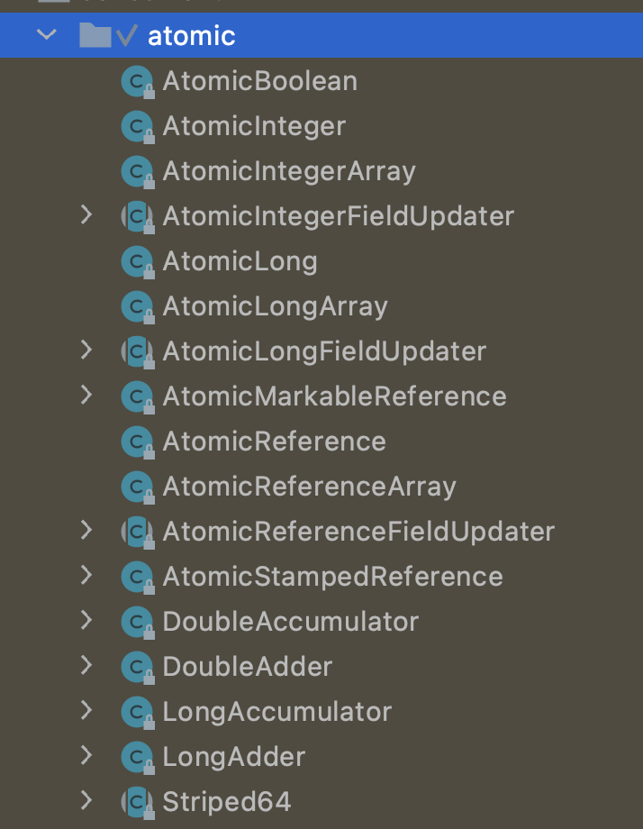

## Introduction

一组用于**在单个变量上支持无锁线程安全编程**的类。
本包中的类把 volatile 值、字段以及数组元素的语义扩展为：在常规访问之外，还提供如下形式的原子条件更新操作

```java
 boolean compareAndSet(expectedValue, updateValue);
```

该方法在不同类中参数类型略有差异：**若变量当前持有 expectedValue，则以原子方式将其设置为 updateValue，并在成功时返回 true**。
本包中的类还提供了**读取并无条件设置值**的方法，以及下文介绍的一个较弱的条件原子更新操作 **weakCompareAndSet**。

这些方法的规定使实现可以借助当代处理器上提供的**高效的机器级原子指令**。
但在某些平台上，对这些操作的支持可能需要某种形式的**内部加锁**，因此**这些方法严格来说并不保证无阻塞——线程在执行操作前可能短暂阻塞**。

原子变量的访问与更新在内存效果上通常遵循 volatile 变量的规则，参见《Java 语言规范》第 17.4 节（内存模型）：

1. `get` 的内存效果等同于读取一个 volatile 变量。
2. `set` 的内存效果等同于写入（赋值）一个 volatile 变量。
3. `lazySet` 的内存效果等同于写入（赋值）一个 volatile 变量，但它允许与后续（而非先前）的内存操作重排序，只要这些操作本身不对普通的非 volatile 写入施加重排序约束。
4. 除了其他使用场景，`lazySet` 还适用于这样的情形：为垃圾回收而将某个此后不再被访问的引用置空。
5. `weakCompareAndSet` **以原子方式读取并有条件地写入变量，但不会建立任何 happens-before 序**，因此除该方法的目标变量之外，它对其他变量的先前或后续读写都不提供任何保证。
6. `compareAndSet` 以及 `getAndIncrement` 等所有「读取并更新」的操作，**同时具有读取和写入 volatile 变量的内存效果**。



**AtomicBoolean、AtomicInteger、AtomicLong 和 AtomicReference 的实例各自提供对单个相应类型变量的访问与更新**。
每个类还提供适用于该类型的工具方法。例如，AtomicLong 和 AtomicInteger 都提供了原子自增方法。
一种典型用途是生成序列号，如下所示：

```java
class Sequencer {
   private final AtomicLong sequenceNumber
     = new AtomicLong(0);
   public long next() {
     return sequenceNumber.getAndIncrement();
   }
 }
```

除表示单值的类之外，本包还包含若干 Updater 类，可在任意选定类的任意选定 volatile 字段上获得 compareAndSet 操作。
**AtomicReferenceFieldUpdater、AtomicIntegerFieldUpdater 和 AtomicLongFieldUpdater 是基于反射的工具类，提供对相应字段类型的访问**。
它们主要用于这样的原子数据结构：同一节点的若干 volatile 字段（例如树节点的左右链接）各自独立地进行原子更新。
**这类类在「何时、如何使用原子更新」上提供了更大的灵活性，代价是基于反射的初始化较为笨拙、使用不够便利、保证也更弱**。

`AtomicIntegerArray`、`AtomicLongArray` 和 `AtomicReferenceArray` 把原子操作的支持进一步扩展到上述类型的数组上。
这些类的另一个特点是：为数组元素提供了 `volatile` 访问语义。

原子类还支持 **weakCompareAndSet** 方法，但它的**适用范围有限**。
在某些平台上，弱版本在正常情况下可能比 compareAndSet 更高效，区别在于**weakCompareAndSet 的某一次调用可能无缘无故地返回 false**。
返回 false 仅意味着：如果愿意，可以重试该操作；其依据的保证是——当变量持有 expectedValue 且没有其他线程也在尝试设置该变量时，反复调用最终会成功。
（例如，这类虚假失败可能源自与「期望值是否等于当前值」无关的内存竞争效应。）
此外，**weakCompareAndSet 不提供同步控制通常所需的顺序保证**。
不过，当这类更新与程序中其他 happens-before 序无关时，该方法对更新计数器和统计信息仍然有用。
当线程看到由 weakCompareAndSet 引起的原子变量更新时，它未必能看到该 weakCompareAndSet 之前发生的其他变量的更新。
这在更新性能统计信息之类场合或许可以接受，但除此之外很少适用。

**AtomicMarkableReference 类将一个布尔值与一个引用关联起来**。
例如，可以用这个标志位在数据结构内部表示「被引用的对象已在逻辑上被删除」。

**AtomicStampedReference 类将一个整数值与一个引用关联起来**。
例如，可以用它表示一系列更新所对应的版本号。

原子类主要被设计为实现非阻塞数据结构及相关基础设施类的构件。
**compareAndSet 方法不能作为加锁的通用替代品，它仅适用于某个对象的关键更新被限制在单个变量上的场合**。
**原子类也不是 java.lang.Integer 及相关类的通用替代品**。
它们不定义 equals、hashCode 和 compareTo 之类的方法。（原子变量预期会被修改，因此不适合作为哈希表的键。）
此外，仅为预期应用中常用的类型提供相应的类。例如，并不存在表示 byte 的原子类；在少数确实需要这么做的场合，**可以用 AtomicInteger 保存 byte 值，再做恰当的类型转换**。
同样地，可以用 Float.floatToRawIntBits 与 Float.intBitsToFloat 之间的转换来保存浮点值，用 Double.doubleToRawLongBits 与 Double.longBitsToDouble 之间的转换来保存双精度值。

## AtomicInteger

```java
// setup to use Unsafe.compareAndSwapInt for updates
private static final Unsafe unsafe = Unsafe.getUnsafe();
private static final long valueOffset;
private volatile int value;
```


若 Java 变量当前持有 expected，则以原子方式将其更新为 x。
该操作具有 volatile 读与写的内存语义。
对应 C11 的 atomic_compare_exchange_strong。
```java
public final class Unsafe {
    @ForceInline
    public final boolean compareAndSwapInt(Object o, long offset,
                                           int expected,
                                           int x) {
        return theInternalUnsafe.compareAndSetInt(o, offset, expected, x);
    }
}

    @IntrinsicCandidate
    public final native boolean compareAndSetInt(Object o, long offset,
                                                 int expected,
                                                 int x);
```

## AtomicReference

AtomicReference fix CAS

Lock

## LongAdder

一个或多个变量共同维护一个初始值为零的 long 型累加和。当更新（方法 `add`）在多个线程间存在竞争时，这组变量可以动态增长以降低竞争。方法 `sum`（等价地，`longValue`）返回当前所有变量合计出的总和。
当多个线程更新同一个总和、且该总和仅用于收集统计之类的用途（而非细粒度的同步控制）时，通常应优先使用本类而非 `AtomicLong`。更新竞争较低时，两者的特性相近；但竞争较高时，本类的预期吞吐量显著更高，代价是占用更多空间。
`LongAdder` 可以与 [java.util.concurrent.ConcurrentHashMap]() 搭配，用来维护可扩展的频次映射（直方图或多重集的一种形式）。例如，要给一个 `ConcurrentHashMap<String,LongAdder>` 类型的 `freqs` 增加计数（若尚未初始化则先初始化），可以写成 `freqs.computeIfAbsent(k -> new LongAdder()).increment()`；
本类继承自 `Number`，但不定义 equals、hashCode 和 compareTo 之类的方法——实例预期会被修改，因此不适合作为集合的键。

```java
public class LongAdder extends Striped64 implements Serializable {
}
```

`AtomicLong` 的带填充（padded）变体，只支持原始访问加上 **CAS**。关于 JVM 内建函数（intrinsics）的说明：如果提供了仅带 release 语义的 CAS 形式，这里本可以使用它。

```java
// Striped64
@sun.misc.Contended static final class Cell {
    volatile long value;
    Cell(long x) { value = x; }
    final boolean cas(long cmp, long val) {
        return UNSAFE.compareAndSwapLong(this, valueOffset, cmp, val);
    }

    // Unsafe mechanics
    private static final sun.misc.Unsafe UNSAFE;
    private static final long valueOffset;
    static {
        try {
            UNSAFE = sun.misc.Unsafe.getUnsafe();
            Class<?> ak = Cell.class;
            valueOffset = UNSAFE.objectFieldOffset
                (ak.getDeclaredField("value"));
        } catch (Exception e) {
            throw new Error(e);
        }
    }
}
```

```java
public void add(long x) {
    Cell[] as; long b, v; int m; Cell a;
    if ((as = cells) != null || !casBase(b = base, b + x)) {
        boolean uncontended = true;
        if (as == null || (m = as.length - 1) < 0 ||
            (a = as[getProbe() & m]) == null ||
            !(uncontended = a.cas(v = a.value, v + x)))
            longAccumulate(x, null, uncontended);
    }
}
```

处理涉及初始化、扩容、创建新 Cell 以及/或竞争等各种更新情形。相关说明见上文。该方法存在乐观重试代码常见的非模块化问题：它依赖于对一组读取结果反复重新检查。

```java
// Striped64
final void longAccumulate(long x, LongBinaryOperator fn,
                          boolean wasUncontended) {
    int h;
    if ((h = getProbe()) == 0) {
        ThreadLocalRandom.current(); // force initialization
        h = getProbe();
        wasUncontended = true;
    }
    boolean collide = false;                // True if last slot nonempty
    for (;;) {
        Cell[] as; Cell a; int n; long v;
        if ((as = cells) != null && (n = as.length) > 0) {
            if ((a = as[(n - 1) & h]) == null) {
                if (cellsBusy == 0) {       // Try to attach new Cell
                    Cell r = new Cell(x);   // Optimistically create
                    if (cellsBusy == 0 && casCellsBusy()) {
                        boolean created = false;
                        try {               // Recheck under lock
                            Cell[] rs; int m, j;
                            if ((rs = cells) != null &&
                                (m = rs.length) > 0 &&
                                rs[j = (m - 1) & h] == null) {
                                rs[j] = r;
                                created = true;
                            }
                        } finally {
                            cellsBusy = 0;
                        }
                        if (created)
                            break;
                        continue;           // Slot is now non-empty
                    }
                }
                collide = false;
            }
            else if (!wasUncontended)       // CAS already known to fail
                wasUncontended = true;      // Continue after rehash
            else if (a.cas(v = a.value, ((fn == null) ? v + x :
                                         fn.applyAsLong(v, x))))
                break;
            else if (n >= NCPU || cells != as)
                collide = false;            // At max size or stale
            else if (!collide)
                collide = true;
            else if (cellsBusy == 0 && casCellsBusy()) {
                try {
                    if (cells == as) {      // Expand table unless stale
                        Cell[] rs = new Cell[n << 1];
                        for (int i = 0; i < n; ++i)
                            rs[i] = as[i];
                        cells = rs;
                    }
                } finally {
                    cellsBusy = 0;
                }
                collide = false;
                continue;                   // Retry with expanded table
            }
            h = advanceProbe(h);
        }
        else if (cellsBusy == 0 && cells == as && casCellsBusy()) {
            boolean init = false;
            try {                           // Initialize table
                if (cells == as) {
                    Cell[] rs = new Cell[2];
                    rs[h & 1] = new Cell(x);
                    cells = rs;
                    init = true;
                }
            } finally {
                cellsBusy = 0;
            }
            if (init)
                break;
        }
        else if (casBase(v = base, ((fn == null) ? v + x :
                                    fn.applyAsLong(v, x))))
            break;                          // Fall back on using base
    }
}
```

> [!NOTE]
>
> See [Netty Memory](/docs/CS/Framework/Netty/memory.md)

### LongAccumulator

一个或多个变量共同维护一个 long 型累积值，更新时使用外部提供的函数。当更新（方法 `accumulate`）在多个线程间存在竞争时，这组变量可以动态增长以降低竞争。方法 `get`（等价地，`longValue`）返回当前所有变量合计出的值。
当多个线程更新同一个值、且该值仅用于收集统计之类的用途（而非细粒度的同步控制）时，通常应优先使用本类而非 `AtomicLong`。更新竞争较低时，两者的特性相近；但竞争较高时，本类的预期吞吐量显著更高，代价是占用更多空间。
累积在单线程内部以及跨线程之间的顺序均无保证，也不可依赖，因此本类仅适用于那些累积顺序无关紧要的函数。所提供的累积函数应当无副作用（side-effect-free），因为线程间的竞争可能使失败的更新被重新应用。调用该函数时，当前值作为第一个参数传入，给定的更新值作为第二个参数传入。例如，要维护一个滚动最大值，可以提供 `Long::max`，并以 `Long.MIN_VALUE` 作为单位元。
类 `LongAdder` 为「维护计数与累加和」这一常见特例提供了与本类功能类似的实现。*`new LongAdder()` 等价于 `new LongAccumulator((x, y) -> x + y, 0L)`。*
本类继承自 `Number`，但不定义 equals、hashCode 和 compareTo 之类的方法——实例预期会被修改，因此不适合作为集合的键。

```java
public void accumulate(long x) {
    Cell[] as; long b, v, r; int m; Cell a;
    if ((as = cells) != null ||
        (r = function.applyAsLong(b = base, x)) != b && !casBase(b, r)) {
        boolean uncontended = true;
        if (as == null || (m = as.length - 1) < 0 ||
            (a = as[getProbe() & m]) == null ||
            !(uncontended =
              (r = function.applyAsLong(v = a.value, x)) == v ||
              a.cas(v, r)))
            longAccumulate(x, function, uncontended);
    }
}
```


## Array


通过 `VarHandle.getVolatile` 实现 Get/Set。
```java

private static final VarHandle AA = MethodHandles.arrayElementVarHandle(int[].class);

    public final int get(int i) {
        return (int)AA.getVolatile(array, i);
    }

    public final void set(int i, int newValue) {
        AA.setVolatile(array, i, newValue);
    }

```

## Implementation Status (JDK 25)

「并发包已经全部 VarHandle 化」是流传很广的说法。核对 JDK 25（jdk-25+36）源码后，实际情况是**分裂的**：

| 类 | JDK 25 实现 | 源码依据 |
| --- | --- | --- |
| `AtomicIntegerArray` / `AtomicLongArray` / `AtomicReferenceArray` | `MethodHandles.arrayElementVarHandle` | 上文 Array 一节的 `AA` VarHandle |
| `AtomicInteger` / `AtomicReference` 等单值类 | **仍是 `jdk.internal.misc.Unsafe`** | `AtomicInteger.java:58-61` 注释：*本类原计划使用 VarHandle 实现，但存在尚未解决的循环启动依赖。* |
| `ThreadLocalRandom` / `Striped64` | **仍是 Unsafe** | `U.putLong(...)` / `UNSAFE.compareAndSwapLong(...)` |

即单值原子类**本意**要用 VarHandle，但 `java.lang.invoke` 与 `java.util.concurrent.atomic` 之间存在启动期循环依赖，尚未解开。判断「某类实际用什么实现」要读字段声明，不能看 API 表面——这正是「存在 ≠ 生效」在 API 层的变体。访问模式与内存序的权威表述见 [VarHandle](/docs/CS/Java/JDK/Concurrency/VarHandle.md)。

### Field Updaters

`AtomicReferenceFieldUpdater` / `AtomicIntegerFieldUpdater` / `AtomicLongFieldUpdater` 提供对**任意类的任意 volatile 字段**的 CAS 能力，适合「同一节点的多个 volatile 字段各自独立原子更新」的场面（如并发数据结构里树节点的左右链接）：

```java
class Node {
    volatile int next;
    private static final AtomicIntegerFieldUpdater<Node> UPDATER =
        AtomicIntegerFieldUpdater.newUpdater(Node.class, "next");
}

UPDATER.compareAndSet(node, expect, update);
```

代价在引言里已写明：**反射式建立、用法笨拙、保证更弱**——字段必须是 `volatile` 且调用方与字段满足访问权限。单变量场景直接包一个 `AtomicInteger` 通常更简单也更快；FieldUpdater 的真正价值是省掉一层包装对象、让多个字段共享节点内存布局。

## Links

- [Concurrency](/docs/CS/Java/JDK/Concurrency/Concurrency.md)
- [VarHandle](/docs/CS/Java/JDK/Concurrency/VarHandle.md)
- [unsafe](/docs/CS/Java/JDK/Basic/unsafe.md)

## References
