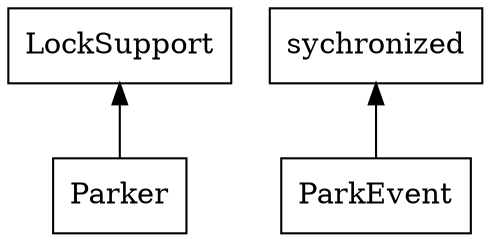
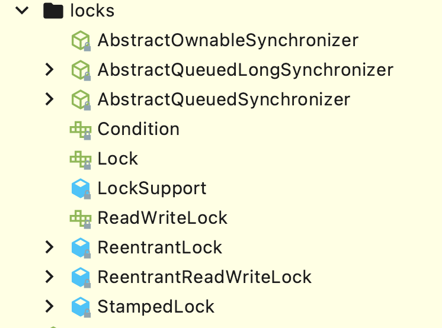

## Introduction

[Threads](/docs/CS/Java/JDK/Concurrency/Thread.md)（线程）是 Java 语言中无法回避的特性，它能把复杂的异步代码改写为更简单的直线式代码，从而简化复杂系统的开发。
此外，线程是发挥多处理器系统计算能力最便捷的途径。
随着处理器核数不断增加，高效利用并发将变得愈发重要。

促使操作系统支持多个程序并发执行（simultaneously）的动机主要有以下几点：

- 资源利用率
- 公平性
- 便利性

线程有时被称为轻量级进程（lightweight processes），大多数现代操作系统把线程而非进程作为调度的基本单位。
在没有显式协调的情况下，线程彼此之间同时、异步地执行。
由于线程共享其所属进程的内存地址空间，同一进程内的所有线程都能访问相同的变量，并从同一个堆（heap）中分配对象，
这使得线程间的数据共享比进程间机制更细粒度。
但若没有显式同步来协调对共享数据的访问，一个线程可能修改另一个线程正在使用的变量，从而产生不可预测的结果。

**线程的优势**

1. 发挥多处理器的能力
2. 建模更简单
3. 简化异步事件的处理
4. 更灵敏的用户界面

**线程的风险**

1. 安全性问题
2. 活跃性问题
3. 性能问题

#### Safety Hazards

线程安全有时会出人意料地微妙，因为在缺乏充分同步时，多个线程中操作的执行顺序是不可预测的，有时甚至会令人惊讶。

由于线程共享同一内存地址空间并并发执行，它们能够访问或修改其他线程可能正在使用的变量。
这带来了极大的便利，因为比起其他线程间通信机制，数据共享变得容易得多。
但这同时也是重大风险：数据被意外修改会让线程陷入混乱。
允许多个线程访问并修改同一变量，会给原本顺序的编程模型引入非顺序性，
这容易让人困惑，也难以推理。
要让多线程程序的行为可预测，必须正确协调对共享变量的访问，使线程互不干扰。
幸运的是，Java 提供了同步机制来协调此类访问。

在没有同步的情况下，编译器、硬件和运行时（runtime）可以随心所欲地调整操作的时机与顺序，
例如把变量缓存在寄存器或处理器本地缓存中，使它们在一段时间内（甚至永久）对其他线程不可见。
这些手段是为了提升性能，通常是可取的，但它们要求开发者清楚地识别
哪些数据在线程间共享，以免这些优化破坏安全性。

#### Liveness Hazards

安全性关注「坏事永远不会发生」，而活跃性关注其互补目标——「好事最终会发生」。
当某个活动进入一种永远无法向前推进的状态时，就发生了活跃性失败（liveness failure）。
顺序程序中也会出现一种活跃性失败：无意的无限循环，导致循环之后的代码永远无法执行。
使用线程还会引入额外的活跃性风险。

例如，若线程 A 正在等待线程 B 独占持有的资源，而 B 永远不释放，A 就会永远等待。

后文将介绍各种形式的 [liveness failures](/docs/CS/OS/Deadlocks.md)（活跃性失败）及其避免方法，包括死锁（deadlock）、饥饿（starvation）与活锁（livelock）。

死锁相关 issue：

- [JDK-8198928 (so) SocketChannel connect may deadlock if closed at around same time that connect fails](https://bugs.openjdk.org/browse/JDK-8198928)


ThreadMXBean 

#### Performance Hazards

与活跃性相关的是性能。活跃性要求「好事最终发生」，但「最终」往往不够——我们通常希望好事尽快发生。
性能问题涵盖面很广，包括服务时间差、响应迟缓、吞吐量低、资源消耗过大或扩展性不足。
与安全性和活跃性一样，多线程程序不仅面临单线程程序的所有性能隐患，
还会因使用线程而引入新的隐患。

在精心设计的并发应用中，使用线程总体上能带来性能收益，但线程始终带有一定程度的运行时开销。
上下文切换（context switch）——即调度器临时挂起活动线程以让其他线程运行——在多线程应用中更为频繁，
并带来显著代价：保存与恢复执行上下文、局部性（locality）损失，以及本可用于运行线程却被调度消耗的 CPU 时间。
当线程共享数据时，必须使用同步机制，而同步会抑制编译器优化、
刷新或使内存缓存失效，并在共享内存总线上产生同步流量。
所有这些因素都带来了额外的性能开销。

### Digraph

后续考虑移除 [Parker](/docs/CS/Java/JDK/Concurrency/Parker.md)，改用 ParkEvent。



## Fundamentals

### Thread Safety

所谓 **thread-safe**（线程安全），是指一个类在被多个线程访问时能正确运作，无论运行时环境如何调度或交错这些线程的执行，
且调用方代码无需额外的同步或其他协调。

编写线程安全代码的核心，在于管理对状态（state）的访问，尤其是 *shared*（共享）、*mutable*（可变）状态。（参见 sharing objects）

若多个线程在没有适当同步的情况下访问同一个可变状态变量，程序就存在问题。修复方法有三种：

- 不在线程间共享该状态变量；
- 将该状态变量设为不可变（immutable）；或
- 每次访问该状态变量时都使用同步。

> [!TIP]
>
> 无状态对象永远是线程安全的。

#### Atomicity

**为保证状态一致性，应在一次原子操作中更新所有相关的状态变量。**

##### Race Condition

*临界区（critical section）* 是访问共享资源（通常是一个变量或数据结构）的一段代码。

*竞态条件（race condition）* 指结果依赖于代码执行的时序。
多个执行线程几乎同时进入临界区，彼此竞争执行各自的操作（试图更新共享数据结构）。

数据竞争（data race）特指由于对单个对象并发修改而引发的那种竞态条件。

我们把 `check-then-act`（先检查后执行）和 `read-modify-write`（读-改-写）序列统称为复合操作（compound actions）：
即必须原子执行、才能保持线程安全的一组操作。

在可行的情况下，使用已有的线程安全对象（如 [AtomicLong](/docs/CS/Java/JDK/Concurrency/Atomic.md)）来管理类的状态。
相比任意状态变量，对既有线程安全对象的可能状态与状态转移进行推理更简单，
也更便于维护和验证线程安全性。

设计线程安全类的流程应包含三个基本要素：

- 找出构成对象状态的变量；
- 找出约束状态变量的不变式（invariants）；
- 建立管理对象状态并发访问的策略。

不变式和后置条件（post-conditions）对状态或状态转移施加的约束，会带来额外的同步或封装要求。
若某些状态非法，则底层状态变量必须被封装，否则客户端代码可能把对象置于非法状态。
若某操作存在非法的状态转移，则必须将其设为原子操作。
反之，若类不施加此类约束，则可放宽封装或序列化要求，以获得更大灵活性或更好性能。

#### Locking

##### Intrinsic Locks

Java 提供了用于保证原子性的内置锁机制：[synchronized block](/docs/CS/Java/JDK/Concurrency/synchronized.md)（同步块）。
同步块由两部分组成：一个充当锁的对象的引用，以及一段受该锁保护的代码。
同步方法（synchronized method）是同步块的简写，其锁范围为整个方法体，锁对象即方法被调用时的目标对象。
（静态同步方法使用对应的 Class 对象作为锁。）

每个 Java 对象都可隐式充当同步用途的锁；这类内置锁称为 **intrinsic locks**（内置锁）或 **monitor locks**（监视器锁）。
执行线程在进入同步块前会自动获取该锁，并在退出同步块时（无论是正常控制流退出还是抛异常退出）自动释放。
获取内置锁的唯一途径，就是进入由该锁保护的同步块或同步方法。

使用私有锁对象而非对象的内置锁（或任何其他公开可访问的锁）有诸多好处。
将锁对象设为私有可封装该锁，使客户端代码无法获取它；而公开可访问的锁允许客户端代码（无论正确与否）参与其同步策略。
客户端若错误地获取了另一个对象的锁，可能引发活跃性问题；而要验证一个公开锁是否被正确使用，需要检查整个程序而非单个类。

##### Reentrancy

可重入（Reentrancy）指锁是按线程而非按调用获取。

> [!ATTENTION]
> 若锁不可重入，下列代码将发生死锁。

##### Guarding State with Locks

对于涉及多个变量的不变式，该不变式中涉及的所有变量必须由同一把锁保护。

##### Liveness and Performance

在耗时计算或可能无法快速完成的操作（如网络 I/O、控制台 I/O）期间，应避免持有锁。

### Sharing Objects

#### Visibility

非原子的 64 位操作

加锁与可见性

volatile 变量

#### Publication and Escape

#### Thread Confinement

- 非正式的线程封闭（Ad-hoc Thread Confinement）
- 栈封闭（Stack Confinement）
- [ThreadLocal](/docs/CS/Java/JDK/Concurrency/ThreadLocal.md)
- [ScopedValue](/docs/CS/Java/JDK/Concurrency/ScopedValues.md) — ThreadLocal 在请求上下文场景的不可变替代品（JDK 25 转正）

#### Immutability

> [!TIP]
> 满足以下条件的对象即为不可变（immutable）：
>
> - 构造之后其状态不可被修改；
> - 所有字段均为 final；且
> - 构造过程正确（this 引用在构造期间未逸出）。

### Building Blocks

#### Synchronized Collections

#### Queues

ConcurrentLinkedQueue 类提供了一个高效、可伸缩、线程安全的非阻塞 FIFO 队列。
ConcurrentLinkedDeque 类与之类似，但额外支持 java.util.Deque 接口。
java.util.concurrent 中有五个实现支持扩展的 [BlockingQueue](/docs/CS/Java/JDK/Collection/Queue.md?id=blockingqueue) 接口，该接口定义了阻塞版的 put 与 take 方法：
LinkedBlockingQueue、ArrayBlockingQueue、SynchronousQueue、PriorityBlockingQueue 和 DelayQueue。
这些不同的类覆盖了生产者-消费者、消息传递、并行任务处理等常见并发场景。

扩展接口 [TransferQueue](/docs/CS/Java/JDK/Collection/Queue.md?id=linkedtransferqueue) 及其实现类 LinkedTransferQueue 引入了一种同步传输方法（以及相关特性），生产者可以选择阻塞等待消费者到来。
BlockingDeque 接口扩展 BlockingQueue，同时支持 FIFO 与 LIFO（基于栈）操作，其实现类为 LinkedBlockingDeque。

#### Concurrent Collections

除队列外，该包还提供面向多线程场景设计的 Collection 实现：

- [ConcurrentHashMap](/docs/CS/Java/JDK/Collection/Map.md?id=concurrenthashmap)
- [ConcurrentSkipListMap](/docs/CS/Java/JDK/Collection/Map.md?id=concurrentskiplistmap)
- [ConcurrentSkipListSet](/docs/CS/Java/JDK/Collection/Set.md?id=concurrentskiplistset)
- [CopyOnWriteArrayList](/docs/CS/Java/JDK/Collection/List.md?id=copyonwritearraylist)
- [CopyOnWriteArraySet](/docs/CS/Java/JDK/Collection/Set.md?id=copyonwritearrayset)

当预期有多个线程访问同一个集合时，通常应选择 ConcurrentHashMap 而非加 synchronized 的 HashMap，同理应选择 ConcurrentSkipListMap 而非加 synchronized 的 TreeMap。
若列表的读操作与遍历次数远多于更新次数，则 CopyOnWriteArrayList 优于加 synchronized 的 ArrayList。
本包中部分类名所带的 "Concurrent" 前缀是一种简写，表示它们与相应的 "synchronized" 类存在若干差异：
例如 `java.util.Hashtable` 和 `Collections.synchronizedMap(new HashMap())` 属于 synchronized 类，而 ConcurrentHashMap 属于 "concurrent" 类。

并发集合是线程安全的，但不受单一互斥锁支配。
以 ConcurrentHashMap 为例，它能安全地允许任意数量的并发读，以及数量可调的并发写。

当需要用一把锁阻断对集合的全部访问时，"Synchronized" 类是有用的，代价是扩展性较差。
在其他多线程访问同一集合的场合，"concurrent" 版本通常更为合适；
而当集合不被共享、或仅在持有其他锁时才可访问时，不加同步的集合更合适。
多数并发 Collection 实现（包括多数队列）还与 java.util 的通常约定不同：其 Iterator 与 Spliterator 提供的是弱一致性（weakly consistent）遍历，而非快速失败（fast-fail）遍历：
- 遍历可以与其他操作并发进行
- 永远不会抛出 ConcurrentModificationException
- 保证恰好遍历一次构造时存在的元素，并且可能（但不保证）反映构造之后的修改。

#### Synchronizers

同步器（synchronizer）是任何依据自身状态协调线程控制流的对象。
阻塞队列可以充当同步器；其他类型的同步器还包括信号量、栅栏（barrier）和闩锁（latch）。

##### Latches

闩锁是一种同步器，可将线程的推进延迟到自身到达终止状态为止。
闩锁如同一道闸门：在到达终止状态之前闸门关闭，任何线程都无法通过；进入终止状态后闸门打开，允许所有线程通过。
闩锁一旦到达终止状态便再也无法改变状态，因此将永久保持打开。

闩锁可用于确保某些活动在其他一次性活动完成之前不继续进行，例如：

- 确保某项计算在所需资源初始化完成之前不推进。
  可以用一个简单的二元（两状态）闩锁来表示“资源 R 已初始化”，任何需要 R 的活动都应先等待这个闩锁。
- 确保某项服务在其依赖的其他服务启动之前不启动。
  每项服务都关联一个二元闩锁；启动服务 S 时，先等待 S 所依赖的其他服务的闩锁，
  待启动完成后再释放 S 的闩锁，从而让依赖 S 的服务得以继续。
- 等待某项活动的所有参与方（例如多人游戏中的玩家）都准备好继续进行。
  此时所有玩家就绪后，闩锁到达终止状态。

[CountDownLatch](/docs/CS/Java/JDK/Concurrency/CountDownLatch.md?id=introduction) 是一种灵活的闩锁实现。
它允许一个或多个线程等待一组事件发生。
闩锁的状态是一个初始化为正数的计数器，代表需要等待的事件数量。
countDown 方法递减计数器，表示某个事件已经发生；await 方法则等待计数器减至零，而计数器归零意味着所有事件都已发生。
若进入时计数器不为零，await 会阻塞，直到计数器减至零、等待线程被中断或等待超时。

[FutureTask](/docs/CS/Java/JDK/Concurrency/Future.md) 的行为同样类似闩锁（FutureTask 实现了 Future，后者描述一种会产生结果的抽象计算）。
Executor 框架使用 FutureTask 表示异步任务，也可以用它表示任何耗时较长、可在需要结果之前就启动的计算。

##### Semaphores

计数[信号量](/docs/CS/Java/JDK/Concurrency/Semaphore.md?id=introduction)用于控制同一时刻可以访问某项资源或执行某个动作的活动数量。

##### Barriers

[CyclicBarrier](/docs/CS/Java/JDK/Concurrency/CyclicBarrier.md?id=introduction) 允许固定数量的参与方在栅栏点反复会合，适用于把问题拆分为固定数量独立子问题的并行迭代算法。
线程到达栅栏点时调用 await，await 会阻塞直到所有线程都到达栅栏点。
若所有线程都到达栅栏点，则栅栏被成功越过，所有线程被释放，栅栏同时被重置以备再次使用。
若对 await 的调用超时，或阻塞在 await 中的线程被中断，则栅栏被视为已损坏，所有尚未完成的 await 调用都以 BrokenBarrierException 终止。
若栅栏被成功越过，await 会为每个线程返回一个唯一的到达序号，可用来“选出”某个领导者，由它在下一轮迭代中执行特殊动作。
CyclicBarrier 还允许在构造器中传入一个栅栏动作（barrier action）；这是一个 Runnable，在栅栏被成功越过之后、阻塞的线程被释放之前，由其中一个子任务线程执行。

栅栏的另一种形式是 [Exchanger](/docs/CS/Java/JDK/Concurrency/Exchanger.md?id=introduction)，这是一个双方参与方在栅栏点交换数据的栅栏。
当双方执行的工作不对称时，Exchanger 很有用，例如一个线程向缓冲区填充数据、另一个线程消费缓冲区中的数据；
这两个线程可以用 Exchanger 会合，用一个已填满的缓冲区交换一个空缓冲区。
两个线程通过 Exchanger 交换对象时，这次交换本身就构成了将两个对象安全发布（safe publication）给对方。

[Phaser](/docs/CS/Java/JDK/Concurrency/Phaser.md?id=introduction) 是一种可复用的同步栅栏，功能上类似 CyclicBarrier 和 CountDownLatch，但支持更灵活的使用方式。

### Summary of Fundamentals

> [!NOTE]
> 到目前为止已经讨论了大量内容！下面这份「并发速查表」总结了主要概念与规则：
>
> - 问题出在可变状态上。
>   所有并发问题都可归结为对可变状态访问的协调。可变状态越少，保证线程安全就越容易。
> - 除非确实需要可变，否则字段一律声明为 final。
> - 不可变对象自动是线程安全的。
>   不可变对象能极大简化并发编程：更简单、更安全，且无需加锁或防御性复制即可自由共享。
> - 封装让复杂度的管理变得可行。
>   完全可以把数据都存放在全局变量中写出一个线程安全的程序，但没有理由这么做。
>   把数据封装在对象内部，更容易维持其不变式；把同步封装在对象内部，更容易遵守其同步策略。
> - 用一把锁守护每个可变变量。
> - 用同一把锁守护某个不变式涉及的所有变量。
> - 在整个复合操作期间持有锁。
> - 多线程无同步访问可变变量的程序，是有缺陷的程序。
> - 不要依赖「我认为不需要同步」这类想当然的推理。
> - 在设计阶段就考虑线程安全性；若类不是线程安全的，请在文档中显式说明。
> - 记录你的同步策略。

给定以下定义：

```tex
\begin{aligned}
&N_{cpu} = number\; of\; CPUs 
\\&U_{cpu}= target\; CPU\; utilization,\; 0\leq U_{cpu}\leq 1
\\&\frac{W}C= ratio\; of\; wait\; time\; to\; compute\; time
\end{aligned}
```

使处理器保持目标利用率时的最优池大小为：

```tex
N_{threads} = N_{cpu}*U_{cpu}*(1+\frac{W}C)
```

可以用 Runtime 获取 CPU 数量：

```tex
int N_CPUS = Runtime.getRuntime().availableProcessors();
```

## Concurrent Applications

### Task Execution

大多数并发应用都围绕*任务*的执行来组织：任务是抽象的、离散的工作单元。
把应用的工作划分为任务，可以简化程序组织，通过提供天然的事务边界来简化错误恢复，
并为工作的并行化提供天然结构，从而促进并发。

大多数服务器应用都存在一个天然的任务边界选择：单个客户端请求。

1. 顺序执行任务
2. 为任务显式创建线程

无限制创建线程的缺点

1. 线程生命周期开销
2. 资源消耗
3. 稳定性

### The Executor Framework

#### Execution Policies

并发编程的核心难题不是「怎么起线程」，而是**用什么策略把任务分配给有限的资源**。
四种经典策略按调度方式排列：

| 策略 | 行为 | 适用场景 | 风险 |
| --- | --- | --- | --- |
| **newFixedThreadPool** | 固定 N 个线程，队列无界 | 需要限制并发度的 CPU 密集任务 | N 定得过大时内存与线程开销高 |
| **newCachedThreadPool** | 线程按需创建、空闲 60s 回收，队列 `SynchronousQueue` | 任务量波动大、且能承受无限并发 | 新任务持续涌入时**线程数无上限**，可能 OOM |
| **newSingleThreadExecutor** | 单线程串行 | 需要保证顺序 | 一个慢任务会阻塞全部 |
| **newScheduledThreadPool** | 固定 N + 定时/周期任务 | 需要延迟或周期执行 | 任务异常会终止后续周期 |

这些工厂方法最终都落到同一个
[ThreadPoolExecutor](/docs/CS/Java/JDK/Concurrency/ThreadPoolExecutor.md) 上，差别只在核心参数：

```java
// newCachedThreadPool 的等价构造
new ThreadPoolExecutor(0, Integer.MAX_VALUE, 60L, TimeUnit.SECONDS,
                       new SynchronousQueue<>());
```

注意核心线程数为 0、最大值却是 `MAX_VALUE` —— 这个「畸形」配置正是 cached pool 语义的全部来源：
先用同步队列直接交给空闲线程，没有空闲线程就新建，用完靠 60 秒超时回收。
**`newCachedThreadPool` 不限制并发度**，用它在 unbounded 的 `newFixedThreadPool` 与 unbounded 的线程数之间二选一时，
必须清楚自己在选「内存无界」还是「线程无界」——两者都是无界，只是不耗在不同资源上。

#### Thread Pools

类库提供了一个灵活的线程池实现，并附带若干实用的预定义配置。
可以通过调用 `Executors` 中的静态工厂方法来创建线程池。

选池子时唯一可靠的做法是**测量**：先用固定池跑压测，观察任务排队与 CPU 利用率，再调 `corePoolSize`。
不要用「经验公式」直接定线程数——阻塞型 I/O 任务与纯计算任务的最优值能差一个数量级。

#### Cancellation and Shutdown

前面已经说明了如何创建 Executor，但还没讲如何关闭它。
Executor 的实现通常会创建线程来处理任务。
但 JVM 必须等到所有（非守护）线程都终止后才能退出，因此未能关闭 Executor 会导致 JVM 无法退出。

#### Delayed and Periodic Tasks

Timer 设施用于管理延迟任务（“100 毫秒后执行该任务”）和周期任务（“每 10 毫秒执行一次该任务”）。
不过 Timer 存在一些缺点，应当把 [ScheduledThreadPoolExecutor](/docs/CS/Java/JDK/sche.md) 视为它的替代方案。
ScheduledThreadPoolExecutor 既可以通过其构造器创建，也可以通过 newScheduledThreadPool 工厂方法创建。

## Performance

提升性能意味着用更少的资源完成更多工作。
“资源”的含义并不固定：对某项活动而言，通常有某一种特定资源最为短缺，可能是 CPU 周期、内存、网络带宽、I/O 带宽、数据库请求数、磁盘空间，或其他任何一种资源。
当某项活动的性能受限于某种特定资源的可用量时，就称它受该资源约束，即 CPU 受限、数据库受限等。

借助并发来获得更好的性能，目标在于两件事：更有效地利用已有的处理资源，以及在额外处理资源可用时让程序能够利用它们。
从性能监控的角度看，就是尽可能让 CPU 保持繁忙。

> [!TIP]
> 避免过早优化。先保证正确，再让它变快——如果它还不够快的话。

### Amdahl's Law

Amdahl 定律描述的是：依据可并行部分与串行部分所占的比例，程序在理论上最多能通过增加计算资源提升多少速度。若 F 为计算中必须串行执行的比例，则 Amdahl 定律指出，在拥有 N 个处理器的机器上，速度提升至多为：

```tex
Speedup \leq \frac{1}{F+\frac{1-F}N}
```

当 N 趋于无穷时，最大加速比收敛于 1/F。

### Costs Introduced by Threads

#### Context Switching

上下文切换不是免费的；线程调度需要在操作系统与 JVM 中操作共享数据结构。操作系统和 JVM 与程序使用同一批 CPU；花在 JVM 与操作系统代码上的 CPU 时间越多，留给程序的就越少。但操作系统与 JVM 的开销并不是上下文切换的唯一代价。当一个新线程被切换进来时，它所需的数据很可能不在本地处理器缓存中，因此一次上下文切换会引发一连串缓存未命中，线程在被首次调度时运行得也会稍慢一些。

#### Memory Synchronization

内存同步的隐性成本常被低估。JMM 语义（[JMM](/docs/CS/Java/JDK/Concurrency/JMM.md)）是**允许** CPU 重排的，
只有在真正需要跨线程可见时，编译器/JIT 才插入内存屏障——而这些屏障在 x86 上往往是一条 `lock` 前缀指令，
它会**清空流水线并锁定 cache line**，代价接近一次缓存未命中。

关键结论是：**无竞争的同步几乎免费**。屏障的真正开销出现在竞争开始之后——
一个共享计数器上的 CAS 循环，失败重试的次数与线程数正相关，这才是 `AtomicInteger`
在高度竞争的计数场景下反而不如锁快的原因。

#### Blocking

阻塞的代价常被算错。**它不仅是「线程闲置」，还有两笔固定开销**：

1. 线程切换本身——保存/恢复寄存器与栈上下文，操作系统调度开销；
2. **缓存失效**。被阻塞唤醒的线程，其工作集大概率已被其他线程的 CPU 核改写，
   重新执行时会遭遇一连串 cache miss。冷启动的代价往往大于切换本身。

这两笔成本解释了为什么减少无谓阻塞（缩短临界区、降低共享频率）是并发优化的第一优先级，
也解释了本节下方 Amdahl 定律在实践中的分量。

### Reducing Lock Contention

锁竞争的削减有严格的优先顺序，**先降低频率，再缩短时间，最后才考虑换算法**：

| 手段 | 说明 | 风险 |
| --- | --- | --- |
| **缩小临界区** | 把 I/O、日志、计算移出锁范围 | 低，但不要缩得过度破坏原子性 |
| **降低共享粒度** | 把一个全局锁拆成 N 个分片锁（`ConcurrentHashMap` 的分段思想） | 中，需要提前识别热点键 |
| **换无锁算法** | CAS / `LongAdder` / `ConcurrentHashMap` | 高，需严格推理内存序 |
| **换线程模型** | 用消息传递、Actor 消除共享 | 最高，改动面大 |

最常被忽略也最有效的是第一条。实践中大量「锁竞争」问题实际是**临界区里混了慢操作**——
一次数据库查询或一次远程调用被包在锁里，临界区的实际长度是毫秒级而非纳秒级，
此时换成任何更花哨的无锁结构都无效，因为瓶颈根本不在线程竞争，而在持锁等待 I/O。

调优前先测量：`jcmd Thread.print` 看线程状态分布，JFR 看锁竞争事件，
定位到底是哪个锁、哪个调用路径在争用。

## Testing

并发代码的测试困难在于**失败是概率性的、且往往在生产环境才复现**。
三套工具构成互补的验证层次：

### Manual Techniques

最基础的手段是**故意制造交错**：在临界区里插入 `Thread.yield()`、`sleep`，
或用 `CountDownLatch` 精确控制两个线程的到达顺序。这能稳定复现竞态，
但只能验证「你已经想到的」那一种交错——**它无法证明没有未知的交错**。

### Dynamic Analysis

静态工具（SpotBugs、Error Prone 的并发检查）能报出明显错误，
但对 happens-before 的误用只能给出警告而非证明。真正能验证内存序正确性的是
**jcstress**（OpenJDK 的独立项目，注意它不在 JDK 源码树里）——
它为每个测试生成大量线程交错，反复执行并检查结果的合法性：

```java
@JCStressTest
@Outcome(id = "1, 1", expect = Expect.ACCEPTABLE)
@Outcome(id = "2, 1", expect = Expect.FORBIDDEN)
public class RaceTest {
    @Actor
    public void actor1(II_Result r) { r.r1 = 1; shared = 1; }
    @Actor
    public void actor2(II_Result r) { r.r2 = 1; shared = 2; }
}
```

这种「声明式合法结果集」的方式比断言具体值更强：它验证的是**所有允许的结果集合**，
能捕获机器码级别的意外重排。这是验证 [volatile](/docs/CS/Java/JDK/Concurrency/volatile.md)
与 [Atomic](/docs/CS/Java/JDK/Concurrency/Atomic.md) 正确性的标准手段。

### JMH

[JMH](https://github.com/openjdk/jmh) 解决的是另一个问题：**测量**。
它用死代码消除、常量折叠抑制、伪死循环等方式对抗 JIT 的优化，
避免「把结果缓存到局部变量」的假优化，从而给出可信的吞吐量/延迟数据。
并发场景下的基准测试几乎都必须用 JMH，普通 `System.nanoTime()` 循环测出的数字没有意义。

对并发代码而言，测试的目标不是「跑过」，而是**把对正确性的推理变成可执行的断言**——
这正是 jcstress 的价值所在。

## Advanced Topics

### Memory Model

- [JMM](/docs/CS/Java/JDK/Concurrency/JMM.md)
- [CAS](/docs/CS/Java/JDK/Basic/unsafe.md?id=cas)

### Explicit Locks

Java 5.0 之前，协调共享数据访问的机制只有 [synchronized](/docs/CS/Java/JDK/Concurrency/synchronized.md) 和 [volatile](/docs/CS/Java/JDK/Concurrency/volatile.md)。

Java 5.0 增加了另一种选择：***ReentrantLock***。
ReentrantLock 并非内置锁的替代品，而是在内置锁显得力不从心时，提供更高级特性的另一种方案。



[Lock](/docs/CS/Java/JDK/Concurrency/Lock.md) 接口定义了一组抽象的加锁操作。
与内置锁不同，Lock 提供了多种加锁方式的选择：无条件加锁、轮询加锁、定时加锁以及可中断加锁，
并且所有加锁与解锁操作都是显式的。
Lock 的实现必须提供与内置锁相同的内存可见性语义，
但在加锁语义、调度算法、顺序保证和性能特征上可以有所不同。

[ReentrantLock](/docs/CS/Java/JDK/Concurrency/ReentrantLock.md) 实现了 Lock，提供了与 synchronized 相同的互斥性和内存可见性保证。

#### Read-write Locks

在许多情况下，数据结构是“读多写少”的——它们是可变的，偶尔会被修改，但绝大多数访问只涉及读取。
在这些场景下，如果能放宽加锁要求、允许多个读者同时访问数据结构，将是非常理想的。
只要保证每个线程看到的数据都是最新的，且在读者查看期间没有其他线程修改数据，就不会存在问题。
这正是[读写锁](/docs/CS/Java/JDK/Concurrency/ReadWriteLock.md)所允许的：一个资源在同一时刻可以被多个读者访问，或被一个写者访问，但不可两者兼有。

[StampedLock](/docs/CS/Java/JDK/Concurrency/StampedLock.md)

### Atomic Variables and Nonblocking Synchronization

近年关于并发算法的研究，很大一部分聚焦于*非阻塞算法*：
它们用 `compare-and-swap` 这类底层原子机器指令代替锁，来保证并发访问下的数据完整性。
非阻塞算法在操作系统和 JVM 中被广泛用于线程与进程调度、垃圾回收，
以及实现锁和其他并发数据结构。

非阻塞算法的设计和实现比基于锁的方案复杂得多，但它们能带来可观的可伸缩性和活跃性优势。
它们的协调粒度更细，而且在多个线程争用同一份数据时不会阻塞，因此能大幅降低调度开销。
此外，它们不受死锁和其他活跃性问题的影响。
在基于锁的算法中，如果持锁线程进入休眠或自旋，其他线程就无法推进；而非阻塞算法不受单个线程故障的影响。

即使不打算开发非阻塞算法，原子变量也可以用作“更好的 volatile 变量”。
原子变量具有与 volatile 变量相同的内存语义，但额外支持原子更新——这使它们非常适合用于计数器、
序列生成器和统计收集，同时比基于锁的方案具备更好的可伸缩性。

加锁还有一些其他缺点。
线程在等待锁时无法做其他任何事情。
如果持锁线程被延迟（由于缺页、调度延迟或类似原因），那么所有需要该锁的线程都无法推进。
如果被阻塞的是高优先级线程，而持锁的是低优先级线程，这就会成为严重问题——这种性能隐患被称为优先级反转。
尽管高优先级线程本应优先执行，但它必须等到锁被释放，这实际上把它的优先级降到了低优先级线程的水平。
如果持锁线程被永久阻塞（由于死循环、死锁、活锁或其他活跃性故障），那么所有等待该锁的线程都永远无法推进。


手动填充也是填充的64字节，为什么@Contended注解会采用两倍的缓存行大小来填充呢
- 目前大部分主流的CPU缓存行是64字节，但是也有部分CPU缓存行是32字节或者128字节，如果只填充64字节的话，在缓存行大小为32字节和64字节的CPU中是可以做到独占缓存行从而避免FalseSharding的，但在缓存行大小为128字节的CPU中还是会出现FalseSharding问题
- 第二个原因其实是最为核心的一个原因，主要是为了防止CPU Adjacent Sector Prefetch（CPU相邻扇区预取）特性所带来的FalseSharding问题。

CPU Adjacent Sector Prefetch：https://www.techarp.com/bios-guide/cpu-adjacent-sector-prefetch/

CPU Adjacent Sector Prefetch是Intel处理器特有的BIOS功能特性，默认是enabled
主要作用就是利用程序局部性原理，当CPU从内存中请求数据，并读取当前请求数据所在缓存行时，会进一步预取与当前缓存行相邻的下一个缓存行，
这样当我们的程序在顺序处理数据时，会提高CPU处理效率。这一点也体现了程序局部性原理中的空间局部性特征。


## Tuning

减少锁粒度 通常使用synchronized都是用小的方法体
- 如Tocmat启动流程里就是在service层对engine,executors和connectors分别加synchronized


使用原子变量或者CAS
- Jetty启动线程池线程是在while循环里用CAS, 成功则继续往下创建线程 失败则continue循环下一轮

并发容器的使用
- 常见的CopyOnWriteArrayList适合读多写少的场景 如tomcat的监听器初始化后基本不变


volatile
- 常见于status的可见性 例如Tomcat


## This Directory Navigation

本页是总纲（线程安全三要素、共享对象、并发容器、Amdahl 定律与锁竞争），全目录沿「线程语义 → 锁与同步器 → 执行框架 → Loom 时代原语」四条线展开：

- 线程与内存模型：[Thread](/docs/CS/Java/JDK/Concurrency/Thread.md)、[JMM](/docs/CS/Java/JDK/Concurrency/JMM.md)、[volatile](/docs/CS/Java/JDK/Concurrency/volatile.md)、[synchronized](/docs/CS/Java/JDK/Concurrency/synchronized.md)、[VarHandle](/docs/CS/Java/JDK/Concurrency/VarHandle.md)（访问模式与 fence 的底层入口）
- 锁的基础：[Parker](/docs/CS/Java/JDK/Concurrency/Parker.md)（JVM 层阻塞原语）、[AQS](/docs/CS/Java/JDK/Concurrency/AQS.md)、[Lock](/docs/CS/Java/JDK/Concurrency/Lock.md)、[ReentrantLock](/docs/CS/Java/JDK/Concurrency/ReentrantLock.md)、[ReadWriteLock](/docs/CS/Java/JDK/Concurrency/ReadWriteLock.md)、[StampedLock](/docs/CS/Java/JDK/Concurrency/StampedLock.md)
- 同步器与原子量：[Semaphore](/docs/CS/Java/JDK/Concurrency/Semaphore.md)、[CountDownLatch](/docs/CS/Java/JDK/Concurrency/CountDownLatch.md)、[CyclicBarrier](/docs/CS/Java/JDK/Concurrency/CyclicBarrier.md)、[Phaser](/docs/CS/Java/JDK/Concurrency/Phaser.md)、[Exchanger](/docs/CS/Java/JDK/Concurrency/Exchanger.md)、[Atomic](/docs/CS/Java/JDK/Concurrency/Atomic.md)
- 执行框架：[ThreadPoolExecutor](/docs/CS/Java/JDK/Concurrency/ThreadPoolExecutor.md)、[ForkJoinPool](/docs/CS/Java/JDK/Concurrency/ForkJoinPool.md)、[Future](/docs/CS/Java/JDK/Concurrency/Future.md)、[CompletableFuture](/docs/CS/Java/JDK/Concurrency/CompletableFuture.md)、[定时执行](/docs/CS/Java/JDK/sche.md)、[Flow](/docs/CS/Java/JDK/Concurrency/Flow.md)（响应式流互操作）
- Loom 与线程上下文：[ThreadLocal](/docs/CS/Java/JDK/Concurrency/ThreadLocal.md)、[ThreadLocalRandom](/docs/CS/Java/JDK/Concurrency/ThreadLocalRandom.md)、[ScopedValue](/docs/CS/Java/JDK/Concurrency/ScopedValues.md)、[VirtualThread](/docs/CS/Java/JDK/Concurrency/VirtualThread.md)、[StructuredTaskScope](/docs/CS/Java/JDK/Concurrency/StructuredTaskScope.md)

## Links

- [JDK](/docs/CS/Java/JDK/JDK.md)
- [C++ Concurrency](/docs/CS/C++/Concurrency.md)

## References

1. [Java Concurrency in Practice](https://jcip.net/)
2. [Concurrency JSR-166 Interest Site](http://gee.cs.oswego.edu/dl/concurrency-interest/index.html)
3. [The java.util.concurrent Synchronizer Framework](http://gee.cs.oswego.edu/dl/papers/aqs.pdf)
4. [Concurrent Programming in Java](http://gee.cs.oswego.edu/dl/cpj/index.html)
5. [Concurrency is hard](https://mkralka.github.io/blog/concurrency-is-hard)
6. [Quotes from the JLS on Threading](https://cs.lmu.edu/~ray/notes/javathreadnotes/)
7. [方腾飞 - InfoQ](https://www.infoq.cn/profile/DC2B685350B2CA/publish)
