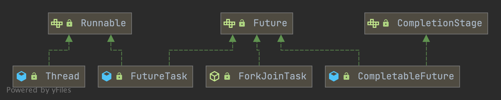
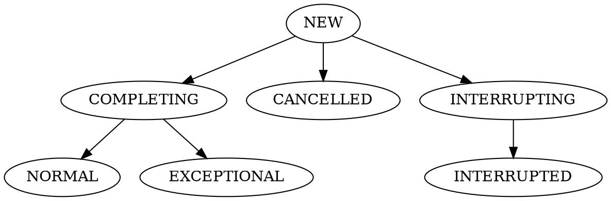

## Introduction


### Future Hierarchy



我们可以通过 [Thread](/docs/CS/Java/JDK/Concurrency/Thread.md) 对象以 **Runnable** 作为任务目标来创建线程，也可以使用 **FutureTask** 来获取 **Future**。

### Runnable

任何希望其实例被**线程执行**的类都应实现 Runnable 接口，并且必须定义一个无参方法 **run**。
该接口旨在为那些希望在自身活跃期间执行代码的对象提供统一的协议。**Thread 类本身即实现了 Runnable 接口。**

实现了 Runnable 接口的类无需继承 Thread 即可运行——只需创建 Thread 实例并将自身作为任务目标传入即可。这一点很重要：除非开发者确实打算修改或增强类的基础行为，否则不应通过继承 Thread 来实现。

```java
@FunctionalInterface
public interface Runnable {

    public abstract void run();
}
```


### Callable

Callable 表示一个**有返回值且可能抛出异常**的任务，实现类需定义一个无参方法 **call**。

**Runnable 不返回结果，也不能抛出受检异常。**

**Callable 接口与 Runnable 类似**，二者都是为那些实例可能被其他线程执行的类而设计的。 

**Executors** 类中提供了一些工具方法，可将其他常见形式转换为 Callable 类。

```java
@FunctionalInterface
public interface Callable<V> {
    /**
     * Computes a result, or throws an exception if unable to do so.
     */
    V call() throws Exception;
}
```


AccessController 类用于执行访问控制操作与决策。
更具体地说，AccessController 类用于以下三个目的：

1. 依据当前生效的安全策略，决定是否允许对关键系统资源的访问；
2. 将代码标记为"特权（privileged）"状态，从而影响后续的访问判定；
3. 获取当前调用上下文的"快照（snapshot）"，以便基于所保存的上下文在不同的上下文中做出访问控制决策。


### PrivilegedCallable

```java
/**
 * A callable that runs under established access control settings
 */
static final class PrivilegedCallable<T> implements Callable<T> {
    private final Callable<T> task;
    private final AccessControlContext acc;

    PrivilegedCallable(Callable<T> task) {
        this.task = task;
        this.acc = AccessController.getContext();
    }

    public T call() throws Exception {
        try {
            return AccessController.doPrivileged(
                new PrivilegedExceptionAction<T>() {
                    public T run() throws Exception {
                        return task.call();
                    }
                }, acc);
        } catch (PrivilegedActionException e) {
            throw e.getException();
        }
    }
}
```


```java
/**
 * A callable that runs under established access control settings and
 * current ClassLoader
 */
static final class PrivilegedCallableUsingCurrentClassLoader<T> implements Callable<T> {
    private final Callable<T> task;
    private final AccessControlContext acc;
    private final ClassLoader ccl;

    PrivilegedCallableUsingCurrentClassLoader(Callable<T> task) {
        SecurityManager sm = System.getSecurityManager();
        if (sm != null) {
            // Calls to getContextClassLoader from this class
            // never trigger a security check, but we check
            // whether our callers have this permission anyways.
            sm.checkPermission(SecurityConstants.GET_CLASSLOADER_PERMISSION);

            // Whether setContextClassLoader turns out to be necessary
            // or not, we fail fast if permission is not available.
            sm.checkPermission(new RuntimePermission("setContextClassLoader"));
        }
        this.task = task;
        this.acc = AccessController.getContext();
        this.ccl = Thread.currentThread().getContextClassLoader();
    }

    public T call() throws Exception {
        try {
            return AccessController.doPrivileged(
                new PrivilegedExceptionAction<T>() {
                    public T run() throws Exception {
                        Thread t = Thread.currentThread();
                        ClassLoader cl = t.getContextClassLoader();
                        if (ccl == cl) {
                            return task.call();
                        } else {
                            t.setContextClassLoader(ccl);
                            try {
                                return task.call();
                            } finally {
                                t.setContextClassLoader(cl);
                            }
                        }
                    }
                }, acc);
        } catch (PrivilegedActionException e) {
            throw e.getException();
        }
    }
}
```


### AccessControlContext

```java
/**
 * This method takes a "snapshot" of the current calling context, which
 * includes the current Thread's inherited AccessControlContext and any
 * limited privilege scope, and places it in an AccessControlContext object.
 * This context may then be checked at a later point, possibly in another thread.
 */
public static AccessControlContext getContext()
{
    AccessControlContext acc = getStackAccessControlContext();
    if (acc == null) {
        // all we had was privileged system code. We don't want
        // to return null though, so we construct a real ACC.
        return new AccessControlContext(null, true);
    } else {
        return acc.optimize();
    }
}

/**
 * Returns the AccessControl context. i.e., it gets
 * the protection domains of all the callers on the stack,
 * starting at the first class with a non-null
 * ProtectionDomain.
 */
private static native AccessControlContext getStackAccessControlContext();
```


## Future 


#### Example:

```java
interface ArchiveSearcher { String search(String target); }
 class App {
   ExecutorService executor = ...
   ArchiveSearcher searcher = ...
   void showSearch(String target) throws InterruptedException {
     Callable<String> task = () -> searcher.search(target);
     Future<String> future = executor.submit(task);
     displayOtherThings(); // do other things while searching
     try {
       displayText(future.get()); // use future
     } catch (ExecutionException ex) { cleanup(); return; }
   }
 }
```


**内存一致性效应（memory consistency effects）**：异步计算所执行的操作，happen-before 另一线程中在相应 Future.get() 调用之后的操作。

```java
/**
 * A {@code Future} represents the result of an asynchronous
 * computation.  Methods are provided to check if the computation is
 * complete, to wait for its completion, and to retrieve the result of
 * the computation.  The result can only be retrieved using method
 * {@code get} when the computation has completed, blocking if
 * necessary until it is ready.  Cancellation is performed by the
 * {@code cancel} method.  Additional methods are provided to
 * determine if the task completed normally or was cancelled. Once a
 * computation has completed, the computation cannot be cancelled.
 * If you would like to use a {@code Future} for the sake
 * of cancellability but not provide a usable result, you can
 * declare types of the form {@code Future<?>} and
 * return {@code null} as a result of the underlying task.
 */
public interface Future<V> {

    /**
     * Attempts to cancel execution of this task.  This attempt will
     * fail if the task has already completed, has already been cancelled,
     * or could not be cancelled for some other reason. If successful,
     * and this task has not started when {@code cancel} is called,
     * this task should never run.  If the task has already started,
     * then the {@code mayInterruptIfRunning} parameter determines
     * whether the thread executing this task should be interrupted in
     * an attempt to stop the task.
     *
     * <p>After this method returns, subsequent calls to {@link #isDone} will
     * always return {@code true}.  Subsequent calls to {@link #isCancelled}
     * will always return {@code true} if this method returned {@code true}.
     */
    boolean cancel(boolean mayInterruptIfRunning);

    // Returns {@code true} if this task was cancelled before it completed normally.
    boolean isCancelled();

    // Returns {@code true} if this task completed.
    boolean isDone();

    // Waits if necessary for the computation to complete, and then retrieves its result.
    V get() throws InterruptedException, ExecutionException;

    // Waits if necessary for at most the given time for the computation to complete, and then retrieves its result, if available
    V get(long timeout, TimeUnit unit)
        throws InterruptedException, ExecutionException, TimeoutException;
}
```


### RunnableFuture

既是 Future 又是 Runnable 的接口。run 方法成功执行会导致 Future 完成，并**允许获取其结果**。

```java
public interface RunnableFuture<V> extends Runnable, Future<V> {
    // Sets this Future to the result of its computation unless it has been cancelled.
    void run();
}
```


## FutureTask

**可取消的异步计算**。
该类为 *Future* 提供了基础实现，包含启动与取消计算、查询计算是否完成以及获取计算结果的方法。

只有在计算完成后才能获取结果；若计算尚未完成，**get 方法将阻塞**。
一旦计算完成，就**无法重新启动或取消（除非通过 runAndReset 调用计算）**。

FutureTask 可用于包装一个 *Callable* 或 *Runnable* 对象。
由于 FutureTask 实现了 Runnable，它可以被提交给一个 **Executor** 执行。
例如，上面用 submit 的写法可以替换为：

```
FutureTask future = new FutureTask<>(task);
executor.execute(future);
```

除了作为独立类使用外，该类还提供了一些 protected 方法，在创建自定义任务类时可能会有用。


参见 [Piggybacking on Synchronization - JMM](/docs/CS/Java/JDK/Concurrency/JMM.md?id=piggybacking-on-synchronization)

```java
public class FutureTask<V> implements RunnableFuture<V> {

    /** The underlying callable; nulled out after running */
    private Callable<V> callable;
    /** The result to return or exception to throw from get() */
    private Object outcome; // non-volatile, protected by state reads/writes
    /** The thread running the callable; CASed during run() */
    private volatile Thread runner;
    /** Treiber stack of waiting threads */
    private volatile WaitNode waiters;
}
```


### state

**修订说明**：
这与该类早期依赖 AbstractQueuedSynchronizer 的版本不同，主要目的是避免在取消竞争期间保留中断状态时给用户带来意外行为。
当前设计的同步控制依赖于通过 CAS 更新的 "state" 字段来跟踪完成情况，同时使用一个简单的 Treiber 栈来保存等待线程。


任务的运行状态，初始为 NEW。

运行状态只有在 set、setException 和 cancel 方法中才会转换到终态。

在完成过程中，state 可能会短暂地取 COMPLETING（正在设置 outcome 期间）或 INTERRUPTING（仅为满足 cancel(true) 而中断 runner 期间）这样的中间值。从中间状态到终态的转换使用代价更低的 ordered/lazy 写，因为这些值是唯一的、无法再被修改。

可能的状态转换：




```java
private volatile int state;
private static final int NEW          = 0;
private static final int COMPLETING   = 1;
private static final int NORMAL       = 2;
private static final int EXCEPTIONAL  = 3;
private static final int CANCELLED    = 4;
private static final int INTERRUPTING = 5;
private static final int INTERRUPTED  = 6;
```


构造方法

```java
public class FutureTask<V> implements RunnableFuture<V> {
    public FutureTask(Callable<V> callable) {
        if (callable == null)
            throw new NullPointerException();
        this.callable = callable;
        this.state = NEW;       // ensure visibility of callable
    }

    public FutureTask(Runnable runnable, V result) {
        this.callable = Executors.callable(runnable, result); // Adapater pattern
        this.state = NEW;       // ensure visibility of callable
    }

    // Executors#callable()
    public static <T> Callable<T> callable(Runnable task, T result) {
        if (task == null)
            throw new NullPointerException();
        return new RunnableAdapter<T>(task, result);
    }
}

static final class RunnableAdapter<T> implements Callable<T> {
    final Runnable task;
    final T result;
    RunnableAdapter(Runnable task, T result) {
        this.task = task;
        this.result = result;
    }
    public T call() {
        task.run();
        return result;
    }
}
```


### run


```java
public class FutureTask<V> implements RunnableFuture<V> {
    public void run() {
        if (state != NEW ||
                !RUNNER.compareAndSet(this, null, Thread.currentThread())) // CAS set runner
            return;
        try {
            Callable<V> c = callable;
            if (c != null && state == NEW) {
                V result;
                boolean ran;
                try {
                    result = c.call();
                    ran = true;
                } catch (Throwable ex) {
                    result = null;
                    ran = false;
                    setException(ex);
                }
                if (ran)
                    set(result);
            }
        } finally {
            // runner must be non-null until state is settled to
            // prevent concurrent calls to run()
            runner = null;
            // state must be re-read after nulling runner to prevent leaked interrupts
            int s = state;
            if (s >= INTERRUPTING)
                handlePossibleCancellationInterrupt(s);
        }
    }

    protected void set(V v) {
        if (STATE.compareAndSet(this, NEW, COMPLETING)) {
            outcome = v;
            STATE.setRelease(this, NORMAL); // final state
            finishCompletion();
        }
    }

    protected void setException(Throwable t) {
        if (STATE.compareAndSet(this, NEW, COMPLETING)) {
            outcome = t;
            STATE.setRelease(this, EXCEPTIONAL); // final state
            finishCompletion();
        }
    }
}
```


### handlePossibleCancellationInterrupt

确保可能由 cancel(true) 引发的中断，只会在任务处于 run 或 runAndReset 期间被投递给该任务。

**TODO**：为何删除 `Thread.interrupted();` ？

```java
private void handlePossibleCancellationInterrupt(int s) {
    // It is possible for our interrupter to stall before getting a
    // chance to interrupt us.  Let's spin-wait patiently.
    if (s == INTERRUPTING)
        while (state == INTERRUPTING)
            Thread.yield(); // wait out pending interrupt

    // assert state == INTERRUPTED;

    // We want to clear any interrupt we may have received from
    // cancel(true).  However, it is permissible to use interrupts
    // as an independent mechanism for a task to communicate with
    // its caller, and there is no way to clear only the
    // cancellation interrupt.
    //
    // Thread.interrupted();
}
```


### finishCompletion

```java
/**
 * Removes and signals all waiting threads, invokes done(), and
 * nulls out callable.
 */
private void finishCompletion() {
    // assert state > COMPLETING;
    for (WaitNode q; (q = waiters) != null;) {
        if (WAITERS.weakCompareAndSet(this, q, null)) {
            for (;;) {
                Thread t = q.thread;
                if (t != null) {
                    q.thread = null;
                    LockSupport.unpark(t);
                }
                WaitNode next = q.next;
                if (next == null)
                    break;
                q.next = null; // unlink to help gc
                q = next;
            }
            break;
        }
    }

    done();

    callable = null;        // to reduce footprint
}
```

```java
public class FutureTask<V> implements RunnableFuture<V> {
    

    /**
     * Returns result or throws exception for completed task.
     *
     * @param s completed state value
     */
    @SuppressWarnings("unchecked")
    private V report(int s) throws ExecutionException {
        Object x = outcome;
        if (s == NORMAL)
            return (V)x;
        if (s >= CANCELLED)
            throw new CancellationException();
        throw new ExecutionException((Throwable)x);
    }

    

    public boolean isCancelled() {
        return state >= CANCELLED;
    }

    public boolean isDone() {
        return state != NEW;
    }

    public boolean cancel(boolean mayInterruptIfRunning) {
        if (!(state == NEW &&
              UNSAFE.compareAndSwapInt(this, stateOffset, NEW,
                  mayInterruptIfRunning ? INTERRUPTING : CANCELLED)))
            return false;
        try {    // in case call to interrupt throws exception
            if (mayInterruptIfRunning) {
                try {
                    Thread t = runner;
                    if (t != null)
                        t.interrupt();
                } finally { // final state
                    UNSAFE.putOrderedInt(this, stateOffset, INTERRUPTED);
                }
            }
        } finally {
            finishCompletion();
        }
        return true;
    }

    /**
     * @throws CancellationException {@inheritDoc}
     */
    public V get() throws InterruptedException, ExecutionException {
        int s = state;
        if (s <= COMPLETING)
            s = awaitDone(false, 0L);
        return report(s);
    }

    /**
     * @throws CancellationException {@inheritDoc}
     */
    public V get(long timeout, TimeUnit unit)
        throws InterruptedException, ExecutionException, TimeoutException {
        if (unit == null)
            throw new NullPointerException();
        int s = state;
        if (s <= COMPLETING &&
            (s = awaitDone(true, unit.toNanos(timeout))) <= COMPLETING)
            throw new TimeoutException();
        return report(s);
    }

    /**
     * Protected method invoked when this task transitions to state
     * {@code isDone} (whether normally or via cancellation). The
     * default implementation does nothing.  Subclasses may override
     * this method to invoke completion callbacks or perform
     * bookkeeping. Note that you can query status inside the
     * implementation of this method to determine whether this task
     * has been cancelled.
     */
    protected void done() { }

    /**
     * Sets the result of this future to the given value unless
     * this future has already been set or has been cancelled.
     *
     * <p>This method is invoked internally by the {@link #run} method
     * upon successful completion of the computation.
     *
     * @param v the value
     */
    protected void set(V v) {
        if (UNSAFE.compareAndSwapInt(this, stateOffset, NEW, COMPLETING)) {
            outcome = v;
            UNSAFE.putOrderedInt(this, stateOffset, NORMAL); // final state
            finishCompletion();
        }
    }

    /**
     * Causes this future to report an {@link ExecutionException}
     * with the given throwable as its cause, unless this future has
     * already been set or has been cancelled.
     *
     * <p>This method is invoked internally by the {@link #run} method
     * upon failure of the computation.
     *
     * @param t the cause of failure
     */
    protected void setException(Throwable t) {
        if (UNSAFE.compareAndSwapInt(this, stateOffset, NEW, COMPLETING)) {
            outcome = t;
            UNSAFE.putOrderedInt(this, stateOffset, EXCEPTIONAL); // final state
            finishCompletion();
        }
    }

    public void run() {
        if (state != NEW ||
            !UNSAFE.compareAndSwapObject(this, runnerOffset,
                                         null, Thread.currentThread()))
            return;
        try {
            Callable<V> c = callable;
            if (c != null && state == NEW) {
                V result;
                boolean ran;
                try {
                    result = c.call();
                    ran = true;
                } catch (Throwable ex) {
                    result = null;
                    ran = false;
                    setException(ex);
                }
                if (ran)
                    set(result);
            }
        } finally {
            // runner must be non-null until state is settled to
            // prevent concurrent calls to run()
            runner = null;
            // state must be re-read after nulling runner to prevent
            // leaked interrupts
            int s = state;
            if (s >= INTERRUPTING)
                handlePossibleCancellationInterrupt(s);
        }
    }

    /**
     * Executes the computation without setting its result, and then
     * resets this future to initial state, failing to do so if the
     * computation encounters an exception or is cancelled.  This is
     * designed for use with tasks that intrinsically execute more
     * than once.
     *
     * @return {@code true} if successfully run and reset
     */
    protected boolean runAndReset() {
        if (state != NEW ||
            !UNSAFE.compareAndSwapObject(this, runnerOffset,
                                         null, Thread.currentThread()))
            return false;
        boolean ran = false;
        int s = state;
        try {
            Callable<V> c = callable;
            if (c != null && s == NEW) {
                try {
                    c.call(); // don't set result
                    ran = true;
                } catch (Throwable ex) {
                    setException(ex);
                }
            }
        } finally {
            // runner must be non-null until state is settled to
            // prevent concurrent calls to run()
            runner = null;
            // state must be re-read after nulling runner to prevent
            // leaked interrupts
            s = state;
            if (s >= INTERRUPTING)
                handlePossibleCancellationInterrupt(s);
        }
        return ran && s == NEW;
    }

    /**
     * Ensures that any interrupt from a possible cancel(true) is only
     * delivered to a task while in run or runAndReset.
     */
    private void handlePossibleCancellationInterrupt(int s) {
        // It is possible for our interrupter to stall before getting a
        // chance to interrupt us.  Let's spin-wait patiently.
        if (s == INTERRUPTING)
            while (state == INTERRUPTING)
                Thread.yield(); // wait out pending interrupt

        // assert state == INTERRUPTED;

        // We want to clear any interrupt we may have received from
        // cancel(true).  However, it is permissible to use interrupts
        // as an independent mechanism for a task to communicate with
        // its caller, and there is no way to clear only the
        // cancellation interrupt.
        //
        // Thread.interrupted();
    }

    /**
     * Removes and signals all waiting threads, invokes done(), and
     * nulls out callable.
     */
    private void finishCompletion() {
        // assert state > COMPLETING;
        for (WaitNode q; (q = waiters) != null;) {
            if (UNSAFE.compareAndSwapObject(this, waitersOffset, q, null)) {
                for (;;) {
                    Thread t = q.thread;
                    if (t != null) {
                        q.thread = null;
                        LockSupport.unpark(t);
                    }
                    WaitNode next = q.next;
                    if (next == null)
                        break;
                    q.next = null; // unlink to help gc
                    q = next;
                }
                break;
            }
        }

        done();

        callable = null;        // to reduce footprint
    }

    /**
     * Awaits completion or aborts on interrupt or timeout.
     *
     * @param timed true if use timed waits
     * @param nanos time to wait, if timed
     * @return state upon completion
     */
    private int awaitDone(boolean timed, long nanos)
        throws InterruptedException {
        final long deadline = timed ? System.nanoTime() + nanos : 0L;
        WaitNode q = null;
        boolean queued = false;
        for (;;) {
            if (Thread.interrupted()) {
                removeWaiter(q);
                throw new InterruptedException();
            }

            int s = state;
            if (s > COMPLETING) {
                if (q != null)
                    q.thread = null;
                return s;
            }
            else if (s == COMPLETING) // cannot time out yet
                Thread.yield();
            else if (q == null)
                q = new WaitNode();
            else if (!queued)
                queued = UNSAFE.compareAndSwapObject(this, waitersOffset,
                                                     q.next = waiters, q);
            else if (timed) {
                nanos = deadline - System.nanoTime();
                if (nanos <= 0L) {
                    removeWaiter(q);
                    return state;
                }
                LockSupport.parkNanos(this, nanos);
            }
            else
                LockSupport.park(this);
        }
    }

   
}
```


### WaitNode


```java
 /**
     * Simple linked list nodes to record waiting threads in a Treiber
     * stack.  See other classes such as Phaser and SynchronousQueue
     * for more detailed explanation.
     */
    static final class WaitNode {
        volatile Thread thread;
        volatile WaitNode next;
        WaitNode() { thread = Thread.currentThread(); }
    }
```


### get

若 state 为 NEW，则会在 `Future.get()` 上阻塞。

在使用 `DiscardPolicy` 或 `DiscardOldestPolicy` 时，建议改用 `Future.get(long timeout, TimeUnit unit)`。

```java
public V get() throws InterruptedException, ExecutionException {
    int s = state;
    if (s <= COMPLETING)
        s = awaitDone(false, 0L);
    return report(s);
}

public V get(long timeout, TimeUnit unit)
    throws InterruptedException, ExecutionException, TimeoutException {
    if (unit == null)
        throw new NullPointerException();
    int s = state;
    if (s <= COMPLETING &&
        (s = awaitDone(true, unit.toNanos(timeout))) <= COMPLETING)
        throw new TimeoutException();
    return report(s);
}


// Returns result or throws exception for completed task.
@SuppressWarnings("unchecked")
private V report(int s) throws ExecutionException {
  Object x = outcome;
  if (s == NORMAL)
    return (V)x;
  if (s >= CANCELLED)
    throw new CancellationException();
  throw new ExecutionException((Throwable)x);
}
```


#### awaitDone

等待完成，或在被中断或超时时中止。

下面的代码非常精妙，旨在实现以下目标：
- 每次调用 park 时恰好调用一次 nanoTime
- 若 nanos <= 0L，则立即返回，不分配对象也不调用 nanoTime
- 若 nanos == Long.MIN_VALUE，避免下溢
- 若 nanos == Long.MAX_VALUE，且 nanoTime 非单调并发生虚假唤醒，最坏情况也只是 park 自旋一段时间

```java
private int awaitDone(boolean timed, long nanos)
    throws InterruptedException {
    long startTime = 0L;    // Special value 0L means not yet parked
    WaitNode q = null;
    boolean queued = false;
    for (;;) {
        int s = state;
        if (s > COMPLETING) {
            if (q != null)
                q.thread = null;
            return s;
        }
        else if (s == COMPLETING)
            // We may have already promised (via isDone) that we are done
            // so never return empty-handed or throw InterruptedException
            Thread.yield();
        else if (Thread.interrupted()) {
            removeWaiter(q);
            throw new InterruptedException();
        }
        else if (q == null) {
            if (timed && nanos <= 0L)
                return s;
            q = new WaitNode();
        }
        else if (!queued)
            queued = WAITERS.weakCompareAndSet(this, q.next = waiters, q);
        else if (timed) {
            final long parkNanos;
            if (startTime == 0L) { // first time
                startTime = System.nanoTime();
                if (startTime == 0L)
                    startTime = 1L;
                parkNanos = nanos;
            } else {
                long elapsed = System.nanoTime() - startTime;
                if (elapsed >= nanos) {
                    removeWaiter(q);
                    return state;
                }
                parkNanos = nanos - elapsed;
            }
            // nanoTime may be slow; recheck before parking
            if (state < COMPLETING)
                LockSupport.parkNanos(this, parkNanos);
        }
        else
            LockSupport.park(this);
    }
}
```


#### removeWaiter

尝试断开（unlink）超时或中断的等待节点，以避免垃圾堆积。内部节点直接摘除而无需使用 *CAS*，因为即便被释放方（releaser）遍历到也无妨。为避免对已移除节点进行摘除带来的副作用，在出现明显竞争时会重新遍历链表。当节点数量很多时这会比较慢，但预计链表不会长到足以抵消更高开销方案的程度。

```java
 private void removeWaiter(WaitNode node) {
        if (node != null) {
            node.thread = null;
            retry:
            for (;;) {          // restart on removeWaiter race
                for (WaitNode pred = null, q = waiters, s; q != null; q = s) {
                    s = q.next;
                    if (q.thread != null)
                        pred = q;
                    else if (pred != null) {
                        pred.next = s;
                        if (pred.thread == null) // check for race
                            continue retry;
                    }
                    else if (!UNSAFE.compareAndSwapObject(this, waitersOffset,
                                                          q, s))
                        continue retry;
                }
                break;
            }
        }
    }
```


### cancel

```java
public boolean cancel(boolean mayInterruptIfRunning) {
    if (!(state == NEW && STATE.compareAndSet
          (this, NEW, mayInterruptIfRunning ? INTERRUPTING : CANCELLED)))
        return false;
    try {    // in case call to interrupt throws exception
        if (mayInterruptIfRunning) {
            try {
                Thread t = runner;
                if (t != null)
                    t.interrupt();
            } finally { // final state
                STATE.setRelease(this, INTERRUPTED);
            }
        }
    } finally {
        finishCompletion();
    }
    return true;
}
```


## CompletableFuture

> [!TIP]
>
> 本节是总览；完整的操作族、执行语义、异常传播与内部结构见专篇 [CompletableFuture](/docs/CS/Java/JDK/Concurrency/CompletableFuture.md)。

一种可以显式完成（设置其值与状态）的 Future，也可作为 CompletionStage 使用，支持在其完成时触发的依赖函数与动作。
当两个以上线程尝试完成、completeExceptionally 或取消一个 CompletableFuture 时，只有一个会成功。
除了上述及相关的直接操纵状态与结果的方法外，CompletableFuture 实现 CompletionStage 接口时遵循以下策略：

- 非异步（non-async）方法的依赖完成动作，可能由完成当前 CompletableFuture 的线程执行，也可能由任意其他调用了完成方法的线程执行。
- 所有未显式指定 Executor 参数的异步方法都使用 **ForkJoinPool.commonPool()** 执行（除非其并行度不足 2，此时会为每个任务新建一个 Thread 来运行）。非静态方法可在子类中通过重写 defaultExecutor() 来改变这一行为。为便于监控、调试与追踪，所有生成的异步任务都是标记接口 CompletableFuture.AsynchronousCompletionTask 的实例。带时间延迟的操作可使用本类定义的适配方法，例如 supplyAsync(supplier, delayedExecutor(timeout, timeUnit))。为支持带延迟与超时的方法，本类最多维护一个守护线程用于触发和取消动作，而非运行它们。
- 所有 CompletionStage 方法都独立于其他 public 方法实现，因此某一方法的行为不受子类中其他方法重写的影响。
- 所有 CompletionStage 方法都返回 CompletableFuture。若只想暴露接口 CompletionStage 中定义的方法，可使用 minimalCompletionStage 方法；若想确保调用方无法自行修改 future，可使用 copy 方法。


CompletableFuture 实现 Future 接口时还遵循以下策略：

- 与 FutureTask 不同，本类无法直接控制导致其完成的计算，因此取消被视为异常完成的另一种形式。cancel 方法的效果等同于 completeExceptionally(new CancellationException())。isCompletedExceptionally 方法可用于判断 CompletableFuture 是否以任何异常方式完成。
- 若以 CompletionException 异常完成，get() 和 get(long, TimeUnit) 会抛出 ExecutionException，其根因与对应 CompletionException 中保存的一致。为简化大多数场景下的使用，本类还定义了 join() 和 getNow 方法，它们在上述情况下直接抛出 CompletionException。


对于接受完成结果（即类型为 T 的参数）的方法，传入的参数可以为 null；但其他任何参数传 null 都会抛出 NullPointerException。
本类的子类通常应重写"虚拟构造器"方法 newIncompleteFuture，它决定了 CompletionStage 方法返回的具体类型。例如，下面这个类替换了默认的 Executor 并禁用了 obtrude 系列方法：

```java

 class MyCompletableFuture<T> extends CompletableFuture<T> {
   static final Executor myExecutor = ...;
   public MyCompletableFuture() { }
   public <U> CompletableFuture<U> newIncompleteFuture() {
     return new MyCompletableFuture<U>(); }
   public Executor defaultExecutor() {
     return myExecutor; }
   public void obtrudeValue(T value) {
     throw new UnsupportedOperationException(); }
   public void obtrudeException(Throwable ex) {
     throw new UnsupportedOperationException(); }
 }
```


默认执行器 —— ForkJoinPool.commonPool()

```java
private static final boolean USE_COMMON_POOL =
    (ForkJoinPool.getCommonPoolParallelism() > 1);

// Default executor -- ForkJoinPool.commonPool() unless it cannot support parallelism.
private static final Executor ASYNC_POOL = USE_COMMON_POOL ?
    ForkJoinPool.commonPool() : new ThreadPerTaskExecutor();
```

结果栈

```java
public class CompletableFuture<T> implements Future<T>, CompletionStage<T> {
    volatile Object result;       // Either the result or boxed AltResult
    volatile Completion stack;    // Top of Treiber stack of dependent actions
}
```

完成


### task chain

```java
public static <U> CompletableFuture<U> supplyAsync(Supplier<U> supplier) {
  return asyncSupplyStage(ASYNC_POOL, supplier);
}

public static <U> CompletableFuture<U> supplyAsync(Supplier<U> supplier, Executor executor) {
  return asyncSupplyStage(screenExecutor(executor), supplier);
}

public static CompletableFuture<Void> runAsync(Runnable runnable) {
  return asyncRunStage(ASYNC_POOL, runnable);
}

public static CompletableFuture<Void> runAsync(Runnable runnable, Executor executor) {
  return asyncRunStage(screenExecutor(executor), runnable);
}
```


随后执行另一个任务

```java
public <U> CompletableFuture<U> thenApplyAsync(
    Function<? super T,? extends U> fn, Executor executor) {
    return uniApplyStage(screenExecutor(executor), fn);
}

public CompletableFuture<Void> thenAcceptAsync(Consumer<? super T> action) {
  return uniAcceptStage(defaultExecutor(), action);
}

public CompletableFuture<Void> thenRunAsync(Runnable action,
                                            Executor executor) {
  return uniRunStage(screenExecutor(executor), action);
}
```


### handle Exception

```java
public CompletableFuture<T> exceptionallyAsync(
    Function<Throwable, ? extends T> fn, Executor executor) {
    return uniExceptionallyStage(screenExecutor(executor), fn);
}

public <U> CompletableFuture<U> handleAsync(
  BiFunction<? super T, Throwable, ? extends U> fn, Executor executor) {
  return uniHandleStage(screenExecutor(executor), fn);
}
```

异常大多会被包装进 `CompletionException.getCause()`

使用 `ExceptionUtils.extractRealException(err)` 获取真实的异常

### collect Results

```java
public <U,V> CompletableFuture<V> thenCombineAsync(
        CompletionStage<? extends U> other,
        BiFunction<? super T,? super U,? extends V> fn, Executor executor) {
        return biApplyStage(screenExecutor(executor), other, fn);
    }
```


```java
public <U> CompletableFuture<U> thenComposeAsync(
    Function<? super T, ? extends CompletionStage<U>> fn,
    Executor executor) {
    return uniComposeStage(screenExecutor(executor), fn);
}
```


allOf

```java
public static CompletableFuture<Void> allOf(CompletableFuture<?>... cfs) {
  return andTree(cfs, 0, cfs.length - 1);
}

static CompletableFuture<Void> andTree(CompletableFuture<?>[] cfs,
                                       int lo, int hi) {
    CompletableFuture<Void> d = new CompletableFuture<Void>();
    if (lo > hi) // empty
        d.result = NIL;
    else {
        CompletableFuture<?> a, b; Object r, s, z; Throwable x;
        int mid = (lo + hi) >>> 1;
        if ((a = (lo == mid ? cfs[lo] :
                  andTree(cfs, lo, mid))) == null ||
            (b = (lo == hi ? a : (hi == mid+1) ? cfs[hi] :
                  andTree(cfs, mid+1, hi))) == null)
            throw new NullPointerException();
        if ((r = a.result) == null || (s = b.result) == null)
            a.bipush(b, new BiRelay<>(d, a, b));
        else if ((r instanceof AltResult
                  && (x = ((AltResult)(z = r)).ex) != null) ||
                 (s instanceof AltResult
                  && (x = ((AltResult)(z = s)).ex) != null))
            d.result = encodeThrowable(x, z);
        else
            d.result = NIL;
    }
    return d;
}
```

anyOf

```java
public static CompletableFuture<Object> anyOf(CompletableFuture<?>... cfs) {
    int n; Object r;
    if ((n = cfs.length) <= 1)
        return (n == 0)
            ? new CompletableFuture<Object>()
            : uniCopyStage(cfs[0]);
    for (CompletableFuture<?> cf : cfs)
        if ((r = cf.result) != null)
            return new CompletableFuture<Object>(encodeRelay(r));
    cfs = cfs.clone();
    CompletableFuture<Object> d = new CompletableFuture<>();
    for (CompletableFuture<?> cf : cfs)
        cf.unipush(new AnyOf(d, cf, cfs));
    // If d was completed while we were adding completions, we should
    // clean the stack of any sources that may have had completions
    // pushed on their stack after d was completed.
    if (d.result != null)
        for (int i = 0, len = cfs.length; i < len; i++)
            if (cfs[i].result != null)
                for (i++; i < len; i++)
                    if (cfs[i].result == null)
                        cfs[i].cleanStack();
    return d;
}
```


该 future 的 join 与 get 方法所返回的结果类型

```java
public T join() {
    Object r;
    if ((r = result) == null)
        r = waitingGet(false);
    return (T) reportJoin(r);
}


// Decodes outcome to return result or throw unchecked exception.
private static Object reportJoin(Object r) {
  if (r instanceof AltResult) {
    Throwable x;
    if ((x = ((AltResult)r).ex) == null)
      return null;
    if (x instanceof CancellationException)
      throw (CancellationException)x;
    if (x instanceof CompletionException)
      throw (CompletionException)x;
    throw new CompletionException(x);
  }
  return r;
}
```

## Links

- [Concurrency](/docs/CS/Java/JDK/Concurrency/Concurrency.md)
- [CompletableFuture](/docs/CS/Java/JDK/Concurrency/CompletableFuture.md)
- [ThreadPool](/docs/CS/Java/JDK/Concurrency/ThreadPoolExecutor.md)
- [RxJava](/docs/CS/Framework/RxJava/RxJava.md)
- [Reactor](/docs/CS/Framework/reactor/Reactor.md)

## References
1. [FutureTask.isDone returns true when task has not yet completed](https://bugs.openjdk.java.net/browse/JDK-8073704)
