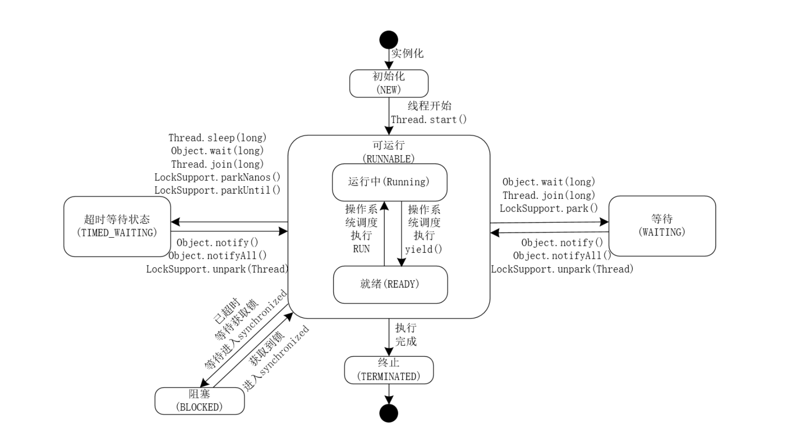

## Introduction

使用线程的主要原因之一是为了提升性能。线程能够让应用程序更充分地利用可用的处理能力，从而改善资源利用率；同时也能让应用程序在既有任务仍在运行时立即开始处理新任务，从而提升响应性。

## Create

线程由 `Thread` 类表示。用户创建线程的唯一途径是**创建该类的对象**；每个线程都关联着一个这样的对象。在对应的 `Thread` 对象上调用 `start()` 方法后，线程便会启动。

```java
// Allocates a new Thread object.
public Thread() {
    init(null, null, "Thread-" + nextThreadNum(), 0);
}

// Allocates a new Thread object with Runnable taarget.
public Thread(Runnable target) {
    init(null, target, "Thread-" + nextThreadNum(), 0);
}
```

### init
线程分为两类：普通线程（normal thread）与守护线程（daemon thread）。

普通线程与守护线程的区别仅在于退出时的行为。线程退出时，JVM 会清点在运行的线程；若仅剩下守护线程，JVM 便开始有序关闭。JVM 停止时，任何残留的守护线程都会被直接抛弃——finally 块不会执行，栈也不会被展开——JVM 直接退出。

守护线程并不能很好地替代对应用内服务生命周期的妥善管理。
```java
private void init(ThreadGroup g, Runnable target, String name,
                  long stackSize) {
  init(g, target, name, stackSize, null, true);
}

private void init(ThreadGroup g, Runnable target, String name,
                  long stackSize, AccessControlContext acc,
                  boolean inheritThreadLocals) {
  if (name == null) {
    throw new NullPointerException("name cannot be null");
  }

  this.name = name;

  Thread parent = currentThread();
  SecurityManager security = System.getSecurityManager();
  if (g == null) {
    /* Determine if it's an applet or not */

    /* If there is a security manager, ask the security manager
               what to do. */
    if (security != null) {
      g = security.getThreadGroup();
    }

    /* If the security doesn't have a strong opinion of the matter
               use the parent thread group. */
    if (g == null) {
      g = parent.getThreadGroup();
    }
  }

  /* checkAccess regardless of whether or not threadgroup is
           explicitly passed in. */
  g.checkAccess();

  /*
         * Do we have the required permissions?
         */
  if (security != null) {
    if (isCCLOverridden(getClass())) {
      security.checkPermission(SUBCLASS_IMPLEMENTATION_PERMISSION);
    }
  }

  g.addUnstarted();

  this.group = g;
  this.daemon = parent.isDaemon();
  this.priority = parent.getPriority();
  if (security == null || isCCLOverridden(parent.getClass()))
    this.contextClassLoader = parent.getContextClassLoader();
  else
    this.contextClassLoader = parent.contextClassLoader;
  this.inheritedAccessControlContext =
    acc != null ? acc : AccessController.getContext();
  this.target = target;
  setPriority(priority);
  if (inheritThreadLocals && parent.inheritableThreadLocals != null)
    this.inheritableThreadLocals =
    ThreadLocal.createInheritedMap(parent.inheritableThreadLocals);
  /* Stash the specified stack size in case the VM cares */
  this.stackSize = stackSize;

  /* Set thread ID */
  tid = nextThreadID();
}
```


### Example

1. 直接继承 Thread 创建线程
2. 使用 [ThreadLocalExecutor](/docs/CS/Java/JDK/Concurrency/ThreadPoolExecutor.md?id=threadpoolexecutor)
3. 使用 [CompletableFuture](/docs/CS/Java/JDK/Concurrency/Future.md?id=completablefuture) 提交任务
4. 使用 [FutureTask](/docs/CS/Java/JDK/Concurrency/Future.md?id=futuretask)


## Lifetime


线程可能处于以下状态之一：

| State        | Description                                                                                                           |
| ------------ |-----------------------------------------------------------------------------------------------------------------------|
| NEW          | 尚未启动的线程处于此状态。                                                                   |
| RUNNABLE     | 在 Java 虚拟机中执行的线程处于此状态。                                                      |
| BLOCKED      | 正在阻塞等待 [monitor lock]() 的线程处于此状态。                                             |
| WATING       | 无限期等待其他线程执行特定操作的线程处于此状态。             |
| TIME_WAITING | 等待其他线程在指定等待时间内执行某个操作的线程处于此状态。 |
| TERMINATED   | 已退出的线程处于此状态。                                                                            |


图源《Java并发编程的艺术》4.1.4节:



当线程未分配到时间片或者主动调用yield函数释放时间片时为Ready状态

## Start

使该线程开始执行；Java 虚拟机（JVM）会调用该线程的 run 方法。

结果是**两个线程并发运行**：

1. *当前线程（从 start 方法调用返回的那个）*
2. *另一个线程（执行其 run 方法的那个）*

一个线程被多次启动永远是不合法的。

使用 synchronized 与 volatile

```java
private volatile int threadStatus;

public synchronized void start() {

    if (threadStatus != 0)
        throw new IllegalThreadStateException();

    /* Notify the group that this thread is about to be started
     * so that it can be added to the group's list of threads
     * and the group's unstarted count can be decremented. */
    group.add(this);

    boolean started = false;
    try {
        start0();
        started = true;
    } finally {
        try {
            if (!started) {
                group.threadStartFailed(this);
            }
        } catch (Throwable ignore) {
            /* do nothing. If start0 threw a Throwable then it will be passed up the call stack */
        }
    }
}

private native void start0();
```

调用 [JVM_StartThread](/docs/CS/Java/JDK/Concurrency/Thread.md?id=jvm_startthread)
```c
//Thread.c
static JNINativeMethod methods[] = {
    {"start0",           "()V",        (void *)&JVM_StartThread},
    {"stop0",            "(" OBJ ")V", (void *)&JVM_StopThread},
    {"isAlive",          "()Z",        (void *)&JVM_IsThreadAlive},
    {"suspend0",         "()V",        (void *)&JVM_SuspendThread},
    {"resume0",          "()V",        (void *)&JVM_ResumeThread},
    {"setPriority0",     "(I)V",       (void *)&JVM_SetThreadPriority},
    {"yield",            "()V",        (void *)&JVM_Yield},
    {"sleep",            "(J)V",       (void *)&JVM_Sleep},
    {"currentThread",    "()" THD,     (void *)&JVM_CurrentThread},
    {"countStackFrames", "()I",        (void *)&JVM_CountStackFrames},
    {"interrupt0",       "()V",        (void *)&JVM_Interrupt},
    {"isInterrupted",    "(Z)Z",       (void *)&JVM_IsInterrupted},
    {"holdsLock",        "(" OBJ ")Z", (void *)&JVM_HoldsLock},
    {"getThreads",        "()[" THD,   (void *)&JVM_GetAllThreads},
    {"dumpThreads",      "([" THD ")[[" STE, (void *)&JVM_DumpThreads},
    {"setNativeName",    "(" STR ")V", (void *)&JVM_SetNativeThreadName},
};
```


### JVM_StartThread

JVM_StartThread:

1. `native_thread = new JavaThread`
   1. `os::create_thread` 调用 `pthread_create()`
   2. `while (state  == ALLOCATED)，Monitor::wait(Mutex::_no_safepoint_check_flag)`
   3. `Monitor::notify` 之后，`thread->call_run()`
2. `Thread::start(native_thread)`
   1. `os::start_thread(thread)`，设置 `set_state(RUNNABLE)`
   2. `pd_start_thread` 调用 `Monitor::notify`


```cpp
//jvm.cpp
JVM_ENTRY(void, JVM_StartThread(JNIEnv* env, jobject jthread))
  JVMWrapper("JVM_StartThread");
  JavaThread *native_thread = NULL;

  // We cannot hold the Threads_lock when we throw an exception,
  // due to rank ordering issues. Example:  we might need to grab the
  // Heap_lock while we construct the exception.
  bool throw_illegal_thread_state = false;

  // We must release the Threads_lock before we can post a jvmti event
  // in Thread::start.
  {
    // Ensure that the C++ Thread and OSThread structures aren't freed before
    // we operate.
    MutexLocker mu(Threads_lock);

    // Since JDK 5 the java.lang.Thread threadStatus is used to prevent
    // re-starting an already started thread, so we should usually find
    // that the JavaThread is null. However for a JNI attached thread
    // there is a small window between the Thread object being created
    // (with its JavaThread set) and the update to its threadStatus, so we
    // have to check for this
    if (java_lang_Thread::thread(JNIHandles::resolve_non_null(jthread)) != NULL) {
      throw_illegal_thread_state = true;
    } else {
      // We could also check the stillborn flag to see if this thread was already stopped, but
      // for historical reasons we let the thread detect that itself when it starts running

      jlong size =
             java_lang_Thread::stackSize(JNIHandles::resolve_non_null(jthread));
```
分配 C++ 层 Thread 结构并创建本地（native）线程。从 Java 获取的栈大小是 64 位有符号值，而构造函数接收的是 size_t（无符号类型），根据平台不同可能是 32 位或 64 位。
 - 在 32 位平台上，若大小超过 UINT_MAX，应避免截断。
 - 应避免传入负值，否则会产生极大的栈。
```
      NOT_LP64(if (size > SIZE_MAX) size = SIZE_MAX;)
      size_t sz = size > 0 ? (size_t) size : 0;
```
调用 [new JavaThread](/docs/CS/Java/JDK/Concurrency/Thread.md?id=javathreadjavathread)
```cpp
      native_thread = new JavaThread(&thread_entry, sz);

      // At this point it may be possible that no osthread was created for the
      // JavaThread due to lack of memory. Check for this situation and throw
      // an exception if necessary. Eventually we may want to change this so
      // that we only grab the lock if the thread was created successfully -
      // then we can also do this check and throw the exception in the
      // JavaThread constructor.
      if (native_thread->osthread() != NULL) {
        // Note: the current thread is not being used within "prepare".
        native_thread->prepare(jthread);
      }
    }
  }

  if (throw_illegal_thread_state) {
    THROW(vmSymbols::java_lang_IllegalThreadStateException());
  }

  if (native_thread->osthread() == NULL) {
    // No one should hold a reference to the 'native_thread'.
    native_thread->smr_delete();
    if (JvmtiExport::should_post_resource_exhausted()) {
      JvmtiExport::post_resource_exhausted(
        JVMTI_RESOURCE_EXHAUSTED_OOM_ERROR | JVMTI_RESOURCE_EXHAUSTED_THREADS,
        os::native_thread_creation_failed_msg());
    }
    THROW_MSG(vmSymbols::java_lang_OutOfMemoryError(),
              os::native_thread_creation_failed_msg());
  }

  Thread::start(native_thread);
JVM_END
```


`thread_entry` 用于 JavaCalls 

```cpp
// jvm.cpp
static void thread_entry(JavaThread* thread, TRAPS) {
  HandleMark hm(THREAD);
  Handle obj(THREAD, thread->threadObj());
  JavaValue result(T_VOID);
  JavaCalls::call_virtual(&result,
                          obj,
                          SystemDictionary::Thread_klass(),
                          // template(run_method_name, "run") 
                          vmSymbols::run_method_name(),
                          vmSymbols::void_method_signature(),
                          THREAD);
}
```


### JavaThread::JavaThread


```cpp
// thread.cpp
JavaThread::JavaThread(ThreadFunction entry_point, size_t stack_sz) :
                       Thread() {
  initialize();
  _jni_attach_state = _not_attaching_via_jni;
  set_entry_point(entry_point);
  // Create the native thread itself.
  // %note runtime_23
  os::ThreadType thr_type = os::java_thread;
  thr_type = entry_point == &compiler_thread_entry ? os::compiler_thread :
                                                     os::java_thread;
  os::create_thread(this, thr_type, stack_sz);
  // The _osthread may be NULL here because we ran out of memory (too many threads active).
  // We need to throw and OutOfMemoryError - however we cannot do this here because the caller
  // may hold a lock and all locks must be unlocked before throwing the exception (throwing
  // the exception consists of creating the exception object & initializing it, initialization
  // will leave the VM via a JavaCall and then all locks must be unlocked).
  //
  // The thread is still suspended when we reach here. Thread must be explicit started
  // by creator! Furthermore, the thread must also explicitly be added to the Threads list
  // by calling Threads:add. The reason why this is not done here, is because the thread
  // object must be fully initialized (take a look at JVM_Start)
}
```


### os::create_thread

待办 PTHREAD_CREATE_DETACHED

```cpp
//os_linux.cpp
bool os::create_thread(Thread* thread, ThreadType thr_type,
                       size_t req_stack_size) {
  assert(thread->osthread() == NULL, "caller responsible");

  // Allocate the OSThread object
  OSThread* osthread = new OSThread(NULL, NULL);
  if (osthread == NULL) {
    return false;
  }

  // set the correct thread state
  osthread->set_thread_type(thr_type);

  // Initial state is ALLOCATED but not INITIALIZED
  osthread->set_state(ALLOCATED);

  thread->set_osthread(osthread);

  // init thread attributes
  pthread_attr_t attr;
  pthread_attr_init(&attr);
  pthread_attr_setdetachstate(&attr, PTHREAD_CREATE_DETACHED);

  // Calculate stack size if it's not specified by caller.
  size_t stack_size = os::Posix::get_initial_stack_size(thr_type, req_stack_size);
  // In the Linux NPTL pthread implementation the guard size mechanism
  // is not implemented properly. The posix standard requires adding
  // the size of the guard pages to the stack size, instead Linux
  // takes the space out of 'stacksize'. Thus we adapt the requested
  // stack_size by the size of the guard pages to mimick proper
  // behaviour. However, be careful not to end up with a size
  // of zero due to overflow. Don't add the guard page in that case.
  size_t guard_size = os::Linux::default_guard_size(thr_type);
  if (stack_size <= SIZE_MAX - guard_size) {
    stack_size += guard_size;
  }
  assert(is_aligned(stack_size, os::vm_page_size()), "stack_size not aligned");

  int status = pthread_attr_setstacksize(&attr, stack_size);
  assert_status(status == 0, status, "pthread_attr_setstacksize");

  // Configure glibc guard page.
  pthread_attr_setguardsize(&attr, os::Linux::default_guard_size(thr_type));

  ThreadState state;

  {
    pthread_t tid;
    //
    int ret = pthread_create(&tid, &attr, (void* (*)(void*)) thread_native_entry, thread);

    char buf[64];
    if (ret == 0) {
      log_info(os, thread)("Thread started (pthread id: " UINTX_FORMAT ", attributes: %s). ",
        (uintx) tid, os::Posix::describe_pthread_attr(buf, sizeof(buf), &attr));
    } else {
      log_warning(os, thread)("Failed to start thread - pthread_create failed (%s) for attributes: %s.",
        os::errno_name(ret), os::Posix::describe_pthread_attr(buf, sizeof(buf), &attr));
    }

    pthread_attr_destroy(&attr);

    if (ret != 0) {
      // Need to clean up stuff we've allocated so far
      thread->set_osthread(NULL);
      delete osthread;
      return false;
    }

    // Store pthread info into the OSThread
    osthread->set_pthread_id(tid);

    // Wait until child thread is either initialized or aborted
    {
      Monitor* sync_with_child = osthread->startThread_lock();
      MutexLockerEx ml(sync_with_child, Mutex::_no_safepoint_check_flag);
      while ((state = osthread->get_state()) == ALLOCATED) {
        sync_with_child->wait(Mutex::_no_safepoint_check_flag);
      }
    }
  }

  // Aborted due to thread limit being reached
  if (state == ZOMBIE) {
    thread->set_osthread(NULL);
    delete osthread;
    return false;
  }

  // The thread is returned suspended (in state INITIALIZED),
  // and is started higher up in the call chain
  assert(state == INITIALIZED, "race condition");
  return true;
}

// Thread start routine for all newly created threads
static void *thread_native_entry(Thread *thread) {

  thread->record_stack_base_and_size();

  // Try to randomize the cache line index of hot stack frames.
  // This helps when threads of the same stack traces evict each other's
  // cache lines. The threads can be either from the same JVM instance, or
  // from different JVM instances. The benefit is especially true for
  // processors with hyperthreading technology.
  static int counter = 0;
  int pid = os::current_process_id();
  alloca(((pid ^ counter++) & 7) * 128);

  thread->initialize_thread_current();

  OSThread* osthread = thread->osthread();
  Monitor* sync = osthread->startThread_lock();

  osthread->set_thread_id(os::current_thread_id());

  log_info(os, thread)("Thread is alive (tid: " UINTX_FORMAT ", pthread id: " UINTX_FORMAT ").",
    os::current_thread_id(), (uintx) pthread_self());

  if (UseNUMA) {
    int lgrp_id = os::numa_get_group_id();
    if (lgrp_id != -1) {
      thread->set_lgrp_id(lgrp_id);
    }
  }
  // initialize signal mask for this thread
  os::Linux::hotspot_sigmask(thread);

  // initialize floating point control register
  os::Linux::init_thread_fpu_state();

  // handshaking with parent thread
  {
    MutexLockerEx ml(sync, Mutex::_no_safepoint_check_flag);

    // notify parent thread
    osthread->set_state(INITIALIZED);
    sync->notify_all();

    // wait until os::start_thread()
    while (osthread->get_state() == INITIALIZED) {
      sync->wait(Mutex::_no_safepoint_check_flag);
    }
  }

  // call one more level start routine
  thread->call_run();

  // Note: at this point the thread object may already have deleted itself.
  // Prevent dereferencing it from here on out.
  thread = NULL;

  log_info(os, thread)("Thread finished (tid: " UINTX_FORMAT ", pthread id: " UINTX_FORMAT ").",
    os::current_thread_id(), (uintx) pthread_self());

  return 0;
}
```

### Thread::start

在该线程启动前，将其线程状态初始化为 RUNNABLE。

线程启动后便不能再设置，因为此时无法确定其确切状态——它可能处于 MONITOR_WAIT、SLEEPING 或其他状态。


```cpp
// thread.cpp
void Thread::start(Thread* thread) {
  // Start is different from resume in that its safety is guaranteed by context or
  // being called from a Java method synchronized on the Thread object.
  if (!DisableStartThread) {
    if (thread->is_Java_thread()) {
     java_lang_Thread::set_thread_status(((JavaThread*)thread)->threadObj(),
                                          java_lang_Thread::RUNNABLE);
    }
    os::start_thread(thread);
  }
}


// The INITIALIZED state is distinguished from the SUSPENDED state because the
// conditions in which a thread is first started are different from those in which
// a suspension is resumed.  These differences make it hard for us to apply the
// tougher checks when starting threads that we want to do when resuming them.
// However, when start_thread is called as a result of Thread.start, on a Java
// thread, the operation is synchronized on the Java Thread object.  So there
// cannot be a race to start the thread and hence for the thread to exit while
// we are working on it.  Non-Java threads that start Java threads either have
// to do so in a context in which races are impossible, or should do appropriate
// locking.

//os.cpp
void os::start_thread(Thread* thread) {
  // guard suspend/resume
  MutexLockerEx ml(thread->SR_lock(), Mutex::_no_safepoint_check_flag);
  OSThread* osthread = thread->osthread();
  osthread->set_state(RUNNABLE);
  pd_start_thread(thread);
}

// os_linux.cpp
void os::pd_start_thread(Thread* thread) {
  OSThread * osthread = thread->osthread();
  assert(osthread->get_state() != INITIALIZED, "just checking");
  Monitor* sync_with_child = osthread->startThread_lock();
  MutexLockerEx ml(sync_with_child, Mutex::_no_safepoint_check_flag);
  sync_with_child->notify();
}
```


### Monitor::notify


```cpp
// mutex.cpp
bool Monitor::notify() {
  assert(_owner == Thread::current(), "invariant");
  assert(ILocked(), "invariant");
  if (_WaitSet == NULL) return true;

  // Transfer one thread from the WaitSet to the EntryList or cxq.
  // Currently we just unlink the head of the WaitSet and prepend to the cxq.
  // And of course we could just unlink it and unpark it, too, but
  // in that case it'd likely impale itself on the reentry.
  Thread::muxAcquire(_WaitLock, "notify:WaitLock");
  ParkEvent * nfy = _WaitSet;
  if (nfy != NULL) {                  // DCL idiom
    _WaitSet = nfy->ListNext;
    assert(nfy->Notified == 0, "invariant");
    // push nfy onto the cxq
    for (;;) {
      const intptr_t v = _LockWord.FullWord;
      assert((v & 0xFF) == _LBIT, "invariant");
      nfy->ListNext = (ParkEvent *)(v & ~_LBIT);
      if (Atomic::cmpxchg(intptr_t(nfy)|_LBIT, &_LockWord.FullWord, v) == v) break;
      // interference - _LockWord changed -- just retry
    }
    // Note that setting Notified before pushing nfy onto the cxq is
    // also legal and safe, but the safety properties are much more
    // subtle, so for the sake of code stewardship ...
    OrderAccess::fence();
    nfy->Notified = 1;
  }
  Thread::muxRelease(_WaitLock);
  assert(ILocked(), "invariant");
  return true;
}
```


### JavaThread::run

```cpp
// thread.cpp
// The first routine called by a new Java thread
void JavaThread::run() {
  // initialize thread-local alloc buffer related fields
  this->initialize_tlab();

  // used to test validity of stack trace backs
  this->record_base_of_stack_pointer();

  this->create_stack_guard_pages();

  this->cache_global_variables();

  // Thread is now sufficient initialized to be handled by the safepoint code as being
  // in the VM. Change thread state from _thread_new to _thread_in_vm
  ThreadStateTransition::transition_and_fence(this, _thread_new, _thread_in_vm);

  DTRACE_THREAD_PROBE(start, this);

  // This operation might block. We call that after all safepoint checks for a new thread has
  // been completed.
  this->set_active_handles(JNIHandleBlock::allocate_block());

  if (JvmtiExport::should_post_thread_life()) {
    JvmtiExport::post_thread_start(this);

  }

  // We call another function to do the rest so we are sure that the stack addresses used
  // from there will be lower than the stack base just computed
  thread_main_inner();

  // Note, thread is no longer valid at this point!
}

void JavaThread::thread_main_inner() {
```
除非该线程存在待处理异常或在启动前已被停止，否则执行线程入口点。
注意：由于 `JVM_StopThread` 的存在，可能已经存在待处理异常！
```cpp
  if (!this->has_pending_exception() &&
      !java_lang_Thread::is_stillborn(this->threadObj())) {
    {
      ResourceMark rm(this);
      //set native thread name
      this->set_native_thread_name(this->get_thread_name());
    }
    HandleMark hm(this);
```
执行 entry_point -> run_method_name(`Thread.run()`)
```cpp
    this->entry_point()(this, this);
  }

  this->exit(false);
  this->smr_delete();
}
```


## Wait Sets and Notification

除关联的监视器（monitor）外，每个对象还拥有一个关联的*等待集（wait set）*。等待集是一组线程的集合。

对象刚被创建时，其等待集为空。将线程加入或移出等待集的基本操作是原子的。

等待集只能通过 `Object``.``wait`、`Object``.``notify` 和 `Object``.``notifyAll` 这些方法进行操作。

### wait
**当前线程必须持有 [this object's monitor](/docs/CS/Java/JDK/Concurrency/synchronized.md?id=objectmonitor)。** 使用 `CHECK_OWNER`。

> [!NOTE]
> 
> 在 while 循环中调用 `wait`，以避免**虚假唤醒（spurious wakeups）**。

导致当前线程等待，直到满足以下条件之一：
- 其他线程对该对象调用了 `Object::notify` 或 `Object::notifyAll`；
- 或经过了指定的时间；
- 或当前线程被其他线程中断。**抛出异常时，当前线程的中断状态会被清除。**

每个线程都必须对可能导致自身被移出等待集的事件确定一个顺序。该顺序无需与其他顺序保持一致，但线程必须表现得如同这些事件就是按该顺序发生的。

例如，若线程 t 位于对象 m 的等待集中，随后 t 被中断且 m 被通知，那么这两类事件之间必须存在一个顺序。若认定中断先发生，则 t 最终会抛出 InterruptedException 从 wait 返回，而 m 的等待集中其他线程（若在通知时尚存在）必须收到通知。若认定通知先发生，则 t 最终会正常从 wait 返回，且中断仍处于挂起状态。


```java
public final native void wait(long timeout) throws InterruptedException;

public final void wait(long timeout, int nanos) throws InterruptedException {
    wait(timeout);
}

public final void wait() throws InterruptedException {
    wait(0);
}
```


#### join

最多等待 millis 毫秒，直到该线程终止。超时为 0 表示永久等待。该实现使用以 this.isAlive 为条件的 **this.wait 循环调用**。线程终止时会调用 this.notifyAll 方法。**建议应用程序不要在 Thread 实例上调用 wait、notify 或 notifyAll。**


实际调用 [wait](/docs/CS/Java/JDK/Concurrency/Thread.md?id=wait)
```java
public final synchronized void join(long millis) throws InterruptedException {
    //...
    while (isAlive()) {
        wait(0);
    }
}
```


#### ObjectSynchronizer::wait

必须通过 [ObjectSynchronizer::inflate](/docs/CS/Java/JDK/Concurrency/synchronized.md?id=inflate) 获取监视器

```cpp
// NOTE: must use heavy weight monitor to handle wait()
int ObjectSynchronizer::wait(Handle obj, jlong millis, TRAPS) {
  if (UseBiasedLocking) {
    BiasedLocking::revoke_and_rebias(obj, false, THREAD);
  }
  ObjectMonitor* monitor = ObjectSynchronizer::inflate(THREAD,
                                                       obj(),
                                                       inflate_cause_wait);
	//invoke ObjectMonitor::wait
  monitor->wait(millis, true, THREAD);

  return dtrace_waited_probe(monitor, obj, THREAD);
}
```

#### ObjectMonitor::wait

1. 检查是否存在待处理中断并 ClearInterrupted，THROW(vmSymbols::java_lang_InterruptedException())
2. CHECK_OWNER
3. **AddWaiter**，进入等待队列
4. 退出监视器
5. **`Park`** 自身
6. ReenterI，或在被其他线程 unPark 时进入

```cpp
//objectMonitor.cpp
void ObjectMonitor::wait(jlong millis, bool interruptible, TRAPS) {
  Thread * const Self = THREAD;
  JavaThread *jt = (JavaThread *)THREAD;

  CHECK_OWNER();

  EventJavaMonitorWait event;

  // check for a pending interrupt and ClearInterrupted
  if (interruptible && Thread::is_interrupted(Self, true) && !HAS_PENDING_EXCEPTION) {
    THROW(vmSymbols::java_lang_InterruptedException());
    return;
  }

	// AddWaiter
  Thread::SpinAcquire(&_WaitSetLock, "WaitSet - add");
  AddWaiter(&node);
  Thread::SpinRelease(&_WaitSetLock);

  _Responsible = NULL;

  intptr_t save = _recursions; // record the old recursion count
  _waiters++;                  // increment the number of waiters
  _recursions = 0;             // set the recursion level to be 1
  exit(true, Self);                    // exit the monitor
  guarantee(_owner != Self, "invariant");

  // TODO-FIXME: change the following logic to a loop of the form
  //   while (!timeout && !interrupted && _notified == 0) park()
        if (millis <= 0) {
          Self->_ParkEvent->park();
        } else {
          ret = Self->_ParkEvent->park(millis);
        }
	// Exit thread safepoint: transition _thread_blocked -> _thread_in_vm

    

    if (node.TState == ObjectWaiter::TS_WAIT) {
      Thread::SpinAcquire(&_WaitSetLock, "WaitSet - unlink");
      if (node.TState == ObjectWaiter::TS_WAIT) {
        DequeueSpecificWaiter(&node);       // unlink from WaitSet
        node.TState = ObjectWaiter::TS_RUN;
      }
      Thread::SpinRelease(&_WaitSetLock);
    }

    // post monitor waited event. Note that this is past-tense, we are done waiting.
    if (JvmtiExport::should_post_monitor_waited()) {
      JvmtiExport::post_monitor_waited(jt, this, ret == OS_TIMEOUT);

      if (node._notified != 0 && _succ == Self) {
        node._event->unpark();
      }
    }
		
  	// enter or reenter 
    ObjectWaiter::TStates v = node.TState;
    if (v == ObjectWaiter::TS_RUN) {
      enter(Self);
    } else {
      guarantee(v == ObjectWaiter::TS_ENTER || v == ObjectWaiter::TS_CXQ, "invariant");
      ReenterI(Self, &node);
      node.wait_reenter_end(this);
    }
  	// OSThreadWaitState()

  jt->set_current_waiting_monitor(NULL);

  guarantee(_recursions == 0, "invariant");
  _recursions = save;     // restore the old recursion count
  _waiters--;             // decrement the number of waiters

  // check if the notification happened
  if (!WasNotified) {
    // no, it could be timeout or Thread.interrupt() or both
    // check for interrupt event, otherwise it is timeout
    if (interruptible && Thread::is_interrupted(Self, true) && !HAS_PENDING_EXCEPTION) {
      THROW(vmSymbols::java_lang_InterruptedException());
    }
  }
}
```


### Notification

退出同步块时唤醒线程

|       | notify | notifyAll |
| ----- | ------ | --------- |
| 顺序  | FIFO   | LIFO      |

notifyAll 从尾到头遍历


```java
public final native void notify();

public final native void notifyAll();

```

**待办**：*考虑：若锁处于空闲状态（cxq == null && succ == null）且处于多处理器（MP）系统，那么与其将线程从 WaitSet 转移到 EntryList，不如直接从 WaitSet 取出一个线程并对其调用 unpark()。*

*考虑：一种并不少见的同步错误是在应使用 `notifyAll()` 的场合误用 `notify()`，可能导致线程被搁置（stranded threads）；这正是丢失唤醒（lost wakeup）的一个例子。一个有用的诊断手段是强制所有 notify() 操作表现得如同 notifyAll()。*

*注意：我们也可以通过"最小等待（minimum wait）"来检测许多这类问题。当"最小等待"被设为一个较小的非零超时值、且程序不再像没有"最小等待"时那样卡死时，就提示存在丢失唤醒的 bug。*


从 WaitSet 出队到 EntryList 或 _cxq

```cpp
void ObjectMonitor::notify(TRAPS) {
  CHECK_OWNER();
  if (_WaitSet == NULL) {
    return;
  }
  DTRACE_MONITOR_PROBE(notify, this, object(), THREAD);
  INotify(THREAD);
  OM_PERFDATA_OP(Notifications, inc(1));
}

void ObjectMonitor::INotify(Thread * Self) {
  Thread::SpinAcquire(&_WaitSetLock, "WaitSet - notify");
  ObjectWaiter * iterator = DequeueWaiter();
  if (iterator != NULL) {
    guarantee(iterator->TState == ObjectWaiter::TS_WAIT, "invariant");
    guarantee(iterator->_notified == 0, "invariant");
    // Disposition - what might we do with iterator ?
    // a.  add it directly to the EntryList - either tail (policy == 1)
    //     or head (policy == 0).
    // b.  push it onto the front of the _cxq (policy == 2).
    // For now we use (b).

    iterator->TState = ObjectWaiter::TS_ENTER;

    iterator->_notified = 1;
    iterator->_notifier_tid = JFR_THREAD_ID(Self);

    ObjectWaiter * list = _EntryList;
    if (list != NULL) {
      assert(list->_prev == NULL, "invariant");
      assert(list->TState == ObjectWaiter::TS_ENTER, "invariant");
      assert(list != iterator, "invariant");
    }

    // prepend to cxq
    if (list == NULL) {
      iterator->_next = iterator->_prev = NULL;
      _EntryList = iterator;
    } else {
      iterator->TState = ObjectWaiter::TS_CXQ;
      for (;;) {
        ObjectWaiter * front = _cxq;
        iterator->_next = front;
        if (Atomic::cmpxchg(iterator, &_cxq, front) == front) {
          break;
        }
      }
    }
```
_WaitSetLock 保护的是等待队列，而非 EntryList。我们可以将上方的"加入 EntryList"操作移到 _WaitSetLock 保护的临界区之外。但在实践中这并无益处。除了 wait() 的超时与中断外，监视器的持有者（owner）是唯一会获取 _WaitSetLock 的线程。_WaitSetLock 上几乎不存在竞争，因此缩短临界区长度并无收益。

```cpp
    iterator->wait_reenter_begin(this);
  }
  Thread::SpinRelease(&_WaitSetLock);
}
```


*_WaitSetLock 保护的是等待队列，而非 EntryList。我们可以将上方的"加入 EntryList"操作移到 _WaitSetLock 保护的临界区之外。但在实践中这并无益处。除了 wait() 的超时与中断外，监视器的持有者是唯一会获取 _WaitSetLock 的线程。**_WaitSetLock 上几乎不存在竞争**，因此缩短临界区长度并无收益。*

**notifyAll**：JavaThread 退出时

```cpp
void JavaThread::exit(bool destroy_vm, ExitType exit_type) {
	//...
  ensure_join(this);
  //...
}
static void ensure_join(JavaThread* thread) {
    Handle threadObj(thread, thread->threadObj());

    ObjectLocker lock(threadObj, thread);

    thread->clear_pending_exception();

    java_lang_Thread::set_thread_status(threadObj(),        java_lang_Thread::TERMINATED);
    java_lang_Thread::set_thread(threadObj(), NULL);
    //notify_all
    lock.notify_all(thread);
    thread->clear_pending_exception();
}
```


#### ObjectMonitor::exit

```cpp
void ObjectMonitor::exit(bool not_suspended, TRAPS) {
  Thread * const Self = THREAD;
  if (THREAD != _owner) {
    if (THREAD->is_lock_owned((address) _owner)) {
      // Transmute _owner from a BasicLock pointer to a Thread address.
      // We don't need to hold _mutex for this transition.
      // Non-null to Non-null is safe as long as all readers can
      // tolerate either flavor.
      assert(_recursions == 0, "invariant");
      _owner = THREAD;
      _recursions = 0;
    } else {
      // Apparent unbalanced locking ...
      // Naively we'd like to throw IllegalMonitorStateException.
      // As a practical matter we can neither allocate nor throw an
      // exception as ::exit() can be called from leaf routines.
      // see x86_32.ad Fast_Unlock() and the I1 and I2 properties.
      // Upon deeper reflection, however, in a properly run JVM the only
      // way we should encounter this situation is in the presence of
      // unbalanced JNI locking. TODO: CheckJNICalls.
      // See also: CR4414101
      assert(false, "Non-balanced monitor enter/exit! Likely JNI locking");
      return;
    }
  }

  if (_recursions != 0) {
    _recursions--;        // this is simple recursive enter
    return;
  }

  // Invariant: after setting Responsible=null an thread must execute
  // a MEMBAR or other serializing instruction before fetching EntryList|cxq.
  _Responsible = NULL;

#if INCLUDE_JFR
  // get the owner's thread id for the MonitorEnter event
  // if it is enabled and the thread isn't suspended
  if (not_suspended && EventJavaMonitorEnter::is_enabled()) {
    _previous_owner_tid = JFR_THREAD_ID(Self);
  }
#endif

  for (;;) {
    assert(THREAD == _owner, "invariant");

    // release semantics: prior loads and stores from within the critical section
    // must not float (reorder) past the following store that drops the lock.
    // On SPARC that requires MEMBAR #loadstore|#storestore.
    // But of course in TSO #loadstore|#storestore is not required.
    OrderAccess::release_store(&_owner, (void*)NULL);   // drop the lock
    OrderAccess::storeload();                        // See if we need to wake a successor
    if ((intptr_t(_EntryList)|intptr_t(_cxq)) == 0 || _succ != NULL) {
      return;
    }
    // Other threads are blocked trying to acquire the lock.

    // Normally the exiting thread is responsible for ensuring succession,
    // but if other successors are ready or other entering threads are spinning
    // then this thread can simply store NULL into _owner and exit without
    // waking a successor.  The existence of spinners or ready successors
    // guarantees proper succession (liveness).  Responsibility passes to the
    // ready or running successors.  The exiting thread delegates the duty.
    // More precisely, if a successor already exists this thread is absolved
    // of the responsibility of waking (unparking) one.
    //
    // The _succ variable is critical to reducing futile wakeup frequency.
    // _succ identifies the "heir presumptive" thread that has been made
    // ready (unparked) but that has not yet run.  We need only one such
    // successor thread to guarantee progress.
    // See http://www.usenix.org/events/jvm01/full_papers/dice/dice.pdf
    // section 3.3 "Futile Wakeup Throttling" for details.
    //
    // Note that spinners in Enter() also set _succ non-null.
    // In the current implementation spinners opportunistically set
    // _succ so that exiting threads might avoid waking a successor.
    // Another less appealing alternative would be for the exiting thread
    // to drop the lock and then spin briefly to see if a spinner managed
    // to acquire the lock.  If so, the exiting thread could exit
    // immediately without waking a successor, otherwise the exiting
    // thread would need to dequeue and wake a successor.
    // (Note that we'd need to make the post-drop spin short, but no
    // shorter than the worst-case round-trip cache-line migration time.
    // The dropped lock needs to become visible to the spinner, and then
    // the acquisition of the lock by the spinner must become visible to
    // the exiting thread).

    // It appears that an heir-presumptive (successor) must be made ready.
    // Only the current lock owner can manipulate the EntryList or
    // drain _cxq, so we need to reacquire the lock.  If we fail
    // to reacquire the lock the responsibility for ensuring succession
    // falls to the new owner.
    //
    if (!Atomic::replace_if_null(THREAD, &_owner)) {
      return;
    }

    guarantee(_owner == THREAD, "invariant");

    ObjectWaiter * w = NULL;

    w = _EntryList;
    if (w != NULL) {
      // I'd like to write: guarantee (w->_thread != Self).
      // But in practice an exiting thread may find itself on the EntryList.
      // Let's say thread T1 calls O.wait().  Wait() enqueues T1 on O's waitset and
      // then calls exit().  Exit release the lock by setting O._owner to NULL.
      // Let's say T1 then stalls.  T2 acquires O and calls O.notify().  The
      // notify() operation moves T1 from O's waitset to O's EntryList. T2 then
      // release the lock "O".  T2 resumes immediately after the ST of null into
      // _owner, above.  T2 notices that the EntryList is populated, so it
      // reacquires the lock and then finds itself on the EntryList.
      // Given all that, we have to tolerate the circumstance where "w" is
      // associated with Self.
      assert(w->TState == ObjectWaiter::TS_ENTER, "invariant");
      ExitEpilog(Self, w);
      return;
    }

    // If we find that both _cxq and EntryList are null then just
    // re-run the exit protocol from the top.
    w = _cxq;
    if (w == NULL) continue;

    // Drain _cxq into EntryList - bulk transfer.
    // First, detach _cxq.
    // The following loop is tantamount to: w = swap(&cxq, NULL)
    for (;;) {
      assert(w != NULL, "Invariant");
      ObjectWaiter * u = Atomic::cmpxchg((ObjectWaiter*)NULL, &_cxq, w);
      if (u == w) break;
      w = u;
    }

    assert(w != NULL, "invariant");
    assert(_EntryList == NULL, "invariant");

    // Convert the LIFO SLL anchored by _cxq into a DLL.
    // The list reorganization step operates in O(LENGTH(w)) time.
    // It's critical that this step operate quickly as
    // "Self" still holds the outer-lock, restricting parallelism
    // and effectively lengthening the critical section.
    // Invariant: s chases t chases u.
    // TODO-FIXME: consider changing EntryList from a DLL to a CDLL so
    // we have faster access to the tail.

    _EntryList = w;
    ObjectWaiter * q = NULL;
    ObjectWaiter * p;
    for (p = w; p != NULL; p = p->_next) {
      guarantee(p->TState == ObjectWaiter::TS_CXQ, "Invariant");
      p->TState = ObjectWaiter::TS_ENTER;
      p->_prev = q;
      q = p;
    }

    // In 1-0 mode we need: ST EntryList; MEMBAR #storestore; ST _owner = NULL
    // The MEMBAR is satisfied by the release_store() operation in ExitEpilog().

    // See if we can abdicate to a spinner instead of waking a thread.
    // A primary goal of the implementation is to reduce the
    // context-switch rate.
    if (_succ != NULL) continue;

    w = _EntryList;
    if (w != NULL) {
      guarantee(w->TState == ObjectWaiter::TS_ENTER, "invariant");
      ExitEpilog(Self, w);
      return;
    }
  }
}
```

#### ObjectMonitor::ExitEpilog

Exit protocol:

1. ST _succ = wakee
2. membar #loadstore|#storestore;
3. ST _owner = NULL
4. unpark(wakee)

```cpp
void ObjectMonitor::ExitEpilog(Thread * Self, ObjectWaiter * Wakee) {
  ParkEvent * Trigger = Wakee->_event;

  // Hygiene -- once we've set _owner = NULL we can't safely dereference Wakee again.
  // The thread associated with Wakee may have grabbed the lock and "Wakee" may be
  // out-of-scope (non-extant).
  Wakee  = NULL;

  // Drop the lock
  OrderAccess::release_store(&_owner, (void*)NULL);
  OrderAccess::fence();                               // ST _owner vs LD in unpark()

  DTRACE_MONITOR_PROBE(contended__exit, this, object(), Self);
  Trigger->unpark();

  // Maintain stats and report events to JVMTI
  OM_PERFDATA_OP(Parks, inc());
}
```


### Interruptions

*`interrupt` 方法会中断**该线程**.*
除非是当前线程中断自身（这始终被允许），否则会调用该线程的 checkAccess 方法，这可能抛出 SecurityException。
所谓中断，实际上并不会真正打断一个正在运行的线程——它只是请求该线程在下一个合适的时机自行中断。
1. 若该线程因调用 Object 类的 wait()、wait(long) 或 wait(long, int) 方法，或本类的 join()、join(long)、join(long, int)、sleep(long) 或 sleep(long, int) 方法而阻塞，则其中断状态会被清除，并收到 InterruptedException。

2. 若该线程在 InterruptibleChannel 上的 I/O 操作中阻塞，则通道会被关闭，线程的中断状态会被设置，并收到 java.nio.channels.ClosedByInterruptException。若该线程在 java.nio.channels.Selector 上阻塞，则其中断状态会被设置，并立即从选择操作中返回（可能携带非零值），如同调用了选择器的 wakeup 方法一样。

3. 若以上条件均不满足，则设置该线程的中断状态。

4. 中断一个未存活的线程不会产生任何效果。

线程可能因多种原因阻塞：等待从 Thread.sleep() 唤醒、等待获取锁、等待 I/O 完成，或等待另一线程的计算结果等。

InterruptedException 通常由所有阻塞方法抛出，以便被捕获后采取纠正措施。Java 中有多个方法会抛出 InterruptedException，例如 Thread.sleep()、Thread.join()、Object 类的 wait() 方法，以及 BlockingQueue 的 put() 和 take() 方法等。


*`interrupted` 方法用于检测**当前线程**是否已被中断，并清除其中断状态。*
*`isInterrupted` 方法用于检测**该线程**是否已被中断。若因中断发生时线程尚未存活而忽略中断，本方法会返回 false 来反映这一点。*

```java
public void interrupt() {
    if (this != Thread.currentThread())
        checkAccess();

    synchronized (blockerLock) {
        Interruptible b = blocker;
        if (b != null) {
            interrupt0();           // Just to set the interrupt flag
            b.interrupt(this);
            return;
        }
    }
    interrupt0();
}

public static boolean interrupted() {
    return currentThread().isInterrupted(true);
}

public boolean isInterrupted() {
    return isInterrupted(false);
}

private native boolean isInterrupted(boolean ClearInterrupted);
```

```cpp
// share/runtime/thread.cpp
void JavaThread::interrupt() {
  // All callers should have 'this' thread protected by a
  // ThreadsListHandle so that it cannot terminate and deallocate
  // itself.

  // For Thread.sleep
  _SleepEvent->unpark();

  // For JSR166 LockSupport.park
  parker()->unpark();

  // For ObjectMonitor and JvmtiRawMonitor
  _ParkEvent->unpark();
}
```

#### JVM_Interrupt

1. `OSThread::set_interrupted(true)`
2. `ParkEvent::unpark`

```c
//Thread.c
{"interrupt0",       "()V",        (void *)&JVM_Interrupt},
```

```cpp
//jvm.cpp
JVM_ENTRY(void, JVM_Interrupt(JNIEnv* env, jobject jthread))
  JVMWrapper("JVM_Interrupt");

  ThreadsListHandle tlh(thread);
  JavaThread* receiver = NULL;
  bool is_alive = tlh.cv_internal_thread_to_JavaThread(jthread, &receiver, NULL);
  if (is_alive) {
    // jthread refers to a live JavaThread.
    Thread::interrupt(receiver);
  }
JVM_END

//thread.cpp
void Thread::interrupt(Thread* thread) {
  os::interrupt(thread);
}

// os.posix.cpp
void os::interrupt(Thread* thread) {
  OSThread* osthread = thread->osthread();

  if (!osthread->interrupted()) {
    osthread->set_interrupted(true);
    // More than one thread can get here with the same value of osthread,
    // resulting in multiple notifications.  We do, however, want the store
    // to interrupted() to be visible to other threads before we execute unpark().
    OrderAccess::fence();
    ParkEvent * const slp = thread->_SleepEvent ;
    if (slp != NULL) slp->unpark() ;
  }

  // For JSR166. Unpark even if interrupt status already was set
  if (thread->is_Java_thread())
    ((JavaThread*)thread)->parker()->unpark();

  ParkEvent * ev = thread->_ParkEvent ;
  if (ev != NULL) ev->unpark() ;
}
```


### Interactions of Waits, Notification, and Interruption
> 摘自 JLS：
> 
> 若线程在等待期间同时被通知和中断，它可能：
> - 正常从 wait 返回，但仍存在一个挂起的中断（换言之，调用 `Thread.interrupted` 会返回 true）
> - 或抛出 `InterruptedException` 从 wait 返回
> 线程不能既重置其中断状态、又正常从 wait 调用返回。
> 
> 类似地，**通知不会因中断而丢失**。假设线程集合 *s* 位于对象 *m* 的等待集中，另一个线程对 *m* 执行了 `notify`，那么必定满足以下之一：
> 
> - *s* 中至少有一个线程正常从 `wait` 返回，或
> - *s* 中所有线程都通过抛出 `InterruptedException` 退出 `wait`
> 
> **注意：若一个线程既被中断又因 `notify` 被唤醒，且该线程通过抛出 `InterruptedException` 从 wait 返回，那么等待集中必有另一线程被通知。**

例如两个线程等待锁时，可能出现 thread1 被通知且 `Thread.interrupted` 返回 true，而另一线程仍在等待的情况。

```
synchronized (lockObject) {
    thread1.interrupt();
  	// Thread.yield(); 
    lockObject.notify();
}
```


## Sleep and Yield


`Thread.sleep()` 使当前线程在指定时长内休眠（暂停执行），实际精度与准确度取决于系统定时器与调度器的实现。
线程**不会失去对任何监视器的所有权**，何时恢复执行则取决于调度情况以及是否有可用处理器。

**需要注意，`Thread.sleep` 与 `Thread.yield` 均不具备任何同步语义。**
具体而言，编译器不必在调用 sleep 或 yield 之前把缓存在寄存器中的写入刷新到共享内存，
也不必在调用 sleep 或 yield 之后重新加载缓存在寄存器中的值。

> 例如，在下面这段（有缺陷的）代码中，假定 this.done 是一个非 volatile 的 boolean 字段：

```
    while (!this.done)
        Thread.sleep(1000);
```

> 编译器完全可以只读取一次 this.done 字段，并在循环的每次执行中复用缓存的值。
> 这意味着即便其他线程修改了 this.done 的值，该循环也永远不会终止。


|              | wait      | yield       | sleep       |
|--------------|-----------| ----------- | ----------- |
| 来源         | Object    | Thread      | Thread      |
| 锁           | 相关      | 无关        | 无关        |
| 中断         | 抛异常    |             | 抛异常      |
| CPU          | 释放      |         释放      | 释放      |


### sleep
若 millis = 0，则行为类似 `os::naked_yield()`，参见 [Thread#yield()](/docs/CS/Java/JDK/Concurrency/Thread.md?id=yield)
```cpp

​```c
//Thread.c
static JNINativeMethod methods[] = {
    {"sleep",            "(J)V",       (void *)&JVM_Sleep},
    ...
};

// jvm.cpp
JVM_ENTRY(void, JVM_Sleep(JNIEnv* env, jclass threadClass, jlong millis))
  JVMWrapper("JVM_Sleep");

  if (millis < 0) {
    THROW_MSG(vmSymbols::java_lang_IllegalArgumentException(), "timeout value is negative");
  }

  if (Thread::is_interrupted (THREAD, true) && !HAS_PENDING_EXCEPTION) {
    THROW_MSG(vmSymbols::java_lang_InterruptedException(), "sleep interrupted");
  }

  // Save current thread state and restore it at the end of this block.
  // And set new thread state to SLEEPING.
  JavaThreadSleepState jtss(thread);

  HOTSPOT_THREAD_SLEEP_BEGIN(millis);
  EventThreadSleep event;

  if (millis == 0) {
    os::naked_yield();
  } else {
    ThreadState old_state = thread->osthread()->get_state();
    thread->osthread()->set_state(SLEEPING);
    if (os::sleep(thread, millis, true) == OS_INTRPT) {
      // An asynchronous exception (e.g., ThreadDeathException) could have been thrown on
      // us while we were sleeping. We do not overwrite those.
      if (!HAS_PENDING_EXCEPTION) {
        if (event.should_commit()) {
          post_thread_sleep_event(&event, millis);
        }
        HOTSPOT_THREAD_SLEEP_END(1);

        // TODO-FIXME: THROW_MSG returns which means we will not call set_state()
        // to properly restore the thread state.  That's likely wrong.
        THROW_MSG(vmSymbols::java_lang_InterruptedException(), "sleep interrupted");
      }
    }
    thread->osthread()->set_state(old_state);
  }
  if (event.should_commit()) {
    post_thread_sleep_event(&event, millis);
  }
  HOTSPOT_THREAD_SLEEP_END(0);
JVM_END
```

#### os::sleep
1. `OSThread::set_interrupted(true)`
2. `ParkEvent::park`

当由 [interrupt()](/docs/CS/Java/JDK/Concurrency/Thread.md?id=jvm_interrupt) 触发 `ParkEvent::unpark` 时，在下一次循环中使用 `OSThread::set_interrupted(true)`。

```cpp
// os_posix.cpp
int os::sleep(Thread* thread, jlong millis, bool interruptible) {

  ParkEvent * const slp = thread->_SleepEvent ;
  slp->reset() ;
  OrderAccess::fence() ;

  if (interruptible) {
    jlong prevtime = javaTimeNanos();

    for (;;) {
      // check for a pending interrupt and ClearInterrupted
      if (os::is_interrupted(thread, true)) { 
        return OS_INTRPT;
      }

      jlong newtime = javaTimeNanos();

      if (newtime - prevtime < 0) {
        // time moving backwards, should only happen if no monotonic clock
        // not a guarantee() because JVM should not abort on kernel/glibc bugs
        assert(!os::supports_monotonic_clock(), "unexpected time moving backwards detected in os::sleep(interruptible)");
      } else {
        millis -= (newtime - prevtime) / NANOSECS_PER_MILLISEC;
      }

      if (millis <= 0) {
        return OS_OK;
      }

      prevtime = newtime;

      {
        assert(thread->is_Java_thread(), "sanity check");
        JavaThread *jt = (JavaThread *) thread;
        ThreadBlockInVM tbivm(jt);
        OSThreadWaitState osts(jt->osthread(), false /* not Object.wait() */);

        jt->set_suspend_equivalent();
        // cleared by handle_special_suspend_equivalent_condition() or
        // java_suspend_self() via check_and_wait_while_suspended()

        slp->park(millis);

        // were we externally suspended while we were waiting?
        jt->check_and_wait_while_suspended();
      }
    }
  } else {
    OSThreadWaitState osts(thread->osthread(), false /* not Object.wait() */);
    jlong prevtime = javaTimeNanos();

    for (;;) {
      // It'd be nice to avoid the back-to-back javaTimeNanos() calls on
      // the 1st iteration ...
      jlong newtime = javaTimeNanos();

      if (newtime - prevtime < 0) {
        // time moving backwards, should only happen if no monotonic clock
        // not a guarantee() because JVM should not abort on kernel/glibc bugs
        assert(!os::supports_monotonic_clock(), "unexpected time moving backwards detected on os::sleep(!interruptible)");
      } else {
        millis -= (newtime - prevtime) / NANOSECS_PER_MILLISEC;
      }

      if (millis <= 0) break ;

      prevtime = newtime;
      slp->park(millis);
    }
    return OS_OK ;
  }
}
```

### yield
调用 os::naked_yield()
```c
//Thread.c
static JNINativeMethod methods[] = {
    {"yield",            "()V",        (void *)&JVM_Yield},
    ...
};

// jvm.cpp
JVM_ENTRY(void, JVM_Yield(JNIEnv *env, jclass threadClass))
  if (os::dont_yield()) return;
  HOTSPOT_THREAD_YIELD();
  os::naked_yield();
JVM_END
```

Linux CFS 调度器（自 2.6.23 起）并不保证 `sched_yield(2)` 真的会让出 CPU。自 skip buddy 机制（v2.6.28）引入后：
- 将正在让出的任务设为当前 CPU 运行队列上的 skip buddy。
- 先从运行队列中选取下一个任务；若运行队列为空，则选取某个 skip buddy（可能就是正在让出的那个任务）。
- 清除该运行队列上的 skip buddy（正在让出的任务不再是 skip buddy）。
  另一种做法是以较小的时长调用 os::naked_short_nanosleep，以避免被立即重新调度。

```cpp
// os_linux.cpp
void os::naked_yield() {
  sched_yield();
}
```


## Timing

`TimeUnit` 类为指定和控制基于超时的操作提供了多种粒度（包括纳秒级）。
本包中的大多数类除无限期等待之外，也包含基于超时的操作。
所有使用超时的地方，超时值都表示方法在宣告超时之前至少应等待的时长。
各实现会「尽力而为」，在超时发生后尽快将其检测出来。
但从超时被检测到，到线程在该超时之后真正重新执行之间，仍可能流逝不定长的时间。
所有接受超时参数的方法都把小于或等于零的值视为完全不等待。
若要「永远」等待，可以传入 `Long.MAX_VALUE`。


`TimeUnit` 表示某个给定粒度单位下的时间跨度，并提供在各单位之间换算、以及以这些单位执行计时与延时操作的工具方法。
`TimeUnit` 本身并不保存时间信息，只是帮助组织和使用那些可能在不同上下文中被分别保存的时间表示。

`TimeUnit` 主要用于告知基于时间的方法，某个时间参数应如何解释。

但需注意，并没有保证某个具体的超时实现能够以与所给 `TimeUnit` 相同的粒度感知时间的流逝。


**便捷方法：**

| 方法           | TimeUnit 中的便捷方法 |
| -------------- | ------------------------------ |
| *Object.wait*  | *timedWait*                    |
| *Thread.join*  | *timedJoin*                    |
| *Thread.sleep* | *sleep*                        |

```java
/**
 * Performs a timed {@link Object#wait(long, int) Object.wait}
 * using this time unit.
 */
public void timedWait(Object obj, long timeout)
        throws InterruptedException {
    if (timeout > 0) {
        long ms = toMillis(timeout);
        int ns = excessNanos(timeout, ms);
        obj.wait(ms, ns);
    }
}

/**
 * Performs a timed {@link Thread#join(long, int) Thread.join}
 * using this time unit.
 */
public void timedJoin(Thread thread, long timeout)
        throws InterruptedException {
    if (timeout > 0) {
        long ms = toMillis(timeout);
        int ns = excessNanos(timeout, ms);
        thread.join(ms, ns);
    }
}

/**
 * Performs a {@link Thread#sleep(long, int) Thread.sleep} using
 * this time unit.
 */
public void sleep(long timeout) throws InterruptedException {
    if (timeout > 0) {
        long ms = toMillis(timeout);
        int ns = excessNanos(timeout, ms);
        Thread.sleep(ms, ns);
    }
}
```

## Thread Affinity


参见 [OpenHFT Java Thread Affinity library](https://github.com/OpenHFT/Java-Thread-Affinity)

## features

### priority

优先级分配的是 时间片长度 不保证执行顺序


### Inter-thread Communication


wait/notify await/signal  Thread.join


终端 Interrupt

synchronized/lock

ThreadLocal


## Fiber

参见 [Loom](/docs/CS/Java/JDK/Loom.md)。

抢占式线程调度（Preemptive Thread Scheduling）

虚拟线程（Virtual Thread）


## Tuning

现象： 线程阻塞

手段： jstack查看线程堆栈 可以grep出启动main线程 查看是 parking在哪里
比如 线程池 Druid获取连接 例如某处执行sql时需要获取连接 但是此时是数据库组件未初始化完成之前 此时阻塞在DruidDataSource.getConnection()


## Links
- [Concurrency](/docs/CS/Java/JDK/Concurrency/Concurrency.md)
- [JVM Thread](/docs/CS/Java/JDK/JVM/Thread.md)


## References

1. [JLS - Threads and Locks](https://docs.oracle.com/javase/specs/jls/se8/html/jls-17.html)
2. [The JSR-133 Cookbook for Compiler Writers - Doug Lea](http://gee.cs.oswego.edu/dl/jmm/cookbook.html)
3. [JSR 133 (Java Memory Model) FAQ - Jeremy Manson and Brian Goetz, February 2004](https://www.cs.umd.edu/~pugh/java/memoryModel/jsr-133-faq.html)
4. [Understanding Threads and Locks](https://docs.oracle.com/cd/E13150_01/jrockit_jvm/jrockit/geninfo/diagnos/thread_basics.html)
