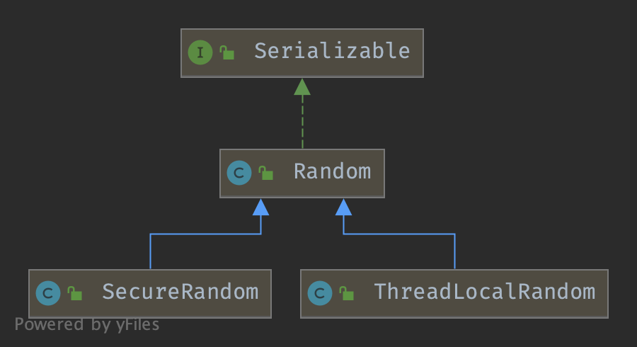

## Introduction


### Random Hierarchy





## Random

`java.util.Random`

`Random` 类的实例用于生成一串伪随机数。它使用一个 **48 位种子（seed）**，并借助线性同余公式（linear congruential formula）对种子进行修改。
如果**创建两个使用相同种子的 Random 实例，并对二者调用相同的方法序列，它们会生成并返回完全相同的数字序列**。

为了保证这一特性，Random 类明确规定了特定的算法。出于 Java 代码绝对可移植性的考虑，Java 实现必须沿用此处列出的全部算法；不过 Random 的子类只要遵循所有方法的通用契约，也可以使用其它算法。
Random 类实现的算法借助一个受保护的工具方法，每次调用最多可**提供 32 个伪随机生成的比特**。

对多数应用而言，`Math.random` 方法使用起来更简单。

`java.util.Random` 的实例是**线程安全（threadsafe）的**。然而，**在多线程间并发共用同一个 Random 实例会遇到竞争（contention），进而导致性能下降**。
在多线程设计中，建议改用 **java.util.concurrent.ThreadLocalRandom**。

java.util.Random 的实例**并非密码学安全的**。
在安全敏感的应用中，建议改用 **java.security.SecureRandom**，以获得密码学安全的伪随机数生成器。


```java
public class Random implements RandomGenerator, java.io.Serializable {
    public Random() {
        this(seedUniquifier() ^ System.nanoTime());
    }

    private static long seedUniquifier() {
        // L'Ecuyer, "Tables of Linear Congruential Generators of
        // Different Sizes and Good Lattice Structure", 1999
        for (;;) {
            long current = seedUniquifier.get();
            long next = current * 1181783497276652981L;
            if (seedUniquifier.compareAndSet(current, next))
                return next;
        }
    }
    
    private final AtomicLong seed;

    private static final long multiplier = 0x5DEECE66DL;
    private static final long addend = 0xBL;
    private static final long mask = (1L << 48) - 1;

    private static final double DOUBLE_UNIT = 0x1.0p-53; // 1.0 / (1L << 53)

    private static final AtomicLong seedUniquifier
            = new AtomicLong(8682522807148012L);
}
```

生成下一个伪随机数。子类应覆写该方法，因为其它所有方法都依赖它。
next 方法的通用契约是：返回一个 int 值；若参数 bits 介于 1 到 32（含）之间，
则返回值中低 bits 位的每一个比特都是（近似）独立选出的，且取 0 或 1 的概率（近似）相等。
next 方法在 Random 类中的实现是：原子地将种子更新为 (seed * 0x5DEECE66DL + 0xBL) & ((1L << 48) - 1)，然后返回 (int)(seed >>> (48 - bits))

```java
public class Random implements RandomGenerator, java.io.Serializable {
    protected int next(int bits) {
        long oldseed, nextseed;
        AtomicLong seed = this.seed;
        do {
            oldseed = seed.get();
            nextseed = (oldseed * multiplier + addend) & mask;
        } while (!seed.compareAndSet(oldseed, nextseed));
        return (int) (nextseed >>> (48 - bits));
    }
}
```


## ThreadLocalRandom


一个仅作用于当前线程的随机数生成器。<br/>
与 Math 类使用的全局 Random 生成器一样，ThreadLocalRandom 使用内部生成的种子完成初始化，该种子不可通过其它途径修改。
在适用的场景下，并发程序中使用 ThreadLocalRandom 而非共享的 Random 对象，通常遇到的额外开销与争用要少得多。
当多个任务（例如各自的 ForkJoinTask）在线程池中并行使用随机数时，使用 ThreadLocalRandom 尤为合适。


### Get ThreadLocalRandom instance

调用 `ThreadLocalRandom.current()` 获取 `static singleton`。

当 `Thread.threadLocalRandomProbe` 为 0 时，调用 `localInit( )`。

```
/** Generates per-thread initialization/probe field */
private static final AtomicInteger probeGenerator = new AtomicInteger();

/** The common ThreadLocalRandom */
static final ThreadLocalRandom instance = new ThreadLocalRandom();

/**
 * The next seed for default constructors.
 */
private static final AtomicLong seeder
    = new AtomicLong(mix64(System.currentTimeMillis()) ^
                     mix64(System.nanoTime()));

/** Constructor used only for static singleton */
private ThreadLocalRandom() {
    initialized = true; // false during super() call
}

```


为当前线程初始化 Thread 中的相关字段。
仅当 `Thread.threadLocalRandomProbe` 为 0（即表明需要生成线程局部种子值）时才会被调用。
注意：即便初始化本身完全是线程局部的，仍然要依赖（静态的）原子生成器来初始化这些值。

```java
static final void localInit() {
    int p = probeGenerator.addAndGet(PROBE_INCREMENT);
    int probe = (p == 0) ? 1 : p; // skip 0
    long seed = mix64(seeder.getAndAdd(SEEDER_INCREMENT));
    Thread t = Thread.currentThread();
    U.putLong(t, SEED, seed);
    U.putInt(t, PROBE, probe);
}
```


### Seed and Probe in Thread

下面三个初始时未赋值的字段由 `java.util.concurrent.ThreadLocalRandom` 类独占管理。
这些字段用于构建并发代码中的高性能 PRNG，不能冒出现伪共享（false sharing）的风险，因此通过 [**@Contended**]() 将它们隔离开。

```
/** The current seed for a ThreadLocalRandom */
@jdk.internal.vm.annotation.Contended("tlr")
long threadLocalRandomSeed;

/** Probe hash value; nonzero if threadLocalRandomSeed initialized */
@jdk.internal.vm.annotation.Contended("tlr")
int threadLocalRandomProbe;

/** Secondary seed isolated from public ThreadLocalRandom sequence */
@jdk.internal.vm.annotation.Contended("tlr")
int threadLocalRandomSecondarySeed;
```


### Fields in ThreadLocalRandom

使用 `jdk.internal.misc.Unsafe` 获取 Thread.class 中的字段偏移。

```java
// Unsafe mechanics
private static final Unsafe U = Unsafe.getUnsafe();
private static final long SEED
    = U.objectFieldOffset(Thread.class, "threadLocalRandomSeed");
private static final long PROBE
    = U.objectFieldOffset(Thread.class, "threadLocalRandomProbe");
private static final long SECONDARY
    = U.objectFieldOffset(Thread.class, "threadLocalRandomSecondarySeed");
private static final long THREADLOCALS
    = U.objectFieldOffset(Thread.class, "threadLocals");
private static final long INHERITABLETHREADLOCALS
    = U.objectFieldOffset(Thread.class, "inheritableThreadLocals");
private static final long INHERITEDACCESSCONTROLCONTEXT
    = U.objectFieldOffset(Thread.class, "inheritedAccessControlContext");

/**
 * The seed increment.
 */
private static final long GAMMA = 0x9e3779b97f4a7c15L;

/**
 * The increment for generating probe values.
 */
private static final int PROBE_INCREMENT = 0x9e3779b9;

/**
 * The increment of seeder per new instance.
 */
private static final long SEEDER_INCREMENT = 0xbb67ae8584caa73bL;
```


### nextInt

```java
/**
 * Returns a pseudorandom {@code int} value.
 */
public int nextInt() {
    return mix32(nextSeed());
}

/**
 * Returns a pseudorandom {@code int} value between zero (inclusive)
 * and the specified bound (exclusive).
 */
public int nextInt(int bound) {
    if (bound <= 0)
        throw new IllegalArgumentException(BAD_BOUND);
    int r = mix32(nextSeed());
    int m = bound - 1;
    if ((bound & m) == 0) // power of two
        r &= m;
    else { // reject over-represented candidates
        for (int u = r >>> 1;
             u + m - (r = u % bound) < 0;
             u = mix32(nextSeed()) >>> 1)
            ;
    }
    return r;
}
```

**Mix**

```java
private static long mix64(long z) {
    z = (z ^ (z >>> 33)) * 0xff51afd7ed558ccdL;
    z = (z ^ (z >>> 33)) * 0xc4ceb9fe1a85ec53L;
    return z ^ (z >>> 33);
}

private static int mix32(long z) {
    z = (z ^ (z >>> 33)) * 0xff51afd7ed558ccdL;
    return (int)(((z ^ (z >>> 33)) * 0xc4ceb9fe1a85ec53L) >>> 32);
}
```


**nextSeed**

```java
final long nextSeed() {
    Thread t; long r; // read and update per-thread seed
    U.putLong(t = Thread.currentThread(), SEED,
              r = U.getLong(t, SEED) + GAMMA);
    return r;
}
```

### Secure

*ThreadLocalRandom 的实例**不具备密码学安全性**。在对安全敏感的应用中，应改用 java.security.SecureRandom。此外，**除非系统属性 java.util.secureRandomSeed 被设置为 true，默认构造的实例不会使用密码学随机的种子**。*


```java
// at end of <clinit> to survive static initialization circularity
static {
    String sec = VM.getSavedProperty("java.util.secureRandomSeed");
    if (Boolean.parseBoolean(sec)) {
        byte[] seedBytes = java.security.SecureRandom.getSeed(8);
        long s = (long)seedBytes[0] & 0xffL;
        for (int i = 1; i < 8; ++i)
            s = (s << 8) | ((long)seedBytes[i] & 0xffL);
        seeder.set(s);
    }
}
```


## SecureRandom

*构造一个安全的随机数生成器（RNG），使用默认的随机数算法实现。*
*该构造函数会遍历已注册的安全 Provider 列表，并从优先级最高的 Provider 开始查找。返回一个新的 SecureRandom 对象，其中封装了第一个支持 SecureRandom（RNG）算法的 Provider 所提供的 SecureRandomSpi 实现。若没有任何 Provider 支持 RNG 算法，则返回一个实现自相关的默认实现。*
*注意，已注册的 Provider 列表可通过 **Security.getProviders()** 方法获取。*

```java
public SecureRandom() {
    /*
     * This call to our superclass constructor will result in a call
     * to our own {@code setSeed} method, which will return
     * immediately when it is passed zero.
     */
    super(0);
    getDefaultPRNG(false, null);
    this.threadSafe = getThreadSafe();
}

private boolean getThreadSafe() {
    if (provider == null || algorithm == null) {
        return false;
    } else {
        return Boolean.parseBoolean(provider.getProperty(
                "SecureRandom." + algorithm + " ThreadSafe", "false"));
    }
}
```

```java
private void getDefaultPRNG(boolean setSeed, byte[] seed) {
    Service prngService = null;
    String prngAlgorithm = null;
    for (Provider p : Providers.getProviderList().providers()) {
        // SUN provider uses the SunEntries.DEF_SECURE_RANDOM_ALGO
        // as the default SecureRandom algorithm; for other providers,
        // Provider.getDefaultSecureRandom() will use the 1st
        // registered SecureRandom algorithm
        if (p.getName().equals("SUN")) {
            prngAlgorithm = SunEntries.DEF_SECURE_RANDOM_ALGO;
            prngService = p.getService("SecureRandom", prngAlgorithm);
            break;
        } else {
            prngService = p.getDefaultSecureRandomService();
            if (prngService != null) {
                prngAlgorithm = prngService.getAlgorithm();
                break;
            }
        }
    }
    // per javadoc, if none of the Providers support a RNG algorithm,
    // then an implementation-specific default is returned.
    if (prngService == null) {
        prngAlgorithm = "SHA1PRNG";
        this.secureRandomSpi = new sun.security.provider.SecureRandom();
        this.provider = Providers.getSunProvider();
    } else {
        try {
            this.secureRandomSpi = (SecureRandomSpi)
                prngService.newInstance(null);
            this.provider = prngService.getProvider();
        } catch (NoSuchAlgorithmException nsae) {
            // should not happen
            throw new RuntimeException(nsae);
        }
    }
    if (setSeed) {
        this.secureRandomSpi.engineSetSeed(seed);
    }
    // JDK 1.1 based implementations subclass SecureRandom instead of
    // SecureRandomSpi. They will also go through this code path because
    // they must call a SecureRandom constructor as it is their superclass.
    // If we are dealing with such an implementation, do not set the
    // algorithm value as it would be inaccurate.
    if (getClass() == SecureRandom.class) {
        this.algorithm = prngAlgorithm;
    }
}
```

## Reference

1. [ThreadLocalRandom - 加多](https://ifeve.com/%e5%b9%b6%e5%8f%91%e5%8c%85%e4%b8%adthreadlocalrandom%e7%b1%bb%e5%8e%9f%e7%90%86%e5%89%96%e6%9e%90/)

## Links

- [AQS](/docs/CS/Java/JDK/Concurrency/AQS.md)
- [Atomic](/docs/CS/Java/JDK/Concurrency/Atomic.md)
- [Concurrency](/docs/CS/Java/JDK/Concurrency/Concurrency.md)
- [CountDownLatch](/docs/CS/Java/JDK/Concurrency/CountDownLatch.md)
- [CyclicBarrier](/docs/CS/Java/JDK/Concurrency/CyclicBarrier.md)
- [Exchanger](/docs/CS/Java/JDK/Concurrency/Exchanger.md)
