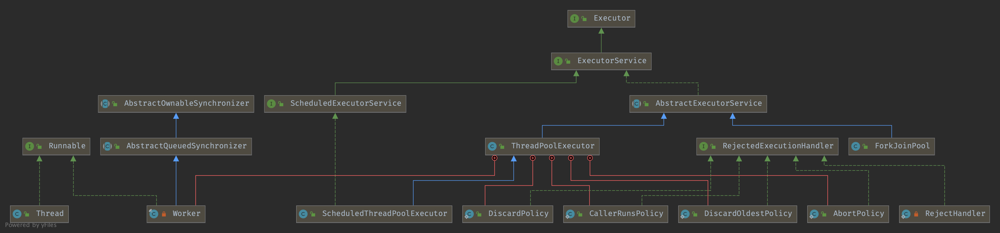
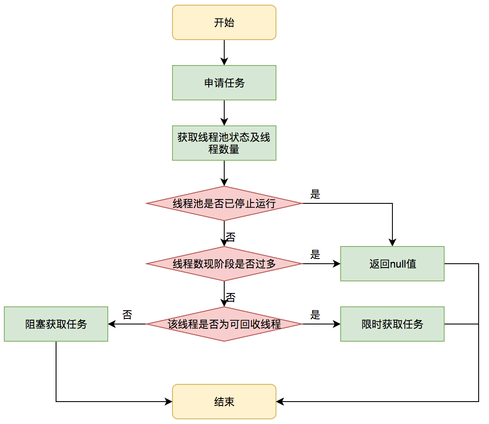

## Introduction

Executor 是用于定义类线程子系统（包括线程池、异步 I/O 与轻量级任务框架）的一个简单标准化接口。
具体使用哪一个 Executor 实现类，决定了任务是在新创建的线程中、在已有的任务执行线程中，还是在调用 execute 的线程中运行，并决定任务是顺序执行还是并发执行。

ExecutorService 提供了更完整的异步任务执行框架。它负责管理任务的排队与调度，并支持受控的关闭。
ScheduledExecutorService 子接口及相关的接口增加了对延迟执行与周期性任务执行的支持。
ExecutorService 提供了一系列方法，用于安排任意以 Callable 形式表达的函数（Callable 是带返回值的 Runnable 对应物）的异步执行。
Future 返回函数的执行结果，可判断是否已执行完成，并提供取消执行的方式。
RunnableFuture 是一种 Future，它带有一个 run 方法，在被执行时会设置其结果。

### Implementation

ThreadPoolExecutor 与 ScheduledThreadPoolExecutor 类提供了可调优、灵活的线程池。
Executors 类为最常见种类与配置的 Executor 提供了工厂方法，以及一些使用它们的工具方法。
基于 Executors 的其他工具包括具体类 FutureTask（提供了 Future 的一种通用可扩展实现），以及 ExecutorCompletionService（用于协调一组异步任务的处理）。
ForkJoinPool 类提供了一个主要用于处理 ForkJoinTask 及其子类实例的 Executor。
这些类采用工作窃取（work-stealing）调度器，对于符合计算密集型并行处理中常见约束的任务可达到高吞吐量。

### Disadvantages of Unbounded Thread Creation

- 线程生命周期开销
  线程的创建与销毁并非没有代价。实际开销因平台而异，但线程创建需要时间，会给请求处理引入延迟，并且需要 JVM 与操作系统进行一定的处理工作。
- 资源消耗
  活动线程会消耗系统资源，尤其是内存。当可运行线程数超过可用处理器数时，线程会处于空闲状态。
- 稳定性
  可创建的线程数量存在上限。



## Executor

线程池在线程管理方面带来同样的收益，而 `java.util.concurrent` 在 Executor 框架中提供了灵活的线程池实现。
Java 类库中任务执行的主要抽象并非 Thread，而是 `Executor`。
该接口提供一种方式，将任务提交与任务如何运行的具体机制（包括线程使用、调度等细节）解耦。

```java
public interface Executor {
   //The command may execute in a new thread, in a pooled thread, or in the calling thread
    void execute(Runnable command);
}
```

### ExecutorService

ExecutorService 是提供**终止管理**方法、并能产生用于跟踪一个或多个**异步任务**进度的 Future 的 Executor。

可从 [Executors](/docs/CS/Java/JDK/Concurrency/ThreadPoolExecutor.md?id=executors) 获取不同的 ExecutorService 实例。

```java
public interface ExecutorService extends Executor {

    void shutdown();

    List<Runnable> shutdownNow();

    boolean isShutdown();

    boolean isTerminated();

    boolean awaitTermination(long timeout, TimeUnit unit)
        throws InterruptedException;

    <T> Future<T> submit(Callable<T> task);

    <T> Future<T> submit(Runnable task, T result);

    Future<?> submit(Runnable task);

    <T> List<Future<T>> invokeAll(Collection<? extends Callable<T>> tasks)
        throws InterruptedException;

    <T> List<Future<T>> invokeAll(Collection<? extends Callable<T>> tasks,
                                  long timeout, TimeUnit unit)
        throws InterruptedException;

    <T> T invokeAny(Collection<? extends Callable<T>> tasks)
        throws InterruptedException, ExecutionException;

    <T> T invokeAny(Collection<? extends Callable<T>> tasks,
                    long timeout, TimeUnit unit)
        throws InterruptedException, ExecutionException, TimeoutException;
}
```

### AbstractExecutorService

包装并执行 [FutureTask](/docs/CS/Java/JDK/Concurrency/Future.md?id=futuretask) 。

```
public <T> Future<T> submit(Runnable task, T result) {
    if (task == null) throw new NullPointerException();
    RunnableFuture<T> ftask = newTaskFor(task, result);
    execute(ftask);
    return ftask;
}

protected <T> RunnableFuture<T> newTaskFor(Runnable runnable, T value) {
    return new FutureTask<T>(runnable, value);
}

protected <T> RunnableFuture<T> newTaskFor(Callable<T> callable) {
  	return new FutureTask<T>(callable);
}
```

#### Implementation

cancelAll

```
private static <T> void cancelAll(ArrayList<Future<T>> futures) {
        cancelAll(futures, 0);
    }

private static <T> void cancelAll(ArrayList<Future<T>> futures, int j) {
    for (int size = futures.size(); j < size; j++)
        futures.get(j).cancel(true);
}
```

<!-- tabs:start -->

##### **invokeAll**

执行给定的任务，在所有任务完成时返回一个持有其状态与结果的 Future 列表。
返回列表中每个元素的 `Future.isDone` 均为 true。

**注意，已完成的任务可能是正常结束，也可能是通过抛出异常结束。**
若在执行过程中修改了给定的集合，本方法的结果未定义。

> [DiscardPolicy may block invokeAll forever](https://bugs.openjdk.org/browse/JDK-8286463)

若 execute(f) 正常返回，调用线程会等待于 `Future.get()` 直到其返回或抛出异常（类似 DiscardPolicy 的情况会导致永久阻塞）。

```java
public abstract class AbstractExecutorService implements ExecutorService {
    public <T> List<Future<T>> invokeAll(Collection<? extends Callable<T>> tasks) throws InterruptedException {
        if (tasks == null)
            throw new NullPointerException();
        ArrayList<Future<T>> futures = new ArrayList<>(tasks.size());
        try {
            for (Callable<T> t : tasks) {
                RunnableFuture<T> f = newTaskFor(t);
                futures.add(f);
                execute(f);
            }
            for (int i = 0, size = futures.size(); i < size; i++) {
                Future<T> f = futures.get(i);
                if (!f.isDone()) {
                    try {
                        f.get();
                    } catch (CancellationException | ExecutionException ignore) {
                    }
                }
            }
            return futures;
        } catch (Throwable t) {
            cancelAll(futures);
            throw t;
        }
    }
}
```

##### **invokeAny**

```java
public abstract class AbstractExecutorService implements ExecutorService {
    public <T> T invokeAny(Collection<? extends Callable<T>> tasks)
            throws InterruptedException, ExecutionException {
        try {
            return doInvokeAny(tasks, false, 0);
        } catch (TimeoutException cannotHappen) {
            assert false;
            return null;
        }
    }

    // the main mechanics of invokeAny.
    private <T> T doInvokeAny(Collection<? extends Callable<T>> tasks,
                              boolean timed, long nanos)
            throws InterruptedException, ExecutionException, TimeoutException {
        if (tasks == null)
            throw new NullPointerException();
        int ntasks = tasks.size();
        if (ntasks == 0)
            throw new IllegalArgumentException();
        ArrayList<Future<T>> futures = new ArrayList<Future<T>>(ntasks);

        ExecutorCompletionService<T> ecs =
                new ExecutorCompletionService<T>(this);

        // For efficiency, especially in executors with limited
        // parallelism, check to see if previously submitted tasks are
        // done before submitting more of them. This interleaving
        // plus the exception mechanics account for messiness of main
        // loop.

        try {
            // Record exceptions so that if we fail to obtain any
            // result, we can throw the last exception we got.
            ExecutionException ee = null;
            final long deadline = timed ? System.nanoTime() + nanos : 0L;
            Iterator<? extends Callable<T>> it = tasks.iterator();

            // Start one task for sure; the rest incrementally
            futures.add(ecs.submit(it.next()));
            --ntasks;
            int active = 1;

            for (; ; ) {
                Future<T> f = ecs.poll();
                if (f == null) {
                    if (ntasks > 0) {
                        --ntasks;
                        futures.add(ecs.submit(it.next()));
                        ++active;
                    } else if (active == 0)
                        break;
                    else if (timed) {
                        f = ecs.poll(nanos, TimeUnit.NANOSECONDS);
                        if (f == null)
                            throw new TimeoutException();
                        nanos = deadline - System.nanoTime();
                    } else
                        f = ecs.take();
                }
                if (f != null) {
                    --active;
                    try {
                        return f.get();
                    } catch (ExecutionException eex) {
                        ee = eex;
                    } catch (RuntimeException rex) {
                        ee = new ExecutionException(rex);
                    }
                }
            }

            if (ee == null)
                ee = new ExecutionException();
            throw ee;

        } finally {
            for (int i = 0, size = futures.size(); i < size; i++)
                futures.get(i).cancel(true);
        }
    }
}
```

<!-- tabs:end -->

### ScheduledExecutorService

ScheduledExecutorService 是一种能够**调度**命令在给定延迟后运行，或周期性执行的 ExecutorService。
schedule 方法创建带有不同延迟的任务，并返回一个可用于取消或检查执行状态的任务对象。
**scheduleAtFixedRate** 与 **scheduleWithFixedDelay** 方法创建并执行周期性运行的任务，直到被取消。

```java
public interface ScheduledExecutorService extends ExecutorService {

    public ScheduledFuture<?> schedule(Runnable command, long delay, TimeUnit unit);

    public <V> ScheduledFuture<V> schedule(Callable<V> callable, long delay, TimeUnit unit);
}
```

提交一个周期性动作，它在给定初始延迟后首次生效，之后在每次执行结束与下一次开始之间间隔给定延迟。

- 任务执行的序列会无限持续，直到出现以下任一异常结束情形：
- 任务通过返回的 future 被显式取消。
- executor 终止，这也会导致任务被取消。
  任务的某次执行抛出异常。此时对返回的 future 调用 get 会抛出 ExecutionException，并以该异常作为原因（cause）。

后续执行会被抑制。此后对返回 future 的 isDone() 调用将返回 true。

```
    public ScheduledFuture<?> scheduleWithFixedDelay(Runnable command, long initialDelay, long delay, TimeUnit unit);
```

提交一个周期性动作，它在给定初始延迟后首次生效，之后按给定周期执行；即执行将在 initialDelay 之后开始，然后是 initialDelay + period，再然后是 initialDelay + 2 * period，依此类推。
**若任务的任意一次执行耗时超过其周期，则后续执行可能延迟开始，但不会并发执行。**

```
public ScheduledFuture<?> scheduleAtFixedRate(Runnable command, long initialDelay, long period, TimeUnit unit);
```

## CompletionService

一种服务，它将新异步任务的生产与已完成任务结果的消费解耦。生产者提交任务执行；消费者获取已完成的任务，并按其完成顺序处理结果。例如，CompletionService 可用于管理异步 I/O：在程序或系统的某一部分提交执行读取的任务，待读取完成后由程序另一部分（可能以不同于提交时的顺序）进行处理。
通常，CompletionService 依赖一个独立的 Executor 来真正执行任务，此时 CompletionService 仅管理一个内部的完成队列。ExecutorCompletionService 类提供了这种方法的一个实现。

**内存一致性效果：** 线程中向 CompletionService 提交任务之前的操作 happen-before 该任务中的操作，而该任务中的操作又 happen-before 从相应的 take() 成功返回之后的操作。

## ThreadPoolExecutor

ThreadPoolExecutor 是一种 ExecutorService，它使用若干个池中线程（通常借助 Executors 工厂方法配置）之一来执行每个被提交的任务。

顾名思义，线程池管理一组同质的工作线程。线程池与一个持有待执行任务的工作队列紧密绑定。
工作线程的生命很简单：从工作队列获取下一个任务、执行它，然后回到等待下一个任务的状态。

线程池解决两类不同的问题：

1. 在执行大量异步任务时，由于降低了每个任务的调用开销，通常能提供更好的性能；
2. 提供对执行一组任务时所消耗资源（包括线程）进行限制与管理的手段。
   每个 ThreadPoolExecutor 还会维护一些基本统计信息，例如已完成任务的数量。

为在广泛的场景下可用，本类提供了许多可调节参数与可扩展钩子。
不过，建议优先使用更为便捷的 Executors 工厂方法：Executors.newCachedThreadPool（无界线程池，自动回收线程）、Executors.newFixedThreadPool（固定大小线程池）与 Executors.newSingleThreadExecutor（单后台线程），它们为最常见的使用场景预置了配置。
否则，在手动配置与调优本类时，请遵循以下指南：

### Core and maximum pool sizes

ThreadPoolExecutor 会根据 corePoolSize（见 getCorePoolSize）与 maximumPoolSize（见 getMaximumPoolSize）设定的边界自动调整池大小（见 getPoolSize）。
在 execute(Runnable) 方法提交新任务时，若运行的线程少于 corePoolSize，即使其他工作线程空闲，也会创建新线程来处理该请求。
否则，仅当运行的线程少于 maximumPoolSize 且队列已满时，才会创建新线程来处理请求。
将 corePoolSize 与 maximumPoolSize 设为相同值，即得到一个固定大小的线程池。
将 maximumPoolSize 设为诸如 Integer.MAX_VALUE 这种实质上无界的值，可让线程池容纳任意数量的并发任务。
最常见情况下，核心与最大池大小仅在构造时设定，但也可以使用 setCorePoolSize 与 setMaximumPoolSize 动态修改。

#### setCorePoolSize

设置核心线程数。该值会覆盖构造器中设定的任何值。

- 若新值小于当前值，多余的现有线程将在下次空闲时被终止。
- 若大于当前值，则会在需要时启动新线程来执行任何已排队的任务。

prestartAllCoreThreads

allowCoreThreadTimeOut


#### setMaximumPoolSize

设置允许的最大线程数。该值会覆盖构造器中设定的任何值。
若新值小于当前值，多余的现有线程将在下次空闲时被终止。

- [Hystrix](/docs/CS/Framework/Spring_Cloud/Hystrix.md?id=hystrixthreadpool)

#### prestartCoreThread

默认情况下，**即便是核心线程，也仅在有新任务到达时才初次创建并启动**，但可通过 prestartCoreThread 或 prestartAllCoreThreads 方法动态覆盖这一行为。
若以非空队列构造线程池，则可能需要预先启动线程。

- [Tomcat](/docs/CS/Framework/Tomcat/threads.md?id=standardthreadexecutor)
- [Dubbo]()

#### allowsCoreThreadTimeOut

若线程池允许核心线程在 keepAlive 时间内无任务到达时超时终止、并在新任务到达时按需重建，则返回 true。

- 为 true 时，应用于非核心线程的同一保活策略也应用于核心线程。
- 为 false（默认）时，核心线程绝不会因缺少到达的任务而被终止。


### ThreadFactory

新线程通过 `ThreadFactory` 创建。
若未另行指定，则使用 `Executors.defaultThreadFactory`，它创建的线程全部位于**同一个 ThreadGroup** 中，并拥有**相同的 NORM_PRIORITY 优先级**与**非守护（non-daemon）状态**。

通过提供不同的 ThreadFactory，可以改变线程的名称、线程组、优先级、守护状态等。
若 ThreadFactory 在 newThread 中返回 null 而未能创建线程，executor 会继续运行，但可能无法执行任何任务。
线程应拥有 "modifyThread" RuntimePermission。
若使用线程池的工作线程或其他线程不拥有该权限，服务可能会降级：配置变更可能无法及时生效，且已关闭的线程池可能停留在一种可终止但尚未完成的状态。

```java
// Executors
private static class DefaultThreadFactory implements ThreadFactory {
    private static final AtomicInteger poolNumber = new AtomicInteger(1);
    private final ThreadGroup group;
    private final AtomicInteger threadNumber = new AtomicInteger(1);
    private final String namePrefix;

    DefaultThreadFactory() {
        SecurityManager s = System.getSecurityManager();
        group = (s != null) ? s.getThreadGroup() :
                              Thread.currentThread().getThreadGroup();
        namePrefix = "pool-" +
                      poolNumber.getAndIncrement() +
                     "-thread-";
    }

    public Thread newThread(Runnable r) {
        Thread t = new Thread(group, r,
                              namePrefix + threadNumber.getAndIncrement(),
                              0);
        if (t.isDaemon())
            t.setDaemon(false); // always be non-daemon
        if (t.getPriority() != Thread.NORM_PRIORITY)
            t.setPriority(Thread.NORM_PRIORITY);
        return t;
    }
}
```

### Keep-alive times

若线程池当前拥有多于 corePoolSize 的线程，多余的线程若空闲时间超过 keepAliveTime（见 getKeepAliveTime(TimeUnit)），将被终止。

这提供了一种在线程池未被积极使用时降低资源消耗的手段。若之后线程池变得更活跃，会重新构造新线程。

该参数也可通过 `setKeepAliveTime(long, TimeUnit)` 方法动态修改。
将 Long.MAX_VALUE 个 TimeUnit.NANOSECONDS 作为参数实际上会禁用空闲线程在关闭前终止。
默认情况下，保活策略仅在线程多于 corePoolSize 时生效，但 `allowCoreThreadTimeOut(boolean)` 方法也可将该超时策略应用于核心线程，前提是 keepAliveTime 值非零。

### ctl

线程池主控制状态 ctl 是一个原子整数，打包了两个概念字段：workerCount，表示有效的线程数量；runState，表示是否运行中、正在关闭等。为了将其打包进一个 int，workerCount 被限制为 **(2^29)-1**（约 5 亿）个线程，而非原本可表示的 (2^31)-1（20 亿）。若未来这成为问题，可将变量改为 AtomicLong，并相应调整下方的移位/掩码常量。但在需求出现之前，使用 int 的这段代码更快、更简单。

workerCount 是已被允许启动且未被允许停止的工作线程数量。该值可能暂时与实际存活线程数不同，例如当 ThreadFactory 在请求时创建线程失败，以及当退出线程仍在执行终止前的记账工作之时。对用户可见的池大小以 workers 集合的当前大小报告。

```
private final AtomicInteger ctl = new AtomicInteger(ctlOf(RUNNING, 0));
private static final int COUNT_BITS = Integer.SIZE - 3;
private static final int COUNT_MASK = (1 << COUNT_BITS) - 1;

// Packing and unpacking ctl
private static int runStateOf(int c)     { return c & ~COUNT_MASK; }
private static int workerCountOf(int c)  { return c & COUNT_MASK; }
private static int ctlOf(int rs, int wc) { return rs | wc; }

/*
 * Bit field accessors that don't require unpacking ctl.
 * These depend on the bit layout and on workerCount being never negative.
 */
private static boolean runStateLessThan(int c, int s) {
    return c < s;
}

private static boolean runStateAtLeast(int c, int s) {
    return c >= s;
}

private static boolean isRunning(int c) {
    return c < SHUTDOWN;
}
```

### runState

runState 提供主要的生命周期控制，取值如下：

- RUNNING：接受新任务并处理已排队任务
- SHUTDOWN：不接受新任务，但处理已排队任务
- STOP：不接受新任务，不处理已排队任务，并中断正在进行的任务
- TIDYING：所有任务已终止，workerCount 为零，转入 TIDYING 状态的线程将运行 terminated() 钩子方法
- TERMINATED：terminated() 已完成。这些值的数值顺序很重要，以便进行比较。runState 随时间单调递增，但不一定经历每个状态。

状态转换：RUNNING -> SHUTDOWN，在调用 shutdown() 时（或许隐式地发生在 finalize() 中）。

(RUNNING 或 SHUTDOWN) -> STOP，在调用 shutdownNow() 时。SHUTDOWN -> TIDYING，当队列与池均为空时。STOP -> TIDYING，当池为空时。TIDYING -> TERMINATED。

当 terminated() 钩子方法执行完成时，处于 awaitTermination() 中等待的线程会在状态到达 TERMINATED 时返回。

检测从 SHUTDOWN 到 TIDYING 的转换比期望的更不直观，因为在 SHUTDOWN 状态下队列可能先空后非空、又再变空；但只有在看到队列为空且 workerCount 为 0 时（有时需要重新检查——见下文）才能终止。

```java
// runState is stored in the high-order bits
private static final int RUNNING    = -1 << COUNT_BITS;
private static final int SHUTDOWN   =  0 << COUNT_BITS;
private static final int STOP       =  1 << COUNT_BITS;
private static final int TIDYING    =  2 << COUNT_BITS;
private static final int TERMINATED =  3 << COUNT_BITS;
```

状态转换：


### create ThreadPoolExecutor

以给定初始参数创建一个新的 ThreadPoolExecutor：

1. corePoolSize —— 池中保留的线程数，即使它们空闲，除非设置了 allowCoreThreadTimeOut；
2. maximumPoolSize —— 池中允许的最大线程数；
3. keepAliveTime —— 当线程数大于核心数时，多余的空闲线程在终止前等待新任务的最长时间；
4. unit —— keepAliveTime 参数的时间单位；
5. workQueue —— 用于在执行前保存任务的队列。该队列只保存由 execute 方法提交的 Runnable 任务；
6. threadFactory —— executor 创建新线程时使用的工厂；
7. handler —— 当执行因线程边界与队列容量达到上限而被阻塞时使用的处理器；

```java
public ThreadPoolExecutor(int corePoolSize,
                          int maximumPoolSize,
                          long keepAliveTime,
                          TimeUnit unit,
                          BlockingQueue<Runnable> workQueue,
                          ThreadFactory threadFactory,
                          RejectedExecutionHandler handler) {
    if (corePoolSize < 0 || maximumPoolSize <= 0 || maximumPoolSize < corePoolSize ||
        keepAliveTime < 0)
        throw new IllegalArgumentException();
    if (workQueue == null || threadFactory == null || handler == null)
        throw new NullPointerException();
    this.acc = System.getSecurityManager() == null ? null : AccessController.getContext();
    this.corePoolSize = corePoolSize;
    this.maximumPoolSize = maximumPoolSize;
    this.workQueue = workQueue;
    this.keepAliveTime = unit.toNanos(keepAliveTime);
    this.threadFactory = threadFactory;
    this.handler = handler;
}
```

### BlockingQueue

任何 [BlockingQueue](/docs/CS/Java/JDK/Collection/Queue.md?id=blockingqueue) 都可用于传递与保存被提交的任务。该队列的使用与池大小调节相互作用：

- 若运行的线程少于 corePoolSize，Executor 总是优先新增线程而非入队。
- 若运行的线程达到或超过 corePoolSize，Executor 总是优先将请求入队而非新增线程。
- 若请求无法入队，则会创建新线程，除非这会超过 maximumPoolSize，此时该任务将被拒绝。

排队有三种通用策略：

1. 直接移交（Direct handoffs）。工作队列的一个良好默认选择是 `SynchronousQueue`，它将任务直接移交给线程而不另行保存。此时，若没有立即可用的线程来运行任务，尝试入队会失败，于是会构造新线程。该策略在处理可能具有内部依赖的请求集合时避免死锁。直接移交通常**要求无界的 maximumPoolSizes**，以避免拒绝新提交的任务。这反过来又带来命令平均到达速度快于处理速度时线程无界增长的可能。
2. 无界队列（Unbounded queues）。使用无界队列（例如未预设容量的 `LinkedBlockingQueue`）会在所有 corePoolSize 线程都繁忙时让新任务在队列中等待。因此，最多只会创建 corePoolSize 个线程（此时 **maximumPoolSize 的值因此不起作用**）。当每个任务彼此完全独立、不会相互影响执行时（例如网页服务器），这或许是合适的。虽然这种排队方式能平滑瞬时请求突发，但同样带来命令平均到达速度快于处理速度时工作队列无界增长的可能。
3. 有界队列（Bounded queues）。有界队列（例如 `ArrayBlockingQueue`）配合有限的 maximumPoolSizes 使用有助于防止资源耗尽，但更难调优与控制。队列大小与最大池大小可相互权衡：使用大队列与小池可最小化 CPU 使用率、操作系统资源与上下文切换开销，但可能导致吞吐量被人为压低。若任务频繁阻塞（例如 I/O 密集型），系统或许能调度出比允许值更多的线程。使用小队列通常要求更大的池大小，使 CPU 更忙，但可能遇到难以接受的调度开销，同样会降低吞吐量。

### Rejected tasks

```java
// ThreadPoolExecutor
final void reject(Runnable command) {
    handler.rejectedExecution(command, this);
}
```

当 execute 无法接受任务时，ThreadPoolExecutor 可能调用 RejectedExecution 方法。这可能发生在 **没有可用线程或队列槽位** 时，原因是：

- **超出了它们的边界**
- **executor 关闭时**

无论哪种情况，execute 方法都会调用其 RejectedExecutionHandler 的 `RejectedExecutionHandler.rejectedExecution(Runnable, ThreadPoolExecutor)` 方法。预定义了四种处理器策略：

1. 在默认的 `ThreadPoolExecutor.AbortPolicy` 中，处理器在拒绝时抛出运行时异常 RejectedExecutionException。
2. 在 `ThreadPoolExecutor.CallerRunsPolicy` 中，调用 execute 的线程自己运行该任务。这提供了一种简单的反馈控制机制，能降低新任务的提交速率。
3. 在 `ThreadPoolExecutor.DiscardPolicy` 中，无法执行的任务被直接丢弃。

   该策略仅用于极少见的、从不依赖任务完成的情况。
4. 在 `ThreadPoolExecutor.DiscardOldestPolicy` 中，若 executor 未关闭，则丢弃工作队列队首的任务，然后重试执行（可能再次失败并导致重复）。
   该策略几乎不可接受。在几乎所有情况下，还应取消该任务以让任何等待其完成的组件抛出异常，和/或记录失败日志。

也可以定义并使用其他种类的 RejectedExecutionHandler 类。这样做需要谨慎，尤其是当策略被设计为仅在特定的容量或排队策略下工作时。

### execute

在未来某个时刻执行给定任务。任务可能在新线程或已有的池中线程中执行。

若任务无法被提交执行，

1. 是因为本 executor **已关闭**，
2. 或是因为其**容量已达上限**，则该任务由当前的 `RejectedExecutionHandler` 处理。

```java
public void execute(Runnable command) {
    int c = ctl.get();
    if (workerCountOf(c) < corePoolSize) { // addWaiter if less than corePoolSize
        if (addWorker(command, true))
            return;
        c = ctl.get();
    }
   
    if (isRunning(c) && workQueue.offer(command)) { // offer queue if isRunning
        int recheck = ctl.get();
        if (! isRunning(recheck) && remove(command))
            reject(command);
        else if (workerCountOf(recheck) == 0) // avoid !queue.isEmpty() but no Worker
            addWorker(null, false); 
    }
   
    else if (!addWorker(command, false))
        reject(command);
}
```

执行分为 3 步：

1. 若运行的线程少于 corePoolSize，则尝试以给定命令作为首个任务启动新线程。对 **addWorker 的调用会原子性地检查 runState 与 workerCount**，从而通过返回 false 避免在不该增加线程时增加线程的误报。
2. 若任务成功入队，仍 **需要再次确认是否本应新增线程（因为上次检查后已有线程消亡），或本方法进入后池已关闭**。因此再次检查状态，必要时在停止时回滚入队，或在无工作线程时启动新线程。
3. 若无法入队，则尝试新增线程；若失败，则可知已关闭或饱和，于是拒绝该任务。

**需考虑操作系统线程调度与 GC 开销**。

I/O 线程的优先级应高于业务线程

### addWorker

根据当前池状态与给定边界（核心或最大）检查是否可新增工作线程。若可以，则相应调整工作线程计数，并尽可能创建并启动一个新的工作线程，以 firstTask 作为首个任务。

本方法在以下情况返回 false：

1. 池已停止或符合关闭条件；
2. 线程工厂在请求时未能创建线程。

若线程创建失败（或因线程工厂返回 null，或因异常——通常是 Thread.start() 中的 OutOfMemoryError），将干净地回滚。

```java
public class ThreadPoolExecutor extends AbstractExecutorService {
    /**
     * Set containing all worker threads in pool. Accessed only when
     * holding mainLock.
     */
    private final HashSet<Worker> workers = new HashSet<Worker>();


    private boolean addWorker(Runnable firstTask, boolean core) {
        retry:
        for (; ; ) {
            int c = ctl.get();
            int rs = runStateOf(c);

            // Check if queue empty only if necessary.
            // when SHUTDOWN and firstTask == null and  !queue.isEmpty(), allow to addWorker
            if (rs >= SHUTDOWN &&
                    !(rs == SHUTDOWN &&
                            firstTask == null &&
                            !workQueue.isEmpty()))
                return false;

            for (; ; ) {
                int wc = workerCountOf(c);
                if (wc >= CAPACITY ||
                        wc >= (core ? corePoolSize : maximumPoolSize))
                    return false;
                if (compareAndIncrementWorkerCount(c))
                    break retry;
                c = ctl.get();  // Re-read ctl
                if (runStateOf(c) != rs)
                    continue retry;
                // else CAS failed due to workerCount change; retry inner loop
            }
        }

        boolean workerStarted = false;
        boolean workerAdded = false;
        Worker w = null;
        try {
            w = new Worker(firstTask);
            final Thread t = w.thread;
            if (t != null) {
                final ReentrantLock mainLock = this.mainLock; // need a mainLock
                mainLock.lock();
                try {
                    // Recheck while holding lock.
                    // Back out on ThreadFactory failure or if
                    // shut down before lock acquired.
                    int rs = runStateOf(ctl.get());

                    if (rs < SHUTDOWN ||
                            (rs == SHUTDOWN && firstTask == null)) {
                        if (t.isAlive()) // precheck that t is startable
                            throw new IllegalThreadStateException();
                        workers.add(w);
                        int s = workers.size();
                        if (s > largestPoolSize)
                            largestPoolSize = s;
                        workerAdded = true;
                    }
                } finally {
                    mainLock.unlock();
                }
                if (workerAdded) {
                    t.start();
                    workerStarted = true;
                }
            }
        } finally {
            if (!workerStarted)
                addWorkerFailed(w);
        }
        return workerStarted;
    }

    /**
     * Rolls back the worker thread creation.
     * - removes worker from workers, if present
     * - decrements worker count
     * - rechecks for termination, in case the existence of this
     *   worker was holding up termination
     */
    private void addWorkerFailed(Worker w) {
        final ReentrantLock mainLock = this.mainLock;
        mainLock.lock();
        try {
            if (w != null)
                workers.remove(w);
            decrementWorkerCount();
            tryTerminate();
        } finally {
            mainLock.unlock();
        }
    }
}
```


#### Worker

Worker 类主要维护运行任务的线程的中断控制状态，以及少量其他记账信息。
该类顺便扩展 **AbstractQueuedSynchronizer**，以简化每次任务执行前后的加锁与释放。
这可防止本意是唤醒等待任务的 worker 线程的中断，转而中断正在运行的任务。
实现的是简单的不可重入互斥锁，而非使用 ReentrantLock，因为我们不希望 worker 任务在调用 setCorePoolSize 等池控制方法时能够重新获取该锁。

*此外，为在线程真正开始运行任务前抑制中断，将锁状态**初始化为负值**，并**在启动时（runWorker 中）清除**它。*

```java
// Creates with given first task and thread from ThreadFactory.
Worker(Runnable firstTask) {
    setState(-1); // inhibit interrupts until runWorker
    this.firstTask = firstTask;
    this.thread = getThreadFactory().newThread(this);
}

/** Thread this worker is running in.  Null if factory fails. */
final Thread thread;
/** Initial task to run.  Possibly null. */
Runnable firstTask;
/** Per-thread task counter */
volatile long completedTasks;

// The value 0 represents the unlocked state.
// The value 1 represents the locked state.
protected boolean isHeldExclusively() {
    return getState() != 0;
}

protected boolean tryAcquire(int unused) {
    if (compareAndSetState(0, 1)) {
        setExclusiveOwnerThread(Thread.currentThread());
        return true;
    }
    return false;
}

protected boolean tryRelease(int unused) {
    setExclusiveOwnerThread(null);
    setState(0);
    return true;
}
```

仅由 `shutdownNow()` 调用

```java
void interruptIfStarted() {
    Thread t;
    if (getState() >= 0 && (t = thread) != null && !t.isInterrupted()) {
        try {
            t.interrupt();
        } catch (SecurityException ignore) {
        }
    }
}
```

将主运行循环委托给外层的 runWorker

```java
public void run() {
    runWorker(this);
}
```

#### runWorker

work 线程主运行循环。**反复从队列获取任务并执行，同时应对若干情形**：

1. 可能以初始任务启动，此时无需获取第一个任务；否则只要池在运行，就从 getTask 获取任务。若其返回 null，则工作线程因池状态或配置参数改变而退出。其他退出源于外部代码抛出的异常，此时 completedAbruptly 为真，通常会导致 processWorkerExit 替换该线程。
2. 运行任何任务前，先获取锁以防止任务执行期间其他池中断，然后确保除非池正在停止，否则本线程的中断位未被设置。
3. 每次任务运行前都会调用 beforeExecute，它可能抛出异常，此时会导致线程死亡（以 completedAbruptly 为 true 跳出循环），且不处理该任务。
4. 若 beforeExecute 正常完成，则运行任务，收集其抛出的任何异常以传给 afterExecute。分别处理 RuntimeException、Error（二者规范保证会被捕获）以及任意 Throwable。由于无法在 Runnable.run 内重新抛出 Throwable，在退出时将其包装进 Error（传给线程的 UncaughtExceptionHandler）。任何抛出的异常也会保守地导致线程死亡。
5. task.run 完成后调用 afterExecute，它也可能抛出异常并导致线程死亡。根据 JLS 第 14.20 节，即使 task.run 抛出异常，生效的也是该异常。异常机制的整体效果，是让 afterExecute 与线程的 UncaughtExceptionHandler 能获得关于用户代码所遇问题尽可能准确的信息。

```java
final void runWorker(Worker w) {
    Thread wt = Thread.currentThread();
    Runnable task = w.firstTask;
    w.firstTask = null;
    w.unlock(); // allow interrupts
    boolean completedAbruptly = true;
    try {
        while (task != null || (task = getTask()) != null) {
            w.lock();
            // If pool is stopping, ensure thread is interrupted;
            // if not, ensure thread is not interrupted.  This
            // requires a recheck in second case to deal with
            // shutdownNow race while clearing interrupt
            if ((runStateAtLeast(ctl.get(), STOP) ||
                 (Thread.interrupted() &&
                  runStateAtLeast(ctl.get(), STOP))) &&
                !wt.isInterrupted())
                wt.interrupt();
            try {
                beforeExecute(wt, task);
                Throwable thrown = null;
                try {
                    task.run();
                } catch (RuntimeException x) {
                    thrown = x; throw x;
                } catch (Error x) {
                    thrown = x; throw x;
                } catch (Throwable x) {
                    thrown = x; throw new Error(x);
                } finally {
                    afterExecute(task, thrown);
                }
            } finally {
                task = null;
                w.completedTasks++;
                w.unlock();
            }
        }
        completedAbruptly = false;
    } finally {
        processWorkerExit(w, completedAbruptly);
    }
}
```

#### getTask

根据当前配置设定，对任务进行阻塞或限时的等待；若本工作线程因以下任一原因必须退出，则**返回 null**：

1. 工作线程数超过了 maximumPoolSize（因调用了 setMaximumPoolSize）；
2. 池已停止；
3. 池已关闭且队列为空；
4. 本工作线程等待任务超时，且超时的工作线程在等待前后都可被终止（即 allowCoreThreadTimeOut || workerCount > corePoolSize），并且当队列非空时，本线程并非池中最后一个线程。

```java
private Runnable getTask() {
    boolean timedOut = false; // Did the last poll() time out?

    for (;;) {
        int c = ctl.get();
        int rs = runStateOf(c);

        // Check if queue empty only if necessary.
        if (rs >= SHUTDOWN && (rs >= STOP || workQueue.isEmpty())) {
            decrementWorkerCount();
            return null;
        }

        int wc = workerCountOf(c);

        // Are workers subject to culling?
        boolean timed = allowCoreThreadTimeOut || wc > corePoolSize;

        if ((wc > maximumPoolSize || (timed && timedOut))
            && (wc > 1 || workQueue.isEmpty())) {
            if (compareAndDecrementWorkerCount(c))
                return null;
            continue;
        }

        try {
          // if > corePoolSize, use poll will out of loop and terminate 
            Runnable r = timed ?
                workQueue.poll(keepAliveTime, TimeUnit.NANOSECONDS) :
                workQueue.take();
            if (r != null)
                return r;
            timedOut = true;
        } catch (InterruptedException retry) {
            timedOut = false;
        }
    }
}
```



#### processWorkerExit

*对被消亡的工作线程执行清理与记账。仅从工作线程调用。除非 completedAbruptly 被设置，否则假设 workerCount 已为退出做了调整。本方法将线程从 workers 集合中移除，并可能在以下情况终止池或替换工作线程：因用户任务异常而退出，或运行的工作线程少于 corePoolSize，或队列非空但已无工作线程。*

```java
private void processWorkerExit(Worker w, boolean completedAbruptly) {
    if (completedAbruptly) // If abrupt, then workerCount wasn't adjusted
        decrementWorkerCount();

    final ReentrantLock mainLock = this.mainLock;
    mainLock.lock();
    try {
        completedTaskCount += w.completedTasks;
        workers.remove(w);
    } finally {
        mainLock.unlock();
    }

    tryTerminate();

    int c = ctl.get();
    if (runStateLessThan(c, STOP)) {
        if (!completedAbruptly) {
            int min = allowCoreThreadTimeOut ? 0 : corePoolSize;
            if (min == 0 && ! workQueue.isEmpty())
                min = 1;
            if (workerCountOf(c) >= min)
                return; // replacement not needed
        }
        addWorker(null, false);
    }
}
```

#### tryTerminate

在以下情况转换到 TERMINATED 状态：

1. （SHUTDOWN 且池与队列均为空）；
2. 或（STOP 且池为空）。

若符合终止条件但 workerCount 非零，则中断一个空闲工作线程以确保关闭信号得以传播。任何可能使终止成为可行的操作（关闭期间减少工作线程数或从队列移除任务）之后都必须调用本方法。本方法非 private，以便 ScheduledThreadPoolExecutor 访问。

```java
final void tryTerminate() {
    for (;;) {
        int c = ctl.get();
        if (isRunning(c) ||
            runStateAtLeast(c, TIDYING) ||
            (runStateOf(c) == SHUTDOWN && ! workQueue.isEmpty()))
            return;
        if (workerCountOf(c) != 0) { // Eligible to terminate
            interruptIdleWorkers(ONLY_ONE);
            return;
        }

        final ReentrantLock mainLock = this.mainLock;
        mainLock.lock();
        try {
            if (ctl.compareAndSet(c, ctlOf(TIDYING, 0))) {
                try {
                    terminated();
                } finally {
                    ctl.set(ctlOf(TERMINATED, 0));
                    termination.signalAll();
                }
                return;
            }
        } finally {
            mainLock.unlock();
        }
        // else retry on failed CAS
    }
}
```

### Hook methods

本类提供了受保护的、可重写的 beforeExecute(Thread, Runnable) 与 afterExecute(Runnable, Throwable) 方法，分别在每任务执行前后调用。它们可用于调整执行环境，例如重新初始化 ThreadLocal、收集统计信息或添加日志条目。此外，可重写 terminated 方法，在 Executor 完全终止后执行所需的特殊处理。
若钩子、回调或 BlockingQueue 方法抛出异常，内部工作线程可能随之失败、突然终止，并可能被替换。
队列维护
getQueue() 方法允许出于监控与调试目的访问工作队列。强烈不建议将该方用于其他任何目的。当大量已排队的任务被取消时，可使用两个提供的方法 remove(Runnable) 与 purge 来辅助回收存储空间。

### Reclamation

程序中不再被引用且没有剩余线程的池，可在未显式关闭的情况下被回收（垃圾回收）。
可通过设置合适的 keep-alive 时间、将核心线程下限设为 0 和/或设置 allowCoreThreadTimeOut(boolean)，将池配置为允许所有未用线程最终消亡。

扩展示例。本类的大多数扩展会重写一个或多个受保护的钩子方法。例如，下面是一个添加了简单暂停/恢复功能的子类：

```java
 class PausableThreadPoolExecutor extends ThreadPoolExecutor {
   private boolean isPaused;
   private ReentrantLock pauseLock = new ReentrantLock();
   private Condition unpaused = pauseLock.newCondition();

   public PausableThreadPoolExecutor(...) { super(...); }

   protected void beforeExecute(Thread t, Runnable r) {
     super.beforeExecute(t, r);
     pauseLock.lock();
     try {
       while (isPaused) unpaused.await();
     } catch (InterruptedException ie) {
       t.interrupt();
     } finally {
       pauseLock.unlock();
     }
   }

   public void pause() {
     pauseLock.lock();
     try {
       isPaused = true;
     } finally {
       pauseLock.unlock();
     }
   }

   public void resume() {
     pauseLock.lock();
     try {
       isPaused = false;
       unpaused.signalAll();
     } finally {
       pauseLock.unlock();
     }
   }
 }
```

### shutdown

发起有序关闭，其间执行先前提交的**任务，但**不再接受新任务**。若已关闭则调用无额外效果。
本方法**不会等待先前提交的任务执行完成**。可使用 *awaitTermination* 来做到这一点。

```java
public void shutdown() {
    final ReentrantLock mainLock = this.mainLock;
    mainLock.lock();
    try {
        checkShutdownAccess();
        advanceRunState(SHUTDOWN);
        interruptIdleWorkers();
        onShutdown(); // hook for ScheduledThreadPoolExecutor
    } finally {
        mainLock.unlock();
    }
    tryTerminate();
}
```

#### shutdownNow

尝试**停止所有正在执行的任务**，停止等待任务的处理，并返回等待执行的任务列表。
这些任务在方法返回时从该任务队列中排出（移除）。

本方法不等待正在执行的任务终止。
可使用 `awaitTermination` 来做到这一点。

除尽力停止处理正在执行的任务外，不作任何保证。
本实现通过 `Thread.interrupt` 中断任务；**任何未能响应中断的任务可能永远无法终止**。

```java
public List<Runnable> shutdownNow() {
    List<Runnable> tasks;
    final ReentrantLock mainLock = this.mainLock;
    mainLock.lock();
    try {
        checkShutdownAccess();
        advanceRunState(STOP);
        interruptWorkers();
        tasks = drainQueue();
    } finally {
        mainLock.unlock();
    }
    tryTerminate();
    return tasks;
}

/**
 * Interrupts all threads, even if active. Ignores SecurityExceptions
 * (in which case some threads may remain uninterrupted).
 */
private void interruptWorkers() {
    final ReentrantLock mainLock = this.mainLock;
    mainLock.lock();
    try {
        for (Worker w : workers)
            w.interruptIfStarted();
    } finally {
        mainLock.unlock();
    }
}

void interruptIfStarted() {
    Thread t;
    if (getState() >= 0 && (t = thread) != null && !t.isInterrupted()) {
        try {
            t.interrupt();
        } catch (SecurityException ignore) {
        }
    }
}
```

> [ExecutorService::shutdownNow may block invokeAll indefinitely](https://bugs.openjdk.org/browse/JDK-8160037)

shutdownNow 返回的是从未启动的任务列表，而 [invokeAll](/docs/CS/Java/JDK/Concurrency/ThreadPoolExecutor.md?id=invokeall) 会等待所有任务完成，因此若直接丢弃未启动的任务列表，它挂起似乎在所难免。
shutdownNow 的调用者可以取消所有返回的任务，从而释放 invokeAll 的调用者。

因此在实践中用户可做如下处理：

```java
for (Runnable r : pool.shutdownNow()) {
    if (r instanceof Future) 
        ((Future)r).cancel(false);
}
```

### adaptive

线程池可以修改的参数
核心线程数和最大线程数

队列长度调整并不直观

VariableLinkedBlockingQueue

### monitor

- getTaskCount
- getCompletedTaskCount
- getCorePoolSize
- getPoolSize
- getActiveCount

#### setWorkQueueSize

[LinkedBlockingQueue](/docs/CS/Java/JDK/Collection/Queue.md?id=linkedblockingqueue) 无法更改容量。

也可以重写一个 LinkedBlockingQueue，使其支持线程安全的大小调整。

## Executors

本包中定义的 Executor、ExecutorService、ScheduledExecutorService、ThreadFactory 与 Callable 类的工厂与工具方法。本类支持以下几类方法：
创建并返回以常用配置设定好的 ExecutorService 的方法；
创建并返回以常用配置设定好的 ScheduledExecutorService 的方法；
创建并返回“包装后”的 ExecutorService 的方法，它通过使实现相关方法不可访问来禁用重新配置；
创建并返回将新创建线程设置为已知状态的 ThreadFactory 的方法；
从其他类似闭包的形式创建并返回 Callable 的方法，以便用于需要 Callable 的执行方法中。

<!-- tabs:start -->

##### **newWorkStealingPool**

创建一个维持足够线程数以支持给定并行度（parallelism）级别的线程池，并可能使用多个队列来减少竞争。
并行度级别对应于积极参与或可用于参与任务处理的最大线程数。
实际线程数可能动态增减。
工作窃取池不保证已提交任务的执行顺序。

```java
public static ExecutorService newWorkStealingPool(int parallelism) {
    return new ForkJoinPool
        (parallelism,
         ForkJoinPool.defaultForkJoinWorkerThreadFactory,
         null, true);
}
```

##### **newFixedThreadPool**

创建一个复用固定数量线程、运行于共享无界队列上的线程池，并在需要时通过提供的 ThreadFactory 创建新线程。任意时刻最多有 nThreads 个线程处于活跃处理任务状态。
若所有线程都活跃时提交了额外任务，它们会在队列中等待，直到有可用线程。
若任何线程在关闭前因执行期间失败而终止，会在需要时由新线程替代以执行后续任务。
池中的线程将一直存在，直到被显式关闭。

```java
public static ExecutorService newFixedThreadPool(int nThreads, ThreadFactory threadFactory) {
    return new ThreadPoolExecutor(nThreads, nThreads,
                                  0L, TimeUnit.MILLISECONDS,
                                  new LinkedBlockingQueue<Runnable>(),
                                  threadFactory);
}
```

##### **newCachedThreadPool**

创建一个按需创建新线程、但在可用时复用先前构造线程的线程池，并在需要时通过提供的 ThreadFactory 创建新线程。

```java
public static ExecutorService newCachedThreadPool(ThreadFactory threadFactory) {
    return new ThreadPoolExecutor(0, Integer.MAX_VALUE,
                                  60L, TimeUnit.SECONDS,
                                  new SynchronousQueue<Runnable>(),
                                  threadFactory);
}
```

##### **newSingleThreadExecutor**

创建一个使用单个工作线程、运行于无界队列上的 Executor，并在需要时通过提供的 ThreadFactory 创建新线程。与被等价替代的 newFixedThreadPool(1, threadFactory) 不同，返回的 executor 保证不可被重配置为使用额外线程。

```java
public static ExecutorService newSingleThreadExecutor(ThreadFactory threadFactory) {
    return new FinalizableDelegatedExecutorService
        (new ThreadPoolExecutor(1, 1,
                                0L, TimeUnit.MILLISECONDS,
                                new LinkedBlockingQueue<Runnable>(),
                                threadFactory));
}


```

##### **newScheduledThreadPool**

创建一个能在给定延迟后调度命令运行、或周期性执行的线程池。

```java
public static ScheduledExecutorService newScheduledThreadPool(
        int corePoolSize, ThreadFactory threadFactory) {
    return new ScheduledThreadPoolExecutor(corePoolSize, threadFactory);
}
```

<!-- tabs:end -->

|              | Cache（缓存线程池）     | Fix（固定线程池）        |
| ------------ | --------------------- | --------------------- |
| 线程         | 全部为非核心线程        | 全部为核心线程          |
| 无任务时     | 60 秒后回收           | 阻塞于 queue.take()    |
| 缺点         | 线程数无上限          | 链表队列无上限        |
|              |                       |                       |


## Tuning

线程池参数设置

| `corePoolSize` / `maxPoolSize` | CPU密集型：`N_cpu + 1~2`；IO密集型：`N_cpu × (1 + 平均等待时间/平均计算时间)`。**必须经压测校准**，高并发建议初始值保守，靠动态扩容应对峰值 |
| ------------------------------ | ------------------------------------------------------------ |
| `keepAliveTime`                | IO密集：30~120s；CPU密集：5~15s。配合有界队列使用，避免线程堆积。 |

通常都是核心和最大线程池大小的设置 可以根据qps预期来设置 例如预计3k ，
线上有160个pod 那单机20-30 并发10 rt时间大约80-100 那么需要核心线程10 最大线程100


**必须使用有界队列**：`ArrayBlockingQueue` 或 `new LinkedBlockingQueue<>(capacity)`。容量根据单机内存、单任务内存占用、目标TPS计算，通常 `500~5000`


拒绝策略生产选型

- ❌ 避免默认 `AbortPolicy`（直接抛异常，调用方难处理）
- ✅ 核心链路：自定义策略 → 记录指标、降级返回、写本地磁盘/DB异步补偿、或触发熔断
- ⚠️ `CallerRunsPolicy`：可反压调用方，但可能阻塞主线程，仅适用于同步调用链且有超时控制场景
- 📦 推荐封装：`FallbackRejectedExecutionHandler`，结合 Sentinel/Resilience4j 实现快速失败


资源隔离：一池一责，避免“火烧连营”

- **按业务/优先级拆分**：支付、日志、消息推送、定时任务等必须独立线程池
- **按IO/CPU拆分**：避免慢IO阻塞占满CPU计算线程
- **核心/非核心隔离**：关键交易链路独占池，背景任务用低配额池
- **现代补充**：Java 21+ 可评估虚拟线程（`Executors.newVirtualThreadPerTaskExecutor()`），但传统池仍需隔离关键路径

异常处理与防泄漏：拒绝“静默失败”

异常吞没防护
```java
  executor.execute(() -> {
      try { /* 业务逻辑 */ } 
      catch (Exception e) { log.error("task failed", e); /* 上报/补偿 */ }
  });
```

- **重写钩子方法**：继承 `ThreadPoolExecutor`，重写 `afterExecute(Runnable r, Throwable t)` 统一捕获异常

- **线程名与UncaughtExceptionHandler**：通过自定义 `ThreadFactory` 设置 `[pool-business-1]`，并注册 `Thread.setDefaultUncaughtExceptionHandler`

- 防任务泄漏

  ：

  - 任务内禁止持有未释放的连接/锁/大对象
  - 使用 `Future.get(timeout)` 或包装超时任务，避免无限期阻塞
  - 定期巡检 `poolSize` 是否持续增长（典型泄漏信号）

动态弹性：从“静态配置”到“自适应”

- **运行时安全调整**：`ThreadPoolExecutor` 的 `setCorePoolSize()`、`setMaximumPoolSize()`、`setKeepAliveTime()` 是线程安全的，支持热更新

- 动态控制方案

  ：

  - 接入配置中心（Nacos/Apollo）推送阈值
  - 基于指标自动扩缩容：队列堆积率、拒绝率、CPU使用率、P99延迟
  - 开源方案：`dynamic-tp`、`Hippo4j`（自带监控面板、告警、动态调参）

- **控制算法参考**：AIMD（加性增乘性减）、PID反馈调节，避免震荡

可观测性：没有监控的线程池等于盲开

暴露并持续采集以下指标（Prometheus/Grafana）：


| 指标       | 方法                      | 告警阈值建议        |
| ---------- | ------------------------- | ------------------- |
| 活跃线程数 | `getActiveCount()`        | > maxPoolSize × 80% |
| 队列使用率 | `queue.size() / capacity` | > 70% 持续1分钟     |
| 拒绝次数   | 自定义计数器              | > 0.1%/秒           |
| 完成任务数 | `getCompletedTaskCount()` | 突降/停滞           |
| 线程池大小 | `getPoolSize()`           | 持续增长不回落      |

- **链路追踪透传**：使用 Spring `TaskDecorator` 或自定义 `Runnable` 包装，安全传递 `traceId`、`MDC`（注意 `InheritableThreadLocal` 内存泄漏风险，任务结束必须 `clear()`）
- **定期 Dump**：`jstack` 分析阻塞链、死锁、线程状态分布

优雅生命周期与降级策略

启停规范

```java
  executor.shutdown();
  if (!executor.awaitTermination(30, TimeUnit.SECONDS)) {
      executor.shutdownNow(); // 强制中断
  }
```

- **结合熔断降级**：当拒绝率或队列堆积持续超标，触发 Sentinel 熔断，快速返回 fallback，避免雪崩

- **任务可重试设计**：非幂等操作防重；关键任务落盘+补偿调度器（如 XXL-JOB）

验证：不经过压测的配置都是纸上谈兵

- **全链路压测**：模拟峰值流量、突发脉冲、慢依赖、网络抖动
- **混沌工程**：注入线程阻塞、GC停顿、队列满、拒绝策略触发，验证隔离与降级是否生效
- **Soak Test（浸泡测试）**：7×24小时运行，观察内存泄漏、线程数、GC频率是否平稳

生产 Checklist

- 显式构造 `ThreadPoolExecutor`，禁用 `Executors.*`
- 队列有界，容量经压测确定
- 拒绝策略自定义，与业务降级打通
- 按业务/IO/CPU拆分，核心链路独占
- 任务内 `try-catch`，重写 `afterExecute`
- 自定义 `ThreadFactory` 设置线程名与异常处理器
- 暴露核心指标，接入监控告警
- 支持配置中心动态调参，或接入动态线程池组件
- 实现优雅关闭，结合熔断防雪崩
- 完成全链路压测与浸泡测试


若业务以轻量IO为主（如网关转发、HTTP调用），可评估 **Java 21 虚拟线程**，大幅降低线程上下文切换开销

线程池只是执行载体，**长期稳定的核心是“流量治理”**：限流+熔断+隔离+降级+可观测，缺一不可


## Links

- [Concurrency](/docs/CS/Java/JDK/Concurrency/Concurrency.md)
- [Thread](/docs/CS/Java/JDK/Concurrency/Thread.md)
- [Future](/docs/CS/Java/JDK/Concurrency/Future.md)

## References

1. [深入理解Java线程池：ThreadPoolExecutor](http://www.ideabuffer.cn/2017/04/04/深入理解Java线程池：ThreadPoolExecutor/)
2. [Java线程池实现原理及其在美团业务中的实践](https://tech.meituan.com/2020/04/02/java-pooling-pratice-in-meituan.html)
3. [JDK-8234131: Miscellaneous changes imported from jsr166 CVS 2021-01](https://bugs.openjdk.java.net/browse/JDK-8234131)
4. [JDK-8257671: ThreadPoolExecutor.Discard*Policy: rejected tasks are not cancelled](https://bugs.openjdk.java.net/browse/JDK-8257671)
