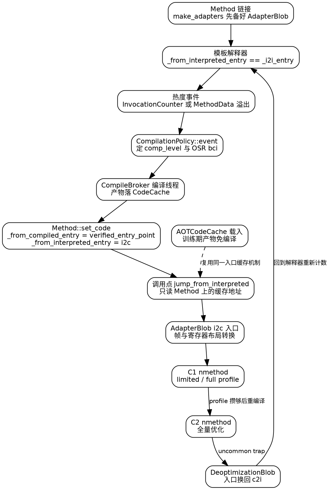

## Introduction

同一个方法的一次 `invokevirtual`，在同一个进程里可能落到四种不同的机器码上：**模板解释器的 codelet**、**C1 产出的 nmethod**、**C2 产出的 nmethod**、以及**训练期生成、启动时直接载入 CodeCache 的 AOT 代码**。字节码本身没变，变的只是"从哪个地址进去"。

所以 HotSpot 里并不存在一个叫 `ExecutionEngine` 的类，执行引擎的真实职责被拆成三件事：

1. **选择**——为每个 `Method` 缓存两个入口地址，调用点只读这两个字段，不判断"该方法是否已编译"。
2. **切换**——编译器产出、deopt 作废、模式开关（`-Xint` / `-Xcomp`）生效时，改的是这两个缓存值与它们指向的 blob。
3. **维护一致性**——切换必须发生在安全点语义之下，且新旧代码要能被 GC 同时看见（老帧还在栈上，新 nmethod 已经可执行）。

本篇是这一层的**导览页**：只讲入口选择与形态切换这条主干。细节全部外链——字节码求值与模板生成见
[interpreter.md](/docs/CS/Java/JDK/JVM/interpreter.md?id=templateinterpreter)，C1 管线见
[c1.md](/docs/CS/Java/JDK/JVM/c1.md?id=hir)，C2 与分层策略见 [JIT.md](/docs/CS/Java/JDK/JVM/JIT.md?id=c2)，
编译产物的存放与失效见 [CodeCache.md](/docs/CS/Java/JDK/JVM/CodeCache.md?id=codeblob)，推测破产见
[Deoptimization.md](/docs/CS/Java/JDK/JVM/Deoptimization.md)，暂停与轮询见
[Safepoint.md](/docs/CS/Java/JDK/JVM/Safepoint.md?id=safepoint)，AOT 代码缓存见
[Startup_Acceleration.md](/docs/CS/Java/JDK/JVM/Startup_Acceleration.md)。

## Version Baseline

> [!NOTE]
>
> 本篇全部符号在 **jdk-27-ga** 的 `src/hotspot/share` 与 `src/hotspot/cpu/x86` 下逐个 grep 确认。LTS 基线为 JDK 25。
> 三个最容易照旧书写错的地方：
>
> - **`EntryKind` 这个名字已经不存在**。`AbstractInterpreter` 的方法入口表枚举在本树叫 `MethodKind`，末项是
>   `number_of_method_entries`（`interpreter/abstractInterpreter.hpp:59-96`）；旧资料里的
>   `abstract_interp0` / `abstract_interp1` 全库 grep 不到。
> - **adapter 只有四个入口**，名字是 `i2c` / `c2i` / `c2i_unverified` / `c2i_no_clinit_check`
>   （`runtime/sharedRuntime.cpp:2663`）。传说中的 `forward` 入口在本树**不存在**，不要写。
> - **没有独立的 backedge counter 文件**。`interpreter/` 下只有 `invocationCounter.hpp`，同一套
>   `[count|carry]` 位布局兼作回边计数（`count_mask_value` 的注释即 `use this value to mask the backedge counter`）。
>
> 另：`ExecutionEngine` 在本子树有两处含义——[JVM.md](/docs/CS/Java/JDK/JVM/JVM.md?id=architecture)
> 里是**架构小节标题**（概念层），本篇里是**导览页**（源码层，讲入口与切换的落点），二者不重叠。
>
> 详见 [JVM 版本基线](/docs/CS/Java/JDK/JVM/JVM.md?id=version-baseline)。

## Method Entry Points

### Two Cached Entry Points on Method

分派的全部秘密是 `Method` 上的两个 `volatile address` 字段，注释把语义写得很死
（`oops/method.hpp:95-102`）：

```cpp
  volatile address _from_compiled_entry;     // Cache of: _code ? _code->entry_point() : _adapter->c2i_entry()
  ...
  volatile address  _from_interpreted_entry; // Cache of _code ? _adapter->i2c_entry() : _i2i_entry
```

两条不变式：

- **`_from_interpreted_entry` 给"调用方在解释器里"的场景用**。没有编译代码时它等于 `_i2i_entry`（解释器入口）；
  一旦装了 nmethod，它变成 adapter 的 `i2c` 入口。
- **`_from_compiled_entry` 给"调用方已经是机器码"的场景用**。没代码时它退化成 adapter 的 `c2i` 入口——
  也就是说，**编译代码调用一个还没编译的方法是合法的**，代价是先过一遍 c2i 摆参数再进解释器。

字段旁还有第三个玩家：`AdapterHandlerEntry* _adapter`（`oops/method.hpp:77`）。它是签名指纹共享的产物，
不是每个方法一份。访问器成对出现：`from_compiled_entry()` / `from_interpreted_entry()`
（`oops/method.hpp:134-135`）、`get_i2c_entry()` / `get_c2i_entry()`（同文件 `:388-389`）、
以及给汇编模板用的偏移 `from_compiled_offset()` / `from_interpreted_offset()`（同文件 `:615`、`:625`）。

### The Interpreter Entry Table

`AbstractInterpreter` 不是一段代码，而是一张表：`static address _entry_table[number_of_method_entries]`
（`interpreter/abstractInterpreter.hpp:121`）。给定方法先算 `MethodKind`
（`AbstractInterpreter::method_kind(const methodHandle&)`，同文件 `:140`），再查表拿入口。`MethodKind`
的分类维度很实在：

| `MethodKind` 条目 | 为什么要在解释器外面单独开入口 |
| :-- | :-- |
| `zerolocals` / `zerolocals_synchronized` | 需要零初始化局部变量表，后者还要加锁 |
| `native` / `native_synchronized` | 根本不执行字节码，直接跳 JNI |
| `empty` / `getter` / `setter` | 一条 `_return` 或一个字段读写，不值得建栈帧 |
| `abstract` | 抛 `AbstractMethodError` |
| `method_handle_invoke_FIRST` … `method_handle_invoke_LAST` | 与 `vmIntrinsics::FIRST_MH_SIG_POLY..LAST_MH_SIG_POLY` 平行编号，按签名多态展开 |
| `java_lang_math_*` / `java_util_zip_CRC32*` / `java_lang_Thread_currentThread` | 用一小段汇编直接实现字节码语义，即 intrinsic |

`method_handle_intrinsic(MethodKind)`（同文件 `:101-106`）负责这段枚举与 `vmIntrinsics::ID` 的换算，
`abstractInterpreter.cpp:116-119` 用 `assert(kind <= method_handle_invoke_LAST, "parallel enum ranges")`
守住两者平行。表里还有一个不属于入口的字段 `_rethrow_exception_entry`（`:125`），供解释器重抛已激活的异常。

模板解释器与 C++(Zero) 解释器共用这张表的语义，分工写在文件头注释（`:40-49`）：`templateTable*` ↔
`bytecodeInterpreter*` 负责字节码求值，`templateInterpreter*` ↔ `zeroInterpreter*` 负责解释器栈帧的创建与管理。
是否插安全点轮询由 `_notice_safepoints` 控制（`:118`），实现落在
`TemplateInterpreter::notice_safepoints()`（`interpreter/templateInterpreter.cpp:315`），基类版本是
`ShouldNotReachHere()`（`interpreter/abstractInterpreter.hpp:225`）。细节见
[interpreter.md 的 AbstractInterpreter 一节](/docs/CS/Java/JDK/JVM/interpreter.md?id=abstractinterpreter)。

### Adapter Blob Entries

跨"解释器帧 / 编译帧"边界的胶水全在 `AdapterBlob` 里（`code/codeBlob.hpp:427-449`）：

```cpp
class AdapterBlob: public BufferBlob {
public:
  enum Entry {
    I2C,
    C2I,
    C2I_Unverified,
    C2I_No_Clinit_Check,
    ENTRY_COUNT
  };
  ...
  address i2c_entry() { return code_begin(); }        // _i2c_offset is always 0 so no need to store it
  address c2i_entry() { return i2c_entry() + _c2i_offset; }
```

四类入口的用途就是它们的名字：`i2c` 是解释器进编译代码（要保 `_bcp` 与 interpreter 帧可恢复，否则 deopt
无法还原）；`c2i` 是编译代码进解释器；`c2i_unverified` 跳过 receiver 校验与 initialize 检查；
`c2i_no_clinit_check` 省掉类初始化检查。一个 `AdapterHandlerEntry` 同时握这四把地址
（`runtime/sharedRuntime.hpp:698-702`，`ENTRIES_COUNT = 4`），按 `AdapterFingerPrint` 在签名相同的方法之间
共享，`SharedRuntime::get_i2c_entry()` / `get_c2i_entry()`（同文件 `:756`、`:765`）只是转发到内部那块
`AdapterBlob`；方法侧的生成入口是 `Method::make_adapters()`（`oops/method.hpp:133`）。为什么"同签名共享
一块 adapter"是正确性而非省内存，见 [Method.md 的 Adapter 一节](/docs/CS/Java/JDK/JVM/Method.md?id=adapter)。

CodeCache 里与执行引擎相邻的还有 `VtableBlob`（`code/codeBlob.hpp:452`）、`MethodHandlesAdapterBlob`
（`:466`），以及 `DeoptimizationBlob` / `UncommonTrapBlob` / `ExceptionBlob` / `SafepointBlob`
这几个 `SingletonBlob`（`:578`、`:651`、`:684`、`:720`）——它们不是"另一种执行路径"，而是路径间的中转站。

### Resolve And Wrong Method Stubs

链接未完成时的间接调用不走 adapter，走 `SharedRuntime` 的 resolve stub。`SHARED_STUBS_DO` 字段表附近
（`runtime/sharedRuntime.hpp:52-65`）列出了这一族 stub 的 `StubId`：`shared_wrong_method_id`、
`shared_wrong_method_abstract_id`、`shared_ic_miss_id`、`shared_resolve_opt_virtual_call_id`、
`shared_resolve_virtual_call_id`、`shared_resolve_static_call_id`。方法还没装代码时，
`_from_compiled_entry` 甚至可以先指向 `SharedRuntime::get_handle_wrong_method_abstract_stub()`
（`oops/method.cpp:1299`），由它负责发现"进了编译入口却只该在解释器里跑"。

## Reaching A Compiled Version

### Hotness Counters In The Interpreter

不启用分层编译时，热度由 `InvocationCounter` 承载（`interpreter/invocationCounter.hpp:34-70`）：
一个 32 位字 `[count|carry]`，`number_of_carry_bits = 1`，所以一次 `increment()` 加的是
`count_grain`（= 2）而不是 1；`limit()` 直接返回 `CompileThreshold`。carry 位的意义是
"溢出过一次但先别编译，等 profile"。该文件头注释写明计数器在方法激活**之前**自增、
`count() > limit()` 时触发动作，方法入口与回边共用同一套位布局。

启用分层编译（默认）时，**同一个解释器动作打的是 `MethodData` 上的计数器而不是 `InvocationCounter`**，
runtime 侧取证入口是 `InterpreterRuntime::frequency_counter_overflow()`
（`interpreter/interpreterRuntime.cpp:1008`）与它内部的 `method->method_data()`
（同文件 `:1082`）。这层为什么这样分、阈值怎么缩放，见
[JIT.md 的 c2 与优化小节](/docs/CS/Java/JDK/JVM/JIT.md?id=optimization)；本篇只关心它把方法交给谁。

### The Single Handoff Function

两条路径汇到同一个函数：`frequency_counter_overflow_inner()` 是一行转发的
`CompilationPolicy::event(method, method, branch_bci, bci, CompLevel_none, nullptr, CHECK_NULL)`
（`interpreter/interpreterRuntime.cpp:1068`）——**解释器不知道也不该知道要用哪个编译器**。
`CompilationPolicy`（`compiler/compilationPolicy.hpp:242`，`event()` 声明在 `:361`）内部按事件类型分流
（`compiler/compilationPolicy.cpp` 中 `CompilationPolicy::event` 函数体）：

```cpp
  if (bci == InvocationEntryBci) {
    method_invocation_event(method, inlinee, comp_level, nm, THREAD);
  } else {
    method_back_branch_event(method, inlinee, bci, comp_level, nm, THREAD);
```

前置还有一道 JVMTI 闸门：`comp_level == CompLevel_none && JvmtiExport::can_post_interpreter_events() &&
THREAD->is_interp_only_mode()` 时直接 `return nullptr`，即**单步调试线程根本不触发编译**。
`JavaThread::_interp_only_mode` 是每线程标志（`runtime/javaThread.hpp:1107-1113`），只由
`prims/jvmtiThreadState.cpp:333` / `:343` 设置，**与 `-Xint` 无关**——这正是"`-Xint` 还得靠
`set_mode_flags` 关 `UseCompiler`"的原因，两者是不同的开关。

尾部是 OSR 的回查：算出 `expected_comp_level`（`MIN2(CompLevel_full_optimization, comp_level + 1)`，
被 `CompilationModeFlag::disable_intermediate()` 降级为 `CompLevel_simple`），再用
`inlinee->lookup_osr_nmethod_for(bci, expected_comp_level, false)`
（`oops/method.hpp:780`）找现成的 OSR nmethod；找到了且级别不同，就把它作为返回值交回 runtime，
由 `interpreterRuntime.cpp:1070-1072` 过一遍 `BarrierSetNMethod::nmethod_osr_entry_barrier` 再跳转。

真正"提交编译任务"的是 `compile(mh, bci, level, THREAD)`（`compiler/compilationPolicy.cpp:865`、`:877`），
投递前用 `CompileBroker::should_compile_new_jobs()`（同文件 `:237`）确认队列允许接活。级别谓词
`is_c1_compile()` / `is_c2_compile()` 定义在 `compiler/compilerDefinitions.hpp:82-88`（判据是"级别是否落在
`CompLevel_none` 与 `CompLevel_full_optimization` 之间"），`CompilerConfig::is_tiered()` / `is_c1_only()` /
`is_c2_only()` / `has_c1()` / `has_c2()` 在同文件 `:112-131`。C1 如何产出 `CompLevel_simple` /
`CompLevel_limited_profile` / `CompLevel_full_profile`，见
[c1.md 的 build 一节](/docs/CS/Java/JDK/JVM/c1.md?id=build)。

### comp_level And The Code Cache

装填动作在 `Method::set_code()`（`oops/method.cpp:1371` 起），注释直接写出顺序依赖：

```cpp
  // These writes must happen in this order, because the interpreter will
  // directly jump to from_interpreted_entry which jumps to an i2c adapter
  // which jumps to _from_compiled_entry.
  mh->_code = code;             // Assign before allowing compiled code to exec

  int comp_level = code->comp_level();
  if (comp_level > mh->highest_comp_level()) {
    mh->set_highest_comp_level(comp_level);
  }

  OrderAccess::storestore();
  mh->_from_compiled_entry = code->verified_entry_point();
  OrderAccess::storestore();
```

`_code` 先写、两个入口后写，中间插 `storestore()`，保证解释器不可能看到"i2c 指向一个还没装好的编译代码"。
`highest_comp_level()` / `highest_osr_comp_level()`（`oops/method.hpp:258-261`）是"这个方法最高到过哪一级"
的历史水位，策略靠它决定下一次给哪个 level。整个函数持有 `NMethodState_lock` 且要求
`mh->adapter() != nullptr`——**adapter 必须先于代码存在**；方法句柄 intrinsic 与虚拟续体
（`is_continuation_native_intrinsic()`）在这里有专门的入口处理，是"入口缓存"最容易被改错的两处。

## Coexistence And Visibility

### Mode Flags And Their Landing Point

`-Xint` / `-Xmixed` / `-Xcomp` 在 `runtime/arguments.cpp:2288`、`:2292`、`:2296` 被解析，
全部只做一件事：`set_mode_flags(_int | _mixed | _comp)` 并把 `mode_flag_cmd_line` 置真
（该静态变量声明在 `runtime/arguments.cpp:131`）。枚举与谓词在
`runtime/arguments.hpp:153-156`、`:484-486`（`is_interpreter_only()` 就是 `mode() == _int`）。
`Arguments::set_mode_flags()` 的函数体（`runtime/arguments.cpp:1358-1400`）是唯一落点：

| mode | 被改动的 flag | 效果 |
| :-- | :-- | :-- |
| 进入前先复位 | `UseInterpreter = UseCompiler = UseLoopCounter = true`，并从 `Arguments::_` 备份恢复 `ClipInlining` / `AlwaysCompileLoopMethods` / `UseOnStackReplacement` / `BackgroundCompilation` | 三种模式共享同一份"出厂值" |
| `_int` | `UseCompiler=false`、`UseLoopCounter=false`、`AlwaysCompileLoopMethods=false`、`UseOnStackReplacement=false` | 关编译、关回边计数、关 OSR |
| `_mixed` | 无 | 与默认相同 |
| `_comp` | `UseInterpreter=false`、`BackgroundCompilation=false`、`ClipInlining=false` | 强制首次调用即编译，且同步等编译完成 |

两条容易被漏掉的补充路径（`runtime/arguments.cpp:2626-2636`）：`CompileThresholdScaling == 0.0`，或
非分层下 `CompileThreshold == 0`，会被**等价翻译成 `set_mode_flags(_int)`**；
Zero 平台则无条件 `_int`（"Zero always runs in interpreted mode"）。
模式谓词的消费点很分散，例如 `classfile/systemDictionary.cpp:2015` 在 `-Xint` 下仍允许
`vmIntrinsics::_linkToNative`，`opto/c2compiler.cpp:108` 用
`assert(!CompilerConfig::is_c1_or_interpreter_only())` 守住"C2 被启动说明不是解释器/C1-only 模式"。

### One Method Several Versions

同一方法在 CodeCache 里**允许同时存在多个版本**：C1 的 `CompLevel_full_profile` 版本与 C2 的
`CompLevel_full_optimization` 版本、以及普通入口与若干 OSR 入口。三条约束：

- **选哪个版本**由策略层决定，`Method` 只缓存"当前该进的那一个地址"；
  `Method::check_code()`（`oops/method.cpp:1364`）在每次装填前断言 `_code` 反指自己且不是 OSR 方法。
- **OSR 版本单独查表**，靠 `lookup_osr_nmethod_for(bci, level, match_level)` 按 bci 与 level 精确命中，
  不进 `_from_compiled_entry`。
- **失效与回收**由 CodeCache 负责，容量、分段与 flushing 见
  [CodeCache.md](/docs/CS/Java/JDK/JVM/CodeCache.md?id=tuning)。

### Deopt Returns Control To The Interpreter

推测破产时不做"重跑同一段代码"，而是**把入口换回去**：`set_from_compiled_entry(adapter()->get_c2i_entry())`
（`oops/method.cpp:1583`）让后续"从编译代码进来"的调用改走 c2i 落回解释器，中转的机器码就是
`DeoptimizationBlob`（`code/codeBlob.hpp:578`）与 `UncommonTrapBlob`（`:651`）。unpack 与 vframe 重建见
[Deoptimization.md 的 blob 一节](/docs/CS/Java/JDK/JVM/Deoptimization.md?id=deoptimization-blob)。

### GC And Safepoint Visibility

入口切换的正确性前提是所有线程能在一个安全点停下并看到同一份 `_from_interpreted_entry` /
`_from_compiled_entry`。解释器侧的轮询由 `_notice_safepoints` 决定插不插
（`interpreter/abstractInterpreter.hpp:118`），编译代码侧由 nmethod 的 poll 位与
`SafepointBlob`（`code/codeBlob.hpp:720`）接手；`Method::verified_code_entry()` 的注释
"must not hit a safepoint"（`oops/method.cpp:1355`）说明**读入口本身不得触发安全点**。
栈上旧帧引用的 nmethod 不能被回收这条属于 GC 可见性范畴，见
[Safepoint.md](/docs/CS/Java/JDK/JVM/Safepoint.md?id=safepoint)。

### AOT Loaded Code

`code/aotCodeCache.hpp:34-39` 的头注释给了一句话定义：**训练期从 CodeCache 收集代码与元数据，
后续生产运行把它直接载回 CodeCache，跳过生成**。条目类型枚举 `DO_AOTCODEENTRY_KIND`（同文件 `:53-59`）
恰好就是本篇四条路径的清单：`Adapter`、`SharedBlob`、`C1Blob`、`C2Blob`、`StubGenBlob`；
`AOTCodeEntry::_id` 的注释 "Adapter's id, vmIntrinsic::ID for stub or name's hash for nmethod"（`:74`）
说明 **AOT 载入后与 JIT 产物共用同一套 adapter 与入口机制**，所以它不是第五条执行路径，而是让某条路径
跳过编译。它与 CDS 侧的 `-XX:AOTMode=record|create -XX:AOTCache=...`（`cds/cdsConfig.hpp:127-133`）是两套
东西：那套管类加载与链接（`cds/aotClassLinker.cpp`、`cds/aotCacheAccess.hpp:38`），这套管代码。展开见
[Startup_Acceleration.md](/docs/CS/Java/JDK/JVM/Startup_Acceleration.md)。

## Execution Paths Compared

| 形态 | 何时可用 | 是否带 profile | 启动代价 | 峰值性能 | 能否被 deopt | CodeCache 约束 |
| :-- | :-- | :-- | :-- | :-- | :-- | :-- |
| 模板解释器 | VM 初始化后即有；代码是 `StubQueue`（`interpreter/abstractInterpreter.hpp:116`），不是 nmethod | 采样出 `MethodData`，自身不消费 | 只付生成解释器代码的一次开销 | 最低，每条字节码一次分派 | 不适用（是 deopt 的**目标**） | 不占 nmethod 名额，见 [interpreter.md](/docs/CS/Java/JDK/JVM/interpreter.md?id=code) |
| C1 | 首次热度事件后异步产出 `CompLevel_simple` 与 profile 级别 | 产出 limited / full profile | 低，HIR/LIR 直出 | 中，优化有限 | 带 profile 的版本会因推测失败进 uncommon trap | 占，见 [c1.md](/docs/CS/Java/JDK/JVM/c1.md?id=hir) |
| C2 | profile 攒够后重编译为 `CompLevel_full_optimization` | 只**消费** profile 做推测 | 高，优化耗 CPU | 最高 | 是主要来源，推测破产即回解释器 | 占，且体积最大，见 [JIT.md](/docs/CS/Java/JDK/JVM/JIT.md?id=c2) |
| AOT 代码 | 启动时从训练产物载入，跳过生成 | 沿用训练期记录的 profile 语义 | 几乎为零 | 取决于训练期到过的级别 | 同 C1/C2 规则（就是它们的 blob） | 载入后与 JIT 产物同区，见 [Startup_Acceleration.md](/docs/CS/Java/JDK/JVM/Startup_Acceleration.md) |

`-Xint` / `-Xcomp` / `-Xmixed` 只决定这张表里"哪些行被允许"：`_int` 关掉 `UseCompiler` 后只剩第 1 行与
AOT 载入；`_comp` 关掉 `UseInterpreter` 后第 1 行退化为"只为 adapter 与 profile 而存在"。

## Dispatch Flow



## Links

- [JVM](/docs/CS/Java/JDK/JVM/JVM.md)
- [interpreter](/docs/CS/Java/JDK/JVM/interpreter.md)
- [JIT](/docs/CS/Java/JDK/JVM/JIT.md)
- [c1](/docs/CS/Java/JDK/JVM/c1.md)
- [CodeCache](/docs/CS/Java/JDK/JVM/CodeCache.md)
- [Method](/docs/CS/Java/JDK/JVM/Method.md)

## References

- [JEP 197: Segmented Code Cache](https://openjdk.org/jeps/197)
- [JEP 295: Ahead-of-Time Compilation](https://openjdk.org/jeps/295)
- [JEP 483: Ahead-of-Time Class Loading & Linking](https://openjdk.org/jeps/483)
- [JEP 514: Ahead-of-Time Command-Line Ergonomics](https://openjdk.org/jeps/514)
