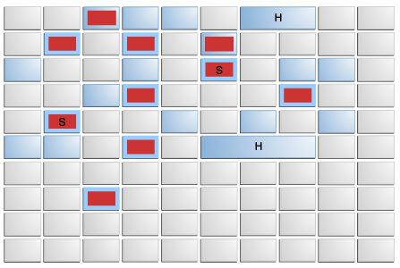
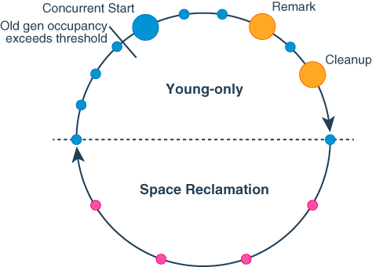

## Introduction

The G1, Garbage First, [garbage collector (GC)](/docs/CS/Java/JDK/JVM/GC/GC.md?id=collectors) has been the default GC since JDK 9.<br/>

> [!NOTE]
> JDK 9 起 G1 只对 **server 环境**默认，受限环境（单 CPU，或物理内存 < 1792 MB）会回落 Serial；**JDK 27 起 G1 成为所有环境的默认 GC**（[JEP 523](https://openjdk.org/jeps/523)）。下文「面向多处理器、大内存的 server 风格收集器」是对其**设计取向**的描述，不代表它仍是可选收集器。
The Garbage-First (G1) garbage collector is a server-style garbage collector, **targeted for multiprocessor machines with large memories**.
It attempts to meet garbage collection (GC) pause time goals with high probability while achieving high throughput.<br/>
Whole-heap operations, such as global marking, are performed concurrently with the application threads. This prevents interruptions proportional to heap or live-data size.

The first focus of G1 is to provide a solution for users running applications that require large heaps with limited GC latency.
**This means heap sizes of around 6 GB or larger, and a stable and predictable pause time below 0.5 seconds.**

Applications running today with either the CMS or the with parallel compaction would benefit from switching to G1 if the application has one or more of the following traits.

- More than 50% of the Java heap is occupied with live data.
- The rate of object allocation rate or promotion varies significantly.
- The application is experiencing undesired long garbage collection or compaction pauses (longer than 0.5 to 1 second).

G1 performs parts of its work at the same time as the application runs. It trades processor resources which would otherwise be available to the application for shorter collection pauses.

This is most visible in the use of one or more garbage collection threads active while the application runs.
Thus, compared to throughput collectors, while garbage collection pauses are typically much shorter with the G1 collector, application throughput also tends to be slightly lower.

G1 is a generational, incremental, parallel, mostly concurrent, stop-the-world, and evacuating garbage collector which monitors pause-time goals in each of the stop-the-world pauses.
Similar to other collectors, G1 splits the heap into (virtual) young and old generations.
Space-reclamation efforts concentrate on the young generation where it is most efficient to do so, with occasional space-reclamation in the old generation.

Some operations are always performed in stop-the-world pauses to improve throughput.
Other operations that would take more time with the application stopped such as whole-heap operations like global marking are performed in parallel and concurrently with the application.
To keep stop-the-world pauses short for space-reclamation, G1 performs space-reclamation incrementally in steps and in parallel.
G1 achieves predictability by tracking information about previous application behavior and garbage collection pauses to build a model of the associated costs.
It uses this information to size the work done in the pauses. For example, G1 reclaims space in the most efficient areas first (that is the areas that are mostly filled with garbage, therefore the name).

G1 reclaims space mostly by using evacuation: live objects found within selected memory areas to collect are copied into new memory areas, compacting them in the process.
After an evacuation has been completed, the space previously occupied by live objects is reused for allocation by the application.

The Garbage-First collector is not a real-time collector.
It tries to meet set pause-time targets with high probability over a longer time, but not always with absolute certainty for a given pause.

## JDK 22–27 Evolution

> [!NOTE]
> 本篇版本基线为 **JDK 27**。下表汇总 JDK 22 以来影响 G1 行为与实现的关键 JEP / bug fix，后续各节会在对应处内联更新并交叉引用。

| JEP / Bug | Release | 领域 | 变化摘要 |
| :-- | :-- | :-- | :-- |
| [JEP 423](https://openjdk.org/jeps/423) | 22 | GC 暂停 | **Region Pinning**：JNI critical 区域不再禁用 GC，改为 pin 住含 critical object 的 region（见 [Region Pinning](#region-pinning-jep-423)） |
| [JEP 475](https://openjdk.org/jeps/475) | 24 | C2 编译 | **Late Barrier Expansion**：G1 写屏障从 C2 编译管道早期移到后期（寄存器分配后），减少 JIT 编译开销（见 [Late Barrier Expansion](#late-barrier-expansion-jep-475)） |
| [JDK-8343782](https://bugs.openjdk.org/browse/JDK-8343782) | 25 | RSet | **Shared G1CardSet**：预期一起回收的 old gen regions 分组后共享一个 G1CardSet 实例，消除组内跨 region 引用追踪（见 [Remembered Set](#remembered-set)） |
| [JEP 522](https://openjdk.org/jeps/522) | 26 | 写屏障 | **Dual Card Table**：双卡表原子交换，消除 mutator 与 refinement 线程间的同步，写屏障从 ~50 指令降到 ~12，吞吐量提升 5–15%（见 [Dual Card Table](#dual-card-table-jep-522)） |
| [JDK-8048180](https://bugs.openjdk.org/browse/JDK-8048180) | 26 | Humongous | **Eager Reclamation of Humongous Objects with References**：含引用的大对象也能在任意 GC pause 中被回收（不再仅限基本类型数组，见 [Humongous Objects](#humongous-objects)） |
| [JEP 523](https://openjdk.org/jeps/523) | 27 | 默认值 | **G1 成为所有环境默认 GC**，废止受限环境（单 CPU / 堆 < 1792 MB）回落 Serial 的规则（见本篇引言） |
| [JDK-8238686](https://bugs.openjdk.org/browse/JDK-8238686) | 27 | 堆伸缩 | **MinHeapFreeRatio / MaxHeapFreeRatio 默认值从 40/70 改为 0/100**，默认不再影响 G1 堆伸缩（见 [Heap Sizing](#heap-sizing)） |

> [!TIP]
> JDK 26 的 JEP 522（双卡表）与 JDK 27 的 JEP 523（G1 全环境默认）构成了 G1 的"收官之战"：吞吐量已接近 Parallel GC，延迟本就优于 Serial / Parallel，现在连最小堆场景也默认选中它。G1 不再需要与 Parallel 做"吞吐 vs 延迟"的二选一——它已经是通用场景的最优解。

## Heap

G1的堆空间管理与JVM之前常用的串行、并行、CMS等垃圾回收算法有很大的区别。串行、并行、CMS中，堆空间是连续的，或者粗粒度的划分为新生代（eden / survivor）、老年代、永久代
随着计算机硬件的发展，服务器堆内存越来越大，旧时代的垃圾回收算法处理大堆时，性能较差且停顿（STW）时间不可控。
G1将堆拆分成一系列的分区（Heap Region），这样垃圾回收算法在大部分场景下仅需处理一部分HR，而不是整个老年代。极大的提升了收集效率，并使得JVM可以精细控制STW的时间

### Region

G1 partitions the heap into a set of equally sized heap regions, each a contiguous range of virtual memory as shown in Figure 1.
A region is the unit of memory allocation and memory reclamation.
At any given time, each of these regions can be empty (light gray), or assigned to a particular generation, young or old. As requests for memory comes in, the memory manager hands out free regions.
The memory manager assigns them to a generation and then returns them to the application as free space into which it can allocate itself.

<div style="text-align: center;">



</div>

<p style="text-align: center;">
Fig.1. G1 Garbage Collector Heap Layout. 
</p>

We encode the value of the heap region type so the generation can be determined quickly. 
The tag is split into two parts:

- major type (young, old, humongous)                    : top N-1 bits
- minor type (eden / survivor, starts / cont hum, etc.) : bottom 1 bit

If there's need to increase the number of minor types in the future, we'll have to increase the size of the latter and hence decrease the size of the former.

G1的分区类型大概可以分为5类：
* 可用分区 FHR
* 新生代分区 YHR，细分为eden分区和survivor分区
* 大对象分区 HHR，细分为大对象头分区和大对象连续分区，当对象size超过region_size一半时，即被认为是大对象
* 老年代分区 OHR
* 归档分区 AHR，细分为开放归档分区和关闭归档分区，区别在于是否允许引用堆外对象

```cpp
//
// 00000 0 [ 0] Free
//
// 00001 0 [ 2] Young Mask
// 00001 0 [ 2] Eden
// 00001 1 [ 3] Survivor
//
// 00010 0 [ 4] Humongous Mask
// 00010 0 [ 4] Starts Humongous
// 00010 1 [ 5] Continues Humongous
//
// 00100 0 [ 8] Old Mask
// 00100 0 [ 8] Old
//
```

### Region Lifecycle State Machine

Region 不是静态分配的——它在不同角色之间动态流转。从 free list 到最终归还，一个 region 可能经历下面的状态序列：

```
                    alloc_region()     GC cycle end
  Free ──────────────────────→ Eden ──────────────→ Survivor
  ↑                                                │
  │                                                │ GC cycle end
  │                          promotion             ↓
  │                                          Old ────────→ Free (evacuation)
  │                                            │
  │  humongous allocation                      │ Cleanup phase
  ↓                                            ↓
  Free ──→ Starts Humongous ──→ Continues Humongous ──→ Free
  ↑
  │  archive time
  └──────── Archive (Open/Closed)
```

**关键转换点**：

| 转换 | 触发者 | 机制 |
| :--- | :--- | :--- |
| Free → Eden | TLAB 分配时 Eden 用尽 | `HeapRegionManager::allocate_young_region()` 从 young free list 取 |
| Eden → Survivor | YGC 结束 | evacuation pause 内把 survivor 复制进新 region，旧 eden 清空归 Free |
| Survivor → Old | 对象晋升 / Survivor 过老 | `copy_to_survivor_space` 中 age ≥ MaxTenuringThreshold 时对象进 old region（不是 region 本身转）；evacuation failure 时整个 survivor region 晋升 |
| Old → Free | Mixed GC / Full GC | evacuation / compaction 清空存活对象后，region 加入 free list |
| Free → Humongous | 分配 > 0.5 × region_size 的对象 | 连续 Free regions 合并为 Starts + N 个 Continues |
| Humongous → Free | Cleanup 阶段检测到没人引用 | `HeapRegion::set_humongous_is_live()` 未被置位 |
| Free → Archive | CDS 归档时 | `G1ArchiveAllocator` 保留只读 region |

**注意**：Region 状态转换与 region 类型编码（line 97-111 的 bit flag）是独立的——编码决定"当前是什么"，生命周期决定"怎么变"。

### HeapRegionManager: Core Data Structures

所有 region 的分配、回收、迭代都经过 `HeapRegionManager`。它维护三个关键结构：

#### 两层索引表

```
G1HeapRegionTable _regions  (全堆 region 的二级索引)
  ├── _regions[chunk_index]        (一级：chunk 指针)
  │     └── chunk->_base
  │           └── chunk->_regions[local_index]  (二级：HeapRegion* 数组)
  │
  └── 堆地址 → region 的映射：
      region_index = (addr - heap_bottom) / region_size
      chunk_idx = region_index >> _log2_region_size
      local_idx = region_index & _region_size_mask
      return _regions[chunk_idx]->_regions[local_idx]
```

为什么两级？G1 heap 最大可以到 32TB（`max_jint × HeapWordSize`），直接用一个巨大数组会导致 TLB miss。分 chunk 可以按需按需分配二级数组（`G1HeapRegionTable::initialize` 惰性初始化）。

#### Free List 管理

`HeapRegionManager` 维护三个并行的 free region 列表：

```
young_free_list    // Eden/Survivor 分配用（G1EdenRegions / G1SurvivorRegions 会从这里取）
old_free_list      // Mixed GC / Full GC 疏散目标
humongous_free_list // humongous 对象分配时需要连续 region，这里单独维护
```

**合并机制**：free list 中的 region 如果物理相邻，`HeapRegionManager::allocate_*_region()` 可以返回连续的一组——这就是 humongous 对象能够被分配的原因。`HeapRegionManager::get_sequence()` 会扫描 free list 找到一段连续 region。

#### Region 迭代器

G1 的很多遍历（evacuation、marking、compaction）需要并行遍历所有 region。`HeapRegionManager::heap_region_par_iterate_from_worker_offset()` 用 **linear scan + claimed bit** 实现多线程安全迭代：

```
每个 worker 从自己的 offset 开始
  → 检查 HeapRegion::_claimed 位（CAS 竞争）
  → claim 成功则处理这个 region
  → 否则跳过（其他 worker 已 claim）
  → 继续线性推进直到遍历完
```

这避免了显式的工作窃取队列——region 数组本身就是天然的"工作队列"。

#### Retirement：动态调整 young gen 大小

G1 有个冷门但重要的机制——**retired regions**。当 heap 需要缩小时（`MinHeapFreeRatio` 触发），G1 不能直接把 region 归还给 OS（因为可能有存活对象），而是先 retire：

```
HeapRegion::retire()
  → 标记 _retired = true
  → 从所有 free list 移除
  → 不再参与任何分配或 GC
```

Retired regions 最终在 Full GC 后被实际释放（如果 compaction 把所有存活对象搬走了），或者在下一次 heap resize 时被重新激活。

The young generation contains eden regions (red) and survivor regions (red with "S").
These regions provide the same function as the respective contiguous spaces in other collectors, with the difference that in G1 these regions are typically laid out in a noncontiguous pattern in memory.
Old regions (light blue) make up the old generation. Old generation regions may be humongous (light blue with "H") for objects that span multiple regions.

Allocation in a heap region consists of incrementing a boundary, top, between allocated and unallocated space.
One region is the current allocation region from which storage is being allocated.
Since we are mainly concerned with multiprocessors, mutator threads allocate only thread-local allocation buffers, or TLABs, directly in this heap region, using a compare-and-swap, or CAS, operation.
They then allocate objects privately within those buffers, to minimize allocation contention.
When the current allocation region is filled, a new allocation region is chosen. Empty regions are organized into a linked list to make region allocation a constant time operation.
Larger objects may be allocated directly in the current allocation region, outside of TLABs.
Objects whose size exceeds 3/4 of the heap region size, however, are termed humongous.


HR的大小影响分配和回收的效率，HR过大则回收消费的时间长，HR过小则导致对象内存分配较慢且内存利用率较低。
HR大小上下限定义在heapRegionBounds中，最小1MB，最大32MB。HR的size必须是2的幂次，即仅可为1MB、2MB、4MB、8MB、16MB、32MB。
JVM参数-XX:G1HeapRegionSize可以指定HR size
计算HR size的逻辑主要在setup_heap_region_size函数中


Each region has an associated remembered set, which indicates all locations that might contain pointers to (live) objects within the region.
Maintaining these remembered sets requires that mutator threads inform the collector when they make pointer modifications that might create inter-region pointers.
This notification uses a card table: every 512-byte card in the heap maps to a one-byte entry in the card table.
Each thread has an associated remembered set log, a current buffer or sequence of modified cards.
In addition, there is a global set of filled RS buffers.

The remembered sets themselves are sets (represented by hash tables) of cards.
Actually, because of parallelism, each region has an associated array of several such hash tables, one per parallel GC thread, to allow these threads to update remembered sets without interference.
The logical contents of the remembered set is the union of the sets represented by each of the component hash tables.
The remembered set write barrier is performed after the pointer write.
If the code performs the pointer write x.f = y, and registers rX and rY contain the object pointer values x and y respectively, then the pseudo-code for the barrier is:

```
1| rTmp := rX XOR rY
2| rTmp := rTmp >> LogOfHeapRegionSize
3| // Below is a conditional move instr
4| rTmp := (rY == NULL) then 0 else rTmp
5| if (rTmp == 0) goto filtered
6| call rs_enqueue(rX)
7| filtered:
```

This barrier uses a filtering technique mentioned briefly by Stefanovi´c et al..
If the write creates a pointer from an object to another object in the same heap region, a case we expect to be common, then it need not be recorded in a remembered set.
The exclusive-or and shifts of lines 1 and 2 means that rTmp is zero after the second line if x and y are in the same heap region.
Line 4 adds filtering of stores of null pointers.
If the store passes these filtering checks, then it creates an out-of-region pointer.
The rs enqueue routine reads the card table entry for the object head rX.
If that entry is already dirty, nothing is done.
This reduces work for multiple stores to the same card, a common case because of initializing writes.
If the card table entry is not dirty, then it is dirtied, and a pointer to the card is enqueued on the thread’s remembered set log.
If this enqueue fills the thread’s current log buffer (which holds 256 elements by default), then that buffer is put in the global set of filled buffers, and a new empty buffer is allocated.

The concurrent remembered set thread waits (on a condition variable) for the size of the filled RS buffer set to reach a configurable initiating threshold (the default is 5 buffers).
The remembered set thread processes the filled buffers as a queue, until the length of the queue decreases to 1/4 of the initiating threshold.
For each buffer, it processes each card table pointer entry.
Some cards are hot:they contain locations that are written to frequently.
To avoid processing hot cards repeatedly, we try to identify the hottest cards, and defer their processing until the next evacuation pause.
We accomplish this with a second card table that records the number of times the card has been dirtied since the last evacuation pause (during which this table, like the card table proper, is cleared).
When we process a card we increment its count in this table.
If the count exceeds a hotness threshold (default 4), then the card is added to circular buffer called the hot queue (of default size 1 K).
This queue is processed like a log buffer at the start of each evacuation pause, so it is empty at the end.
If the circular buffer is full, then a card is evicted from the other end and processed.

Thus, the concurrent remembered set thread processes a card if it has not yet reached the hotness threshold, or if it is evicted from the hot queue.
To process a card, the thread first resets the corresponding card table entry to the clean value, so that any concurrent modifications to objects on the card will redirty and re-enqueue the card.
It then examines the pointer fields of all the objects whose modification may have dirtied the card, looking for pointers outside the containing heap region.
If such a pointer is found, the card is inserted into the remembered set of the referenced region.

We use only a single concurrent remembered set thread, to introduce parallelism when idle processors exist.
However, if this thread is not sufficient to service the rate of mutation, the filled RS buffer set will grow too large.
We limit the size of this set; mutator threads attempting to add further buffers perform the remembered set processing themselves.

-XX:ParallelGCThreads

Default  2048 Region

use -XX:+G1HeapRegionSize could define but suggest default

Young default 5% of heap size and suggest less than 60%

-XX:G1NewSizePercent -XX:G1MaxNewSizePercent

Eden : survivor1: survivor2 = 8: 1: 1 still

Humongous over half of region size

可预测停顿 

-XX:MaxGCPauseMillis=value

### Heap Sizing

G1 respects standard rules when resizing the Java heap, using `-XX:InitialHeapSize` as the minimum Java heap size, `-XX:MaxHeapSize` as the maximum Java heap size,
`-XX:MinHeapFreeRatio` for the minimum percentage of free memory, `-XX:MaxHeapFreeRatio` for determining the maximum percentage of free memory after resizing.
The G1 collector considers to resize the Java heap according to these options during the Remark and the Full GC pauses only.
This process may release memory to or allocate memory from the operating system.

> [!NOTE]
> **JDK 27 默认值变化（[JDK-8238686](https://bugs.openjdk.org/browse/JDK-8238686)）**：G1 将 `-XX:MinHeapFreeRatio` 和 `-XX:MaxHeapFreeRatio` 的默认值分别从 **40 / 70** 改为 **0 / 100**。改动后这两个参数默认不再影响 G1 堆伸缩逻辑，只有用户显式设置时才生效。旧默认值在 Full GC 后可能触发不必要的堆扩展或收缩，新默认让 G1 更纯粹地按容量目标（`-Xms` / `-Xmx`）运行。

Heap expansion occurs within the collection pause, while memory release occurs after the pause concurrent to the application.

#### Young-Only Phase Generation Sizing

G1 always sizes the young generation at the end of a normal young collection for the next mutator phase.
This way, G1 can meet the pause time goals that were set using -XX:MaxGCPauseTimeMillis and -XX:GCPauseIntervalMillis based on long-term observations of actual pause time.
This calculation takes into account how long it took young generations of similar size to evacuate.
This includes information like how many objects had to be copied during collection, and how interconnected these objects had been.

The -XX:GCPauseIntervalMillis and -XX:MaxGCPauseTimeMillis options define a minimum mutator utilization (MMU).
G1 will try for every possible time range of -XX:GCPauseIntervalMillis at most use -XX:MaxGCPauseTimeMillis milliseconds for garbage collection pauses.

If not otherwise constrained, then G1 adaptively sizes the young generation size between the values that -XX:G1NewSizePercent and -XX:G1MaxNewSizePercent determine to meet pause-time.
See Garbage-First Garbage Collector Tuning  for more information about how to fix long pauses.

Alternatively, -XX:NewSize in combination with -XX:MaxNewSize may be used to set minimum and maximum young generation size respectively.

> [!NOTE]
>
> Only specifying one of these latter options fixes young generation size to exactly the value passed with -XX:NewSize and -XX:MaxNewSize respectively. This disables pause time control.

#### Space-Reclamation Phase Generation Sizing

During the space-reclamation phase, G1 tries to maximize the amount of space that is reclaimed in the old generation in a single garbage collection pause. The size of the young generation is typically set to the minimum allowed, typically as determined by -XX:G1NewSizePercent, but also considering the MMU specification.

At the start of every mixed collection in this phase, G1 selects a set of regions from the collection set candidates to add to the collection set. This additional set of old generation regions consists of three parts:

- A minimum set of old generation regions to ensure evacuation progress.
  This set of old generation regions is determined by the number of regions in the collection set candidates divided by the length of the Space-Reclamation phase as determined by -XX:G1MixedGCCountTarget.
- Additional old generation regions from the collection set candidates if G1 predicts that after collecting the minimum set there will be time left.
  Old generation regions are added until 80% of the remaining time is predicted to be used.
- A set of optional collection set regions that G1 evacuates incrementally after the other two parts have been evacuated and there is time left in this pause.

The first two sets of regions are collected in an initial collection pass, with additional regions from the optional collection set fit into the remaining pause time.
This method ensures space reclamation progress while improving the probability to keep pause time and minimal overhead due to management of the optional collection set.

The Space-Reclamation phase ends when there are no more regions in the collection set candidate regions set.

#### Periodic Garbage Collections

If there is no garbage collection for a long time because of application inactivity, the VM may hold on to a large amount of unused memory for a long time that could be used elsewhere.
To avoid this, G1 can be forced to do regular garbage collection using the -XX:G1PeriodicGCInterval option.
This option determines a minimum interval in ms at which G1 considers performing a garbage collection.
If this amount of time passed since any previous garbage collection pause and there is no concurrent cycle in progress, G1 triggers additional garbage collections with the following possible effects:

During the Young-Only phase: G1 starts a concurrent marking using a Concurrent Start pause or, if -XX:-G1PeriodicGCInvokesConcurrent has been specified, a Full GC.
During the Space Reclamation phase: G1 continues the space reclamation phase triggering the garbage collection pause type appropriate to current progress.
The -XX:G1PeriodicGCSystemLoadThreshold option may be used to refine whether a garbage collection is triggered: if the average one-minute system load value as returned by the getloadavg() call on the JVM host system (for example, a container) is above this value, no periodic garbage collection will be run.

#### Determining Initiating Heap Occupancy

The Initiating Heap Occupancy Percent (IHOP) is the threshold at which a Concurrent Start collection is triggered and it is defined as a percentage of the old generation size.

G1 by default automatically determines an optimal IHOP by observing how long marking takes and how much memory is typically allocated in the old generation during marking cycles.
This feature is called Adaptive IHOP.
If this feature is active, then the option -XX:InitiatingHeapOccupancyPercent determines the initial value as a percentage of the size of the current old generation as long as there aren't enough observations to make a good prediction of the Initiating Heap Occupancy threshold.
Turn off this behavior of G1 using the option-XX:-G1UseAdaptiveIHOP. In this case, the value of -XX:InitiatingHeapOccupancyPercent always determines this threshold.

Internally, Adaptive IHOP tries to set the Initiating Heap Occupancy so that the first mixed garbage collection of the space-reclamation phase starts when the old generation occupancy is at a current maximum old generation size minus the value of -XX:G1HeapReservePercent as the extra buffer.

#### Behavior in Very Tight Heap Situations

When the application keeps alive so much memory so that an evacuation can't find enough space to copy to, an evacuation failure occurs.
Evacuation failure means that G1 tries to complete the current garbage collection by keeping any objects that have already been moved in their new location, and not copying any not yet moved objects, only adjusting references between the object.
Evacuation failure may incur some additional overhead, but generally should be as fast as other young collections.
After this garbage collection with the evacuation failure, G1 will resume the application as normal without any other measures.
G1 assumes that the evacuation failure occurred close to the end of the garbage collection; that is, most objects were already moved and there is enough space left to continue running the application until marking completes and space-reclamation starts.

If this assumption doesn’t hold, then G1 will eventually schedule a Full GC. This type of collection performs in-place compaction of the entire heap. This might be very slow.

G1 tries to avoid evacuation failure during young collections by scheduling Preventive young collections.
The assumption is that an additional regular young collection that does not incur an evacuation failure might free enough memory in the old generation by reclaiming humongous regions to not incur the overhead of such a garbage collection at all.
Preventive young collections may be turned off using the -XX:-UsePreventiveGC option.

```cpp

  // Minimum region size; we won't go lower than that.
  // We might want to decrease this in the future, to deal with small
  // heaps a bit more efficiently.
  static const size_t MIN_REGION_SIZE = 1024 * 1024;

  // Maximum region size determined ergonomically.
  static const size_t MAX_ERGONOMICS_SIZE = 32 * 1024 * 1024;
  // Maximum region size; we don't go higher than that. There's a good
  // reason for having an upper bound. We don't want regions to get too
  // large, otherwise cleanup's effectiveness would decrease as there
  // will be fewer opportunities to find totally empty regions after
  // marking.
  static const size_t MAX_REGION_SIZE = 512 * 1024 * 1024;

  // The automatic region size calculation will try to have around this
  // many regions in the heap.
  static const size_t TARGET_REGION_NUMBER = 2048;

void HeapRegion::setup_heap_region_size(size_t max_heap_size) {
  size_t region_size = G1HeapRegionSize;
  // G1HeapRegionSize = 0 means decide ergonomically.
  if (region_size == 0) {
    region_size = clamp(max_heap_size / HeapRegionBounds::target_number(),
                        HeapRegionBounds::min_size(),
                        HeapRegionBounds::max_ergonomics_size());
  }

  // Make sure region size is a power of 2. Rounding up since this
  // is beneficial in most cases.
  region_size = round_up_power_of_2(region_size);
```

Now make sure that we don't go over or under our limits.

1MB ~ 32MB

```cpp
  region_size = clamp(region_size, HeapRegionBounds::min_size(), HeapRegionBounds::max_size());

  // Calculate the log for the region size.
  int region_size_log = log2i_exact(region_size);

  // Now, set up the globals.
  guarantee(LogOfHRGrainBytes == 0, "we should only set it once");
  LogOfHRGrainBytes = region_size_log;

  guarantee(GrainBytes == 0, "we should only set it once");
  GrainBytes = region_size;

  guarantee(GrainWords == 0, "we should only set it once");
  GrainWords = GrainBytes >> LogHeapWordSize;

  guarantee(CardsPerRegion == 0, "we should only set it once");
  CardsPerRegion = GrainBytes >> G1CardTable::card_shift();

  LogCardsPerRegion = log2i(CardsPerRegion);

  if (G1HeapRegionSize != GrainBytes) {
    FLAG_SET_ERGO(G1HeapRegionSize, GrainBytes);
  }
}
```

### young size

- -XX:NewSize and -XX:MaxNewSize override -XX:NewRatio

```cpp

G1YoungGenSizer::G1YoungGenSizer() : _sizer_kind(SizerDefaults),
  _use_adaptive_sizing(true), _min_desired_young_length(0), _max_desired_young_length(0) {

  if (FLAG_IS_CMDLINE(NewRatio)) {
    if (FLAG_IS_CMDLINE(NewSize) || FLAG_IS_CMDLINE(MaxNewSize)) {
      log_warning(gc, ergo)("-XX:NewSize and -XX:MaxNewSize override -XX:NewRatio");
    } else {
      _sizer_kind = SizerNewRatio;
      _use_adaptive_sizing = false;
      return;
    }
  }

  if (NewSize > MaxNewSize) {
    if (FLAG_IS_CMDLINE(MaxNewSize)) {
      log_warning(gc, ergo)("NewSize (" SIZE_FORMAT "k) is greater than the MaxNewSize (" SIZE_FORMAT "k). "
                            "A new max generation size of " SIZE_FORMAT "k will be used.",
                            NewSize/K, MaxNewSize/K, NewSize/K);
    }
    FLAG_SET_ERGO(MaxNewSize, NewSize);
  }

  if (FLAG_IS_CMDLINE(NewSize)) {
    _min_desired_young_length = MAX2((uint) (NewSize / HeapRegion::GrainBytes),
                                     1U);
    if (FLAG_IS_CMDLINE(MaxNewSize)) {
      _max_desired_young_length =
                             MAX2((uint) (MaxNewSize / HeapRegion::GrainBytes),
                                  1U);
      _sizer_kind = SizerMaxAndNewSize;
      _use_adaptive_sizing = _min_desired_young_length != _max_desired_young_length;
    } else {
      _sizer_kind = SizerNewSizeOnly;
    }
  } else if (FLAG_IS_CMDLINE(MaxNewSize)) {
    _max_desired_young_length =
                             MAX2((uint) (MaxNewSize / HeapRegion::GrainBytes),
                                  1U);
    _sizer_kind = SizerMaxNewSizeOnly;
  }
}
```

### Humongous Objects

Humongous objects are objects larger or equal the size of half a region.
The current region size is determined ergonomically as described in the Ergonomic Defaults for G1 GC section, unless set using the -XX:G1HeapRegionSize option.

These humongous objects are sometimes treated in special ways:

- Every humongous object gets allocated as a sequence of contiguous regions in the old generation.
  The start of the object itself is always located at the start of the first region in that sequence.
  Any leftover space in the last region of the sequence will be lost for allocation until the entire object is reclaimed.
- Generally, humongous objects can be reclaimed only at the end of marking during the Cleanup pause, or during Full GC if they became unreachable.
  There is, however, a special provision for **eager reclamation** of humongous objects during any GC pause: G1 opportunistically reclaims humongous objects if they are not referenced by many objects.
  - **JDK 26 前（pre-[JDK-8048180](https://bugs.openjdk.org/browse/JDK-8048180)）**：仅基本类型数组（`bool`、各种整型、浮点型）可以被 eager reclaim——扫描这类对象的引用关系成本极低，GC pause 内就能判定它们是否真的不可达。
  - **JDK 26+**：含引用的 humongous 对象也能被 eager reclaim。实现上，GC pause 中会扫描这些对象的字段，沿引用向外追溯，只要确认它们不被任何 young gen region 或 survivor region 引用即可回收，无需等完整的并发标记周期结束。
  这个 eager reclaim 行为默认启用，可用 `-XX:G1EagerReclaimHumongousObjects` 控制。
- Allocations of humongous objects may cause garbage collection pauses to occur prematurely.
  G1 checks the Initiating Heap Occupancy threshold at every humongous object allocation and may force an initial mark young collection immediately, if current occupancy exceeds that threshold.
- The humongous objects never move, not even during a Full GC.
  This can cause premature slow Full GCs or unexpected out-of-memory conditions with lots of free space left due to fragmentation of the region space.

## Garbage Collection Cycle

On a high level, the G1 collector alternates between two phases.
The young-only phase contains garbage collections that fill up the currently available memory with objects in the old generation gradually.
The space-reclamation phase is where G1 reclaims space in the old generation incrementally, in addition to handling the young generation.
Then the cycle restarts with a young-only phase.

<div style="text-align: center;">



</div>

<p style="text-align: center;">
Fig.2. Garbage Collection Cycle. 
</p>

The following list describes the phases, their pauses and the transition between the phases of the G1 garbage collection cycle in detail:

1. Young-only phase: This phase starts with a few Normal young collections that promote objects into the old generation.
   The transition between the young-only phase and the space-reclamation phase starts when the old generation occupancy reaches a certain threshold, the Initiating Heap Occupancy threshold.
   At this time, G1 schedules a Concurrent Start young collection instead of a Normal young collection.

   - Concurrent Start : This type of collection starts the marking process in addition to performing a Normal young collection.
     Concurrent marking determines all currently reachable (live) objects in the old generation regions to be kept for the following space-reclamation phase.
     While collection marking hasn’t completely finished, Normal young collections may occur.
     Marking finishes with two special stop-the-world pauses: Remark and Cleanup.
     <br>
     The Concurrent Start pause may also determine that there is no need to follow through with marking: in this case, a short concurrent mark undo phase occurs, and the Young Only phase continues.
     In this case no Remark and Cleanup pauses will occur.
   - Remark: This pause finalizes the marking itself, performs reference processing and class unloading, reclaims completely empty regions and cleans up internal data structures.
     Between Remark and Cleanup G1 calculates information to later be able to reclaim free space in selected old generation regions concurrently, which will be finalized in the Cleanup pause.
   - Cleanup: This pause determines whether a space-reclamation phase will actually follow.
     If a space-reclamation phase follows, the young-only phase completes with a single Prepare Mixed young collection.
2. Space-reclamation phase: This phase consists of multiple young collections that in addition to young generation regions, also evacuate live objects of sets of old generation regions.
   These collections are also called Mixed collections. The space-reclamation phase ends when G1 determines that evacuating more old generation regions wouldn't yield enough free space worth the effort.

After space-reclamation, the collection cycle restarts with another young-only phase.
As backup, if the application runs out of memory while gathering liveness information, G1 performs an in-place stop-the-world full heap compaction(Full GC) like other collectors.

## Garbage Collection Pauses and Collection Set

G1 performs garbage collections and space reclamation in stop-the-world pauses.
Live objects are typically copied from source regions to one or more destination regions in the heap, and existing references to these moved objects are adjusted.

For non-humongous regions, the destination region for an object is determined from the source region of that object:

- Objects of the young generation (eden and survivor regions) are copied into survivor or old regions, depending on their age.
- Objects from old regions are copied to other old regions.

Objects in humongous regions are treated differently. G1 only determines their liveness, and if they are not live, reclaims the space they occupy. Objects within humongous regions are never moved by G1.

### Remembered Set

通常的，有两种记录引用关系的方式，PointOut和PointIn。
如果obj1.field1=obj2，如果是PointOut方式，则在obj1所在region的RSet记录obj2的位置；如果是PointIn方式，则在obj2所在region记录obj1的位置。G1采用的是PointIn方式

To evacuate the collection set G1 manages a remembered set: the set of locations outside the collection set that contain references into the collection set.
When an object from the collection set moves during garbage collection, any other references to that object from outside the collection set need to be changed to point to the new location of the object.

The remembered set entries represent approximate locations to save memory: often references close together reference objects close together.
G1 logically partitions the heap into cards, by default 512 byte sized areas. Remembered set entries are compressed indexes of these cards.

G1 initially manages this remembered set on a per-region basis: every region contains a per-region remembered set, the set of locations with potential references into this region.
During garbage collection, the remembered set for the entire collection set is generated from these.

The remembered sets are created mostly lazily: between the Remark and Cleanup pause G1 rebuilds the remembered set of all collection set candidate regions.
Other than that G1 always maintains remembered sets for young generation region as they are collected at every collection and by default some humongous objects for eager reclaim.


RSet 记录的是引用关系，G1使用Point-In的方式，记录其他区域对本区的引用关系，如下所示：
1. 为什么不需要新生代到老生代的引用
1. 因为Mix GC肯定会先GC Young区，不需要考虑Young区引用Old区的问题
1. 为什么需要Old区到Old区的引用
1. 因为Mix回收不是整个Old区

| 引用关系	| 是否需要RSet | 详解                                                                                       |
| --- | --- |------------------------------------------------------------------------------------------|
| 分区内部	| 不需要 | GC是以Region为最小单位，回收时会扫描整个Region，也就是Region内每个对象都会扫描到，谁引用谁自然知道了，无需额外空间记录    在处理RSet时过滤      |
| 新生代到新生代 |	不需要 | G1提供了三种GC-YGC、Mixed GC、Full GC,每种GC都会全量回收新生代Region，新生代中每个Region都会被整个扫描，代间引用就不用记了 在写屏障时过滤 |
| 新生代到老年代 |	不需要 | YGC:只回收新生代，与老年代无关，不用记; Mixed GC : 以新生代为根，根可达分析的时候就找到老生代了,不用记 Full GC : 整堆回收,无需记 在写屏障时过滤  |
| 老年代到新生代 |	需要 |                                                                                          |
| 老年代到老年代 |	需要 |                                                                                          |


YGC时，GC root主要是两类：栈空间和老年代分区到新生代分区的引用关系。
Mixed GC时，由于仅回收部分老年代分区，老年代分区之间的引用关系也将被使用。
因此，我们仅需要记录两种引用关系：老年代分区引用新生代分区，老年代分区之间的引用。

由于PointIn模式的缺点，一个对象可能被引用的次数不固定，为了节约空间，G1采用了三级数据结构来存储：
* 稀疏表：通过哈希表来存储，key是region index，value是card数组
* 细粒度PerRegionTable：当稀疏表指定region的card数量超过阈值时，则在细粒度PRT中创建一个对应的PerRegionTable对象，其包含一个C heap位图，每一位对应一个card
* 粗粒度位图：当细粒度PRT size超过阈值时，则退化为分区位图，每一位表示对应分区有引用到当前分区
  每个HeapRegion都包含了一个HeapRegionRemSet，每个HeapRegionRemSet都包含了一个OtherRegionsTable，引用数据就保存在这个OtherRegionsTable中

> [!NOTE]
> **JDK 25 Shared G1CardSet（[JDK-8343782](https://bugs.openjdk.org/browse/JDK-8343782)）**：旧模型中每个 old gen region 独立维护一个 G1CardSet 实例。JDK 25 起，在 Remark 阶段结束后，G1 会把预期在同一轮 Mixed GC 中一起 evacuation 的 regions 分组（collection group），同组内的 regions 共享一个 G1CardSet。因为组内 regions 总是同时被回收，它们之间的跨 region 引用在 collection set merge 时自然能被扫描到——无需单独维护 RSet 条目。这个改动显著降低了 RSet 的内存开销，并减少了 GC pause 中的 RSet merge 时间。

添加引用的入口在heapRegionRemSet.cpp中
void OtherRegionsTable::add_reference

-  大对象可能跨region，因此需要找到该对象的头部region
-  判断region index是否在粗粒度位图中，如是，则直接返回
-  在细粒度PRT中查找region index对应的记录，如有，则返回
-  在稀疏表中添加该region index和card，如果返回成功或found，则返回
-  如果_sparse_table.add_card返回overflow，则表示稀疏表对应region记录已超过阈值，则在细粒度PRT中添加region index和card

稀疏表主要逻辑在sparsePRT.hpp中
RSHashTable::add_card(

往稀疏表中添加引用的逻辑主要在两个add_card方法中：
* 根据region index从哈希表中找到SparsePRTEntry
* 在_cards中遍历，如果card已经记录，则返回found；
* 如果小于阈值，则添加card到_cards数组
* 如果大于等于阈值，则返回overflow

细粒度PRT主要逻辑在heapRegionRemSet.cpp的PerRegionTable类中

-  _bm是个C heap位图，每一位对应region中的一个card
-  添加引用时，先根据card在_bm中找到对应bit位置，然后将该bit置为1
-  _occupied引用数量加1，如果是并行操作则使用原子指令加1

RSet实现

稀疏哈希表 - SparsePRT
细粒度 - PerRegionTable
粗粒度位图 - BitMap

卡表就是将Region进一步划分，将Region划分为若干个物理连续的512Byte的card page - 卡页，这样每个Region就有一个卡表来映射Regin中的卡页，整堆有个global card table - 全局卡表 存储所有Region的卡表情况
如下图所示，假设数据如下，那么，card table、heap region、heap的关系如图所示
Heap - 堆 大小设置为 1GB
那么global card table - 全局卡表 的长度就是 1GB / 512Byte = 2097151 个
HR - Heap Region - 每个Region大小设置为 1MB
那么每个Region 的卡表长度就是 1MB / 512Byte = 2048 个RSet 的模型
稀疏Hash Table - SparsePRT
key - region address 引用对象所在Region的地址
value - card page index array - 引用对象所在Region中卡表索引值数组，

对象的引用关系如下所示
1. B、C、D 分区中的对象b、c、d都引用了A分区中的a对象
2. Point In方式记录，所以Region A 中的RSet会记录这个3个引用情况
3. key分别记录 B、C、D 分区地址
4. value 分别记录b、c、d对象所在卡页对应卡表的index
5. c对象比较大，占3个card page,所以value是数组类型，存放index的值

细粒度 - PerRegionTable
位图来映射卡表就是:
- 一个Bit代表一个card(512Byte) , 8Bit = Byte ，你看看，1:4096的比例
- 0代表这个卡表中对象没有引用
- 1代表有引用

粗粒度位图 - BitMap
粗粒度位图和细粒度位图的主要区别是：粗粒度位图中，每一个Bit代表的是一个Region，而非Card，粒度更粗。其他概念和模型基本相似，且都属于同一个对象（PerRegionTable，后文代码详解中有描述），这里略过不表。


### DCQS

> [!WARNING]
> **本文所述 DCQS 与 Refine 线程模型适用于 JDK 25 及更早版本（pre-[JEP 522](https://openjdk.org/jeps/522)）**。
> 自 **JDK 26** 起，G1 引入双卡表（Dual Card Table）架构，mutator 写屏障不再需要与 refinement 线程做同步——详见下方 [Dual Card Table](#dual-card-table-jep-522)。
> 双卡表保留了 card table 作为脏引用追踪的核心机制，但完全移除了 DirtyCardQueueSet、DirtyCardQueue 以及相关的 refinement 线程协作逻辑。

当对象引用关系变化时，都需要更新RSet。为了不影响Mutator的性能，RSet的更新通常是异步进行的，这一异步更新操作需要引入DCQS（Dirty Card Queue Set）结构
JVM声明了一个全局的静态结构G1BarrierSet，其中包含两个Queue Set，DirtyCardQueueSet和G1SATBMarkQueueSet，分别用于处理DCQS和STAB


G1BarrierSet::G1BarrierSet(

-  DCQ队列长度为G1UpdateBufferSize（默认256），超过阈值时该DCQ会被写入DCQS
DCQ的入队逻辑也在g1BarrierSet.cpp

void G1BarrierSet::write_ref_field_post_slow

-  如果当前线程是Mutator线程，则调用当前线程DCQ的enqueue方法
-  否则，调用DCQS的_shared_dirty_card_queue的enqueue方法，_shared_dirty_card_queue是全局变量，调用enqueue前需要加锁
入队最后都会调用到DirtyCardQueue的enqueue方法，DirtyCardQueue是PtrQueue的子类，因此实际会调用PtrQueue的enqueue方法。


-  调用enqueue_known_active将对象入队

PtrQueue::enqueue_known_active


PtrQueueSet::process_or_enqueue_complete_buffer(

-  enqueue_known_active
判断是否buffer已满，如果已满则调用handle_zero_index
如果未满，则对象入队，_index减去size
-  handle_zero_index
判断是否全局DCQ，如是则将全局DCQ放入DCQS，并申请为全局DCQ申请新空间
否则，调用process_or_enqueue_complete_buffer处理DCQ
-  process_or_enqueue_complete_buffer
如果DCQS中队列数量超过阈值，则调用mut_process_buffer，由Mutator线程协助处理引用变更
否则调用enqueue_complete_buffer，有refine线程组处理引用变更
-  enqueue_complete_buffer
enqueue_complete_buffer的逻辑较简单，将DCQ加入链表，如果没有refine线程在工作，则通过全局monitor通知refine线程
mut_process_buffer是在虚函数，在G1中的实现在dirtyCardQueue.cpp中

bool DirtyCardQueueSet::mut_process_buffer(BufferNode* node) {


-  与refine线程组处理逻辑类似，只不过是在Mutator线程中调用apply_closure_to_buffer函数执行

不论是Refine线程和Mutator线程处理，最后都会调用到apply_closure_to_buffer函数执行具体逻辑

Refine线程的具体逻辑在g1ConcurrentRefineThread.cpp的run_service方法中

-  使用volatile变量_should_terminate，用于从run的死循环中退出
-  使用模板方法模式，具体线程具体逻辑实现虚函数run_service


-  等待Mutator线程或其他Refine线程唤醒
-  通过do_refinement_step调用DCQS的apply_closure_to_completed_buffer和apply_closure_to_buffer

具体写RSet的逻辑在g1RemSet.cpp的do_card_ptr中

DCQS机制以card为基本元素，card size默认512B，card内的对象都需要扫描，因此有可能导致浮动垃圾
当JAVA进程修改了对象引用关系后，如果被引用对象处于老年代中，则将数据写入DCQ中，当DCQ满后，将DCQ加入DCQS中，并由Refine线程组离线更新RSet。如果Refine线程组线程数量超过阈值时，由Mutator线程协助处理。


### Dual Card Table ([JEP 522](https://openjdk.org/jeps/522))

**Release**: 26 | **Status**: Delivered

JDK 26 引入的双卡表是 G1 自诞生以来对写屏障机制的**最大结构变更**——它把旧模型中 mutator 线程与 refinement 线程之间复杂的同步（`DirtyCardQueueSet`、`DirtyCardQueue`、全局 monitor 通知等）完全替换为**零同步的原子交换协议**。

#### 旧模型的问题

pre-JDK-26 的 G1 使用单卡表 + DirtyCardQueueSet (DCQS) 机制：

1. mutator 写屏障：每次引用写操作需要 `CAS` 检查 card 是否已脏，未脏则入队当前线程的 `DirtyCardQueue`（DCQ）
2. DCQ 满了（默认 256 个 card）后，需要加全局锁把 DCQ 放进 DCQS
3. refinement 线程组从 DCQS 取 DCQ 并离线处理，将脏 card 信息写入 RSet
4. refinement 线程不够快时，mutator 线程要停下来帮忙处理（`mut_process_buffer`）

这个模型的问题在于：**每次写操作的"快速路径"上都夹带了同步开销**。在对象引用密集修改的应用中（如缓存、序列化框架），写屏障本身的执行时间可达 ~50 条指令，直接吞掉了 5–15% 的应用吞吐量。

#### 新模型架构

```
                    ┌──────────────────────┐
                    │   Atomic Swap        │
                    │   (via TSH)          │
                    └──────────▲───────────┘
                               │
         ┌──────────────────────┤──────────────────────┐
         │                      │                      │
    ┌────▼────┐           ┌─────▼─────┐
    │ Primary │◄──────────►│ Secondary │
    │CardTable│           │ CardTable  │
    │  满时   │  swap 回到   │  初始为空  │
    └─────────┘           └───────────┘
         ▲                      ▲
         │                      │
    mutator threads       refinement threads
    零同步写脏卡         扫描 + 写入 RSet
```

核心设计非常简洁：

1. **两张完全相同布局的卡表**：`primary`（mutator 写）和 `secondary`（refinement 读）。每张卡表占堆容量的 ~0.2% native 内存，双卡表总共 ~0.4% / GB heap。

2. **mutator 写屏障极端简化**：

   ```cpp
   // pre-JEP 522: 约 50 条指令（含 CAS、队列管理、锁竞争）
   // JEP 522 后：约 12 条指令（仅标脏 + 过滤）
   void G1BarrierSet::write_ref_field_post(T* p, oop value) {
     if (_primary_card_table.is_dirty(p)) return;
     _primary_card_table.mark_dirty(p);  // 零同步，直接写字节
   }
   ```

   不再需要检查 card 是否已脏（可以多标，但不会漏标），也不需要入队 DirtyCardQueue。

3. **原子交换触发点**：G1 预测下一次 GC pause 扫描 primary card table 可能超出停顿目标时，通过 **Thread-Local Handshake** ([JEP 312](https://openjdk.org/jeps/312)) 让所有 mutator 线程短暂停驻，然后在安全的时刻交换两张卡表的角色：

   - mutator 线程立即切到新的 primary（原来的 secondary，空的）继续零同步标脏
   - refinement 线程拿到旧的 primary（现在满的），在后台扫描并构建 RSet

4. **repeat until done**：如果 refinement 线程在当前 GC pause 前还没扫完一整张表，说明写屏障标脏速度太快，G1 会在 pause 内直接扫描还没处理的部分。

#### 关键代码位置（JDK 27）

```cpp
// src/hotspot/share/gc/g1/g1BarrierSet.hpp
class G1BarrierSet : public CardTableBarrierSet {
  G1CardTable _primary_card_table;     // mutator 线程写入
  G1CardTable _refinement_card_table;  // refinement 线程扫描
  // 原子交换由 Thread-Local Handshake 触发，在 VMThread 中完成
};

// src/hotspot/share/gc/g1/g1BarrierSet.cpp
void G1BarrierSet::swap_card_tables() {
  // 通过 tshandshake::execute 让所有 mutator 到达安全点后执行：
  // 1. _primary ↔ _refinement 指针交换
  // 2. 清空新 secondary 的内容
  // 3. refinement 线程开始处理旧 primary
}
```

#### 性能收益与权衡

| 指标 | JEP 522 前 | JEP 522 后 |
| :--- | :--- | :--- |
| mutator 写屏障指令数 | ~50 x64 指令 | ~12 x64 指令 |
| mutator 需要帮助 refinement | 是（`mut_process_buffer`） | **否**（完全解耦） |
| refinement 线程与 mutator 同步 | 是（monitor + DCQS 锁） | **否**（各自写不同内存区域） |
| 吞吐量提升 | — | **5–15%**（引用密集型应用） |
| GC pause 中扫描卡表 | 扫描 DCQS 中的队列 | 直接扫描整张 primary 表 |
| 额外 native 内存 | DCQS + per-thread DCQ | **第二张卡表**（~0.2% / GB heap） |

额外 native 内存开销可以接受：JDK 20–21 已移除了 G1 中多个更大的数据结构（总共超过双卡表的 8 倍），这些内存开销早已"腾位"。

#### 与后续版本的衔接

- **JDK 24 [JEP 475](https://openjdk.org/jeps/475) Late Barrier Expansion** 进一步配合：双卡表让写屏障逻辑变得极简，这意味着把屏障代码推迟到 C2 寄存器分配之后，实现上更清晰且不会牺牲代码质量。两者叠加后，C2 编译开销降低 ~10–20%。
- **`-XX:-G1UseConcRefinement`** 仍可用——双卡表保留了 refinement 线程组的调度逻辑，只是不再做同步竞争。关闭 refinement 会让 GC pause 中扫描整张 primary 表。


## Pause-Time Prediction and Adaptive Sizing

> G1 区别于 Parallel GC / Serial GC 的**核心竞争力**在于：它不追求单次 GC 最快，而是追求**每次 GC 的停顿时间都落在目标窗口内**。实现这一点靠的就是 G1Predictions 预测模型——它用历史数据估计下一次 GC 需要多久，反过来决定这次要做多少工作。

### 为什么需要预测模型

Parallel GC 和 Serial GC 没有预测能力——它们"能收集多少就收集多少"，停顿时间随堆大小、活对象比例和引用复杂度线性变化。G1 的设计目标不同：`-XX:MaxGCPauseMillis=200` 默认值意味着每次 GC 暂停都要尽量控制在 200ms 内，无论堆多大、活对象多不多。

G1 实现这个目标的策略是 **按可预测的工作量增量回收**：每次只回收"能在目标时间内完成的那部分"。具体落到三个决策上：

1. **这次 GC 要收多少 young regions**（决定 Eden / Survivor 尺寸）
2. **这次 Mixed GC 要追加多少 old regions**（决定 CSet 中 old gen 候选数）
3. **什么时候开始下一次并发标记**（IHOP 自适应）

这三个决策全都取决于同一个问题：**回收 1 个 region 大概要多久？**

### G1Predictions：历史数据驱动的成本估计

核心类是 `G1Predictions`（`src/hotspot/share/gc/g1/g1Predictions.hpp`），它维护一组从历史 GC pause 中采集的时间统计，用**指数加权移动平均（EWMA）**来估计下一次 GC 的"单位工作量耗时"。

#### 采集的数据

每次 evacuation pause 结束后，`G1YoungCollector::record_young_collection_end` 把以下时间片段记录到 `G1CollectorPolicy`：

| 指标 | 含义 |
| :--- | :--- |
| `_cur_social_rate_ms_per_byte` | 每复制 1 字节对象的平均耗时 |
| `_cur_non_copy_time_ms` | pause 中非复制工作的固定开销（根扫描、RSet merge 等） |
| `_cur_rs_scan_time_ms_per_byte` | 扫描 1 字节 card 的平均耗时 |
| `_cur_old_evac_rate_ms_per_byte` | 老年代对象的复制速率（通常比 young 慢，因为还要更新引用） |

```cpp
// src/hotspot/share/gc/g1/g1CollectorPolicy.cpp（简化）
void G1CollectorPolicy::record_young_collection_end(bool concurrent_operation_is_full_mark,
                                                    bool evacuation_failed) {
  // 从 phase_times 提取实际耗时
  _recent_copy_rate_ms_per_byte.add(worker_costs.young_copy_ms_per_byte);
  _recent_non_copy_ms.add(worker_costs.non_copy_ms);
  _recent_rs_scan_ms_per_byte.add(worker_costs.rs_scan_ms_per_byte);
  // …
}
```

每个指标的类型是 `TruncatedSeq`——一个带截断窗口的滑动序列，默认保留最近 **10 次 pause** 的数据。

#### 预测公式

`G1Predictions::predict_young_collection_time_ms` 用一个简单的线性模型估算"一次回收 young gen regions 的 GC pause 要多久"：

```
predict_pause_ms = non_copy_overhead_ms
                 + (live_bytes_to_copy × copy_rate_ms_per_byte)
                 + (rs_scan_bytes × rs_scan_rate_ms_per_byte)
```

即：**固定开销 + 复制成本 + RSet 扫描成本**。

关键函数链：

```
G1CollectorPolicy::recalculate_gc_time_info()  // pause 结束后调用
  → _predictor.predict_young_collection_time_ms()
  → _predictor.predict_region_non_copy_time_ms()
  → _predictor.predict_copy_time_ms()
```

#### 截断机制

真实世界中 GC pause 耗时偶尔会出现 **outlier**（比如一次分配风暴）。G1Predictions 有一个 `TruncatedSeq::truncated_mean`——它把数据排序后**截掉最大的 1/3**再算平均值，避免 outlier 污染预测。

```cpp
// src/hotspot/share/gc/g1/g1Predictions.hpp
double get_new_prediction(TruncatedSeq const* seq) const {
  // 不直接用均值：极端值会让 G1 过度保守，
  // 截断最大值后再用 EWMA 平滑
  return seq->truncated_mean() * confidence_factor();
}
```

### 决策 1：Young Gen 尺寸自适应

预测出"回收一个 young region 平均耗时 X ms"后，G1 用这个信息决定**下一个 mutator phase 要分多少 regions 给 Eden**。

入口：`G1CollectorPolicy::choose_young_generation_length`，在 young GC 结束时调用。

```
G1CollectorPolicy::choose_young_generation_length()
  → G1Predictions::predict_pause_time_ms()         // 预测
  → G1Predictions::prediction_deviation_ms()       // 计算波动范围
  → 根据 _target_pause_time_ms 和 prediction + deviation
    算出这次可以接受多少 young regions
  → 在 [_young_length_min, _young_length_max] 范围内 clamp
```

核心公式（简化）：

```
allowed_young_regions = floor(
    (_target_pause_time_ms - predicted_non_copy_overhead)
    / predicted_ms_per_young_region
)
```

`young_length_min` 和 `young_length_max` 由 `-XX:G1NewSizePercent`（默认 5% heap）和 `-XX:G1MaxNewSizePercent`（默认 60% heap）决定。这两个参数是 Young Gen 尺寸的硬边界，G1 永远不会越界。

#### MMU（Minimum Mutator Utilization）约束

光靠 `-XX:MaxGCPauseMillis` 还不够——极端情况下 G1 可以把每次 GC 都做得极短，但 GC 频率高到 mutator 几乎不跑。G1 同时维护一个 **MMU** 约束：在 `-XX:GCPauseIntervalMillis`（默认 200ms）窗口内，GC 时间占比不能超过某个下限。

函数链：

```
G1CollectorPolicy::calc_g1_mmu()
  → GC time in last interval / interval length
  → 如果 GC 占比太高，强制收缩 young gen（让 GC 更频繁）
  → 如果 GC 占比太低，允许扩展 young gen（让 GC 更快）
```

### 决策 2：Mixed GC 的 CSet 选择（三部分模型）

Marking 周期结束后，G1 知道哪些 old regions 最值得回收（live data 少、连接度低）。但 Mixed GC 的 CSet 不能全放进去——要控制 pause time。

`G1CollectorPolicy::next_collection_size` 在每次 Mixed GC 开始时决定 CSet 中要放多少 old regions：

```cpp
// src/hotspot/share/gc/g1/g1Policy.cpp（简化）
void G1CollectorPolicy::choose_collection_set() {
  // 1. 基础部分：保证每次 Mixed GC 都有进展
  uint min_old = _candidate_regions_num / _mixed_gc_count_target;
  
  // 2. 增量部分：在时间允许的前提下尽量多收
  uint predicted_old = _predictor.predict_old_collection_regions_ms()
                       / _predictor.ms_per_old_region();
  // 80% 规则：只加到还剩 20% 目标时间
  uint time_budget_left = _target_pause_time_ms - _predictor.young_cost();
  uint max_from_time = floor(time_budget_left / _predictor.ms_per_old_region() * 0.8);
  
  // 3. 可选部分：evacuate_initial_collection_set 完成后
  //    如果还有时间，G1 会把剩余候选者追加进去
}
```

三个部分的最终 CSet = **young regions + min_old + incremental_old** + optional（如果有剩余时间）。

- `-XX:G1MixedGCCountTarget`（默认 8）控制整个 space-reclamation phase 要分几次才把所有候选 old regions 收完
- `-XX:G1HeapWastePercent`（默认 5）控制"回收能释放的空间占比低于这个阈值的 region 直接跳过"

### 决策 3：IHOP 自适应——什么时候开始并发标记

IHOP（Initiating Heap Occupancy Percent）决定并发标记的启动时机。如果启动太晚，标记还没完成 old gen 就满了，被迫 Full GC；如果启动太早，mutator 分配压力还不大，标记白做。

#### Adaptive IHOP 算法（`G1IHOPControl`）

`G1Policy::create_ihop_control` 创建一个 `G1AdaptiveIHOPControl`，它维护两个时间统计：

```
IHOP_candidate = max(
    // 上一次 marking 启动时的 old occupancy
    last_conc_mark_start_occupancy_bytes,
    // 历史 marking 期间 old gen 的平均分配速率 × 预期 marking 耗时
    _predictor.mark_rate_ms_per_byte * expected_mark_duration_ms,
    // 目标 old gen 上限 - G1HeapReservePercent 的缓冲
    max_old_capacity - _heap_reserve_bytes
)
```

决策链：

```
Young GC 结束时（G1YoungCollector::collect → policy()->need_to_start_conc_mark()）
  → _ihop_control->get_conc_mark_start_threshold()
  → 比较当前 old gen occupancy + 即将分配的对象大小
  → 如果超过 IHOP 阈值 → 在这次 Young GC 上 piggy-back 一个 Concurrent Start pause
  → 触发 VM_G1TryInitiateConcMark
```

#### 关键参数

- `-XX:InitiatingHeapOccupancyPercent`（默认 45）：非 Adaptive 模式下的固定阈值，以及 Adaptive 模式下的**初始值**（第一次 concurrent marking 用这个值）
- `-XX:-G1UseAdaptiveIHOP`：关闭自适应，回到固定阈值模式
- `-XX:G1HeapReservePercent`（默认 10）：old gen 容量的缓冲百分比，防止 Adaptive IHOP 算出的阈值太激进导致 Full GC

### 决策总结：G1 的三段自适应体系

```
┌─────────────────────────────────────────────────────────────────────┐
│                     G1Predictions（历史统计）                        │
│                                                                     │
│  TruncatedSeq × 5（copy rate / non-copy / RS scan / ...）           │
│  ── EWMA ──▶ 预测 pause time for X bytes                            │
└─────────┬──────────────────┬───────────────────────┬───────────────┘
          │                  │                       │
          ▼                  ▼                       ▼
  ┌───────────────┐   ┌───────────────┐   ┌───────────────────────┐
  │ Young Gen     │   │ Mixed GC      │   │ IHOP Adaptive         │
  │ Size Decision │   │ CSet Selection│   │ Concurrent Mark Start │
  │               │   │               │   │                       │
  │ clamp(        │   │ min_old +     │   │ max(last_start,       │
  │  allowed,     │   │ incremental,   │   │  alloc_rate×mark_time,│
  │  [min,max])   │   │ optional)     │   │  max_capacity-buffer) │
  └───────────────┘   └───────────────┘   └───────────────────────┘
          │                  │                       │
          ▼                  ▼                       ▼
    Eden regions      Old regions             Concurrent Mark
    allocation         candidates              start or not?
```

这套体系的设计哲学是：**G1 永远不预测"我要收集多少"，而是预测"我在目标时间内能收集多少"**——然后反推工作量。这和 Parallel GC 的"尽量收"恰好相反。

### Collection Set

The collection set is the set of source regions to reclaim space from. Depending on the type of garbage collection, the collection set consists of different kinds of regions:

- In a Young-Only phase, the collection set consists only of regions in the young generation, and humongous regions with objects that could potentially be reclaimed.
- In the Space-Reclamation phase, the collection set consists of regions in the young generation, humongous regions with objects that could potentially be reclaimed, and some old generation regions from the set of collection set candidate regions.

The collection set candidate regions are regions that are highly likely to be collected in the space reclamation phase.
G1 selects them during the Remark pause according to how much live data they contain and their connectivity with other regions.
Regions with little live data (lots of free space) are preferred over regions that are mostly live, and regions with little connectivity over regions with high connectivity, as the effort to collect these more "efficient" regions is smaller.
G1 will drop regions that do not contribute much to free memory gain from the collection set candidate regions.
This includes all regions where the amount of space that can be reclaimed is less than -XX:G1HeapWastePercent percent of the current heap size.
G1 will not collect these regions later this space reclamation phase. default 5, suggest 2

Between the Remark and Cleanup pause G1 proceeds to prepare them for later collection, with the Cleanup pause finishing the work and sorting them according to efficiency.
More efficient regions that take less time to collect and that contain more free space are preferably collected in the subsequent Mixed collections.

### Garbage Collection Process

A garbage collection consists of four phases.

- The Pre Evacuate Collection Set phase performs some preparatory work for garbage collection: disconnecting TLABs from mutator threads, selecting the collection set for this collection as described in Java Heap Sizing, and other small preparatory work.
- During Merge Heap Roots G1 creates a single unified remembered set for later easier parallel processing from the collection set regions.
  This removes many duplicates from the individual remembered sets that would otherwise be needed to be filtered out later in a more expensive way.
- The Evacuate Collection Set phase contains the bulk of the work: G1 starts moving objects starting from the roots.
  A root reference is a reference from outside the collection set, either from some VM internal data structure (external roots), code (code roots) or from the remainder of the Java heap (heap roots).
  For all roots, G1 copies the referenced object in the collection set to its destination, processes its references into the collection set as new roots until there are no more roots.
  Individual timing for these phases can be observed with -Xlog:gc+phases=debug logging in the Ext Root Scanning, Code Root Scan, Scan Heap Roots, and Object Copy sub-phases respectively.
  G1 may optionally repeat main evacuation phases for optional collection sets.
- The Post Evacuate Collection Set consists of clean-up work including reference processing and setup for the following mutator phase.

These phases correspond to the phases printed with -Xlog:gc+phases=info logging.

Young GC

Mixed GC

Full GC

-XX:InitiatingHeapOccupancyPercent

全局采⽤标记-整理算法

局部是copy

G1收集器的特短：
并⾏与并发
分代收集（与其他收集器⼀样）
空间整理（标记-整理算法）
可预测的停顿

如果不计算维护Remembered Set的操作，G1收集器的运作⼤致可划分为以下⼏个步骤：

- Initial Marking
- Concurrent Marking
- Final Marking
- Live Data Counting and Evacuation

Compact - Smaller, adjustable, but still a pause

Young GC all using copy and STW(smaller, adjustable).

CMS的写屏障实现是直接的同步操作，而G1就不得不将其实现为类似于消息队列的结构，把写前屏障和写后屏障中要做的事情都放到队列里，然后再异步处理

在发⽣Minor Gc之前，虚拟机会先检查⽼年代最⼤可⽤的连续空间是否⼤于新⽣代所有对象的总空间，如
果这个条件成⽴，那么Minnor Gc可⽤确保是安全的。如果不成⽴，则虚拟机会查看
HandlePromotyionFailure设置值是否允许担保失败。如果允许，那么会继续检查⽼年代最⼤空间是否⼤
于历次晋升到⽼年代对象的平均⼤⼩，如果⼤于，将尝试⼀次 Minnor Gc；如果⼩于，或者
HandlePromotyionFailure设置不允许冒险，那么这时要进⾏⼀次Full Gc

[JEP 345: NUMA-Aware Memory Allocation for G1](https://openjdk.java.net/jeps/345)

## Concurrent Marking

G1 marking uses an algorithm called Snapshot-At-The-Beginning (SATB) .
It takes a virtual snapshot of the heap at the time of the Initial Mark pause, when all objects that were live at the start of marking are considered live for the remainder of marking.
This means that objects that become dead (unreachable) during marking are still considered live for the purpose of space-reclamation (with some exceptions).
This may cause some additional memory wrongly retained compared to other collectors. However, SATB potentially provides better latency during the Remark pause.
The too conservatively considered live objects during that marking will be reclaimed during the next marking.

### Marking Data Structures

We maintain two marking bitmaps, labeled previous and next.
The previous marking bitmap is the last bitmap in which marking has been completed.
The next marking bitmap may be under construction.
The two physical bitmaps swap logical roles as marking is completed.
Each bitmap contains one bit for each address that can be the start of an object.
With the default 8-byte object alignment, this means 1 bitmap bit for every 64 heap bits.
We use a mark stack to hold (some of) the gray (marked but not yet recursively scanned) objects.

### Initial Marking Pause/Concurrent Marking

The first phase of a marking cycle clears the next marking bitmap. This is performed concurrently.
Next, the initial marking pause stops all mutator threads, and marks all objects directly reachable from the roots (in the generational mode, initial marking is in fact piggy-backed on a fullyyoung evacuation pause).
Each heap region contains two top at mark start (TAMS) variables, one for the previous marking and one for the next.
We will refer to these as the previous and next TAMS variables.
These variables are used to identify objects allocated during a marking phase.
These objects above a TAMS value are considered implicitly marked with respect to the marking to which the TAMS variable corresponds, but allocation is not slowed down by marking bitmap updates.
The initial marking pause iterates over all the regions in the heap, copying the current value of top in each region to the next TAMS of that region.
Steps A and D of figure 2 illustrate this.
Steps B and E of this figure show that objects allocated during concurrent marking are above the next TAMS value, and are thus considered live.
(The bitmaps physically cover the entire heap, but are shown only for the portions of regions for which they are relevant.)

Now mutator threads are restarted, and the concurrent phase of marking begins.
This phase is very similar to the concurrent marking phase: a “finger” pointer iterates over the marked bits.
Objects higher than the finger are implicitly gray; gray objects below the finger are represented with a mark stack.

The mutator may be updating the pointer graph as the collector is tracing it.
This mutation may remove a pointer in the “snapshot” object graph, violating the guarantee on which SATB marking is based.
Therefore, SATB marking requires mutator threads to record the values of pointer fields before they are overwritten.
Below we show pseudocode for the marking write barrier for a write of the value in rY to offset FieldOffset in an object whose address is in rX.
Its operation is explained below.

```
1| rTmp := load(rThread + MarkingInProgressOffset)
2| if (!rTmp) goto filtered
3| rTmp := load(rX + FieldOffset)
4| if (rTmp == null) goto filtered
5| call satb_enqueue(rTmp)
6| filtered:
```

The actual pointer store [rX, FieldOffset] := rY would follow.
The first two lines of the barrier skip the remainder if marking is not in progress; for many programs, this filters out a large majority of the dynamically executed barriers.
Lines 3 and 4 load the value in the object field, and check whether it is null. It is only necessary to log non-null values.
In many programs the majority of pointer writes are initializing writes to previously-null fields, so this further filtering is quite effective.
The satb enqueue operation adds the pointer value to the thread’s current marking buffer.
As with remembered set buffers, if the enqueue fills the buffer, it then adds it to the global set of completed marking buffers.
The concurrent marking thread checks the size of this set at regular intervals, interrupting its heap traversal to process filled buffers.

> [Use single mark bitmap in G1](https://bugs.openjdk.org/browse/JDK-8210708)

### Concurrent Marking Finger Algorithm: `do_marking_step` Deep Dive

上文只提了"finger 指针遍历 marked bits"一句话，这里展开 G1 并发标记的**核心循环**。G1 的并发标记不是简单的 DFS——它同时用 **bitmap（finger 扫描）** 和 **mark stack（栈式 DFS）** 两种机制表示灰度对象，并与 SATB 队列、TAMS 隐式标记、YGC evacuation 并发交互。

#### 为什么需要两种灰度表示

在三色标记中，"灰对象" 是关键——自身已标记但子引用还没扫完。G1 选择了两种表示方式：

| 灰度表示 | 存储形式 | 优点 | 缺点 |
| :--- | :--- | :--- | :--- |
| **below-finger gray** | mark stack（`G1CMTask` 内部的 oop 栈） | 精确、快速处理 | 栈容量有限，GC worker 线程间需要窃取 |
| **above-finger gray** | marking bitmap（finger 指针之后的所有 marked bits） | bitmap 可无限扩展 | 遍历 bitmap 找对象需要解析标记位 |

finger 把 bitmap 切成两半：**finger 之前的已标记对象要么全黑（子引用已扫完）要么在 mark stack 中等待继续处理；finger 之后的所有 marked 对象都是灰的（等待被扫）**。

#### 核心循环：`G1CMTask::do_marking_step`

这是 G1 并发标记线程（`G1CMConcurrentMarkingTask`）每个 worker 的核心方法，在一个设定的时间片（`G1ConcMarkStepDurationMillis`，默认 10ms）内尽可能多标记：

```cpp
// src/hotspot/share/gc/g1/g1CMTask.cpp（简化核心循环）
void G1CMTask::do_marking_step(double target_time_ms,
                                bool do_termination, bool is_serial) {
  Ticks start = Ticks::now();
  double time_limit_ms = 10.0;  // G1ConcMarkStepDurationMillis
  // 1. 先 drain SATB 队列（mutator 写屏障记录的旧引用）
  //    这保证了 SATB 正确性：所有被覆盖的旧引用都被补扫
  drain_satb_buffers();
  
  // 2. 主循环：交替处理 mark stack 和 bitmap
  while (elapsed_time_ms < time_limit_ms) {
    // 2a. 优先处理 mark stack 中的对象
    if (!_mark_stack.is_empty()) {
      oop obj = _mark_stack.pop();
      // 递归扫描 obj 的子引用
      obj->oop_iterate(_mark_closure);
      // 如果 obj 有子引用不在 bitmap 的 above-finger 区，
      // push 到 _mark_stack 等待下次迭代
    }
    
    // 2b. mark stack 空了 → 用 finger 扫描 bitmap
    if (!_marking_finger.move_to_next_marked_bit()) {
      // bitmap 扫完了 → 标记 terminator 让所有 worker 同步
      _has_aborted = false;
      return;  // 结束这次 step
    }
    // 找到了一个 marked bit → 对应的对象是 above-finger gray
    oop obj = _marking_finger.current_obj();
    // 把它 push 到 mark stack，下次迭代时递归处理
    _mark_stack.push(obj);
  }
  
  // 3. 时间片用完 → 检查 SATB 队列大小，决定要不要中断
  if (_satb_overflow) {
    // SATB 队列积压太多，先 drain SATB 再继续
    drain_satb_buffers();
  }
}
```

#### SATB 队列 drain 的两种触发方式

SATB 队列中的内容来自 mutator 线程的写屏障——每次引用字段被覆盖前，旧值被 enqueue 到线程本地的 SATB buffer。SATB buffer 满了就进全局 `G1SATBMarkQueueSet`。

drain 时机：

```
方式 1：do_marking_step 开头立即 drain
  → 保证 SATB 正确性优先

方式 2：SATB 队列 overflow 时中断 mark loop
  → SATB 队列积压过多会让 Remark pause 变长
  → G1 定期检查 _satb_overflow 标志
```

drain 的逻辑很直接——把 SATB buffer 中的每个对象当作灰度对象处理（标记它的子引用），相当于把 SATB 写屏障记录的"旧值"补扫一遍。

#### TAMS 的隐式标记：新分配对象自动存活

在 Initial Mark 暂停中，G1 把每个 region 的 `top` 保存到 `next_tams`。**TAMS 以上的对象（marking 开始后新分配的）自动视为活对象，不需要在 marking bitmap 中置位**。

机制：

```cpp
// Initial Mark 暂停中
for (HeapRegion* hr : all_regions) {
  hr->save_prev_top_to_next_tams();  // next_tams = hr->top()
}
// mutator 继续运行，新分配的对象都在 next_tams 之上
// GC worker 标记时：
if (obj_address >= hr->next_tams()) {
  // 隐式标记，跳过 bitmap 置位
  // 但仍然要扫描它的子引用（子引用可能在 TAMS 以下）
}
```

TAMS 的好处：**新分配对象的标记是零成本的**——写屏障不会因为新对象的出现而额外置位。代价是新对象的所有子引用都会被保守地扫描一遍（因为子引用可能指向 TAMS 以下的旧对象）。

#### Evacuation 与 Marking 的并发交互

标记进行期间可能触发 Young GC / Mixed GC（evacuation pause），这会改变堆的状态。关键点：

1. **Evacuation 不处理 "next marking" 的 bitmap**：evacuation 期间标记线程仍然在跑。evacuation 移动对象时，只调整当前 evacuation 所需的引用关系，不碰并发标记线程正在扫描的对象。

2. **TAMS 在 evacuation 后会增加**：如果 evacuation 把更多对象搬到某个 region 并分配到了新地址，region 的 `top` 会升高。evacuation pause 结束后，**新的 top 会被复制到 next_tams**，这样新搬来的对象也算"隐式标记"。

3. **Marking Stack 被当作额外的 GC Root**：evacuation pause 开始时，GC worker 线程先 join 标记的 terminator（让标记线程暂停），然后把所有 worker 的 mark stack 里的对象当作 CSet 的根——这些对象可能已经在 CSet 里，evacuation 时需要正确处理它们的转发指针。

4. **Concurrent Mark 终止条件**：标记完成需要同时满足三个条件：

```
do_marking_step 中检查：
  !_marking_finger.has_more_marked_bits()  // bitmap 扫完了
  && _marking_stack.is_empty()             // mark stack 空了
  && !_satb_queue.has_unprocessed_entries()  // SATB 队列 drain 完了
```

三个条件同时满足后，标记线程设置 `has_aborted() = false`，触发 Remark pause。

#### Concurrent Marking 的完整阶段

从 `phase_clear_cld_claimed_marks` 到 `phase_cleanup`，并发标记周期的 7 个阶段：

```
G1ConcurrentMarkThread::concurrent_mark_cycle_do()
  │
  ├── phase_clear_cld_claimed_marks()     // 1. 清理上次标记残留
  │   └── SystemDictionary::unlink()
  │
  ├── phase_scan_root_regions()            // 2. 扫描 root regions（survivor + archive）
  │   └── G1CMRootRegionScanTask (并行)
  │   // ⚠️ 必须在所有 evacuation 之前完成，YGC 会 wait
  │
  ├── phase_mark_loop()                    // 3. 主循环：do_marking_step
  │   └── G1CMConcurrentMarkingTask (并行)
  │       └── do_marking_step(10ms, ...)  // 上面展开的核心逻辑
  │
  ├── phase_rebuild_remembered_sets()     // 4. 重建 RSet（Remark 与 Cleanup 之间）
  │   └── G1UpdateRemSetTask (并行)
  │
  ├── phase_delay_to_keep_mmu_before_cleanup() // 5. MMU 节流
  │   // 如果 GC 时间占比太高，等 mutator 先跑一会儿
  │
  ├── phase_cleanup()                      // 6. STW pause：选择 CSet 候选
  │   └── VM_G1Concurrent → CMCleanup
  │
  └── phase_clear_bitmap_for_next_mark()   // 7. 为下次标记清空 next bitmap
      // （实际上是交换 previous/next 的角色）
```

注意 **阶段 2（scan_root_regions）必须在阶段 3（mark_loop）之前**。YGC pause 开始时会调用 `wait_for_root_region_scanning()`——如果 root region 扫描还没结束，YGC 必须等标记线程扫完。这是 correctness 的硬约束：root region 是 survivor regions，YGC 的 evacuate 会处理这些对象，但如果标记线程还没扫完它们，YGC 可能会把标记中途的对象搬到新位置而没通知标记线程。

### Final Marking Pause

A marking phase is complete when concurrent marking has traversed all the marked objects and completely drained the mark stack, and when all logged updates have been processed.
The former condition is easy to detect; the latter is harder, since mutator threads “own” log buffers until they fill them.
The purpose of the stop-world final marking pause is to reach this termination condition reliably, while all mutator threads are stopped.
It is very simple: any unprocessed completed log buffers are processed as above, and the partially completed per-thread buffers are processed in the same way.
This process is done in parallel, to guard against programs with many mutator threads with partially filled marking log buffers causing long pause times or parallel scaling issues.

### Live Data Counting and Cleanup

Concurrent marking also counts the amount of marked data in each heap region.
Originally, this was done as part of the marking process.
However, evacuation pauses that move objects that are live must also update the per-region live data count.
When evacuation pauses are performed in parallel, and several threads are evacuating objects to the same region, updating this count consistently can be a source of parallel contention.
While a variety of techniques could have ameliorated this scaling problem, updating the count represented a significant portion of evacuation pause cost even with a single thread. Therefore, we opted to perform all live data counting concurrently.
When final marking is complete, the GC thread re-examines each region, counting the bytes of marked data below the TAMS value associated with the marking.
This is something like a sweeping phase, but note that we find live objects by examining the marking bitmap, rather than by traversing dead objects.

Evacuation pauses occurring during marking may increase the next TAMS value of some heap regions.
So a final stop-world cleanup pause is necessary to reliably finish this counting process.
This cleanup phase also completes marking in several other ways.
It is here that the next and previous bitmaps swap roles: the newly completed bitmap becomes the previous bitmap, and the old one is available for use in the next marking.
In addition, since the marking is complete, the value in the next TAMS field of each region is copied into the previous TAMS field, as shown in steps C and F of figure 2.
Liveness queries rely on the previous marking bitmap and the previous TAMS, so the newly-completed marking information will now be used to determine object liveness.
In figure 2, light gray indicates objects known to be dead.
Steps D and E show how the results of a completed marking may be used while a new marking is in progress.

Finally, the cleanup phase sorts the heap regions by expected GC efficiency.
This metric divides the marking’s estimate of garbage reclaimable by collecting a region by the cost of collecting it.
This cost is estimated based on a number of factors, including the estimated cost of evacuating the live data and the cost of traversing the region’s remembered set.
The result of this sorting is an initial ranking of regions by desirability for inclusion into collection sets.
The cost estimate can change over time, so this estimate is only initial.

Regions containing no live data whatsoever are immediately reclaimed in this phase.
For some programs, this method can reclaim a significant fraction of total garbage.

### Evacuation Pauses and Marking

First, an evacuation pause never evacuates an object that was proven dead in the last completed marking pass.
Since the object is dead, it obviously is not referenced from the roots, but it might be referenced from other dead objects.
References within the collection set are followed only if the referring object is found to be live.
References from outside the collection set are identified by the remembered sets; objects identified by the remembered sets are ignored if they have been shown to be dead.
Second, when we evacuate an object during an evacuation pause, we need to ensure that it is marked correctly, if necessary, with respect to both the previous and next markings.
It turns out that this is quite subtle and tricky.
Unfortunately, due to space restrictions, we cannot give here all the details of this interaction.

We allow evacuation pauses to occur when the marking thread’s marking stack is non-empty: if we did not, then marking could delay a desired evacuation pause by an arbitrary amount.
The marking stack entries may refer to objects in the collection set.
Since these objects are marked in the current marking, they are clearly live with respect to the previous marking, and may be evacuated by the evacuation pause.
To ensure that marking stack entries are updated properly, we treat the marking stack as a source of roots.

## Region Pinning ([JEP 423](https://openjdk.org/jeps/423))

**Release**: 22 | **Status**: Delivered

### 问题背景

JNI 规范定义了 `GetPrimitiveArrayCritical` / `ReleasePrimitiveArrayCritical` 等函数对——`Get...Critical` 返回 Java 对象数组的直接指针，调用方在 `Release...Critical` 之前"持有"这个指针。这期间如果 GC 把这个数组对象搬走，C 代码持有的指针就会悬空。

pre-JDK-22 的 G1 对此的解决方案是 **在所有 JNI critical 区域期间禁止 GC**：任何触发 GC 的 mutator 线程必须等所有 critical 区域结束才能开始暂停。实际生产中这个方案的问题在于：

- critical 区域阻塞的时间可能很短（微秒级），但 **mutator 线程触发 GC 的时机不可预测**——如果恰好在那几十微秒内，就必须等
- 高并发场景下多个 JNI critical 区域重叠，可能导致 GC 暂停被延迟数分钟，甚至触发 OOM

社区反馈包括 JIRA 因这个问题导致的 [线程饥饿 OOM](https://bugs.openjdk.org/browse/JDK-8192647) 和 [Jira 官方博客](https://confluence.atlassian.com/jirakb/jira-running-out-of-memory-due-to-gc-allocation-race-condition-957122851.html)。

### 实现方案

G1 自诞生以来就有一种隐含的"pinning"机制——humongous regions 和某些 liveness 过高的 region 不会被 evacuation。JEP 423 把这个机制扩展到任意 region：

1. **per-region critical object counter**：每个 HeapRegion 维护一个 `_critical_objects_count`。`GetPrimitiveArrayCritical` 成功后给所在 region **+1**，`ReleasePrimitiveArrayCritical` **-1**。

2. **pin 语义**：`count > 0` 的 region 被视为 **pinned**——GC pause 中会跳过它们。

3. **YGC 中的 pinned region 处理**：YGC 中的 pinned young region **不会被 evacuation**，而是当作 evacuation failure 处理——就地晋升到 old gen（promoted），下次 Mixed GC 时再尝试回收。

4. **Full GC 中的 pinned region 处理**：Full GC 中的 pinned region **不会被 compact**。

```cpp
// src/hotspot/share/gc/g1/heapRegion.hpp
class HeapRegion : public G1ContiguousSpace {
  // JEP 423 新增：critical object 计数
  uint  _critical_objects_count;
  
  void inc_critical_objects_count() { _critical_objects_count++; }
  void dec_critical_objects_count() { _critical_objects_count--; }
  bool is_pinned() const { return _critical_objects_count > 0 || humongous(); }
};

// JNI 入口处调用
oop JNIFastGetPrimitiveArrayCritical(JNIEnv* env, jarray array, jboolean* isCopy) {
  oop o = ...;
  HeapRegion* hr = heap_region_containing(o);
  hr->inc_critical_objects_count();  // pin
  return array_oop_to_array(o);
}
```

### 权衡与风险

| 维度 | 说明 |
| :--- | :--- |
| GC 不再被禁用 | mutator 线程永远不会因 JNI critical 区域而等 GC |
| 可 pin region 粒度 | 只能 pin region，不能 pin 单个对象——一个 region 中只要有一个 critical object，整个 region 都不会被 evacuation |
| young region pinned 后果 | 立即晋升 old gen，可能增加 old gen 占用（但这是临时的，下次 Mixed GC 会处理） |
| 理论风险 | 极端情况下大量 region 同时被 pin，GC 可用空间急剧减少 |

OpenJDK 假设 JNI critical 区域会继续被"短时间、少量使用"——这是 JNI 对它们的设计初衷。Shenandoah GC 也有类似 pinning 机制且运行良好，G1 直接复用了这一假设。

### 与其他收集器的对比

| 收集器 | JNI critical 处理 |
| :--- | :--- |
| Serial / Parallel | 单线程 STW，无 pinning 概念 |
| CMS | 也禁用 GC |
| **G1 (pre-JEP 423)** | **禁用 GC**（与 CMS 同） |
| **G1 (JEP 423+)** | **region pinning** |
| ZGC | 有类似 pinning 机制 |
| Shenandoah | region pinning（G1 JEP 423 前就已实现） |

## Late Barrier Expansion ([JEP 475](https://openjdk.org/jeps/475))

**Release**: 24 | **Status**: Delivered | **Component**: hotspot / compiler

### 问题：C2 的早屏障扩展带来的编译开销

JIT 编译管道（以 C2 为例）通常按以下阶段展开：

```
bytecode → IR → 指令选择 → 寄存器分配 → 代码生成
               ↑  ← 旧模型：G1 写屏障在这里就展开成具体指令
```

pre-JEP 475 的 G1 写屏障扩展发生在 **IR 阶段**——编译器还没有决定使用哪些寄存器、哪些指令序列。这导致：

1. 屏障展开时需要预估额外的寄存器需求，可能导致编译器做出次优的寄存器分配决策
2. 屏障的指令序列在不了解平台细节的情况下生成，某些优化（如延迟分支、指令融合）无法应用
3. HotSpot 开发者如果不深入理解 C2 的 IR 形式，很难改动屏障逻辑

性能影响：初步测试显示 C2 编译时间因此增加了 **~10–20%**，特别是对屏障密集的代码（如大型缓存、序列化）。

### 解决方案：在代码生成阶段插入屏障指令

JEP 475 把 G1 写屏障的展开推迟到 **指令选择 + 寄存器分配之后、代码生成之前**——此时编译器已经决定了具体使用哪些寄存器和指令序列：

```
bytecode → IR → 指令选择 → 寄存器分配 → 代码生成
                                        ↑  ← 新模型：屏障在这里插入具体机器指令
```

具体实现上，JEP 475 在 C2 的代码生成器（`CodeGenerator`）中为 G1 加了平台特定的 barrier 插入点：

```cpp
// src/hotspot/share/opto/codeGenerator.cpp（简化）
void CodeGenerator::generate_memory_access(MachNode* node) {
  // 1. 正常生成 store 指令
  emit_store(node);
  
  // 2. 检查这个 store 是否需要屏障
  if (node->needs_g1_barrier()) {
    // 3. 在 store 指令之后，直接插入平台特定的屏障代码
    //    此时已知哪些寄存器被占用，可以做最优的指令选择
    emit_g1_barrier(node);
  }
}
```

### 收益

| 收益 | 细节 |
| :--- | :--- |
| C2 编译时间降低 | **~10–20%**（取决于应用中引用写操作的密度） |
| 屏障指令更高效 | 可利用寄存器分配信息做最优指令选择，在 x64 上平均减少 30% 指令数 |
| 屏障实现简化 | 把 G1 屏障的"是什么"（逻辑）和"怎么生成"（机器码）解耦 |

### 与 JEP 522 的关系

JEP 475 和 JEP 522 是**互补关系**：

- JEP 475（JDK 24）改变的是**屏障在哪里展开**（编译器管道的阶段）
- JEP 522（JDK 26）改变的是**屏障本身做什么**（双卡表取代单卡表 + DCQS）

两者叠加后，G1 写屏障在 JDK 27 中的最终形态是：**极简逻辑（~12 指令的标脏 + 过滤）** + **最优机器码生成（寄存器分配后插入）**，达到了"小而快"的极致。

## Barrier

Generational garbage collectors need to keep track of references from older to younger generations so that younger generations can be garbage-collected without inspecting every object in the older generation(s).
The set of locations potentially containing pointers to newer objects is often called the *remembered set*.
At every store, the system must ensure that the updated location is added to the remembered set if the store creates a reference from an older to a newer object.
This mechanism is usually referred to as a *write barrier* or *store check*.

For some stores, the compiler can know statically that no store check is necessary, for example, when storing an integer (assuming that integers are implemented as immediates rather than as real heap-allocated objects).
However, in the general case, a store check must be executed for every store operation.
Since stores are fairly frequent in non-functional languages, an efficient write barrier implementation is essential.
The write barrier implementation described here reduces the write barrier overhead in the mutator to only two extra instructions per checked store.

### Card Marking

Our new write barrier implementation is based on Wilson’s card marking scheme.
In this scheme, the heap is divided into cards of size 2k words (typically, k = 5..7), and every card has an associated bit in a separate bit vector.
A store check simply marks the bit corresponding to the location being updated.
At garbage collection time, the collector scans the bit vector and, whenever it finds a marked bit, examines all pointers in the corresponding card in the heap.

Unfortunately, card marking as just described can be fairly slow.
Since the bit must be inserted into the bit vector, the corresponding word has to be read from memory, updated, and written back.
In addition, bit manipulations usually require several instructions on RISC processors.
Chambers and Ungar improved on Wilson’s scheme by using bytes instead of bits to mark cards.
That is, every card in the heap has one byte associated with it; a card is marked simply by storing a special value (e.g., zero) into the corresponding byte.
Although this scheme uses eight times more memory, the space overhead is usually still small; for example, with a card size of 32 words = 128 bytes, the space for the byte map is less than 1% of the heap size.

The big advantage of the byte marking scheme is its speed.
A store check requires just 3 SPARC instructions in addition to the actual store.

### Write Barrier

Our new write barrier improves on standard card marking by relaxing the invariant maintained by the card marking scheme.
The invariant maintained by standard card marking is

> bit or byte i is marked <--> card i may contain a pointer from old to new

Our scheme’s relaxed invariant is

> bit or byte i is marked <--> cards i..i+l may contain a pointer from old to new where l is a small constant (1 in our current implementation).

Essentially, l gives the store check some leeway in choosing which byte to mark—the marked byte may be up to l bytes away (in the direction of lower addresses) from the “correct” byte.
The relaxed invariant allows us to omit computing the exact address of the updated word: as long as the offset of the updated word (i.e., its distance from the beginning of the object) is less than $l*2^k$ ,
we can mark the byte corresponding to the object’s address rather than the byte corresponding to the updated field.
Thus, the common-case store check is only two instructions.

When scanning a card, the garbage collector simply needs to make sure that the last object in the card is scanned completely even if only part of it belongs to the card.
In other words, the collector continues scanning beyond the last word of the card until encountering the next object header.
However, with very large objects, this scheme could result in high scanning costs since the amount of scanning is no longer bounded by a fixed maximum leeway but only by the size of the last object.
Fortunately, this problem can be mitigated by marking the exact card for stores into arrays; then, if the last object starting in a card is an array, the collector need not continue scanning into the next card(s).

## RSet Refinement: Concurrent Card Scanning

G1 的写屏障只做"标脏 card"——把引用发生的 card 加入 DirtyCardQueue，**不会立即扫描这个 card 里到底有哪些对象**。这些脏 card 被延迟处理，处理过程就是 **RSet refinement**。refinement 与 mutator 并发运行，由 `ConcurrentRefineThread` 驱动。

> [!NOTE]
> JEP 522 改变了 refinement 的工作方式。pre-JDK-26 用 DirtyCardQueueSet（DCQS）模式，写屏障 enqueue → refinement thread dequeue；JDK 26+ 的 dual card table 下，写屏障直接标脏 primary table，refinement 只需要扫描脏 card 列表。下文主要讲 **pre-JDK-26 的 DCQS 机制**——因为这是 G1 十年来的主力实现，原理在 dual table 下仍然成立。

### RSet 三级粒度：Coarse → Medium → Fine

RSet 不是单一结构，而是一个 **渐进式精确** 的三层存储。从粗到细，扫描成本递增但精确性也递增：

| 层级 | 数据结构 | 粒度 | 扫描成本 | 何时产生 |
| :--- | :--- | :--- | :--- | :--- |
| **Coarse** | per-region `_coarse_map` (bitmap) | 整个 region | 极高（整个 region 都要扫） | RSet 刚建立时默认 coarse；region 首次被引用 |
| **Medium** | per-region `_card_table` (bitmap, 512B 粒度) | 512B card | 中等 | refinement 扫描了 coarse region，标记了 card bitmap |
| **Fine** | per-region `_par_cards` + `_fine_region` list | 精确的对象引用地址 | 低 | medium 扫描后发现 card 内引用很少，值得精确记录 |

**refinement 的核心工作就是"把 coarse 变成 medium，把 medium 变成 fine"**。GC 时扫描 RSet 的顺序反过来：先扫 fine（最精确），再扫 medium，最后 coarse。每扫完一层，能跳过的范围就更大。

### ConcurrentRefineThread 调度模型

RSet refinement 由一个主线程 + N 个 worker 线程组成：

```
ConcurrentRefineThread
  │
  ├── _primary_thread (单线程)
  │     └── run() 循环：
  │           while (true) {
  │             wait_until_queue_over_threshold();
  │             drain_queue_until_empty_or_budget();
  │             update_periodic_logging();
  │           }
  │
  └── _secondary_threads[] (N worker 线程，G1ConcRefinementThreads)
        └── run() 循环：
              while (true) {
                wait_until_primary_signals_work();
                drain_queue_segment();
              }
```

关键参数：

| 选项 | 默认值 | 作用 |
| :--- | :--- | :--- |
| `-XX:G1ConcRefinementThreads` | 0（自动 = min(8, 并行GC线程数)） | refine worker 数 |
| `-XX:G1RefinementBudgetMs` | 10ms | 每次 refinement 循环的时间预算 |
| `-XX:G1DirtyCardQueueSizeThreshold` | 128 | DCQS 积压超过此阈值触发 refine |
| `-XX:G1MaxRefineQueueSize` | 256 × 并发 refinement 阈值 | 超过时 primary thread 也处理 |

### Refinement 主循环：CardQueue 消费 + RSet 更新

`ConcurrentRefineThread::run` 的核心循环：

```cpp
// src/hotspot/share/gc/g1/concurrentRefineThread.cpp
void ConcurrentRefineThread::run() {
  while (true) {
    // 1. 等待脏队列积压到一定程度
    _monitor.wait_for_completion();

    // 2. 从 DCQS 取出 completed buffer
    void* card_index = _dcqs.get_card();
    while (card_index != NULL) {
      CardIdx_t card = (CardIdx_t)(uintptr_t)card_index;
      
      // 3. 定位这个 card 属于哪个 region
      HeapRegion* hr = _g1h->heap_region_containing(card_to_addr(card));
      if (hr == NULL) continue;
      
      // 4. 定位引用者（card 里的老对象）和被引用者（card 外的对象）
      //    refinement 要把被引用者所在 region 加入 hr 的 RSet
      
      // 5. 扫描 card：找 card 内所有包含跨 region 引用的对象
      MemRegion card_mem = card->area();
      hr->rem_set()->update_references(card_mem);
      
      // 6. RSet 层级升级：从 coarse → medium → fine
      //    update_references 内部：
      //      a. 如果 RSet 还是 coarse bitmap → 先降级到 medium（card bitmap）
      //      b. 然后扫描 card，找到具体引用地址 → 加入 medium bitmap
      //      c. 如果 medium 中引用数很少 → 进一步降到 fine（精确地址 list）
      
      // 7. 检查时间预算
      if (elapsed > budget_ms) break;
      
      // 8. 取下一个 card
      card_index = _dcqs.get_card();
    }
    
    // 9. 通知 secondary thread 继续
    _secondary_monitor.notify_all();
  }
}
```

**RSet 层级升级的具体逻辑**（`HeapRegionRemSet::update_references`）：

```
update_references(card_mem)
  │
  ├── 检查 RSet 当前层级：
  │   current_level = hr->rem_set()->get_level()  // coarse / medium / fine
  │
  ├── 如果是 coarse：
  │   → 创建 medium card bitmap（全 1，表示"所有 card 都可能有引用"）
  │   → 立即降级到 medium
  │
  ├── 如果是 medium：
  │   → 扫描 card_mem 内所有对象
  │   → 对每个对象的每个引用字段：
  │       if (ref->region() != hr)  // 跨 region
  │         medium_map.mark(card_of(ref))  // 标记 medium bitmap
  │
  └── 如果是 fine：
      → 直接把 ref 地址加入 fine_region 的精确引用 list
```

### JEP 522 对 Refinement 的影响

JDK 26+（dual card table）下 refinement 的工作方式简化了：

| 方面 | pre-JDK-26 | JDK 26+ |
| :--- | :--- | :--- |
| 写屏障 | `enqueue(card)` 到 DCQS，缓冲区满了才进全局队列 | 直接标脏 primary table，原子可见 |
| Refinement 触发 | DCQS 积压到阈值才启动 thread | 定期扫描 primary table 找脏 card |
| 同步成本 | DCQS 需要 CAS 完成 buffer 队列 | 全局原子指针 `_primary` 无锁读 |
| Memory overhead | DCQS buffer ≈ 2×card size × CPU cores | dual table = 2 × ~0.2% heap |

dual table 的 refinement thread **不再需要处理 queue 积压问题**——直接遍历 `_primary` 的 dirty bits 即可。这是因为 primary table 是全局原子可见的，refinement thread 和 mutator 写屏障之间没有生产者-消费者关系，而是共享同一个 dirty 标记。

### Refinement 暂停的保护机制

refinement 不能无限并发消耗 CPU，G1 有三道保护：

1. **时间预算**：每次循环 `G1RefinementBudgetMs`（默认 10ms），到点就 yield 给 mutator。如果 mutator 分配压力大，refinement 暂停可以延长。

2. **分配阈值**：当 young gen 总分配速度超过 `G1RefinementTopPriorityRatio`（默认 1.5）× 预测回收速度时，refinement 完全让步。

3. **GC 内 refinement**：如果 refinement 跟不上，**evacuation pause 内会同步处理 RSet**（`G1ParTask::work` 中的 `update_rem_set`）。这会增加 pause time 但保证 correctness。

### 监控与调优

```bash
# 用 G1PrintRefinementStats 观察 refinement 效率
java -XX:+UnlockDiagnosticVMOptions -XX:+G1PrintRefinementStats -jar app.jar

# 关键日志字段：
# - Concurrent refinement thread time spent
# - RSet level distribution（多少 coarse / medium / fine）
# - Cards processed per refinement iteration
```

常用调优：

```
G1ConcRefinementThreads=4     # 固定 refine worker 数
G1RefinementBudgetMs=20       # 放宽 refinement 时间预算 → 更及时的 RSet 更新
G1DirtyCardQueueSizeThreshold=256  # 积压更久才触发 → 写屏障 overhead 更低
```

## G1CollectedHeap

```c

class G1CollectedHeap : public CollectedHeap {
  
  G1CollectorPolicy* _collector_policy;
  G1CardTable* _card_table;

  SoftRefPolicy      _soft_ref_policy;

  // These sets keep track of old, archive and humongous regions respectively.
  HeapRegionSet _old_set;
  HeapRegionSet _archive_set;
  HeapRegionSet _humongous_set;

  // The sequence of all heap regions in the heap.
  HeapRegionManager* _hrm;

  // Manages all allocations with regions except humongous object allocations.
  G1Allocator* _allocator;

  // The young region list.
  G1EdenRegions _eden;
  G1SurvivorRegions _survivor;

  // The current policy object for the collector.
  G1Policy* _g1_policy;
  G1HeapSizingPolicy* _heap_sizing_policy;

  G1CollectionSet _collection_set;
}
```

#### HeapRegionManager

```cpp

HeapRegionManager* HeapRegionManager::create_manager(G1CollectedHeap* heap, G1CollectorPolicy* policy) {
  if (policy->is_hetero_heap()) {
    return new HeterogeneousHeapRegionManager((uint)(policy->max_heap_byte_size() / HeapRegion::GrainBytes) /*heap size as num of regions*/);
  }
  return new HeapRegionManager();
}
```

G1HeapRegionTable

```cpp
class HeapRegionManager: public CHeapObj<mtGC> {
G1HeapRegionTable _regions;
G1RegionToSpaceMapper* _heap_mapper;
G1RegionToSpaceMapper* _prev_bitmap_mapper;
G1RegionToSpaceMapper* _next_bitmap_mapper;
FreeRegionList _free_list;
}
```

```cpp

class G1HeapRegionTable : public G1BiasedMappedArray<HeapRegion*> {
 protected:
  virtual HeapRegion* default_value() const { return NULL; }
};

```


G1MonitoringSupport for monitoring logical spaces in G1.
It provides data for both G1's jstat counters as well as G1's memory pools.


G1将堆划分为堆区域，每个堆区域属于以下类别之一
* eden      : regions that have been allocated since the last GC
* survivors : regions with objects that survived the last few GCs
* old       : long-lived non-humongous regions
* humongous : humongous regions
* free      : free regions

#### HeapRegion

```cpp
class HeapRegion: public G1ContiguousSpace {
  private:
  // The remembered set for this region.
  // (Might want to make this "inline" later, to avoid some alloc failure
  // issues.)
  HeapRegionRemSet* _rem_set;

  protected:
  // The index of this region in the heap region sequence.
  uint  _hrm_index;

  HeapRegionType _type;

  // For a humongous region, region in which it starts.
  HeapRegion* _humongous_start_region;

  // True iff an attempt to evacuate an object in the region failed.
  bool _evacuation_failed;

  // Fields used by the HeapRegionSetBase class and subclasses.
  HeapRegion* _next;
  HeapRegion* _prev;
  
  // The index in the optional regions array, if this region
  // is considered optional during a mixed collections.
  uint _index_in_opt_cset;
  int  _young_index_in_cset;
  SurvRateGroup* _surv_rate_group;
  int  _age_index;
}
```

#### mem_allocate

当TLAB分配失败时，进入慢速分配阶段。慢速分配首先需要尝试对Heap加锁，加锁成功后在TLAB外的YHR或HHR分配

如果需要gc，则触发gc，gc成功后，回到加锁逻辑，重新开始分配直到成功，或者gc重试次数大于GCLockerRetryAllocationCount

G1ContiguousSpace::par_allocate_impl
使用CAS操作分配，如果可用空间大于对象容量则持续重试，否则退出重新选择HR或触发GC


```c
// share/gc/g1/g1CollectedHeap.cpp
HeapWord* G1CollectedHeap::mem_allocate(size_t word_size,
                              bool*  gc_overhead_limit_was_exceeded) {
  assert_heap_not_locked_and_not_at_safepoint();

  if (is_humongous(word_size)) {
    return attempt_allocation_humongous(word_size);
  }
  size_t dummy = 0;
  return attempt_allocation(word_size, word_size, &dummy);
}
```

```cpp
class G1Allocator : public CHeapObj<mtGC> {

}
```

## Root Scanning

```cpp

void G1RootProcessor::process_all_roots(OopClosure* oops,
                                        CLDClosure* clds,
                                        CodeBlobClosure* blobs) {
  AllRootsClosures closures(oops, clds);

  process_java_roots(&closures, NULL, 0);
  process_vm_roots(&closures, NULL, 0);

  process_code_cache_roots(blobs, NULL, 0);

  // refProcessor is not needed since we are inside a safe point
  _process_strong_tasks.all_tasks_claimed(G1RP_PS_refProcessor_oops_do);
}
```

### process_java_roots

```cpp

void G1RootProcessor::process_java_roots(G1RootClosures* closures,
                                         G1GCPhaseTimes* phase_times,
                                         uint worker_i) {
  // Iterating over the CLDG and the Threads are done early to allow us to
  // first process the strong CLDs and nmethods and then, after a barrier,
  // let the thread process the weak CLDs and nmethods.
  {
    G1GCParPhaseTimesTracker x(phase_times, G1GCPhaseTimes::CLDGRoots, worker_i);
    if (_process_strong_tasks.try_claim_task(G1RP_PS_ClassLoaderDataGraph_oops_do)) {
      ClassLoaderDataGraph::roots_cld_do(closures->strong_clds(), closures->weak_clds());
    }
  }

  {
    G1GCParPhaseTimesTracker x(phase_times, G1GCPhaseTimes::ThreadRoots, worker_i);
    bool is_par = n_workers() > 1;
```

`Threads::possibly_parallel_oops_do`

```
    Threads::possibly_parallel_oops_do(is_par,
                                       closures->strong_oops(),
                                       closures->strong_codeblobs());
  }
}
```

process_vm_roots

```cpp
void G1RootProcessor::process_vm_roots(G1RootClosures* closures,
                                       G1GCPhaseTimes* phase_times,
                                       uint worker_i) {
  OopClosure* strong_roots = closures->strong_oops();

  {
    G1GCParPhaseTimesTracker x(phase_times, G1GCPhaseTimes::UniverseRoots, worker_i);
    if (_process_strong_tasks.try_claim_task(G1RP_PS_Universe_oops_do)) {
      Universe::oops_do(strong_roots);
    }
  }

  {
    G1GCParPhaseTimesTracker x(phase_times, G1GCPhaseTimes::JNIRoots, worker_i);
    if (_process_strong_tasks.try_claim_task(G1RP_PS_JNIHandles_oops_do)) {
      JNIHandles::oops_do(strong_roots);
    }
  }

  {
    G1GCParPhaseTimesTracker x(phase_times, G1GCPhaseTimes::ObjectSynchronizerRoots, worker_i);
    if (_process_strong_tasks.try_claim_task(G1RP_PS_ObjectSynchronizer_oops_do)) {
      ObjectSynchronizer::oops_do(strong_roots);
    }
  }

  {
    G1GCParPhaseTimesTracker x(phase_times, G1GCPhaseTimes::ManagementRoots, worker_i);
    if (_process_strong_tasks.try_claim_task(G1RP_PS_Management_oops_do)) {
      Management::oops_do(strong_roots);
    }
  }

  {
    G1GCParPhaseTimesTracker x(phase_times, G1GCPhaseTimes::JVMTIRoots, worker_i);
    if (_process_strong_tasks.try_claim_task(G1RP_PS_jvmti_oops_do)) {
      JvmtiExport::oops_do(strong_roots);
    }
  }

#if INCLUDE_AOT
  if (UseAOT) {
    G1GCParPhaseTimesTracker x(phase_times, G1GCPhase
```

## Collection Phases

G1 的外层 GC 分发逻辑在 `G1CollectedHeap::try_collect()`。它根据 `GCCause` 决定走哪条路：

```
try_collect(cause)
  │
  ├── should_do_concurrent_full_gc(cause) → try_collect_concurrently()  // 并发 Full GC（兜底）
  ├── GCLocker::should_discard(cause) → return false                     // 被锁竞争丢弃
  ├── _gc_locker / _wb_young_gc → VM_G1CollectForAllocation              // 标准 Evacuation Pause（Young/Mixed）
  └── else → VM_G1CollectFull                                            // 串行 Full GC
```

`should_do_concurrent_full_gc()` 在分配失败时判断是否启动并发 Full GC（不是 evacuation pause 里的 Young GC，而是**全堆并发 mark → compact** 的完整周期）。

```cpp
// share/gc/g1/g1CollectedHeap.cpp
void G1CollectedHeap::collect(GCCause::Cause cause) {
  try_collect(cause, collection_counters(this));
}

bool G1CollectedHeap::try_collect(GCCause::Cause cause,
                                  const G1GCCounters& counters_before) {
  if (should_do_concurrent_full_gc(cause)) {
    return try_collect_concurrently(cause,
                                    counters_before.total_collections(),
                                    counters_before.old_marking_cycles_started());
  } else if (GCLocker::should_discard(cause, counters_before.total_collections())) {
    return false;
  } else if (cause == GCCause::_gc_locker || cause == GCCause::_wb_young_gc
             DEBUG_ONLY(|| cause == GCCause::_scavenge_alot)) {
    VM_G1CollectForAllocation op(0, counters_before.total_collections(),
                                 cause, policy()->max_pause_time_ms());
    VMThread::execute(&op);
    return op.gc_succeeded();
  } else {
    VM_G1CollectFull op(counters_before.total_collections(),
                        counters_before.total_full_collections(),
                        cause);
    VMThread::execute(&op);
    return op.gc_succeeded();
  }
}
```


## Young Collect

Eden 区满 G1 会根据停顿预测模型计算当前 Eden 区 GC 大概耗时。如果回收时间远小于 `-XX:MaxGCPauseMillis` 则分配空闲分区加入 Eden 区；如果时间接近则触发一次 Young GC。年轻代初始占堆 5% 最多不超过 60%。

GC 并行任务包括根扫描、更新 RSet、对象复制，主要逻辑在 `g1CollectedHeap.cpp` 的 `G1ParTask::work` 中调用。以下完整展开 evacuation 内部机制的调用链。

### Evacuation Call Chain: Object Copy 四步闭环

G1 的 evacuation 本质是 **Cheney 复制算法**——从 CSet 根出发，把存活对象复制到 survivor 或 old gen，并调整所有引用。与 Parallel GC 不同的是，G1 的 evacuation 同时维护 RSet 和更新 SATB 标记状态。

#### 完整调用链

```
并行工作线程启动
  → G1ParTask::work()
  → G1ParEvacuateFollowersClosure::do_void()
  → G1ParScanThreadState::trim_queue_to_threshold()     // 核心循环
      ├── dequeue() 取出待处理的 oop
      ├── G1ParCopyClosure::do_oop_work()              // 步骤 1：判定 + 复制
      │     ├── state.is_in_cset()?  ← 不在 CSet → 跳过
      │     ├── m.is_marked()?       ← 已转发 → decode_pointer()
      │     └── copy_to_survivor_space()               // 步骤 2：真正复制
      │           ├── should_promote? (age ≥ tenuring)
      │           │     └── 分配 old gen region
      │           └── PLAB / Region 分配策略
      ├── oop_store(p, forwardee)                      // 步骤 3：更新引用
      ├── update_rem_set(p, forwardee)                 // 步骤 4：更新 RSet
      └── follow_obj()                                 // 递归处理子引用
            └── 把子引用入队 trim_queue，循环直到队列空
```

#### 步骤 1：判定 + 转发状态检查（`G1ParCopyClosure::do_oop_work`）

这是每次处理一个引用字段 `p` 时的入口。关键逻辑：

```cpp
// src/hotspot/share/gc/g1/g1ParCopyClosure.hpp
void G1ParCopyClosure::do_oop_work(T* p) {
  oop obj = CompressedOops::decode_not_null(RawAccess<>::oop_load(p));

  // 1.1 判定对象是否在 CSet 中
  if (state.is_in_cset()) {
    markWord m = obj->mark();
    if (m.is_marked()) {
      // 1.2a 已转发（mark-word 存了转发指针）
      forwardee = cast_to_oop(m.decode_pointer());
    } else {
      // 1.2b 尚未转发 → 执行真正的复制
      forwardee = _par_scan_state->copy_to_survivor_space(state, obj, m);
    }
    RawAccess<IS_NOT_NULL>::oop_store(p, forwardee);  // 步骤 3：更新引用
  }
}
```

**机制**：G1 用 mark-word 的最低两位编码转发状态——正常对象的 lock 是 `01`（unlocked），转发后改成 `11`（marked），剩余位存转发指针。所以 `m.is_marked()` 实际上是检查 lock bits 是否为 `11`，**常量时间**判断是否已复制。

#### 步骤 2：PLAB 分配与 age promotion（`copy_to_survivor_space`）

这是 evacuation 中最复杂的函数，决定对象搬到哪里、如何避免竞争、以及 age 如何处理：

```
G1ParScanThreadState::copy_to_survivor_space(state, obj, mark)
  │
  ├── should_promote = (obj->age() >= _max_tenuring_threshold)
  │                     || survivor 区空间不足
  │
  ├── 选择分配目标：
  │   should_promote 是 → _old_gen_alloc_region
  │   should_promote 否 → _young_gen_alloc_region（survivor）
  │
  ├── 尝试 PLAB 分配：
  │   plab = _survivor_plab / _old_plab[thread_id]
  │   new_addr = plab.allocate(obj_size)
  │   if (new_addr != NULL) goto copy_done
  │
  ├── PLAB 满了 → 申请新 PLAB：
  │   plab.retire()                 // 旧 PLAB 尾部填 dummy int[]
  │   new_plab = _allocator.new_plab(target_size)
  │   if (new_plab.allocate → goto copy_done
  │
  ├── PLAB 也申请不到 → 直接在 region 中分配：
  │   region = alloc_region()        // 从 free list 取 region
  │   new_addr = region.par_allocate(obj_size)
  │   // par_allocate 用 CAS 竞争 top 指针
  │
  └── copy_done:
      ├── Copy::aligned_disjoint_words(new_addr, obj, obj_size)
      ├── new_obj->set_age(obj->age() + 1)   // age 递增
      │   // 注意：mark-word 的 age 位在轻量级锁/重量级锁状态下
      │   // 被锁指针覆盖，需要特殊恢复：
      │   if (mark.has_monitor()) {
      │     // 从 locker 记录里找 age
      │   }
      ├── new_obj->set_mark(markWord::prototype())
      └── obj->forward_to(new_obj)            // 旧对象 mark-word 存转发指针
```

**PLAB（Parallel Labor Allocation Buffer）机制**：每个 GC worker 线程拥有自己的 PLAB——一个从 survivor region 划出的连续小块。复制对象优先在自己的 PLAB 里做 bump-pointer 分配（**零同步**），只有 PLAB 满了才竞争 region。这避免了多线程 evacuate 时频繁 CAS 同一个 region 的 top 指针。

**Age Promotion（晋升）**：对象每经历一次 Young GC age +1，当 age ≥ `-XX:MaxTenuringThreshold`（默认 15）时晋升到 old gen。另一种晋升触发条件是 survivor region 总空间不足——G1 有一个动态 tenuring 阈值，通过 `_desired_survivor_size` 控制 survivor region 总容量占 young gen 的比例。

**大数组特殊处理**：当数组长度超过 `ParGCArrayScanChunk`（默认 50 个对象引用）时，`trim_queue_to_threshold` 不会把它递归展开，而是整个入队 `_partial_array_queue`。下次循环时用 `do_oop_partial_array` 分块处理——防止递归栈溢出。

#### 步骤 3 & 4：引用更新 + RSet 维护

`G1ParCopyClosure::do_oop_work` 中 `RawAccess<IS_NOT_NULL>::oop_store(p, forwardee)` 把调用者的引用字段从旧地址改到新地址。

然后 `update_rem_set(p, forwardee)` 判断：
- 如果 `p`（引用者）所在 region 不在 young gen → 这是一个 old → old 或 old → young 跨 region 引用
- 调用 `heap_region_rem_set()->add_reference(p)` 把脏 card 加入 RSet 的写入队列

这个 add_reference 不会触发实时扫描——pre-JEP 522 通过 DCQS（DirtyCardQueueSet）队列异步处理，JDK 26+（JEP 522）则直接标脏 primary card table（见 [Dual Card Table](#dual-card-table-jep-522)）。

#### Evacuation Failure 处理

当 G1 找不到足够的空 region 来容纳所有存活对象时（通常发生在分配压力特别大的应用），evacuation failure 发生：

```cpp
G1ParScanThreadState::copy_to_survivor_space(...) {
  new_addr = plab.allocate(obj_size);
  if (new_addr == NULL) {
    new_addr = alloc_region()->par_allocate(...);
    if (new_addr == NULL) {
      // 标记当前 region 为 evacuation_failed
      _region->set_evacuation_failed(true);
      // 让 _par_scan_state 就地处理：不复制，就地调整引用
      return obj;  // 假装复制成功，返回原地址
    }
  }
}
```

evacuation failure region 会被 **就地晋升到 old gen**（年轻代的 evacuation failure 等价于 promotion），下次 Mixed GC 时如果存活度下降了还能再试。如果大部分 young regions 都 evacuation failure，G1 会升级到 Full GC。


```cpp

void G1YoungCollector::collect() {
  // Do timing/tracing/statistics/pre- and post-logging/verification work not
  // directly related to the collection. They should not be accounted for in
  // collection work timing.

  // The G1YoungGCTraceTime message depends on collector state, so must come after
  // determining collector state.
  G1YoungGCTraceTime tm(this, _gc_cause);

  // JFR
  G1YoungGCJFRTracerMark jtm(gc_timer_stw(), gc_tracer_stw(), _gc_cause);
  // JStat/MXBeans
  G1MonitoringScope ms(monitoring_support(),
                       false /* full_gc */,
                       collector_state()->in_mixed_phase() /* all_memory_pools_affected */);
  // Create the heap printer before internal pause timing to have
  // heap information printed as last part of detailed GC log.
  G1HeapPrinterMark hpm(_g1h);
  // Young GC internal pause timing
  G1YoungGCNotifyPauseMark npm(this);

  // Verification may use the workers, so they must be set up before.
  // Individual parallel phases may override this.
  set_young_collection_default_active_worker_threads();

  // Wait for root region scan here to make sure that it is done before any
  // use of the STW workers to maximize cpu use (i.e. all cores are available
  // just to do that).
  wait_for_root_region_scanning();

  G1YoungGCVerifierMark vm(this);
  {
    // Actual collection work starts and is executed (only) in this scope.

    // Young GC internal collection timing. The elapsed time recorded in the
    // policy for the collection deliberately elides verification (and some
    // other trivial setup above).
    policy()->record_young_collection_start();

    calculate_collection_set(jtm.evacuation_info(), _target_pause_time_ms);

    G1RedirtyCardsQueueSet rdcqs(G1BarrierSet::dirty_card_queue_set().allocator());
    G1PreservedMarksSet preserved_marks_set(workers()->active_workers());
    G1ParScanThreadStateSet per_thread_states(_g1h,
                                              &rdcqs,
                                              &preserved_marks_set,
                                              workers()->active_workers(),
                                              collection_set()->young_region_length(),
                                              collection_set()->optional_region_length(),
                                              &_evac_failure_regions);

    pre_evacuate_collection_set(jtm.evacuation_info(), &per_thread_states);

    bool may_do_optional_evacuation = collection_set()->optional_region_length() != 0;
    // Actually do the work...
    evacuate_initial_collection_set(&per_thread_states, may_do_optional_evacuation);

    if (may_do_optional_evacuation) {
      evacuate_optional_collection_set(&per_thread_states);
    }
    post_evacuate_collection_set(jtm.evacuation_info(), &per_thread_states);

    // Refine the type of a concurrent mark operation now that we did the
    // evacuation, eventually aborting it.
    _concurrent_operation_is_full_mark = policy()->concurrent_operation_is_full_mark("Revise IHOP");

    // Need to report the collection pause now since record_collection_pause_end()
    // modifies it to the next state.
    jtm.report_pause_type(collector_state()->young_gc_pause_type(_concurrent_operation_is_full_mark));

    policy()->record_young_collection_end(_concurrent_operation_is_full_mark, evacuation_failed());
  }
  TASKQUEUE_STATS_ONLY(print_taskqueue_stats());
  TASKQUEUE_STATS_ONLY(reset_taskqueue_stats());
}
```

### wait_for_root_region_scanning

```cpp


void G1YoungCollector::wait_for_root_region_scanning() {
  Ticks start = Ticks::now();
  // We have to wait until the CM threads finish scanning the
  // root regions as it's the only way to ensure that all the
  // objects on them have been correctly scanned before we start
  // moving them during the GC.
  bool waited = concurrent_mark()->root_regions()->wait_until_scan_finished();
  Tickspan wait_time;
  if (waited) {
    wait_time = (Ticks::now() - start);
  }
  phase_times()->record_root_region_scan_wait_time(wait_time.seconds() * MILLIUNITS);
}

```

### evacuate_initial_collection_set

```cpp

void G1YoungCollector::evacuate_initial_collection_set(G1ParScanThreadStateSet* per_thread_states,
                                                      bool has_optional_evacuation_work) {
  G1GCPhaseTimes* p = phase_times();

  {
    Ticks start = Ticks::now();
    rem_set()->merge_heap_roots(true /* initial_evacuation */);
    p->record_merge_heap_roots_time((Ticks::now() - start).seconds() * 1000.0);
  }

  Tickspan task_time;
  const uint num_workers = workers()->active_workers();

  Ticks start_processing = Ticks::now();
  {
    G1RootProcessor root_processor(_g1h, num_workers);
    G1EvacuateRegionsTask g1_par_task(_g1h,
                                      per_thread_states,
                                      task_queues(),
                                      &root_processor,
                                      num_workers,
                                      has_optional_evacuation_work);
    task_time = run_task_timed(&g1_par_task);
    // Closing the inner scope will execute the destructor for the
    // G1RootProcessor object. By subtracting the WorkerThreads task from the total
    // time of this scope, we get the "NMethod List Cleanup" time. This list is
    // constructed during "STW two-phase nmethod root processing", see more in
    // nmethod.hpp
  }
  Tickspan total_processing = Ticks::now() - start_processing;

  p->record_initial_evac_time(task_time.seconds() * 1000.0);
  p->record_or_add_nmethod_list_cleanup_time((total_processing - task_time).seconds() * 1000.0);

  rem_set()->complete_evac_phase(has_optional_evacuation_work);
}

```

## Mixed GC: Old Gen Incremental Reclamation

G1 的标志性特性。**Young GC 只回收 young regions，Mixed GC 则在回收 young regions 的同时，选择性地回收部分 old gen regions**——把存活对象疏散到其他 free regions，然后把空出来的 old regions 放还 free list。这就是 G1 "Garbage-First" 名字的由来：**优先回收垃圾最多的 regions**。

Mixed GC 本身不是一个新的 GC 类型，而是 **Young GC 的超集**：执行流程几乎一样（根扫描 → RSet 更新 → evacuation → 对象晋升），唯一的区别是 **CSet（Collection Set）里多了 old gen regions**。

### Mixed GC 的触发时机

Mixed GC 触发需要**两个前置条件**，按顺序满足：

```
条件 1：并发标记周期完成
  → Initial Mark → Concurrent Mark → Remark → Cleanup 全部跑完
  → Cleanup 阶段选择了哪些 old regions 是候选（G1MixedGCLiveThresholdPercent）
  → 设置 collector_state = MixedPhase
  → 所有后续的 Young GC 都会自动变成 Mixed GC

条件 2：Heap 可回收空间足够
  → G1Policy::next_gc_should_be_mixed() 检查：
    reclaimable_bytes = sum(candidate_old_regions)
    if (reclaimable_bytes / heap_capacity >= G1HeapWastePercent)
      → 执行 Mixed GC
    else
      → 继续纯 Young GC（说明 old gen 垃圾太少，回收收益不划算）
```

关键参数：

| 选项 | 默认值 | 作用 |
| :--- | :--- | :--- |
| `-XX:G1MixedGCLiveThresholdPercent` | 85 | old region 存活对象占比 < 此值才纳入 CSet 候选（越低越积极回收） |
| `-XX:G1OldCSetRegionThresholdPercent` | 10 | 单次 Mixed GC 最多纳入的 old regions 数占 heap 总 region 数的 % |
| `-XX:G1HeapWastePercent` | 5 | old gen 可回收空间占比必须 ≥ 此值才启动 Mixed GC |
| `-XX:G1MixedGCCountTarget` | 8 | 一次标记周期预计的 Mixed GC 次数（影响每次 CSet 大小） |
| `-XX:G1MixedGCLiveThresholdPercent` | 85 | 单个 region 存活对象占比 < 此阈值才回收 |

### CSet 候选选择算法

并发标记 Cleanup 阶段（`G1Policy::record_concurrent_mark_cleanup_end`）完成后，G1 为每个 old region 记录了**存活字节数**（`G1HeapRegion::live_bytes()`）。候选选择就是从所有 old regions 中挑出存活对象最少的：

```cpp
// src/hotspot/share/gc/g1/g1Policy.cpp（简化）
void G1Policy::record_concurrent_mark_cleanup_end() {
  // 1. 筛选候选
  _candidate_old_cset_length = 0;
  for (HeapRegion* hr : old_regions) {
    size_t live_pct = hr->live_bytes() * 100 / hr->used();
    if (live_pct < G1MixedGCLiveThresholdPercent) {
      // 存活对象占比低于阈值 → 候选
      _free_candidate_old_regions.push_back(hr);
      _candidate_old_cset_length++;
    }
  }
  
  // 2. 按存活字节数升序排序（最垃圾的排最前）
  sort_by_live_bytes_asc(_free_candidate_old_regions);
}
```

然后**每次 Mixed GC 从候选池里取前 N 个**加入 CSet：

```cpp
// 每次 Mixed GC 开始时
void G1Policy::choose_initial_cset_max_length() {
  // next_collection_size() 在 Pause-Time Prediction 章节展开过
  // 它返回当前停顿预算下能容纳的 CSet 总字节数
  size_t max_cset_bytes = next_collection_size();
  size_t cset_bytes = 0;
  
  // 先加 young regions（必须全加）
  cset_bytes += _eden_used + _survivor_used;
  
  // 从候选池里按存活少→多 依次加 old regions
  while (!_free_candidate_old_regions.empty() 
         && cset_bytes < max_cset_bytes) {
    HeapRegion* hr = _free_candidate_old_regions.front();
    cset_bytes += hr->used();
    _collection_set.add(hr);
    _free_candidate_old_regions.pop_front();
  }
  
  // 达到 G1OldCSetRegionThresholdPercent 的 region 数上限也停止
}
```

**关键点**：候选池一次标记周期只建一个，后续每次 Mixed GC 从池里消费（取完了就只能等下个标记周期）。这就是为什么一个标记周期内会有多次 Mixed GC——**分段回收 old gen**，每次只取一部分候选。

### Mixed GC 的 Evacuation 与 Young GC 的区别

Evacuation 逻辑完全复用 Young GC 的 `G1ParTask::work` → `trim_queue_to_threshold` → `copy_to_survivor_space` 调用链，只有三个差异：

**差异 1：CSet 里有 old regions**

```
Young GC CSet = { all eden regions, all survivor regions }
Mixed GC CSet = { all eden regions, all survivor regions, + N candidate old regions }
```

Evacuation 把 CSet 里所有 region 的存活对象搬到 free regions，不管是 young 还是 old。

**差异 2：晋升目标不同**

Young GC 里，存活对象要么留在 survivor（age < MaxTenuringThreshold），要么晋升到 old gen。Mixed GC 里：

```
eden survivor → 存活 → survivor（age+1）→ 老 survivor 晋升 old
candidate old → 存活 → 新 old region（疏散，age 不变）
```

**注意**：从 candidate old gen 疏散出来的对象是**重新分配到新的 old region**，不是直接原地搬。新 old region 的 top/prev_top/next_tams 都从零开始，旧 candidate region 清空后释放回 free list。

**差异 3：Evacuation 期间维护 Marking Bitmap**

如果 Mixed GC 触发时并发标记还没完全结束（yields 给 evacuation pause），evacuation 时需要正确处理正在被标记的对象。这就是 `G1ParCopyClosure::do_oop_work` 中 `should_mark` 参数的意义——下面的代码块展示了完整的带 marking 交互的 closure。

### Evacuation 与 Marking 的并发交互（Mixed GC 特有）

在 evacuation pause 开始前，标记线程会先 `yield`（`G1ConcurrentMark::do_yield_check`）。evacuation pause 中，GC worker 需要：

1. **先 join 标记的 terminator**：让所有标记 worker 暂停在 yield point
2. **标记栈（mark stack）作为额外的 GC Root**：如果 evacuation 时 mark stack 里还有对象（标记还没结束但被 pause 中断了），这些对象也要参与 evacuation
3. **Evacuation 后更新 TAMS**：evacuation 搬迁对象到新 region，`top` 变化后需要同步到 `next_tams`

Evacuation pause 结束后，标记线程恢复，基于新的堆位置继续标记。

### Mixed GC 中的 G1ParCopyClosure（带 should_mark 参数）

下面是 Mixed GC evacuation 时实际运行的 closure——与 Young GC 的 closure 唯一区别是 `should_mark` 分支：

```cpp
// src/hotspot/share/gc/g1/g1ParCopyClosure.hpp
// should_mark = true 时表示当前 closure 同时是标记工作的一部分
// （通常是 Initial Mark pause 或者 Mixed GC evacuation 中）
void G1ParCopyClosure<barrier, should_mark>::do_oop_work(T* p) {
  T heap_oop = RawAccess<>::oop_load(p);
  if (CompressedOops::is_null(heap_oop)) return;

  oop obj = CompressedOops::decode_not_null(heap_oop);
  const G1HeapRegionAttr state = _g1h->region_attr(obj);

  if (state.is_in_cset()) {
    // 在 CSet 里 → 需要 evacuation（与 Young GC 逻辑相同）
    oop forwardee;
    markWord m = obj->mark();
    if (m.is_marked()) {
      forwardee = cast_to_oop(m.decode_pointer());
    } else {
      forwardee = _par_scan_state->copy_to_survivor_space(state, obj, m);
    }
    RawAccess<IS_NOT_NULL>::oop_store(p, forwardee);
  } else {
    // 不在 CSet 里 → 不复制，但可能需要标记
    if (state.is_humongous()) {
      _g1h->set_humongous_is_live(obj);
    }
    // should_mark = true 时（Initial Mark pause）：
    // 这个 closure 同时是标记工作，把遇到的对象加到标记 bitmap
    if (should_mark) {
      mark_object(obj);
    }
  }
}
```

### need_to_start_conc_mark：IHOP 判定入口

何时启动下一次并发标记由 `G1Policy::need_to_start_conc_mark` 决定。它在**每次分配请求**（eden region 或 humongous 对象分配）时被调用：

```cpp
// src/hotspot/share/gc/g1/g1Policy.cpp
bool G1Policy::need_to_start_conc_mark(const char* source,
                                        size_t alloc_word_size) {
  // 已经在 Mixed phase 中就不需要了（标记周期应该已经在跑）
  if (about_to_start_mixed_phase()) {
    return false;
  }

  // IHOP threshold（可能是静态 IHOP=45%，也可能是 adaptive 自适应值）
  size_t threshold = _ihop_control->get_conc_mark_start_threshold();

  size_t cur_used = _g1h->non_young_capacity_bytes();
  size_t alloc_bytes = alloc_word_size * HeapWordSize;
  size_t after_alloc = cur_used + alloc_bytes;

  bool should_start = after_alloc > threshold
                      && collector_state()->in_young_only_phase();

  log_debug(gc, ergo, ihop)
    ("%s occupancy: " SIZE_FORMAT "B threshold: " SIZE_FORMAT "B (%1.2f%%)",
     should_start ? "Request concurrent cycle" : "Skip",
     after_alloc, threshold,
     (double) threshold / _g1h->capacity() * 100);

  return should_start;
}
```

**adaptive IHOP** 的更新发生在每次并发标记周期结束后。`G1AdaptiveIHOPControl` 根据上次标记的实际时间 + 同时期的分配率，计算下次启动阈值。公式在 [Pause-Time Prediction and Adaptive Sizing](#pause-time-prediction-and-adaptive-sizing) 章节展开。

### G1ConcurrentMarkThread 的生命周期

```cpp
// src/hotspot/share/gc/g1/g1ConcurrentMarkThread.cpp
void G1ConcurrentMarkThread::run_service() {
  while (wait_for_next_cycle()) {
    concurrent_cycle_start();
    
    if (_state == FullMark) {
      concurrent_mark_cycle_do();   // 标准 Full Mark
    } else {
      concurrent_undo_cycle_do();   // 可选的 Undo Mark（用于类卸载优化）
    }
    
    concurrent_cycle_end(_state == FullMark && !_cm->has_aborted());
    _vtime_accum = (os::elapsedVTime() - _vtime_start);
  }
  _cm->root_regions()->cancel_scan();
}
```

`wait_for_next_cycle()` 等待的信号就是 `need_to_start_conc_mark` 返回 true 后 GC policy 通知的。线程启动后，首先跑 Initial Mark pause（通过 JVMThread 协调 GC 线程），然后进入并发标记的 `phase_mark_loop`。

### concurrent_mark_cycle_do 主循环

```cpp
// src/hotspot/share/gc/g1/g1ConcurrentMark.cpp
void G1ConcurrentMark::concurrent_mark_cycle_do() {
  // Initial Mark pause（由外部触发）
  phase_clear_cld_claimed_marks();       // 1. 清理残留
  phase_scan_root_regions();              // 2. 扫 survivor roots（并行）
  phase_mark_loop();                      // 3. 主标记循环（并发，do_marking_step）
  phase_rebuild_remembered_sets();        // 4. 重建 RSet
  phase_delay_to_keep_mmu_before_cleanup(); // 5. MMU 节流
  phase_cleanup();                        // 6. STW：选 CSet 候选
  phase_clear_bitmap_for_next_mark();     // 7. 为下次标记交换 bitmap
}
```

每个阶段的详细机制在 [Concurrent Marking Finger Algorithm](#concurrent-marking-finger-algorithm-do_marking_step-deep-dive) 和 [RSet Refinement](#rset-refinement-concurrent-card-scanning) 章节展开。

#### concurrent_mark_cycle_do 源码参考

```cpp
void G1ConcurrentMarkThread::concurrent_mark_cycle_do() {
  HandleMark hm(Thread::current());
  ResourceMark rm;

  // Phase 1: Clear CLD claimed marks.
  phase_clear_cld_claimed_marks();

  // We have to ensure that we finish scanning the root regions
  // before the next GC takes place. To ensure this we have to
  // make sure that we do not join the STS until the root regions
  // have been scanned. If we did then it's possible that a
  // subsequent GC could block us from joining the STS and proceed
  // without the root regions have been scanned which would be a
  // correctness issue.
  //
  // So do not return before the scan root regions phase as a GC waits for a
  // notification from it.
  //
  // For the same reason ConcurrentGCBreakpoints (in the phase methods) before
  // here risk deadlock, because a young GC must wait for root region scanning.
  //
  // We can not easily abort before root region scan either because of the
  // reasons mentioned in G1CollectedHeap::abort_concurrent_cycle().

  // Phase 2: Scan root regions.
  if (phase_scan_root_regions()) return;

  // Phase 3: Actual mark loop.
  if (phase_mark_loop()) return;

  // Phase 4: Rebuild remembered sets.
  if (phase_rebuild_remembered_sets()) return;

  // Phase 5: Wait for Cleanup.
  if (phase_delay_to_keep_mmu_before_cleanup()) return;

  // Phase 6: Cleanup pause
  if (phase_cleanup()) return;

  // Phase 7: Clear bitmap for next mark.
  phase_clear_bitmap_for_next_mark();
}
```

#### scan_root_regions

```cpp
void G1ConcurrentMark::scan_root_regions() {
  // scan_in_progress() will have been set to true only if there was
  // at least one root region to scan. So, if it's false, we
  // should not attempt to do any further work.
  if (root_regions()->scan_in_progress()) {
    assert(!has_aborted(), "Aborting before root region scanning is finished not supported.");

    _num_concurrent_workers = MIN2(calc_active_marking_workers(),
                                   // We distribute work on a per-region basis, so starting
                                   // more threads than that is useless.
                                   root_regions()->num_root_regions());

    G1CMRootRegionScanTask task(this);
    log_debug(gc, ergo)("Running %s using %u workers for %u work units.",
                        task.name(), _num_concurrent_workers, root_regions()->num_root_regions());
    _concurrent_workers->run_task(&task, _num_concurrent_workers);

    // It's possible that has_aborted() is true here without actually
    // aborting the survivor scan earlier. This is OK as it's
    // mainly used for sanity checking.
    root_regions()->scan_finished();
  }
}
```

scan_finished 通知可以进行下一次 Young GC

```cpp
void G1CMRootMemRegions::scan_finished() {

  if (!_should_abort) {
    assert(_claimed_root_regions >= num_root_regions(),
           "we should have claimed all root regions, claimed " SIZE_FORMAT ", length = %u",
           _claimed_root_regions, num_root_regions());
  }

  notify_scan_done();
}
```

### cleanup

```cpp
bool G1ConcurrentMarkThread::phase_cleanup() {
  CMCleanup cl(_cm);
  VM_G1Concurrent op(&cl, "Pause Cleanup");
  VMThread::execute(&op);
  return _cm->has_aborted();
}
```

```cpp

void G1ConcurrentMark::cleanup() {
  assert_at_safepoint_on_vm_thread();

  // If a full collection has happened, we shouldn't do this.
  if (has_aborted()) {
    return;
  }

  G1Policy* policy = _g1h->policy();
  policy->record_concurrent_mark_cleanup_start();

  double start = os::elapsedTime();

  verify_during_pause(G1HeapVerifier::G1VerifyCleanup, VerifyOption_G1UsePrevMarking, "Cleanup before");

  if (needs_remembered_set_rebuild()) {
    GCTraceTime(Debug, gc, phases) debug("Update Remembered Set Tracking After Rebuild", _gc_timer_cm);
    G1UpdateRemSetTrackingAfterRebuild cl(_g1h);
    _g1h->heap_region_iterate(&cl);
  } else {
    log_debug(gc, phases)("No Remembered Sets to update after rebuild");
  }

  verify_during_pause(G1HeapVerifier::G1VerifyCleanup, VerifyOption_G1UsePrevMarking, "Cleanup after");

  // We need to make this be a "collection" so any collection pause that
  // races with it goes around and waits for Cleanup to finish.
  _g1h->increment_total_collections();

  // Local statistics
  double recent_cleanup_time = (os::elapsedTime() - start);
  _total_cleanup_time += recent_cleanup_time;
  _cleanup_times.add(recent_cleanup_time);

  {
    GCTraceTime(Debug, gc, phases) debug("Finalize Concurrent Mark Cleanup", _gc_timer_cm);
    policy->record_concurrent_mark_cleanup_end(needs_remembered_set_rebuild());
  }
}
```

## Full GC: Parallel Mark-Sweep-Compact

G1 的最终兜底回收器。**晋升失败、evacuation failure、大对象分配失败**都可能触发 Full GC。JDK 10 起（JEP 307）变成**并行**——用 `ParallelGCThreads` 个 worker 同时执行四个阶段。

Full GC 的算法是 **mark-sweep-compact**，与 evacuation 有本质区别：

| 特性 | Evacuation (Young/Mixed GC) | Full GC |
| :--- | :--- | :--- |
| 时机 | 每次 GC 都执行 | 兜底，只在 evacuation 失败后 |
| 压缩粒度 | **按对象**（边扫边复制） | **按 region**（先算地址，再统一移动） |
| 暂停时间 | 与 CSet 大小成正比 | 与整个堆存活对象成正比 |
| 引用更新 | evacuation 时边复制边更新 | 独立 Phase 3 统一更新所有引用 |

### 四阶段总览

```cpp
// src/hotspot/share/gc/g1/g1FullCollector.cpp
void G1FullCollector::collect() {
  phase1_mark_live_objects();   // STW 并行标记
  phase2_prepare_compaction();  // 计算 forwarding pointers
  phase3_adjust_pointers();     // 更新所有引用到新地址
  phase4_do_compaction();       // 按计算的地址搬运对象
}
```

### Phase 1: STW 并行标记

与 SATB 并发标记不同——Full GC 标记是**纯 STW**（没有 mutator 干扰），所以不需要写屏障记录。直接用多 worker 做三色标记。同时还处理弱引用（`ReferenceProcessor`）和类卸载（`SystemDictionary::do_unloading`）——这些是 Full GC 独有的工作。

```cpp
inline void G1FullGCMarker::follow_object(oop obj) {
  assert(_bitmap->is_marked(obj), "should be marked");
  if (obj->is_objArray()) {
    // Handle object arrays explicitly to allow them to
    // be split into chunks if needed.
    follow_array((objArrayOop)obj);
  } else {
    obj->oop_iterate(mark_closure());
  }
}
```
这里转到[Klass::oop_oop_iterate](/docs/CS/Java/JDK/JVM/Oop-Klass.md?id=oop_oop_iterate)


The current implementation of the full GC for G1 uses a single threaded mark-sweep-compact algorithm.
[JEP 307: Parallel Full GC for G1](https://openjdk.java.net/jeps/307)

```
-XX:ParallelGCThreads
```

```cpp

bool G1CollectedHeap::do_full_collection(bool explicit_gc,
                                         bool clear_all_soft_refs,
                                         bool do_maximum_compaction) {
  assert_at_safepoint_on_vm_thread();

  if (GCLocker::check_active_before_gc()) {
    // Full GC was not completed.
    return false;
  }

  const bool do_clear_all_soft_refs = clear_all_soft_refs ||
      soft_ref_policy()->should_clear_all_soft_refs();

  G1FullGCMark gc_mark;
  GCTraceTime(Info, gc) tm("Pause Full", NULL, gc_cause(), true);
  G1FullCollector collector(this, explicit_gc, do_clear_all_soft_refs, do_maximum_compaction);

  collector.prepare_collection();
  collector.collect();
  collector.complete_collection();

  // Full collection was successfully completed.
  return true;
}
```

### prepare_collection
prepare_collection
- Full GC应当清理软引用
- 由于Full GC过程中，永久代（元空间）中的方法可能被移动，需要保存bcp字节码指针数据或者转化为bci字节码索引
- 保存轻量级锁和重量级锁的对象头
- 清理和处理对象的派生关系

```cpp

void G1FullCollector::prepare_collection() {
  _heap->policy()->record_full_collection_start();

  _heap->abort_concurrent_cycle();
  _heap->verify_before_full_collection(scope()->is_explicit_gc());

  _heap->gc_prologue(true);
  _heap->retire_tlabs();
  _heap->prepare_heap_for_full_collection();

  PrepareRegionsClosure cl(this);
  _heap->heap_region_iterate(&cl);

  reference_processor()->start_discovery(scope()->should_clear_soft_refs());

  // Clear and activate derived pointer collection.
  clear_and_activate_derived_pointers();
}
```

### G1FullCollector::collect

```cpp
// g1FullCollector.cpp
void G1FullCollector::collect() {
  phase1_mark_live_objects();
  verify_after_marking();

  // Don't add any more derived pointers during later phases
  deactivate_derived_pointers();

  phase2_prepare_compaction();

  phase3_adjust_pointers();

  phase4_do_compaction();
}
```

### phase1_mark_live_objects

- 标记对象，具体逻辑在[G1FullGCMarkTask](/docs/CS/Java/JDK/JVM/GC/G1.md?id=g1fullgcmarktask)
- 清理弱引用
- 卸载类的元数据（complete_cleaning）或仅清理字符串（partial_cleaning）
- 清理字符串会清理StringTable和字符串去重（JEP 192: String Deduplication in G1）
```cpp
void G1FullCollector::phase1_mark_live_objects() {
  // Recursively traverse all live objects and mark them.
  GCTraceTime(Info, gc, phases) info("Phase 1: Mark live objects", scope()->timer());

    G1FullGCMarkTask marking_task(this);
    run_task(&marking_task);

    uint old_active_mt_degree = reference_processor()->num_queues();
    reference_processor()->set_active_mt_degree(workers());
    GCTraceTime(Debug, gc, phases) debug("Phase 1: Reference Processing", scope()->timer());
    // Process reference objects found during marking.
    ReferenceProcessorPhaseTimes pt(scope()->timer(), reference_processor()->max_num_queues());
    G1FullGCRefProcProxyTask task(*this, reference_processor()->max_num_queues());
    const ReferenceProcessorStats& stats = reference_processor()->process_discovered_references(task, pt);
    scope()->tracer()->report_gc_reference_stats(stats);
    pt.print_all_references();
    assert(marker(0)->oop_stack()->is_empty(), "Should be no oops on the stack");

    reference_processor()->set_active_mt_degree(old_active_mt_degree);
  }

    GCTraceTime(Debug, gc, phases) debug("Phase 1: Weak Processing", scope()->timer());
    WeakProcessor::weak_oops_do(_heap->workers(), &_is_alive, &do_nothing_cl, 1);

  if (ClassUnloading) {
    GCTraceTime(Debug, gc, phases) debug("Phase 1: Class Unloading and Cleanup", scope()->timer());
    // Unload classes and purge the SystemDictionary.
    bool purged_class = SystemDictionary::do_unloading(scope()->timer());
    _heap->complete_cleaning(&_is_alive, purged_class);

  scope()->tracer()->report_object_count_after_gc(&_is_alive);
}
```

#### G1FullGCMarkTask
- 如果允许卸载类的元数据，则调用process_strong_roots；否则调用process_all_roots_no_string_table
- process_strong_roots的GC roots仅强根
- process_all_roots_no_string_table的GC roots包括弱根、强根，但是不含StringTable
- 遍历标记栈中的所有对象
```cpp
void G1FullGCMarkTask::work(uint worker_id) {
  Ticks start = Ticks::now();
  ResourceMark rm;
  G1FullGCMarker* marker = collector()->marker(worker_id);
  MarkingCodeBlobClosure code_closure(marker->mark_closure(), !CodeBlobToOopClosure::FixRelocations);

  if (ClassUnloading) {
    _root_processor.process_strong_roots(marker->mark_closure(),
                                         marker->cld_closure(),
                                         &code_closure);
  } else {
    _root_processor.process_all_roots(marker->mark_closure(),
                                      marker->cld_closure(),
                                      &code_closure);
  }

  // Mark stack is populated, now process and drain it.
  marker->complete_marking(collector()->oop_queue_set(), collector()->array_queue_set(), &_terminator);
  marker->flush_mark_stats_cache();

  // This is the point where the entire marking should have completed.
  assert(marker->oop_stack()->is_empty(), "Marking should have completed");
  assert(marker->objarray_stack()->is_empty(), "Array marking should have completed");
  log_task("Marking task", worker_id, start);
}
```

### Phase 2: Prepare Compaction — 计算所有对象的新地址

Full GC 最关键的阶段——为堆中**每个存活对象**计算压缩后的新位置，写入其 mark-word 作为 forwarding pointer。与 evacuation "边扫边复制" 不同，Full GC 先算完所有地址，再统一搬运。

#### 核心设计：Compaction Point

每个 worker 维护自己的 compaction point（一个"源→目标"的 region 映射列表），避免多线程同时写一个 region：

```
G1FullGCCompactionPoint (per worker)
  ├── _input_regions[]   // 源 region（要被压缩的 region）
  ├── _output_regions[]  // 目标 region（接收压缩对象的空 region）
  └── _forwarding        // 当前目标 region 的 bump-pointer
```

遍历 region 时，对每个存活对象做 `new_addr = output_region.par_allocate(obj_size)`，然后 `obj->set_mark(encode_pointer_as_mark(new_addr))`。**对象还没动**——现在只是在算"搬到哪里"。

#### 串行压缩兜底

Phase 2 末尾如果没有释放出足够的空 region（极端碎片），`prepare_serial_compaction()` 把所有线程的最后一个 region 合并，单线程硬压缩一次——避免 OOM。

#### phase2_prepare_compaction 源码

```cpp
void G1FullCollector::phase2_prepare_compaction() {
  GCTraceTime(Info, gc, phases) info("Phase 2: Prepare for compaction", scope()->timer());
  G1FullGCPrepareTask task(this);
  run_task(&task);

  // To avoid OOM when there is memory left.
  if (!task.has_freed_regions()) {
    task.prepare_serial_compaction();
  }
}
```

#### G1FullGCPrepareTask

```cpp

void G1FullGCPrepareTask::work(uint worker_id) {
  Ticks start = Ticks::now();
  G1FullGCCompactionPoint* compaction_point = collector()->compaction_point(worker_id);
  G1CalculatePointersClosure closure(collector(), compaction_point);
  G1CollectedHeap::heap()->heap_region_par_iterate_from_start(&closure, &_hrclaimer);

  compaction_point->update();

  // Check if any regions was freed by this worker and store in task.
  if (closure.freed_regions()) {
    set_freed_regions();
  }
  log_task("Prepare compaction task", worker_id, start);
}
```

### Phase 3: Adjust Pointers — 更新所有引用

Phase 2 计算完 forwarding pointers 后，堆中所有引用字段还指向旧地址。Phase 3 按**有依赖的顺序**统一更新：

```
1. preserved marks（轻量级锁/重量级锁保护的对象）→ 必须先调
2. weak roots（Soft/Weak/PhantomReference 的 referent）
3. GC roots（线程栈、JNI handles、Universe、StringTable、CLDG）
4. region by region 遍历所有对象的字段引用
```

为什么 roots 在堆内字段之前？调整 roots 时需要读取对象——如果对象地址变了但 roots 还指向旧地址，就是 use-after-free。**先从 roots 开始，保证遍历始终从新地址出发**。

#### phase3_adjust_pointers 源码

```cpp
void G1FullCollector::phase3_adjust_pointers() {
  // Adjust the pointers to reflect the new locations
  GCTraceTime(Info, gc, phases) info("Phase 3: Adjust pointers", scope()->timer());

  G1FullGCAdjustTask task(this);
  run_task(&task);
}
```

#### G1FullGCAdjustTask

```cpp

void G1FullGCAdjustTask::work(uint worker_id) {
  Ticks start = Ticks::now();
  ResourceMark rm;

  // Adjust preserved marks first since they are not balanced.
  G1FullGCMarker* marker = collector()->marker(worker_id);
  marker->preserved_stack()->adjust_during_full_gc();

  {
    // Adjust the weak roots.
    AlwaysTrueClosure always_alive;
    _weak_proc_task.work(worker_id, &always_alive, &_adjust);
  }

  CLDToOopClosure adjust_cld(&_adjust, ClassLoaderData::_claim_strong);
  CodeBlobToOopClosure adjust_code(&_adjust, CodeBlobToOopClosure::FixRelocations);
  _root_processor.process_all_roots(&_adjust, &adjust_cld, &adjust_code);

  // Now adjust pointers region by region
  G1AdjustRegionClosure blk(collector(), worker_id);
  G1CollectedHeap::heap()->heap_region_par_iterate_from_worker_offset(&blk, &_hrclaimer, worker_id);
  log_task("Adjust task", worker_id, start);
}
```

### Phase 4: Do Compaction — 搬运对象

有了 forwarding pointers（Phase 2 写的）和更新过的引用（Phase 3 调的），Phase 4 只需按 Phase 2 规划好的顺序把对象搬到新位置：

```
G1FullGCCompactTask::work(worker_id)
  → G1CompactRegionClosure
    └── 对每个存活对象：
          forwardee = obj->forwardee()   // 读 Phase 2 写的 forwarding pointer
          Copy::aligned_disjoint_words(forwardee, obj, obj_size)
```

搬完之后所有源 region 通过 Phase 2 标记的 `freed_regions` 列表释放回 free list。

#### phase4_do_compaction 源码

```cpp

void G1FullCollector::phase4_do_compaction() {
  // Compact the heap using the compaction queues created in phase 2.
  GCTraceTime(Info, gc, phases) info("Phase 4: Compact heap", scope()->timer());
  G1FullGCCompactTask task(this);
  run_task(&task);

  // Serial compact to avoid OOM when very few free regions.
  if (serial_compaction_point()->has_regions()) {
    task.serial_compaction();
  }
}
```

#### G1FullGCCompactTask

```cpp

void G1FullGCCompactTask::work(uint worker_id) {
  Ticks start = Ticks::now();
  GrowableArray<HeapRegion*>* compaction_queue = collector()->compaction_point(worker_id)->regions();
  for (GrowableArrayIterator<HeapRegion*> it = compaction_queue->begin();
       it != compaction_queue->end();
       ++it) {
    compact_region(*it);
  }

  G1ResetSkipCompactingClosure hc(collector());
  G1CollectedHeap::heap()->heap_region_par_iterate_from_worker_offset(&hc, &_claimer, worker_id);
  log_task("Compaction task", worker_id, start);
}
```

### complete_collection

```cpp

void G1FullCollector::complete_collection() {
  // Restore all marks.
  restore_marks();

  // When the pointers have been adjusted and moved, we can
  // update the derived pointer table.
  update_derived_pointers();

  _heap->concurrent_mark()->swap_mark_bitmaps();
  // Prepare the bitmap for the next (potentially concurrent) marking.
  _heap->concurrent_mark()->clear_next_bitmap(_heap->workers());

  _heap->prepare_heap_for_mutators();

  _heap->resize_all_tlabs();

  _heap->policy()->record_full_collection_end();
  _heap->gc_epilogue(true);

  _heap->verify_after_full_collection();
}
```

### Improvement

[JEP 307: Parallel Full GC for G1](https://openjdk.org/jeps/307) 


## Development

G1 is still under active development. Each JDK release sees several improvements to throughput, startup, pause times, and memory footprint.

* [Refactoring of remembered sets](https://bugs.openjdk.org/browse/JDK-8017163), which provided a significant memory footprint improvement
* [Increasing max region size](https://bugs.openjdk.org/browse/JDK-8275056)
* [Region pinning](https://openjdk.org/jeps/423)

### Comparison to Other Collectors

This is a summary of the main differences between G1 and the other collectors:

Parallel GC can compact and reclaim space in the old generation only as a whole. G1 incrementally distributes this work across multiple much shorter collections. This substantially shortens pause time at the potential expense of throughput.
G1 performs part of the old generation space-reclamation concurrently.
G1 may exhibit higher overhead than the above collectors, affecting throughput due to its concurrent nature.
ZGC is targeted at very large heaps, aiming to provide significantly smaller pause times at further cost of throughput.
Due to how it works, G1 has some unique mechanisms to improve garbage collection efficiency:

G1 can reclaim some completely empty, large areas of the old generation during any collection. This could avoid many otherwise unnecessary garbage collections, freeing a significant amount of space without much effort.
G1 can optionally try to deduplicate duplicate strings on the Java heap concurrently.
Reclaiming empty, large objects from the old generation is always enabled. You can disable this feature with the option -XX:-G1EagerReclaimHumongousObjects. String deduplication is disabled by default. You can enable it using the option -XX:+G1EnableStringDeduplication.

## Tuning

> 很多应用在升级JDK11，出现容器和Java进程内存整体变高的现象，主要源自Heap的使用率差异。
> CMS的Old generation为非移动式，由 CMSInitiatingOccupancyFraction 来控制使用比例来触发gc，因此应用启动后短时间内，heap old区使用率不会上升。
> 而G1的heap region是松散管理，整体利用heap，所以显得内存使用率高。本质是一个heap利用率的问题，cms初始留着部分heap不用。这个问题可以通过调低Xmx来解决

**The general recommendation is to use G1 with its default settings**, 
eventually giving it a different pause-time goal and setting a maximum Java heap size by using -Xmx if desired.

G1 defaults have been balanced differently than either of the other collectors.
G1's goals in the default configuration are neither maximum throughput nor lowest latency, but to provide relatively small, uniform pauses at high throughput.
However, G1's mechanisms to incrementally reclaim space in the heap and the pause-time control incur some overhead in both the application threads and in the space-reclamation efficiency.

If you prefer high throughput, then relax the pause-time goal by using -XX:MaxGCPauseMillis or provide a larger heap.
If latency is the main requirement, then modify the pause-time target.
Avoid limiting the young generation size to particular values by using options like -Xmn, -XX:NewRatio and others because the young generation size is the main means for G1 to allow it to meet the pause-time.
**Setting the young generation size to a single value overrides and practically disables pause-time control.**

Generally, when moving to G1 from other collectors, particularly the Concurrent Mark Sweep collector, start by removing all options that affect garbage collection, and only set the pause-time goal and overall heap size by using -Xmx and optionally -Xms.
Many options that are useful for other collectors to respond in some particular way, have either no effect at all, or even decrease throughput and the likelihood to meet the pause-time target.

For diagnosis purposes, G1 provides comprehensive logging.
A good start is to use the -Xlog:gc*=debug option and then refine the output from that if necessary.
The log provides a detailed overview during and outside the pauses about garbage collection activity.
This includes the type of collection and a breakdown of time spent in particular phases of the pause.

### Observing Full Garbage Collections

A full heap garbage collection (Full GC) is often very time consuming. Full GCs causedby too high heap occupancy in the old generation can be detected by finding the words Pause Full (G1 Compaction Pause) in the log. Full GCs are typically preceded by garbage collections that encounter an evacuation failure indicated by (Evacuation Failure) tags.

The reason that a Full GC occurs is because the application allocates too many objects that can't be reclaimed quickly enough. Often concurrent marking has not been able to complete in time to start a space-reclamation phase. The probability to run into a Full GC can be compounded by the allocation of many humongous objects. Due to the way these objects are allocated in G1, they may take up much more memory than expected.

The goal should be to ensure that concurrent marking completes on time. This can be achieved either by decreasing the allocation rate in the old generation, or giving the concurrent marking more time to complete.

G1 gives you several options to handle this situation better:

- You can determine the number of regions occupied by humongous objects on the Java heap using the gc+heap=info logging. 
  Y in the lines "Humongous regions: X->Y” give you the amount of regions occupied by humongous objects. 
  If this number is high compared to the number of old regions, the best option is to try to decrease this number of objects.  `To-space exhausted` Error please check if too many `Pause Young (Concurrent Start) (G1 Humongous Allocation)` in GC log.
  You can achieve this by increasing the region size using the  -XX:G1HeapRegionSize option.  8-32M
  The currently selected heap region size is printed at the beginning of the log.
- Increase the size of the Java heap. This typically increases the amount of time marking has to complete.
- Increase the number of concurrent marking threads by setting -XX:ConcGCThreads explicitly.
- Force G1 to start marking earlier. G1 automatically determines the Initiating Heap Occupancy Percent (IHOP) threshold based on earlier application behavior. 
  If the application behavior changes, these predictions might be wrong.
  There are two options: Lower the target occupancy for when to start space-reclamation by increasing the buffer used in an adaptive IHOP calculation by modifying -XX:G1ReservePercent; 
  or, disable the adaptive calculation of the IHOP by setting it manually using -XX:-G1UseAdaptiveIHOP and -XX:InitiatingHeapOccupancyPercent.

Other causes than Allocation Failure for a Full GC typically indicate that either the application or some external tool causes a full heap collection.
If the cause is System.gc(), and there is no way to modify the application sources, the effect of Full GCs can be mitigated by using -XX:+ExplicitGCInvokesConcurrent or let the VM completely ignore them by setting -XX:+DisableExplicitGC. External tools may still force Full GCs; they can be removed only by not requesting them.

### Humongous Object Fragmentation

A Full GC could occur before all Java heap memory has been exhausted due to the necessity of finding a contiguous set of regions for them. Potential options in this case are increasing the heap region size by using the option -XX:G1HeapRegionSize to decrease the number of humongous objects, or increasing size of the heap. In extreme cases, there might not be enough contiguous space available for G1 to allocate the object even if available memory indicates otherwise. This would lead to a VM exit if that Full GC can not reclaim enough contiguous space. As a result, there are no other options than either decreasing the amount of humongous object allocations as mentioned previously, or increasing the heap.

### Tuning for Latency

#### Unusual System or Real-Time Usage

For every garbage collection pause, the gc+cpu=info log output contains a line including information from the operating system with a breakdown about where during the pause-time has been spent.
An example for such output is User=0.19s Sys=0.00s Real=0.01s.

User time is time spent in VM code, system time is the time spent in the operating system, and real time is the amount of absolute time passed during the pause.
If the system time is relatively high, then most often the environment is the cause.

Common known issues for high system time are:

- The VM allocating or giving back memory from the operating system memory may cause unnecessary delays.
  Avoid the delays by setting minimum and maximum heap sizes to the same value using the options -Xms and -Xmx, and pre-touching all memory using -XX:+AlwaysPreTouch to move this work to the VM startup phase.
- Particularly in Linux, coalescing of small pages into huge pages by the Transparent Huge Pages (THP) feature tends to stall random processes, not just during a pause.
  Because the VM allocates and maintains a lot of memory, there is a higher than usual risk that the VM will be the process that stalls for a long time. Refer to the documentation of your operating system on how to disable the Transparent Huge Pages feature.
- Writing the log output may stall for some time because of some background task intermittently taking up all I/O bandwidth for the hard disk the log is written to.
  Consider using a separate disk for your logs or some other storage, for example memory-backed file system to avoid this.

Another situation to look out for is real time being a lot larger than the sum of the others this may indicate that the VM did not get enough CPU time on a possibly overloaded machine.

#### Reference Object Processing Takes Too Long

Information about the time taken for processing of Reference Objects is shown in the Reference Processing phase.
During the Reference Processing phase, G1 updates the referents of Reference Objects according to the requirements of the particular type of Reference Object.
By default, G1 tries to parallelize the sub-phases of Reference Processing using the following heuristic: for every -XX:ReferencesPerThread reference Objects start a single thread, bounded by the value in -XX:ParallelGCThreads.
This heuristic can be disabled by setting -XX:ReferencesPerThread to 0 to use all available threads by default, or parallelization disabled completely by -XX:-ParallelRefProcEnabled.

#### Young-Only Collections Within the Young-Only Phase Take Too Long

Normal young and, in general any young collection roughly takes time proportional to the size of the young generation, or more specifically, the number of live objects within the collection set that needs to be copied.
If the Evacuate Collection Set phase takes too long, in particular, the Object Copy sub-phase, decrease -XX:G1NewSizePercent. This decreases the minimum size of the young generation, allowing for potentially shorter pauses.

Another problem with sizing of the young generation may occur if application performance, and in particular the amount of objects surviving a collection, suddenly changes.
This may cause spikes in garbage collection pause time. It might be useful to decrease the maximum young generation size by using -XX:G1MaxNewSizePercent.
This limits the maximum size of the young generation and so the number of objects that need to be processed during the pause.

#### Mixed Collections Take Too Long

Mixed young collections are used to reclaim space in the old generation. The collection set of mixed collections contains young and old generation regions.
You can obtain information about how much time evacuation of either young or old generation regionscontribute to the pause-time by enabling the gc+ergo+cset=debug log output.


## Pros, Cons and Fitness

| 维度 | 说明 |
| --- | --- |
| 主要优势 | 吞吐/延迟平衡；可预测暂停（`MaxGCPauseMillis` 目标）；Region 化无碎片；大堆友好；JDK 9 起官方默认 |
| 主要缺点 | 内存与 CPU 开销高于 CMS；调优面较宽；极小堆反而更慢；Humongous 大对象易引发碎片化与混合收集 |
| 最佳场景 | >4 GB 堆的通用服务端；对响应时间（暂停约 <1 s）有要求、又不愿手工调代的应用 |
| 关键限制 | 极小堆不划算；需足够 CPU 支撑并发标记/回收线程 |
| 启用方式 | `-XX:+UseG1GC`（JDK 9 起默认；JDK 27 全环境默认） |

## Links

- [Garbage Collection](/docs/CS/Java/JDK/JVM/GC/GC.md)
- [Card Table](/docs/CS/Java/JDK/JVM/GC/CardTable.md)
- [TLAB](/docs/CS/Java/JDK/JVM/TLAB.md)

## References

1. [The Garbage-First Garbage Collector](http://www.oracle.com/technetwork/java/javase/tech/g1-intro-jsp-135488.html)
2. [Garbage-First Garbage Collector Tuning](http://www.oracle.com/technetwork/articles/java/g1gc-1984535.html)
3. [Garbage-First Garbage Collector Tuning - JDK11](https://docs.oracle.com/en/java/javase/11/gctuning/garbage-first-garbage-collector-tuning.html#GUID-90E30ACA-8040-432E-B3A0-1E0440AB556A)
4. [Garbage-First Garbage Collection](http://www.cs.williams.edu/~dbarowy/cs334s18/assets/p37-detlefs.pdf)
5. [A Fast Write Barrier for Generational Garbage Collectors](https://bibliography.selflanguage.org/_static/write-barrier.pdf)
6. [JEP 423: Region Pinning for G1](https://openjdk.org/jeps/423)
