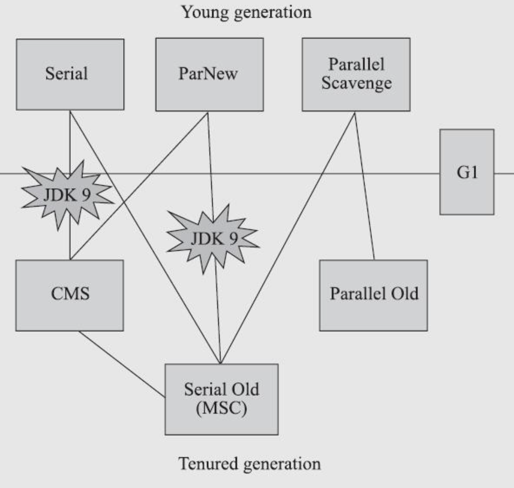
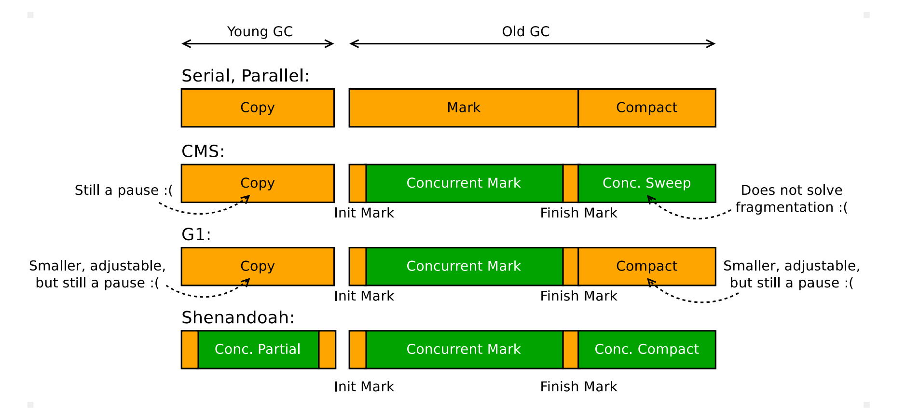

## Introduction

Java 的垃圾回收（Garbage Collection, GC）是 Java 程序实现[自动内存管理](/docs/CS/memory/GC.md)的机制。

GC 的实现位于 JVM 内部，各 JVM 可以自由实现自己的回收算法，但都须符合 JVM 规范：对堆中对象进行标记或识别不可达对象，并在压缩（compaction）阶段销毁它们。

垃圾回收器以"GC Roots"为起点来识别存活与死亡对象。典型的 GC Roots 包括：

- 系统类加载器加载的类（不含自定义类加载器）：`ClassLoaderDataGraph::roots_cld_do`
- 存活线程：`Threads::possibly_parallel_oops_do`
- 当前执行方法的局部变量与参数
- JNI 方法的局部变量与参数
- 全局 JNI 引用：`JNIHandles::oops_do`
- 作为同步监视器（monitor）使用的对象
- JVM 内部为自身目的而持有的对象
- CodeCache：`CodeCache::blobs_do`

回收器从 GC Roots 出发遍历整个内存对象图，沿引用逐跳访问其它对象。

**本文结构**：GC 的讲述分三层递进。先讲**理论模型**——对象如何被标记与判定存活、堆如何分代、并发回收如何保证正确性、通用阶段长什么样（Generation → GC Barrier Panorama → Correctness of Concurrent Marking → General Collection Phase Model）；再讲**引用交互与具体收集器**——四类特殊引用如何被 GC 处理，以及 HotSpot 各收集器的实现与选型（Reference Processing → Collectors）；最后是**事件与诊断**——对象如何分配、各类 GC 事件何时触发、元空间、统一日志与内存泄漏 / OOM 调优（allocate → Young GC Issues → Full GC → MetaSpace → GC Logging and Observability → memory leak → Tuning）。

## GC Algorithms

回顾[垃圾回收算法](/docs/CS/memory/GC.md?id=tracing-garbage-collection)：JVM 采用追踪式（tracing）回收。

JDK 10 的 [JEP 304: Garbage Collector Interface](https://openjdk.org/jeps/304) 发布后，GC 代码可读性大幅提升：`/src/hotspot/share/gc/` 目录下按不同 GC 算法分子目录存放，`shared` 目录存放通用代码与接口。

## Generation

分代垃圾回收器需要记录从老生代指向新生代的引用，从而在对新生代回收时无需扫描老生代中的每一个对象。这些"可能含有指向新对象指针的位置"的集合通常称为 `remembered set`（记忆集）。

每次发生写操作时，系统必须确保：若该写操作创建了一条"老→新"的引用，则把更新后的位置加入 `remembered set`。这一机制通常称为 `write barrier`（写屏障）或 `store check`（存储检查）。HotSpot 各收集器主要用两种实现：

1. **卡表标记（Card Marking）**：把跨区域引用记录在 Card Table 中；
2. **两指令（Two-Instruction）**方案：以少量指令开销完成卡表更新。

详见 [G1 RSet（含 Root Scanning）](/docs/CS/Java/JDK/JVM/GC/G1/RSet.md) 与各收集器页；记忆集与写屏障的全景见 [GC 屏障全景](#gc-barrier-panorama-write-barrier-read-barrier-and-remembered-set)。跨代引用假说（分代回收的理论基础）见 [Intergenerational Reference Hypothesis](#intergenerational-reference-hypothesis)。

### mark

不同收集器标记"对象存活"的方式不同：

- **对象头标记字**（如 Serial）：直接在对象 mark word 上置位；
- **位图（Bitmap）**（如 G1、Shenandoah）：用外部位图记录标记状态，不污染对象头；
- **着色指针（Colored Pointer）**（如 ZGC）：把标记信息编码进指针本身。

### Young Generation

新创建的对象先进入新生代。新生代进一步划分：

- **Eden 区**：所有新对象都从这里开始分配初始内存。
- **Survivor 区（FromSpace 与 ToSpace）**：对象在经历一次 GC 后仍存活，会从 Eden 移入 Survivor。

当新生代发生垃圾回收，称为一次 `minor garbage collection`（次要收集）。

当 Eden 区被对象填满，触发 Minor GC：所有死亡对象被删除，存活对象移入某个 Survivor 区。Minor GC 还会检查 Survivor 区中的对象，把它们移入另一个 Survivor 区。

以如下序列为例：

- Eden 容纳全部对象（存活与死亡混合）；
- Minor GC 发生：Eden 中的死亡对象全部移除，存活对象移入 S1（FromSpace）；此时 Eden 与 S2 为空；
- 新对象创建并加入 Eden，Eden 与 S1 中部分对象变为死亡；
- Minor GC 再次发生：Eden 与 S1 中的死亡对象移除，存活对象移入 S2（ToSpace）；此时 Eden 与 S1 为空。

因此任意时刻总有一个 Survivor 区为空。当存活对象在 Survivor 区之间移动达到某阈值后，会被晋升（promote）到老年代。

可用 `-Xmn` 标志设置新生代大小。默认老年代:新生代 = 2:1；Eden:From:To = 8:1:1。

#### Handle Promotion

当 `HandlePromotionFailure` 设为 `true` 时允许晋升担保（先假定老年代有足够空间容纳晋升对象，冒险进行 Minor GC）；否则直接进行 Full GC。

相关两类问题：

- **晋升失败（Promotion Failure）**：Minor GC 时老年代没有足够连续空间容纳晋升对象，被迫触发 Full GC。
- **过早晋升（Premature Promotion）**：对象存活不久即被晋升，导致老年代过早膨胀、Full GC 频率升高。

### Old Generation

长寿对象最终会从新生代晋升到老年代（Old Generation，也称 Tenured Generation），其中存放长期存活于 Survivor 区的对象。

当从老年代回收对象，称为一次 `major garbage collection`（主要收集）。

可用 `-Xms` 与 `-Xmx` 标志设置堆内存的初始与最大值。

### Intergenerational Reference Hypothesis

跨代引用假说（弱分代假说）认为：绝大多数对象"朝生夕死"，且跨代引用（老→新）远少于同代引用。记忆集正是为高效处理跨代引用而设计——它记录从本代/本区指向其它代/区的引用，使收集某区域时不必扫描整个堆。

记忆集的常见实现：

- **位（bits）**：用位图标记；
- **对象（objects）**：记录具体对象；
- **卡表（Card Table）**：把堆划分为固定大小的卡（card），用字节数组标记哪张卡含有跨代引用（最常用）。

**伪共享（False Sharing）**：卡表若按字节粒度更新，相邻卡可能落于同一缓存行，多线程并发更新会互相 invalidate 缓存行，造成伪共享。HotSpot 提供 `-XX:+UseCondCardMark` 选项，在更新卡表前先检查该卡是否已标记，减少不必要的写：

```cpp
product(bool, UseCondCardMark, false,                                     \
        "Check for already marked card before updating card table")       \
```

## GC Barrier Panorama: Write Barrier, Read Barrier and Remembered Set

**写屏障（Write Barrier）** 是编译器 / VM 在对象引用被读取或写入处插入的一小段代码，用来让 GC 在不暂停应用的前提下感知引用变化。没有写屏障，并发 / 增量式 GC 无法正确工作或无法避免全堆扫描。

### Write Barrier

发生在"引用字段被写"时，各收集器用到的写屏障包括：

1. **卡表标记（Card Marking）**：当存储创建"老生代→新生代"（或跨区域）的引用时，把对应卡（card）标记为脏，GC 只扫描脏卡而非整个老生代。G1 / CMS / 分代 Shenandoah 使用；详见 [CardTable](/docs/CS/Java/JDK/JVM/GC/CardTable.md)。
2. **SATB 写屏障**：引用字段被覆盖前，把旧值压入 SATB 队列（G1 / Shenandoah 并发标记阶段）。
3. **增量更新写屏障**：黑色对象指向白色对象时记录（CMS，见 [CMS Incremental Update](/docs/CS/Java/JDK/JVM/GC/CMS/IncrementalUpdate.md)）。
4. **并发转移写屏障**：Shenandoah 在并发压缩阶段，若对象仍指向 from-region，则先将其转移到 to-region 再写，以维持"目标无转发"不变式。

### Read Barrier (Load Barrier)

仅被需要并发转移对象的收集器使用：

- **ZGC**：引用带"着色指针（Colored Pointer）"，读屏障在加载引用时检查元数据位，若对象已被并发转移则"自愈（self-heal）"到新地址。见 [ZGC 页](/docs/CS/Java/JDK/JVM/GC/ZGC.md)。
- **Shenandoah**：对象头部有 Brooks 指针，读屏障在读取引用时穿过该指针到达对象当前位置（若已被转移）。见 [Shenandoah 页](/docs/CS/Java/JDK/JVM/GC/Shenandoah.md)。

> G1 既不用读屏障也不用着色指针——它靠 SATB 写屏障 + 卡表，在**暂停（STW）**期间完成转移，因此 G1 的转移阶段必须 Stop-The-World，而 ZGC / Shenandoah 的转移可并发。

### Relation Between Remembered Set and Card Table

**记忆集** 是"记录从本区/本代指向其他区/代的所有引用"的数据结构，目的是让收集某区域时**不必扫描整个堆**。其实现通常就是卡表（写屏障标脏）；G1 还用更精细的 Per-Region Remembered Set（RSet，基于卡表），见 [G1 RSet Refinement](/docs/CS/Java/JDK/JVM/GC/G1/RSet.md) 与 [CardTable](/docs/CS/Java/JDK/JVM/GC/CardTable.md)。

| 收集器 | 写屏障 | 读屏障 | 记忆集 / 卡表 |
| :--- | :--- | :--- | :--- |
| Serial / ParNew | 卡表标脏（Minor GC 用） | 无 | 卡表 |
| G1 | 卡表 + SATB 写屏障 | 无 | RSet（基于卡表） |
| Shenandoah | 卡表 + SATB 写屏障 + 并发转移写屏障 | Brooks 指针读屏障 | 卡表（分代模式） |
| ZGC | 无卡表 | 着色指针读屏障 | 无（靠染色指针 + 转发表） |

## Correctness of Concurrent Marking: Tri-color Marking, SATB and Incremental Update

并发标记（concurrent marking）指 GC 在**不暂停应用线程（mutator）**的情况下遍历对象图、判定对象存活。难点在于：标记线程与应用线程同时运行，应用随时可能修改引用关系，普通的"标记完即回收"会导致存活对象被误回收。HotSpot 用**三色标记（Tri-color Marking）**建模，并依赖写屏障保证两种正确性算法之一成立。

### Tri-color Marking Abstraction

把堆中对象按标记进度染成三种颜色：

| 颜色 | 含义 |
| :--- | :--- |
| 白（White） | 尚未被标记线程访问；标记结束时仍为白色的对象被判定为垃圾 |
| 灰（Gray） | 自身已被访问，但其引用的对象尚未全部扫描完 |
| 黑（Black） | 自身及所有可达引用都已被扫描，确认存活 |

标记从 Roots 出发：Root 直接可达对象置灰，扫描灰对象引用的子对象、把它们置灰，灰对象引用全部扫描完则置黑；如此推进直到无灰对象。白对象即不可达。

### Missing Marking Problem Caused by Concurrency

若标记过程中应用线程（mutator）做了以下任意一件，会破坏"黑 = 确认存活"的不变式：

1. **删除从灰 / 黑对象到某白对象的引用**（该白对象本应被灰对象带着变灰）；
2. **新增从黑对象到白对象的引用**（黑对象已扫完，不会再扫）。

结果：一个本应存活的白对象既不再被任何灰对象引用、又未被黑对象"携带"，最终被错误回收——**漏标（missed mark）**。由于多数对象"朝生夕死"，漏标比"多标（误判存活、浮动垃圾）"危害更大（直接丢失数据）。

### Two Correctness Algorithms

| 算法 | 核心思想 | 如何借写屏障实现 | 代表收集器 |
| :--- | :--- | :--- | :--- |
| **增量更新（Incremental Update）** | 不丢"黑→白"的新增引用：一旦黑对象新指向白对象，将该黑对象**重新置灰**（或记录待重新扫描），重新扫描它 | 写屏障在"黑色对象字段写入白色引用"时，将黑色对象重新入灰 | **CMS**（被称为 *incremental update*，见 [CMS Incremental Update](/docs/CS/Java/JDK/JVM/GC/CMS/IncrementalUpdate.md)） |
| **SATB（Snapshot At The Beginning）** | 不丢"被删除的引用"：以标记**开始时刻的堆快照**为准，开始时存活的对象都算存活；mutator 覆盖某引用时，把**旧值**记录进 SATB 队列，标记线程随后补扫 | 写屏障在"引用字段被覆盖"时，将旧引用压入 `SATBMarkQueue` | **G1**、**Shenandoah**（见 [Shenandoah 页](/docs/CS/Java/JDK/JVM/GC/Shenandoah.md)）；CMS 的 Remark 阶段也部分借鉴 |

> 直觉：增量更新保的是"新连上的引用"，SATB 保的是"断开前的旧引用"。前者写屏障重（每次黑→白都要处理），后者实现更简单、对 mutator 写路径侵入小，但会把"标记开始时存活、之后立刻死亡"的对象延迟到下一周期才回收（浮动垃圾）。CMS 用增量更新（可能因漏标而触发 [Concurrent Mode Failure](/docs/CS/Java/JDK/JVM/GC/CMS/ConcurrentModeFailure.md) 后回退到 Full GC），G1 / Shenandoah 用 SATB。

G1 中存活对象由 `G1SATBCardTableModRefBS`（继承自 card-table 写屏障）实现：运行时引用字段被覆盖前把旧值 enqueue；并发标记线程在最终标记（Remark）阶段 drain 完 SATB 队列，确保所有"开始时刻"的对象都已标黑。相关源码位于 `src/hotspot/share/gc/g1/`。

### Relation with Other Sections of This Article

- [Generation](#intergenerational-reference-hypothesis) 提到的 "跨代引用" 靠记忆集解决，而记忆集的维护依赖写屏障（见 [GC 屏障全景](#gc-barrier-panorama-write-barrier-read-barrier-and-remembered-set)）。
- 标记方式（对象头标记字 / 位图 / 着色指针）在 [Generation 的 mark 小节](#mark) 已概览，三种方式分别对应 Serial / G1·Shenandoah / ZGC。

## General Collection Phase Model: STW and Concurrent

尽管各收集器实现迥异，其**暂停 / 并发阶段的拓扑**高度一致。理解此模型，就能更好地读各收集器页面。

### STW Phase (Must Pause Application)

| 阶段 | 作用 | 触发成本 |
| :--- | :--- | :--- |
| **初始标记（Initial Mark）** | 把 Roots 直接可达对象置灰；通常搭在 Minor GC 上做，极短 | 极短 |
| **最终 / 重新标记（Remark / Final Mark）** | 修正并发标记期间 mutator 产生的变更（SATB 队列、重新扫描脏卡 / 根） | 中等，与堆中"变化量"相关 |
| **转移 / 压缩（Evacuation / Compaction）** | 把存活对象复制到新区域 / 整理；G1 / Serial / Parallel 在此 STW，ZGC / Shenandoah 可并发 | G1 / 传统收集器的主要暂停来源 |

### Concurrent Phase (Concurrent with Application Threads)

- **并发标记（Concurrent Marking）**：遍历对象图，可并发。
- **并发清理（Concurrent Cleanup）**：回收完全空闲的区域（G1、Shenandoah）。
- **并发转移 / 压缩（Concurrent Evacuation / Compaction）**：ZGC、Shenandoah 的核心优势——对象并发转移。
- **并发引用处理**：软 / 弱 / 虚引用、finalizable 对象的发现与清洗（CMS 在 STW 处理，部分收集器可并发发现）。

### Cooperation with Safepoint

初始标记、最终标记等 STW 阶段要求**所有 Java 线程到达安全点（Safepoint）** 才能开始——GC 是触发 Safepoint 的主要来源之一。GC 线程本身不参与 Safepoint 轮询。关于线程如何"静止"，见 [Safepoint](/docs/CS/Java/JDK/JVM/Safepoint.md)。

### Trigger Timing

- **minor / Young GC**：Eden 满（或发生分配时 Survivor 无空间）。
- **并发标记启动**：老年代 / 整堆占用达阈值（如 G1 的 IHOP、CMS 的 `CMSInitiatingOccupancyFraction` 默认 ~92%，详见 [CMS Concurrent Mode Failure](/docs/CS/Java/JDK/JVM/GC/CMS/ConcurrentModeFailure.md)）；也可能由分配压力、元空间耗尽等触发。
- **Full GC**：老年代空间不足且并发回收来不及、晋升失败、`System.gc()`（除非 `-XX:+DisableExplicitGC`）、元空间（Metaspace）耗尽。FGC 通常暂停长。

## Reference Processing

Java 在强引用之外，提供了 `SoftReference` / `WeakReference` / `PhantomReference` / `FinalReference` 四类"特殊引用"（位于 `java.lang.ref` 包），把对象生命周期管理与 GC 解耦——这正是 [Reference 类型总览](/docs/CS/Java/JDK/Basic/Ref.md?id=reference-class-hierarchy) 所覆盖的主题。它们不是普通强引用：GC 在标记与回收时必须对它们做特殊处理，否则软 / 弱引用会像强引用一样拖住对象，虚引用与终引用也无法完成 post-mortem 清理和 finalization。

GC 对特殊引用的处理发生在 **引用处理阶段（reference-processing phase）**，由 HotSpot 的 `ReferenceProcessor` 驱动，流程可概括为三步：

1. **发现（discover）**：GC 在标记过程中识别引用对象，按类型（soft / weak / final / phantom）挂到对应的 discovered 链表；发现策略分 `ReferenceBasedDiscovery`（引用对象须在本代内）与 `ReferentBasedDiscovery`（只要 referent 在本 span 内即可更早被发现）。
2. **处理（process）**：`process_discovered_references` 按类型分别处理——软引用按 LRU 策略在内存压力下清除、弱引用在判定 weakly reachable 时清除、虚引用原子清除 referent 后入队、终引用保留 referent 给 `FinalizerThread` 执行 `finalize`。
3. **入队（enqueue）**：处理后的引用从 discovered 链表推到 pending 链表，再由 Java 侧 `ReferenceHandler` 线程搬到应用注册的 `ReferenceQueue`（HotSpot 侧 `discover → process → enqueue` 的源码细节见 [ReferenceProcessor（GC 侧）](/docs/CS/Java/JDK/Basic/Ref.md?id=referenceprocessor-gc-side)）。

四类引用在 GC 中的语义差异直接决定了它们的用途：软引用支撑内存敏感缓存、弱引用支撑规范化映射（`WeakHashMap`）、虚引用做回收前清理、终引用服务 finalization。引用处理本身可与 mutator 并发（部分收集器在并发阶段发现并清洗软 / 弱 / 虚引用，见上文通用收集阶段模型中的"并发引用处理"），也可在 STW 阶段完成（如 CMS）。

常用诊断与控制参数：

```text
-XX:+PrintReferenceGC             # 按 GC 阶段打印引用处理信息
-XX:+ParallelRefProcEnabled       # 并行处理引用（多线程）
-XX:+/-RegisterFinalizersAtInit   # finalizer 在 Object.<init> 时注册
```

## Collectors

沿用 Dijkstra 等人的模型，一个带垃圾回收的程序可划分为两个半独立的部分：

- **Mutator（变更者）**：执行应用代码，分配新对象并通过修改引用字段改变对象图，使其指向不同目标对象。这些引用字段可能位于堆对象中，也可能位于各种"根（roots）"上，例如静态变量、线程栈等。正是这些引用更新，可能让任意对象脱离 roots 而变得不可达。
- **Collector（回收者）**：执行垃圾回收代码，发现不可达对象并回收其内存。

一个程序可以有多个 mutator 线程，但它们整体上可视为堆上的一个单一角色；同理，回收者线程也可能有一个或多个。

### Comparing garbage collectors

评估收集器通常从以下维度对比：

- 吞吐量（Throughput）
- 暂停时间（Pause time）
- 空间占用（Space）
- 实现复杂度（Implementation）
- 自适应能力（Adaptive systems）

参考 [JVM](https://book.douban.com/subject/34907497/)：





JDK 8 默认收集器为 Parallel GC：新生代采用 Parallel Scavenge，老年代采用 Parallel Old 进行收集。它以吞吐量优先，适用于对时延不敏感的后台任务型服务器（如批量订单处理、科学计算等）。

各收集器逐篇：[CMS](/docs/CS/Java/JDK/JVM/GC/CMS.md)（JDK 14 起移除）、[G1](/docs/CS/Java/JDK/JVM/GC/G1.md)、[Shenandoah](/docs/CS/Java/JDK/JVM/GC/Shenandoah.md)、[ZGC](/docs/CS/Java/JDK/JVM/GC/ZGC.md)、[Serial](/docs/CS/Java/JDK/JVM/GC/Serial.md)、[Parallel](/docs/CS/Java/JDK/JVM/GC/Parallel.md)、[Epsilon](/docs/CS/Java/JDK/JVM/GC/Epsilon.md)。

HotSpot 的收集器组合（源码 `gcConfiguration.cpp`）按角色可分为：

- 新生代收集器（young_collector）：`G1New`、`ParallelScavenge`、`ParNew`（配合 CMS）、`DefNew`；
- 老年代收集器（old_collector）：`G1Old`、`ConcurrentMarkSweep`、`ParallelOld`、`Z`、`Shenandoah`、`SerialOld`。

> CMS 自 [JEP 214: Remove GC Combinations Deprecated in JDK 8](https://openjdk.java.net/jeps/214) 起只能与 ParNew 配合；部分罕用组合随 [JEP 173: Retire Some Rarely-Used GC Combinations](https://openjdk.java.net/jeps/173) 退役。

| GC | 优化目标 |
| --- | --- |
| Serial | 内存占用（Footprint） |
| Parallel | 吞吐量（Throughput） |
| G1 | 吞吐量 / 延迟平衡 |
| ZGC / Shenandoah | 低延迟（Low Latency） |

### Evolution Timeline

HotSpot 的收集器家族，其演进主线是**把越来越多的 GC 工作从 STW 搬到与应用线程并发**，并在「吞吐量」与「延迟」之间反复权衡。下表按 JDK 版本梳理关键节点：

| JDK | 事件 | 规范 |
| --- | --- | --- |
| 1.0–1.2 | `Serial` 单线程 STW，单处理器时代的默认选择 | — |
| 1.4 | `Parallel Scavenge` + `Parallel Old`（吞吐量优先）；`ParNew` 作为 CMS 的新生代搭档出现 | — |
| 1.4 / 5 | `CMS` 并发标记-清除，首次把「低延迟」带入生产 | — |
| 6 / 7 | `G1` 实验性引入，以 Region 化与增量回收试图取代 CMS | [JEP 156](https://openjdk.org/jeps/156) |
| 9 | `G1` 成为默认收集器 | [JEP 248](https://openjdk.org/jeps/248) |
| 11 | `Epsilon`（no-op）随 JDK 11 提供；`ZGC` 实验性引入 | [JEP 318](https://openjdk.org/jeps/318) / [JEP 333](https://openjdk.org/jeps/333) |
| 12 | `Shenandoah` 实验性集成 | [JEP 189](https://openjdk.org/jeps/189) |
| 14 | `CMS` 整体移除，生态被迫迁移到 G1 / ZGC | [JEP 363](https://openjdk.org/jeps/363) |
| 15 | `ZGC`、`Shenandoah` 转正为生产特性（product） | [JEP 377](https://openjdk.org/jeps/377) / [JEP 379](https://openjdk.org/jeps/379) |
| 21 | `ZGC` 支持分代 | [JEP 439](https://openjdk.org/jeps/439) |
| 23 | `ZGC` 分代模式成为默认 |
| 27 | `Serial` 默认废止：未显式指定收集器时一律选 G1 | [JEP 523](https://openjdk.org/jeps/523) |

代际替换关系：

- **Serial → Parallel**：用多线程换取吞吐量，代价是 STW 暂停随堆增大而变长。
- **Parallel → CMS**：引入并发标记/清除，换取更短暂停，代价是内存碎片、[Concurrent Mode Failure](/docs/CS/Java/JDK/JVM/GC/CMS/ConcurrentModeFailure.md) 风险与更高的 CPU 占用。
- **CMS → G1**：以 Region 化堆与可预测暂停模型取代 CMS 的「标记-清除」碎片问题，目标是平衡吞吐与延迟。
- **G1 → Shenandoah / ZGC**：进一步把对象重定位（relocation）也并发化——Shenandoah 用 Brooks Pointer + 读屏障，ZGC 用着色指针（Colored Pointer）+ 读屏障——把暂停时间与堆大小彻底解耦，做到亚 10 ms 级暂停、TB 级堆。
- **Epsilon** 是旁支：不做任何回收，仅用于性能基准测试与已知短命进程。

### Pros, Cons and Trade-offs

| 收集器 | 并发程度 | 主要优势 | 主要缺点 | 最佳场景 | 关键限制 |
| --- | --- | --- | --- | --- | --- |
| `Serial` | 全程 STW（单线程） | 实现最简单、运行时开销最小、内存占用最低 | 单线程，暂停随堆线性增长 | 单处理器 / 小堆（<100 MB） | 无法利用多核 |
| `Parallel` | 年轻代/老年代 STW（多线程） | 吞吐量最高 | 暂停长（可到秒级，随堆增大） | 批处理、科学计算等后台任务 | 延迟敏感场景不可用 |
| `CMS`（已移除） | 标记/清除并发，回收仍 STW | 相对更短暂停 | 内存碎片、[Concurrent Mode Failure](/docs/CS/Java/JDK/JVM/GC/CMS/ConcurrentModeFailure.md)、浮动垃圾、CPU 占用高 | JDK 14 前的中堆低延迟服务 | JDK 14 起移除，不可再用，见 [CMS Removal](/docs/CS/Java/JDK/JVM/GC/CMS/Removal.md) |
| `G1` | 并发标记 + STW 回收（Region 化） | 吞吐/延迟平衡、可预测暂停、大堆友好 | 内存与 CPU 开销高于 CMS、调优面较宽 | >4 GB 堆的通用服务端 | 小堆反而更慢 |
| `Shenandoah` | 并发标记 + **并发**重定位 | 暂停与堆大小基本无关、主动归还内存给 OS | CPU 开销高（并发屏障） | 大堆且要求稳定低延迟 | 相比 G1/ZGC 吞吐略降 |
| `ZGC` | 全并发（着色指针 + 读屏障） | 暂停 <10 ms、支持 TB 级堆、归还内存 | 早期不支持分代（JDK 21+ 已补）、对透明大页/元空间有约束 | 超大堆 / 超低延迟 | 极早期版本功能受限 |
| `Epsilon` | 不回收 | 零 GC 开销、可预测性能 | 堆耗尽即 OOM 退出 | 性能基准、短命进程、已知生命周期 | 不做任何回收 |

各收集器的算法细节、阶段与调优，见下方逐节与对应独立笔记：[Serial](/docs/CS/Java/JDK/JVM/GC/Serial.md)、[Parallel](/docs/CS/Java/JDK/JVM/GC/Parallel.md)、[CMS](/docs/CS/Java/JDK/JVM/GC/CMS.md)、[G1](/docs/CS/Java/JDK/JVM/GC/G1.md)、[Shenandoah](/docs/CS/Java/JDK/JVM/GC/Shenandoah.md)、[ZGC](/docs/CS/Java/JDK/JVM/GC/ZGC.md)、[Epsilon](/docs/CS/Java/JDK/JVM/GC/Epsilon.md)。

### Epsilon

Epsilon 是一个"什么都不做"（no-op）的垃圾回收器，随 JDK 11 发布（见 [JEP 318: Epsilon: A No-Op Garbage Collector](https://openjdk.java.net/jeps/318)）。它负责内存分配，但不实现任何实际的内存回收机制；一旦 Java 堆耗尽，JVM 即关闭。

### Serial

串行收集器使用单线程完成所有垃圾回收工作，由于没有线程间通信开销，相对高效。它最适合单处理器机器（无法利用多处理器硬件），但在多处理器上运行小数据集（约 100 MB 以内）的应用时也有用。默认情况下，在某些硬件与操作系统配置上会选它；也可显式用 `-XX:+UseSerialGC` 启用。

> [!WARNING]
> 上述「受限环境默认选 Serial」的口径**在 JDK 27 已废止**（[JEP 523](https://openjdk.org/jeps/523)）：无论 CPU 数量与物理内存大小，JVM 在未显式指定收集器时一律选 G1。Serial 仍可显式启用（`-XX:+UseSerialGC`），「适合单处理器 / 小数据集」的适用场景说明依然成立。

Serial 使用 Cheney 复制算法（以及 Moon 算法变体）完成存活对象搬运。

#### Serial Old

- 与 Parallel 配合（自 JDK 5）；
- 在 CMS 发生 [Concurrent Mode Failure](/docs/CS/Java/JDK/JVM/GC/CMS/ConcurrentModeFailure.md) 时作为后备收集器。

### Parallel Scavenge

并行收集器又称吞吐量收集器（throughput collector），是一个与串行收集器类似的分代收集器。它与串行收集器的主要区别在于：并行收集器使用多线程加速垃圾回收。

并行收集器面向运行在多处理器或多线程硬件上、具有中到大数据集的应用。可用 `-XX:+UseParallelGC` 启用。

典型参数：

```text
- GCTimeRatio                               = 99
- MaxGCPauseMillis                          = 18446744073709551615
- UseParallelGC                            := true
- UseParallelOldGC                          = true
- UseAdaptiveGCBoundary                     = false
```

参见 [Garbage Collector Ergonomics](https://docs.oracle.com/javase/7/docs/technotes/guides/vm/gc-ergonomics.html)。

**ParNew 与 Parallel Scavenge 的区别**：两者都用于新生代垃圾收集，主要差异如下：

1. **默认配合的老年代收集器不同**：ParNew 通常与 CMS 配合，作为 CMS 的默认新生代收集器；Parallel Scavenge 通常与 Parallel Old 配合，构成完整的 Parallel 收集策略。
2. **目标与场景差异**：ParNew 侧重降低暂停时间，更适合 Web 服务器、交互式应用等低延迟场景；Parallel Scavenge 侧重高吞吐量，更适合以后台运算为主的场景（如大型计算、批处理）。
3. **暂停与吞吐量权衡**：ParNew 为保证低延迟可能牺牲部分吞吐量；Parallel Scavenge 则相反，为保证最大吞吐量可牺牲部分延迟。
4. **自适应调节能力**：Parallel Scavenge 具备自适应调节策略（`-XX:+UseAdaptiveSizePolicy`），能根据系统实际运行情况调整各区域大小与目标暂停时间；ParNew 无此机制。
5. **与 CMS / G1 的互动**：ParNew 与 CMS 结合紧密，共同服务低延迟场景；Parallel Scavenge 不适合与 CMS 配合，但在 Java 8 及之前可作为 G1 的候选配合项。

### Concurrent

以并发为主的收集器用处理器资源（原本可用于应用）换取更短的主要收集暂停时间。最明显的开销是并发阶段占用一个或多个处理器。在 N 处理器系统上，并发部分会占用 K/N 的处理器，其中 1≤K≤ceiling(N/4)。除并发阶段占用处理器外，为支持并发还需额外开销。因此，虽然并发收集器的暂停通常短得多，应用吞吐量也往往略低于其它收集器。

在多核机器上，并发阶段处理器可供应用线程使用，故并发 GC 线程不会"暂停"应用，通常带来更短暂停；但应用可用的处理器资源减少，应预期一定减速，尤其当应用最大化使用所有核心时。随着 N 增大，并发 GC 导致的处理器资源减少比例变小，并发收益增大。

在单处理器（单核）机器上，并发收集器通常无收益。但 CMS（非 G1）有一种增量模式，可在仅一两个处理器的系统上实现低暂停；详见 CMS 收集器文档。该特性在 Java SE 8 中已废弃，可能在后续大版本移除。

### CMS

[JEP 291: Deprecate the Concurrent Mark Sweep (CMS) Garbage Collector](https://openjdk.org/jeps/291) → [JEP 363: Remove the Concurrent Mark Sweep (CMS) Garbage Collector](https://openjdk.org/jeps/363)

> [!WARNING]
>
> CMS 自 **JDK 14 起已从 HotSpot 移除**（`gc/cms` 目录整体删除）。在命令行传 `-XX:+UseConcMarkSweepGC` 只会得到 `Ignoring option UseConcMarkSweepGC; support was removed in <version>` 警告，然后**回退到默认收集器继续运行**——不报错，容易被忽略。机制与历史详见 [CMS 页](/docs/CS/Java/JDK/JVM/GC/CMS.md)。

### G1

[G1GC](/docs/CS/Java/JDK/JVM/GC/G1.md) 本意是作为 CMS 的替代者，面向拥有大堆（超过 4GB）的多线程应用而设计。它与 CMS 一样可并行、可并发，但底层机制与老一代收集器大不相同。

### Shenandoah

Shenandoah 于 **JDK 12 作为实验特性集成（[JEP 189](https://openjdk.org/jeps/189)）**，JDK 15 转为生产特性（[JEP 379](https://openjdk.org/jeps/379)），不在默认收集器之列。

Shenandoah 相对 G1 的关键优势是：它在与应用线程并发的过程中完成了更多 GC 周期工作。G1 只能在应用暂停时搬迁堆区域，而 Shenandoah 可与应用并发地重定位对象。Shenandoah 能压缩存活对象、清理垃圾，并在检测到空闲内存后几乎立即把 RAM 归还 OS。由于这一切都在应用运行时并发进行，Shenandoah 的 CPU 开销更高。

启用 Shenandoah：`-XX:+UseShenandoahGC`（自 JDK 15 起为 product 选项，不再需要 `-XX:+UnlockExperimentalVMOptions`；JDK 24+ 的分代实验模式见 [Shenandoah Generational](/docs/CS/Java/JDK/JVM/GC/Shenandoah/Generational.md)）。

[JEP 189: Shenandoah: A Low-Pause-Time Garbage Collector (Experimental)](https://openjdk.java.net/jeps/189)

### ZGC

[JEP 333: ZGC: A Scalable Low-Latency Garbage Collector (Experimental)](https://openjdk.java.net/jeps/333)

Z 垃圾回收器（ZGC）是一个可扩展的低延迟垃圾回收器，所有昂贵的工作都并发完成，不会停止应用线程的执行。

ZGC 面向需要低延迟（暂停小于 10 ms）和 / 或使用超大堆（数 TB）的应用。可用 `-XX:+UseZGC` 启用。

ZGC 自 JDK 11 起作为实验特性提供，并在 JDK 12 中改进；面向需要低延迟（暂停小于 10 ms）和 / 或使用超大堆（数 TB）的应用。

ZGC 的主要目标是低延迟、可扩展性与易用性。为此，ZGC 允许 Java 应用在它执行所有 GC 操作时继续运行。默认情况下，ZGC 会归还未使用的内存给操作系统。

启用 ZGC：`-XX:+UseZGC`（自 JDK 15 起为 product 选项；JDK 21 起支持分代，JDK 23 起分代模式成为默认，详见 [ZGC 页](/docs/CS/Java/JDK/JVM/GC/ZGC.md)）。

### How to Select the Right Garbage Collector

大多数情况下，默认设置即可工作良好。必要时可调整堆大小提升性能；若性能仍不满足目标，再按应用需求更换收集器：

- **Serial**：应用数据集小（约 100 MB 以内）和 / 或运行在单处理器上、对暂停时间无要求；
- **Parallel**：峰值应用性能优先，且无暂停时间要求，或可接受 1 秒以上暂停；
- **G1**（注：CMS 已于 JDK 14 移除，不再推荐）：响应时间比整体吞吐量更重要，且 GC 暂停须保持在约 1 秒以内；
- **ZGC**：响应时间优先级高，和 / 或使用超大堆。

### Collector tuning

常用参数：

- `ParallelGCThreads`：并行 GC 线程数
- `ConcGCThreads`：并发 GC 线程数
- `UseAdaptiveSizePolicy`：自适应调节
- `MaxGCPauseMillis`：目标最大暂停时间
- `GCTimeRatio`：吞吐量目标（GC 时间占比）
- 堆大小：`MaxHeapSize` / `Xmx`、`MinHeapSize` / `Xms`、`NewSize` / `Xmn`
- 线程本地分配缓冲：`TLABSize`、`YoungPLABSize` / `OldPLABSize`

当磁盘 IO 繁忙时，JVM 可能被阻塞较长时间：GC 需要通过 `write()` 系统调用记录 GC 活动，而这些 `write()` 调用可能因后台磁盘 IO 而阻塞。由于 GC 日志位于 JVM 暂停路径上，因此 `write()` 调用耗时会计入 JVM 的 STW 暂停。

对延迟敏感的应用，立即可行的解决方案是把 GC 日志文件放到独立的 HDD 或 SSD 等高性能磁盘上，避免 IO 争用。

## allocate

对于 HotSpot JVM 而言，所有 GC 算法的本质都是对堆内存的管理——即都实现了堆的抽象，它们都实现了 `CollectedHeap` 接口。

## Young GC Issues

若 Young GC 耗时过长，应检查新生代与各 Survivor 区大小是否合理。常用调优参数：

```text
-XX:+UsePSAdaptiveSurvivorSizePolicy
-XX:SurvivorRatio
-XX:TargetSurvivorRatio
```

新生代的跨代引用记录依赖卡表与写屏障：当发生"老→新"引用写操作时，将对应卡标记为脏。其底层即更新卡表字节：

```cpp
CARD_TABLE [this address >> 9] = DIRTY;
```

为避免多线程并发更新同一缓存行造成伪共享，可开启 `-XX:+UseCondCardMark`（更新前先检查卡是否已脏）。

### YGC Duration Anomaly

Young GC 耗时异常的常见来源：

- root 对象扫描与标记时间过长
- 存活对象拷贝（copy）耗时较大
- 等待各线程到达安全点（Safepoint）时间较长
- GC 日志对 GC 时间的影响（日志落在 STW 路径上）
- 操作系统活动影响（如内存 swap）

## Full GC

**FGC 频次异常的常见原因**：

- 老年代空间不足
- 内存碎片化
- 永久代 / 元空间空间不足
- 对象预估与晋升担保失败
- 堆大小动态调整

对象是否已被标记 / 转发，由对象头的 mark word 判定：

```cpp
// Used only for markSweep, scavenging
bool oopDesc::is_gc_marked() const {
  return mark_raw()->is_marked();
}

// Used by scavengers
bool oopDesc::is_forwarded() const {
  // The extra heap check is needed since the obj might be locked, in which case the
  // mark would point to a stack location and have the sentinel bit cleared
  return mark_raw()->is_marked();
}

// Used by scavengers
void oopDesc::forward_to(oop p) {
  markOop m = markOopDesc::encode_pointer_as_mark(p);
  set_mark_raw(m);
}
```

### System.gc

```java
public final class System {
   public static void gc() {
        Runtime.getRuntime().gc();
    }
}

public class Runtime {
 		public native void gc();
}
```

若未设置 `-XX:+DisableExplicitGC`，不同堆会执行对应的 `collect` 方法；部分收集器在 `-XX:+ExplicitGCInvokesConcurrent` 时会执行并发 Full GC：

```cpp
// Runtime.c
JNIEXPORT void JNICALL
Java_java_lang_Runtime_gc(JNIEnv *env, jobject this)
{
    JVM_GC();
}

// jvm.cpp
JVM_ENTRY_NO_ENV(void, JVM_GC(void))
  if (!DisableExplicitGC) {
    EventSystemGC event;
    event.set_invokedConcurrent(ExplicitGCInvokesConcurrent);
    Universe::heap()->collect(GCCause::_java_lang_system_gc);
    event.commit();
  }
JVM_END
```

## MetaSpace

从 Java 8 起，元空间（MetaSpace）取代永久代（PermGen）。其实现与 PermGen 不同，这部分堆空间现在可自动调整大小。

这避免了因 PermGen 空间有限而导致应用内存耗尽的问题。元空间可被垃圾回收，当元空间达到其最大大小时，不再使用的类会被自动清理。

相关诊断参数：

```text
-Xnoclassgc -verbose:class -XX:+TraceClassLoading -XX:+TraceClassUnLoading -XX:+ClassUnloadingWithConcurrentMark -XX:+PrintAdaptiveSizePolicy
```

## GC Logging and Observability: Unified Logging

**JDK 9（[JEP 158](https://openjdk.org/jeps/158)）** 起，JVM 用统一的 `-Xlog` 框架取代旧的 `-XX:+PrintGCDetails` 等零散开关。所有日志按 **tag + level** 组织。

### -Xlog Syntax

```text
-Xlog[:[<what>][:[<output>][:[<decorators>][:<output-options>]]]]
  <what>      := <tag-set>[=<level>]
                  * 表示"至少包含该 tag"
  <level>     := off | error | warning | info | debug | trace | develop
  <output>    := stderr | stdout | file=<name>
  <decorators>:= time,uptime,pid,tid,level,tags
```

### Common Recipes

```text
# 全部 GC 日志（info 级，默认输出到 stdout，带 uptime/GC/tags 装饰）
-Xlog:gc*

# 全部细节输出到文件，带时间戳与线程号，轮转
-Xlog:gc*=info:file=gc.log:time,tid:filecount=5,filesize=10M

# 观察每次 GC 的堆前后变化（debug 级才打印各区域容量）
-Xlog:gc+heap=debug

# 看触发的 Safepoint 与暂停
-Xlog:safepoint*=info

# 收集器专有 tag：zgc / shenandoah / gc / cms
-Xlog:gc,zgc=debug
-Xlog:gc,shenandoah=info
```

可用 `jcmd <pid> VM.log what="gc*=debug:file=gc-debug.log"` 动态调级，无需重启。

### Key Pauses in Logs

| 日志 | 含义 |
| :--- | :--- |
| `Pause Young` / `GC (Allocation Failure)` | 年轻代收集（STW） |
| `Pause Full` / `Full GC` | 整堆收集（STW，最长） |
| `Concurrent Cycle` / `Concurrent Mark` | 并发标记周期开始 |
| `Pause Initial Mark` / `Pause Remark` | 并发周期的两次短暂停 |
| `Uncommit` / `Commit` | ZGC / G1 把内存还给 OS 或重新申请 |

> 旧版 `-Xloggc:<file> -XX:+PrintGCDetails -XX:+PrintGCDateStamps` 在 JDK 9+ 已统一为 `-Xlog:gc*:file=<file>:time`，新代码不要再用废弃开关。

## memory leak

内存泄漏指无用对象（不再使用的对象）持续占有内存，或其内存得不到及时释放，从而造成内存空间浪费。内存泄漏有时不严重且不易察觉，开发者可能并不知道其存在，需要自主观察；严重时无内存可分配，直接 OOM。

**常见内存泄漏场景**：

- **元空间（Metaspace）**：若应用加载了大量 class，Perm / Metaspace 区存储的信息一般会比较大；大量 `intern` 的 String 对象也会导致该区不断增长。比较常见的一个案例是 Groovy 动态编译 class 造成泄漏。
- **堆（Heap）**：静态集合类持有对象导致泄漏；监听器在释放对象时忘记删除，增加泄漏机会；各种连接（数据库、网络、IO 等）未关闭；内部类与外部模块的引用——非静态内部类的对象会隐式强引用其外围对象，内部类未释放时外围对象也不会被释放，造成泄漏。

## Tuning

**GC 日志**：`-XX:+PrintGCDetails`（注意：JDK 9+ 已统一为 `-Xlog`，见 [GC 日志与可观测性](#gc-logging-and-observability-unified-logging)）。

调优经验：

- 年轻代内存使用率高位、频繁 Minor GC 且效率不高，说明对象没那么快能被回收，可适当调大年轻代。
- 老年代内存使用率高位、频繁 Full GC，分两种情况：
  - 若每次 Full GC 后老年代占用率未下降，可怀疑内存泄漏；
  - 若 Full GC 后老年代占用率下降，说明不是泄漏，应考虑调大老年代。

### OOM

常见 OOM 类型：

- `java.lang.OutOfMemoryError: Java heap space`：堆空间不足
- `GC overhead limit exceeded`：GC 占用时间过长，考虑内存泄漏
- `Requested array size exceeds VM limit`：试图分配过大数组
- `Metaspace`：元空间耗尽
- `Out of swap space`：系统交换空间不足
- `Unable to create native threads`：无法创建本地线程

## This Directory Navigation

- **理论模型**：[Generation](#intergenerational-reference-hypothesis)（分代 / 跨代假说 / 记忆集 / 卡表 / 伪共享）→ [GC 屏障全景](#gc-barrier-panorama-write-barrier-read-barrier-and-remembered-set)（写 / 读屏障、记忆集与卡表关系）→ [并发标记正确性](#correctness-of-concurrent-marking-tri-color-marking-satb-and-incremental-update)（三色标记 / SATB / 增量更新）→ [通用收集阶段模型](#general-collection-phase-model-stw-and-concurrent)（STW / 并发 / Safepoint / 触发时机）
- **引用与收集器**：四类特殊引用（Soft / Weak / Phantom / Final）如何被 GC 发现、清洗与入队，见 [Reference Processing](#reference-processing)；各收集器逐篇：[Serial](/docs/CS/Java/JDK/JVM/GC/Serial.md)、[Parallel](/docs/CS/Java/JDK/JVM/GC/Parallel.md)（吞吐优先）、[CMS](/docs/CS/Java/JDK/JVM/GC/CMS.md)、[G1](/docs/CS/Java/JDK/JVM/GC/G1.md)、[Shenandoah](/docs/CS/Java/JDK/JVM/GC/Shenandoah.md)、[ZGC](/docs/CS/Java/JDK/JVM/GC/ZGC.md)、[Epsilon](/docs/CS/Java/JDK/JVM/GC/Epsilon.md)（只分配不回收）
- **事件与诊断**：[allocate](#allocate) / [Young GC Issues](#young-gc-issues) / [Full GC](#full-gc)（含 System.gc）/ [MetaSpace](#metaspace) / [GC 日志与可观测性](#gc-logging-and-observability-unified-logging) / [memory leak](#memory-leak) / [Tuning](#tuning)（含 OOM）
- 卡片表与写屏障：[CardTable](/docs/CS/Java/JDK/JVM/GC/CardTable.md)

## Links

- [Garbage Collection](/docs/CS/memory/GC.md)
- [JVM](/docs/CS/Java/JDK/JVM/JVM.md)
- [Object Header](/docs/CS/Java/JDK/JVM/Object_Header.md)
- [Metaspace](/docs/CS/Java/JDK/JVM/Metaspace.md)
- [Handles](/docs/CS/Java/JDK/JVM/Handles.md)
- [Reference Types (java.lang.ref)](/docs/CS/Java/JDK/Basic/Ref.md)

## References

1. [Unnecessary GCLocker-initiated young GCs](https://bugs.openjdk.java.net/browse/JDK-8048556)
2. [Exploiting the Weak Generational Hypothesis for Write Reduction and Object Recycling](https://openscholarship.wustl.edu/eng_etds/169/)
3. [Java Platform, Standard Edition HotSpot Virtual Machine Garbage Collection Tuning Guide](https://docs.oracle.com/javase/8/docs/technotes/guides/vm/gctuning/toc.html)
4. [Our Collectors](https://blogs.oracle.com/jonthecollector/our-collectors)
5. [Garbage Collection in Java – What is GC and How it Works in the JVM](https://www.freecodecamp.org/news/garbage-collection-in-java-what-is-gc-and-how-it-works-in-the-jvm/)
6. [HotSpot Virtual Machine Garbage Collection Tuning Guide - JDK11](https://docs.oracle.com/en/java/javase/11/gctuning/index.html)
7. [HotSpot Storage Management](https://openjdk.java.net/groups/hotspot/docs/StorageManagement.html)
8. [Eliminating Large JVM GC Pauses Caused by Background IO Traffic](https://www.linkedin.com/blog/engineering/archive/eliminating-large-jvm-gc-pauses-caused-by-background-io-traffic)
