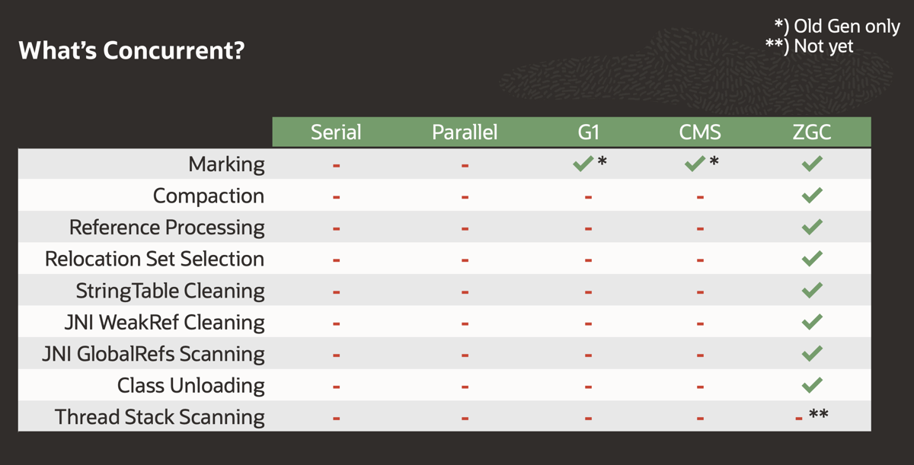

## Introduction

随着硬件的发展，堆空间越来越大（几十 GB、上百 GB、数 TB），同时对停顿时间的需求从秒级到百毫秒级，再到十毫秒级和亚毫秒级。G1 逐渐力不从心，下一代低延迟垃圾回收器主要有 **ZGC** 和 **Shenandoah**。

ZGC 的回收算法与 Azul Systems 2005 年提出的 Pauseless GC 类似。仅三次与堆大小无关的短暂 STW（开始标记、结束标记、开始 relocate），从而轻松实现 **< 1 ms** 停顿的目标。

### Key Features

- **全并发**：回收周期绝大部分逻辑与 Mutator 并发执行，暂停与堆大小、存活数据量解耦
- **基于 Region**：与 G1 类似，但 Region 大小不唯一（Small 2 MB / Medium 32 MB / Large N × 2 MB）
- **并发压缩**：常规回收周期就包含 relocation，不需要单独 Full GC mark-compact
- **支持 NUMA**：原生 NUMA 感知
- **着色指针**：在 64-bit 堆对象引用的 metadata bits 中编码 GC 状态（区别于 CMS/G1 标记对象本身）
- **读屏障（load barrier）**：在引用**加载**时检查 colored pointer 的 metadata，必要时 self-healing 地址

### Region Types

| 类型 | 大小 | 存放对象 |
| --- | --- | --- |
| Small | 2 MB | < 256 KB |
| Medium | 32 MB | 256 KB ~ 4 MB |
| Large | N × 2 MB（N ≥ 2） | > 4 MB（按 2 MB 粒度对齐） |

### GC Cycle Phases

ZGC 的回收周期由以下阶段组成，仅三次与堆大小无关的短暂 STW：

1. **Pause Mark Start**（STW）：扫描线程栈等根集
2. **Concurrent Mark / Remap**（并发）：遍历对象图
3. **Pause Mark End**（STW）：同步点
4. **Concurrent Prepare for Relocate**（并发）：引用处理、类卸载、relocation set 选择
5. **Pause Relocate Start**（STW）：扫描线程栈
6. **Concurrent Relocate**（并发）：压缩堆

由于 remap 非常消耗时间，该子阶段会在下一个回收周期的并发标记子阶段合并执行。

### Generational Transition Timeline

| 版本 | 变化 |
| --- | --- |
| JDK 11 | 实验特性（[JEP 333](https://openjdk.org/jeps/333)） |
| JDK 15 | 生产特性（[JEP 377](https://openjdk.org/jeps/377)） |
| JDK 21 | 分代模式可选（[JEP 439](https://openjdk.org/jeps/439)，需 `-XX:+ZGenerational`） |
| **JDK 23** | **分代模式成为默认**（[JEP 474](https://openjdk.org/jeps/474)），非分代模式废弃 |
| JDK 25+ | 非分代模式移除（[JEP 490](https://openjdk.org/jeps/490)） |

## Knowledge Map

ZGC 已拆分为 5 篇独立笔记，下表给出每篇的覆盖范围。阅读顺序建议：**ColoredPointers → LoadBarrier → Generational → ObjectAllocation → CollectionCycle**。

### Colored Pointers

**64-bit 指针里塞 GC 状态：metadata bits 编码、multi-mapping、非分代 vs 分代布局演变、最大堆约束。**

- 基本布局：metadata bits + address bits 的分割与含义
- 非分代 ZGC：高阶位 metadata + multi-mapping 三个虚拟视图（Marked0 / Marked1 / Remapped）
- 分代 ZGC（JEP 439）：低阶位 metadata + 显式 barrier 代码（取消 multi-mapping）
- 颜色状态机：标记和 relocation 阶段的 colored pointer 状态转换
- 地址位宽与最大堆（~16 TB / 分代版可扩展）
- 为什么不能与 CompressedOops 同时启用

👉 [**跳转 → ZGC/ColoredPointers.md**](/docs/CS/Java/JDK/JVM/GC/ZGC/ColoredPointers.md)

### Load Barrier

**读屏障机制：fast path / slow path 分流、self-healing CAS 并发重定位修复、非分代 vs 分代职责变化。**

- 注入位置：堆引用**读取**处的 JIT 代码（类似 compressed oops decode）
- Fast path：1–2 条指令检查 metadata → 剥离 → 解引用（绝大多数 > 99% 执行）
- Slow path：self-healing CAS 循环修复指向已 relocate Region 的指针
- Baker 风格并发 relocation 与 forwarding 表原理
- 非分代 vs 分代职责对比：标记职责移到 store barrier
- Load barrier vs Store barrier 分工表

👉 [**跳转 → ZGC/LoadBarrier.md**](/docs/CS/Java/JDK/JVM/GC/ZGC/LoadBarrier.md)

### Generational ZGC

**JEP 439 七个核心设计概念：动机、Driver 线程、RSet、SATB 标记、Full GC 语义。**

- 动机：非分代 ZGC 的三个问题（stall 风险、堆冗余、CPU 开销）
- 双 Driver 架构：`ZDriverMinor`（young）与 `ZDriverMajor`（young → old）
- 7 个设计概念详述：No multi-mapping、Optimized barriers（fast/slow path、RSet barrier、SATB barrier、barrier patching）、Double-buffered RSet、Relocations without extra heap memory、Dense heap regions、Large objects、Full GC
- RSet 的 act-once 语义与 SATB 标记原理
- 启用方式与版本时间线

👉 [**跳转 → ZGC/Generational.md**](/docs/CS/Java/JDK/JVM/GC/ZGC/Generational.md)

### Object Allocation

**C++ 源码层：ZObjectAllocator → ZHeap → ZPageAllocator 分配链路、三种 Region 分配路径、page cache 与 stall 机制。**

- `alloc_object` 三路分发：small / medium / large
- Small 对象共享页分配 + CAS retry 竞争路径
- Large 对象专用 large page（按 2 MB 粒度对齐）
- `ZPageAllocator::alloc_page`：page cache → 扩堆 → flush cache → stall 等待 GC
- `alloc_page_or_stall`：non-blocking flag 与 safepoint stall 机制
- JVM 参数：`ZStallOnOutOfMemory`、`ZCollectionInterval`

👉 [**跳转 → ZGC/ObjectAllocation.md**](/docs/CS/Java/JDK/JVM/GC/ZGC/ObjectAllocation.md)

### Collection Cycle

**C++ 源码层：ZDirector 轮询驱动、四种 GC 触发策略、ZDriver 线程主循环、GC Cause 分发。**

- GC 触发四策略：rule_timer / rule_warmup / rule_allocation_rate / rule_proactive
- `ZDirector::run_thread`：100 ms tick + allocation rate 抽样 + `start_gc` 决策
- `make_minor_gc_decision` / `make_major_gc_decision`：timer → allocation_rate → high_usage 优先级
- `ZCollectedHeap::collect`：GCCause switch 路由到 minor / major driver
- `ZDriverMinor::run_thread` 与 `ZDriverMajor::run_thread`：port.receive() → gc() → ack() → handle_alloc_stalls()
- Major GC 内部：`collect_young`（preclean / roots）+ `collect_old`

👉 [**跳转 → ZGC/CollectionCycle.md**](/docs/CS/Java/JDK/JVM/GC/ZGC/CollectionCycle.md)

## Pros, Cons and Fitness

| 维度 | 说明 |
| --- | --- |
| 主要优势 | 全并发（着色指针 + 读屏障），暂停 < 1 ms 且与堆大小、存活数据量解耦；支持 TB 级堆；主动归还内存给 OS |
| 主要缺点 | 早期不支持分代（JDK 21+ 已补）；着色指针占用高位，不支持 CompressedOops；对透明大页有约束 |
| 最佳场景 | 超大堆（数 TB）或要求亚 1 ms 级暂停的超低延迟服务（如金融交易、实时风控） |
| 关键限制 | 堆小于 32 GB 时着色指针优势不明显；不支持 CompressedOops（进程内存天然更大） |
| 启用方式 | `-XX:+UseZGC`（JDK 15+ 为 product；JDK 23 起分代模式默认） |

## Links

- [Garbage Collection](/docs/CS/Java/JDK/JVM/GC/GC.md)
- [Shenandoah](/docs/CS/Java/JDK/JVM/GC/Shenandoah.md)
- [G1 Garbage Collector](/docs/CS/Java/JDK/JVM/GC/G1.md)
- [Card Table](/docs/CS/Java/JDK/JVM/GC/CardTable.md)
- [TLAB](/docs/CS/Java/JDK/JVM/TLAB.md)

## References

1. [The Pauseless GC Algorithm](https://www.usenix.org/legacy/events/vee05/full_papers/p46-click.pdf) — ZGC 与 Azul Pauseless GC 的设计渊源
2. [Deep Dive into ZGC: A Modern Garbage Collector in OpenJDK](https://dl.acm.org/doi/pdf/10.1145/3538532) — ACM TOSEM 2022
3. [ZGC The Next Generation Low-Latency Garbage Collector](http://cr.openjdk.java.net/~pliden/slides/ZGC-OracleDevLive-2020.pdf) — OracleDevLive 2020
4. [The Z Garbage Collector Low Latency GC for OpenJDK](http://cr.openjdk.java.net/~pliden/slides/ZGC-Jfokus-2018.pdf) — Jfokus 2018
5. [JEP 333: ZGC (Experimental)](https://openjdk.org/jeps/333)
6. [JEP 376: ZGC: Concurrent Thread-Stack Processing](https://openjdk.org/jeps/376)
7. [JEP 377: ZGC (Production)](https://openjdk.org/jeps/377)
8. [JEP 439: Generational ZGC](https://openjdk.org/jeps/439)
9. [JEP 474: ZGC: Generational Mode by Default](https://openjdk.org/jeps/474)
10. [JEP 490: ZGC: Remove the Non-Generational Mode](https://openjdk.org/jeps/490)
11. [OpenJDK16 ZGC 详细源码分析](https://heapdump.cn/article/3473288)
