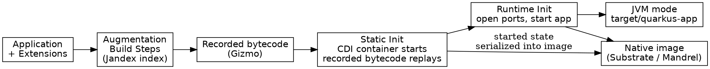

## Introduction

Quarkus 的全部性能主张可以压成一句话：**把启动时才做的事挪到构建期做**。这一页拆解这句话的工程含义——augmentation（增强）三阶段、bytecode recording、closed world 假设，以及它在 JVM 模式、native image、Project Leyden AOT 三种产物上分别兑现了多少。总览见 [Quarkus](/docs/CS/Java/Quarkus.md)，扩展如何实现这套机制见 [Extensions](/docs/CS/Java/Quarkus/Extensions.md)。

## The Three Phases of Bootstrap

传统容器的引导是"启动时发现"：扫描 classpath、解析描述符、反射装配。Quarkus 把引导切成三个阶段，前两个都在构建期完成：

| 阶段 | 发生时机 | 做什么 | 约束 |
| :--- | :--- | :--- | :--- |
| Augmentation | 构建期（Maven/Gradle 插件内） | 执行各扩展的 Build Step，读注解（经 Jandex 索引）、合并配置、生成字节码 | 不允许加载任何应用类 |
| Static Init | 应用 main 的静态初始化 / native image 构建时 | 执行录制的字节码，启动 CDI 容器，装配框架对象 | 不允许监听端口、起线程，不允许读运行期配置 |
| Runtime Init | 应用 `main` 方法 | 只做必须到运行期才能做的事：打开端口、启动调度器 | 应限制到最小 |

Static Init 阶段的产出会被 Substrate 直接序列化进 native image，也就是说框架的"已启动状态"是烤进二进制的，进程起来时不需要再执行任何引导逻辑。

## Bytecode Recording and Gizmo

Augmentation 阶段不能直接调用运行时逻辑（那些类此刻还不可用），Quarkus 的解法是 **bytecode recording**：构建期对 recorder 对象的调用被拦截并记录下来，而不是真的执行；记录结果交给字节码生成库 **Gizmo** 编译成"在运行期重放同一串调用"的类。本质是把构建期的调用**延迟执行**到运行期。

可被录制的对象限于：基本类型、`String`、`Class<?>`、先前 recorder 调用的返回值、有无参构造器加 getter/setter 的 POJO、带 `@RecordableConstructor` 的对象，以及上述类型的数组与集合。当录制表达力不够时，扩展作者可以直接用 Gizmo 生成字节码——它相当于 ASM 的高层封装。

## Closed World and Config Phases

构建期决策的前提是**封闭世界假设**：构建时看到的就是运行时的全部。配置因此被按阶段绑定，Quarkus 用三类配置阶段把这条假设变成契约：

| 配置阶段 | 含义 | 例子 |
| :--- | :--- | :--- |
| `BUILD_TIME` | 只影响构建，运行期不可见也不可改 | 是否启用某扩展、注解处理器开关 |
| `BUILD_AND_RUN_TIME_FIXED` | 影响构建，运行期可读但**不再重新读取**，改了必须重新构建 | 数据库 URL、JDBC 驱动选择 |
| `RUN_TIME` | 构建期不可用，启动时读取 | 监听端口、超时时间 |

这条契约同时服务 native image：如果配置在运行期才读，Substrate 无法推断配置内容，只能保留所有可能用到的代码路径；配置在构建期固定，未调用的方法就能被静态消除。相应地，Quarkus 的官方建议是 *favor build time work over runtime work*——构建期干得越多，产物体积和加载时间越小。

BuildItem 本身要求不可变：producer/consumer 模型无法为 mutation 正确排序。

## What It Buys

- **启动时间**：元数据处理、注解扫描、bean 装配全部前移，启动只剩"重放已录制的字节码 + 开端口"。
- **内存（RSS，不只是堆）**：只为运行时真正用到的类付出加载代价，描述符解析等构建期依赖类在 JVM 模式下即可从产物中剔除——这是 Quarkus 相对传统应用服务器（如 WildFly）最实质的差异：部署期常驻的整堆框架类不再进内存。
- **native image 友好**：初始化走字节码直路，Substrate 能判断"这个方法永不被调用"并消除它。

## Project Leyden AOT: 不走 native 也要提速

Quarkus 3.32 集成了 [Project Leyden](https://wiki.openjdk.org/display/leyden/Main) 的 AOT 缓存（JEP 483 一系）：训练运行一次，把类加载、类链接、方法剖析结果写成 AOT cache 文件，后续运行直接加载，跳过 JVM 每次冷启动重复的劳动。**需要 JDK 25**（LTS 口径）。

官方 3.32 发布博文给出的数字：`quarkus create app` 生成的最小 REST 应用启动从 **370 ms 降到 80 ms**；9000 个类的大型 REST CRUD 应用从 **3 s 降到 900 ms**。代价是镜像里多一个 AOT cache 文件，且收益低于 native image，但"同一个 JAR、同一个 JVM、不改代码"的投入产出比非常好。训练运行可以在构建期触发（minimal training），也可以由集成测试驱动，生成的 cache 可直接打进容器镜像。

## Quarkus vs Spring Boot: 两种装配哲学

| 维度 | Quarkus | Spring Boot |
| :--- | :--- | :--- |
| 装配时机 | 构建期 augmentation | 运行期反射 + 自动配置 |
| 配置读取 | 大量属性构建期固定，运行期改需重新构建 | 运行期随时可改 |
| bean 容器 | ArC（构建期 CDI 实现） | Spring 容器（运行期） |
| 启动/RSS | 毫秒级 / 按实际使用计费 | 秒级 / 框架类常驻 |
| 灵活性代价 | 封闭世界，构建期错误前移 | 动态性强，问题延后到运行期暴露 |
| 升级策略 | 社区月更 + LTS 双轨 | 半年一个大版本 |

这不是"谁更好"的关系：长生命周期、动态配置密集的业务系统用 Spring Boot 更顺手；追求启动速度、内存密度和 serverless/高密度部署的服务用 Quarkus 更划算。两者的边界正在互相侵蚀——Spring Boot 4.x 在补启动速度，Quarkus 4 在补模块化与动态性。

## Links

- [Extensions](/docs/CS/Java/Quarkus/Extensions.md)
- [NativeImage](/docs/CS/Java/Quarkus/NativeImage.md)
- [Config](/docs/CS/Java/Quarkus/Config.md)
- [Spring Boot](/docs/CS/Framework/Spring_Boot/Spring_Boot.md)
- [Graal](/docs/CS/Java/JDK/JVM/Graal.md)
- [Netty EventLoop](/docs/CS/Framework/Netty/EventLoop.md)

## References

- https://quarkus.io/guides/writing-extensions
- https://quarkus.io/blog/quarkus-3-32-released/
- https://quarkus.io/guides/aot
- https://openjdk.org/jeps/483
