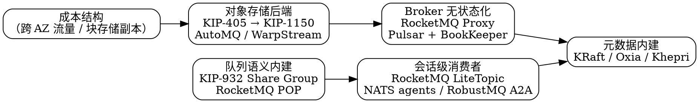

## Introduction

本篇只收录**已经在一手来源里留下痕迹**的演进方向 —— 官方发布说明、KIP / RIP / PIP 提案原文、项目文档站的现行文案。厂商宣传页里的数字一律标注为「厂商口径」，不当作事实写。

读每一条方向时，先用三个问题过一遍：

1. 证据是**已发布**（进入某版本、文档站已收录）还是**仅提案**（状态还是 Under Discussion）？
2. 说话的是**项目本身**（Apache Kafka / RocketMQ / Pulsar 的官方文档与发布说明）还是**厂商**（Confluent / Redpanda / AutoMQ / RobustMQ 的官网）？这两者的断言强度不同 —— 例如「AI 数据流」是 Confluent 的定位，而 Apache Kafka 自己的文档至今只称自己是 event streaming platform。
3. 这条方向**改变了选型判据**，还是只给既有能力换了实现？

三条贯穿主线：

- **成本把存储推向对象存储，架构因此被重写。** 副本模型、broker 是否有状态、性能瓶颈落在哪一层，这三件事是一起变的，不会只变一件。
- **「消息 vs 流」的分叉正在被填平。** 日志型系统内建了队列语义（逐条 ack、投递计数、DLQ），选型的第一问不再是「我要消息还是要流」，而是「我要哪种重放与并发模型」。
- **消费方的形态变了。** 消费者从「少量长期运行的进程」变成「海量、短生命周期的会话」，这是 topic / group 模型第一次被要求按会话粒度分配通道 —— 而它原本是按业务主题设计的。

> [!NOTE]
> 本目录各产品的**现行能力**以各自分册为准（版本基线 Kafka 4.3.1 / RocketMQ 5.5.1 / Pulsar 4.2.4）。本篇只写方向与证据，不复述机制细节；同一结论只在归属分册展开。
>
> ⚠️ 两个基线在本篇核实时已滞后：**Apache Pulsar 5.0 已于 2026-10-05 发布并标为 LTS**（本目录尚未按 5.0 重做源码核实），**NATS Server 最新为 v2.15.1（2026-10-09）**。涉及这两者的段落都按 5.0 / 2.15.1 的一手页面写，并与 4.2.4 / 2.15.0 的分册结论并列，不要互相覆盖。

## Storage Moves to Object Store

这是证据最整齐的一条方向，因为它由成本而非功能驱动。块存储上「本地三副本 × ISR 复制」在对象存储里是重复付费 —— AutoMQ 的官方表述直接算了一笔账：EBS 自身的三副本机制叠加 ISR 复制，结果是**同一份数据存了九份**（"EBS's inherent three-replica mechanism, coupled with ISR replication, results in data being stored nine times"）。

**Kafka 侧的推进节奏分三步：**

| 阶段 | 一手证据 | 状态 |
| ---- | -------- | ---- |
| 分层存储落地 | KIP-405，页面原文「This KIP has been merged and marked production-ready since Kafka 3.9」；3.9.0 发布说明（2024-11-06）「Tiered storage is now production-ready in Kafka 3.9」 | **已 GA**（3.9 起） |
| 补齐远端读与元数据 | KIP-1023 follower 从 tiered offset 起 fetch、KIP-1208 元数据管理前缀、KIP-1235 `remote.log.metadata.topic.min.isr`（4.3） | 已进入版本 |
| 去掉本地盘 | **KIP-1150: Diskless Topics**，状态原文「Current state : "Under Discussion"」，JIRA KAFKA-19161 | **仅提案** |

KIP-1150 的动机值得逐句读，它把方向说得很清楚：现有 tiered storage 只搬走**已完成**的 segment，「does not remove the need for replication of active segments」；目标是让 hyperscaler 上的操作者「Eliminate inter-zone data transfer costs from replication」并「Permit multi-region active-active topics」。也就是说它要做的是**用对象存储替换掉块存储这一层**，而不只是加一层冷存储。

⚠️ 断言强度必须压住：这是 Under Discussion 的提案，不是承诺，更不是当前能力。中文资料里已经出现「Kafka 4.x 支持 diskless」的说法，属于把提案当发布。

配置名这一层也要盯住，它比宣传语更能说明实现形态：broker 级总开关是 **`remote.log.storage.system.enable`**（4.3 文档原文「Whether to enable tiered storage functionality in a broker or not」，Default **false**），topic 级是 `remote.storage.enable`，本地层的边界由 `log.local.retention.ms` / `log.local.retention.bytes` 表达。网上流传的 `tiered.storage.enabled` **在 4.3 的配置表里不存在**。

⚠️ 一个容易被写坏的点：Kafka 官方文档把本地层描述为「the same as the current Kafka that uses the local disks」，**没有**把本地日志称作「bounded cache」。「分层存储让 Kafka 的本地盘变成 S3 的缓存」是第三方叙述，不是官方口径。真实变化是**读延迟分布**与**成本归属**，容量模型（segment、retention、索引）仍照旧 —— 机制见 [Kafka Storage](/docs/CS/MQ/Kafka/Storage.md)。

**其它项目的同一条方向**：Pulsar 走 offload（NAR driver + ledger 关闭事件驱动，见 [Pulsar Cluster](/docs/CS/MQ/Pulsar/Cluster.md)）；RocketMQ 有独立的 `tieredstore` 模块且在持续修（5.5.1 发布说明列了 tiered storage 相关的多个修复项）。生态侧两个可核实的事实：WarpStream 被 Confluent 收购（官方公告 2024-09-09，Jay Kreps 原文「Confluent has acquired WarpStream, an innovative Kafka-compatible streaming solution with a unique architecture」）；AutoMQ 官方称自己是「Diskless Kafka® on S3」，架构名是 **Shared Storage**（把 Kafka 原生 Log 替换为自研 S3Stream 使 broker 完全无状态）—— 注意其文档明确把 Kafka 归为「classic Shared Nothing」，而「disaggregated log」这个措辞在两页官方文档里都没有出现。

## Queue Semantics Grow Inside Log-based Brokers

「消息队列 vs 流」这个分叉曾经是最粗的一根选型线：日志型只能分区独占，队列型才有逐条 ack 与重投。这条线正在被日志型系统自己填平。

- **Kafka**：KIP-932「Queues for Kafka」把 share group 定位成「roughly equivalent to a **durable shared subscription** in existing systems」。节奏是 4.0 Early Access → 4.1 Preview → 4.2 production-ready，细节与配置项见 [ShareGroup](/docs/CS/MQ/Kafka/ShareGroup.md)。
- **RocketMQ**：反方向走 —— 在队列模型之上加**无状态消费模型 POP**，让同一主体同时支持两种消费模型，见 [RocketMQ 5.x](/docs/CS/MQ/RocketMQ/RocketMQ5.md)。
- **RabbitMQ / Pulsar**：本来就有记录级共享（quorum queue 逐条 ack、共享订阅），是这条方向的参照系而非后来者。

真正说明「方向」的不是功能本身，而是**开关形态的变化**：Kafka 4.3 的 `group.coordinator.rebalance.protocols` 已标 `forRemoval`，官方原文「In Kafka 5.0, all protocols will always be enabled and cannot be disabled via this configuration. Use feature versions (group.version, streams.version, share.version) managed by kafka-features.sh instead」。协议从「可关的配置」变成「恒开的能力 + 版本门槛」，这是成熟期项目的典型动作，也是升级 Kafka 到 5.0 前必须先验证的一行。

⚠️ 边界：共享消费并不取代分区独占。record 级并发换来的是**同一 partition 内不再保证顺序交付给单个消费者**，且状态要落 `__share_group_state`、锁要有超时 —— 复杂度是转移而非消失。判据表在 ShareGroup 篇的 Selection Criteria。

## Consumer Shapes Change: AI-Era Workloads

这条方向的机制值得说透，因为多数资料停在「MQ 支持 AI」这类宣传语上。

Agent 会话的负载特征是：**海量通道、每条几乎空闲、生命周期以分钟计、一消费者独占**。而传统模型里每个通道都要占一份 topic 元数据、一组队列文件、一份订阅注册，Broker 还要轮询全量 topic 判断有没有新消息 —— 无效扫描随通道数**线性**增长。这正是 `RocketMQ 5.5.0` 要解决的问题。

一手证据（三条，都在官方页面）：

1. **RIP-83「Lite Topic: A New Message Model」**（PR #9800）随 `rocketmq-all-5.5.0`（2026-04-10）发布，发布说明原文：**"This version introduces Lite Mode, a lightweight subscription mechanism designed for AI scenarios"**。
2. 官方文档定义：LiteTopic 是**单个父 topic 内的轻量、临时子通道**，「You can create millions of fine-grained message channels -- one per session, task, or user -- without the resource overhead of separate topics」；版本门槛写得很明确 —— **Server 5.5.0 起，gRPC SDK 5.1.0 起**。
3. 官方同时给出了代价：「Each LiteTopic has only one queue by default, which limits per-channel TPS but enables ordered consumption and fine-grained subscription control」—— 单队列换有序与细粒度，**不是免费的海量分区**。实现侧 5.5.0/5.5.1 的提交里出现 `PopLiteLongPollingService`、RocksDB CQ 路径改名与 `autoClean` 调度、通配订阅与 consumer suspend，说明它压在 POP 之上并额外承担了清理与生命周期。

另两个可核实的定位声明（强度低于上面三条，因为是站内宣传而非行为规范）：

- **NATS** 官网现称「The Real-Time Communication Fabric for Distributed Agents and Applications」，并称把 messaging、streaming、state 统一成一套实时系统，「connecting services, devices, and AI agents from cloud to edge」。见 [NATS](/docs/CS/MQ/NATS.md)。
- **RobustMQ** 官网称「Communication Infrastructure for the AI Era」，列了 native A2A、AgentCard 语义发现、per-agent 持久 mailbox（FETCH + ACK 拉取、离线投递）与「Million-scale lightweight Topics」。

> [!WARNING]
> **RobustMQ 不是 RocketMQ 的商业化发行版**。它是独立的 Rust 项目（Apache-2.0，官网自述「Targeting Apache TLP · Built with Rust · Multi-Protocol Native」，即**尚未**进入 ASF 孵化），单 broker 原生支持 MQTT / Kafka / NATS / AMQP 多协议。本库早期把它写成「由 Apache RocketMQ 团队与腾讯云主导的商业发行版」，属事实错误，已改正。
>
> 它的 100 µs 内存延迟、1M+ 单机 QPS、0 外部依赖都是**厂商口径**，没有第三方基准，不要写进任何选型结论。

需要明确划出的边界：**Apache Kafka 项目自身的文档没有任何 AI / agent 定位**（4.3 的 Introduction 仍写「Apache Kafka® is an event streaming platform」）。Confluent（厂商）有：官方发布帖标题「Evolving the Data Streaming Platform for AI, Scale, and Control」、「Making Agents Native to the Stream」，以及 Streaming Agents、Tableflow 等产品条目。写「Kafka 面向 AI 做了改造」是把厂商叙述安到了项目头上。

## Metadata Layer Moves Inward

三个主流项目在同一年代把元数据从外部组件收回内部，这条方向的可核实度极高，因为它是**破坏性变更**：

| 项目 | 一手证据 | 运维后果 |
| ---- | -------- | -------- |
| Kafka | 4.0.0 发布说明：「marking the first major release to operate entirely without Apache ZooKeeper®」；4.3 升级文档：「Apache Kafka 4.0 only supports KRaft mode - ZooKeeper mode has been removed」 | 无 ZK 可依赖；`inter.broker.protocol.version`、`log.message.format.version`、`message.format.version` 在 4.0 移除，`metadata.version` 变成由 `kafka-features.sh` 管理的 feature 而非配置项 |
| Pulsar | 5.0 release highlights：**Oxia 成为新集群的推荐元数据存储**，同时「ZooKeeper remains fully supported as the metadata store」；并把 v5 client API / Scalable Topics / Oxia 称作「separate choices」 | 渐进采用是官方设计意图，升级不等于换元数据层；5.0 同时给了「planned path back to 4.x」的 rollback 指引 |
| RabbitMQ | 4.3 元数据存储换成 Khepri（Raft） | 集群要求多数派节点在线，少数派侧操作直接超时 |
| RocketMQ | DLedger 作为 CommitLog 模式已在源码中标记废弃，推荐路径是 Controller | Controller 自身默认仍用 DLedger 组做 Raft，见 [Cluster](/docs/CS/MQ/RocketMQ/Cluster.md) |

结论的形态是：「再引一个 ZooKeeper」的运维成本论已不再是默认答案，但代价换成了**必须维护 quorum** —— 一致性存储进了主链路，节点数从「想加就加」变成「奇数且过半可用」。

## Where Compute and Output Go

计算的位置有两个相反方向，且都能核实：

- **往 broker 里长**：Pulsar Functions、RocketMQ 5.x 无状态 Proxy（协议适配 + 消费管理 + ACL 都在 Proxy，Broker 只管存储，见 [RocketMQ5](/docs/CS/MQ/RocketMQ/RocketMQ5.md)）。
- **往客户端与引擎里退**：Kafka Streams 的服务端 rebalance 协议（KIP-1071）4.1 early access、4.2「server-side rebalance protocol to GA with a limited feature set」—— 注意官方措辞是 **limited feature set**，不要写成完整 GA。

输出侧的新变量是**湖仓成为下游**。可核实的官方特性名只有两个：Redpanda 的 **Iceberg Topics**（文档站在 Tiered Storage / Mountable Topics / Iceberg 导航下）与 Confluent 的 **Tableflow**（「Topics to tables in a few clicks」）。

⚠️ **Apache Kafka 自身没有对应的 Iceberg KIP**（本次核实未在 cwiki 检索到，也不在 4.3 的发布说明里）。把「Kafka 原生写 Iceberg」当成项目能力是错的；那是 Connect / Flink / 厂商层的活。Kafka 官方在存储层的下一步是 KIP-1150。

流处理与 MQ 的合并信号，要按 Confluent 官方文档的现行措辞写：「For new stream processing workloads, Confluent Cloud for Apache Flink® is the recommended stream processing engine on Confluent Cloud. **ksqlDB remains fully supported for existing applications.**」

> [!WARNING]
> 这条常被二手资料写成「ksqlDB 已 EOL / 已停止维护」。截至 2026-10 的两篇官方 overview 页面（发布日 2026-10-09 与 2026-09-22）都**没有** EOL 或 sunset 声明，只说新负载推荐 Flink。也不存在名为 `flink-ksql migration guide` 的官方页面 —— 检索不到就不要写。

## Protocols: Compatibility Beats Standards

按标准统一的预期没有发生，发生的是**兼容面收敛到 Kafka API**：Redpanda 官方架构页写「Producers and consumers interact with Redpanda using the Kafka API」，AutoMQ 称「Diskless Kafka® on S3」，WarpStream 被收购时的定性是「Kafka-compatible streaming solution」。这是事实上的协议赢家，与规范文本无关。

规范侧的两个可核实状态：

- **CloudEvents**：核心规范最后一个 release tag 是 `ce@v1.0.2`（2022-02-06），另有一条 SQL 扩展 `cesql@v1.0.0`（2024-06-17）。即核心规范自 2022 年起未再改版。
- **OpenMessaging**：规范线基本停滞 —— `openmessaging-java` 最后的 release 是 `2.1.0-pubsub`（2020-09-25）；而 `openmessaging/benchmark` 仓库仍在收到提交（2026-04-07 的消息大小分布支持、2026-01-04 的「Support RocketMQ5 benchmark using grpc sdk」）。**benchmark 活跃 ≠ 规范在演进**，两者要分开写。

与此同时，私有协议在多协议方向上重新组合：RocketMQ 5.x 走 Remoting（自定义编解码）+ gRPC（Protobuf）双栈，RobustMQ 把「one message, consumed by any protocol」当作卖点。

选型判据：**「兼容 Kafka API」不等于「兼容 Kafka 语义」**。逐项要核对的是 share group 是否支持、事务与幂等 producer 的覆盖范围、ISR 与 min.insync.replicas 在对象存储后端下的实际语义、以及 controller / 元数据层的行为差异。

## Selection Implications

把上面六节压成一张能用的表 —— 左列是现在就能进生产的事实，右列是还不能当成事实的说法。

| 方向 | 现在可确证 | 还不能当成事实 |
| ---- | ---------- | -------------- |
| 对象存储后端 | Kafka tiered storage 自 3.9 production-ready（`remote.log.storage.system.enable` 默认 false）；RocketMQ 有持续维护的 `tieredstore` 模块 | 「Kafka 支持 diskless」—— KIP-1150 仍是 Under Discussion 提案；「本地盘变成缓存」—— 无官方表述 |
| 队列语义内建 | Kafka 4.2 起 Kafka Queues production-ready；RocketMQ POP 无状态消费 | 队列语义「取代」分区独占；5.0 前 share 能力可完全不用（受 `share.version` feature level 门控） |
| 会话级消费者 | RocketMQ LiteTopic：Server 5.5.0+ / gRPC SDK 5.1.0+，官方定性 designed for AI scenarios | 「MQ 已为 AI 重构」的泛指；Apache Kafka 有 AI 定位（其文档无）；RobustMQ 的性能数字 |
| 元数据内建 | Kafka 4.0 KRaft-only；Pulsar 5.0 推荐 Oxia 且 ZK 仍支持；RabbitMQ 4.3 Khepri | 把「不需要 ZK」读成「不需要维护 quorum」 |
| 计算与输出 | Streams 服务端 rebalance 4.2 GA（limited feature set）；Redpanda Iceberg Topics / Confluent Tableflow 存在 | Kafka 原生写 Iceberg；ksqlDB 已 EOL |
| 协议 | Kafka API 成为兼容面；CloudEvents 停在 1.0.2；OpenMessaging 规范自 2020 停滞 | 任何「统一 MQ 标准将胜出」的断言 |

## Unverified

本篇**不写**以下条目，换环境重测时也不要凭印象补：

- Pulsar 官方**没有** roadmap 页（`pulsar.apache.org/roadmap/` 返回 404），因此「Pulsar 未来会做什么」只能引用已发布的 5.0 highlights，不能引用路线图。
- 「Pulsar 4.x 移除了跨地域复制」这个说法**已被证伪**（见下条），但「`pulsar-replication` 独立模块与 `PulsarBackup` 类在 4.2.4 源码中零命中」是本库早前的源码级结论，仍然有效。5.0 release highlights 明列「Fixes across **geo-replication**, subscriptions, delayed delivery, and acknowledgment recovery」，说明 geo-replication 作为**能力**一直在。二者不要把话说反。
- RocketMQ 官方文档**没有**独立的 tiered storage 页（`/docs/featureBehavior/12tieredstorage` 与 `/rip/83` 均 404），「对象存储分层」只有发布说明条目级证据；其「serverless / 多租户」的官方方向声明未核实到，不作断言。
- NATS JetStream 的「tiered storage」「self-healing streams」：官方文档与 `SUMMARY.md` 全量检索零命中，不作断言。
- Confluent 的 `flink-ksql` 官方迁移指南：未检索到官方页面，只有第三方个人博客里的同名工具。
- AutoMQ 的「disaggregated log」、Redpanda 的「Direct Iceberg」/「Icebeam」：在对应官方页面上均为零命中，官方名分别是 **Shared Storage** 与 **Iceberg Topics**。
- Redpanda「thread-per-core C++ 重写」：本次只拿到**标题级**证据（官方视频标题），未读到架构页正文对应段落，因此本篇不据此断言其实现模型。
- CloudEvents 的 CNCF 成熟度等级（incubating / graduated）：官方页面只出现「CNCF Serverless WG/CloudEvents」字样，未读到等级原文，故不写等级。
- KIP-1150 / KIP-1163 / KIP-1164 / KIP-1165 / KIP-1181 的**当前**状态：核实时 KIP-1150 页显示的是历史版本快照（页面顶部有 old version 提示），状态串为 Under Discussion；写正文时只说「提案阶段」，不说「已被否决」也不说「将在 5.0 落地」。
- 4.2 已宣布 Kafka Queues production-ready，而 4.3 文档里 `group.coordinator.rebalance.protocols` 的 Default 串仍是 `classic,consumer,streams`（不含 `share`）。两者关系需回源码确认，本机 `raw.githubusercontent` 不可用 → 本篇只写成「由 `share.version` feature level 门控」，不写「默认开启」也不写「默认关闭」。

## Links

- [MQ](/docs/CS/MQ/MQ.md?id=future-directions)
- [Kafka Storage](/docs/CS/MQ/Kafka/Storage.md)
- [Kafka ShareGroup](/docs/CS/MQ/Kafka/ShareGroup.md)
- [RocketMQ 5.x](/docs/CS/MQ/RocketMQ/RocketMQ5.md)
- [LiteTopic](/docs/CS/MQ/RocketMQ/LiteTopic.md)
- [Pulsar 集群复制与分层存储](/docs/CS/MQ/Pulsar/Cluster.md)

## References

1. [KIP-405: Kafka Tiered Storage](https://cwiki.apache.org/confluence/display/KAFKA/KIP-405%3A+Kafka+Tiered+Storage)
2. [KIP-932: Queues for Kafka](https://cwiki.apache.org/confluence/display/KAFKA/KIP-932%3A+Queues+for+Kafka)
3. [KIP-1150: Diskless Topics](https://cwiki.apache.org/confluence/pages/viewpage.action?pageId=364349847)
4. [Apache Kafka 3.9.0 Release Announcement](https://kafka.apache.org/blog/2024-11-06/apache-kafka-3.9.0-release-announcement/)
5. [Apache Kafka 4.0.0 Release Announcement](https://kafka.apache.org/blog/2025-03-18-apache-kafka-4.0.0-release-announcement/)
6. [Kafka Tiered Storage Configs (4.3)](https://kafka.apache.org/43/configuration/tiered-storage-configs/)
7. [Apache RocketMQ 5.5.0 Release Notes](https://github.com/apache/rocketmq/releases/tag/rocketmq-all-5.5.0)
8. [RocketMQ LiteTopic](https://rocketmq.apache.org/docs/domainModel/03litetopic)
9. [Apache Pulsar 5.0 Release Highlights](https://pulsar.apache.org/docs/5.0.x/release-highlights/)
10. [NATS Downloads](https://nats.io/download/)
11. [Confluent acquires WarpStream](https://www.confluent.io/blog/confluent-acquires-warpstream/)
12. [AutoMQ Architecture](https://docs.automq.com/automq/architecture/)
13. [Redpanda Iceberg Topics](https://docs.redpanda.com/current/manage/iceberg/about-iceberg-topics/)
14. [RobustMQ](https://www.robustmq.com/en/)
15. [CloudEvents Specification Releases](https://github.com/cloudevents/spec/releases)
16. [OpenMessaging Benchmark](https://github.com/openmessaging/benchmark)
17. [Confluent Cloud ksqlDB Overview](https://docs.confluent.io/cloud/current/ksql/overview.html)
