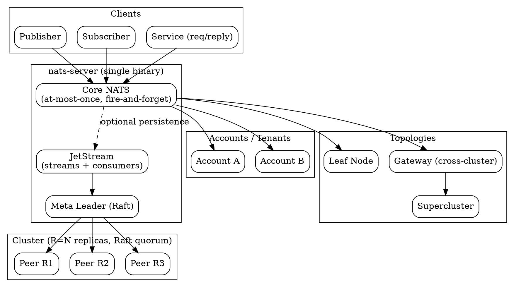

## Introduction

NATS 是云原生与边缘原生（cloud and edge native）的开源消息系统，由 [nats-io](https://github.com/nats-io) 维护。应用连接到 NATS Server，通过 **subject（主题）** 交换消息，彼此不需要知道对方网络地址。它追求的目标是一个**单一小二进制**、高吞吐低延迟、安全默认；从笔记本上的单节点到跨区域的集群都能运行。

当前稳定版本：**nats-server v2.15.1，发布于 2026-10-09**（来源：GitHub Releases 确认，v2.15.1 与 2.14.8 并行发布；v2.15.1 升级到 Go 1.27.2）。JetStream 持久化引擎随 **NATS 2.2** 引入。

它解决的核心问题：应用组件间的**空间解耦**（发布/订阅、请求-应答、队列、scatter-gather），以及在此之上可选的**时间解耦**——消息可落盘、可重放、可在订阅者离线时等待。

定位差异（与 Kafka / RocketMQ / Pulsar 相比）：NATS 核心（Core NATS）是**无存储、无分区、无 ACK 的 subject 级 pub/sub**，而非基于日志分区（partition）的提交日志系统；它不按 partition 做伸缩，而是按 subject 树路由。持久化由 JetStream 作为可叠加的存储层提供，二者共用同一进程。相较于 Kafka 以"分区日志 + 消费者位移"为核心，NATS 以"subject + stream/consumer"为核心，运维更轻、API 更小，但放弃了分区顺序保证与 Kafka 式重放语义的等价物。

## Two Layers, One Process

理解 NATS 最关键的一点是：它不是"一个产品两个版本"，而是**同一个进程上的两层**。

**Core NATS** 是路由层，只回答"这条消息现在该送到谁手上"。它不存储、不确认、不重放，语义是明确的 **at-most-once**。把存储、ACK、重投从热路径上全部拿掉之后，剩下的东西可以常驻内存、延迟在微秒级、单进程扛百万级 msg/s —— 代价是发布者与订阅者**必须同时在线**。

**JetStream** 是可选的持久化层，只做一件事：给 Core 加回**时间解耦**。它由 stream（服务端消息仓库）、consumer（服务端有状态游标）、client 三部分组成，核心设计选择是**位移在 server 侧** —— 应用不记 offset、不提交位移，因此 consumer 天然是可共享的工作单元。

这个分层决定 NATS 的所有形态：单二进制既是 broker 又是存储；集群既是路由 mesh 又是复制组；边缘部署靠 leaf node 桥接。所有配置项都在同一个 `nats-server` 进程里。

## The Core Trade-off

NATS 的全部卖点可以浓缩成一句话：**用丢弃换速度**。

Core NATS 明确选择 at-most-once —— 订阅者不在的那一刻，消息就永久消失，**没有任何错误提示**。这让它的热路径短到极致，也让运维成本低到极致：没有分区、没有重平衡、没有消费位移要管。

所以选型问题永远是同一个：**这条消息丢了要紧吗？**

- 要紧 → 上 JetStream，付存储与重投的代价，换时间解耦；
- 不要紧（实时报价、温度、缓存失效、被下一条覆盖的状态同步）→ Core 就够，别为不需要的持久化付钱。

而 JetStream 侧也要记住：它的语义是 **at-least-once**（重投是常态），**不提供 exactly-once**。官方口径是 at-least-once + 应用幂等 ≈ effectively-once，且去重窗口默认只有 **2 分钟**，超出窗口的重复照样入库。

## Reading Guide

本目录按**从概念到机制到运维**的顺序铺开，六篇各自独立成篇：

[Core NATS 路由层](/docs/CS/MQ/NATS/Core_NATS.md) 讲底座 —— subject 寻址与通配符、pub/sub 与 queue group 的分工、request-reply 的两种模式、at-most-once 的适用边界、slow consumer 与 payload 上限。**先读这篇**，后面所有篇目都建立在它的语义之上。

[JetStream 持久化层](/docs/CS/MQ/NATS/JetStream.md) 讲存储 —— stream 与 consumer 的边界、三种 retention 策略、push/pull 选择、ack 策略与四种应答、server 侧的两个控制项（`ack_wait` / `max_deliver`）、去重与幂等的实现路径、KV 与 Object Store 两个高层抽象、跨集群的 mirror/source。

[集群与 Raft 复制](/docs/CS/MQ/NATS/Clustering.md) 讲一致性 —— 这里必须把两件事分开：**Core 的 cluster 只是路由 mesh + interest 传播，没有一致性**；一致性来自 JetStream 的 Raft group。本篇覆盖 route mesh 的形成、Raft 选举与 quorum 提交、placement、peer 增删，以及 2.15 最大的变化：**期望状态调和（desired state reconciliation）**与 **evacuate endpoints**。

[部署形态与跨集群](/docs/CS/MQ/NATS/Topologies.md) 讲四种形态 —— 单节点 → cluster → supercluster（gateway 跨区）→ leaf（边缘）。核心区分维度是"**谁出向拨号**"、"连接是 server-to-server 还是 cluster-to-cluster"、"跨链路要不要 domain 与 account"。跨区复制**不能**靠把一个 cluster 拉长，必须用 gateway。

[安全模型](/docs/CS/MQ/NATS/Security.md) 讲身份与权限 —— 三个问题（你是谁 / 你能做什么 / 链路安不安全）加上圈住三者的 account 隔离单元。覆盖密码/token、NKey、JWT 信任链、operator mode、subject 级授权、跨账号 import/export、auth callout、TLS 与 mTLS。

[运维与升级](/docs/CS/MQ/NATS/Operations.md) 讲运行与维护 —— 四维 sizing、配置分块与 SIGHUP 热加载、**server 配置默认值全表**、8222 监控端点、SIGUSR2 lame duck 滚动升级、升 2.15 的顺序与禁区、Helm + NACK 部署、硬化。

## Version Baseline

本目录所有结论以 **v2.15.1** 为准。2.15 系列是一次**元数据层（metalayer）重写**，升级前必须知道三件事：

**期望状态调和重写了 scale / move / peer 增删。** 官方**强烈建议至少从 v2.14.7 升到 2.15.x**（2.14.7+ 内含兼容代码）。混版本期间 stream/consumer 的**创建与删除可以照常**，但**不要触发 scale 或 move** —— 那类操作会 stall 直到升级完成。回退也只支持降到 v2.14.7+。

**`js_ack_fc_v2` 在 2.15 保持 2.14 的默认值**（v1 格式的 ack/flow-control reply subject），**2.16 才切 v2**。若账号 import/export 或 subject 权限里含 `$JS.ACK.<stream>.>` / `$JS.FC.<stream>.>`（或更细粒度），**升 2.16 前必须先改**。这是下一个版本升级的前置动作，不是 2.15 的。

**`js_raft_delete_range` 在 2.15 默认开启**（2.14 全程支持但默认关闭）。镜像有大段 delete gap 的 stream 时，server 从逐条删除改为提议一次删除区间，效率提升明显。⚠️ 但**从 2.12 或更早直接升到 2.15 可能因此出问题**。

另外两个新默认值值得单独记住：**stream 的 `max_consumers` 默认上限 1000**（防止应用误建无限 consumer 拖垮系统，server 级 `jetstream { limits { default_max_consumers: 1000 } }` 可调，设 `-1` 恢复不限）；**replicated stream 的同步改为成组 sync**，`sync:always` 从"每条消息 sync 一次"变成批量同步，性能显著提升。

## Key Features

- 单一二进制、极小内存占用、亚毫秒延迟、单 server 可处理百万级 msg/s。
- 位置透明：服务发现、负载均衡、容错由 server 处理。
- 内建多租户（accounts）、安全默认、nkey/JWT 身份体系。
- 协议外还提供 MQTT、WebSocket 适配。
- 持久层 JetStream 同时给出 stream/consumer、KV、Object Store 三种原语。
- 集群、JetStream、leaf nodes、MQTT、WebSocket 都是**同一进程上的配置项**，无需额外部署独立组件。

## Pitfalls

- **Core NATS 默认丢消息**：无订阅者在线即丢失，且**无任何错误提示**，不可当作可靠队列。需要持久化必须上 JetStream。这是最常见的误用。
- **Subject-based 而非 partition-based**：不要用 Kafka 的"分区顺序/分区再均衡"心智模型套 NATS；stream 内的顺序由序列号保证，跨 subject 无全局顺序。
- **把 JetStream 当 exactly-once**：它是 at-least-once，重投是常态。幂等必须应用侧做，且 `Nats-Msg-Id` 去重窗口默认只有 2 分钟。
- **Core cluster ≠ 一致性**：route mesh 只传播 interest，不保证顺序与持久性。一致性只在 JetStream 的 Raft group 内成立。
- **用 route 跨地域**：跨区必须用 gateway 独立集群，把一个 cluster 拉长会让全 mesh 流量持续跨 WAN。
- **版本基线**：务必以当前 v2.15.1 为准核对配置项；2.15 重写了 metalayer，升级顺序有硬约束（见 Version Baseline）。
- **单条 payload 上限 1 MB**：超大对象请走 Object Store 分块，而非单条大消息。
- **R=1 无 HA**：生产环境务必 `R>=3` 并跨节点放置，否则单点故障即丢数据/不可用。

## Links

- [Core NATS 路由层](/docs/CS/MQ/NATS/Core_NATS.md)
- [JetStream 持久化层](/docs/CS/MQ/NATS/JetStream.md)
- [集群与 Raft 复制](/docs/CS/MQ/NATS/Clustering.md)
- [部署形态与跨集群](/docs/CS/MQ/NATS/Topologies.md)
- [安全模型](/docs/CS/MQ/NATS/Security.md)
- [运维与升级](/docs/CS/MQ/NATS/Operations.md)

## References

1. NATS 官方文档 - What is NATS: https://docs.nats.io/nats-concepts/intro
2. NATS 官方文档 - JetStream: https://docs.nats.io/nats-concepts/jetstream
3. NATS 官方文档 - Core NATS Deep Dive: https://docs.nats.io/learn/core-nats
4. NATS 官方文档 - Clustering & Replication Deep Dive: https://docs.nats.io/learn/clustering
5. NATS 官方文档 - Upgrade to 2.15: https://docs.nats.io/release-notes/upgrade-to-2.15
6. nats-io/nats-server Releases: https://github.com/nats-io/nats-server/releases
7. nats-server v2.15.1 Release: https://github.com/nats-io/nats-server/releases/tag/v2.15.1
