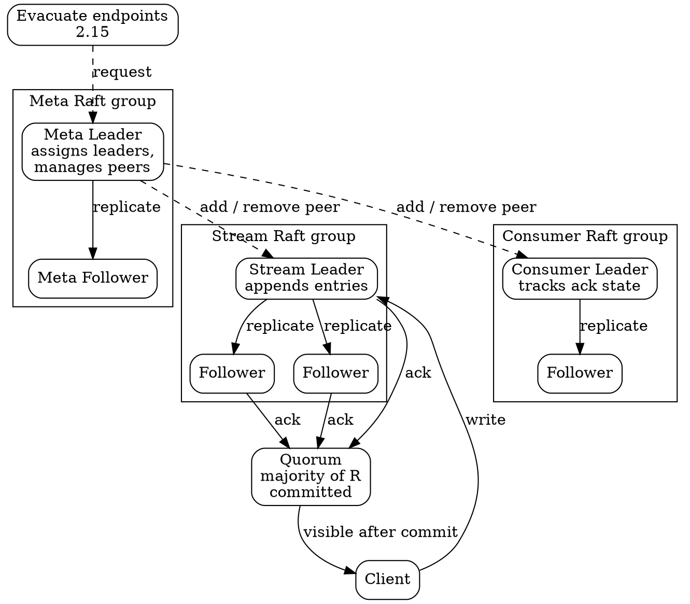

## Introduction

Core NATS 的 "cluster" 和 JetStream 的 "cluster" 是两个不同的东西，混着讲必然得出错误结论。Core NATS 的集群只是一张 **route mesh**：server 之间互相转发 subject interest，谁在线谁就转发，没有复制、没有 leader、没有一致性。真正的一致性来自 JetStream——每个 stream 与 consumer 各自是一个 **Raft group**，写入必须经 **quorum（多数派）** 提交后才对客户端可见。

| 维度 | Core NATS cluster | JetStream cluster |
| :--- | :--- | :--- |
| 连接方式 | `cluster { routes }` | 同集群内的 route 之上，再叠一层 Raft |
| 复制对象 | 不复制任何数据 | stream / consumer 的元数据与数据 |
| 一致性 | 无，仍是 at-most-once | quorum 提交后可见 |
| leader | 没有 | meta leader + 每个 asset 各自的 leader |
| 节点挂掉 | 路由重算，客户端重连即可 | 少数派失去写入能力，多数派继续服务 |
| 配置面 | `cluster {}` | `jetstream {}` + stream 的 `num_replicas` |

本篇只讲**集群与复制**：route 如何长成 mesh、Raft group 与 leader 怎么选主、quorum 语义、placement、扩缩容与 peer 管理、2.15 引入的期望状态调和与 evacuate。**部署形态**（单节点 / 集群 / 超级集群 / leaf 节点）属于另一篇 [Topologies](/docs/CS/MQ/NATS/Topologies.md?id=the-four-shapes)；**stream 与 consumer 的语义**（存储、ACK、去重、mirror/source）也不在这里展开。

> 版本基线：**nats-server v2.15.1**，发布于 **2026-10-09**（同期 v2.14.8 作为并行维护分支）。v2.15.0 编译于 Go 1.27.1，v2.15.1 升到 Go 1.27.2（PR #8740）；依赖 `github.com/klauspost/compress v1.20.1`、`github.com/nats-io/nats.go v1.53.1`。

## Cluster Formation

### Routes and Gossip

集群的最小配置单位是 `cluster {}` 块。每个 server 声明自己的 `name`、监听的 `listen`，以及已知的 `routes` 邻居地址。三个要素：

- **cluster name**：同一个集群内所有 server 必须一致。名字不同的 server 不会互相组网。
- **server_name**：集群内唯一标识，用于日志、监控与 Raft 节点名。
- **routes**：邻居的 route 地址（`nats://host:6222`），走独立的 6222 端口，与 client 端口 4222 分开。

route 的妙处在于 **gossip**：只要给出**一个** seed route，整张 mesh 就会自动长成全互联。server 之间互相传播"谁还活着、谁连着谁"，最终每台 server 都与其他所有 server 建立双向 route。不需要像数据库那样手工列出全网拓扑。

手工写全 mesh 也是合法的（server 会识别出重复连接并丢弃多余的，日志里记 `Duplicate Route`），但没必要：每台 server 只需要一条 route。这个取舍的另一面是**没有哪台 server 依赖某个 seed 先起来**——手工写全 mesh 的代价是每加一台新 server 就要改所有配置，靠 gossip 补齐则是新 server 指向老 server 即可。

route 之上，interest 可以**自由传播**：任何一台 server 收到订阅，就把该订阅传播给整个集群；收到发布，就沿着 interest 把消息转给对应订阅者所在的 server。于是**客户端不需要知道彼此在哪台机器上**，只要连上集群中任意一台就能互相收发。

> [!NOTE]
>
> route mesh 只解决"消息该送到哪台机器"。它**不保证**消息不丢、**不保证**顺序、**不保证**只送达一次。Core NATS 的语义仍然止步于 at-most-once（详见 [Core NATS 路由层](/docs/CS/MQ/NATS/Core_NATS.md)）——这套集群机制是为了横向扩展与就近接入，不是为了可靠性。

### Server Identity and Tags

`server_tags` 是 server 级别的标签列表（`key:value` 形式的字符串数组），不参与路由，但会被 JetStream 的 **placement** 用作副本落点的筛选条件——这是"把副本钉在某个机架 / 某个可用区"的唯一抓手。给 server 打标签的典型理由是隔离故障域：跨机架的副本才能真正扛住机架级故障。

各端口的职责划分：

| 端口 | 用途 | 配置位置 |
| :--- | :--- | :--- |
| 4222 | client 连接 | `listen` |
| 6222 | cluster route | `cluster { listen }` |
| 7222 | gateway（跨集群） | `gateway { listen }` |
| 7422 | leafnode | `leafnodes { listen }` |
| 8222 | monitoring HTTP | server config 的 `http_port` |

最小的三节点集群配置：

```conf
server_name: n1-east
listen: 0.0.0.0:4222

cluster {
  name: east
  listen: 0.0.0.0:6222
  routes: [
    nats://n2-east:6222,
    nats://n3-east:6222
  ]
}

server_tags: [region:us-east, rack:r1]
```

集群内给每一台都配一份 routes 列表是冗余的——给一台配 seed、其余留空即可，gossip 会把 mesh 补齐。

## Raft Groups and Leaders

### Meta Layer and Asset Layer

JetStream 的 Raft 分两层，角色完全不同：

| 层 | 管辖对象 | 作用 |
| :--- | :--- | :--- |
| **meta leader** | 集群元数据 | 决定哪个 server 当哪个 stream / consumer 的 leader，管理 peer 增删 |
| **stream leader** | 单个 stream | 接收写入、追加日志、发起复制 |
| **consumer leader** | 单个 consumer | 维护 ACK 状态与投递游标 |

meta leader 是**集群级单点**：它没选出之前，新的 stream / consumer 无法创建。它挂掉后集群重新选举，选举期间已有 stream 的读写**不受影响**（各 asset 有自己的 Raft group 和 leader）。这是 JetStream 能一边跑数据一边选主的原因。

stream leader 与 consumer leader 的选举是**独立**的：一个 stream 的 leader 可以和它的 consumer 的 leader 在不同机器上，两者互不阻塞。leader 是**任期（term）** 概念的产物，每次选举开启新 term，旧 term 的 leader 自动退位——完整机制见 [Raft](/docs/CS/Distributed/Consensus/Raft.md?id=leader-election)。

选举的实际节奏：leader 默认每秒发一次**心跳**，follower 各自跑一个**选举定时器**（4~9 秒，故意错开以免同时成为 candidate）。心跳一停，定时器到点的 follower 就成为 **candidate**，把 term 往上加一、投自己一票、向其余 peer 拉票。拿到**多数派票**的瞬间成为 leader，其余 peer 退回 follower。

这个节奏有个运维含义：**选举窗口是秒级，不是毫秒级**。leader 被 kill 后，有几秒钟 `stream info` 里 leader 一栏是空的、写入被拒——这是 Raft 的正常行为而不是 bug。客户端要**重试**而不是把"暂时没有 leader"当致命错误。

两种 leader 各有各的 stepdown：`nats stream cluster step-down ORDERS` 换的是 stream leader，`nats server cluster step-down` 换的是 meta leader，互不影响。

### Quorum Commit Path

写入路径是这一节的核心：**leader 追加 → 复制给 follower → 多数派确认 → 才对外可见**。



图里三处关键关系：

1. **peer 增删由 meta 层驱动**（虚线），而 asset leader 在 move 期间负责正确处理 peer 的加入与退出——这正是 2.15 期望状态机制要修的地方。
2. **quorum 是可见性的闸门**：少数派的写入凑不齐多数派，因此不会被提交、也不会向客户端确认——这正是"少数派失去写入能力"的含义。
3. **evacuate 请求打到 meta 层**，由它统一编排资产迁移。

## Replication and Quorum

### Commit Semantics

复制因子记为 `R`（stream 配置里的 `num_replicas`）。quorum 的定义是 **⌊R/2⌋ + 1**：

| R | quorum | 可容忍节点故障数 | 说明 |
| :--- | :--- | :--- | :--- |
| 1 | 1 | 0 | 无 HA，单副本，单点 |
| 2 | 2 | 0 | 无容错收益，罕见 |
| 3 | 2 | 1 | 生产默认推荐 |
| 5 | 3 | 2 | 大规模场景 |

**R=3 容忍单节点宕机**是实践中最常见的选择：三个副本里挂一个，剩下两个仍构成多数派，stream 保持可写可读。R=1 完全没有 HA——进程挂掉数据就不可用，因此生产环境至少 R=3，并且要靠 placement 把副本分散到不同故障域。

注意 quorum 语义的一个直接推论：**可写能力是多数派的属性，而不是"还有没有活着的副本"的属性**。R=3 的 stream 挂掉一个副本后，剩下两个仍构成多数派，写入继续可用；反之若两个副本不可用，剩下的单个副本虽然还持有数据，却已不构成多数派——此时 stream **失去写入能力**，直到多数派恢复。JetStream 集群的可用性边界由 quorum 划定，而不是由副本存活数划定。

### Replicated Stream Sync

复制流之间同步（mirror / source 拉取）依赖 follower 向 leader 请求日志区间。2.15 在这条路径上做了**更激进的批量同步**：尤其是 `sync:always` 策略，从"每条消息同步一次"改为"成组同步"，吞吐显著提升。对做跨地域复制、或在大 stream 上跑 mirror 的场景，这个改动直接降低了网络往返次数。

## Placement

副本落在哪里由 stream 的 **placement** 决定，两个维度：

- **cluster**：把副本限定在某个集群内，用于"这份数据必须待在本地"的要求（合规、数据驻留）。
- **tags**：限定到带指定 `server_tags` 的 server，用于跨机架 / 跨可用区的分散。

server 侧的标签写在配置里（`server_tags`），server 会把标签广播给集群，placement 据此挑人：

```conf
server_tags: [region:us-east, disk:ssd]
```

stream 侧用 placement 提要求，CLI 用 `--cluster` 与 `--tag`（可重复）：

```bash
nats stream add ORDERS \
  --subjects "orders.>" \
  --replicas 3 \
  --cluster east \
  --tag region:us-east \
  --tag disk:ssd \
  --defaults
```

对应的 API 配置形态：

```json
{
  "name": "ORDERS",
  "subjects": ["orders.>"],
  "storage": "file",
  "retention": "limits",
  "num_replicas": 3,
  "placement": {
    "cluster": "east",
    "tags": ["region:us-east", "disk:ssd"]
  }
}
```

两条容易踩的规则：

1. **多个 tag 是交集不是并集**——列出的**每一个** tag 都必须命中才算合格。匹配**大小写不敏感**（`ssd` == `SSD`），但**拼写必须完全正确**（`sdd` 匹配不到任何 server）。
2. **匹配失败就失败，不会退而求其次**。找不到合格 server 时，meta leader 拒绝创建 stream，错误里直接点名没匹配上的 tag：

```text
nats: error: could not create Stream: no suitable peers for placement, tags not matched ['disk:sdd'] (10005)
```

要求 3 个副本但只有 2 台 server 带该 tag，同样失败——placement 不会为了凑够副本数而放宽约束。

排查副本位置看 stream info：每个 peer 都会带上自己所在的 cluster 与 server 名，placement 是否生效一眼可见。**副本挤在同一台机器上是常见事故**——placement 没配、tag 拼错、或集群内 server 数量不足，都会静默退化成"同一故障域内的三副本"。

> [!NOTE]
>
> placement 只决定**副本落在哪些 server**，不决定**谁当 leader**。stream 的 placement 里没有 `preferred` 字段；硬填会被拒绝，报 `preferred server not permitted in placement`。要指定 leader 用 stepdown 请求（`nats stream cluster step-down ORDERS --preferred n2-east`），但那只是**请求**——选举仍由 quorum 决定，结果要读 stream info 才知道。

## Scaling and Peer Management

### Adding and Removing Peers

扩缩容通过改变 stream / consumer 的 `num_replicas` 表达：

- **加 peer**：新副本需要先 **catchup**——从当前 leader 拉取缺失的历史数据，追平后才纳入复制组参与后续提交。
- **减 peer**：多余的副本被移除，它持有的数据不需要额外搬迁（因为已提交的数据在其它副本上）。
- 两种操作都由 meta 层发起，不由应用直接操作某台 server。

catchup 是**有时间成本**的：一个有几亿条消息的 stream 加第三个副本，不是瞬间完成的。扩容窗口内吞吐下降、磁盘占用翻倍都要预期在内。

**加 peer 会立刻抬高 quorum，这是最容易忽略的一点。** R=3 升到 R=4 后，提交一条写入需要**三**个 peer 持有它（原来两个就够），而新 peer 此时日志还是空的、给不出那份 ack——于是**三个老 peer 必须全部在线**，写才提交。换句话说，扩容窗口内 R=4 的流能容忍的故障数**比扩容前的 R=3 更少**，与"加副本提升可用性"的直觉正好相反。窗口在 `stream info` 显示新 peer `current` 时才关闭。

新 peer 在追平之前也不会参与选举——它没有历史数据，不该拿自己不具备的状态去竞选。

### Moving a Replica Off a Server

把副本从某台机器上挪走**不是**减副本数，而是 **evacuate** 这个 peer：meta leader 挑一台合格的新 server 作替补，被挪走的 peer 在替补追平之前**仍然留在组里继续服务**，替补追平后才提交移除。stream 始终保持原有副本数。

```bash
nats stream cluster evacuate ORDERS n4-east
```

若没有任何 server 合格（placement 太窄或集群太小），请求以 `peer remap failed` 失败且**什么都不动**——这是刻意设计：宁可拒绝，也不把你要求保持 3 副本的流悄悄降成 2 副本。

注意 evacuate（挪副本）与 `--replicas`（改副本**数量**）是两件事；`nats stream edit ORDERS --replicas=1` 才是缩容。

> [!WARNING]
>
> `nats server cluster evacuate`（疏散整台 server）与单资产 evacuate 语义**不同**：前者是 best-effort，**可能留下副本数不足的资产**。单资产的 evacuate 则在无处可放时直接拒绝。

### Consumer Limits

2.15 起 stream 默认带一个 **max_consumers = 1000** 的上限——防止失控的应用无限创建 consumer 把系统拖垮。server 级默认值可在 `jetstream { limits { default_max_consumers: 1000 } }` 调整，设为 `-1` 恢复"无限制"；单条 stream 可以用自己的 `max_consumers` 覆盖，或在 account limits 里调整。

这个上限是**保护性默认值**，不是"限制你正常用"——正常业务的 consumer 数远达不到这个量级。配置细节见 [Operations](/docs/CS/MQ/NATS/Operations.md?id=jetstream-consumer-limit)。

## Desired State and Evacuation

### Desired State Reconciliation

这是 2.15 最重要的一次内部重构。原来 stream / consumer 的 **scale、move、add peer、remove peer** 是**命令式**的：调用一次 API，server 执行一次动作，中途状态变化或失败就容易卡住。2.15 把这些操作全部改成**期望状态调和循环（desired state reconciliation）**——声明目标状态，由一个循环持续把实际状态推向目标；期间由 asset leader 正确处理 peer 的加入与退出。

2.15 之前，一次重配置**不留任何记录**：meta leader 挑好新 peer 加进组，此后唯一的进展迹象就是组里的 peer 数和 stream 的副本数对不上。意图是**推断**出来的，不是写下来的——既没法问"这个 stream 要往哪去"，也没有东西可以拿来回滚。

现在 meta leader 把**终态**写到 assignment 上：要收敛到哪个 cluster、最终 peer 集合是什么、改动前的原配置是什么，各 server 自己向它收敛。这份记录正是"能在重配置进行中读到状态"和"能取消一次重配置"的前提。

它出现在 `nats stream info` 的 `Cluster Migration Status` 段：

```text
   Cluster Migration Status:

              Status: moving stream to cluster west

             Created: 2026-09-18 09:41:22 (1m18s)

             Cluster: east -> west

       Desired Peers: n1-west, n2-west, n3-west
```

三个读法：

- **Desired Peers** 是流要收敛到的 peer 集合，上面的 `Replica` 行是它**当前**的 peer 集合——重配置进行中两者不同，结束后一致。
- **`(pending)`** 标记的 peer 在 assignment 里但还不是完整的 Raft 组成员（要么正在加入，要么正在退出）。**pending peer 不计入 quorum**，所以一次 move 不会把 stream 置于险境——组继续用原有的 peer 提交。
- **`from -> to`** 行渲染的是 **origin**，即重配置前的配置，也是回滚时恢复的目标。缩容显示 `Replicas: 3 -> 5`，改保留策略显示 `Retention Policy: Limits -> Interest`。

没有这一段，说明没有重配置在飞。

### Evacuate Endpoints

2.15 新增的**端点疏散**能力，用于"这台机器要下线 / 要搬走，把上面的东西都挪走"这类运维场景：

| API | 作用范围 |
| :--- | :--- |
| `$JS.API.SERVER.EVACUATE` | 把某节点上的**全部 stream 与 consumer** 迁走 |
| `$JS.API.STREAM.PEER.EVACUATE.*` | 把某个 stream 的**某个 peer 及其 consumer** 迁走 |

三个关键性质：

1. **迁移过程中资产保持副本数不变**——不会出现"搬一半就只有一份数据"的窗口。
2. **新副本节点自动分配**，不需要手工指定落点（落点仍受 placement 约束）。
3. **按资产粒度递进**：整台机器 → 单个 stream 及其 consumer → 单个 consumer，可选范围越细，越适合"只想挪走其中一部分"的场景。

三种疏散的**失败语义相反**，这是最容易踩的地方：

| 命令 | 无处可放时 |
| :--- | :--- |
| `nats server cluster evacuate <server>` | **照样执行**，该资产变成**副本不足**继续跑，并记 `could not replace peer for stream` |
| `nats stream cluster evacuate <stream> <peer>` | 拒绝，报 `peer remap failed`，**什么都不动** |
| `nats consumer cluster evacuate <stream> <consumer> <peer>` | 同上，拒绝 |

server 级疏散是 **best-effort**：它的任务是**清空这台机器**，因此找不到替补的资产也会被挪走，代价是变成 under-replicated——一个 R=3 的流可能只剩两个 peer 在跑。被疏散的 server 在资产补足之前会被排除在它们的 placement 之外，不会立刻把副本又塞回来。

单资产疏散则**宁可拒绝**：让一个流掉一个副本，比让一条命令不执行更糟，所以它要求你先修好 placement 或扩容。

> [!WARNING]
>
> server 级疏散后要**逐个复查**你在意的 stream 的 `nats stream info`，别假设排空一定干净。集群没有余量、或 placement 把流钉在少数几台机器上时，疏散一台节点就等于悄悄让那些流各掉一个副本。

peer **移除**（peer-remove）是另一回事：它直接把 peer 从组里摘掉，**不先把数据迁到替补上**。那是给"服务器已经没了、不会回来"的灾备场景用的；服务器还在跑就该用 evacuate。另外，peer-remove 前必须先停掉服务器——还在运行的 server 被 peer-remove 后的反应是**自己把 JetStream 关掉**。

### Cancelling a Move

迁移中途的 stream 现在**能可靠取消**。此前 move 一旦启动，中途想反悔代价很大，现在可以取消且不留残留状态：

```bash
nats stream cluster cancel-move ORDERS
```

stream 回到 origin 里记录的**原配置与原 peer 集合**——副本数、placement、保留策略都还原。

名字里的 "move" 有误导性：**任何在飞的重配置都能这样回滚**，R=3 升 R=5 的 scale、改保留策略，一样用它取消。正确读法是"取消这次重配置"。

执行前有两道检查，正好用来看"到底有没有东西可取消"：

- stream 根本没组集群 → `stream is not clustered`
- 没有重配置在飞（`stream info` 里没有 `Cluster Migration Status` 段）→ `stream is not busy moving`

> [!WARNING]
>
> **不要取消一个快完成的 move。** 回滚本身就是一次重配置：stream 要重新收敛回原来的 peer，那些已经跨过去的 peer 又要 catchup 一轮。move 只差几秒就完成时，取消比让它落地、之后再把 stream 挪回去更费劲。先拿 `Desired Peers` 和 `Replica` 行对一下——两者快对齐了就让它跑完。
>
> `--force` 会**连同检查一起跳过**，也就跳过了"告诉你其实没有东西可取消"的那道检查。先不带 `--force` 跑一次，确认确实有东西在飞再说。

### Metalayer Rescue

灾备场景下，meta 层可能因为"一半以上节点永久失联"而无法选出 meta leader——此时集群不能创建新 stream，也不能做 peer 管理。**Metalayer rescue**（last resort）允许**临时降低 meta 层所需的 quorum**，从而在节点已经死亡的前提下强行选出 leader、把死节点从 meta 组里移除。

这是应急手段，**不应替代正常的 peer 管理**：先在 meta 层还活着的时候把死节点摘掉，永远比事后 rescue 干净。

### Upgrade Path

官方**强烈建议至少从 v2.14.7 升到 2.15.x**（2.14.7+ 已包含兼容代码）。混版本运行期间有一条硬约束：

| 操作 | 混版本期间是否可用 |
| :--- | :--- |
| 创建 / 删除 stream、consumer | 可照常进行 |
| scale / move（扩缩容、迁移） | **不要触发**，会 stall 直到升级完成 |

另有两个与升级相关的开关对**复制路径**有直接影响，容易踩：

- **`js_raft_delete_range`** 在 2.15 **默认开启**（2.14 全程支持但默认关闭）。开启后，镜像有大段 delete gap 的 stream，server 会提议一次"删除区间"而不是逐条删除。⚠️ **从 2.12 或更早直接升到 2.15 可能因此出问题**，需要先在中间版本上过渡。
- **`js_ack_fc_v2`** 在 2.15 **保持 2.14 的默认值**（v1 格式的 ack / flow-control reply subject），**2.16 才切到 v2**。若账号的 import/export 或 subject 权限里出现 `$JS.ACK.<stream>.>` / `$JS.FC.<stream>.>`（或更细粒度的变体），**升 2.16 前必须先改**。

完整的升级检查清单见 [Operations](/docs/CS/MQ/NATS/Operations.md?id=upgrading-to-215)。

## Stream Source Indexing

sourcing（源流 → 目标流复制）这条路径在 2.15 有两项改进，都与 leader 切换和源重建相关：

- **Detect source stream recreation**：被 source 引用的源 stream 重建后，server 能**检测到**并从正确序列号自动重启 sourcing。否则它会一直停在那里等源 stream 的序列号追上旧的最高序列号——而重建后的源若从新序列号开始，这个等待可能永不结束。
- **Stream source indexing**：source 单独维护一份**持久化的"已 source 到的最高序列号"索引**。没有它，leader 切换时必须做一次昂贵的回扫（全量比对已复制的区间）；有了它，新 leader 直接读索引续上。

这两项一起解决的是同一个问题的两面：source 的进度状态必须是**可持久化、可恢复**的，而不是 leader 内存里的临时变量。

同批改进还有一项与之相关：**shorter wait for durable source/mirror consumer resets**——用 durable consumer 做 sourcing / mirroring 时，consumer 的心跳现在可以**短路掉指数级的重建退避**，让 sourcing / mirroring 更快恢复。原先 consumer 重建要按指数退避等待，心跳不能打断这个等待。

## Patch Notes

v2.15.1 是补丁版本，集中在修复而非新特性。与**集群复制**直接相关的几项：

| 修复项 | 影响 |
| :--- | :--- |
| Raft membership change 问题 | 成员变更后的状态收敛 |
| learner scale-up 问题 | 新副本追平时的扩缩容路径 |
| metalayer commit recovery 问题 | meta 层的提交恢复 |
| consumer created time 在 recovery 后保留 | 重建的 consumer 保留原始创建时间 |

其余修复（leafnode `leafz` 上报 WebSockets 使用情况、TLS certificate pin 在配置 reload 后校验正确的 pin、legacy `$GR.` reply 前缀在 client 入口被保留以阻止客户端向 gateway reply subject 发消息、MQTT 的 packet length 提早按 `max_payload` 校验、非 QoS2 的 `PUBREC` 处理修正）属于网络层与协议层，完整清单见 [Operations](/docs/CS/MQ/NATS/Operations.md?id=_2151-fixes)。

## Pitfalls

- **把 Core NATS 的 cluster 当成复制系统**：route mesh 转发 interest，不复制数据。需要持久化与副本，必须用 JetStream；两个概念别混。
- **cluster name 拼错不报错**：那台 server 会**自己组一个集群**，永远加不进 `east`，表面上像是一个集群，实际是两个。这种错误在线上表现为 route 被拒（日志里是 `cluster name does not match`），排查办法是看日志里这行拒绝记录，或者做一次跨 server 的发布——发出去的消息到不了另一台的订阅者，就说明它们没 join。
- **把 cluster 端口暴露到公网**：route 是**受信链路**——它承载所有账号的流量外加 system account，比任何单条 client 连接看到的都多。cluster 的 `listen` 端口（6222）应该绑到私有网段并加防火墙，生产环境还要配 route 凭据或 TLS。
- **R=1 上生产**：单副本没有任何容错，进程重启即中断服务，也无高可用可言。生产至少 R=3。
- **副本挤在同一故障域**：placement 没配或 tag 写错，三副本可能全在同一台机器或同一机架，R=3 的容错承诺瞬间作废。上线前看 stream info 核对副本位置。
- **混版本期间做 scale 或 move**：2.14.x 与 2.15.x 混跑时触发会 stall 到升级完成。先把所有节点升到 2.15.x 再动资产。
- **从 2.12 及更早直接跳到 2.15**：`js_raft_delete_range` 默认开启后，带大段 delete gap 的镜像可能出问题。走中间版本过渡。
- **准备升 2.16 却没查 subject 权限**：2.16 才切 `js_ack_fc_v2` 到 v2 格式，账号 import/export 与 subject 权限里含 `$JS.ACK.<stream>.>` / `$JS.FC.<stream>.>` 的必须先改。
- **用 rescue 处理日常节点下线**：metalayer rescue 是 last resort，正常的 peer 摘除要在 meta 层还活着时做完。
- **扩缩容不看 catchup**：加 peer 要追平历史数据，大 stream 上这是分钟级到小时级的过程，不是瞬时完成。
- **扩容窗口内容错反而变差**：R=3 升 R=4 会把 quorum 抬到 3，而新 peer 追平前给不出 ack，三个老 peer 必须全在。窗口内比扩容前更脆弱。
- **placement 的多个 tag 是交集**：列出的每个 tag 都必须命中；匹配不看大小写但拼写必须完全正确，拼错就匹配不到任何 server 并直接拒绝创建。
- **误以为 placement 能指定 leader**：stream 的 placement 里没有 `preferred` 字段，硬填会被拒（`preferred server not permitted in placement`）。换 leader 只能用 stepdown 请求，且最终由选举决定。
- **选举窗口当成了故障**：leader 被 kill 后有几秒 `stream info` 里 leader 为空、写入被拒，这是 Raft 的正常选主过程，客户端应重试而非直接失败。
- **evacuate 与改副本数混淆**：evacuate 是把副本挪到另一台机器、保持副本数不变；`--replicas` 才是改数量。用错会把 3 副本的流降成 2 副本。
- **evacuate 失败后用 `--force` 绕过**：`peer remap failed` 表示没有合格 server，应先修 placement 或扩容，而不是强行跳过。

## Links

- [NATS 总纲](/docs/CS/MQ/NATS.md)
- [NATS 部署形态：集群、超级集群与 leaf 节点](/docs/CS/MQ/NATS/Topologies.md)
- [JetStream 持久化语义](/docs/CS/MQ/NATS/JetStream.md)
- [运维、监控与升级](/docs/CS/MQ/NATS/Operations.md)
- [Raft 共识算法](/docs/CS/Distributed/Consensus/Raft.md)
- [Kafka 副本机制对照](/docs/CS/MQ/Kafka/Kafka.md?id=replication)

## References

- NATS 官方文档 - Clustering: https://docs.nats.io/learn/clustering
- NATS 官方文档 - Upgrade to 2.15: https://docs.nats.io/release-notes/upgrade-to-2.15
- ADR-62 - Desired State Metalayer: https://github.com/nats-io/nats-architecture-and-design/blob/main/adr/ADR-62.md
- ADR-61 - Metalayer Rescue for Disaster Recovery: https://github.com/nats-io/nats-architecture-and-design/blob/main/adr/ADR-61.md
- nats-server v2.15.1 Release: https://github.com/nats-io/nats-server/releases/tag/v2.15.1
