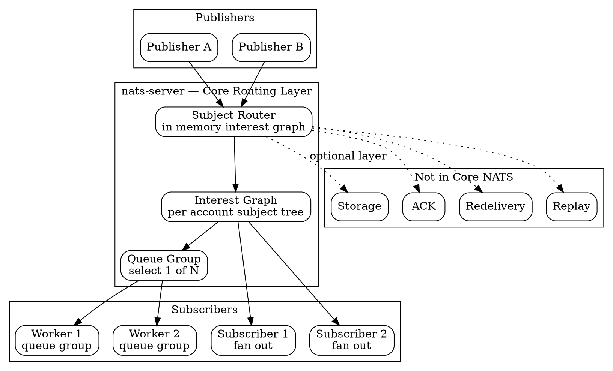

## Introduction

Core NATS 是 NATS 的底座：一个**不存储、不确认、不重放**的 subject 路由层。它的全部职责就是回答一个问题 —— "这条消息现在应该送到谁手上"。所有围绕"消息会不会丢"的争论，答案都在这一层：Core NATS 明确选择 **at-most-once**，订阅者不在的那一刻，消息就永久消失了。

这不是缺陷，而是取舍。把存储、ACK、重投、复制全部从热路径上拿掉之后，剩下的东西小到可以常驻内存、延迟在微秒级、单进程就能扛住百万级 msg/s。代价是**发布者与订阅者必须同时在线** —— 这叫"时间耦合"，Core NATS 消除了空间耦合，却保留着时间耦合。

要消掉时间耦合就得加一层存储，这就是 [JetStream](/docs/CS/MQ/NATS/JetStream.md)。两者不是替代关系，而是**同一个进程上的两层**：Core 在上，JetStream 在下，上层可以单独用，也可以叠着用。



## Subject Addressing

### Token and Hierarchy

Subject 是**大小写敏感**的字符串，可以包含除空白、tab、换行以外的任意 UTF-8 字符。`.` 分隔 token 构成层次：

```text
orders.retail.placed
orders.retail.shipped
orders.wholesale.placed
```

实践上推荐只用 `a-z` `A-Z` `0-9` `-` `_` 加作为分隔符的 `.`。subject 官方建议控制在 **16 个 token 以内、总长 256 字符以内**。

### Wildcards

订阅侧可用两种通配符，发布侧不行 —— **publisher 必须发到完整指定的 subject**。

| 通配符 | 匹配 | 约束 |
| --- | --- | --- |
| `*` | 恰好一个 token | 可出现在任意位置 |
| `>` | 一个或多个 token | **只能出现在 subject 末尾** |

```text
sensor.alarm.*        匹配 sensor.alarm.smoke
                      不匹配 sensor.alarm.smoke.critical（token 多了）
                      不匹配 sensor.alarm（token 少了）

sensor.*.*.critical   匹配 sensor.alarm.smoke.critical

sensor.>              匹配 sensor.alarm.smoke
                      匹配 sensor.alarm.smoke.critical
                      匹配 sensor.alarm.water.critical
```

### Reserved Prefixes

`$` 开头的 subject 保留给系统使用，自己不要往里发：

| 前缀 | 用途 |
| --- | --- |
| `$SYS` | 系统事件与 server 状态 |
| `$JS` | JetStream API |
| `$KV` | Key-Value store |
| `$O` | Object store |
| `$SRV` | Service API |
| `_INBOX` | 客户端自动生成的 reply subject |

### Performance Characteristics

NATS 只为**有活跃订阅者的 subject** 建路由表，全部常驻内存；没有订阅者的 subject 不会留下任何痕迹。因此：

- **subject 几乎是免费的** —— 创建百万级唯一 subject 几乎没有额外开销；
- 通配符匹配走 **trie 结构**，不是线性扫描；
- interest graph 是**动态**的 —— 订阅建立/撤销会即时增删路由节点。

这与 Kafka 完全不同：Kafka 的 topic/partition 是**要预先创建、重平衡、要占磁盘**的重对象；NATS 的 subject 是**用出来才有**的轻量地址。

## Publish and Subscribe

### Fan-Out Semantics

普通 pub/sub 语义：**同一 subject 上的每个订阅者都会收到一份独立拷贝**。发布者不知道订阅者有几个，也不关心它们在哪。

```bash
# Terminal 1
nats sub "orders.>"

# Terminal 2
nats pub orders.retail.placed "Order #1001"
```

### Queue Groups

Queue group 把 fan-out 改成**负载均衡**：同一个 queue 名字下的订阅者共享消息，NATS 为每条消息**随机挑一个成员**投递。

```bash
nats sub orders.new --queue workers   # worker 1
nats sub orders.new --queue workers   # worker 2
nats sub orders.new --queue workers   # worker 3
nats pub orders.new "Order 1"          # 只到其中一个 worker
```

关键性质：

- queue 名字由**应用定义**，不是服务端配置；
- 选择是**逐条随机**的，不看成员忙不忙 —— 不做负载感知；
- 成员加入/离开即时生效，无需重新配置；
- 成员掉线（含被当作 slow consumer 断开）后，server 会从剩余成员中重选。

**queue group 与普通订阅可以共存于同一 subject**：普通订阅者每条都收（审计、监控），queue 成员共享（业务处理）。这是 NATS 做"一次处理 + 全量观测"的标准姿势。

### Request-Reply

Request-Reply 不是独立协议，而是建立在 pub/sub 上的组合：客户端生成唯一 inbox subject（`_INBOX.<nuid>`），订阅它，再把该 subject 作为 reply-to 发出。

```bash
nats reply time --command "date"     # Terminal 1
nats request time ""                 # Terminal 2
```

两种应答模式：

| 模式 | 做法 | 语义 |
| --- | --- | --- |
| Scatter-Gather | 多个服务各自普通订阅 | **所有**服务都收到并都应答，客户端收集多个响应 |
| Load-Balancing | 多个服务用同一 queue group | **只有**一个服务收到并应答 |

客户端的 `request()` 默认返回**第一个**响应、丢弃其余；要收集全部响应必须自己订阅 inbox 并读到超时为止。

**No Responders 检测**：当请求 subject 上没有任何订阅者时，server **立即**返回 `no responders available for request`，而不是让客户端干等到超时。这是 NATS 少数几个服务端主动反馈的语义之一，对"服务是否存在"的探测很有用。

```bash
nats request no.such.service "test"
# Error: no responders available for request
```

### Headers

Core NATS 的消息支持可选的 headers（键值对），用于携带元数据。服务端可用 `no_header_support` 关闭该能力。

## Delivery Semantics

### At-Most-Once

Core NATS 的本质属性：

- 消息只发给**发布那一刻在线**的订阅者；
- **最多一次** —— 没有重投、没有 ACK；
- 订阅者离线、重启、或当时没订阅 → **永远收不到**；
- server 不存储任何东西。

这条性质决定了适用边界：

| 适合 | 不适合 |
| --- | --- |
| 实时报价、温度、传感器读数 | 订单、支付、账务等不可丢事件 |
| 缓存失效通知 | 需要重放的历史数据 |
| "后到覆盖先到"的状态同步 | 需要 exactly-once 的事务 |
| 高频遥测（丢了无所谓） | 需要背压的削峰场景 |

### Slow Consumers

单个订阅者消费太慢时，server 有两种应对，由 `no_fast_producer_stall` 决定（**默认 false**）：

- **默认（false）**：server 会**阻塞快生产者**，给慢消费者留出缓冲空间 —— 消息不丢，但快的那边被拖住；
- **true**：不阻塞生产者，**直接丢掉给慢消费者的消息**。

> [!WARNING]
> `no_fast_producer_stall` 默认是 `false`，即默认**不丢消息但会反压**。网上流传的「NATS 会丢消息给慢消费者」只在显式打开这个开关后成立。
> 配套的客户端侧 `PendingLimits`（消息数 + 总字节数）由客户端自己设置，超过同样触发 slow consumer 判定。

### Payload Limits

| 限制 | 默认值 | 说明 |
| --- | --- | --- |
| `max_payload` | **1MB** | 单条消息 payload 上限；可调到 64MB，官方**不建议超过 8MB** |
| `max_pending` | **64MB** | 单连接缓冲上限；**必须 ≥ `max_payload`** |
| `max_control_line` | 4KB | 协议行上限（含 subject + queue group 长度） |
| `max_connections` | 64K | 活跃客户端连接上限 |

超大对象不要靠调大 `max_payload` 硬扛 —— 走 [Object Store](/docs/CS/MQ/NATS/JetStream.md?id=object-store) 分块。

## Request-Reply Design Notes

Request-Reply 看起来是同步的，但它**没有 server 端的请求队列**。这带来几个必须在设计上正视的后果：

- **超时是客户端的事**。server 不知道你的业务超时，所有 `request()` 的 timeout 都是客户端本地定时器；
- **重试要自己做**。服务端处理成功但响应丢失时，客户端重试会得到重复处理 —— 写操作必须幂等；
- **不要在 request handler 里做长事务**。NATS 没有请求隔离，一个慢 handler 会占住它的订阅投递通道。

生产上常见的稳妥形态是"**request 只用来问，快速失败；真正的活儿交给 JetStream 的异步流**"。

## Pitfalls

- **把 Core NATS 当可靠队列用** —— 这是最常见也最贵的错误。无订阅者在线即永久丢失，且**没有任何错误提示**。需要持久化必须上 JetStream。
- **用 Kafka 的分区心智模型套 NATS** —— 没有 partition、没有 rebalance、没有 consumer offset。stream 内的顺序由序列号保证，**跨 subject 无全局顺序**。
- **以为 queue group 会挑"最闲"的成员** —— 它是逐条随机，不看负载。想按负载分配得自己在应用层做。
- **以为 `request()` 会等所有响应** —— 默认只取第一个响应，其余丢弃。
- **以为 `no responders` 是超时** —— 它是**立即**返回的，说明 subject 上压根没订阅者；把它当成"服务慢"去调大 timeout 是白费功夫。
- **在订阅里用 `>` 监听全量做业务逻辑** —— `>` 可以做运维监控（受权限约束），但把全量流量灌进业务处理是放大故障的经典方式。
- **把大 payload 塞进 Core NATS** —— 1MB 默认上限，超了就换 Object Store。
- **忘了 message headers 默认是开的** —— 若不需要 headers 且想省开销，可用 `no_header_support` 关掉。

## Links

- [NATS 枢纽](/docs/CS/MQ/NATS.md)
- [JetStream 持久化层](/docs/CS/MQ/NATS/JetStream.md)
- [集群与 Raft 复制](/docs/CS/MQ/NATS/Clustering.md)
- [安全模型](/docs/CS/MQ/NATS/Security.md)
- [MQ 总纲](/docs/CS/MQ/MQ.md)

## References

1. NATS 官方文档 - Subjects: https://docs.nats.io/concepts/subjects
2. NATS 官方文档 - Queue Groups: https://docs.nats.io/concepts/queue-groups
3. NATS 官方文档 - Request-Reply: https://docs.nats.io/concepts/request-reply
4. NATS 官方文档 - Core NATS Deep Dive: https://docs.nats.io/learn/core-nats
5. NATS 官方文档 - Server Configuration: https://docs.nats.io/running-a-nats-service/configuration/configuration
