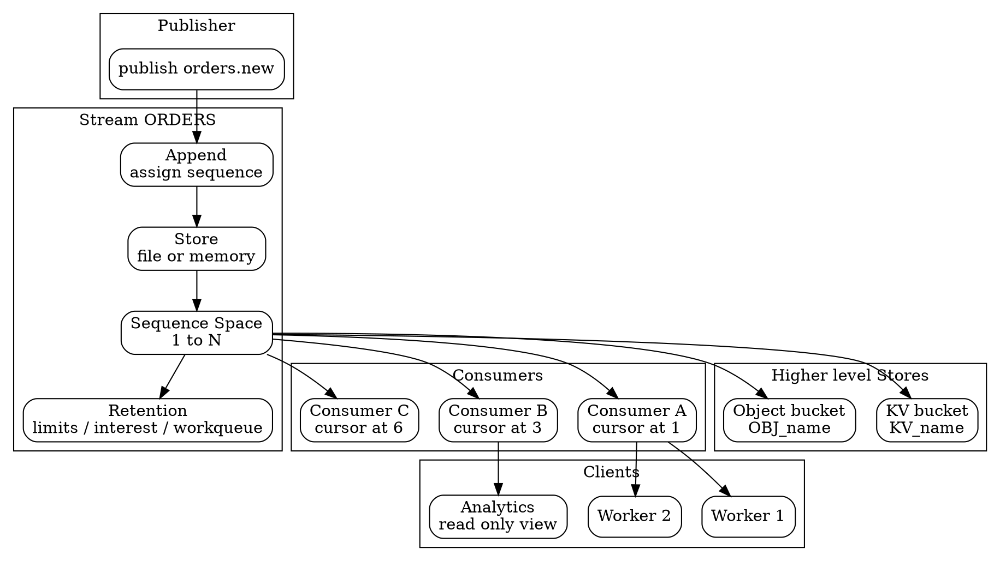

## Introduction

JetStream 是 NATS 的**可选持久化层**，与 Core 跑在同一个进程里。它只做一件事：给 Core 加回**时间解耦** —— 发布者与订阅者不必同时在线，消息落盘后可以被读回、被重放、被多个消费者独立推进。

JetStream 由三个部件组成，职责边界很干净：

| 部件 | 是什么 | 谁维护状态 |
| --- | --- | --- |
| **Stream** | 绑定到一组 subject 模式的服务端消息仓库，分配序列号 | server |
| **Consumer** | stream 之上的有状态游标，记录客户端读到哪了 | server |
| **Client** | 连到 consumer 收消息并应答的应用 | 应用 |

关键设计选择是**位移在 server 侧**：应用不需要自己记 offset、不需要提交位移、不需要在重启后告诉服务端"我读到哪了"。这让 consumer 天然成为**可共享的工作单元** —— 多个客户端接同一个 consumer 就能分摊工作量。



## Stream

### Binding and Uniqueness

Stream 绑定到一个或多个 subject 模式；publisher 向匹配 subject 发消息时，server 追加进 stream 并分配序列号。

**一个 subject 只能属于一个 stream** —— 这条约束是硬检查，任何重叠都会被拒：

```bash
nats stream add ORDERS --subjects "orders.>" --defaults
nats stream add ARCHIVE --subjects "orders.*" --defaults
# nats: error: could not create Stream: subjects overlap with an existing stream (10065)
```

检查覆盖**任何重叠**，不只是完全相同：`orders.>` 与 `orders.*` 冲突，与单个 `orders.created` 也冲突。

要保留重叠的 subject 语义，用 **mirror**（1:1 拷贝另一个 stream）和 **source**（把多个 stream 汇聚进一个），而不是硬塞进同一个 stream。

### Defaults

`--defaults` 创建出来的 stream，其默认值如下（server 填入）：

| 配置项 | 默认值 | 说明 |
| --- | --- | --- |
| `storage` | **file** | 落盘；`memory` 则重启即失 |
| `retention` | **limits** | 另两种：`interest` / `workqueue` |
| `discard` | **old** | 满了删旧的；`new` 则拒收新消息 |
| `num_replicas` | **1** | 单副本，无 HA |
| `duplicate_window` | **2m0s** | 去重窗口 |
| `max_msgs` / `max_bytes` / `max_age` | **-1（不限）** | 无上限 |
| `max_msg_size` | -1（不限） | 单条消息上限 |
| `max_msgs_per_subject` | -1（不限） | 单 subject 保留条数 |
| `max_consumers` | **-1（API 层不限）** | ⚠️ 但 **2.15 起 server 默认给每个 stream 1000 个 consumer 上限** |
| `compression` | none | 可选 `s2`（Snappy 扩展） |
| `allow_direct` | false（API 默认） | CLI 创建时默认打开；见下文 |
| `discard` | old | 达到上限时的行为 |
| `sealed` / `deny_delete` / `deny_purge` | false | 不可逆保护位 |
| `num_replicas` | 1（最大 5） | |

> [!WARNING]
> **2.15 新增的 `max_consumers` 默认 1000 与 API 文档里的 `-1` 不矛盾**：API 层的字段默认值是 `-1`（不限），但 **2.15 引入了 server 侧的默认上限 1000**（`jetstream { limits { default_max_consumers: 1000 } }`，设 `-1` 恢复不限）。这是为了防止应用误建无限 consumer 拖垮整个系统。**规划高 consumer 数的 stream（尤其是 KV watcher）时必须提前算这笔账。**

### Unlimited Defaults Grow Forever

`--defaults` 意味着 `max_msgs` / `max_bytes` / `max_age` **全部无上限** —— stream 会一直存到磁盘满为止，而磁盘满会直接拖垮 server。生产 stream **至少要设一个 limit**，让旧消息按龄淘汰而不是等磁盘见底。

### Stream Names Are Permanent

stream 名**不能改**：`nats stream edit` 没有 `--name`，server 会拒绝任何试图改名的更新（`stream configuration name must match original`）。想改名只能新建 + 让旧的自然老去。

### Retention Policies

| 策略 | 消息何时被删 | 典型用途 |
| --- | --- | --- |
| `limits`（默认） | 达到 `max_msgs` / `max_bytes` / `max_age` 之一 | 通用日志型留存 |
| `interest` | **所有**匹配 filter 的 consumer 都 ACK 之后 | 每个消费者独立读完整份数据 |
| `workqueue` | **任一** consumer ACK 之后（consumer 的 filter 必须互不重叠） | 任务队列语义 |

`limits` 与 `interest`/`workqueue` 的关键差别是 `interest`/`workqueue` **消费即删除** —— 消息离开 stream 后其他 consumer 就看不到了，所以同一 stream 内不能既有"每个消费者都要读全量"的语义又有"读了就没了"的语义。

### Advanced Stream Features

- **Mirror / Source**：mirror 维护另一个 stream 的 1:1 拷贝；source 把多个 stream 的消息汇聚进来。跨集群复制、跨 leaf 拷贝数据都靠它们。
- **Subject transform / republish**：入流时改写 subject，或把已存消息按映射规则重新发布到新 subject（用于分区、再路由）。
- **Per-message TTL**（`Nats-TTL` header，需 stream 开 `allow_msg_ttl`）：单条消息提前过期，不必等 stream 级 `max_age`。
- **Atomic batch publish**（`allow_atomic` + `Nats-Batch-Id` / `Nats-Batch-Sequence` / `Nats-Batch-Commit`）：一批消息要么全成要么全拒。
- **Fast batch publish**（`allow_batched`）：牺牲部分可靠性换吞吐。
- **Counter**（`allow_msg_counter` + `Nats-Incr`）：分布式原子计数器。
- **Scheduled messages**（`allow_msg_schedules` + `Nats-Schedule` cron 表达式）：定时投递。
- **Rollup**（`Nats-Rollup: sub` / `all`，需 `allow_rollup_hdrs`）：用一条消息替换掉旧消息 —— KV store 的历史裁剪就是靠它。
- **Direct get**（`allow_direct`）：绕过 consumer 直接按 sequence 取消息，延迟更低。**CLI 创建 stream 时默认打开，客户端库则默认关闭**。

## Consumer

### Stateful Cursor

Consumer 是 stream 之上的**有状态服务端视图**。多个 consumer 可以独立读同一个 stream，各自维护自己的位置：

```text
ORDERS stream: #1 #2 #3 #4 #5 #6 #7 #8
Inventory:      ▲@#1
Email:              ▲@#3
Analytics:                    ▲@#6
```

consumer 可以从四个起点之一开始：**流的开头**、**最新消息**、**指定序列号**、**指定时间**。

### Push vs Pull

| 模式 | 谁驱动 | 适合 |
| --- | --- | --- |
| **Pull** | 客户端主动 `fetch` | 批处理、速率可控、客户端决定何时拉 |
| **Push** | server 推到 `deliver_subject` | 在线实时消费、fire-and-forget 式推送 |

Pull 是新系统的默认选择 —— 它把背压握在客户端手里：拉多少、拉多快、什么时候停，都是客户端说了算。

### Ack Policy

Ack 策略决定"一条消息算不算处理完了"：

| 策略 | 语义 | 风险 |
| --- | --- | --- |
| `explicit` | 每条单独应答（ack/nak/term） | 需要写 ACK 逻辑 |
| `none` | 不需要应答，server 认为投递即完成 | 无 pending list、无重投，**消息可能从未真正处理** |
| `all` | 一次 ack 覆盖此前所有消息 | 便宜，但**要求严格顺序处理** |
| `flow_control` | 服务端为 mirror/source 建的 push consumer 使用 | 用户一般不直接设 |

`all` 的坑值得单独强调：ack 消息 #10 会连带把 #1~#9 一起结清。但**重投的消息会出现在更晚的消息之后**，所以除非把 `MaxAckPending` 设为 1（强制一次只飞一条），否则 ack #10 会把一条仍等待重投的 #7 静默吃掉 —— 这是无声的数据丢失。

### The Four Responses

客户端对一条已投递的消息有四种应答：

| 应答 | 含义 | 后续 |
| --- | --- | --- |
| **ack** | 成功 | 从 pending list 移除，永不再投 |
| **nak** | 失败，重投 | 立即重投，或按客户端指定的延迟重投 |
| **term** | 放弃，这条永远处理不了 | 从 pending list 移除，**不再投给任何人** |
| **in-progress** | 还在处理中 | **重置 AckWait 计时器**，不是终态应答 |

ack / nak / term 是终态，in-progress 只是续命。

**nak 不带延迟是常见事故源**：一次瞬时故障（下游服务重启、行锁、限流）会立刻重投、立刻再失败，把一个 worker 死死钉在一条消息上。要退避就用**带延迟的 nak**（客户端 API 支持，CLI 的 `--nak` 只请求立即重投）。**consumer 的 backoff 不解决这个** —— backoff 只作用于 AckWait 超时触发的重投，不作用于 nak。

**term 之后消息不在 consumer 里，但仍在 stream 里** —— 在默认 `limits` 留存下，其他 consumer 仍能看到它；只有在 `workqueue`/`interest` stream 上 term 才和 ack 一样真正删除消息。term 会触发 `$JS.EVENT.ADVISORY.CONSUMER.MSG_TERMINATED.<stream>.<consumer>` 通告。

### Server-side Controls

| 参数 | 默认值 | 作用 |
| --- | --- | --- |
| `ack_wait` | **30s** | 投递后等待应答的时限，超时视为静默失败并重投 |
| `max_deliver` | **-1（不限）** | 投递次数上限，超过就放弃 |
| `max_ack_pending` | 1000 | 同时在途未确认的消息数上限 |
| `backoff` | 无 | 每次尝试之间的递增延迟列表；**设置后会替换 ack_wait**（列表首项成为首次重投等待） |
| `inactive_threshold` | 无 | 消费者空闲多久后被清理（ephemeral consumer 尤其要注意） |

> [!WARNING]
> **backoff 会覆盖 ack_wait**：设了 backoff 后，列表第一项就是"第一次重投前的等待"，也就是第一次投递的 ack 截止时间。若 `--backoff-min=1s` 而实际处理要 5 秒，慢任务会被反复重投。**backoff 的最小值必须大于正常处理耗时。**

**MaxDeliver 到了没有死信队列** —— JetStream 内置的 DLQ 不存在。消息被丢出 consumer pending list 后仍在 stream 里，但 consumer 的常规输出对此**只字不提**。唯一可观测的信号是通告：`$JS.EVENT.ADVISORY.CONSUMER.MAX_DELIVERIES.<stream>.<consumer>`。**要监这个 subject**，否则毒消息会无声消失。

### Consumer Configuration Reference

`nats consumer add` 常用参数与默认值：

```bash
nats consumer add ORDERS shipping \
  --pull \
  --durable shipping \
  --ack explicit \
  --deliver all \
  --filter "orders.shipped" \
  --max-deliver 5 \
  --wait 30s \
  --backoff=linear --backoff-steps=5 --backoff-min=1s --backoff-max=30s
```

- `--ack`：`explicit` / `none` / `all`；
- `--deliver`：`all` / `last` / `new` / `by_start_sequence` / `by_start_time`；
- `--filter`：`filter_subject`，只消费匹配 subject 的子集；
- `--max-deliver` / `--wait`：对应 `max_deliver` / `ack_wait`；
- `--replicas`：consumer 自身也是 Raft group，独立副本数。

### Ordered Consumers

Ordered consumer 提供**按序重放**，带每消费者序列号，**不做重投、不需要 ACK** —— 适合要求严格顺序且能容忍"重放即顺序"的场景。

它的代价必须说清：没有 ACK 就没有"这条确实处理完了"的确认，语义更接近"按序投递一遍"。配合去重可达 effectively-once，但**它不是 exactly-once 的替代品**。

### Priority Groups

2.15 引入的 priority group 改变普通 worker pool "平均分配"的默认行为，让服务端决定**何时启用备用 worker / 是否把活固定给一个客户端 / 按优先级即时切换**。当前**每个 consumer 实际只支持一个优先级组**（配置可传多个，服务端只用第一个，其余静默忽略）。

| 策略 | 语义 | pull 上的关键参数 | 是否需 explicit ack |
| --- | --- | --- | --- |
| `overflow` | 近端优先，积压超过阈值才启用备用 | `min_pending` / `min_ack_pending` | 是 |
| `pinned_client` | 固定一个客户端接全部消息，其余待命 | `Nats-Pin-Id`（TTL 默认 **2 分钟**） | 是 |
| `prioritized` | 按数字优先级（**0~9**，越小越优先）服务当前 pull | `priority` | 否 |

`pinned_client` **不保证独占处理权** —— 服务端可能在原客户端仍以为持有 pin 时切换，长任务可能与服务端已交给别人的消息重复执行。

## Delivery Semantics

### At-Least-Once

JetStream 的投递语义是 **at-least-once**：未 ACK 的消息在 `ack_wait` 到期后被重投。消息不会因为客户端崩溃而永久消失，但**会重复到达**。

### Effectively-Once

exactly-once 需要客户端幂等配合。两条路径：

**路径一：发布侧去重。** 带 `Nats-Msg-Id` 头发布，stream 的 `duplicate_window`（默认 **2 分钟**）内相同 msg-id 的重复发布被拒绝（PubAck 标记 `duplicate: true`），消息不落盘。

```bash
nats pub orders.us.placed --header "Nats-Msg-Id: txn-abc-123" '{"id":"1004"}'
```

**路径二：消费侧幂等。** 用 `Nats-Expected-Last-Sequence` / `Nats-Expected-Last-Subject-Sequence` / `Nats-Expected-Last-Msg-Id` 做乐观并发控制 —— 条件不满足时发布直接失败。

> [!WARNING]
> **去重窗口只有 2 分钟是硬约束**：超过窗口的重复 msg-id **会被正常接受并存储**。窗口外的幂等要靠消费侧自己保证。窗口长度可按 stream 调（`duplicate_window`），但**窗口越大占用的去重状态越多**。

`Nats-Msg-Id` 是**发布侧**的去重键；它**不能**阻止消费侧重投 —— 一条已存储的消息被重投时仍然带着同一个 msg-id，但那是同一份存储，不是新写入。

### Exactly-Once Is Not Provided

JetStream **不提供** exactly-once 传输语义。官方口径是 at-least-once + 应用幂等 ≈ effectively-once。宣称"JetStream 是 exactly-once"是错的。

## KV Store

KV 不是独立数据库 —— **一个 bucket 就是一条名为 `KV_<bucket>` 的 stream**，subject 空间是 `$KV.<bucket>.>`，key 是 subject 的最后一段，value 是该 subject 上的一条消息。`put` 是追加消息，`get` 是读该 subject 的最后一条，`watch` 是开一个 consumer。

```bash
nats kv add CONFIG --history 10 --ttl 24h
nats kv put CONFIG db_url "postgres://prod-db:5432/app"
nats kv get CONFIG db_url
nats kv watch CONFIG
nats kv ls CONFIG
```

关键特性：

- **history**：每个 key 保留多少历史版本（底层是 `max_msgs_per_subject`），支持 compare-and-swap 安全递减；
- **TTL**：key 级过期（底层 `max_age`）或 bucket 级；
- **watcher**：先收到全量快照，再收增量变更 —— 这是它最实用的能力，等于一个带历史的状态订阅。

底层 stream 的固定属性（ADR-8）：写副本用 file、`discard` 恒为 `new`、`allow_rollup_hdrs` 恒为 true、`deny_delete` 恒为 true、`allow_direct` 恒为 true。

> [!WARNING]
> **KV 的 `duplicate_window` 与 `max_age` 有联动约束**（ADR-8）：若设了 key TTL（`max_age > 0`），`duplicate_window` 必须 **等于 2 分钟**（当 `max_age > 2 分钟`）**或等于 `max_age`**（当 `max_age ≤ 2 分钟`）；不设 TTL 时不设即可，server 会补 2 分钟。

## Object Store

Object store 存**整块文件** —— 发票 PDF、固件镜像、模型权重、超出单条消息上限的二进制。

```bash
nats object add ARTIFACTS --replicas 3
nats object put ARTIFACTS ./model-v2.bin
nats object get ARTIFACTS model-v2.bin ./downloaded-model.bin
nats object ls ARTIFACTS
```

机制：**bucket 是一条名为 `OBJ_<bucket>` 的 stream**。`put` 把字节切成 chunk、每块作为一条消息写入，随后追加一条描述整个对象的 metadata 消息；`get` 先读 metadata、顺序回放 chunk、校验 digest（SHA-256）后再交出字节。chunk 大小限制了单条消息的大小，因此**跨 chunk 才能处理超大对象**。

与 KV 的分工：

| | Key-Value | Object Store |
| --- | --- | --- |
| 单元 | 小结构化 value | 大文件 |
| 留存 | **完整历史**（每 key 多版本） | **只留最新 metadata** |
| 适合 | 读 / 覆盖 / 审计 | 整体 put / fetch |

## Cross-Cluster and Cross-Region

JetStream 的复制是**单集群内**的事（Raft group），跨集群复制用 **mirror / source**：

- **mirror**：另一个 stream 的 1:1 拷贝；
- **source**：把多个 stream 汇聚进一个。

跨 leaf 拷贝数据同样靠 mirror/source，配合 **JetStream domain** 隔离两侧的 JetStream 系统。详见 [部署形态](/docs/CS/MQ/NATS/Topologies.md)。

2.15 在这条链路上修了几处关键问题：被 source 引用的源 stream 重建后，server 现在能**检测到并从正确序列号自动重启 sourcing**（此前会一直停到源 stream 达到旧的最高序列号）；source 单独维护一份持久化的"已 source 到的最高序列号"索引，避免 leader 切换时做昂贵的回扫；durable consumer 用于 sourcing/mirroring 时，heartbeat 可以**短路指数退避**，恢复更快。

## Pitfalls

- **用 Core NATS 的语义去理解 JetStream** —— JetStream 是 at-least-once，**重投是常态而非异常**。消费端不幂等就一定会出重复副作用。
- **忘开 `Nats-Msg-Id` 就以为有了幂等** —— 没有 msg-id 的重复发布会**存两条**。去重键要自己生成（业务幂等键，而不是随机 UUID，重试时必须是同一个值）。
- **以为去重窗口是无限的** —— 默认 **2 分钟**，超出窗口的重复照样入库。
- **`max_deliver` 到了没有 DLQ** —— 消息被静默丢出 consumer pending list。必须订阅 `$JS.EVENT.ADVISORY.CONSUMER.MAX_DELIVERIES.>` 才能发现。
- **用 `ack=all` 又不设 `max_ack_pending=1`** —— 重投消息会落在更晚消息之后，一次 ack 会连带吃掉仍在等待重投的消息，无声丢数据。
- **backoff 覆盖 ack_wait** —— 设了 backoff 后最小值必须大于真实处理耗时，否则慢任务被无限重投。
- **给裸 nak 不带延迟** —— 瞬时故障被立刻重投、立刻再失败，worker 被钉死。backoff 救不了这个。
- **生产 stream 全用 `--defaults`** —— 三个 max 全不限，磁盘满直接拖垮 server。
- **KV bucket 建在 JetStream 没开的 server 上** —— KV 依赖 JetStream，`nats-server -js` 是前提。
- **拿 KV 当 Redis 用却忘了 history 语义** —— KV 默认保留每个 key 的历史版本，key 数量大时存储会远超预期。
- **跨集群指望 JetStream 自己复制** —— 复制只在单集群内成立，跨集群必须显式配 mirror/source。

## Links

- [NATS 枢纽](/docs/CS/MQ/NATS.md)
- [Core NATS 路由层](/docs/CS/MQ/NATS/Core_NATS.md)
- [集群与 Raft 复制](/docs/CS/MQ/NATS/Clustering.md)
- [部署形态与跨集群](/docs/CS/MQ/NATS/Topologies.md)
- [运维与升级](/docs/CS/MQ/NATS/Operations.md)
- [MQ 总纲](/docs/CS/MQ/MQ.md)

## References

1. NATS 官方文档 - JetStream: https://docs.nats.io/concepts/jetstream
2. NATS 官方文档 - JetStream Deep Dive: https://docs.nats.io/learn/jetstream
3. NATS 官方文档 - Create Stream API: https://docs.nats.io/reference/jetstream/api/stream/create
4. NATS 官方文档 - JetStream API Headers: https://docs.nats.io/reference/jetstream/api/headers
5. NATS 官方文档 - Key-Value Store: https://docs.nats.io/learn/key-value
6. NATS 官方文档 - Object Store: https://docs.nats.io/learn/object-store
7. ADR-8 JetStream based Key-Value Stores: https://github.com/nats-io/nats-architecture-and-design/blob/main/adr/ADR-8.md
