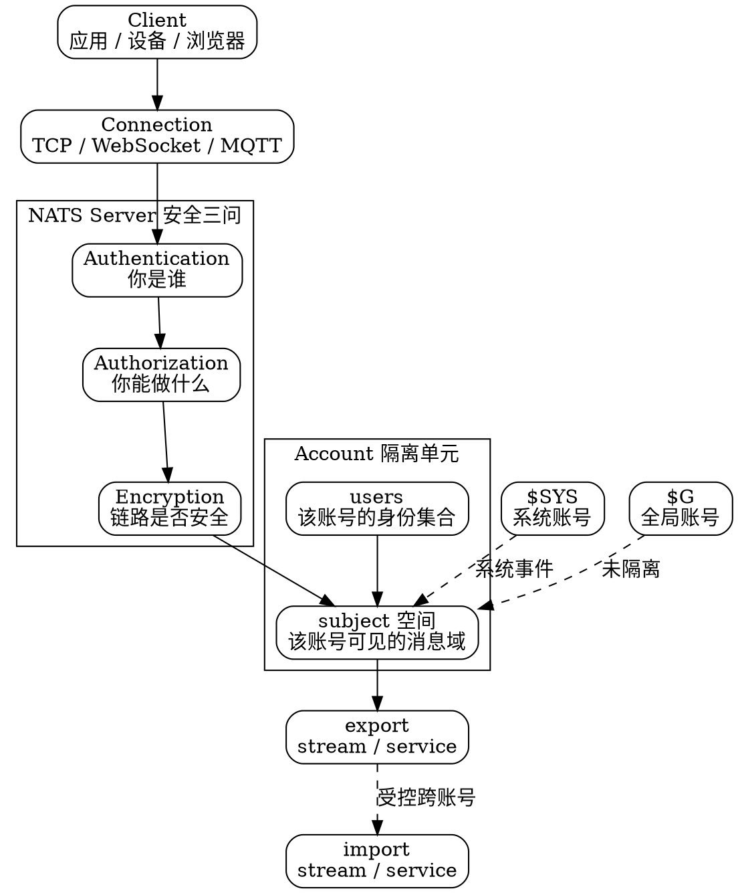

## Introduction

NATS 的安全模型可以拆成三个彼此独立、但必须同时回答的问题：

| 问题 | 机制 | 回答的是 |
| ---- | ---- | -------- |
| 你是谁 | **Authentication** | 客户端身份：password / token / NKey 签名 / bearer JWT / mTLS 客户端证书 / Auth Callout |
| 你能做什么 | **Authorization** | 按 **subject** 的 publish / subscribe allow / deny 列表 |
| 链路安不安全 | **Encryption** | 传输层 TLS；双向 TLS 还能直接把客户端证书当身份用 |

把这三者圈在一起的隔离单元是 **Account（账号）**：每个 account 有自己的 user 集合，也有自己的 subject 空间 —— 两个 account 默认互相看不见，只有显式建立 import / export 才连通。未配置 account 时，server 使用隐式的**全局账号 `$G`**。

> 版本基线：**nats-server v2.15.1**，发布于 2026-10-09（v2.15.0 于 2026-09 发布，2.14.8 是并行维护分支）。
> 本文只描述身份与权限模型本身；资源配置、热加载、监控端口与滚动升级属于运行面，归 Operations 分册。



## Authentication

### Config-based Credentials

最基础的方式是在 server 配置里直接写 user 列表。密码写在配置文件里，因此**配置文件本身成为密钥资产**，权限与备份策略要按密钥对待。

```conf
# nats-server.conf
port: 4222

authorization {
  users = [
    { user: "alice", password: "s3cr3t" }
    { user: "bob",   password: "an0th3r" }
  ]
}
```

`token` 形态是更退化的一档：全体客户端共用同一个 token。它无法区分个体、无法审计谁发过消息，只适合隔离要求不高的临时环境。

### Method Comparison

| 方式 | 凭据形式 | 适用规模 | 信任根在谁 | 运维成本 |
| ---- | -------- | -------- | ---------- | -------- |
| 用户名 / 密码 | 明文密码，写在 server 配置里 | 小规模、单集群 | server 配置文件 | 低 |
| Token | 全局共享的单一 token | 极小规模、临时环境 | server 配置文件 | 最低 |
| NKey | Ed25519 密钥对，**签名而不传密码** | 中等规模、客户端数量多 | server 配置里的公钥 | 中 |
| JWT | user JWT 持有者身份 | 中大规模、多集群 | operator 公钥 + account resolver | 中高 |
| Auth Callout | 外部服务代做判定 | 已有 IAM / SSO 体系 | 外部认证服务 | 高 |

选型的分界线基本是**信任根的位置**：配置型把信任根放在 server 的配置文件里，随规模线性膨胀；operator / JWT 把信任根上移到 operator 密钥，server 只需信任一个公钥；Auth Callout 则把信任根彻底外置，server 自己不做身份判定。

## NKeys

NKey 是 Ed25519 密钥对。客户端持有 **seed**（私钥），server 只配置对应的**公钥**。

- 认证过程中客户端用 seed **对 server 给出的随机数签名**，server 用公钥验签；**密码本身从不在网络上传输**。
- seed 是长期私钥，等价于密码，必须按密钥文件管理（`0600` 权限，且不能进版本库）。
- server 侧只需保存公钥，泄露公钥不构成凭证泄露。
- 轮换顺序：追加新公钥 → 热加载或重启 → 客户端换 seed → 移除旧公钥。任意时刻新旧公钥并存。

```conf
authorization {
  nkeys = [
    { user: "app", nkey: "UXXXXXXXXXXXXXXXXXXXXXXXXXXXXXXX" }
  ]
}
```

CLI 签发的凭据文件把 **user JWT**（仅 operator / JWT 模式）与 **NKey seed** 打包在一个 `.creds` 文件里，由 nats 客户端直接读取：

```text
-----BEGIN NATS USER JWT-----
eyJ0eXAiOiJKV1QiLCJhbGciOiJlZDI1NTE5LW5rZXkifQ...
------END NATS USER JWT------

************************* IMPORTANT *************************
NKEY Seed printed below can be used to sign and prove identity.
NKEYs are sensitive and should be treated as secrets.

-----BEGIN USER NKEY SEED-----
SUAXXXXXXXXXXXXXXXXXXXXXXXXXXXXXXXXXXXXXXXXXXXXX
------END USER NKEY SEED------

*************************************************************
```

## Decentralized JWT

JWT 模式把身份做成一条**离线可签发的信任链**，签发过程不需要 server 参与：

```text
Operator JWT  ──签发──▶  Account JWT  ──签发──▶  User JWT
     │                        │                       │
  server 信任的根        账号定义与权限          应用持有的凭证
```

- **Operator** 是信任根，只有一把私钥（operator seed），用来签发 account JWT。
- **Account** 承载身份与权限信息，被 operator 签发；一个 operator 可以签多个 account。
- **User** 是终端身份，被 account 签发；user JWT 里带该用户的 subject 权限。
- 撤销粒度落在 account / operator 级：撤销一个 account JWT，其下所有 user 立即失效。

因为签发是离线的，**运维不需要连上 server** 就能新增或轮换用户凭证，这是它相对配置型认证最大的运维优势。

## Operator Mode

Operator 模式下 server 的行为发生根本变化：**server 信任的是 operator 公钥，而不是配置里的 user 列表**。配置里的 `users` / `nkeys` 会被 operator 模式接管，凭据的实际来源是 account resolver。

```conf
# nats-server.conf
operator: "OXXXXXXXXXXXXXXXXXXXXXXXXXXXXXXXXX"
resolver: NATS
```

- `resolver: NATS` 表示使用**内置的 NATS resolver**，server 从内置存储里读取 account 与 user 列表。
- 另一种形态是 `resolver: URL`，指向外部 HTTP resolver，由外部服务返回 account 树。
- `resolver_preload` 可指定离线预加载目录，让 server 在启动时先读本地快照，不依赖 resolver 可达。

配合 nsc 工具签发（nsc 负责签发，server 只负责验证）：

```bash
# 1) 创建 operator 与 account
nsc add operator --generate-sk --name ExampleOp
nsc add account --name ExampleAccount
nsc add user --name ExampleUser --account ExampleAccount

# 2) 签发 user JWT 与凭据文件
nsc generate nats-user-jwt ExampleUser --account ExampleAccount
nsc generate creds ExampleUser --account ExampleAccount
```

`nats` CLI 自带一套等价的 `nats auth` 工作流，用于不装 nsc 的场景：

```bash
nats auth create-operator --generate-sk --name ExampleOp
nats auth create-account --name ExampleAccount --operator ExampleOp
nats auth add-user --name ExampleUser --account ExampleAccount
nats auth issue-creds --user ExampleUser --account ExampleAccount
```

> [!IMPORTANT]
> operator 模式下**配置里的 user 列表不生效**。把 `authorization { users = [...] }` 和 operator 模式混着写，是"配了不生效"类故障的常见来源。

## Authorization

授权的单位是 **subject**。每个 user 可以分别声明 publish 与 subscribe 两侧的 allow / deny 列表：

```conf
authorization {
  users = [
    {
      user: "orders-writer"
      password: "s3cr3t"
      permissions: {
        publish: {
          allow: ["orders.>", "_INBOX.>"]
          deny:  ["orders.internal.>"]
        }
        subscribe: {
          allow: ["orders.created", "orders.updated"]
        }
      }
    }
  ]
}
```

判定规则：

- **deny 优先**：命中 deny 直接拒绝，即使同时命中 allow。
- **allow 是白名单**：某一侧一旦写明规则，未命中 allow 的 subject 在该侧被拒绝。
- 未显式配置的一侧不做限制 —— 只声明 publish 时，subscribe 侧仍可订阅任意 subject。
- 通配符与 Core NATS 一致（规则见 [Core NATS 路由层](/docs/CS/MQ/NATS/Core_NATS.md)）：`*` 匹配单层，`>` 匹配多层后缀。

### Reserved Subject Prefixes

以下前缀承载 server 内部语义，**不能随手授权给应用账号**：

| 前缀 | 用途 | 授权给应用的后果 |
| ---- | ---- | --------------- |
| `$SYS` | 系统账号的事件与请求 | 暴露 server 内部状态与运维通道 |
| `$JS` | JetStream API | 可直接读写 stream / consumer 元数据 |
| `$JS.ACK.` | 消费者确认 | 伪造 ack 会掩盖未确认消息 |
| `$JS.FC.` | 流控信号 | 影响生产消费背压 |
| `$KV` | KV bucket 数据面 | 键值数据可被越权读写 |
| `$O` | Object Store 数据面 | 大对象可被越权读写 |
| `$SRV` | 服务导入的应答主题 | 可劫持服务应答 |
| `_INBOX` | 请求-应答的通配收件箱 | 可劫持他人请求的应答 |

其中 `$JS.ACK.` 与 `$JS.FC.` 尤其危险：很多应用账号的权限里被"顺手"加了 `>` 通配，等于把 ack 与流控的控制权交了出去。跨账号 import / export 若涉及这两类前缀，升级 2.16 之前必须改格式，详见 [Operations](/docs/CS/MQ/NATS/Operations.md?id=upgrading-to-215)。

授权模型与其他消息系统的对照，参见 Kafka 分册的 SASL 与 ACL 模型。

## Accounts and Multitenancy

Account 是 NATS 的**隔离单元**，同时承担两件事：

1. **身份隔离**：每个 account 有自己的 user 集合，同一个用户名可以在两个 account 里各有一份。
2. **subject 空间隔离**：每个 account 有自己的 subject 命名空间，两个 account 默认互相看不见对方的订阅与消息。

未配置任何 account 时，server 使用隐式的**全局账号 `$G`** —— 所有客户端共享一个 subject 空间，任何人都能订阅任何 subject。这是"忘了配 account"最直接的故障表现。

系统账号是 **`$SYS`**，承载 server 自身的事件与运维请求，需要单独配置并单独授权。

跨账号的受控访问靠 **stream 与 service 的 import / export**：账号 A 显式 export 某个 subject 模式或 service，账号 B 显式 import，双方才连通，且映射关系可以变换（例如 export `public.>`，import 后变成 `internal.public.>`）。

```conf
accounts {
  $SYS {
    users = [ { user: "sys", password: "sys-secret" } ]
  }

  AcctA {
    users = [ { user: "a-user", password: "a-secret" } ]
    exports = [
      { service: "svc.echo" }
      { stream: "public.>" }
    ]
  }

  AcctB {
    users = [ { user: "b-user", password: "b-secret" } ]
    imports = [
      { service: { subject: "svc.echo", account: AcctA } }
      { stream: { subject: "public.>", account: AcctA } }
    ]
  }
}
```

要点：

- **import / export 是显式的、有方向的**：只有 A export 了、B import 了，消息才通；单边配置不产生任何效果。
- **service export** 用于请求-应答：被导出方提供服务，导入方可以调用但看不到对方的其他 subject。
- **stream export** 用于单向数据流：导入方拿到的是订阅能力。
- 映射可做 subject 变换，因此可以让被导入方用一个陌生的 subject 看到数据，避免直接暴露原命名。

## Auth Callout

Auth Callout 把**认证判定本身**委托给外部服务，server 只负责把请求转出去、把结论收回来。

- server 把客户端信息（连接参数、账号上下文等）**以 JSON 编码**放进 `Nats-Request-Info` 头，转发给配置的 callout 服务。
- server 用 **`Nats-Server-Xkey`** 头携带加密材料，供 callout 服务与 server 之间的后续通信使用。
- callout 服务要么返回带用户身份的 JWT，要么不返回 —— 不返回即拒绝连接。
- 这条路径的信任根完全在外部服务，server 内部不保存用户凭据，适合已有 IAM / SSO / 内部审计体系的公司。

```conf
authorization {
  auth_callout {
    issuer: "ExampleAuthCallout"
    auth_users: [ "authz-service" ]
  }
}
```

`auth_users` 列出的是**被允许充当 callout 服务的账号**，这个列表本身就是一处授权边界 —— 它必须被收紧。

> [!WARNING]
> v2.15.1 修复了「auth callout 的 `auth_users` 绕过」相关问题。使用 auth callout 的部署应当升级到 2.15.1，而不是停留在 2.15.0。

## Encryption and TLS

TLS 是**按连接类型分别配置**的，不是"一个开关管全部"。client、cluster route、gateway、leafnode、websocket、MQTT 各自有独立的 TLS 段落。

```conf
tls {
  cert_file: "/etc/nats/tls/server.crt"
  key_file:  "/etc/nats/tls/server.key"
  ca_file:   "/etc/nats/tls/ca.crt"
  verify:    true
}
```

### mTLS as Identity

**双向 TLS 可以直接把客户端证书当作身份** —— 证书的 CN 或 SAN 映射成 NATS 用户名，密码与 user 列表都不再需要。

- 证书校验通过即完成认证，身份来自证书本身。
- 客户端证书的轮换由 PKI 承担，不再需要在 server 配置里同步 user。
- 前提是 server 端开启证书校验并启用身份映射。

### TLS-first Handshake

默认情况下 client 先发 `CONNECT`，server 再决定是否升级到 TLS —— 明文 `CONNECT` 会被先解析一次。对"客户端连上来就必须加密"的要求，可以在对应段落开启 **TLS-first**，让握手成为第一段字节。

### Static Encryption at Rest

TLS 解决的是**传输中**的机密性；消息落盘后的机密性由静态加密承担。密钥由运维方自己管理，server 不持有、也无法恢复。

> [!NOTE]
> 静态加密的密钥一旦丢失，磁盘上的数据即不可恢复 —— 它等价于一份需要异地备份的密钥资产。

## Subject Design for Access Control

授权是按 subject 匹配的，因此**subject 命名本身就是权限设计的载体**。把命名空间按"业务域 + 动作 + 实体类型"组织，权限规则就能与目录树对齐：

```text
<domain>.<entity>.<verb>.<region>

orders.order.created.us-east
orders.order.updated.us-east
billing.invoice.created.us-east
```

由此得到的性质：

| 设计 | 权限表达 | 效果 |
| ---- | -------- | ---- |
| 按业务域分前缀 | `allow: ["orders.>"]` | 一个业务域 = 一组权限 |
| 按读写分离 | publish `orders.order.created.*`，subscribe `orders.order.*` | 写窄读宽 |
| 按租户分前缀 | `tenant.<id>.>` | 每租户一套 subject，权限可按租户下发 |
| 动作用固定后缀 | `*.created` / `*.updated` | 订阅方可按动作订阅同一实体的生命周期 |

要点是**让通配符的边界落在语义边界上**：如果 `>` 既是业务域的分隔也是动作的分隔，一条 `allow: ["orders.>"]` 会同时放开该域下的全部读写，粒度就失控了。

不同 account 之间仍然优先用 import / export 表达可见性，而不是靠 subject 前缀硬编码租户边界 —— 前缀是约定，import / export 是 server 强制执行的。

## Pitfalls

- **忘了配 account = 全局账号 `$G`**：所有客户端共享一个 subject 空间，任何人都能订阅任何 subject。多租户场景下这等于没有隔离。
- **operator 模式下 `users` 列表不生效**：配置里写了 user 却不生效，先确认是否处于 operator 模式。
- **`deny` 才是最终裁决**：写 allow 时别忘了 deny 列表，命中 deny 的 subject 不会因为命中 allow 而放行。
- **只声明了一侧**：只写 publish 权限不代表 subscribe 被限制 —— 另一侧默认不受限。
- **把 `_INBOX.>` 或 `$JS.ACK.>` 授给应用**：前者可劫持请求应答，后者可伪造消费者确认。
- **共享 token 不可审计**：出了事故无法定位到具体客户端。
- **NKey seed 当普通配置文件存**：seed 是私钥，泄露即等于交出该身份。
- **静态加密密钥没有备份**：密钥丢失 = 磁盘数据永久不可读。
- **auth callout 的 `auth_users` 收紧**：该列表决定谁能充当 callout 服务，2.15.1 修复过绕过问题，必须升级并收紧。
- **TLS 与端口是分开的**：Monitoring 端口、MQTT 端口、WebSocket 端口各自独立，容易出现"主端口加了 TLS、监控口没加"的错配。

## Links

- [NATS 总纲](/docs/CS/MQ/NATS.md)
- [Operations](/docs/CS/MQ/NATS/Operations.md)
- [Clustering](/docs/CS/MQ/NATS/Clustering.md)
- [Topologies](/docs/CS/MQ/NATS/Topologies.md)
- [MQ 总纲](/docs/CS/MQ/MQ.md)
- [RabbitMQ](/docs/CS/MQ/RabbitMQ.md)

## References

1. [NATS 官方文档 - Security](https://docs.nats.io/learn/security/)
2. [NATS 官方文档 - Concepts: Security](https://docs.nats.io/concepts/security)
3. [NATS 官方文档 - Securing NATS](https://docs.nats.io/running-a-nats-service/configuration/securing_nats)
4. [NATS Server Configuration Reference](https://docs.nats.io/reference/config)
5. [nats-io/nsc - JWT 与 NKey 签发工具](https://github.com/nats-io/nsc)
