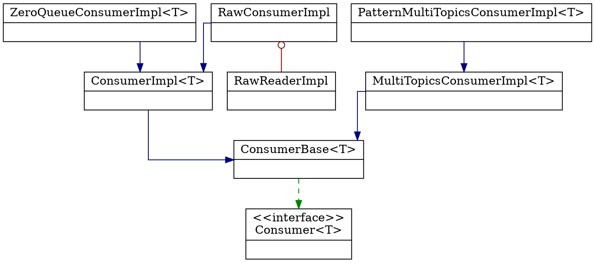

## Introduction

Pulsar 的消费模型围绕 **subscription（订阅）** 展开：一个 subscription 是一条独立的 cursor（消费位点 + 未确认消息集合），多个 subscription 可以消费同一 topic 而互不干扰。`SubscriptionType` 枚举（`pulsar-client-api/.../api/SubscriptionType.java`）只有四个值：

| 类型 | 语义（源码注释原文口径） |
| ---- | ---- |
| `Exclusive` | 同一 subscription 名只允许 1 个 consumer 连接 |
| `Shared` | 多 consumer 轮转分摊消息，**不保证消费顺序** |
| `Failover` | 多 consumer 同时挂载但只有 1 个活跃接收，断线时其余顶上；**分区 topic 上按分区保证有序** |
| `Key_Shared` | 多 consumer 共享，**同 key 的消息路由到同一个 consumer**（可用 `ordering_key` 覆盖消息 key 用于排序） |

消息从 broker 经 dispatcher 推送到客户端的 `incomingMessages` 队列，用户侧 `receive()` / `receiveAsync()` / `MessageListener` 三种取法最终都从这个队列出队；确认（ack）之后 broker 侧推进 cursor 的 `markDeletePosition`。本篇依次展开 `ConsumerBase` 的线程模型、retry 与死信、Retention 与 TTL，最后是与 consumer 对称的 `Reader`（无 subscription、无 ack 的游标式读取）。

Create a consumer builder with no schema (Schema.BYTES) for subscribing to one or more topics.
```java
Consumer<byte[]> consumer = client.newConsumer()
        .topic("my-topic")         
        .subscriptionName("my-subscription-name")         
        .subscribe();  

while (true) {      
    Message<byte[]> message = consumer.receive();      
    System.out.println("Got message: " + message.getValue());      
    consumer.acknowledge(message);  
}
```





## ConsumerBase

```java
public abstract class ConsumerBase<T> extends HandlerState implements Consumer<T> {
    final BlockingQueue<Message<T>> incomingMessages;

    protected final ExecutorProvider executorProvider;
    protected final ScheduledExecutorService externalPinnedExecutor;
    protected final ScheduledExecutorService internalPinnedExecutor;
}
```

#### internalPinnedExecutor

`ConsumerBase` 持有两个执行器：`internalPinnedExecutor` 与 `externalPinnedExecutor`。前者是「线程钉住」的内部执行器 —— 消息入队、位点推进这类必须与连接事件严格串行的操作都走它，避免「消息已入队但读取处看不到」的竞态（源码注释原文：*The messages are added into the receiver queue by the internal pinned executor, so need to use internal pinned executor to avoid race condition*）。

#### pendingBatchReceiveTask

批量接收的超时调度：`batchReceivePolicy` 的超时不是每条消息一个定时器，而是一个自旋的 `newTimeout` 链 —— 每轮计算「最早的未完成 batchReceive 还剩多久」，到点统一补全（`completeOpBatchReceive`）。取消中的 timeout 直接跳过，Closing/Closed 状态不再续期：

```java
public abstract class ConsumerBase<T> extends HandlerState implements Consumer<T> {
    private void pendingBatchReceiveTask(Timeout timeout) {
        internalPinnedExecutor.execute(() -> doPendingBatchReceiveTask(timeout));
    }

    private void doPendingBatchReceiveTask(Timeout timeout) {
        if (timeout.isCancelled()) {
            return;
        }

        long timeToWaitMs;

        synchronized (this) {
            // If it's closing/closed we need to ignore this timeout and not schedule next timeout.
            if (getState() == State.Closing || getState() == State.Closed) {
                return;
            }

            timeToWaitMs = batchReceivePolicy.getTimeoutMs();
            OpBatchReceive<T> opBatchReceive = pendingBatchReceives.peek();

            while (opBatchReceive != null) {
                // If there is at least one batch receive, calculate the diff between the batch receive timeout and the elapsed time since the operation was created.
                long diff = batchReceivePolicy.getTimeoutMs()
                        - TimeUnit.NANOSECONDS.toMillis(System.nanoTime() - opBatchReceive.createdAt);

                if (diff <= 0) {
                    completeOpBatchReceive(opBatchReceive);

                    // remove the peeked item from the queue
                    OpBatchReceive<T> removed = pendingBatchReceives.poll();

                    if (removed != opBatchReceive) {
                        // regression check, if this were to happen due to incorrect code changes in the future,
                        // (allowing multi-threaded calls to poll()), then ensure that the polled item is completed
                        // to avoid blocking user code

                        log.error("Race condition in consumer {} (should not cause data loss). "
                                + " Concurrent operations on pendingBatchReceives is not safe", this.consumerName);
                        if (removed != null && !removed.future.isDone()) {
                            completeOpBatchReceive(removed);
                        }
                    }
                } else {
                    // The diff is greater than zero, set the timeout to the diff value
                    timeToWaitMs = diff;
                    break;
                }

                opBatchReceive = pendingBatchReceives.peek();
            }
            batchReceiveTimeout = client.timer().newTimeout(this::pendingBatchReceiveTask,
                    timeToWaitMs, TimeUnit.MILLISECONDS);
        }
    }
}
```

#### triggerListener

listener 模式下消息不是用户线程主动取的，而是 broker 推送触发 `triggerListener` 从队列取出后转发给用户回调。注意 `Key_Shared` 与其它模式的分派差异：前者按消息 key 取 `executorProvider.getExecutor(peekMessageKey(msg))` 保证同 key 串行，后者走 `getExternalExecutor(msg)`。

```java
public abstract class ConsumerBase<T> extends HandlerState implements Consumer<T> {
    private void triggerListener() {
        internalPinnedExecutor.execute(() -> {
            try {
                Message<T> msg;
                do {
                    msg = internalReceive(0, TimeUnit.MILLISECONDS);
                    if (msg != null) {
                        // Trigger the notification on the message listener in a separate thread to avoid blocking the
                        // internal pinned executor thread while the message processing happens
                        final Message<T> finalMsg = msg;
                        if (SubscriptionType.Key_Shared == conf.getSubscriptionType()) {
                            executorProvider.getExecutor(peekMessageKey(msg)).execute(() ->
                                    callMessageListener(finalMsg));
                        } else {
                            getExternalExecutor(msg).execute(() -> {
                                callMessageListener(finalMsg);
                            });
                        }
                    }
                } while (msg != null);
            } catch (PulsarClientException e) {
                log.warn("[{}] [{}] Failed to dequeue the message for listener", topic, subscription, e);
            }
        });
    }
}
```


#### ConsumerImpl

`ConsumerImpl` 在 `ConsumerBase` 之上持有三个 tracker，分别对应三种「未确认」语义：

| 字段 | 职责 |
| ---- | ---- |
| `unAckedMessageTracker` | 逐条/累积 ack 的未确认集合，redelivery 的依据 |
| `acknowledgmentsGroupingTracker` | 分组 ack 的合并发送 |
| `negativeAcksTracker` | 单条 negative ack（`negativeAcknowledge`）触发的快速重投 |

```java

public class ConsumerImpl<T> extends ConsumerBase<T> implements ConnectionHandler.Connection {
    private final UnAckedMessageTracker unAckedMessageTracker;
    private final AcknowledgmentsGroupingTracker acknowledgmentsGroupingTracker;
    private final NegativeAcksTracker negativeAcksTracker;

}
```

#### receive and BlockingQueue.take

同步 `receive()` 的主链就是 `incomingMessages.take()`：取出消息 → `messageProcessed`（更新 `lastDequeuedMessageId`、补发 flow permit、更新统计）→ `beforeConsume`（过 interceptor 链）。`receiveAsync()` 则是 `poll()` + `pendingReceives` 挂起，由同一队列的到达事件补全。`beforeConsume` 的 interceptor 链单个抛错只记日志不中断（源码注释明言不抛异常）：

```java
 @Override
    public Message<T> receive() throws PulsarClientException {
        if (listener != null) {
            throw new PulsarClientException.InvalidConfigurationException(
                    "Cannot use receive() when a listener has been set");
        }
        verifyConsumerState();
        return internalReceive();
    }

@Override
protected Message<T> internalReceive() throws PulsarClientException {
        Message<T> message;
        try {
        message = incomingMessages.take();
        messageProcessed(message);
        return beforeConsume(message);
        } catch (InterruptedException e) {
        stats.incrementNumReceiveFailed();
        throw PulsarClientException.unwrap(e);
        }
        }

@Override
protected synchronized void messageProcessed(Message<?> msg) {
        ClientCnx currentCnx = cnx();
        ClientCnx msgCnx = ((MessageImpl<?>) msg).getCnx();
        lastDequeuedMessageId = msg.getMessageId();

        if (msgCnx != currentCnx) {
        // The processed message did belong to the old queue that was cleared after reconnection.
        } else {
        if (listener == null && !parentConsumerHasListener) {
        increaseAvailablePermits(currentCnx);
        }
        stats.updateNumMsgsReceived(msg);

        trackMessage(msg);
        }
        decreaseIncomingMessageSize(msg);
        }
```


```java
protected Message<T> beforeConsume(Message<T> message) {
        if (interceptors != null) {
            return interceptors.beforeConsume(this, message);
        } else {
            return message;
        }
    }
```
This is called just before the message is returned by Consumer.receive(), MessageListener.received(Consumer, Message) or the java.util.concurrent.CompletableFuture returned by Consumer.receiveAsync() completes.

This method calls ConsumerInterceptor.beforeConsume(Consumer, Message) for each interceptor. Messages returned from each interceptor get passed to beforeConsume() of the next interceptor in the chain of interceptors.

This method does not throw exceptions. 
If any of the interceptors in the chain throws an exception, it gets caught and logged, and next interceptor in int the chain is called with 'messages' returned by the previous successful interceptor beforeConsume call.

```java
public class ConsumerInterceptors<T> implements Closeable {
    public Message<T> beforeConsume(Consumer<T> consumer, Message<T> message) {
        Message<T> interceptorMessage = message;
        for (int i = 0, interceptorsSize = interceptors.size(); i < interceptorsSize; i++) {
            try {
                interceptorMessage = interceptors.get(i).beforeConsume(consumer, interceptorMessage);
            } catch (Throwable e) {
                if (consumer != null) {
                    log.warn("Error executing interceptor beforeConsume callback topic: {} consumerName: {}", consumer.getTopic(), consumer.getConsumerName(), e);
                } else {
                    log.warn("Error executing interceptor beforeConsume callback", e);
                }
            }
        }
        return interceptorMessage;
    }
}
```


```java
@Override
    protected CompletableFuture<Message<T>> internalReceiveAsync() {
        CompletableFutureCancellationHandler cancellationHandler = new CompletableFutureCancellationHandler();
        CompletableFuture<Message<T>> result = cancellationHandler.createFuture();
        internalPinnedExecutor.execute(() -> {
            Message<T> message = incomingMessages.poll();
            if (message == null) {
                pendingReceives.add(result);
                cancellationHandler.setCancelAction(() -> pendingReceives.remove(result));
            } else {
                messageProcessed(message);
                result.complete(beforeConsume(message));
            }
        });

        return result;
    }
```


## Retry and Dead Letter

`reconsumeLater` 让消费失败的消息延迟后重新投递，依赖 `deadLetterPolicy` 配置的重试主题（retry letter topic）。`doReconsumeLater` 的真实链路是：给消息打上 `RECONSUMETIMES` / `DELAY_TIME` 系统属性 → 用内部 `retryLetterProducer` 发到重试 topic（带 `deliverAfter`）→ 原消息 ack 掉；重试次数超过 `maxRedeliverCount` 且配了死信 topic 时改投 DLQ。发重试 topic 本身失败时走 `exceptionally` 兜底：从 tracker 移除并 `redeliverUnacknowledgedMessages` 立即重投，不让消息卡死：

```java
  while (true) {
      Message<String> msg = consumer.receive();
 
      try {
           // Process message...
 
           consumer.acknowledge(msg);
      } catch (Throwable t) {
           log.warn("Failed to process message");
           consumer.reconsumeLater(msg, 1000 , TimeUnit.MILLISECONDS);
      }
  }
```
reconsumeLater

```java
public abstract class ConsumerBase<T> extends HandlerState implements Consumer<T> {
    @Override
    public void reconsumeLater(Message<?> message, long delayTime, TimeUnit unit) throws PulsarClientException {
        if (!conf.isRetryEnable()) {
            throw new PulsarClientException("reconsumeLater method not support!");
        }
        try {
            reconsumeLaterAsync(message, delayTime, unit).get();
        } catch (InterruptedException e) {
            Thread.currentThread().interrupt();
            throw PulsarClientException.unwrap(e);
        } catch (ExecutionException e) {
            throw PulsarClientException.unwrap(e);
        }
    }

    @Override
    public CompletableFuture<Void> reconsumeLaterAsync(Message<?> message, long delayTime, TimeUnit unit) {
        if (!conf.isRetryEnable()) {
            return FutureUtil.failedFuture(new PulsarClientException("reconsumeLater method not support!"));
        }
        try {
            validateMessageId(message);
        } catch (PulsarClientException e) {
            return FutureUtil.failedFuture(e);
        }
        return doReconsumeLater(message, AckType.Individual, Collections.emptyMap(), delayTime, unit);
    }
}
```

#### doReconsumeLater

```java
public class ConsumerImpl<T> extends ConsumerBase<T> implements ConnectionHandler.Connection {
    @Override
    protected CompletableFuture<Void> doReconsumeLater(Message<?> message, AckType ackType,
                                                       Map<String, Long> properties,
                                                       long delayTime,
                                                       TimeUnit unit) {
        MessageId messageId = message.getMessageId();
        if (messageId == null) {
            return FutureUtil.failedFuture(new PulsarClientException
                    .InvalidMessageException("Cannot handle message with null messageId"));
        }

        if (messageId instanceof TopicMessageIdImpl) {
            messageId = ((TopicMessageIdImpl) messageId).getInnerMessageId();
        }
        checkArgument(messageId instanceof MessageIdImpl);
        if (getState() != State.Ready && getState() != State.Connecting) {
            stats.incrementNumAcksFailed();
            PulsarClientException exception = new PulsarClientException("Consumer not ready. State: " + getState());
            if (AckType.Individual.equals(ackType)) {
                onAcknowledge(messageId, exception);
            } else if (AckType.Cumulative.equals(ackType)) {
                onAcknowledgeCumulative(messageId, exception);
            }
            return FutureUtil.failedFuture(exception);
        }
        if (delayTime < 0) {
            delayTime = 0;
        }
        if (retryLetterProducer == null) {
            createProducerLock.writeLock().lock();
            try {
                if (retryLetterProducer == null) {
                    retryLetterProducer = client.newProducer(schema)
                            .topic(this.deadLetterPolicy.getRetryLetterTopic())
                            .enableBatching(false)
                            .blockIfQueueFull(false)
                            .create();
                }
            } catch (Exception e) {
                log.error("Create retry letter producer exception with topic: {}",
                        deadLetterPolicy.getRetryLetterTopic(), e);
                return FutureUtil.failedFuture(e);
            } finally {
                createProducerLock.writeLock().unlock();
            }
        }
        CompletableFuture<Void> result = new CompletableFuture<>();
        if (retryLetterProducer != null) {
            try {
                MessageImpl<T> retryMessage = (MessageImpl<T>) getMessageImpl(message);
                String originMessageIdStr = getOriginMessageIdStr(message);
                String originTopicNameStr = getOriginTopicNameStr(message);
                SortedMap<String, String> propertiesMap
                        = getPropertiesMap(message, originMessageIdStr, originTopicNameStr);
                int reconsumetimes = 1;
                if (propertiesMap.containsKey(RetryMessageUtil.SYSTEM_PROPERTY_RECONSUMETIMES)) {
                    reconsumetimes = Integer.parseInt(propertiesMap.get(RetryMessageUtil.SYSTEM_PROPERTY_RECONSUMETIMES));
                    reconsumetimes = reconsumetimes + 1;
                }
                propertiesMap.put(RetryMessageUtil.SYSTEM_PROPERTY_RECONSUMETIMES, String.valueOf(reconsumetimes));
                propertiesMap.put(RetryMessageUtil.SYSTEM_PROPERTY_DELAY_TIME, String.valueOf(unit.toMillis(delayTime)));

                MessageId finalMessageId = messageId;
                if (reconsumetimes > this.deadLetterPolicy.getMaxRedeliverCount() && StringUtils.isNotBlank(deadLetterPolicy.getDeadLetterTopic())) {
                    initDeadLetterProducerIfNeeded();
                    deadLetterProducer.thenAccept(dlqProducer -> {
                        TypedMessageBuilder<byte[]> typedMessageBuilderNew =
                                dlqProducer.newMessage(Schema.AUTO_PRODUCE_BYTES(retryMessage.getReaderSchema().get()))
                                        .value(retryMessage.getData())
                                        .properties(propertiesMap);
                        typedMessageBuilderNew.sendAsync().thenAccept(msgId -> {
                            doAcknowledge(finalMessageId, ackType, properties, null).thenAccept(v -> {
                                result.complete(null);
                            }).exceptionally(ex -> {
                                result.completeExceptionally(ex);
                                return null;
                            });
                        }).exceptionally(ex -> {
                            result.completeExceptionally(ex);
                            return null;
                        });
                    }).exceptionally(ex -> {
                        result.completeExceptionally(ex);
                        deadLetterProducer = null;
                        return null;
                    });
                } else {
                    TypedMessageBuilder<T> typedMessageBuilderNew = retryLetterProducer.newMessage()
                            .value(retryMessage.getValue())
                            .properties(propertiesMap);
                    if (delayTime > 0) {
                        typedMessageBuilderNew.deliverAfter(delayTime, unit);
                    }
                    if (message.hasKey()) {
                        typedMessageBuilderNew.key(message.getKey());
                    }
                    typedMessageBuilderNew.sendAsync()
                            .thenCompose(__ -> doAcknowledge(finalMessageId, ackType, properties, null))
                            .thenAccept(v -> result.complete(null))
                            .exceptionally(ex -> {
                                result.completeExceptionally(ex);
                                return null;
                            });
                }
            } catch (Exception e) {
                result.completeExceptionally(e);
            }
        }
        MessageId finalMessageId = messageId;
        result.exceptionally(ex -> {
            log.error("Send to retry letter topic exception with topic: {}, messageId: {}",
                    retryLetterProducer.getTopic(), finalMessageId, ex);
            Set<MessageId> messageIds = Collections.singleton(finalMessageId);
            unAckedMessageTracker.remove(finalMessageId);
            redeliverUnacknowledgedMessages(messageIds);
            return null;
        });
        return result;
    }
}
```


```java
 protected void increaseAvailablePermits(ClientCnx currentCnx, int delta) {
        int available = AVAILABLE_PERMITS_UPDATER.addAndGet(this, delta);

        while (available >= receiverQueueRefillThreshold && !paused) {
            if (AVAILABLE_PERMITS_UPDATER.compareAndSet(this, available, 0)) {
                sendFlowPermitsToBroker(currentCnx, available);
                break;
            } else {
                available = AVAILABLE_PERMITS_UPDATER.get(this);
            }
        }
    }
```

## Message Retention

默认情况下，Pulsar Broker 会对消息做如下处理：

- 当消息被 Consumer 确认之后，会立即执行删除操作。
- 对于未被确认的消息会存储到 backlog 中。

但是，很多线上的生产环境下，这种默认行为并不能满足我们的生产需求，所以，Pulsar 提供了如下配置策略来覆盖这些行为：

- Retention 策略：用户可以将 Consumer 已经确认的消息保留下来。
- TTL 策略：对于未确认的消息，用户可以通过设置 TTL 来使未确认的消息到达已经确认的状态


Retention 策略的设置提供了两种方式：

- 消息的大小，默认值：defaultRetentionSizeInMB=0
- 消息被保存的时间，默认值：defaultRetentionTimeInMinutes=0

#### Backlog

backlog 是未被确认消息的集合，它有一个大前提是，这些消息所在的 Topic 是被 Broker 所持久化的，在默认情况下，用户创建的 Topic 都会被持久化。换句话说，Pulsar Broker 会将所有未确认或者未处理的消息都存放到 backlog 中。

同样的，我们可以在 NameSpace 级别对 backlog 的大小进行配置。需要注意的是，对 backlog 进行配置时，我们需要明确以下两点：

- 在当前的 NameSpace 下，每一个 Topic 允许的大小是多少
- 如果超过设定的 backlog 的阈值，将会执行哪些操作


## Reader

`Reader` 是 Pulsar 里与 consumer **正交**的读取入口，源码 javadoc 的定位只有一句：*A Reader can be used to scan through all the messages currently available in a topic*。它与 consumer 的差别是本质性的：

| 维度 | Consumer | Reader |
| ---- | -------- | ------ |
| subscription | 必须有，cursor 独立存储 | 无用户可见 subscription |
| ack | 需要，ack 后推进 `markDeletePosition` | 无 ack、无重投 |
| 起始位点 | 从 subscription 的 cursor 继续 | **每次创建时由 `startMessageId` 指定** |
| 典型用途 | 业务消费（可回溯、可多订阅） | 事件溯源重放、全量扫描、compacted topic 快照读取 |

关键能力都落在 `ReaderBuilder`（`pulsar-client-api/.../api/ReaderBuilder.java`）：

- `startMessageId(MessageId)` —— 从任意位点开始（`MessageId.earliest` / `latest` 或具体消息 ID），这是 reader 与 consumer 最大的分野：consumer 续读 cursor，reader 由调用方决定「从哪读起」。
- `startMessageIdInclusive()` —— 上面指定位点是否包含该消息本身。
- `readCompacted(boolean)` —— 只读 compacted topic 的最新值视图（配合 [ManagedLedger 存储层](/docs/CS/MQ/Pulsar/ManagedLedger.md) 的 compaction 语义）。

读取侧 `Reader` 接口只有一组 `readNext` 三态：阻塞 `readNext()`、带超时 `readNext(timeout, unit)`（超时返回 null）、`readNextAsync()`（返回 `CompletableFuture`，源码注释要求**串行调用**，否则会在应用侧堆积 receive backlog）。Reader 没有 listener 模式 —— 它本质是「带位点控制的拉式扫描」，与 Kafka 的无组消费（assign + seek）是同一思路的不同实现。

## Links

- [Pulsar](/docs/CS/MQ/Pulsar/Pulsar.md)
- [Producer](/docs/CS/MQ/Pulsar/Producer.md)
- [Broker](/docs/CS/MQ/Pulsar/Broker.md)
- [ManagedLedger 存储层](/docs/CS/MQ/Pulsar/ManagedLedger.md)
- [Functions 与事务](/docs/CS/MQ/Pulsar/Functions.md)

## References

1. [Apache Pulsar 4.2.4 Release](https://github.com/apache/pulsar/releases/tag/v4.2.4)
2. [ConsumerBase.java (v4.2.4)](https://github.com/apache/pulsar/blob/v4.2.4/pulsar-client/src/main/java/org/apache/pulsar/client/impl/ConsumerBase.java)
3. [SubscriptionType.java (v4.2.4)](https://github.com/apache/pulsar/blob/v4.2.4/pulsar-client-api/src/main/java/org/apache/pulsar/client/api/SubscriptionType.java)
4. [Reader.java (v4.2.4)](https://github.com/apache/pulsar/blob/v4.2.4/pulsar-client-api/src/main/java/org/apache/pulsar/client/api/Reader.java)
5. [ReaderBuilder.java (v4.2.4)](https://github.com/apache/pulsar/blob/v4.2.4/pulsar-client-api/src/main/java/org/apache/pulsar/client/api/ReaderBuilder.java)
6. [Pulsar 官方文档](https://pulsar.apache.org/docs/)

