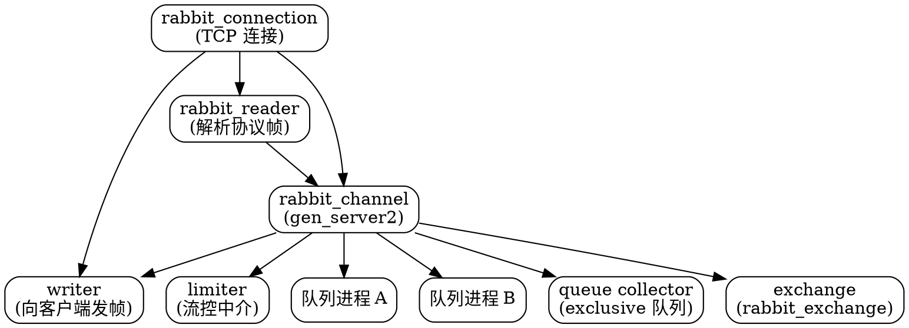

## Introduction

RabbitMQ 用 Erlang/OTP 写成，这意味着它的运行模型不是「一个 broker 进程 + 线程池」，而是**成千上万个轻量 Erlang 进程**。理解了这套进程模型，前面几篇里那些看起来各不相干的细节就会串起来：为什么 `multiple=true` 的 ack 会跨 consumer 生效（因为 unacked 集合在 channel 上）、为什么 prefetch 是最有效的背压手段（因为 limiter 是按 channel 独立的中介进程）、为什么 quorum queue 的消息始终经 leader（因为队列本身是一个 Raft 状态机进程）。

本篇展开 4.4 的进程模型：connection / channel / reader / writer / limiter / 队列进程各自的职责与边界，以及元数据（Khepri）与消息数据（队列自己的 Raft 组）这两层完全不同的复制语义。

> [!NOTE]
> **版本基线**：4.4.0（2026-10-20 发布，社区支持至 2027-07-31）。上一系列 4.3.x 最新补丁 4.3.6（2026-09-16，社区支持至 2027-01-31）。
>
> 本篇的进程职责描述来自 `rabbitmq-server@v4.4.0` 源码的模块头注释与关键函数实现，不是从文档转述。

## The Process Tree

一个客户端连接进来，broker 侧大致是这样一棵树：



### Channel Responsibilities

`rabbit_channel` 的模块头注释把它的职责列得很清楚，它是 `gen_server2` 行为：

- **路由消息**（调用各 exchange 类型模块的实现）到队列进程；
- **管理队列、exchange 与 binding**；
- **跟踪消费者**；
- **跟踪未确认的投递**（`unacked_message_q`）；
- **跟踪 publisher confirms**；
- **事务管理**；
- **授权**（强制执行权限）；
- 若启用了 tracing，发布 trace 事件。

`start_link/11` 的入参本身就说明了依赖关系：

```erlang
start_link(Channel, ReaderPid, WriterPid, ConnPid, ConnName, User,
           VHost, Capabilities, CollectorPid, Limiter, AmqpParams) ->
    gen_server2:start_link(
      ?MODULE, [Channel, ReaderPid, WriterPid, ConnPid, ConnName,
                User, VHost, Capabilities, CollectorPid, Limiter, AmqpParams], []).
```

每个 channel 有两个从属进程：

- **writer** —— 负责把帧发给客户端；
- **limiter** —— 依据生效中的 QoS prefetch 与内部流控逻辑，控制可以投递给消费者的消息数量。

channel 还知道自己所属连接的 **queue collector**：当队列以 exclusive 方式声明在某个 channel 上时，channel 会通知 collector 该队列的存在。

### Why Channel Is Not The Delivery Path

源码注释里有一句关键的话：连接负责**解析来自客户端的协议帧并派发给 channel 进程**。也就是说**读路径与 channel 是分离的** —— reader 进程持续读 socket 并把帧派给 channel，channel 进程不必阻塞在 socket 读取上。

这是 Erlang 模型的直接收益：**一个慢客户端不会卡住 broker 的其它工作**，因为它的帧解析在一个独立进程里，channel 的 mailbox 满了才会形成背压。

> [!TIP]
> 这解释了为什么 RabbitMQ 的吞吐上不去是**架构性的**而非实现效率问题：每条消息都要经过 reader → channel → exchange 路由 → 队列进程 → limiter → writer 这条链，而 Kafka 走的是分区直连。链路上每一环都是一次进程间消息传递。

路由那一环的具体规则见[Exchange 与路由](/docs/CS/MQ/RabbitMQ/Exchange_and_Routing.md)，而 channel 上的授权检查见[安全与访问控制](/docs/CS/MQ/RabbitMQ/Security_and_Access_Control.md)。

## The Limiter

`rabbit_limiter` 值得单独讲，因为它是理解 prefetch 的钥匙。它的模块头注释写得很直白：

> 每个 channel 关联一个 limiter 进程，在创建 consumer 时通过 `rabbit_amqqueue:basic_consume/10` 传给队列，`rabbit_amqqueue:basic_get/4` 也会传。后者其实不必要（basic.get 不受限流），但这样一来，**只要队列知道某个 channel，也就知道它的 limiter**，少一些麻烦。

limiter 持有的状态，实际上是**channel 与它消费的所有队列之间共享的状态**：

> 本质上，所有这些队列都在竞争同一个受限资源 —— **通过该 channel 投递消息的能力** —— 而 limiter 进程的职责就是调解这种访问。

**limiter 与 channel 分开有两个原因**：关注点分离，以及效率。channel 可能非常繁忙（尤其它还在处理发布时）；有了独立的 limiter 进程，所有这些访问调解都不必触碰 channel。

效率上，channel 与队列各自保存一部分 limiter 的**本地状态**（分别由 `new/1` 与 `client/1` 初始化）。这让它们在 limiter 处于 `inactive`（即没有协议级流控发生）时**完全不需要与 limiter 进程交互**。

> [!WARNING]
> 这个优化有代价 —— 源码注释直言「确实带来了一些复杂性」。所以**行为上必须以 limiter 的语义为准，不能假设「channel 就是唯一的真相」**。这正是 `multiple=true` 的 ack 会跨 consumer 生效的根源：未确认消息集合挂在 channel 上（`unacked_message_q`），而 limiter 也在 channel 这一层做流控，两者都不在单个 consumer 上。

## Metadata and Message Data Are Different Systems

RabbitMQ 里有**两层完全不同的复制语义**，混为一谈是最常见的理解错误：

| 组件 | 说明 |
| --- | --- |
| **元数据（Khepri）** | vhost / 队列 / exchange / binding / 权限 / 策略 —— Raft 复制，**多数派才能写** |
| **quorum queue** | 队列消息 —— 独立 Raft 组，**始终经 leader** |
| **stream** | 队列消息 —— 独立 Raft 组，consumer **可从任意 replica 读**，不受 leader 切换影响 |
| **经典镜像队列** | 4.0 已移除 |

三条推论：

1. **拓扑变更的多数派要求是集群级的**。Khepri 需要**多数节点在线**才能接受写 / 删 / 成员变更 —— 不只是网络分区，多数节点停机也一样。
2. **消息投递路径的多数派要求是队列级的**。一个 3 成员 quorum queue 容忍 1 个成员故障，与集群整体是否健康无关。
3. **stream 不受 leader 切换影响**，这是它与 quorum queue 在读取路径上的关键差异。

> [!IMPORTANT]
> **Khepri 在多数节点提交即返回，Mnesia 是全部节点**。所以拓扑变更后立刻从另一节点发布，消息**不保证被路由**。官方给的缓解手段是启动时声明拓扑后注入 1–2 秒暂停、用静态拓扑、或单连接。

### Reading Consistency

读取按组件分两类：

- **多数读走本地 cache** —— 最终一致；
- **线性一致读走 leader** —— 新 leader 选出前会暂停。

## Routing Path

路由的入口是 `rabbit_exchange:route/3`（`route/2` 已 deprecated）。它的类型签名透露了路由结果的三种形态：

```erlang
-type route_return() :: list(rabbit_amqqueue:name() |
                             {rabbit_amqqueue:name(), route_infos()}).
```

即：**要么是队列名列表，要么是「队列名 + 路由信息」列表**（路由信息里带 `binding_keys`，用于记录消息命中了哪些 binding）。exchange 类型模块负责把 routing key 匹配到 binding 上；**core 内置的类型实现在 `rabbit_exchange_type_*.erl` 中注册**，插件类型则由插件注册。

`rabbit_exchange` 还提供 `assert_equivalence/6` 与 `assert_args_equivalence/2` —— 这是「重新声明时参数必须等价」的检查实现，也是运维里最常见的 `PRECONDITION_FAILED` 来源。

## Erlang Specifics Worth Knowing

### Atom Table Limit

quorum queue 会把**队列名转换成 Erlang atom**。高 churn 场景（频繁创建删除队列）可能触及默认 **500 万** atom 上限 —— 这是 Erlang VM 的全局限制，撞上后节点会崩。

### Scheduler and Reductions

节点指标里的 `rabbitmq_erlang_processes_*`（进程数）、调度器运行队列长度、GC 统计，都来自 `node_metrics` 指标族。判断节点是否过载，除了看队列深度，更该看**调度器运行队列**与**进程 reductions** —— 后者反映单个 channel 的 CPU 开销分布。

### File Descriptor Budget

RabbitMQ 的进程模型意味着**每个连接、每个 channel、每个队列、每个 consumer 都对应若干 Erlang 进程**，而每个 socket 都要占文件描述符。官方不给固定推荐值，规则是**连接数 × 1.5**。提高 OS 上限时**必须同步提高 `ERL_MAX_PORTS`**：

```bash
rabbitmqctl eval 'erlang:system_info(port_limit).'
```

## Links

- [RabbitMQ（总览）](/docs/CS/MQ/RabbitMQ.md)
- [RabbitMQ 的集群与元数据](/docs/CS/MQ/RabbitMQ/Cluster_and_Metadata.md)
- [RabbitMQ 的队列类型](/docs/CS/MQ/RabbitMQ/Queue_Types.md)
- [RabbitMQ 的消费与流控](/docs/CS/MQ/RabbitMQ/Consumption_and_Flow_Control.md)
- [Erlang/OTP 运行时与调度器](/docs/CS/OS/scheduling.md)

## References

- https://www.rabbitmq.com/docs/metadata-store
- https://www.rabbitmq.com/docs/quorum-queues
- https://github.com/rabbitmq/rabbitmq-server/blob/v4.4.0/deps/rabbit/src/rabbit_channel.erl
- https://github.com/rabbitmq/rabbitmq-server/blob/v4.4.0/deps/rabbit/src/rabbit_limiter.erl
- https://github.com/rabbitmq/rabbitmq-server/blob/v4.4.0/deps/rabbit/src/rabbit_exchange.erl
