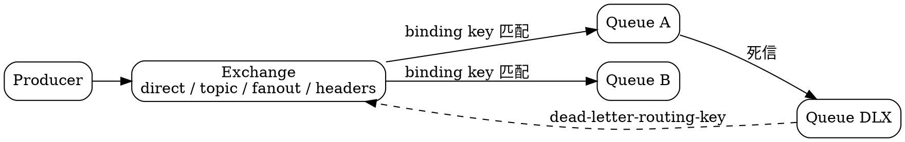

## Introduction

RabbitMQ 的路由能力是它区别于 Kafka / RocketMQ 的根本所在：消息先进入 exchange，由 exchange 按 binding 规则决定投递到哪些队列，生产者通常并不知道消息最终会流向哪里。本篇展开 4.4 的 exchange 类型全集、routing key 匹配规则、headers 匹配的四个 `x-match` 取值，以及两个最容易被忽略的能力：Alternate Exchange 与 exchange-to-exchange binding。

## Exchange and Routing

核心心智一句话：**生产者从不直接把消息发到队列**，甚至往往不知道消息最终会不会被投递出去。交换机决定把消息推到哪里去。



### Type List: More Than Four

core 内置 4 种（全部在 `rabbit_exchange_type_*.erl` 中注册）：

| 类型 | 路由方式 |
| --- | --- |
| `direct` | routing key **完全相等** |
| `topic` | routing key 按 `.` 分段，**通配符**匹配 |
| `fanout` | 忽略 routing key，广播到所有绑定队列 |
| `headers` | 按消息 **header** 匹配，不看 routing key |

4.x 另有两个 **`x-*` 类型在 core 内**（不是插件）：

- `x-modulus-hash` —— 分片路由，按 routing key 的哈希取模分派到 N 个分片队列；
- `x-local-random` —— 本节点内随机投递。

插件提供的类型（至少 5 个）：`x-consistent-hash`、`x-jms-topic`、`x-random`、`x-recent-history`、`x-federation-upstream`。

> [!WARNING]
> 「RabbitMQ 有四种 exchange 类型」是过时认知。但 `headers` **仍在**，且每个 vhost 会预声明两个实例 `amq.match` 与 `amq.headers` —— 源码注释刻意区分了它们分别来自 AMQP 0-9-1 的 PDF 与 XML 规范。

### The x-modulus-hash Timeline

这个类型的归属与行为都变过，值得单独记一笔：

| 版本 | 状态 |
| --- | --- |
| 4.2 及之前 | 在 `rabbitmq_sharding` **插件**里 |
| **4.3.0** | **移入 core** 并重写（官方 4.3.0 release notes 已宣布，PR #15849） |
| 4.4.0 | 路由**变为稳定**：拓扑不变时，带同一 routing key 的消息稳定路由到同一绑定目标 |

> [!IMPORTANT]
> **官方 4.4.0 release notes 的时间线表述有误** —— 它说 x-modulus-hash「已从 `rabbitmq_sharding` 移入 core」，读起来像 4.4 才做这件事。但**源码显示 v4.3.0 就已移入**（4.2.0 的 core 里没有该文件、插件侧有；4.3.0 的 core 里有、插件侧消失；且 4.3.0 与 4.4.0 的 core 实现**逐字节相同**）。
>
> 对 4.2 → 4.3+ 的既有部署来说，这是一个**行为变更**：排序规则变了，同一 routing key 的落点会变。依赖 hash 分片做数据局部性的场景，升级时必须评估。
>
> 官方 release notes 里关于「路由变稳定」的描述对应的是 4.4.0 —— 4.4 之前同一 routing key 不保证落到同一目标，4.4 起才稳定。

### Special Semantics of default exchange

每个 vhost 预声明 7 个 exchange，其中最特殊的是**空字符串名**的default exchange（`rabbit_vhost.erl:265-273`）：

- 类型是 `direct`，因此 routing key 必须**等于队列名**
- **禁止绑定到它**（会得到 `access_refused "operation not permitted on the default exchange"`）
- `amq.` 前缀的实体**禁止删除**；但在创建时被拒绝（passive 或已存在时豁免）

### Boundaries of topic Wildcards

`*` 匹配**恰好一个** segment，`#` 匹配**零个或多个**：

| binding key | `regions.na.cities.toronto` | `regions.na.cities` | `audit.events.users.signup` |
| --- | --- | --- | --- |
| `regions.na.cities.*` | ✅ | ❌ | ❌ |
| `audit.events.#` | ❌ | ❌ | ✅ |
| `#` | ✅ | ✅ | ✅ |

注意 `audit.events.#` **能匹配 `audit.events`**（零个 segment），而 `*` 不能匹配空。这意味着 `#` 单独使用等价于 fanout。

```erlang
%% 4.3 新增硬限制：单个 binding key 最多 2 个 '#'
-define(MAX_HASH_WILDCARDS, 2).
```

超出即得到 `binding_invalid`。源码注释说明了动机：MQTTv5 的 topic filter 最多一个 `#`，每多一个都成倍放大匹配开销（`rabbit_exchange_type_topic.erl:28-30, 52-61`）。

### x-match of headers Has Four Values

| `x-match` | 语义 |
| --- | --- |
| `all` | 所有**非 `x-` 前缀** header 都匹配（**未指定时的默认值**） |
| `any` | 任一匹配 |
| `all-with-x` | 所有 header 匹配，**包括** `x-` 前缀 |
| `any-with-x` | 任一匹配，包括 `x-` 前缀 |

> [!TIP]
> `all-with-x` / `any-with-x` **在官方 exchanges 文档页查不到**，只出现在源码的校验错误信息里。默认的 `all`/`any` 会对 `x-` 前缀 header 直接 `skip`（`rabbit_exchange_type_headers.erl:54-66`）——想匹配 RabbitMQ 自己的内部 header，必须显式用 `-with-x` 变体。

### Two Easily Overlooked Capabilities

**Alternate Exchange（AE）**：**仅在无任何匹配 binding 时**才生效（`rabbit_exchange.erl:432-440` 的空结果分支）。它是唯一在 declare 时做参数等价性检查的 x-arg，且可以做成 policy 动态调整。典型用法是兜底：没被业务队列消费掉的消息进 AE，避免静默丢失。

**Exchange-to-Exchange binding**：允许把 exchange 直接绑到另一个 exchange。它**不是重新发布**，而是路由扩展，因此遵守源与目标两个 exchange 的类型——**目标 exchange 的 ingress 指标不会更新**（文档明确）。

路由把消息交给队列之后，队列类型决定这条消息能被怎么消费，见[队列类型](/docs/CS/MQ/RabbitMQ/Queue_Types.md)；声明拓扑所需的权限见[安全与访问控制](/docs/CS/MQ/RabbitMQ/Security_and_Access_Control.md)。


## Links

- [RabbitMQ（总览）](/docs/CS/MQ/RabbitMQ.md)
- [RabbitMQ 的协议面](/docs/CS/MQ/RabbitMQ/Protocol.md)
- [消息代理与路由模型](/docs/CS/MQ/MQ.md?id=message-brokers)

## References

- https://www.rabbitmq.com/docs/exchanges
- https://www.rabbitmq.com/docs/routing
- https://www.rabbitmq.com/docs/headers-exchange
