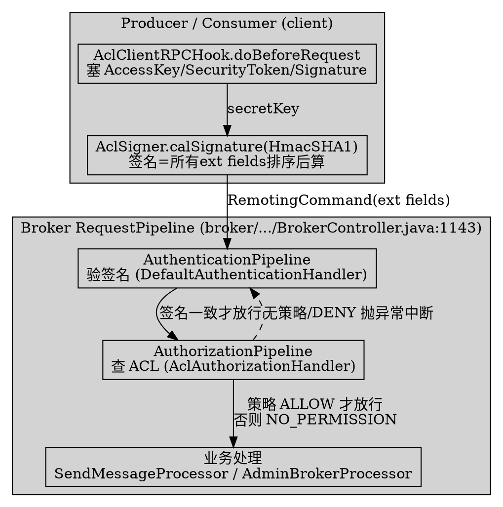

# ACL Access Control (ACL 访问控制)

## Introduction

RocketMQ 5.5.1 的访问控制被收口到 remoting 层的 `RequestPipeline`，在「业务处理器之前」做**请求级**校验，且明确拆为两段：先**认证（Authentication，验 HmacSHA1 签名）**再**鉴权（Authorization，查 ACL 策略）**。本页所有 `file:line` 均基于 **RocketMQ 5.5.1** 真源码核验。

> 版本基线：RocketMQ 5.5.1

**纠偏结论（务必先读，5.5.1 与 4.x 资料差异巨大）**：

1. **不存在** `AccessValidator` 接口与 `PlainAccessValidator`（`broker/acl/` 包）这些 4.x 类——全仓 grep 零命中。5.5.1 把 ACL 重构进 `auth` 模块，等价角色是 `AclAuthorizationHandler` + `DefaultAuthorizationProvider` + `AuthorizationEvaluator` + `StatelessAuthorizationStrategy`。
2. 客户端签名类叫 **`AclSigner.calSignature`**（HmacSHA1），**不是** `Signature.generateSignature`。
3. `aclEnable`（`BrokerConfig.java:320`，默认 `false`）在 5.5.1 新链路里**无人读取**（仅剩一个 `setAclEnable` setter）；真正的开关是 `AuthConfig.authorizationEnabled` / `authenticationEnabled`，写在同一个 broker 配置文件里由 `MixAll.properties2Object` 注入。
4. 老 `plain_acl.yml` 的读取位于 `auth/migration/v1/PlainPermissionManager`，**仅被迁移工具 `AuthMigrator` 使用**；运行时 ACL 数据由 `AuthorizationMetadataManager` 管理（可经 admin API 动态建 `Acl`），并非启动即自动加载 `plain_acl.yml`。

## 1. 整体架构：认证 + 鉴权两段 Pipeline

`BrokerController.initialRequestPipeline`（`broker/.../BrokerController.java:1139-1154`）把两条 pipe 串起来，注意**后加的先执行**：

```java
// broker/.../BrokerController.java:1143-1150
RequestPipeline pipeline = (ctx, request) -> { };
// add pipeline; the last pipe add will execute at the first
pipeline = pipeline.pipe(new AuthorizationPipeline(authConfig))
    .pipe(new AuthenticationPipeline(authConfig));
this.setRequestPipeline(pipeline);
```

因此一次请求进 broker 的校验顺序是：**AuthenticationPipeline（验签名）→ AuthorizationPipeline（查 ACL）**，两者都在业务处理前。任一段失败都抛 `AbortProcessException(ResponseCode.NO_PERMISSION, ...)`，直接拒绝，根本不会进入 `SendMessageProcessor` / `AdminBrokerProcessor` 的业务逻辑。

| 阶段 | 类 | 开关 | 失败含义 |
| ---- | ---- | ---- | ---- |
| 认证 Authentication | `AuthenticationPipeline`（`broker/.../auth/pipeline/AuthenticationPipeline.java:34`） | `authConfig.isAuthenticationEnabled()`（`:46`） | 签名/身份不对 |
| 鉴权 Authorization | `AuthorizationPipeline`（`broker/.../auth/pipeline/AuthorizationPipeline.java:36`） | `authConfig.isAuthorizationEnabled()`（`:48`） | 无匹配策略 / DENY |

## 2. 客户端签名：AclClientRPCHook + AclSigner

客户端通过 `AclClientRPCHook implements RPCHook`（`client/.../acl/common/AclClientRPCHook.java:26`）在发请求前塞字段：

```java
// client/.../acl/common/AclClientRPCHook.java:33-44
public void doBeforeRequest(String remoteAddr, RemotingCommand request) {
    request.addExtField(SessionCredentials.ACCESS_KEY, sessionCredentials.getAccessKey());
    if (sessionCredentials.getSecurityToken() != null) {
        request.addExtField(SessionCredentials.SECURITY_TOKEN, sessionCredentials.getSecurityToken());
    }
    byte[] total = AclUtils.combineRequestContent(request, parseRequestContent(request));
    String signature = AclUtils.calSignature(total, sessionCredentials.getSecretKey());   // 用 SecretKey 签名
    request.addExtField(SessionCredentials.SIGNATURE, signature);
}
```

签名算法在 `AclSigner`（`client/.../acl/common/AclSigner.java:29-67`）：默认 `SigningAlgorithm.HmacSHA1`（`:31`），`signAndBase64Encode` 用 `Mac.getInstance("HmacSHA1")` + `SecretKeySpec(key, "HmacSHA1")` 算完 Base64。签名内容是**所有 ext fields 排序后** `AclUtils.combineRequestContent`（`client/.../acl/common/AclUtils.java:40`）拼成的字节数组。

> 反直觉：ACL 请求头里 ACL hook 只塞 **AccessKey / SecurityToken / Signature** 三项。`Opaque`、`Language` 是 `RemotingCommand` 协议层自带字段（由 remoting 协议头填充），**并非** ACL hook 写入——不要把它们算进 ACL 签名内容。

## 3. 服务端认证：验签名（Authentication 阶段）

`AuthenticationPipeline.execute`（`AuthenticationPipeline.java:45-58`）在 `isAuthenticationEnabled()` 为真时，用 `AuthenticationFactory.newContext` 构造认证上下文并交给 `AuthenticationEvaluator` 求值。

上下文抽取在 `DefaultAuthenticationContextBuilder.build(ctx, command)`（`auth/.../authentication/builder/DefaultAuthenticationContextBuilder.java:99-125`）：

```java
// auth/.../authentication/builder/DefaultAuthenticationContextBuilder.java:107-123
if (!fields.containsKey(SessionCredentials.ACCESS_KEY)) {
    return result;                                  // 无 AccessKey → 空 context（后续会被拒）
}
result.setUsername(fields.get(SessionCredentials.ACCESS_KEY));
result.setSignature(fields.get(SessionCredentials.SIGNATURE));
SortedMap<String, String> map = new TreeMap<>();
for (Map.Entry<String, String> entry : fields.entrySet()) {
    if (!SessionCredentials.SIGNATURE.equals(entry.getKey())) {   // 排除 Signature 自身
        map.put(entry.getKey(), entry.getValue());
    }
}
result.setContent(AclUtils.combineRequestContent(request, map));  // 与客户端完全一致的内容
```

验签在 `DefaultAuthenticationHandler.doAuthenticate`（`auth/.../authentication/chain/DefaultAuthenticationHandler.java:58-70`）：

```java
// auth/.../authentication/chain/DefaultAuthenticationHandler.java:65-69
String signature = AclSigner.calSignature(context.getContent(), user.getPassword());  // user.getPassword() 即 SecretKey
if (context.getSignature() == null
    || !MessageDigest.isEqual(signature.getBytes(AclSigner.DEFAULT_CHARSET), context.getSignature().getBytes(AclSigner.DEFAULT_CHARSET))) {
    throw new AuthenticationException("check signature failed.");
}
```

> 反直觉：签名用 **SecretKey** 而非 AccessKey。服务端用 `user.getPassword()`（即该 AccessKey 对应的 SecretKey）重算签名比对；AccessKey 只是身份主键。若客户端没配 `AclClientRPCHook`，则 ext fields 里没有 `ACCESS_KEY`（`DefaultAuthenticationContextBuilder.java:107` 直接返回空），`doAuthenticate` 会因 `username cannot be null` 拒绝（前提是 `authenticationEnabled=true`）。

## 4. 服务端鉴权：ACL 策略判定（Authorization 阶段）

`AuthorizationPipeline.execute`（`AuthorizationPipeline.java:46-60`）在 `isAuthorizationEnabled()` 为真时：先 `newContexts` 构造授权上下文，再 `evaluator.evaluate(request, contexts)`；抛 `AuthorizationException`/`AuthenticationException` 即 `NO_PERMISSION`。

### 4.1 从 RemotingCommand 抽取 accessKey / resource / action

这正是任务想找的「`AccessResource` 抽取 accessKey/resource/action」的**真实现场**：`DefaultAuthorizationContextBuilder.build(ctx, command)`（`auth/.../authorization/builder/DefaultAuthorizationContextBuilder.java:193-618`）。它从 ext fields 取 accessKey 作为 subject（`:201-203`），再按 `request.getCode()` 大 `switch` 把请求映射到 `Resource` + `Action`：

```java
// auth/.../authorization/builder/DefaultAuthorizationContextBuilder.java:220-239
case RequestCode.SEND_MESSAGE:
    topic = Resource.ofTopic(requireResource(fields.get(TOPIC), "topic"));
    result.add(DefaultAuthorizationContext.of(subject, topic, Action.PUB, sourceIp));   // 发消息 → TOPIC + PUB
    break;
case RequestCode.SEND_MESSAGE_V2:
case RequestCode.SEND_BATCH_MESSAGE:
    topic = Resource.ofTopic(requireResource(fields.get(B), "topic"));
    result.add(DefaultAuthorizationContext.of(subject, topic, Action.PUB, sourceIp));
    break;
case RequestCode.PULL_MESSAGE:
case RequestCode.LITE_PULL_MESSAGE:
    result.add(DefaultAuthorizationContext.of(subject, topic, Action.SUB, sourceIp));   // 拉消息 → TOPIC + SUB
    result.add(DefaultAuthorizationContext.of(subject, group, Action.SUB, sourceIp));   // 同时 GROUP + SUB
    break;
```

资源类型与动作来自两个枚举：`ResourceType`（`common/.../resource/ResourceType.java:22-34`：`ANY/CLUSTER/NAMESPACE/TOPIC/GROUP`）与 `Action`（`common/.../action/Action.java:22-42`：`PUB/SUB/CREATE/UPDATE/DELETE/GET/LIST`）。**没有** 4.x 的 `Permission(DENY/ANY/PUB/SUB)` 那套位掩码（`client/.../acl/common/Permission.java:21-24` 是 4.x 残留，新链路不用）。

新机制还提供注解驱动的兜底分支 `buildContextByAnnotation`（`DefaultAuthorizationContextBuilder.java:652-728`）：请求码未在 `switch` 显式处理时，读取 header 上的 `@RocketMQAction`（`resource()`+`action()`）与字段上的 `@RocketMQResource` 注解自动抽取，替代了 4.x 逐请求码硬编码的可维护性方案。

### 4.2 策略匹配与判定

`AuthorizationEvaluator.evaluate`（`auth/.../authorization/AuthorizationEvaluator.java:56-64`）逐个 context 调 `StatelessAuthorizationStrategy.doEvaluate`（`AbstractAuthorizationStrategy.java:50-74`）。后者经 `DefaultAuthorizationProvider`（`auth/.../authorization/provider/DefaultAuthorizationProvider.java:59-79`）的 `HandlerChain`：`UserAuthorizationHandler` → `AclAuthorizationHandler`。

`AclAuthorizationHandler.handle`（`auth/.../authorization/chain/AclAuthorizationHandler.java:54-78`）三步走：

```java
// auth/.../authorization/chain/AclAuthorizationHandler.java:60-77
acl = authorizationMetadataProvider.getAcl(context.getSubject()).join();
if (acl == null) throwException(context, "no matched policies.");
PolicyEntry matchedEntry = matchPolicyEntries(context, acl);          // 先 CUSTOM 后 DEFAULT 策略
if (matchedEntry == null) throwException(context, "no matched policies.");
if (matchedEntry.getDecision() == Decision.DENY) throwException(context, "the decision is deny.");
```

匹配在 `matchPolicyEntries`（`AclAuthorizationHandler.java:110-119`）用三重过滤：`entry.isMatchResource` × `entry.isMatchAction` × `entry.isMatchEnvironment(Environment.of(sourceIp))`——即**资源 + 动作 + 源 IP/CIDR 环境**三者同时命中。优先级 `comparePolicyEntries`（`:121-162`）规则：**LITERAL > PREFIXED > ANY**，且 **DENY 优先于 ALLOW**。

> 反直觉：默认「无匹配策略」即 **DENY**（`AclAuthorizationHandler.java:69-71`），是白名单语义，不是黑名单。

## 5. 配置：开关与 plain_acl.yml（含迁移）

### 5.1 开关

`AuthConfig`（`auth/.../config/AuthConfig.java:41, 162`）的 `authorizationEnabled` / `authenticationEnabled` 从 broker 配置文件注入：`BrokerStartup.configFileToConfigContext`（`broker/.../BrokerStartup.java:130-148`）用 `MixAll.properties2Object(properties, authConfig)` 把同一份 properties 同时灌进 `brokerConfig` 与 `authConfig`。所以 5.5.1 启用 ACL 应写：

```properties
authorizationEnabled=true
authenticationEnabled=true
```

而不是 4.x 的 `aclEnable=true`（`BrokerConfig.java:320` 的 `aclEnable` 在新链路中无读取点，是遗留字段）。

### 5.2 plain_acl.yml（仅迁移用）

老 `plain_acl.yml` 结构由 `PlainAccessData`（`auth/.../migration/v1/PlainAccessData.java:27-28`）描述：顶层 `globalWhiteRemoteAddresses` + `accounts`，`accounts` 每条含 `accessKey/secretKey/admin/whiteRemoteAddress/defaultTopicPerm/defaultGroupPerm/topicPerms/groupPerms`（`PlainPermissionManager.getAllAclConfig`：`auth/.../migration/v1/PlainPermissionManager.java:108-146`）。默认加载路径 `conf/plain_acl.yml` 与 `conf/acl/*.yml`（`:51-52`）。

> 纠偏：5.5.1 **默认不自动加载** `plain_acl.yml` 做运行时鉴权——`PlainPermissionManager` 只被 `AuthMigrator`（`auth/.../migration/AuthMigrator.java`）调用，把 v1 配置迁成新 `Acl` 模型。运行时 ACL 数据来自 `AuthorizationMetadataManager`（可经 `AdminBrokerProcessor` 的 `createAcl/updateAcl/deleteAcl` 动态管理，`AdminBrokerProcessor.java:3404` 等）。

### 5.3 「免校验」白名单

4.x 的 `globalWhiteRemoteAddresses`（IP 维度全局免 ACL）在 5.5.1 新模型里**不是**一个独立的全局旁路。新模型提供两种维度：

- **请求码维度**：`AuthConfig.authorizationWhitelist`（`AuthConfig.java:194`），在 `AbstractAuthorizationStrategy` 构造时按逗号拆成 rpcCode 集合（`:42-47`），匹配则整条 authorization 跳过（`AbstractAuthorizationStrategy.java:60-62`）。
- **IP/环境维度**：作为 ACL 策略条目的 `Environment`（源 IP/CIDR）参与匹配（`AclAuthorizationHandler.java:117`），是策略内的限制而非"全局免 ACL"。

## 6. 反直觉点小结（对照任务清单）

| 任务假设 | 5.5.1 真源码结论 |
| ---- | ---- |
| `AccessValidator` / `PlainAccessValidator`（`broker/acl/`） | 不存在；等价物是 `AclAuthorizationHandler` + `DefaultAuthorizationProvider`（auth 模块） |
| `Signature.generateSignature` | 实为 `AclSigner.calSignature`（HmacSHA1，`AclSigner.java:31/57`） |
| 请求码白名单 / `resourceType=TOPIC/SUBSCRIPTION/GROUP` / `action=PUB/SUB` / `permission=DENY/ANY/PUB/SUB` | 资源类型 `ResourceType`（TOPIC/GROUP/CLUSTER/ANY），动作 `Action`（PUB/SUB/GET/UPDATE/DELETE/CREATE/LIST），判定用 `Decision`(ALLOW/DENY)；4.x 的 `Permission` 位掩码是残留 |
| `aclEnable=true` + SPI 注册 `META-INF/service` | 新开关 `authorizationEnabled`/`authenticationEnabled`；无 `AccessValidator` 的 SPI（全仓零命中） |
| `globalWhiteRemoteAddresses` 免校验 | 新模型无独立全局 IP 旁路；改由 `authorizationWhitelist`(请求码维度) 与策略 `Environment`(IP 维度) 承载 |

核心反直觉点（均被源码证实）：① ACL 是**请求级**、业务处理前校验（`AuthorizationPipeline.java:48` 早返回）；② 签名用 **SecretKey** 而非 AccessKey（服务端 `user.getPassword()`，`DefaultAuthenticationHandler.java:65`）；③ 默认未开 `authorizationEnabled` 则**完全不校验**（`AuthorizationPipeline.java:48` return）；④ 客户端不配 `AclClientRPCHook` 则无签名，`authenticationEnabled=true` 时会被拒（缺 `ACCESS_KEY` → `username cannot be null`）；⑤ 无匹配 ACL 策略即 **DENY**（白名单语义）。



## Links

- [Broker](/docs/CS/MQ/RocketMQ/Broker.md)
- [Remoting](/docs/CS/MQ/RocketMQ/Remoting.md)
- [Producer](/docs/CS/MQ/RocketMQ/Producer.md)
- [MessageProtocol](/docs/CS/MQ/RocketMQ/MessageProtocol.md)
- [RocketMQ5](/docs/CS/MQ/RocketMQ/RocketMQ5.md)
- [Namesrv](/docs/CS/MQ/RocketMQ/Namesrv.md)

## References

- `client/src/main/java/org/apache/rocketmq/acl/common/AclClientRPCHook.java:26-61`（RPCHook，塞 AccessKey/SecurityToken/Signature）
- `client/src/main/java/org/apache/rocketmq/acl/common/AclSigner.java:29-67`（HmacSHA1 签名，DEFAULT_ALGORITHM）
- `client/src/main/java/org/apache/rocketmq/acl/common/SessionCredentials.java:29-32`（ACCESS_KEY/SECRET_KEY/SIGNATURE 常量）
- `client/src/main/java/org/apache/rocketmq/acl/common/AclUtils.java:40-65`（combineRequestContent / calSignature）
- `client/src/main/java/org/apache/rocketmq/acl/common/Permission.java:21-24`（4.x 残留 Permission 位掩码，新链路不用）
- `broker/src/main/java/org/apache/rocketmq/broker/BrokerController.java:1139-1154`（initialRequestPipeline 装配顺序）
- `broker/src/main/java/org/apache/rocketmq/broker/auth/pipeline/AuthenticationPipeline.java:34-63`（认证 pipeline）
- `broker/src/main/java/org/apache/rocketmq/broker/auth/pipeline/AuthorizationPipeline.java:36-65`（鉴权 pipeline）
- `auth/src/main/java/org/apache/rocketmq/auth/authorization/AuthorizationEvaluator.java:49-74`（evaluate）
- `auth/src/main/java/org/apache/rocketmq/auth/authorization/builder/DefaultAuthorizationContextBuilder.java:193-728`（从 RemotingCommand 抽取 subject/resource/action）
- `auth/src/main/java/org/apache/rocketmq/auth/authorization/provider/DefaultAuthorizationProvider.java:59-79`（HandlerChain: User + Acl）
- `auth/src/main/java/org/apache/rocketmq/auth/authorization/chain/AclAuthorizationHandler.java:54-162`（策略匹配、DENY 优先）
- `auth/src/main/java/org/apache/rocketmq/auth/authorization/strategy/AbstractAuthorizationStrategy.java:50-74`（白名单 / 早返回）
- `auth/src/main/java/org/apache/rocketmq/auth/authentication/builder/DefaultAuthenticationContextBuilder.java:99-125`（抽取 ACCESS_KEY/SIGNATURE/content）
- `auth/src/main/java/org/apache/rocketmq/auth/authentication/chain/DefaultAuthenticationHandler.java:58-70`（服务端验签，用 user.getPassword()=SecretKey）
- `auth/src/main/java/org/apache/rocketmq/auth/config/AuthConfig.java:41, 162, 194`（authorizationEnabled / authorizationWhitelist）
- `auth/src/main/java/org/apache/rocketmq/auth/migration/v1/PlainPermissionManager.java:37-146`（legacy plain_acl.yml 加载，仅迁移用）
- `auth/src/main/java/org/apache/rocketmq/auth/migration/v1/PlainAccessData.java:27-28`（globalWhiteRemoteAddresses / accounts 结构）
- `common/src/main/java/org/apache/rocketmq/common/BrokerConfig.java:320, 1440-1441`（aclEnable 遗留字段）
- `common/src/main/java/org/apache/rocketmq/common/resource/ResourceType.java:22-34`（TOPIC/GROUP/CLUSTER/ANY）
- `common/src/main/java/org/apache/rocketmq/common/action/Action.java:22-42`（PUB/SUB/GET/UPDATE/DELETE/CREATE/LIST）
- 对照（4.x 不存在于 5.5.1）：`AccessValidator` 接口、`PlainAccessValidator`（`broker/acl/`）——全仓 grep 零命中
