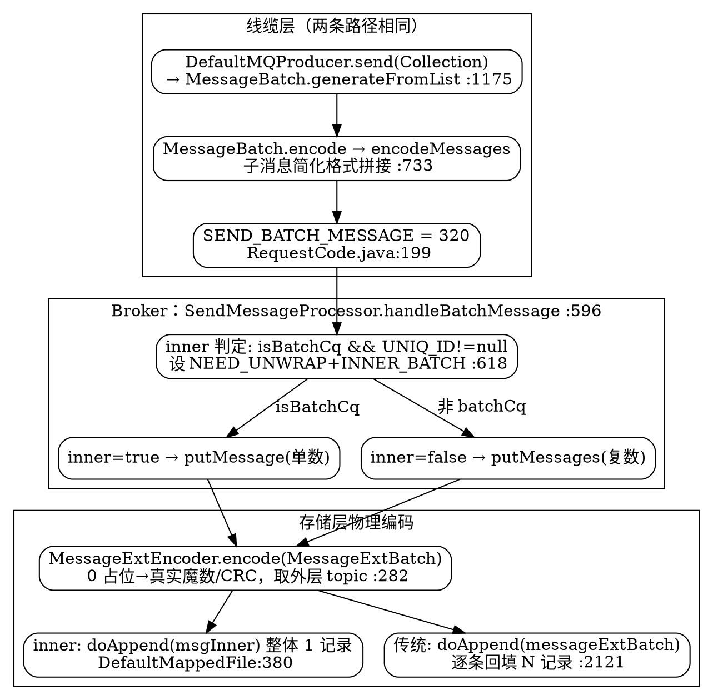
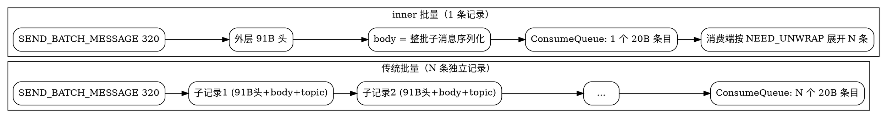

## Introduction

RocketMQ 的批量消息是「消息协议」中最容易被误读的一处：它**不是**把 N 条消息简单塞进一条物理记录。5.5.1 里存在两条编码路径，二者在**线缆 body** 上完全相同（都是 `encodeMessages` 拼接的简化子格式），真正的分野在**落盘粒度**：

- **线缆批量（传统批量 / 传输层批量）**：Producer 把多条消息压成**一次网络请求**发送，省 RTT 与头部开销；Broker 收到后拆成 N 条独立消息存储，ConsumeQueue 有 N 个 20B 条目——存储层与单条消息无异。
- **物理批量（inner batch / 5.x 新引入）**：整批在 `CommitLog` 中作为**一条物理记录**落盘，ConsumeQueue 仅 1 个 20B 条目，消费端按 `NEED_UNWRAP_FLAG` 再展开成 N 条——真正省存储与 dispatch 开销。

> 版本基线：**5.5.1**（tag `rocketmq-all-5.5.1`）。本篇所有 `file:line` 均对应该基线源码；单条消息的定长头布局见 [MessageProtocol](/docs/CS/MQ/RocketMQ/MessageProtocol.md) §3，不重复展开。



## 1. 线缆批量编码（Producer → Wire）

### 1.1 入口与规整约束

Producer 侧批量入口是 `DefaultMQProducer.send(Collection<Message>)`，内部调 `MessageBatch.generateFromList(msgs)`（`DefaultMQProducer.java:1175`），把一批 `Message` 规整成一个 `MessageBatch`。规整阶段强制以下约束（`MessageBatch.java:42-72`）：

- **同 topic**：`first.getTopic().equals(message.getTopic())` 不成立直接抛 `UnsupportedOperationException`（`:58-59`）；
- **同 waitStoreMsgOK**：`first.isWaitStoreMsgOK() != message.isWaitStoreMsgOK()` 抛异常（`:61-62`）；
- **禁延迟消息**：`delayTimeLevel/delayTimeMs/delayTimeSec/deliverTimeMs > 0` 抛 `UnsupportedOperationException("Delayed messages are not supported for batching")`（`:49-51`）；
- **禁重试 topic**：`topic.startsWith(RETRY_GROUP_TOPIC_PREFIX)` 抛异常（`:52-54`）。

规整后 `MessageBatch` 的 topic / waitStoreMsgOK 取首条消息的值（`:69-70`），整批共享。

### 1.2 简化子格式（关键：无真实魔数、无 topic）

`MessageBatch.encode()` 调 `MessageDecoder.encodeMessages(messages)`（`MessageBatch.java:34-36`），后者对每条子 `Message` 调 `encodeMessage`（`MessageDecoder.java:663-700`）再拼接。**这个线缆子格式是「精简版」，与单条物理定长头完全不同**：

```
偏移  字段         类型/长度      说明
0     TOTALSIZE    int 4         整条子消息长度（含自身）
4     MAGICCODE    int 4         占位 0（非真实物理魔数）
8     BODYCRC      int 4         占位 0（落盘时由 broker 重算）
12    FLAG         int 4         业务 flag
16    BODY         int 4 + N     体长度 + 体字节
…     PROPERTIES   short 2 + K   属性长度(2) + 属性字符串
```

与单条物理定长头（91B）相比，**线缆子格式没有 QUEUEID / QUEUEOFFSET / PHYSICALOFFSET / SYSFLAG / BORNTIMESTAMP / BORNHOST / STORETIMESTAMP / STOREHOSTADDRESS / RECONSUMETIMES / PREPAREDTXOFFSET / TOPIC 字段**——因为这些是整批共享的元数据（同 topic、同 bornHost/storeHost），由外层 `MessageBatch` 的 Remoting 请求头承载（`DefaultMQProducerImpl.java:1005` 的 `requestHeader.setBatch(true)` 标记）。子格式只保留「这条子消息自己独有」的 flag / body / properties。

`encodeMessages` 把所有子消息的简化编码直接 `System.arraycopy` 拼成一个 `byte[]`，作为 `MessageBatch` 的 body（`:742-748`）。整批经 `SEND_BATCH_MESSAGE = 320`（`RequestCode.java:199`）一次性发出。

## 2. Broker 接收与 inner / 传统判定

`SendMessageProcessor.handleBatchMessage`（`SendMessageProcessor.java:596-667`）把线缆 body 收进 `MessageExtBatch`，并做 inner batch 判定：

- 当 `QueueTypeUtils.isBatchCq(topicConfig) && MessageClientIDSetter.getUniqID(messageExtBatch) != null`（`:618`）——即该 topic 启用**批量 ConsumeQueue** 且整批带 UNIQ_KEY 时，判定为**新引入的 inner-batch**：
  - 置位 `NEED_UNWRAP_FLAG` 与 `INNER_BATCH_FLAG`（`:620-621`）；
  - `messageExtBatch.setInnerBatch(true)`（`:622`）；
  - `countInnerMsgNum` 统计子消息数并写入 `PROPERTY_INNER_NUM`（`:624-626`）；
  - 响应头回带 `BatchUniqId` 告诉 Producer 这是 inner-batch 响应（`:630`）。
- 否则走**传统批量**路径。

落盘入口随之分叉（`:639-662`）：inner 调 `putMessage(messageExtBatch)`（单数），传统调 `putMessages(messageExtBatch)`（复数）。

## 3. 物理批量编码器（核心：0 占位 → 真实魔数 / CRC）

无论 inner 还是传统，Broker 都用同一套 `MessageExtEncoder.encode(MessageExtBatch, ctx)`（`MessageExtEncoder.java:282-383`）把线缆拼接的子格式**重写为完整物理定长头**。这是批量编码最精妙的一步，逐条子消息做如下转换：

1. 从线缆子格式读 `TOTALSIZE/MAGICCODE(=0)/BODYCRC(=0)/FLAG/BODY/PROPERTIES`（`:298-313`）；
2. **重算 `bodyCrc = UtilAll.crc32(body)`**（`:308`）——填回线缆 0 占位；
3. 从外层 `MessageExtBatch` 取**整批共享**的 `topic/sysFlag/queueId/bornHost/storeHost/bornTimestamp/reconsumeTimes`（`:315-356`）；
4. 用 `calMsgLength(version, sysFlag, bodyLen, topicLength, totalPropLen)` 计算完整定长头（91B IPv4 / 115B IPv6），重写每条子消息（`:325-377`）：
   - `MAGICCODE = version.getMagicCode()`（V1=-626843481 / V2=-626843477，**替换线缆 0 占位**，`:328`）；
   - `BODYCRC = bodyCrc`（**替换线缆 0 占位**，`:330`）；
   - `QUEUEOFFSET / PHYSICALOFFSET / STORETIMESTAMP = 0`（占位，落盘时回填，`:336/:338/:349`）；
   - `PREPAREDTRANSACTIONOFFSET = 0`——**批不支持事务**（注释 `batch does not support transaction`，`:357-358`）；
   - `BODY/TOPIC/PROPERTIES` 取自子格式（topic 字节从外层取，`:315-316`）。
5. 末尾为开启 `enabledAppendPropCRC` 预留 `crc32ReservedLength` 校验段（`:377`）。

循环结束后 `putMessageContext.setBatchSize(batchSize)` 与 `setPhyPos(new long[batchSize])`（`:379-380`），供落盘分支逐条回填物理偏移。

> 一句话：`batchEncoder` 把「多条精简子消息」翻译成「多条完整物理记录」，但**每条子消息的 topic 来自外层、魔数与 CRC 现场重算**——这正是整批同 topic 约束的回报（省去每条重复写 topic）。

## 4. 落盘粒度差异（两条物理路径）

`DefaultMappedFile.appendMessage` 按 `isInnerBatch` 分派（`DefaultMappedFile.java:374-384`），落到 `CommitLog` 的两个 `doAppend` 重载：

- **传统批量**（`isInnerBatch()==false`）：走 `doAppend(messageExtBatch)`（`CommitLog.java:2121-2216`）。它读 `encodedBuff`，循环每条子消息：读 `TOTALSIZE` 定长切分（`:2163`），回填 `QUEUEOFFSET`（连续递增，`:2184`）、`PHYSICALOFFSET`（`:2186`）、`STORETIMESTAMP`（`:2190`），最后 `byteBuffer.put(messagesByteBuff)` 整体写入（`:2209`）。结果是 **N 条各自带完整 MAGIC_CODE 头的物理记录连续排布**，ConsumeQueue 派发 N 个 20B 条目——与单条消息存储无本质区别，批量只在网络层省开销。
- **inner 批量**（`isInnerBatch()==true`）：走 `doAppend(msgInner)` 分支（`:380`，即 `CommitLog.java:1990-2119` 的单条落盘路径，把整个 `encodedBuff` 当作**一条大消息**的 body）。结果是 **1 条物理记录**（外层 1 个 91B 头 + body=整批序列化），ConsumeQueue 仅 **1 个 20B 条目**；消费端按 `NEED_UNWRAP_FLAG` 把这条记录解码展开成 N 条。



## 5. 两条消息 ID（批量场景）

与 [MessageProtocol](/docs/CS/MQ/RocketMQ/MessageProtocol.md) §6 的两类 ID 对应，批量场景的语义如下：

- **UNIQ_KEY（业务 ID）**：整批**一个**，由 Producer 在 `generateFromList` 过程中设置（`DefaultMQProducerImpl.java:932` 注释 "ID has been set in the generating process"），作为 `PROPERTY_UNIQ_CLIENT_MESSAGE_ID_KEYIDX` 进入 properties，随消息体走。
- **offsetMsgId（物理 ID）**：
  - inner 批量：整批**一个**（整条记录一个物理偏移）；
  - 传统批量：**N 个**（每条子消息各自一个），`doAppend(messageExtBatch)` 的 `msgIdSupplier` 把 `batchCount` 个 phyPos 拼成逗号分隔串（`:2138-2156`）。

消费端展开时，`MessageDecoder.decodeMessage(MessageExt, list)`（`MessageDecoder.java:761-781`）把整批 body 用 `decodeMessages` 解码成多条，并为每条构造 `MessageClientExt`：`queueOffset = messageExt.getQueueOffset() + i`（连续递增，`:767`），topic / storeHost / bornHost / 时间戳从外层复制。

## 6. 限制与边界

批量编码的硬性边界（源码可证）：

| 约束 | 源码位置 | 说明 |
|------|---------|------|
| 同 topic | `MessageBatch.java:58-59` | 否则 `UnsupportedOperationException` |
| 同 waitStoreMsgOK | `MessageBatch.java:61-62` | 否则抛异常 |
| 禁延迟消息 | `MessageBatch.java:49-51` | delay 系列字段 > 0 抛异常 |
| 禁重试 topic | `MessageBatch.java:52-54` | `RETRY_GROUP_TOPIC_PREFIX` 不支持 |
| 批不支持事务 | `MessageExtEncoder.java:357-358` | `PREPAREDTRANSACTIONOFFSET` 强制 0 |
| 单批 body 上限 | `MessageExtEncoder.java:288` | 超过 `maxMessageBodySize` 抛 `RuntimeException` |
| inner 需 batchCq + UNIQ_ID | `SendMessageProcessor.java:618` | 否则退化为传统批量 |

补充：批量消息在消费侧无法像单条那样精确控制每条的重试/死信，且 inner batch 展开依赖 `NEED_UNWRAP_FLAG`，低版本 Broker 或跨版本客户端可能退化；顺序消息的严格分区语义在批量下需额外对齐 queue 选择。

## Links

- [MessageProtocol（消息协议：单条物理编码 / 命令码 / 两条消息 ID）](/docs/CS/MQ/RocketMQ/MessageProtocol.md)
- [Store（存储引擎与派发：ConsumeQueue 20B 单元 / Reput）](/docs/CS/MQ/RocketMQ/Store.md)
- [Producer（生产端路径）](/docs/CS/MQ/RocketMQ/Producer.md)
- [MessageLifecycle（端到端消息生命周期与幂等）](/docs/CS/MQ/RocketMQ/MessageLifecycle.md)
- [TransactionalMessage（事务消息源码链路）](/docs/CS/MQ/RocketMQ/TransactionalMessage.md)
- [Remoting（通信模块高层概览）](/docs/CS/MQ/RocketMQ/Remoting.md)

## References

1. [RocketMQ 源码：rocketmq-store / MessageExtEncoder](https://github.com/apache/rocketmq/tree/develop/store/src/main/java/org/apache/rocketmq/store)
2. [RocketMQ 源码：common / MessageDecoder、MessageBatch](https://github.com/apache/rocketmq/tree/develop/common/src/main/java/org/apache/rocketmq/common/message)
3. [RocketMQ 官方文档 - batch send](https://rocketmq.apache.org/docs/)
