## Controller HA: How Controller Mode Elects Master and How Proxy Shields the Routing Layer

> 版本基线：**5.5.1**（tag `rocketmq-all-5.5.1`）。所有 `file:line` 均来自 `E:/Projects/rocketmq-rocketmq-all-5.5.1` 真文件核验。

## Introduction

5.x 引入的 **Controller 模式**常被叙述成「Controller 替代 NameServer 做选主」。**这是一个需要澄清的误区**：传统 NameServer 模式下的 NameServer **从来不负责选主**——`brokerRole` 由配置静态指定，broker 把 master 地址「自报」注册到 NameServer，NameServer 只是被动汇总路由的注册中心（`[Namesrv](/docs/CS/MQ/RocketMQ/Namesrv.md)` 一节已坐实）。

准确的说法是：Controller 是 5.x **新增的、独立的选主权威**，它接管了「谁是 master」的裁定权；在 Controller 模式下 NameServer **并未消失**，而是退化为更纯粹的路由发现组件，路由表里 master 地址的权威性从「broker 自报」转移到「Controller 裁定」。`[RocketMQ 5.x](/docs/CS/MQ/RocketMQ/RocketMQ5.md)` 的 HA 节已指出 Controller 是「轻量级、可拔插的选主组件，既可部署在 NameServer 中，也可部署在本地」。

本文聚焦 Proxy 部署形态下，Controller 高可用如何接管选主、以及 Proxy 如何屏蔽这一层。

## Controller Itself Is Highly Available (Raft)

`Controller` 是一个接口（`Controller.java:38`），它自身的元数据（哪个 broker 是 master、syncStateSet 等）必须高可用，因此 Controller 用 Raft 保证自身一致，提供两种实现：

- `DLedgerController`（`controller/.../impl/DLedgerController.java:87`）—— Controller 自身默认实现
- `JRaftController`（`controller/.../impl/JRaftController.java:67`）—— 需显式配置

`controllerType` 默认 `DLEDGER_CONTROLLER`（`ControllerConfig.java:31`），即 Controller 组内部用 DLedger 做 Raft；`controllerStorePath` 默认 `${user.home}/${controllerType}Controller`（`:185`）。

> ⚠️ 注意区分三层「DLedger」：
> 1. **Broker 侧 DLedger 模式**（旧，`enableDLegerCommitLog`）—— 5.5.1 已废弃（`BrokerStartup.java:47-49` 启动即警告）。
> 2. **Controller 自身 Raft**（`controllerType=DLedger`）—— 推荐路径，默认即开。
> 3. **Controller 与 Broker DLedger 互斥**：`enableControllerMode` 与 `enableDLegerCommitLog` 同开直接 `System.exit(-4)`。

Broker 侧开启 Controller 模式的开关：`enableControllerMode = false`（默认关闭，`BrokerConfig.java:366`），`controllerAddr = ""`（`:368`）指向 Controller 集群地址。即 **5.x 默认仍是传统主从**，需显式开启 Controller 模式。

## How Controller Elects Master (Source-Level)

选主的核心在 `ReplicasInfoManager.electMaster`（`controller/.../impl/manager/ReplicasInfoManager.java:193`），由 `Controller.electMaster`（`Controller.java:80`）经 `ControllerRequestProcessor.handleControllerElectMaster`（`ControllerRequestProcessor.java:177-191`）路由进来。

选举逻辑分三步（`ReplicasInfoManager.java:193-276`）：

1. **首次选主**：若该 broker 组从未有 master（`isFirstTimeForElect`），直接把请求携带的 `brokerId` 立为 master（`:212-216`）。
2. **Policy 选举**：否则调用 `electPolicy.elect`（`:222`）。默认 `DefaultElectPolicy`（`controller/.../elect/impl/DefaultElectPolicy.java:29`）：
   - 优先在 **in-sync 副本集**（`syncStateSet`）中候选，其次在 `allReplicaBrokers`（需开 `enableElectUncleanMaster`）中候选（`ReplicasInfoManager.java:209`、`:81-93`）。
   - 候选按 **`(epoch ↓, maxOffset ↓, electionPriority ↑)`** 降序排序，取最优（`DefaultElectPolicy.java:39-51`、`:112-119`）。
   - 老 master 仍存活且在候选集内 → **保留老 master**（`:103-105`、`:225-238`）。
   - 指定 `designateElect` 可强制选举某 brokerId（`:221`、`:108-110`）。
3. **新 master 产生**：`masterEpoch + 1`、`syncStateSetEpoch + 1`，生成 `ElectMasterEvent` 写入状态机（`:241-262`）—— 状态机保证多 Controller 副本一致。

此外 `ReplicasInfoManager` 还负责 `registerBroker`（`:334`）、`getNextBrokerId`（`:290`）、`applyBrokerId`（`:305`）、`alterSyncStateSet`（`:110`）、`getReplicaInfo`（`:368`）、`scanNeedReelectBrokerSets`（`:468`，周期扫描需要重选的 broker 组）—— 即 Controller 完整管理「broker 生命周期 + 选主 + 同步副本集」。

## How Broker Obeys the Controller (Three Paths)

Broker 侧的副本管理由 `ReplicasManager`（`broker/.../broker/controller/ReplicasManager.java:67`）承担，它通过**三条路径**感知并执行 Controller 的选主裁定：

| 路径 | 触发 | 入口 | 动作 |
| ---- | ---- | ---- | ---- |
| **注册时** | broker 启动/重启向 Controller 注册 | `registerBrokerToController` `:559` → RPC `registerBrokerToController` | 按响应 `masterBrokerId` 调 `changeToMaster`/`changeToSlave`（`:571-574`） |
| **周期拉取** | 定时同步 | `schedulingSyncBrokerMetadata` `:641` → `getReplicaInfo` `:644` | 对比 `masterEpoch`，新 epoch 大则 `changeToMaster`/`changeToSlave`（`:652-664`） |
| **主动推送** | Controller 决策后反向通知 | `AdminBrokerProcessor.notifyBrokerRoleChanged` `:3217` → `replicasManager.changeBrokerRole` `:3229` | 直接 `changeToMaster`/`changeToSlave`（`:225-235`） |

`changeToMaster`（`:237`）/ `changeToSlave`（`:281`）的核心动作：改写 `brokerId`/`brokerRole`（`SYNC_MASTER`/`SLAVE`）、通知 `haService` 切主、更新 `masterAddress`/`masterBrokerId`，最后关键一步——`registerBrokerWhenRoleChange`（`:321`）注释明确写 **"Register broker to name-srv"**，调用 `registerBrokerAll`（`:326`）把**新 master 身份重新注册到 NameServer**。

> 这一步是「Controller 替代 NameServer 选主语义」的**真正落点**：broker 的 master 身份不再由配置自报，而是由 Controller 裁定后，broker 主动把裁定结果写回 NameServer 路由表。

## What "Replacing" Actually Means (Core Clarification)

把两种模式的「谁是 master」权威来源并排对照：

| 维度 | 传统 NameServer 模式 | Controller 模式 |
| ---- | ------------------ | --------------- |
| master 决定方 | 配置 `brokerRole` + broker 自报 | **Controller `electMaster` 裁定** |
| NameServer 角色 | 被动汇总注册路由（含 masterAddr） | 仍为路由发现；但 masterAddr 由 Controller 裁定驱动 |
| 主从切换 | 人工 / 外部脚本 / 无切换 | **自动**：master 宕机 → `scanNeedReelectBrokerSets` → `electMaster` → 新 master 被通知/拉取 → 重注册 NameServer |
| 故障切换时延 | 取决于人工 | Controller 秒级裁定 + 20s 路由刷新（见下） |
| Proxy/客户端可见性 | 直连或经 Proxy 读 NameServer 路由 | 同左，无差异 |

**结论**：NameServer 在两种模式下都只做路由发现；Controller 模式新增的选主权威**叠加**在 NameServer 之上，而非取代 NameServer。所谓「替代选主语义」，准确含义是「**master 身份的权威来源从 broker 自报变为 Controller 裁定，并经 NameServer 路由对外暴露**」。

## Proxy Shields the Client (Source-Level)

在 Proxy 部署形态下，客户端（gRPC `rocketmq-client-java` 或 Remoting SDK）只连 Proxy，**完全不感知** NameServer / Controller / Broker 的存在。源码层面有两个铁证：

1. **Proxy 与选主 Controller 零直接交互**：在 `proxy/` 模块检索 `getControllerAddr` / `controllerLeader` / 选主 `Controller` 类 → **无任何命中**；仅 `Local` 模式实现引用了本机 `brokerController`（那是 Local 模式把 Proxy 和 Broker 同进程，非选主 Controller）。Proxy 的路由完全来自 NameServer。

2. **Proxy 经 NameServer 获取路由**：`ClusterTopicRouteService.getTopicRouteForProxy`（`proxy/.../route/ClusterTopicRouteService.java:38`）→ `getAllMessageQueueView` → `getTopicRouteData` 从 **NameServer** 拉取 `TopicRouteData`（含 `brokerAddrs` 中的 masterAddr）。

Proxy 路由缓存参数（`ProxyConfig.java`）：

| 配置 | 默认值 | 含义 |
| ---- | ------ | ---- |
| `topicRouteServiceCacheRefreshSeconds` | `20`（`:187`） | 路由缓存刷新周期（秒） |
| `topicRouteServiceCacheExpiredSeconds` | `300`（`:186`） | 路由缓存过期时间（秒） |
| `topicRouteServiceCacheMaxNum` | `20000`（`:188`） | 缓存条目上限 |

**切主感知全链路**（Controller 模式下 Proxy 如何"间接"拿到新 master）：

```dot
digraph proxy_shield {
  rankdir=LR;
  node [shape=box, style=rounded];

  subgraph cluster_controller {
    label="Controller (Raft, 高可用)";
    color=lightgrey;
    C1 [label="electMaster\nReplicasInfoManager:193"];
    C2 [label="scanNeedReelect\n:468"];
  }
  subgraph cluster_broker {
    label="Broker 组";
    color=lightgrey;
    B1 [label="changeToMaster\nReplicasManager:237"];
    B2 [label="registerBrokerWhenRoleChange\nregisterBrokerAll :321"];
  }
  subgraph cluster_ns {
    label="NameServer (路由发现)";
    color=lightgrey;
    N1 [label="RouteInfoManager\n更新 masterAddr"];
  }
  subgraph cluster_proxy {
    label="Proxy (无状态)";
    color=lightgrey;
    P1 [label="TopicRouteService 缓存 20s 刷新\nClusterTopicRouteService:38"];
  }
  subgraph cluster_client {
    label="Client";
    color=lightgrey;
    Q1 [label="gRPC / Remoting SDK"];
  }

  C2 -> C1 [label="master 宕机触发"];
  C1 -> B1 [label="notifyBrokerRoleChanged :3217\n或 getReplicaInfo 拉取 :644"];
  B1 -> B2 [label="切主后"];
  B2 -> N1 [label="registerBrokerAll"];
  N1 -> P1 [label="下次路由刷新 <=20s"];
  P1 -> Q1 [label="写请求路由到新 master"];
}
```

即：Controller 裁定新 master → broker 切主并 `registerBrokerAll` 更新 NameServer → Proxy 至多 20s 后刷新路由缓存拿到新 masterAddr → 把写请求转发到新 master。Proxy 与客户端全程**不直接与 Controller 通信**，所有选主复杂性被 NameServer 路由层 + Proxy 缓存屏蔽。

## Misconceptions Corrected

| 常见说法 | 5.5.1 真相 |
| -------- | --------- |
| Controller 替代 NameServer 做选主 | ❌ NameServer 从未负责选主；Controller 是**新增**选主权威，NameServer 继续做路由发现 |
| Proxy 直连 Controller 获取 master | ❌ Proxy 只连 **NameServer**；与选主 Controller 零交互 |
| Controller 模式默认开启 | ❌ `enableControllerMode=false`（`BrokerConfig.java:366`），5.x 默认仍是传统主从 |
| 废弃 DLedger | ⚠️ 仅废弃 **Broker 侧** DLedger 模式；Controller 自身默认仍用 DLedger 组 Raft |

## Links
- /docs/CS/MQ/RocketMQ/DLedgerCommitLog.md

- [RocketMQ 5.x](/docs/CS/MQ/RocketMQ/RocketMQ5.md)
- [NameServer](/docs/CS/MQ/RocketMQ/Namesrv.md)
- [Broker](/docs/CS/MQ/RocketMQ/Broker.md)
- [Cluster](/docs/CS/MQ/RocketMQ/Cluster.md)
- [RocketMQ](/docs/CS/MQ/RocketMQ/RocketMQ.md)
- [HAService（传统主从复制：HAClient 反向拉取 / SYNC·ASYNC / GroupTransfer）](/docs/CS/MQ/RocketMQ/HAService.md)

## References

1. [RocketMQ 5.5.1 Release](https://github.com/apache/rocketmq/releases/tag/rocketmq-all-5.5.1)
2. [RocketMQ 5.0 速览（官方）](https://rocketmq.apache.org/docs/featureBehavior/)
3. [RocketMQ 部署 Controller 模式（官方）](https://rocketmq.apache.org/docs/deployment/02runbroker)
