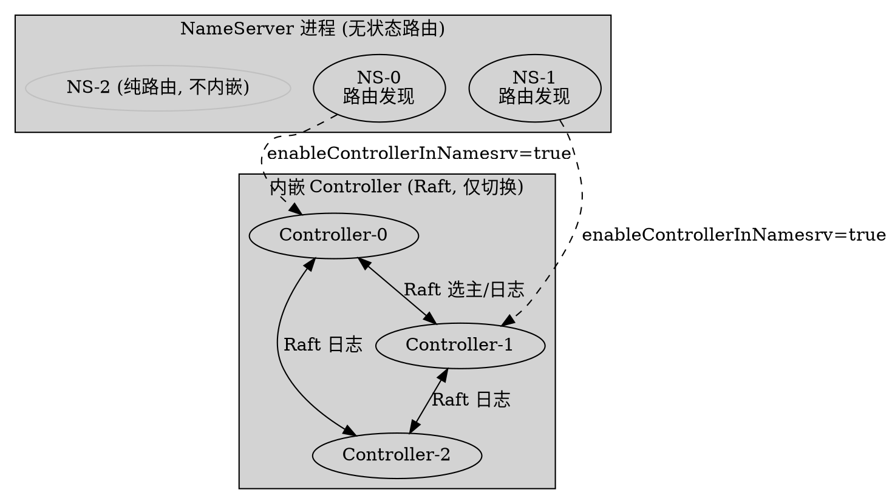
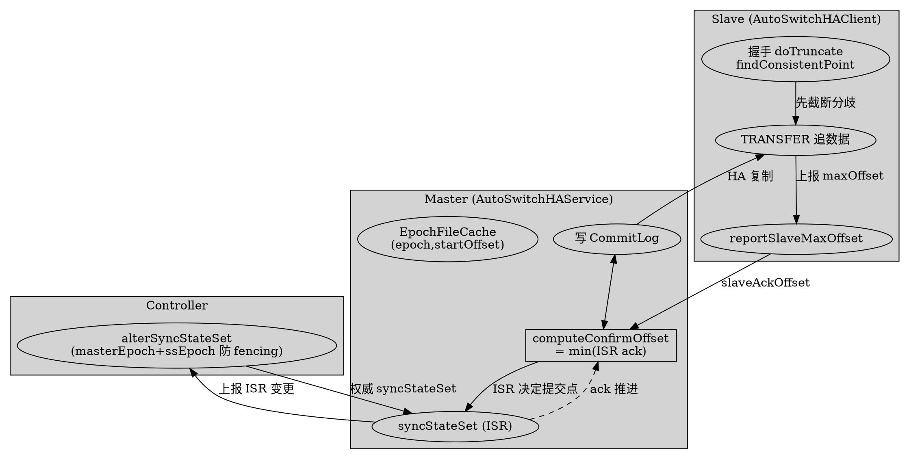
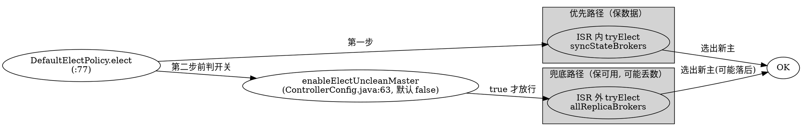

# Embedded Controller Deployment, AutoSwitch Replication Semantics and Disaster Recovery

## Introduction

RocketMQ 5.x 的 Controller 模式（[ControllerHA](/docs/CS/MQ/RocketMQ/ControllerHA.md)）把「选主」从 broker 配置里抽出来交给独立的 Controller 组件，但真正让这套架构落地的是三块配套机制：**内嵌部署**（Controller 进程放哪）、**AutoSwitch 复制语意**（master/slave 间数据如何复制、提交点如何推进、副本如何进出 ISR）、**容灾选举**（master 挂了如何选、能否选数据落后的副本）。

三者共同回答了传统主从架构解决不了的两个问题：① 选主不再靠人工配 `brokerRole`，而是 Controller 自动裁定；② 复制不再「异步追不上就脑裂」，而是有 ISR + 提交点（类似 Kafka HW）的强一致语义，且能在「丢数据」与「不可用」之间做显式取舍。

> 启用前提：AutoSwitchHA 仅在 `BrokerConfig.enableControllerMode=true`（`BrokerConfig.java:366` 默认 false）时启用；否则 broker 仍走传统 `DefaultHAService` 异步复制。本页所有 file:line 基于 **RocketMQ 5.5.1** 源码核验。

## 1. 内嵌部署（Embedded Deployment via enableControllerInNamesrv）

Controller 有两种部署形态：**独立部署**（单独 `Controller` 进程）与**内嵌 NameServer 部署**。内嵌是 5.x 推荐的轻量形态。

开关在 `NamesrvConfig`：

```java
// common/.../common/namesrv/NamesrvConfig.java:79
private boolean enableControllerInNamesrv = false;
```

`NamesrvStartup` 据此决定是否在内嵌 NameServer 进程里拉起 Controller：

```java
// namesrv/.../namesrv/NamesrvStartup.java:72-82
public static ControllerManager controllerManagerMain() {
    if (namesrvConfig.isEnableControllerInNamesrv()) {
        return createAndStartControllerManager();   // 内嵌启动 Controller
    }
    return null;
}
```

配置加载路径会额外准备 `ControllerConfig` 与 `JraftConfig`：

```java
// NamesrvStartup.java:107-113  （若开启则构造控制器配置）
if (namesrvConfig.isEnableControllerInNamesrv()) {
    controllerConfig = new ControllerConfig();
    JraftConfig jraftConfig = new JraftConfig();
    controllerConfig.setJraftConfig(jraftConfig);
    MixAll.properties2Object(properties, controllerConfig);
}
```

关键性质（官方 `docs/cn/controller/deploy.md:9` 明确）：

> 嵌入 NameServer 部署时，NameServer 本身能力**仍然是无状态的**。内嵌模式下若 NameServer 挂掉多数派，**只影响切换能力，不影响原来路由获取等功能**。

也就是说，内嵌的 Controller 与 NameServer 的路由发现职责是解耦的——Controller 用 Raft（DLedgerController 或 JRaftController，由 `controllerType` 决定，默认 `DLEDGER_CONTROLLER`，`ControllerConfig.java:31`）保证自身高可用，NameServer 仍可被客户端只读拉路由。部署方**不强制每台 NameServer 都开** `enableControllerInNamesrv`（`:9`），可部分节点内嵌以减小运维 footprint。



## 2. 复制语意（AutoSwitchHA Replication Semantics）

Controller 模式下的复制由 `AutoSwitchHAService`（继承 `DefaultHAService`）承担，它把 Kafka 式的 **ISR + 高水位（HW）** 语意引入了 RocketMQ。核心三个概念：**EpochFileCache**（一致点）、**syncStateSet**（ISR）、**confirmOffset**（提交点）。

### 2.1 角色切换：changeToMaster / changeToSlave

选主结果下发后，broker 通过 `AutoSwitchHAService.changeToMaster` 升主：

```java
// store/.../ha/autoswitch/AutoSwitchHAService.java:122-169
public boolean changeToMaster(int masterEpoch) throws RocksDBException {
    final long truncateOffset = truncateInvalidMsg();         // 截断本地下落到新 epoch 之前的脏数据
    this.defaultMessageStore.setConfirmOffset(computeConfirmOffset());
    if (truncateOffset >= 0) this.epochCache.truncateSuffixByOffset(truncateOffset);
    final EpochEntry newEpochEntry = new EpochEntry(masterEpoch, getMaxPhyOffset());
    this.epochCache.appendEntry(newEpochEntry);               // 新 epoch 落盘
    this.defaultMessageStore.setStateMachineVersion(masterEpoch);
}
```

降从则启动 `AutoSwitchHAClient` 反向连接新 master（`:172-187`）。注意 master 升主时先做 `truncateInvalidMsg`（`:502`）——把未达确认点的日志截断，避免把脏数据暴露给消费者，这是「新主不读旧脏」的保证。

### 2.2 EpochFileCache 与一致点（findConsistentPoint）

AutoSwitch 用 **epoch + startOffset** 二元组标记每一段 leader 任期的数据区间，而非单纯物理 offset。slave 在握手阶段会收到 master 的 epoch 列表，并用 `findConsistentPoint` 算出本地应截断到哪：

```java
// store/.../ha/autoswitch/AutoSwitchHAClient.java:435-453
private boolean doTruncate(List<EpochEntry> masterEpochEntries, long masterEndOffset) {
    ...
    final long truncateOffset = localEpochCache.findConsistentPoint(masterEpochCache);
    if (truncateOffset < 0) { /* 找不到一致点：拒绝，避免数据分歧 */ return false; }
    this.messageStore.truncateFiles(truncateOffset);          // 真正截断本地日志
}
```

```java
// store/.../ha/autoswitch/EpochFileCache.java:227-245
public long findConsistentPoint(final EpochFileCache compareCache) {
    final Map<Integer, EpochEntry> descendingMap = new TreeMap<>(this.epochMap).descendingMap();
    while (iter.hasNext()) {
        final EpochEntry curLocalEntry = iter.next();
        final EpochEntry compareEntry = compareCache.getEntry(curLocalEntry.getKey());
        if (compareEntry != null && compareEntry.getStartOffset() == curLocalEntry.getValue().getStartOffset()) {
            consistentOffset = Math.min(curLocalEntry.getValue().getEndOffset(), compareEntry.getEndOffset());
            break;   // 同 epoch 且同 startOffset 才认定一致
        }
    }
}
```

反直觉点：一致点判定**必须 epoch 与 startOffset 同时相等**，否则即便物理 offset 相同也可能是不同任期写出的不同数据（offset 复用陷阱）。这是 AutoSwitch 相对传统异步复制最本质的改进——**用任期号杜绝脑裂后的数据错配**。

### 2.3 syncStateSet：ISR 进出（maybeExpand / maybeShrink）

`syncStateSet` 就是 RocketMQ 版的 ISR。slave 追上提交点才被接纳为同步副本：

```java
// AutoSwitchHAService.java:316-333
public void maybeExpandInSyncStateSet(Long slaveBrokerId, long slaveMaxOffset) {
    final long confirmOffset = this.defaultMessageStore.getConfirmOffset();
    if (slaveMaxOffset >= confirmOffset) {
        final EpochEntry currentLeaderEpoch = this.epochCache.lastEntry();
        if (slaveMaxOffset >= currentLeaderEpoch.getStartOffset()) {  // 还要落在新 leader epoch 区间内
            currentSyncStateSet.add(slaveBrokerId);                   // 接纳进 ISR
            notifySyncStateSetChanged(currentSyncStateSet);
        }
    }
}
```

落后太久的 slave 被移出 ISR（`:280-310`）：若 `(now - lastCaughtUpTime) > haMaxTimeSlaveNotCatchup` 则 shrink。

### 2.4 confirmOffset：提交点（类似 Kafka HW）

`computeConfirmOffset` 取 ISR 内所有 slave 的 `min(slaveAckOffset)`——只有被 ISR 多数确认的物理偏移才对消费者可见：

```java
// AutoSwitchHAService.java:423-445
public long computeConfirmOffset() {
    long newConfirmOffset = getMaxPhyOffset();
    for (HAConnection connection : this.connectionList) {
        Long slaveId = ((AutoSwitchHAConnection) connection).getSlaveId();
        if (currentSyncStateSet.contains(slaveId) && connection.getSlaveAckOffset() > 0)
            newConfirmOffset = Math.min(newConfirmOffset, connection.getSlaveAckOffset());  // ISR 最小值
    }
    return newConfirmOffset;
}
```

slave 侧在 TRANSFER 收数据时，由 master 告知 confirmOffset 并取 `min(confirmOffset, maxPhyOffset)` 落地（`:570`）——保证 slave 的可见水位不超过自身真实落盘。

### 2.5 Controller 侧 syncStateSet 维护与防 fencing

broker 把本地算好的 syncStateSet 通过 `alterSyncStateSet` 上报 Controller，Controller 带 **masterEpoch + syncStateSetEpoch** 双乐观锁防 fencing：

```java
// controller/.../impl/manager/ReplicasInfoManager.java:110-190
public ControllerResult<AlterSyncStateSetResponseHeader> alterSyncStateSet(...) {
    if (request.getMasterEpoch() != syncStateInfo.getMasterEpoch())      // 旧主被 fencing
        return fencedMasterEpoch();
    if (syncStateSet.getSyncStateSetEpoch() != syncStateInfo.getSyncStateSetEpoch())  // 并发写冲突
        return fencedSyncStateSetEpoch();
    for (Long replica : newSyncStateSet)
        if (!brokerAlivePredicate.check(...)) return brokerNotAlive();   // 只接纳存活副本
    int epoch = syncStateInfo.getSyncStateSetEpoch() + 1;                // 版本号 +1
}
```



## 3. 容灾（Disaster Recovery & Unclean Master Election）

master 宕机后由 `DefaultElectPolicy.elect` 在 Controller 侧选新主。选主策略分两步——**优先在同步副本（syncStateSet）内选，失败才跨出**：

```java
// controller/.../elect/impl/DefaultElectPolicy.java:77-94
public Long elect(clusterName, brokerName, Set<Long> syncStateBrokers, Set<Long> allReplicaBrokers,
                  Long oldMaster, Long preferBrokerId) {
    if (syncStateBrokers != null)
        newMaster = tryElect(..., syncStateBrokers, ...);   // 第一步：只在 ISR 内选
    if (newMaster != null) return newMaster;
    if (allReplicaBrokers != null)
        newMaster = tryElect(..., allReplicaBrokers, ...);  // 第二步：跨出 ISR（unclean）
}
```

`tryElect` 的排序键（`:39-51`）：**`(epoch↓, maxOffset↓, electionPriority↑)`**——优先选任期新、数据多、优先级高的副本；老 master 仍存活且无人强制指定则保留（防脑裂 no-op）。

### 3.1 容灾的核心开关：enableElectUncleanMaster

是否允许「第二步跨出 ISR 选主」由 `enableElectUncleanMaster` 控制：

```java
// controller/.../impl/manager/ReplicasInfoManager.java:209
Set<Long> allReplicaBrokers = controllerConfig.isEnableElectUncleanMaster()
    ? brokerReplicaInfo.getAllBroker() : null;   // 关（默认）则第二步根本拿不到候选集
```

```java
// common/.../common/ControllerConfig.java:63
private boolean enableElectUncleanMaster = false;   // 默认关闭
```

官方 `docs/cn/controller/deploy.md:32` 的警示：

> enableElectUncleanMaster：是否可以从 SyncStateSet 以外选举 Master，若为 true，**可能会选取数据落后的副本作为 Master 而丢失消息**，默认为 false。

这正是容灾的两难：**关（默认）= 宁可不可用也不丢数**（ISR 全灭则停写，等副本恢复）；**开 = 优先可用性**（允许落后副本顶上，但可能丢未同步的消息）。`docs/cn/controller/deploy.md:121` 给出的生产建议是「保证 `allAckInSyncStateSet=true` 以及 `enableElectUncleanMaster=false`」。

### 3.2 与 DLedger 复制的对比

| 维度 | DLedger 模式（老 5.x 方案） | AutoSwitchHA 模式（新推荐） |
|---|---|---|
| 选主 | DLedger 自身 Raft 选主 | Controller 外部选主 |
| 复制 | DLedger 日志复制（quorum ack，强 leader） | AutoSwitchHA 异步复制 + ISR/确认点 |
| 数据一致性边界 | 复制即多数派确认，语义简单 | confirmOffset=min(ISR ack)，HW 语义 |
| 脑裂防护 | Raft term | epoch + startOffset 一致点截断 |
| 部署 | 需独立 DLedger（或内嵌） | Controller 模式 + 传统 HA 改造 |
| 去重/迁移 | DLedger 已逐步废弃（见 [RocketMQ5](/docs/CS/MQ/RocketMQ/RocketMQ5.md)） | 当前主线 |

AutoSwitchHA 的本质是把「复制」从选举协议里解耦出来，复用改造后的 HA 管线，再用 Controller 的 syncStateSet + confirmOffset 补上一致性边界，工程上更轻、迁移更平滑。



## Links
- /docs/CS/MQ/RocketMQ/DLedgerCommitLog.md

- [ControllerHA](/docs/CS/MQ/RocketMQ/ControllerHA.md)
- [Namesrv](/docs/CS/MQ/RocketMQ/Namesrv.md)
- [Broker](/docs/CS/MQ/RocketMQ/Broker.md)
- [Cluster](/docs/CS/MQ/RocketMQ/Cluster.md)
- [RocketMQ5](/docs/CS/MQ/RocketMQ/RocketMQ5.md)
- [Store](/docs/CS/MQ/RocketMQ/Store.md)
- [HAService（传统主从复制：HAClient 反向拉取 / SYNC·ASYNC / GroupTransfer）](/docs/CS/MQ/RocketMQ/HAService.md)

## References

- `namesrv/.../namesrv/NamesrvStartup.java:72-82,107-113`（内嵌启动）
- `common/.../common/namesrv/NamesrvConfig.java:79`（enableControllerInNamesrv）
- `common/.../common/ControllerConfig.java:31,63`（controllerType / enableElectUncleanMaster）
- `store/.../ha/autoswitch/AutoSwitchHAService.java:122,172,280,316,423`（角色切换/ISR/提交点）
- `store/.../ha/autoswitch/AutoSwitchHAClient.java:435,570`（一致点截断/confirmOffset 落地）
- `store/.../ha/autoswitch/EpochFileCache.java:227`（findConsistentPoint）
- `controller/.../impl/manager/ReplicasInfoManager.java:110,209`（alterSyncStateSet / unclean 判定）
- `controller/.../elect/impl/DefaultElectPolicy.java:39,77`（选举排序与两步选主）
- 官方文档 `distribution/docs/cn/controller/deploy.md:9,21,32,121`
