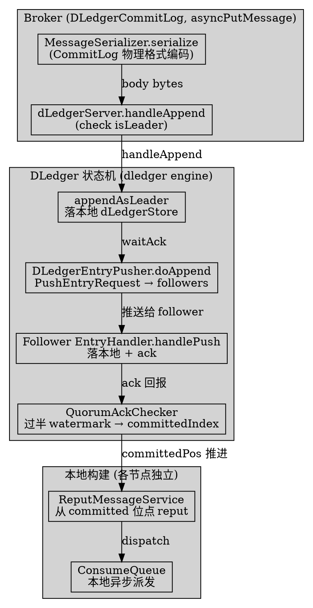

# DLedgerCommitLog — RocketMQ's Raft Consensus Adapter for the CommitLog

## Introduction

`DLedgerCommitLog` 是 RocketMQ 对接 **DLedger 共识引擎**（`io.openmessaging.storage.dledger`）的**适配层**：它把 `CommitLog` 的「消息追加从本地 MappedFile 写盘」替换为「走 DLedger 状态机的 Raft 风格复制」，从而让一组 Broker 在无需外部 Controller 的情况下通过内置选举达成主从一致。本页只深挖 `store/dledger` 包下的 `DLedgerCommitLog.java`（主仓库），并对照 dledger 引擎本体（`DLedgerServer` / `DLedgerEntry` / `DLedgerEntryPusher`）核验复制与选主，与已挖的 [HAService](/docs/CS/MQ/RocketMQ/HAService.md)（老主从复制）、[ControllerReplication](/docs/CS/MQ/RocketMQ/ControllerReplication.md)（Controller 选主）形成「三套复制/选主机制」对照。

> 版本基线：RocketMQ 5.5.1

**纠偏 / 反直觉点（务必先读）**：
- `DLedgerCommitLog` 类上标了 `@Deprecated`，注释明确写「新部署请用 Controller 模式做自动 failover」（`DLedgerCommitLog.java:62-64`）——它**不是 5.x 的推荐主从方案**，而是兼容旧 DLedger 部署的适配层。
- 任务描述里提到的 `DLedgerSynchronizationProcessor`（从节点同步处理器）在 5.5.1 主仓库与 dledger 0.3.3.4 仓库中**均不存在**（全仓 grep 零命中）。dledger 模式下的「主推 / 从接」复制由 dledger 引擎的 `DLedgerEntryPusher` 承担，并非 RocketMQ 侧的某个 Processor 类。
- 任务描述提到的 `isInReplicationProcess`（dual-write 判定）在 5.5.1 中**也不存在**（零命中）。dledger 模式是**完全替换** `CommitLog` 写入路径，不存在「双写」历史分支；老 `HAService` 在 dledger 模式下被整体旁路（`haService == null`）。

## 1. 类定位与装配（extends CommitLog）

`DLedgerCommitLog extends CommitLog`（`DLedgerCommitLog.java:65`），因此复用父类全部的 offset 分配、topicQueueLock、`putMessageLock`、dispatch 注册等基建，只覆写「写入 / 读取 / 恢复 / flush」等与存储后端相关的钩子。它自身被 `@Deprecated` 标注（`DLedgerCommitLog.java:64`）。

### 1.1 启用判定：DefaultMessageStore 在 dledger 模式下替换 CommitLog

装配点是 `DefaultMessageStore` 构造函数（`DefaultMessageStore.java:240-241`）：

```java
// store/.../store/DefaultMessageStore.java:240-241
this.commitLog = messageStoreConfig.isEnableDLegerCommitLog() ?
    new DLedgerCommitLog(this) : new CommitLog(this);
```

即 `enableDLegerCommitLog`（`MessageStoreConfig.java:1444`）为 `true` 时，整个 `commitLog` 字段被替换成 `DLedgerCommitLog` 实例；此后所有 `putMessage` / `getData` / `getMaxOffset` 等都走 dledger 分支。相关配置由 `MessageStoreConfig` 暴露：`getdLegerGroup`（`MessageStoreConfig.java:1396`）、`getdLegerPeers`（`:1412`）、`getdLegerSelfId`（`:1428`）、`getStorePathDLedgerCommitLog`（`:916`）。

### 1.2 构造：把 BrokerConfig 翻译成 DLedgerConfig

构造函数（`DLedgerCommitLog.java:89-119`）把 `MessageStoreConfig` 逐项映射进 `DLedgerConfig`，再 `new DLedgerServer(dLedgerConfig)`（`:108`）：

```java
// store/.../store/dledger/DLedgerCommitLog.java:91-108
dLedgerConfig = new DLedgerConfig();
dLedgerConfig.setSelfId(   ...getdLegerSelfId());        // 例如 n0 / n1
dLedgerConfig.setGroup(    ...getdLegerGroup());          // 例如 RaftGroup1
dLedgerConfig.setPeers(    ...getdLegerPeers());          // peer 列表
dLedgerConfig.setStoreBaseDir(...getStorePathRootDir());
dLedgerConfig.setDataStorePath(...getStorePathDLedgerCommitLog());
dLedgerConfig.setMappedFileSizeForEntryData(...getMappedFileSizeCommitLog());
// ...
id = Integer.parseInt(dLedgerConfig.getSelfId().substring(1)) + 1;  // "n0"→1, "n1"→2
dLedgerServer = new DLedgerServer(dLedgerConfig);
```

注意 `id` 字段（`:77`、`:107`）由 selfId 数字部分 +1 算出，**并非 0 永远是 master**——真正的 master 是选举产生、运行时再由 `DLedgerRoleChangeHandler` 把 `brokerId` 重置为 0（见第 3 节）。构造末尾还注册了一个 `AppendHook`（`:110-115`）：在每条 entry 写入后，把「物理 offset」回填进 body 内部的 `PHY_POS_POSITION` 槽位（`entry.getPos() + bodyOffset`），这是 dledger 物理 offset 与 CommitLog 消息体 offset 对齐的关键。

## 2. 写入路径：putMessage 走 DLedger 状态机

dledger 模式下消息追加完全不走父类的 `MappedFile.appendMessage`，而是序列化后交给 `DLedgerServer.handleAppend`。单条路径在 `asyncPutMessage`（`DLedgerCommitLog.java:542-642`）：

```java
// store/.../store/dledger/DLedgerCommitLog.java:564-589
encodeResult = this.messageSerializer.serialize(msg);            // 仍按 CommitLog 物理格式编码
// ... 分配 queueOffset、加 putMessageLock ...
AppendEntryRequest request = new AppendEntryRequest();
request.setGroup(dLedgerConfig.getGroup());
request.setRemoteId(dLedgerServer.getMemberState().getSelfId());
request.setBody(encodeResult.getData());
dledgerFuture = (AppendFuture<AppendEntryResponse>) dLedgerServer.handleAppend(request);
if (dledgerFuture.getPos() == -1) { ... OS_PAGE_CACHE_BUSY ... }  // 被拒（非 Leader 等）
long wroteOffset = dledgerFuture.getPos() + DLedgerEntry.BODY_OFFSET;  // ← dledger pos + 48
```

关键差异：

- **编码复用 CommitLog 格式**：`MessageSerializer.serialize`（`DLedgerCommitLog.java:905-997`）与父类 `CommitLog` 的编码逻辑一致（TOTALSIZE / MAGICCODE / QUEUEOFFSET / PHYSICALOFFSET / BODY / TOPIC / PROPERTIES…），所以 dledger 存储的 body 内部仍是标准 RocketMQ 消息结构，只是外层被包进 `DLedgerEntry`。
- **offset 偏移 +48**：`wroteOffset = getPos() + DLedgerEntry.BODY_OFFSET`（`DLedgerCommitLog.java:589`）。`BODY_OFFSET = HEADER_SIZE + 4 = 48`（`dledger/.../entry/DLedgerEntry.java:21-23`），即 dledger 文件里「数据起点」相对 entry 头部的偏移。msgId 用这个 `wroteOffset` 生成。
- **仅 Leader 可写**：`handleAppend` 在 dledger 引擎侧先 `check(memberState.isLeader())`（`dledger/.../DLedgerServer.java:251`），Follower/Candidate 调 `putMessage` 会拿到 `NOT_LEADER` / `LEADER_NOT_READY` 等码，映射成 `SERVICE_NOT_AVAILABLE`（`DLedgerCommitLog.java:620-624`）。
- **异步响应映射**（`DLedgerCommitLog.java:614-641`）：`dledgerFuture.thenApply` 把 `DLedgerResponseCode` 翻译成 `PutMessageStatus`。特别地，`WAIT_QUORUM_ACK_TIMEOUT` → `IN_SYNC_REPLICAS_NOT_ENOUGH`（注释明确说「不要返回 flush_slave_timeout，客户端会忽略它」，`:627`）；`LEADER_PENDING_FULL` → `OS_PAGE_CACHE_BUSY`（`:630`）。
- **批量路径** `asyncPutMessages`（`DLedgerCommitLog.java:644-786`）走 `BatchAppendEntryRequest`，循环 `appendAsLeader` 后仅等**最后一条** entry 的 ack（`:277-280`），`getPositions()` 拿回每条的物理 offset。

`start()` / `shutdown()` 直接委托 `dLedgerServer.startup()` / `shutdown()`（`DLedgerCommitLog.java:138-145`）；`flush()` 委托 `dLedgerFileStore.flush()` 并返回 `getFlushedWhere()`（`:147-151`）。

## 3. 选主与角色变更（DLedgerRoleChangeHandler）

dledger 的选举在 dledger 引擎内由 `DLedgerLeaderElector` 完成；RocketMQ 侧只通过一个回调把「选举结果」翻译成 Broker 的 master/slave 角色。这个回调就是 `DLedgerRoleChangeHandler`（`broker/.../dledger/DLedgerRoleChangeHandler.java`，**注意它在 broker 包，不在 store/dledger 包**）。

### 3.1 装配：注册到 LeaderElector

`BrokerController` 在启用 dledger 时创建并注册该 handler（`BrokerController.java:879-884`）：

```java
// broker/.../BrokerController.java:879-884
if (messageStoreConfig.isEnableDLegerCommitLog()) {
    DLedgerRoleChangeHandler roleChangeHandler =
        new DLedgerRoleChangeHandler(this, defaultMessageStore);
    ((DLedgerCommitLog) defaultMessageStore.getCommitLog())
        .getdLedgerServer().getDLedgerLeaderElector().addRoleChangeHandler(roleChangeHandler);
}
```

### 3.2 handle：按角色切换 Broker 身份

`handle(term, role)`（`DLedgerRoleChangeHandler.java:57-104`）在单线程 executor 里处理三种角色：

| 选举角色 | RocketMQ 侧动作 | file:line |
| ---- | ---- | ---- |
| `CANDIDATE` | 若当前不是 SLAVE → `changeToSlave(id)`（选举中先降为从） | `DLedgerRoleChangeHandler.java:66-69` |
| `FOLLOWER` | `changeToSlave(id)` | `:71-73` |
| `LEADER` | 自旋等到 `ledgerEndIndex == committedIndex && dispatchBehindBytes()==0`，再 `recoverTopicQueueTable()` + `changeToMaster(SYNC_MASTER)` | `:74-93` |

`changeToSlave`（`DLedgerRoleChangeHandler.java:136-154`）把 `brokerId` 设为 `id`（n0→1，n1→2…，`brokerId==0?1:brokerId`，`:140`），`brokerRole` 设为 `SLAVE`，并启动 `SlaveSynchronize` 定时同步（topic/config 元数据，而非 CommitLog 数据，`:112-126`）。`changeToMaster`（`DLedgerRoleChangeHandler.java:156-177`）把 `brokerId` 重置为 **0**、`brokerRole` 设为 `SYNC_MASTER`，并 `registerBrokerAll` 向 NameServer 重新注册。

> 反直觉点：dledger 模式下「谁是 master」**不是配置固定的**，而是选举动态决定的；配置里 `n0/n1/n2` 只是 selfId 与优先级（`preferredLeaderId`，`DLedgerCommitLog.java:103`），真正成为 master 后 `brokerId` 被统一重置为 0。这与老 `brokerRole` 静态配置（`SLAVE`/`MASTER`）和 [HAService](/docs/CS/MQ/RocketMQ/HAService.md) 的「master 恒为主」模型截然不同。

## 4. 复制机制：DLedgerEntryPusher（替代不存在的 SynchronizationProcessor）

任务描述的 `DLedgerSynchronizationProcessor` 在 5.5.1 / dledger 0.3.3.4 中均不存在（反例）。真正的复制由 dledger 引擎的 `DLedgerEntryPusher` 完成。其分工：

- **Leader 侧**：`handleAppend` 调 `dLedgerStore.appendAsLeader` 把 entry 落本地，再 `dLedgerEntryPusher.waitAck(resEntry)`（`dledger/.../DLedgerServer.java:287-288`）等 quorum。`DLedgerEntryPusher` 内含 `LeaderPusher` 的 `doAppend`（`DLedgerEntryPusher.java:549`）向每个 follower 发 `PushEntryRequest`（类型 APPEND/COMPARE/TRUNCATE/COMMIT，`buildPushRequest` `:438`）；`QuorumAckChecker`（`DLedgerEntryPusher.java:256`）统计各 peer 的 watermark，超过半数即把 `committedIndex` 前推。
- **Follower 侧**：收到 push 后由 `EntryHandler.handlePush`（`DLedgerEntryPusher.java:849`）落本地 `dLedgerStore` 并 ack；COMPARE 阶段用于对齐日志（脑裂/落后时），TRUNCATE 类型（`:680`、`:941`）用于截断本节点多出来的未提交 entry——这就是主从切换时的「`truncate` 语义」。

RocketMQ 侧的 `DLedgerCommitLog.truncate`（`DLedgerCommitLog.java:237-248`）则是**读取时**的防御：返回给上层的数据若超出 `committedPos`，把 `size` 截断到 `committedPos`，避免把未提交数据暴露给 ConsumeQueue/消费。真正的日志截断发生在 dledger 引擎层（见上）。`resetOffset`（`DLedgerCommitLog.java:513-516`）直接 `return false` 并注释「currently, it seems resetOffset has no use」。

## 5. 与 HAService 的关系（互斥，非共存）

dledger 模式与老 `HAService` **互斥**：启用 dledger 即完全弃用 `HAService` 的数据同步。证据链：

1. **HAService 不被创建**：`DefaultMessageStore.initializeHAService`（`DefaultMessageStore.java:1976-1988`）的装配条件是 `!isEnableDLegerCommitLog() && !isDuplicationEnable()`；dledger 模式下该条件为假，`haService` 保持 `null`。
2. **所有 haService 调用点都判空**：`slaveFallBehindMuch`（`DefaultMessageStore.java:1550-1555`）在 `haService == null || enableDLegerCommitLog` 时直接 `return -1` 并打印 warn；`updateHaMasterAddress` / `getRuntimeInfo` 等同样先 `if (haService != null)`（`:1516`、`:3129`）。
3. **DLedgerCommitLog 不保留 HAService 引用**：通读 `DLedgerCommitLog.java`，没有任何 `HAService` 字段或调用。唯一的 HA 关联是覆写 `appendData` 返回 `false`（`DLedgerCommitLog.java:815-818`），注释明确「the old ha service will invoke method, here to prevent it」——即即便被老逻辑误调，也**禁止往旧 MappedFile 追加**，强制走 dledger 写入。

> 反直觉点：老 [HAService](/docs/CS/MQ/RocketMQ/HAService.md) 是「**slave 反向 pull**」（slave 主动连 master、上报 offset、master 推数据）；dledger 是「**Leader 推 / Follower 接 + Quorum 确认**」（Raft 风格）。两者是两套不同机制，启用 dledger 即整体旁路 HAService，不存在「dledger 内部还走 HAService 拉数据」。

## 6. 物理格式映射与读回（readCommitLog）

### 6.1 DLedgerEntry 与 CommitLog 物理格式

一条 dledger 存储的记录 = `DLedgerEntry` 头（magic/size/index/term/pos/crc…，`HEADER_SIZE=44`，`BODY_OFFSET=48`，`dledger/.../entry/DLedgerEntry.java:21-23`）+ body。body 内部**就是标准 RocketMQ CommitLog 消息字节**（由 `MessageSerializer` 编码，`:905-997`），所以 dledger **不重写 magicCode / 不改写消息体语义**，只是「外包一层 Raft entry 头」。`AppendHook`（`:110-115`）在 entry 写入后把 `entry.getPos() + bodyOffset` 回填到 body 内的 `PHY_POS_POSITION`，使消息体里的物理 offset 与 dledger 实际落点一致——这是「dledger offset」与「CommitLog 消息 offset」对齐的桥梁。

### 6.2 读回：getData / getMessage 从 dledger 存储取

`DLedgerCommitLog.getData`（`DLedgerCommitLog.java:250-275`）与 `getMessage`（`:788-800`）对 `offset >= dividedCommitlogOffset` 的部分，改为从 `dLedgerFileList`（即 `DLedgerMmapFileStore` 的数据文件列表）按 offset 定位 MmapFile、取 buffer，再经 `convertSbr(truncate(sbr))` 包装成 `DLedgerSelectMappedBufferResult`（`:228-235`、`:1108-1125`）。`dividedCommitlogOffset`（`:83`）是「旧 CommitLog 段 / dledger 段」的分界线：迁移场景下老数据仍走 `super.getData(offset)`（本地 MappedFile），新数据走 dledger 文件（`dledgerRecoverNormally` 在 `:298` 把该值设为 `dLedgerFileList` 首文件 offset）。

`getMaxOffset`（`DLedgerCommitLog.java:154-162`）返回 `dLedgerFileStore.getCommittedPos()`（已提交位点），`getConfirmOffset`（`DLedgerCommitLog.java:178-180`）直接等于 `getMaxOffset`——即 dledger 的「已提交」即「可消费确认点」，不像 AutoSwitch 那样额外维护独立 confirmOffset（对照 [ControllerReplication](/docs/CS/MQ/RocketMQ/ControllerReplication.md)）。

> 反直觉点：dledger 提供 **Raft 一致性保证的是 CommitLog（日志复制）**；而**消费队列 ConsumeQueue 仍由每个节点本地异步构建**——`DefaultMessageStore` 的 `ReputMessageService` 从 dledger 提交位点 `reput` 派发（dispatch 链 `CommitLogDispatcherBuildConsumeQueue` 等，在 `DefaultMessageStore.java:248-250` 注册，dledger 模式同样生效）。即「日志一致」≠「索引一致自动同步」，从节点各自本地重建二级索引。

```dot
digraph dledger_role_ha {
  rankdir = LR;
  subgraph cluster_elect {
    label = "DLedgerLeaderElector (dledger engine)";
    style = filled;
    EL [label="选举 → CANDIDATE/FOLLOWER/LEADER", shape=box];
  }
  subgraph cluster_handler {
    label = "DLedgerRoleChangeHandler (broker 包)";
    style = filled;
    H [label="handle(term, role)", shape=box];
    S [label="changeToSlave(id)\nbrokerId=id, role=SLAVE", shape=box];
    M [label="changeToMaster(0)\nbrokerId=0, role=SYNC_MASTER", shape=box];
  }
  subgraph cluster_ha {
    label = "HAService 装配 (DefaultMessageStore)";
    style = filled;
    HA [label="initializeHAService\n!enableDLegerCommitLog 才建", shape=box];
    NONE [label="haService == null\n(dledger 模式整体旁路)", shape=box];
  }
  EL -> H [label="addRoleChangeHandler"];
  H -> S [label="FOLLOWER/CANDIDATE"];
  H -> M [label="LEADER 且追平"];
  M -> HA [style=dashed, label="dledger 下条件为假"];
  HA -> NONE;
}
```





## Links

- [Store](/docs/CS/MQ/RocketMQ/Store.md)
- [HAService](/docs/CS/MQ/RocketMQ/HAService.md)
- [ControllerReplication](/docs/CS/MQ/RocketMQ/ControllerReplication.md)
- [ControllerHA](/docs/CS/MQ/RocketMQ/ControllerHA.md)
- [Broker](/docs/CS/MQ/RocketMQ/Broker.md)
- [RocketMQ5](/docs/CS/MQ/RocketMQ/RocketMQ5.md)

## References

- 主仓库 `store/src/main/java/org/apache/rocketmq/store/dledger/DLedgerCommitLog.java:62-65`（@Deprecated / extends CommitLog）、`:89-119`（构造翻译 DLedgerConfig）、`:108`（new DLedgerServer）、`:110-115`（AppendHook 回填 PHY_POS）、`:138-151`（start/flush）、`:154-180`（getMaxOffset / getConfirmOffset）、`:228-248`（convertSbr / truncate）、`:250-275`（getData）、`:513-516`（resetOffset=false）、`:542-642`（asyncPutMessage → handleAppend）、`:585`（dLedgerServer.handleAppend）、`:589`（wroteOffset=pos+BODY_OFFSET）、`:644-786`（asyncPutMessages 批量）、`:788-800`（getMessage）、`:815-818`（appendData=false 禁用老 HA）、`:905-997`（MessageSerializer 编码）、`:1108-1125`（DLedgerSelectMappedBufferResult）
- 主仓库 `store/src/main/java/org/apache/rocketmq/store/DefaultMessageStore.java:240-241`（new DLedgerCommitLog 替换 CommitLog）、`:248-250`（dispatch 链）、`:1976-1988`（initializeHAService 互斥条件）、`:1550-1555`（slaveFallBehindMuch 在 dledger 返回 -1）
- 主仓库 `broker/src/main/java/org/apache/rocketmq/broker/BrokerController.java:879-884`（注册 RoleChangeHandler）
- 主仓库 `broker/src/main/java/org/apache/rocketmq/broker/dledger/DLedgerRoleChangeHandler.java:36`（implements RoleChangeHandler）、`:57-104`（handle 三角色）、`:106-134`（handleSlaveSynchronize 元数据同步）、`:136-177`（changeToSlave / changeToMaster）
- 主仓库 `store/src/main/java/org/apache/rocketmq/store/config/MessageStoreConfig.java:916`（getStorePathDLedgerCommitLog）、`:1396`（getdLegerGroup）、`:1412`（getdLegerPeers）、`:1428`（getdLegerSelfId）、`:1444`（isEnableDLegerCommitLog）
- dledger 引擎 `io/openmessaging/storage/dledger/DLedgerServer.java:247-299`（handleAppend / appendAsLeader / waitAck，check isLeader）
- dledger 引擎 `io/openmessaging/storage/dledger/entry/DLedgerEntry.java:21-23`（BODY_OFFSET=48 / HEADER_SIZE=44）
- dledger 引擎 `io/openmessaging/storage/dledger/DLedgerEntryPusher.java:52`（类）、`:256`（QuorumAckChecker）、`:438`（buildPushRequest）、`:549`（doAppend 推 follower）、`:680`/`:946`（TRUNCATE 截断）、`:849`（EntryHandler.handlePush follower 落盘）
