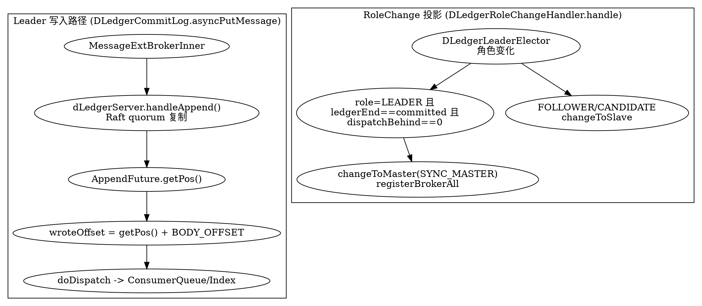
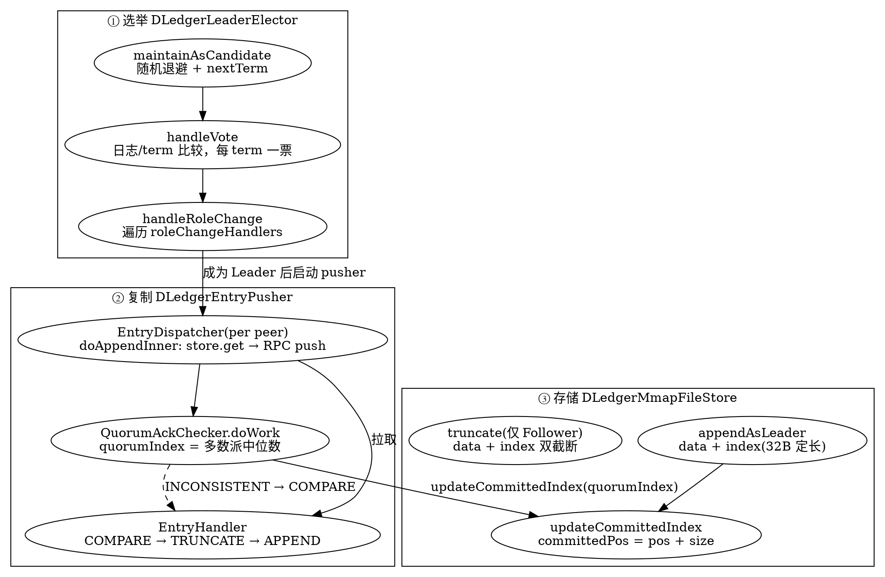

## Introduction

Dledger 是 RocketMQ 用于解决**分布式数据一致性**的核心协议，基于 Raft 协议实现
Dledger 作为一个轻量级的 Java Library，它的作用就是将 Raft 有关于算法方面的内容全部抽象掉，开发人员只需要关心业务即可
部署 RocketMQ 时可以根据需要选择使用 DLeger 来替换原生的副本存储机制。

> Etcd 虽然也实现了 Raft 协议，但它是自己封装的一个服务，对外提供的接口全是跟它自己的业务相关的

Dledger 只做一件事情，就是 CommitLog
Dledger 的定位就是把上一层的 StateMachine 给去除，只留下 CommitLog。这样的话，系统就只需要实现一件事：就是把操作日志变得高可用和高可靠。

> [!WARNING]
> **DLedger 在 5.5.1 中已被源码标记废弃**，而官方文档页至今未标注 —— 写方案前必读。本页的架构描述在 5.5.1 源码中依然成立（类都在），但**新部署不应再选它**，替代路径见 [Cluster](/docs/CS/MQ/RocketMQ/Cluster.md)。
>
> 源码常量证据（`BrokerStartup.java:47-49`）：
> ```java
> static final String DLEDGER_COMMIT_LOG_DEPRECATION_WARNING =
>     "Broker DLedger mode is deprecated and may be removed in a future release. " +
>         "Use Controller mode for new deployments.";
> ```
> 启动时由 `warnIfDLedgerCommitLogEnabled` 输出（同文件 `:258`）。
>
> 三条容易被文档误导的点：
> - **官方 5.0 文档页（`/docs/bestPractice/02dledger`）完全没有 deprecation 标注**，措辞仍是「部署指南」—— 只有源码知道这件事
> - **不存在 `org.apache.rocketmq.dledger` 这个包**，真实位置是 `store/.../store/dledger/` 与 `broker/.../broker/dledger/`
> - 顶层模块列表**没有** dledger 模块，它是外部依赖 `io.openmessaging.storage:dledger`
>
> 另需注意：启用 DLedger 会**强制 `brokerId = -1`**（`BrokerStartup.java:211-213`），且 **broker 不向 NameServer 注册**（`BrokerController.java:1976`），路由改由 DLedger 组内自维护 —— 升级迁移时极易踩坑。

这样做对消息系统还有非常特别的含义。消息系统里面如果还采用 StateMachine + CommitLog 的方式，会出现 double IO 的问题，因为消息本省可以理解为是一个操作记录。
所以 Dledger 会提供一些对原生 CommitLog 访问的 API。通过这些 API 可以直接去访问 CommitLog。这样的话，只需要写入一次就可以拿到写入的内容。
Dledger 对外提供的是简单的 API，如下图 6 所示。可以把它理解为一个可以无限写入操作记录的文件，可以不停 append，每一个 append 的记录会加上一个编号。
所以直接去访问 Dledger 的话就是两个 API：一个是 append，另一个是 get，即根据编号拿到相应的 entry（一条记录）。


## Architecture


主要有两件事：选举和复制，对应到上面的架构图中，也就是两个核心类：DLedgerLeaderElector 和 DLedgerStore，选举和文件存储。
选出 leader 后，再由 leader 去接收数据的写入，同时同步到其他的 follower，这样就完成了整个 Raft 的写入过程。


build

```shell
mvn clean install -DskipTests
```

选举核心类

- DLedgerConfig
- MemberState 节点状态机
- DLedgerClientProtocol 客户端通信协议


```java
package io.openmessaging.storage.dledger.protocol;

import java.util.concurrent.CompletableFuture;

/**
 * Both the RaftLogServer(inbound) and RaftRpcService (outbound) should implement this protocol
 */
public interface DLedgerClientProtocol {

    CompletableFuture<GetEntriesResponse> get(GetEntriesRequest request) throws Exception;

    CompletableFuture<AppendEntryResponse> append(AppendEntryRequest request) throws Exception;

    CompletableFuture<MetadataResponse> metadata(MetadataRequest request) throws Exception;

    CompletableFuture<LeadershipTransferResponse> leadershipTransfer(LeadershipTransferRequest request) throws Exception;
}
```

- DLedgerProtocol 服务端通信协议

```Java
/**
 * Both the RaftLogServer(inbound) and RaftRpcService (outbound) should implement this protocol
 */
public interface DLedgerProtocol extends DLedgerClientProtocol {

    CompletableFuture<VoteResponse> vote(VoteRequest request) throws Exception;

    CompletableFuture<HeartBeatResponse> heartBeat(HeartBeatRequest request) throws Exception;

    CompletableFuture<PullEntriesResponse> pull(PullEntriesRequest request) throws Exception;

    CompletableFuture<PushEntryResponse> push(PushEntryRequest request) throws Exception;

}
```

## RocketMQ

Dledger 虽然只需要写 CommitLog，但是基于 CommitLog 是可以做很多事情的。
RocketMQ 原来的架构里是有 CommitLog 的，现在用 Dledger 去替代原来的 CommitLog。
由于 Dledger 提供了一些可以直接读取 CommitLog 的 API，于是就可以很方便地根据 CommitLog 去构建 ConsumerQueue 或者其他的模块。
这就是 Dledger 在 RocketMQ 上最直接的应用

加了 Dledger 之后，其实就是在原来的消息上面加了一个头。这个头就是 Dledger 的头，本质上是一些简单的属性，例如 size 等

在使用的时候会有格式上的差异，所以社区在升级的时候做了一个平滑升级的考虑，如图 11 所示。要解决的问题是：如何将原来已有的 CommitLog 和现在基于 Dledger 的 CommitLog 混合？现在已经支持自动混合，但是唯一的一个要求是旧版的 CommitLog 需要自己去保持它的一致性。因为 Dledger 的复制是从新写入的记录开始。假设旧的 CommitLog 已经是一致的情况下，然后直接启动 Dledger ，是可以在旧的 CommitLog 基础上继续 append，同时保证新写消息的一致性，高可靠和高可用。这是 Dledger 直接应用到 RocketMQ 上的时候一个格式上的区别。

对于用户来说，这样做最直接的好处是：若使用 Master/Slave 架构模式，一旦一个 broker 挂了，则需要手动控制。但是使用 Dledger 之后不需要这么做。因为 Dledger 可以通过自己选举，然后把选举结果直接传给 RocketMQ 的 broker，这样通过 nameserver 拿到路由的时候就可以自动找到 leader 节点去访问消息，达到自动切换的目的。


## Source-Level Integration（RocketMQ 侧，5.5.1）

> 版本基线：**5.5.1**（目录 `rocketmq-all-5.5.1`，源码即该 release）。DLedger 共识引擎（`DLedgerServer` / `DLedgerLeaderElector` / `DLedgerEntryPusher` 等）来自外部依赖 `io.openmessaging.storage:dledger`，**不在本仓源码内**；本仓的「DLedger 部分」是三层集成胶水，下面逐层看源码如何把 Raft 日志接进 RocketMQ。

### DLedgerCommitLog：用 DLedger 替换 CommitLog

`DLedgerCommitLog extends CommitLog`（`store/.../store/dledger/DLedgerCommitLog.java:65`，类上已标 `@deprecated Use Controller mode`）。它把传统 commitlog 的「自己管 MappedFile + 主从同步」换成「所有写入走 DLedger 的 Raft 复制」，但对外仍是 `CommitLog` 接口，所以 `DefaultMessageStore` 无需改动就能切换。

写入路径（`asyncPutMessage` :542）的关键几步：

1. `messageSerializer.serialize(msg)`（:564）把消息编码成 body。
2. `assignOffset(msg)`（:572）先分配 queue offset（本地算，不等 Raft）。
3. 构造 `AppendEntryRequest` 并 `dLedgerServer.handleAppend(request)`（:585）—— **这一步才是真正的 Raft append**，复制到多数派后返回 `AppendFuture`。
4. **物理偏移换算**：`wroteOffset = dledgerFuture.getPos() + DLedgerEntry.BODY_OFFSET`（:589）。`getPos()` 是 DLedger entry 在 entry log 中的绝对位置，`BODY_OFFSET` 是 DLedger 固定条头（magic/size/index/term/pos/crc…）长度（来自 dledger 依赖）。这正是 Introduction 说的「在消息前加了一个 DLedger 头」—— 一条 RocketMQ 消息被包进一条 DLedger entry，`wroteOffset` 要跳过条头才指向消息体起始；msgId 也由这个 `wroteOffset` 生成（:594）。
5. 返回 `AppendFuture` 的 `thenApply`（:614）：把 DLedger 响应码映射成 RocketMQ 状态——`SUCCESS→PUT_OK`；`INCONSISTENT_LEADER / NOT_LEADER / LEADER_NOT_READY / DISK_FULL→SERVICE_NOT_AVAILABLE`；`WAIT_QUORUM_ACK_TIMEOUT→IN_SYNC_REPLICAS_NOT_ENOUGH`；`LEADER_PENDING_FULL→OS_PAGE_CACHE_BUSY`（:616-633）。即**写是否成功完全由 DLedger 的 quorum 复制结果决定**，broker 自身不再判断主从同步。

读取与可见性边界（:237-292）：`getData(offset)`（:250）和 `truncate(SelectMmapBufferResult)`（:237）都以 `dLedgerFileStore.getCommittedPos()` 为硬上限——`offset >= committedPos` 直接返回 null / 截断（:242-247, :263）。换言之 follower 只能读到 **committed index 之前**的数据，未提交（已写盘但还没达成 quorum / commit）的部分对读不可见。这与 Raft 的 committed 语义一致，也是 RocketMQ 用 DLedger 后「读一致性」的来源。

恢复与混合模式（:294-313）：`dledgerRecoverNormally` 先 `dLedgerFileStore.load()` + `recover()`（:295-297），把 `dividedCommitlogOffset` 设为 DLedger 第一段 entry 文件的起始偏移（:298）——这是「旧 commitlog」与「DLedger commitlog」的分界，读旧段走 `super.getData`（:252-254）。若 ConsumeQueue 的物理偏移超过 entry log 的 `maxWrotePosition`，则 `truncateDirtyLogicFiles(maxPhyOffset)`（:305-307）清掉脏逻辑文件，保证 CQ 不超前于已复制的物理日志。

### RoleChange：选举结果驱动 Broker 主从

`DLedgerRoleChangeHandler implements DLedgerLeaderElector.RoleChangeHandler`（`broker/.../broker/dledger/DLedgerRoleChangeHandler.java:36`）——它把自己注册进 DLedger 的选举器，Raft 角色一变就回调 `handle(term, role)`（:57）。这是「DLedger 自动选主后把结果交给 broker」的接线点，也是 DLedger 模式相比 Master/Slave 手动切换的核心卖点。

- `CANDIDATE`：若当前不是 `SLAVE` 就 `changeToSlave`（:66-69）。
- `FOLLOWER`：直接 `changeToSlave`（:71-72）。
- `LEADER`：先自旋等待，直到 **`isLeader()` 且 `ledgerEndIndex == committedIndex` 且 `dispatchBehindBytes() == 0`**（:75-88）—— 即不仅要选上，还要等本地把全部已提交 entry 重放完、ConsumerQueue 追平，才 `recoverTopicQueueTable()` + `changeToMaster(SYNC_MASTER)`（:89-92）。避免「刚选上主就接流量、但历史消息还没建好 CQ」的窗口。
- `changeToSlave(brokerId)`（:136）：`brokerId` 按 `brokerId==0?1:brokerId` 重设（:140）、`BrokerRole.SLAVE`（:141）、`changeSpecialServiceStatus(false)`（:143）、起 slave 同步（:146）、`registerBrokerAll`（:149）。
- `changeToMaster(role)`（:156）：`brokerId` 置 0（:168）、`BrokerRole` 置主（:169）、`changeSpecialServiceStatus(true)`（:165）、`registerBrokerAll`（:172）。`registerBrokerAll` 让 NameServer 拿到新路由，客户端从而自动找到 leader—— 这正是 Introduction 说的「自动切换」落地处。

> [!NOTE]
> **broker 的 master / slave 角色不是配置写死的，而是 DLedger 选举的投影**。一旦 leader 宕机触发重新选举，新 leader 由 `RoleChangeHandler` 自动 `changeToMaster`，无需人工介入。这也解释了 Introduction 提到的坑：启用 DLedger 会强制 `brokerId = -1`、broker 不向 NameServer 注册，路由改由 DLedger 组内自维护。

### Controller 内嵌 DLedger：元数据复制（新模式）

同一套 `io.openmessaging.storage.dledger` 库，既驱动已废弃的 broker 模式，也驱动 **5.5.1 推荐的新 Controller 模式**。`DLedgerController implements Controller`（`controller/.../impl/DLedgerController.java:87`），构造时直接 `new DLedgerServer(...)`（:136）、`registerStateMachine(statemachine)`（:137）、把自身 `RoleChangeHandler` 挂进选举器（:138）、`startup()`（:145）—— controller 集群也用 DLedger 做 Raft 复制，只是「状态机」从「CommitLog」换成「controller 元数据」。

- 所有 controller 元数据变更（`electMaster` / `alterSyncStateSet` / `applyBrokerId` / `registerBroker` / `getNextBrokerId` / `cleanBrokerData` …）都走 `scheduler.appendEvent(...)`（:182-268）→ `ControllerEventHandler`（:433）→ `appendToDLedgerAndWait(request)`（:292，内部 `dLedgerServer.handleAppend` :300）。**每一条元数据变更都是一条 DLedger entry**，靠 Raft 复制到多数派。
- 提交后由 `DLedgerControllerStateMachine.onApply`（`DLedgerControllerStateMachine.java:54`）遍历 `CommittedEntryIterator`，对每条 `DLedgerEntry` 反序列化出 event 并 `replicasInfoManager.applyEvent(event)`（:59-63），把已提交事件落到内存的 `ReplicasInfoManager`（syncStateSet / epoch / brokerId 等）。`onSnapshotSave / onSnapshotLoad`（:73 / :78）提供快照，避免 entry 无限增长。

> [!WARNING]
> 这反证了 Introduction 里「DLedger 去除 StateMachine、只留 CommitLog」的说法：**DLedger 本身完整支持 `StateMachine`**（Raft 标准组件），所谓「去除」只是指 broker 模式下上层业务不再套一层独立状态机、而是直接消费 CommitLog 来重建 ConsumerQueue。Controller 模式恰恰又用回了 `StateMachine` 接口来应用元数据事件。

### 调用与时序（append + 选主投影）



## Source-Level Core（dledger 库，0.3.3.4）

> 共识引擎核心来自 `io.openmessaging.storage:dledger`（rocketmq 5.5.1 依赖 `0.3.3.4`，pom 拼写作 `dleger.version`）。本 rocketmq 仓库只引用、未 vendored，已 clone `dledger-all-0.3.3.4` 标签源码到 `E:/Projects/dledger-0.3.3.4` 并用 `codegraph init` 建索引（136 files / 2784 nodes）反查核验。本节补 Raft 三要素的源码主线，并与上文 Integration 章节形成闭环。

### 主线一：Leader 选举（DLedgerLeaderElector）

DLedger 是单组 Raft 变体，选举逻辑集中在 `DLedgerLeaderElector`（723 行）。

- **三态状态机**：`StateMaintainer` 后台线程跑 `maintainState`（:546），按 `isLeader()/isFollower()` 分发到 `maintainAsLeader / maintainAsFollower / maintainAsCandidate`。
- **投票判定 `handleVote`**（:193）：两层比较——(1) 候选人日志不能比自己旧：`ledgerEndTerm` 小则 `REJECT_EXPIRED_LEDGER_TERM`（:205），term 相等但 `ledgerEndIndex` 小则 `REJECT_SMALL_LEDGER_END_INDEX`（:207）；(2) term 比较：小则 `REJECT_EXPIRED_VOTE_TERM`（:211），相等且已投他人则 `REJECT_ALREADY_VOTED/HAS_LEADER`（:220/:222），**更大则降级为 candidate 并置 `needIncreaseTermImmediately`**（:227）。通过则 `setCurrVoteFor` + `ACCEPT`（:241）——**每 term 一票**。
- **选主 `maintainAsCandidate`**（:402）：受 `nextTimeToRequestVote` 随机退避（:404，避免选票分裂）；必要时 `memberState.nextTerm()`（:419）；`voteForQuorumResponses` 并发发投票（:435）；按 `acceptedNum / alreadyHasLeader / knownMaxTerm` 统计（:457-476）。
- **角色切换回调 `handleRoleChange`**（:556）：先 `takeLeadershipTask.check`，再遍历 `roleChangeHandlers` 逐个 `handle`（:563-568）。**这正是 rocketmq 集成层 `DLedgerRoleChangeHandler` 的注册点**（`addRoleChangeHandler` :572）——选举结果的出口。
- **默认阈值**：心跳 `heartBeatTimeIntervalMs=2000`、`maxHeartBeatLeak=3`（:58-59）；投票退避 `minVoteIntervalMs=300`、`maxVoteIntervalMs=1000`（:63-64）。

### 主线二：日志复制（DLedgerEntryPusher）

复制三件套（:52-86）：每个 peer 一个 `EntryDispatcher`（Leader 侧推，:399）、全局一个 `EntryHandler`（Follower 侧收，:66/:85）、全局一个 `QuorumAckChecker`（commit，:68/:256）。

- **Leader 推 `EntryDispatcher.doAppendInner`**（:480）：`getDLedgerEntryForAppend` 从本地 store 取 entry（:514），经 `dLedgerRpcService.push` RPC 发给该 follower（:487）；成功回 `updatePeerWaterMark`（:496）并 `quorumAckChecker.wakeup()`（:497）唤醒 commit 检查线程；`INCONSISTENT_STATE` 则回退 `COMPARE`（:501）。
- **commit 推进（核心）`QuorumAckChecker.doWork`**（:267）：收集所有 peer 的 `peerWaterMarks`（:314），**`quorumIndex = sortedWaterMarks.get(size/2)`（:319）即多数派 watermark 中位数**——Raft 的 "majority commit" 规则落到代码。随后 `dLedgerStore.updateCommittedIndex`（:323/:338）。
- **fsmCaller 分支（:320）**：**有状态机**时 `caller.onCommitted(quorumIndex)`（:325）把已提交 entry 应用到状态机；**无状态机**（broker 集成模式）走 else（:337），对 `pendingAppendResponsesByTerm` 里等待的 future 逐个 complete（:342-356）——即**唤醒客户端 append 的阻塞等待**。这是 DLedger「可选 StateMachine」的落点。
- **日志对齐 `EntryHandler` 状态机**：`COMPARE → TRUNCATE → APPEND → COMMIT`（:395 注释）。`doCompare`（:720）：Leader 与 follower 比对 `compareIndex` 处 entry，不一致则算出 `truncateIndex` 让 follower 截断脏数据（:758-778，典型场景：旧 leader 残留的未提交 entry）。

### 主线三：存储引擎（DLedgerStore / DLedgerMmapFileStore）

`DLedgerStore` 是抽象基类，`DLedgerMmapFileStore`（777 行）是其文件实现，`DLedgerMemoryStore` 为内存实现。

- **双文件模型 `appendAsLeader`**（:345）：先 `dataFileList.append`（数据，:367），再 `indexFileList.append`（索引，:371）；**索引项定长 `INDEX_UNIT_SIZE = 32` 字节**（:49），校验 `indexPos == index * 32`（:372）；`ledgerEndIndex++`（:376）。data + index 分离、index 定长 32B 是 DLedger 存储的核心结构——rocketmq 集成层 `wroteOffset = getPos() + BODY_OFFSET`（:589）中的 `getPos()` 即 data 文件的物理偏移。
- **提交位推进 `updateCommittedIndex`**（:595）：合法性校验后 `committedPos = pos + size`（:616），`getCommittedPos()`（:624）返回。**这正是 rocketmq 集成层 `DLedgerCommitLog` 读/截断以 `committedPos` 为硬上限（:237-292）的源头**——坐实「follower 只能读到已提交数据」。
- **截断 `truncate`**（:387）：**仅 FOLLOWER 可截断**（`PreConditions.check(isFollower)` :388），`dataFileList.truncateOffset` + `rebuildWithPos`（:408-411），再截断 index（:420-424）。用于 Leader 变更后清理旧 leader 残留的未提交 entry。

### Core ↔ Integration 衔接（源码级闭环）

1. 选举 **`handleRoleChange`（:556）** → rocketmq `DLedgerRoleChangeHandler.handle`（broker 主从 / controller 角色投影）。
2. 复制+存储 **`getCommittedPos()`（:624）** → `DLedgerCommitLog` 读边界（:237-292）。
3. 存储 **`appendAsLeader` data+index（:345）** → `wroteOffset = getPos() + BODY_OFFSET`（:589）。

> 纠偏（旧笔记「DLedger 去除 StateMachine」）：准确表述是——**DLedger 库本身提供 `statemachine/StateMachine.java` + `StateMachineCaller.java` 抽象**（源码在 `dledger/src/main/java/io/openmessaging/storage/dledger/statemachine/`）；是否注册由集成方决定：rocketmq 的 broker 集成模式（`DLedgerCommitLog`）**不注册 fsmCaller**（commit 即 ack 客户端），而 controller 模式（`DLedgerControllerStateMachine`）**注册了**，把元数据变更 apply 到 `ReplicasInfoManager`。



## Links

- [Cluster（三代 HA 架构与 DLedger → Controller 迁移）](/docs/CS/MQ/RocketMQ/Cluster.md)
- [Broker](/docs/CS/MQ/RocketMQ/Broker.md)
- [Store（CommitLog 存储引擎）](/docs/CS/MQ/RocketMQ/Store.md)
- [RocketMQ](/docs/CS/MQ/RocketMQ/RocketMQ.md)

## References

1. [Dledger — RocketMQ 最佳实践（官方，未标 deprecation）](https://rocketmq.apache.org/zh/docs/bestPractice/02dledger/)
2. [openmessaging/dledger（DLedger 共识库源码）](https://github.com/openmessaging/dledger)
3. [DLedgerCommitLog.java (rocketmq-all-5.5.1)](https://github.com/apache/rocketmq/blob/rocketmq-all-5.5.1/store/src/main/java/org/apache/rocketmq/store/dledger/DLedgerCommitLog.java)
4. [DLedgerRoleChangeHandler.java (rocketmq-all-5.5.1)](https://github.com/apache/rocketmq/blob/rocketmq-all-5.5.1/broker/src/main/java/org/apache/rocketmq/broker/dledger/DLedgerRoleChangeHandler.java)
5. [DLedgerController.java (rocketmq-all-5.5.1)](https://github.com/apache/rocketmq/blob/rocketmq-all-5.5.1/controller/src/main/java/org/apache/rocketmq/controller/impl/DLedgerController.java)
6. [DLedgerControllerStateMachine.java (rocketmq-all-5.5.1)](https://github.com/apache/rocketmq/blob/rocketmq-all-5.5.1/controller/src/main/java/org/apache/rocketmq/controller/impl/DLedgerControllerStateMachine.java)
7. [dledger-all-0.3.3.4（rocketmq 5.5.1 依赖的共识库标签）](https://github.com/openmessaging/dledger/releases/tag/dledger-all-0.3.3.4)
8. [DLedgerLeaderElector.java (dledger 0.3.3.4)](https://github.com/openmessaging/dledger/blob/dledger-all-0.3.3.4/dledger/src/main/java/io/openmessaging/storage/dledger/DLedgerLeaderElector.java)
9. [DLedgerEntryPusher.java (dledger 0.3.3.4)](https://github.com/openmessaging/dledger/blob/dledger-all-0.3.3.4/dledger/src/main/java/io/openmessaging/storage/dledger/DLedgerEntryPusher.java)
10. [DLedgerMmapFileStore.java (dledger 0.3.3.4)](https://github.com/openmessaging/dledger/blob/dledger-all-0.3.3.4/dledger/src/main/java/io/openmessaging/storage/dledger/store/file/DLedgerMmapFileStore.java)
