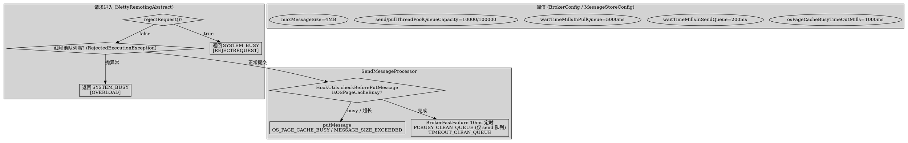
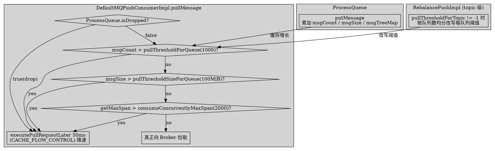

# Broker/Client Flow Control & Rate Limiting

## Introduction

RocketMQ 的「流控 / 限流」在 5.5.1 中**不是**一套统一的令牌桶服务，而是由「Broker 侧 busy 拒请求 + 过期请求清理」「Netty 线程池队列满拒绝」「消息大小硬限制」以及「客户端本地拉取闸门」四类机制拼装而成，彼此正交。本页基于 **RocketMQ 5.5.1** 真源码逐条核实。

> 版本基线：RocketMQ 5.5.1

**反直觉 / 纠偏点（务必先读）**：
- 5.5.1 **不存在**基于 Guava `RateLimiter` 的通用请求限流。`BrokerConfig.flowControlEnable` / `consumerFailRetryRate` 经全仓核实**均无**；`flowControlEnable` 只存在于 HA 复制（`haFlowControlEnable`，默认 false）与冷数据（`coldDataFlowControlEnable`，默认 false）。`RateLimiter` 关键字命中均为 RocksDB 的 `org.rocksdb.RateLimiter`，与请求流控无关。
- 5.5.1 **没有** `isBrokerBusy()` 方法。真正的 busy 闸门是 `SendMessageProcessor.rejectRequest()`（`isOSPageCacheBusy() || isTransientStorePoolDeficient()`），再叠加 `BrokerFastFailure` 的定时过期清理。
- 任务描述中 `waitTimeMillsInPullQueue = 1000ms` 是错的：实际默认为 **5000ms**（`BrokerConfig.java:148` 的 `5 * 1000`）。`waitTimeMillsInSendQueue` 才是 200ms。

## 1. Broker 侧：busy 拒请求（rejectRequest）

### 1.1 判定入口

发送链路上，busy 判定由 `SendMessageProcessor.rejectRequest()` 承担（注意：**不是** `isBrokerBusy`）：

```java
// broker/src/main/java/org/apache/rocketmq/broker/processor/SendMessageProcessor.java:130-140
public boolean rejectRequest() {
    if (!this.brokerController.getBrokerConfig().isEnableSlaveActingMaster()
        && this.brokerController.getMessageStoreConfig().getBrokerRole() == BrokerRole.SLAVE) {
        return true;                                            // 普通 slave 不接 send
    }
    if (this.brokerController.getMessageStore().isOSPageCacheBusy()
        || this.brokerController.getMessageStore().isTransientStorePoolDeficient()) {
        return true;                                            // OS 页缓存忙 / 临时池不足
    }
    return false;
}
```

`rejectRequest()` 被 Netty 层在投递请求前调用，命中即直接回 `SYSTEM_BUSY`：

```java
// remoting/src/main/java/org/apache/rocketmq/remoting/netty/NettyRemotingAbstract.java:370-375
if (pair.getObject1().rejectRequest()) {
    final RemotingCommand response = RemotingCommand.createResponseCommand(
        RemotingSysResponseCode.SYSTEM_BUSY,
        "[REJECTREQUEST]system busy, start flow control for a while");
    ...
}
```

> 纠偏：`rejectRequest()` 返回的码是 `SYSTEM_BUSY`，**不是** `REMOTING_TIMEOUT`。任务描述里提到的 `REMOTING_TIMEOUT` 在本链路并未使用（队列满场景见第 2 节，同样返回 `SYSTEM_BUSY`）。

### 1.2 OSPageCacheBusy 判定

`DefaultMessageStore.isOSPageCacheBusy()` 用 CommitLog 写锁持有时间判定「一次 flush / 落盘耗时过久」：

```java
// store/src/main/java/org/apache/rocketmq/store/DefaultMessageStore.java:742-748
public boolean isOSPageCacheBusy() {
    long begin = this.getCommitLog().getBeginTimeInLock();
    long diff = this.systemClock.now() - begin;
    return diff < 10000000                                   // 未持锁时 beginTimeInLock=0，diff 巨大，直接判 false
        && diff > this.messageStoreConfig.getOsPageCacheBusyTimeOutMills();  // 默认 1000ms
}
```

阈值 `osPageCacheBusyTimeOutMills` 默认 **1000ms**（`store/.../config/MessageStoreConfig.java:271`）。即「CommitLog 写锁被持有时长 > 1s」即视为页缓存忙。

### 1.3 标准路径的 OS_PAGE_CACHE_BUSY 生成点

标准（非 DLedger）写入路径，在 `putMessage` 之前由发送钩子 `HookUtils.checkBeforePutMessage` 先判 busy，直接给 `OS_PAGE_CACHE_BUSY` 状态：

```java
// broker/src/main/java/org/apache/rocketmq/broker/util/HookUtils.java:106-108
if (brokerController.getMessageStore().isOSPageCacheBusy()) {
    return new PutMessageResult(PutMessageStatus.OS_PAGE_CACHE_BUSY, null);
}
```

该状态最终在 `SendMessageProcessor` 映射为 `SYSTEM_BUSY`：

```java
// broker/src/main/java/org/apache/rocketmq/broker/processor/SendMessageProcessor.java:451-454
case OS_PAGE_CACHE_BUSY:
    response.setCode(ResponseCode.SYSTEM_BUSY);
    response.setRemark("[PC_SYNCHRONIZED]broker busy, start flow control for a while");
    break;
```

> DLedger 路径（`store/.../dledger/DLedgerCommitLog.java:587/631/709/775`）也会在锁忙时返回 `OS_PAGE_CACHE_BUSY`，与上同码。

### 1.4 刷盘与 PUT_MESSAGE_STATUS 的关系

- `FlushDiskTimeout` 出现在**同步刷盘**场景下 GroupCommitService 等待落盘超时；经 `handleDiskFlush` 结果合并到 `PutMessageResult`，最终在 `SendMessageProcessor` 各 `case` 映射成对应 `ResponseCode`（多为 `SERVICE_NOT_AVAILABLE` / `SYSTEM_ERROR`，非 `OS_PAGE_CACHE_BUSY`）。
- `OS_PAGECACHE_BUSY` 是页缓存忙（锁持有过久），与刷盘超时语义不同：前者是「写不进 page cache」，后者是「已写入但等落盘慢」。两者都属于「Broker 忙」大类的不同成因。

## 2. Broker 侧：过期请求清理（BrokerFastFailure）

`BrokerFastFailure` 是一个每 10ms 跑一次的定时任务（开关 `brokerFastFailureEnable`，默认 `true`，`BrokerConfig.java:146`），做两件事：

```java
// broker/src/main/java/org/apache/rocketmq/broker/latency/BrokerFastFailure.java:81-120
public void start() {
    this.scheduledExecutorService.scheduleAtFixedRate(..., 1000, 10, TimeUnit.MILLISECONDS);
}
private void cleanExpiredRequest() {
    while (this.brokerController.getMessageStore().isOSPageCacheBusy()) {     // 分支一：页缓存忙
        ... this.brokerController.getSendThreadPoolQueue().poll(0, ...);       // 只清空 SEND 队列！
        rt.returnResponse(SYSTEM_BUSY, "[PCBUSY_CLEAN_QUEUE]broker busy ...");
    }
    for (Pair<...> pair : cleanExpiredRequestQueueList) {                      // 分支二：超时清理
        cleanExpiredRequestInQueue(pair.getObject1(), pair.getObject2().get());
    }
}
```

| 队列 | 超时阈值（默认） | 说明 |
| ---- | ---- | ---- |
| sendThreadPoolQueue | waitTimeMillsInSendQueue = **200ms** | `BrokerConfig.java:147` |
| pullThreadPoolQueue | waitTimeMillsInPullQueue = **5000ms** | `BrokerConfig.java:148`（非 1000ms） |
| litePullThreadPoolQueue | waitTimeMillsInLitePullQueue | `BrokerConfig.java` |
| heartbeatThreadPoolQueue | waitTimeMillsInHeartbeatQueue | 同上 |
| endTransactionThreadPoolQueue | waitTimeMillsInTransactionQueue | 同上 |
| ackThreadPoolQueue | waitTimeMillsInAckQueue | 同上 |
| adminBrokerThreadPoolQueue | waitTimeMillsInAdminBrokerQueue | 同上 |

> 纠偏：任务描述说「busy 时清理过期 pull/endTransaction 请求」并不准确。`isOSPageCacheBusy` 为 true 时**只** `poll` 清空 **send 队列**（`:94-115`）；pull / endTransaction 等队列是在 `for` 循环里按各自 `waitTimeMillsInXxxQueue` 阈值清理（`:117-119`），即使不 busy 也会因超时而被清。超时清理的统一回码是 `SYSTEM_BUSY`，remark 为 `[TIMEOUT_CLEAN_QUEUE]`（`BrokerFastFailure.java:139`）。

## 3. Netty 线程池队列上限：队列满拒绝

Broker 把每个请求类型挂到固定容量的 `LinkedBlockingQueue` 上，容量由 `BrokerConfig` 控制：

```java
// broker/src/main/java/org/apache/rocketmq/broker/BrokerController.java:440-442
this.sendThreadPoolQueue = new LinkedBlockingQueue<>(this.brokerConfig.getSendThreadPoolQueueCapacity());   // 默认 10000
this.pullThreadPoolQueue = new LinkedBlockingQueue<>(this.brokerConfig.getPullThreadPoolQueueCapacity());   // 默认 100000
```

当线程池繁忙、队列已满，`submit` 抛 `RejectedExecutionException`，被 Netty 层捕获后同样回 `SYSTEM_BUSY`：

```java
// remoting/src/main/java/org/apache/rocketmq/remoting/netty/NettyRemotingAbstract.java:381-393
pair.getObject2().submit(requestTask);
} catch (RejectedExecutionException e) {
    ...
    final RemotingCommand response = RemotingCommand.createResponseCommand(
        RemotingSysResponseCode.SYSTEM_BUSY,
        "[OVERLOAD]system busy, start flow control for a while");
}
```

要点：队列满拒绝返回的是 `SYSTEM_BUSY`（remark `[OVERLOAD]`），**不是** `REMOTING_TIMEOUT`。

## 4. 消息大小硬限制（非流控）

`maxMessageSize` 默认为 `1024 * 1024 * 4 = 4MB`（`store/.../config/MessageStoreConfig.java:194`，客户端 `DefaultMQProducer.java:150` 同值）。超过即在 append 阶段返回 `MESSAGE_SIZE_EXCEEDED`：

```java
// store/src/main/java/org/apache/rocketmq/store/CommitLog.java:1962-1966
if (msgLen > this.messageStoreConfig.getMaxMessageSize()) {
    log.warn("message size exceeded, msg total size: {}, maxMessageSize: {}", ...);
    return new AppendMessageResult(AppendMessageStatus.MESSAGE_SIZE_EXCEEDED);
}
```

该状态在 `SendMessageProcessor` 映射为 `ResponseCode.MESSAGE_ILLEGAL`（`:424-429`）。

> 纠偏：消息大小限制是**硬限制 / 校验**，不属于「流控」——它不随负载变化、不与队列/线程池耦合，只是入站消息体大小的边界检查。把它与 busy 拒流并列易误导。

## 5. 消费侧流控：本地拉取闸门（与 Broker 限流正交）

消费侧流控完全在客户端本地，目的是**防止本地 `ProcessQueue` 堆积撑爆内存**，与 Broker 是否 busy 无关。

### 5.1 闸门阈值（默认值）

| 参数 | 默认值 | 位置 |
| ---- | ---- | ---- |
| pullThresholdForQueue（每队列缓存消息条数） | **1000** | `DefaultMQPushConsumer.java:182` |
| pullThresholdSizeForQueue（每队列缓存大小，单位 MiB） | **100** | `DefaultMQPushConsumer.java:197` |
| pullThresholdForTopic（整 topic 缓存条数，按队列均分；-1 关闭） | **-1**（关闭） | `DefaultMQPushConsumer.java:208` |
| consumeConcurrentlyMaxSpan（并发消费最大进度差，条） | **2000** | `DefaultMQPushConsumer.java:176` |
| pullInterval（拉取间隔，ms） | 0 | `DefaultMQPushConsumer.java:224` |

### 5.2 拉取前检查（pullMessage）

`DefaultMQPushConsumerImpl.pullMessage` 在真正拉取前逐项检查本地 `ProcessQueue`：

```java
// client/.../impl/consumer/DefaultMQPushConsumerImpl.java:269-302
long cachedMessageCount = processQueue.getMsgCount().get();
long cachedMessageSizeInMiB = processQueue.getMsgSize().get() / (1024 * 1024);

if (cachedMessageCount > this.defaultMQPushConsumer.getPullThresholdForQueue()) {        // 条数超阈值
    this.executePullRequestLater(pullRequest, PULL_TIME_DELAY_MILLS_WHEN_CACHE_FLOW_CONTROL); // 50ms 后重试，不拉
    return;
}
if (cachedMessageSizeInMiB > this.defaultMQPushConsumer.getPullThresholdSizeForQueue()) {  // 体积超阈值
    this.executePullRequestLater(pullRequest, PULL_TIME_DELAY_MILLS_WHEN_CACHE_FLOW_CONTROL);
    return;
}
if (!this.consumeOrderly
    && processQueue.getMaxSpan() > this.defaultMQPushConsumer.getConsumeConcurrentlyMaxSpan()) { // 进度差超阈值
    this.executePullRequestLater(pullRequest, PULL_TIME_DELAY_MILLS_WHEN_CACHE_FLOW_CONTROL);
    return;
}
```

`ProcessQueue.putMessage` 把拉到的消息放进 `msgTreeMap` 并累加 `msgCount` / `msgSize`（`ProcessQueue.java:129-168`）；`getMaxSpan()` 取 `lastKey - firstKey`（`ProcessQueue.java:170-176`）。一旦本地缓存越过任一闸门，拉取被**推迟 50ms**（`PULL_TIME_DELAY_MILLS_WHEN_CACHE_FLOW_CONTROL`，`:105`）而非丢弃——这是「降速」而非「drop」。

> 纠偏：任务描述说「`ProcessQueue.putMessage` 超阈值则 drop 不再拉取」不够精确。实际**不是 putMessage 时 drop**，而是下一次 `pullMessage` 调度时判断 `ProcessQueue` 已超阈值就 `executePullRequestLater` 推迟拉取（闸门在拉取侧，不在投递侧）。drop 仅发生在 `ProcessQueue.isDropped()` 时（队列被 rebalance 摘掉，`:248`）。

### 5.3 topic 级阈值

`pullThresholdForTopic` 默认 -1（关闭）。开启时，**不在拉取循环里直接比较**，而是在 rebalance 结果变化时按队列数把 topic 阈值均分并改写每队列阈值（`RebalancePushImpl.messageQueueChanged`，`RebalancePushImpl.java:67-81`）：`newVal = max(1, pullThresholdForTopic / currentQueueCount)`。即 topic 级是「按队列数平摊」的派生值。

### 5.4 broker 反向流控

当 broker 返回 `SYSTEM_BUSY` / 拉取被 broker 限速时，客户端用 `PULL_TIME_DELAY_MILLS_WHEN_BROKER_FLOW_CONTROL = 20ms`（`:109`）推迟重拉（`:446` / `:598`），与本地缓存流控的 50ms 区分开。

## 6. 慢消费统计（BrokerStatsManager / ConsumeStatus）

流控触发后，慢消费通过统计指标可观测，但**统计本身不参与限流决策**。

- Broker 侧：`BrokerStatsManager` 维护 `GROUP_CK_NUMS`（POP 检查点次数，`:188`）、`GROUP_GET_LATENCY`（拉取 RT，`:189`），拉取 RT 由 `incGroupGetLatency` 累加（`BrokerStatsManager.java:515-522`，调用点 `DefaultPullMessageResultHandler.java:142`、`PopMessageProcessor.java:456/609`）。消费 RT 由客户端 `ConsumerStatsManager.incConsumeRT`（`ConsumerStatsManager.java:71`，调用点 `ConsumeMessageConcurrentlyService.java:455`、`ConsumeMessageOrderlyService.java:553`）记录。
- 聚合体：`ConsumeStatus`（`remoting/.../body/ConsumeStatus.java:20-76`）封装 `pullRT` / `pullTPS` / `consumeRT` / `consumeOKTPS` / `consumeFailedTPS` / `consumeFailedMsgs`，用于 `ConsumerRunningInfo` 上报与运维观测。

> 注意：`GROUP_CK_NUMS` 在 5.5.1 已标记 `@Deprecated`（`BrokerStatsManager.java:76`），POP 场景下仍有实际写入；CK = Checkpoint（确认检查点）次数，RT = 时延，均为观测指标而非流控开关。





## Links
- /docs/CS/MQ/RocketMQ/Stats.md

- [Broker](/docs/CS/MQ/RocketMQ/Broker.md)
- [Store](/docs/CS/MQ/RocketMQ/Store.md)
- [Consumer](/docs/CS/MQ/RocketMQ/Consumer.md)
- [Producer](/docs/CS/MQ/RocketMQ/Producer.md)
- [RocketMQ5](/docs/CS/MQ/RocketMQ/RocketMQ5.md)
- [RocketMQ](/docs/CS/MQ/RocketMQ/RocketMQ.md)

## References

- `broker/src/main/java/org/apache/rocketmq/broker/latency/BrokerFastFailure.java:41, 59-66, 81-154`（10ms 定时 / 队列注册 / cleanExpiredRequest / PCBUSY_CLEAN_QUEUE / TIMEOUT_CLEAN_QUEUE）
- `broker/src/main/java/org/apache/rocketmq/broker/processor/SendMessageProcessor.java:130-140, 451-454`（rejectRequest / OS_PAGE_CACHE_BUSY→SYSTEM_BUSY / MESSAGE_ILLEGAL）
- `broker/src/main/java/org/apache/rocketmq/broker/util/HookUtils.java:106-108`（标准路径 isOSPageCacheBusy→OS_PAGE_CACHE_BUSY）
- `broker/src/main/java/org/apache/rocketmq/broker/processor/PullMessageProcessor.java:296-302`（pull 侧 rejectRequest：slave 不读）
- `store/src/main/java/org/apache/rocketmq/store/DefaultMessageStore.java:742-748`（isOSPageCacheBusy 判定）
- `store/src/main/java/org/apache/rocketmq/store/config/MessageStoreConfig.java:194, 271`（maxMessageSize=4MB / osPageCacheBusyTimeOutMills=1000ms）
- `store/src/main/java/org/apache/rocketmq/store/CommitLog.java:1962-1966`（MESSAGE_SIZE_EXCEEDED）
- `store/src/main/java/org/apache/rocketmq/store/dledger/DLedgerCommitLog.java:587, 631, 709, 775`（DLedger 路径 OS_PAGE_CACHE_BUSY）
- `common/src/main/java/org/apache/rocketmq/common/BrokerConfig.java:103, 105, 146-148`（send/pullThreadPoolQueueCapacity=10000/100000 / brokerFastFailureEnable=true / waitTimeMillsInSendQueue=200 / waitTimeMillsInPullQueue=5000）
- `broker/src/main/java/org/apache/rocketmq/broker/BrokerController.java:440-442`（线程池队列容量构造）
- `remoting/src/main/java/org/apache/rocketmq/remoting/netty/NettyRemotingAbstract.java:370-375, 381-393`（rejectRequest→SYSTEM_BUSY / 队列满 RejectedExecutionException→SYSTEM_BUSY）
- `client/src/main/java/org/apache/rocketmq/client/impl/consumer/DefaultMQPushConsumerImpl.java:105, 109, 129-168, 269-302`（PULL_TIME_DELAY / pullMessage 闸门）
- `client/src/main/java/org/apache/rocketmq/client/impl/consumer/ProcessQueue.java:129-176`（putMessage / getMaxSpan）
- `client/src/main/java/org/apache/rocketmq/client/consumer/DefaultMQPushConsumer.java:176, 182, 197, 208, 224`（consumeConcurrentlyMaxSpan=2000 / pullThresholdForQueue=1000 / pullThresholdSizeForQueue=100 / pullThresholdForTopic=-1 / pullInterval=0）
- `client/src/main/java/org/apache/rocketmq/client/impl/consumer/RebalancePushImpl.java:67-81`（topic 级阈值均分）
- `store/src/main/java/org/apache/rocketmq/store/stats/BrokerStatsManager.java:76, 109, 188-189, 515-522`（GROUP_CK_NUMS / RT / GROUP_GET_LATENCY / incGroupGetLatency）
- `client/src/main/java/org/apache/rocketmq/client/stat/ConsumerStatsManager.java:71`（incConsumeRT）
- `remoting/src/main/java/org/apache/rocketmq/remoting/protocol/body/ConsumeStatus.java:20-76`（pullRT / pullTPS / consumeRT / consumeOKTPS / consumeFailedTPS）
- 反例核实：`common/src/main/java/org/apache/rocketmq/common/BrokerConfig.java` 全类**无** `flowControlEnable` / `consumerFailRetryRate` 字段；`store/.../config/MessageStoreConfig.java:411, 456` 仅有 `haFlowControlEnable` / `coldDataFlowControlEnable`；全仓 `RateLimiter` 命中均为 RocksDB（`org.rocksdb.RateLimiter`），无 Guava 令牌桶请求限流。5.5.1 亦**无** `isBrokerBusy()` 方法。
