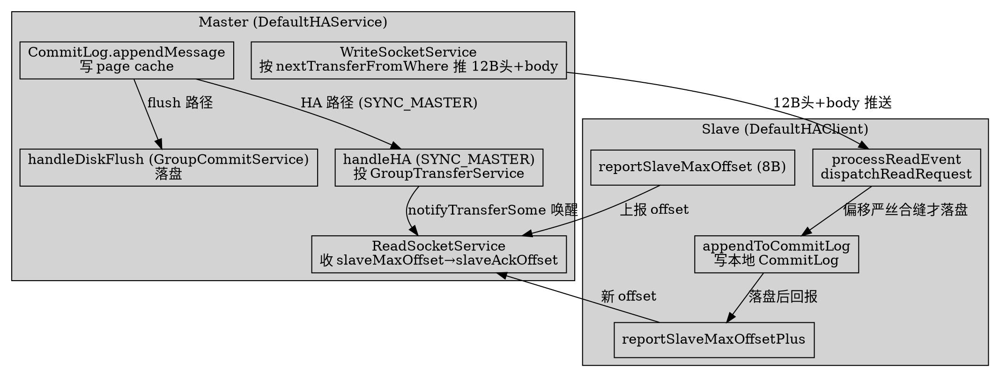
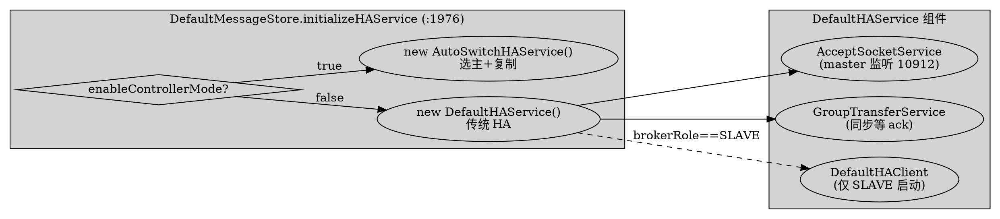

# Traditional HA Master-Slave Replication (HAService)

## Introduction

RocketMQ 的传统主从复制由 `store/ha/` 包下的 `HAService` 体系承担，是 5.x 时代**与 Controller 选主正交**的「数据复制层」。本页只深挖传统 `DefaultHAService`（`SYNC_MASTER` / `ASYNC_MASTER` 模型），与已挖的 [ControllerReplication](/docs/CS/MQ/RocketMQ/ControllerReplication.md)（AutoSwitch + ISR + confirmOffset）形成「老 HA vs 新选主」对照。

**正交性结论（务必先读）**：`HAService` 只负责「主已被选出之后，数据如何从 master 同步到 slave」，完全不参与选主。选主由两条旧路径决定——① 传统 `brokerRole` 静态配置（NameServer 模式，[Namesrv](/docs/CS/MQ/RocketMQ/Namesrv.md) 只做路由，不做仲裁）；② 5.x 的 Controller 模式（[ControllerHA](/docs/CS/MQ/RocketMQ/ControllerHA.md)）。二者的装配点在 `DefaultMessageStore.initializeHAService`：

```java
// store/.../store/DefaultMessageStore.java:1976-1988
private void initializeHAService() {
    if (!this.messageStoreConfig.isEnableDLegerCommitLog() && !this.messageStoreConfig.isDuplicationEnable()) {
        if (brokerConfig.isEnableControllerMode()) {
            this.haService = new AutoSwitchHAService();           // 新选主：数据复制 + ISR/confirmOffset
        } else {
            this.haService = ServiceProvider.loadClass(HAService.class);
            if (null == this.haService) {
                this.haService = new DefaultHAService();          // 传统 HA：纯数据复制
            }
        }
    }
}
```

即 `AutoSwitchHAService extends DefaultHAService`（`ControllerReplication.md` 已确认），两者共用同一套 `AcceptSocketService` / `GroupTransferService` / `HAClient` 骨架，差异只在「是否引入 epoch + syncStateSet + confirmOffset」。本页的所有 `file:line` 均基于 **RocketMQ 5.5.1** 真文件核验。

> 命名纠偏：任务描述里提到的 `reportTransferRT`、`handleSlaveRelation` 是 4.x 旧方法名，在 5.5.1 中**均已不存在**（全仓 grep 零命中）。5.5.1 的对应实现是 slave 侧 `DefaultHAClient.dispatchReadRequest`（`DefaultHAClient.java:184`）、master 侧 `DefaultHAConnection.WriteSocketService.run` 与 `ReadSocketService.processReadEvent`（`DefaultHAConnection.java:153/:275`）。下文一律用真名。

## 1. HAService 启动总览（组件装配）

`HAService` 是接口（`HAService.java:30`），`DefaultHAService` 是其唯一传统实现。`init` 阶段按 `brokerRole` 装配四个子服务（`DefaultHAService.java:68-76`）：

```java
// store/.../store/ha/DefaultHAService.java:68-76
public void init(final DefaultMessageStore defaultMessageStore) throws IOException {
    this.defaultMessageStore = defaultMessageStore;
    this.acceptSocketService = new DefaultAcceptSocketService(...);   // master 侧：监听 slave 连接
    this.groupTransferService = new GroupTransferService(this, ...);  // 同步复制等 ack
    if (brokerRole == BrokerRole.SLAVE) {
        this.haClient = new DefaultHAClient(this.defaultMessageStore); // slave 侧：主动连 master
    }
    this.haConnectionStateNotificationService = new HAConnectionStateNotificationService(...);
}
```

`start` 顺序（`DefaultHAService.java:125-133`）：`acceptSocketService.beginAccept()` → `acceptSocketService.start()` → `groupTransferService.start()` → `haConnectionStateNotificationService.start()` → 仅在 slave 时 `haClient.start()`。注意 **master 不会启动 `haClient`**，slave 不会启动 `acceptSocketService`——两者角色互补。

四个组件职责：

| 组件 | 角色 | 关键 file:line |
| ---- | ---- | ---- |
| `DefaultAcceptSocketService`（内嵌于 `DefaultHAService:266`） | **master** 监听 `haListenPort`（默认 10912，`MessageStoreConfig.java:242`），每来一个 slave 连接 `createConnection` 出一条 `DefaultHAConnection`（`DefaultHAService.java:273`） | `DefaultHAService.java:289-386` |
| `DefaultHAConnection` | **master 侧每 slave 一条**，内含 `ReadSocketService`（收 slave 上报的 offset）+ `WriteSocketService`（向 slave 推数据） | `DefaultHAConnection.java:33` |
| `DefaultHAClient` | **slave** 唯一，主动连 master、上报 `slaveMaxOffset`、接收推送写本地 CommitLog | `DefaultHAClient.java:36` |
| `GroupTransferService` | **master** 同步复制时，让 producer 线程等 slave ack 到 `nextOffset` 才返回 | `GroupTransferService.java:38` |

> `haListenPort = 10912`（`MessageStoreConfig.java:242`）、`haSendHeartbeatInterval = 5000ms`（`:243`）、`haHousekeepingInterval = 20000ms`（`:244`）—— 这几个心跳/保活阈值同时作用于 master 的 `WriteSocketService`（`DefaultHAConnection.java:313`）与 slave 的 `run` 超时判定（`DefaultHAClient.java:331`）。

## 2. slave 主动拉取模型（pull-style：slave 上报 offset，master 推数据）

传统 HA 是**反向 pull 模型**：slave 主动建连并周期性上报自己的 `slaveMaxOffset`，master 据此从对应位置推数据。与 [ControllerReplication](/docs/CS/MQ/RocketMQ/ControllerReplication.md) 的 AutoSwitch 走同一套 socket，但**没有 epoch 握手**，slave 直接报物理 offset。

### 2.1 slave 侧：DefaultHAClient.run

状态机 `READY → TRANSFER → SHUTDOWN`（`DefaultHAClient.java:303-345`）：

```java
// store/.../store/ha/DefaultHAClient.java:308-365
while (!this.isStopped()) {
    switch (this.currentState) {
        case READY:
            if (!this.connectMaster()) { this.waitForRunning(5000); }   // 连不上每 5s 重试
            continue;
        case TRANSFER:
            if (!transferFromMaster()) { closeMasterAndWait(); continue; }
            break;
    }
    // 超过 haHousekeepingInterval 没从 master 读到数据 → 主动断开重连
    if (now - lastReadTimestamp > haHousekeepingInterval) this.closeMaster();
}
```

`transferFromMaster`（`DefaultHAClient.java:347-365`）三步：**先** `reportSlaveMaxOffset`（若距上次写超过 `haSendHeartbeatInterval`）→ **再** `processReadEvent`（收 master 推送）→ **最后** `reportSlaveMaxOffsetPlus`（落盘后回报最新 offset）。上报包格式极简，仅 8 字节 `slaveMaxOffset`（`DefaultHAClient.java:51, 110-128`）：

```java
// DefaultHAClient.java:110-128
private boolean reportSlaveMaxOffset(final long maxOffset) {
    this.reportOffset.putLong(maxOffset);                 // REPORT_HEADER_SIZE = 8
    for (int i = 0; i < 3 && this.reportOffset.hasRemaining(); i++)
        this.socketChannel.write(this.reportOffset);      // 最多重试 3 次
    lastWriteTimestamp = ...;
    return !this.reportOffset.hasRemaining();
}
```

### 2.2 slave 侧：接收推送并落盘（dispatchReadRequest）

`processReadEvent`（`DefaultHAClient.java:153-182`）循环 `socketChannel.read` 到 4MB 缓冲，每读一段调用 `dispatchReadRequest`（`DefaultHAClient.java:184-229`）。推送包格式由 master 定义：`TRANSFER_HEADER_SIZE = 8 + 4`（物理 offset 8B + bodySize 4B，`DefaultHAConnection.java:48`）。slave 解析后做两件关键校验再落盘：

```java
// DefaultHAClient.java:189-217
long masterPhyOffset = byteBufferRead.getLong(dispatchPosition);   // 推送起始物理 offset
int  bodySize       = byteBufferRead.getInt(dispatchPosition + 8);
long slavePhyOffset = defaultMessageStore.getMaxPhyOffset();
if (slavePhyOffset != 0 && slavePhyOffset != masterPhyOffset) {    // 偏移必须严丝合缝
    log.error("master pushed offset not equal the max phy offset in slave ...");
    return false;                                                 // 不一致直接断链
}
// 整段写入本地 CommitLog
defaultMessageStore.appendToCommitLog(masterPhyOffset, bodyData, dataStart, bodySize);
this.dispatchPosition += TRANSFER_HEADER_SIZE + bodySize;
reportSlaveMaxOffsetPlus();                                        // 落盘后立即回报
```

偏移对齐校验是传统 HA 的**唯一一致性保证**——它只检查「master 推的起始 offset == 我本地 maxPhyOffset」，不检查任期/数据版本（这正是 AutoSwitch 用 `EpochFileCache` 补强的地方，见 [ControllerReplication](/docs/CS/MQ/RocketMQ/ControllerReplication.md) 2.2）。落盘经由 `DefaultMessageStore.appendToCommitLog`（`DefaultMessageStore.java:1373-1389`），内部 `commitLog.appendData` 后 `reputMessageService.wakeup()` 触发后续 dispatch 到 ConsumeQueue（与 [Store](/docs/CS/MQ/RocketMQ/Store.md) 写路径的异步派发一致）。

### 2.3 master 侧：DefaultHAConnection 双向服务

`AcceptSocketService.run`（`DefaultHAService.java:342-380`）`selector.select(1000)` 等待 `OP_ACCEPT`，每来一个连接 `createConnection` 出 `DefaultHAConnection` 并 `start()`。`DefaultHAConnection` 内部起两个 `ServiceThread`：

- **`ReadSocketService`（`DefaultHAConnection.java:137-254`）**：监听 `OP_READ`，解析 slave 上报的 8 字节 `slaveMaxOffset`，更新 `slaveAckOffset`（`DefaultHAConnection.java:230`）并 `haService.notifyTransferSome(slaveAckOffset)`（`DefaultHAConnection.java:236`）——后者唤醒 `GroupTransferService` 让等 ack 的 producer 继续。首次上报还会记录 `slaveRequestOffset`（`:231-234`），它是 `WriteSocketService` 决定从哪推数据的起点。
- **`WriteSocketService`（`DefaultHAConnection.java:256-475`）**：监听 `OP_WRITE`，按 `nextTransferFromWhere` 从 CommitLog 读数据推给 slave（见第 4 节）。

> 注意 master 侧**没有名为 `dispatchReadRequest` / `handleSlaveRelation` 的方法**：slave 的 offset 上报直接在 `ReadSocketService.processReadEvent`（`DefaultHAConnection.java:211-253`）里处理，数据推送在 `WriteSocketService.run` 里处理。这是与 4.x 资料最大的命名差异。

## 3. 同步复制 vs 异步复制（SYNC_MASTER / ASYNC_MASTER）

复制语义由 `MessageStoreConfig.brokerRole` 驱动（注意该字段定义在 `MessageStoreConfig` 而非 `BrokerConfig`，详见 [Store](/docs/CS/MQ/RocketMQ/Store.md) 的坑点表）。判定入口是 `CommitLog.needHandleHA`（`CommitLog.java:1338-1358`）：

```java
// store/.../store/CommitLog.java:1340-1355
if (!messageExt.isWaitStoreMsgOK()) return false;
if (this.defaultMessageStore.getMessageStoreConfig().isDuplicationEnable()) return false;
if (BrokerRole.SYNC_MASTER != this.defaultMessageStore.getMessageStoreConfig().getBrokerRole())
    return false;          // ASYNC_MASTER / SLAVE 直接不处理 HA
return true;
```

### 3.1 异步复制（ASYNC_MASTER）：完全不等

`handleDiskFlushAndHA`（`CommitLog.java:1360-1379`）中，`needHandleHA == false` 时 `replicaResultFuture = completedFuture(PUT_OK)`（`CommitLog.java:1365`）——**producer 立即返回，slave 是否追上与发送结果无关**。数据仍会被 slave 拉走（第 2 节机制照常运行），但 master 不阻塞等待。

### 3.2 同步复制（SYNC_MASTER）：等 slave ack 到 nextOffset

`needHandleHA == true` 时调用 `handleHA`（`CommitLog.java:1385-1400`）：

```java
// CommitLog.java:1387-1399
if (needAckNums >= 0 && needAckNums <= 1) {
    return CompletableFuture.completedFuture(PutMessageStatus.PUT_OK);  // ← 关键提前返回
}
GroupCommitRequest request = new GroupCommitRequest(nextOffset, slaveTimeout, needAckNums);
haService.putRequest(request);                  // 投入 GroupTransferService
haService.getWaitNotifyObject().wakeupAll();
return request.future();                         // 阻塞直到 GroupTransferService 唤醒
```

**关键反直觉点（5.x 行为）**：`needAckNums = getInSyncReplicas()`（`CommitLog.java:1047`），而其默认值为 **`1`**（`MessageStoreConfig.java:385`）。于是默认 `SYNC_MASTER` + `inSyncReplicas=1` 时，`handleHA` 在 `:1387` **直接返回 PUT_OK，根本不进 `GroupTransferService` 等待**——即默认配置下「同步主」其实**不等 slave**，语义等价于异步。要真正让 master 阻塞等 slave，必须把 `inSyncReplicas` 设成 `>= 2`（此时 `needAckNums > 1`，才会投入 `GroupTransferService` 走等待分支）。`MessageStoreConfig.java:381` 的注释也印证：`ASYNC_MASTER` 下 `inSyncReplicas` 被忽略；`SYNC_MASTER` 下该值才生效。

> 这与 4.x 经典「同步双写」体验不同：4.x 的 `GroupCommitRequest` 无 `ackNums`，`GroupTransferService` 无条件等 `push2SlaveMaxOffset >= nextOffset`。5.x 引入 `ackNums` 概念（为 Controller 模式的 ISR 多副本 ack 服务），传统路径的 `needAckNums<=1` 提前返回是这波改造的副作用——写笔记时务必注明默认 `inSyncReplicas=1` 这一陷阱。

### 3.3 等待实现：GroupTransferService.doWaitTransfer

当真正需要等待时（传统 HA 取 `ackNums<=1` 分支或 `ackNums>=2` 分支），`GroupTransferService.doWaitTransfer`（`GroupTransferService.java:79-146`）在 `deadLine - System.nanoTime() > 0` 的窗口内轮询（每次 `waitForRunning(1)`）：

```java
// GroupTransferService.java:87-133
for (int i = 0; !transferOK && deadLine - System.nanoTime() > 0; i++) {
    if (i > 0) this.notifyTransferObject.waitForRunning(1);
    if (!allAckInSyncStateSet && req.getAckNums() <= 1) {                 // 传统 HA 单 slave 路径
        transferOK = haService.getPush2SlaveMaxOffset().get() >= req.getNextOffset();
        continue;
    }
    // ... allAckInSyncStateSet 分支（仅 AutoSwitchHAService 进入）...
    else {                                                                  // 传统多副本 ackNums>=2 路径
        int ackNums = 1;                                                    // 含 master 自身
        for (HAConnection conn : haService.getConnectionList())
            if (conn.getSlaveAckOffset() >= req.getNextOffset() && ++ackNums >= req.getAckNums())
                transferOK = true;
    }
}
req.wakeupCustomer(transferOK ? PUT_OK : FLUSH_SLAVE_TIMEOUT);   // 超时 → FLUSH_SLAVE_TIMEOUT
```

`deadLine = System.nanoTime() + slaveTimeout * 1e6`，`slaveTimeout` 默认 **3000ms**（`MessageStoreConfig.java:261`，亦见 `CommitLog.java:1396`）。超时未达 `nextOffset` 则返回 `FLUSH_SLAVE_TIMEOUT`，producer 拿到非 `SEND_OK` 结果。等待的唤醒源是 master `ReadSocketService` 收到 slave 上报后调用的 `notifyTransferSome`（`DefaultHAService.java:107-117` → `groupTransferService.notifyTransferSome()`）。

## 4. push 与文件对齐（master 按 maxOffset 推、batch、流控、滞后）

`WriteSocketService.run`（`DefaultHAConnection.java:275-406`）是 master 推送的主循环，纯 NIO `select(1000)` + 状态驱动：

1. **起点对齐**（`DefaultHAConnection.java:282-306`）：`slaveRequestOffset < 0` 时 `Thread.sleep(10)` 空转等待 slave 首次上报；`nextTransferFromWhere == -1` 时初始化——若 slave 报 0 则从「master maxOffset 向下对齐到文件边界」开始（`getMaxOffset() - (maxOffset % mappedFileSizeCommitLog)`），否则从 `slaveRequestOffset` 开始。
2. **心跳空推**（`DefaultHAConnection.java:308-326`）：`lastWriteOver` 且距上次写超过 `haSendHeartbeatInterval` 时，推一个 `bodySize=0` 的 header 维持连接。
3. **读 CommitLog 推正文**（`DefaultHAConnection.java:333-365`）：`getCommitLogData(nextTransferFromWhere)`（`DefaultMessageStore.java:1353` → `commitLog.getData`）拿到 `SelectMappedBufferResult`，按 `haTransferBatchSize` 截断单批大小，构造 `TRANSFER_HEADER_SIZE` 头（offset + size）后 `transferData` 写出。

### 4.1 batch 与流控

- **`haTransferBatchSize` 默认 `1024 * 32 = 32KB`**（`MessageStoreConfig.java:249`）：单批推送上限，`WriteSocketService` 在 `:337-339` 把 `size` 钳到该值。`transferData`（`DefaultHAConnection.java:408-457`）先写 12B 头再写 body，写不完则 `lastWriteOver=false` 下次续写。
- **流控 `FlowMonitor`**：`DefaultHAConnection` 与 `DefaultHAClient` 各持一个（`DefaultHAConnection.java:77`、`DefaultHAClient.java:80`）。`FlowMonitor.canTransferMaxByteNum`（`FlowMonitor.java:47-54`）在 `haFlowControlEnable=true`（`MessageStoreConfig.java:411`，**默认 false**）时才真正限流，上限 `maxHaTransferByteInSecond` 默认 `100MB/s`（`MessageStoreConfig.java:416`）。默认关闭，故 `WriteSocketService.java:341-350` 的流控分支实际不触发。

### 4.2 滞后（fall-behind）计算

传统 HA 没有 confirmOffset 概念，滞后直接用 `masterMaxOffset - slaveAckOffset`：

- **`slaveFallBehindMuch`**（`DefaultMessageStore.java:1549-1557`）：`commitLog.getMaxOffset() - haService.getPush2SlaveMaxOffset().get()`，即 master 当前最大 offset 减去已推到所有 slave 的最大值。
- **`isSlaveOK`**（`DefaultHAService.java:98-105`）：`connectionCount > 0` 且 `masterPutWhere - push2SlaveMaxOffset < haMaxGapNotInSync`（默认 `256MB`，`MessageStoreConfig.java:252`），用于判断 slave 是否「足够新」可承接读请求。
- **`inSyncReplicasNums`**（`DefaultHAService.java:191-207`）：遍历连接，凡 `masterPutWhere - conn.getSlaveAckOffset() < haMaxGapNotInSync` 即算一个「近同步」副本（含 master 自身从 1 起算）。

> 任务描述提到的 `isSlaveRead`、`reportTransferRT` 在 5.5.1 中**均不存在**（全仓零命中）。「是否从 slave 读」由 `isSlaveOK` + `haMaxGapNotInSync` 决定，而非某个 `isSlaveRead` 开关。

## 5. 与 Controller / AutoSwitch 的关系（正交，非替代）

| 维度 | 传统 HAService（`DefaultHAService`） | AutoSwitch（`AutoSwitchHAService`，见 [ControllerReplication](/docs/CS/MQ/RocketMQ/ControllerReplication.md)） |
| ---- | ---- | ---- |
| 装配条件 | `enableControllerMode = false`（默认） | `enableControllerMode = true` |
| 选主 | 不参与，靠 `brokerRole` 静态配置 / NameServer | Controller 外部选主，`changeToMaster/Slave` 切换 |
| 复制协议 | 8B offset pull + 12B header push，**无版本校验** | 复用同套 socket，但增加 epoch 握手 + `findConsistentPoint` 截断 |
| 一致性边界 | 无 confirmOffset，仅 `push2SlaveMaxOffset` 最大下界 | `confirmOffset = min(ISR ack)`，类 Kafka HW |
| 多副本 ack | `GroupTransferService` 按 `ackNums` 数连接 | 按 `syncStateSet`（ISR）集合 |

核心要点：**`AutoSwitchHAService extends DefaultHAService`**，二者共用 `AcceptSocketService` / `GroupTransferService` / `HAClient` 骨架与 `slaveMaxOffset`/`TRANSFER_HEADER` 协议；差异仅在 AutoSwitch 额外维护 `EpochFileCache` + `syncStateSet` + `confirmOffset`。传统 HA 的「`slavePhyOffset != masterPhyOffset` 即断链」校验（`DefaultHAClient.java:196`）在脑裂场景下无法区分「同 offset 不同任期数据」，这正是 AutoSwitch 用 epoch 补强的动因，详见 [ControllerReplication](/docs/CS/MQ/RocketMQ/ControllerReplication.md) 2.2。两者在 `GroupTransferService.doWaitTransfer` 里通过 `haService instanceof AutoSwitchHAService` 分叉（`GroupTransferService.java:97`）。

## 6. 与存储衔接（落盘与复制的时序）

`CommitLog.putMessage` 的写路径尾段（`CommitLog.java:1169` / `:1326`）统一收口到 `handleDiskFlushAndHA`（`CommitLog.java:1360-1379`），它把**落盘**与**复制**两个 Future `thenCombine`：

```java
// CommitLog.java:1362-1378
CompletableFuture<PutMessageStatus> flushResultFuture = handleDiskFlush(...);   // SYNC_FLUSH→GroupCommitService / ASYNC_FLUSH→FlushRealTimeService
CompletableFuture<PutMessageStatus> replicaResultFuture =
    needHandleHA ? handleHA(...) : completedFuture(PUT_OK);                     // 复制（本节 3）
return flushResultFuture.thenCombine(replicaResultFuture, (flush, replica) -> {
    if (flush  != PUT_OK) putMessageResult.setPutMessageStatus(flush);
    if (replica != PUT_OK) putMessageResult.setPutMessageStatus(replica);
    return putMessageResult;
});
```

时序要点（结合 [Store](/docs/CS/MQ/RocketMQ/Store.md) 写路径）：

1. `CommitLog.appendMessage` 先把消息写进 page cache（**仅内存，未落盘**，见 [Store](/docs/CS/MQ/RocketMQ/Store.md) 的 flush/commit 区分）。
2. `handleDiskFlush`：同步刷盘走 `GroupCommitService`（注意这是 `CommitLog` 内部的刷盘服务，**与 `ha` 包的 `GroupTransferService` 是两个不同的类**，仅名字易混淆）；异步刷盘走 `FlushRealTimeService`。
3. `handleHA`：仅 `SYNC_MASTER` 且 `inSyncReplicas>=2` 时真正等待 slave ack（见 3.2 陷阱）；否则 `PUT_OK`。
4. 二者都 `PUT_OK` 后 producer 才拿到 `SEND_OK`。此时数据可能仍在 master page cache（异步刷盘）但**已推到 slave page cache**——故「`SEND_OK` 既不等于 master 落盘，也不等于 slave 落盘」，只代表「master 写内存 +（同步模式下）slave 也写内存」。

slave 侧落盘后由 `dispatchReadRequest` 调 `appendToCommitLog`，再 `reputMessageService.wakeup()` 触发本地 ConsumeQueue 派发（`DefaultMessageStore.java:1379-1381`），形成与 master 平行的二级索引，保证从 slave 消费也能读到（前提是 `isSlaveOK` 判定为近同步）。





## Links
- /docs/CS/MQ/RocketMQ/DLedgerCommitLog.md

- [Store](/docs/CS/MQ/RocketMQ/Store.md)
- [ControllerReplication](/docs/CS/MQ/RocketMQ/ControllerReplication.md)
- [ControllerHA](/docs/CS/MQ/RocketMQ/ControllerHA.md)
- [Namesrv](/docs/CS/MQ/RocketMQ/Namesrv.md)
- [Broker](/docs/CS/MQ/RocketMQ/Broker.md)
- [RocketMQ5](/docs/CS/MQ/RocketMQ/RocketMQ5.md)

## References

- `store/.../store/ha/HAService.java:30`（接口）
- `store/.../store/ha/DefaultHAService.java:68-133, 266-386`（init/start/AcceptSocketService/isSlaveOK/notifyTransferSome）
- `store/.../store/ha/DefaultHAClient.java:36, 51, 110-128, 153-229, 303-365`（slave run / report / dispatchReadRequest）
- `store/.../store/ha/DefaultHAConnection.java:33, 48, 137-254, 256-475`（master Read/Write SocketService）
- `store/.../store/ha/GroupTransferService.java:38-146`（doWaitTransfer 同步等待）
- `store/.../store/ha/FlowMonitor.java:25-75`（haTransferBatchSize / haFlowControlEnable 流控）
- `store/.../store/CommitLog.java:1047, 1169, 1338-1400`（needHandleHA / handleHA / GroupCommitRequest）
- `store/.../store/DefaultMessageStore.java:1353, 1373-1389, 1549-1557, 1976-1988`（getCommitLogData / appendToCommitLog / slaveFallBehindMuch / initializeHAService）
- `store/.../store/config/MessageStoreConfig.java:242-261, 385, 411, 416`（haListenPort / haTransferBatchSize / haMaxGapNotInSync / slaveTimeout / inSyncReplicas / haFlowControlEnable / maxHaTransferByteInSecond）
- 对照：`store/.../ha/autoswitch/AutoSwitchHAService.java`、`store/.../ha/autoswitch/AutoSwitchHAClient.java`（AutoSwitch 继承体系，详见 ControllerReplication.md）
