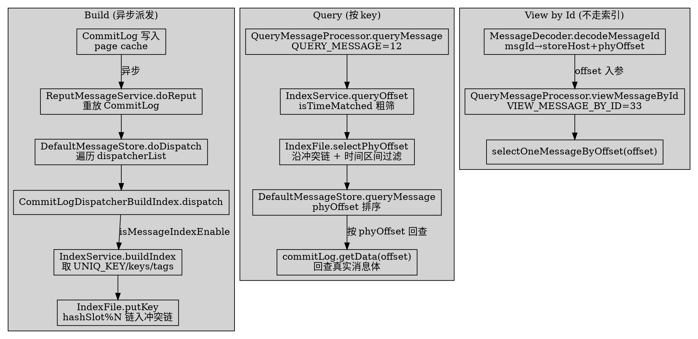
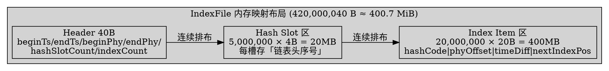

# IndexFile and IndexService (消息索引与按 Key 查询)

## Introduction

RocketMQ 的「按业务 Key 查询消息」能力由 `store/index` 包下的 `IndexFile` + `IndexService` 承担，是一套**基于内存映射文件的哈希索引**，与 ConsumeQueue（按队列/offset 顺序索引）正交。本页只深挖 **5.5.1 本地 `store` 包**的经典实现（`tieredstore` 包另有一套 `IndexFile`/`IndexService` 接口与 RocksDB 实现，不在本页范围），所有 `file:line` 均经真源码核验。

> 版本基线：RocketMQ 5.5.1

**三个反直觉 / 纠偏点（先读）：**

1. **单文件大小不是「约 40MB」，而是约 400MB**。`IndexFile` 构造函数（`IndexFile.java:54-57`）按 `INDEX_HEADER_SIZE(40) + hashSlotNum*4 + indexNum*20` 计算，其中 `maxHashSlotNum=5000000`（`MessageStoreConfig.java:237`）、`maxIndexNum=5000000*4=20000000`（`MessageStoreConfig.java:238`），故 `40 + 20,000,000 + 400,000,000 = 420,000,040` 字节 ≈ **400.7 MiB**。任务描述里的「约 40MB」是把「20 字节索引项」误当作「4 字节」导致的数量级错误——真正占大头的是 2000 万条 × 20 字节的索引项区。
2. **只给「设置了 keys 或 UNIQ_KEY 或 tags」的消息建索引**。`IndexService.buildIndex`（`IndexService.java:245-277`）显式跳过无 key 的消息；**没有设置任何 key 的消息在 IndexFile 里完全不存在条目**，按 key 查询必然查不到。
3. **QUERY_MESSAGE 请求码是 12，不是 9**。`RequestCode.java:26` 定义为 `QUERY_MESSAGE = 12`，`VIEW_MESSAGE_BY_ID = 33`（`RequestCode.java:50`）。任务描述写的 `QUERY_MESSAGE=9` 是错误的（9 实际对应 `SEND_MESSAGE_V2` 一类，并非查询）。

## 1. File Layout (磁盘文件布局)

一个 `IndexFile` 由三段组成，构造时一次性 `new DefaultMappedFile(fileName, fileTotalSize)` 映射（`IndexFile.java:54-59`）：

| 区段 | 大小 | 内容 | 源码 |
| ---- | ---- | ---- | ---- |
| Header（40B） | 40 字节 | beginTimestamp / endTimestamp / beginPhyOffset / endPhyOffset / hashSlotCount / indexCount | `IndexHeader.java:37-50` |
| Hash Slot 区 | `hashSlotNum * 4` = 5000000×4 = 20,000,000 B | 每个槽 4 字节，存「该槽冲突链最新一条索引项的序号」 | `IndexFile.java:31`（`hashSlotSize=4`） |
| Index Item 区 | `indexNum * 20` = 20000000×20 = 400,000,000 B | 每条索引项 20 字节 | `IndexFile.java:45`（`indexSize=20`） |

Header 的字段布局由 `IndexHeader` 的静态偏移量固定（`IndexHeader.java:38-43`）：

```java
// store/.../store/index/IndexHeader.java:37-50
public static final int INDEX_HEADER_SIZE = 40;
private static int beginTimestampIndex = 0;   // 8B
private static int endTimestampIndex   = 8;   // 8B
private static int beginPhyoffsetIndex = 16;  // 8B
private static int endPhyoffsetIndex   = 24;  // 8B
private static int hashSlotcountIndex  = 32;  // 4B
private static int indexCountIndex     = 36;  // 4B  -> 合计 40B
// indexCount 初始化为 1（不是 0），避免槽值为 0 与「空槽」冲突
private final AtomicInteger indexCount = new AtomicInteger(1);
```

每条 Index Item 的 20 字节格式（注释见 `IndexFile.java:32-44`）：

```
Key HashCode(4B) | Physical Offset(8B) | Time Diff(4B) | Next Index Pos(4B)
```

`Time Diff` 是相对该文件 `beginTimestamp` 的**秒数**（构建时 `/1000`，查询时 `*1000`，见第 2、4 节），用 4 字节存差异而非绝对时间戳，节省空间。

## 2. Hash Slot and Conflict Chain (哈希槽与冲突链)

`putKey`（`IndexFile.java:116-174`）的链入逻辑是整个索引设计的核心：

```java
// store/.../store/index/IndexFile.java:116-174（节选）
public boolean putKey(final String key, final long phyOffset, final long storeTimestamp) {
    if (this.indexHeader.getIndexCount() < this.indexNum) {
        int keyHash = indexKeyHashMethod(key);                 // key.hashCode() 取绝对值
        int slotPos = keyHash % this.hashSlotNum;              // 定位槽
        int absSlotPos = IndexHeader.INDEX_HEADER_SIZE + slotPos * hashSlotSize;
        int slotValue = this.mappedByteBuffer.getInt(absSlotPos);   // 旧槽头（上一链表头序号）
        if (slotValue <= invalidIndex || slotValue > this.indexHeader.getIndexCount())
            slotValue = invalidIndex;                          // 越界/空槽则视为 0

        long timeDiff = (storeTimestamp - this.indexHeader.getBeginTimestamp()) / 1000; // 秒
        // ... timeDiff 越界钳制 ...

        int absIndexPos = INDEX_HEADER_SIZE + hashSlotNum*hashSlotSize
                        + this.indexHeader.getIndexCount() * indexSize;   // 新索引项追加到尾部
        this.mappedByteBuffer.putInt(absIndexPos,        keyHash);
        this.mappedByteBuffer.putLong(absIndexPos + 4,   phyOffset);
        this.mappedByteBuffer.putInt(absIndexPos + 4 + 8, (int) timeDiff);
        this.mappedByteBuffer.putInt(absIndexPos + 4 + 8 + 4, slotValue); // ← 关键：新项指向「旧槽头」
        this.mappedByteBuffer.putInt(absSlotPos, this.indexHeader.getIndexCount()); // 槽头更新为当前序号

        if (invalidIndex == slotValue) this.indexHeader.incHashSlotCount();  // 首次占用该槽
        this.indexHeader.incIndexCount();
        this.indexHeader.setEndPhyOffset(phyOffset);
        this.indexHeader.setEndTimestamp(storeTimestamp);
        return true;
    } else {
        log.warn("Over index file capacity ...");   // 已满：返回 false，由上层新建文件
    }
    return false;
}
```

**冲突链本质**：每个哈希槽只存「当前链表头」的索引项序号；新插入项把自己的 `Next Index Pos` 字段写成**旧的槽头值**，再让槽头指向自己。于是同一哈希值的所有消息按「后进先出」串成单向链表，`IndexFile.java:204-259` 的 `selectPhyOffset` 正是沿着这条链 `nextIndexToRead = prevIndexRead` 向前遍历（`IndexFile.java:244-251`）。

> 命名纠偏：源码字段叫 `Next Index Pos`，但它在语义上是「指向上一条（更旧）冲突项的指针」，即 prev 指针。任务描述的 `prevIndex/nextIndex` 实际被合并为一个 prev 指针。

## 3. Async Index Build (异步构建索引)

索引**不是**在消息写入 CommitLog 时同步构建，而是由 `ReputMessageService` 异步重放 CommitLog、经 `CommitLogDispatcher` 派发：

1. **派发器注册**：`DefaultMessageStore` 初始化时把三个 dispatcher 入队，其中 `CommitLogDispatcherBuildIndex` 负责索引（`DefaultMessageStore.java:248-250`）。
2. **异步重放**：`ReputMessageService.doReput`（`DefaultMessageStore.java:2711-2745`）循环 `commitLog.getData(reputFromOffset)`，逐条 `checkMessageAndReturnSize` 解析成 `DispatchRequest`，再 `DefaultMessageStore.doDispatch`（`DefaultMessageStore.java:2064-2065`）遍历 `dispatcherList` 调用各 `dispatch`。
3. **落库**：`CommitLogDispatcherBuildIndex.dispatch`（`DefaultMessageStore.java:2255-2268`）在 `isMessageIndexEnable()` 为真时调 `indexService.buildIndex(request)`（受 `isIndexFileWriteEnable()` 开关控制，另有 RocksDB 路径）。

`buildIndex`（`IndexService.java:224-282`）从 `DispatchRequest` 取三类 key 分别建索引，并跳过回滚事务消息：

```java
// store/.../store/index/IndexService.java:224-282（节选）
public void buildIndex(DispatchRequest req) {
    IndexFile indexFile = retryGetAndCreateIndexFile();
    // 事务消息：PREPARED/COMMIT 也索引，ROLLBACK 直接 return（:235-243）
    if (req.getUniqKey() != null)                                // ① 客户端自动生成的 UNIQ_KEY
        indexFile = putKey(indexFile, msg, buildKey(topic, req.getUniqKey()));
    if (keys != null && keys.length() > 0) {                      // ② 用户显式 setKeys
        for (String key : keys.split(MessageConst.KEY_SEPARATOR)) // 多 key 用空格分隔，逐个建
            indexFile = putKey(indexFile, msg, buildKey(topic, key));
    }
    if (propertiesMap.containsKey(MessageConst.PROPERTY_TAGS))    // ③ tags 也按 INDEX_TAG_TYPE 建
        indexFile = putKey(indexFile, msg, buildKey(topic, tags, MessageConst.INDEX_TAG_TYPE));
}
// buildKey = topic + "#" + key（带类型时 topic + "#" + indexType + "#" + key），见 :217-222
```

`putKey`（私有，`IndexService.java:284-297`）在 `IndexFile.putKey` 返回 false（文件写满）时循环 `retryGetAndCreateIndexFile()` 滚动到新文件。`retryGetAndCreateIndexFile` 最多重试 `MAX_TRY_IDX_CREATE=3` 次（`IndexService.java:45, 304-327`），全失败则 `makeIndexFileError()` 打标记。

**文件滚动**：`getAndCreateLastIndexFile`（`IndexService.java:329-383`）——若列表末尾文件 `isWriteFull()`（`indexCount >= indexNum`，`IndexFile.java:108-110`）就新建一个以时间戳命名的 `IndexFile`，并用守护线程刷盘前一个文件。

## 4. Query Path (查询路径：queryOffset → selectPhyOffset → queryMessage)

### 4.1 IndexService.queryOffset → IndexFile.selectPhyOffset

`queryOffset`（`IndexService.java:169-215`）倒序遍历 `indexFileList`，先用 `isTimeMatched`（`IndexFile.java:197-202`，按文件头时间区间粗筛）过滤文件，命中则调 `f.selectPhyOffset(phyOffsets, queryKey, maxNum, begin, end)`。

`selectPhyOffset`（`IndexFile.java:204-259`）沿冲突链遍历、按「keyHash 相等 + 时间区间命中」收集 `phyOffset`：

```java
// store/.../store/index/IndexFile.java:216-251（节选）
for (int nextIndexToRead = slotValue; ; ) {
    if (phyOffsets.size() >= maxNum) break;
    int absIndexPos = INDEX_HEADER_SIZE + hashSlotNum*hashSlotSize + nextIndexToRead * indexSize;
    int  keyHashRead  = getInt(absIndexPos);
    long phyOffsetRead = getLong(absIndexPos + 4);
    long timeDiff     = getInt(absIndexPos + 4 + 8);
    int  prevIndexRead = getInt(absIndexPos + 4 + 8 + 4);          // 链表 prev 指针
    timeDiff *= 1000L;
    long timeRead = this.indexHeader.getBeginTimestamp() + timeDiff; // 还原绝对时间
    boolean timeMatched = timeRead >= begin && timeRead <= end;     // 时间区间过滤
    if (keyHash == keyHashRead && timeMatched) phyOffsets.add(phyOffsetRead);
    if (prevIndexRead <= invalidIndex || prevIndexRead > indexCount
        || prevIndexRead == nextIndexToRead || timeRead < begin) break;  // 链尾/越界/早于起点即停
    nextIndexToRead = prevIndexRead;
}
```

### 4.2 DefaultMessageStore.queryMessage：拿 phyOffset 再回查 CommitLog

`DefaultMessageStore.queryMessage`（`DefaultMessageStore.java:1396-1450`，带 `indexType/lastKey` 的重载在 `:1453+`）最多循环 3 次（每次用上一轮最早消息的时间戳收窄 `lastQueryMsgTime`），核心步骤：

```java
// store/.../store/DefaultMessageStore.java:1404-1443（节选）
if (messageStoreConfig.isIndexFileReadEnable())
    queryOffsetResult = this.indexService.queryOffset(topic, key, maxNum, begin, lastQueryMsgTime, null);
Collections.sort(queryOffsetResult.getPhyOffsets());                       // 排序后顺序回查
for (long offset : queryOffsetResult.getPhyOffsets()) {
    MessageExt msg = this.lookMessageByOffset(offset);                      // 取 storeTimestamp 收窄时间
    SelectMappedBufferResult result = this.commitLog.getData(offset, false); // 用 phyOffset 回查 CommitLog
    int size = result.getByteBuffer().getInt(0);                            // 读消息总长度
    result.getByteBuffer().limit(size); result.setSize(size);
    queryMessageResult.addMessage(result);                                  // 加入结果（零拷贝 buffer）
}
```

即「**索引只给 phyOffset，真实消息体要从 CommitLog 按 offset 重新读**」，索引本身不存消息内容。

## 5. Broker Entry and offsetMsgId Decode (Broker 查询入口与 offsetMsgId 解码)

`QueryMessageProcessor`（`QueryMessageProcessor.java:58`）在 `BrokerController.registerProcessor`（`BrokerController.java:1234-1239`）注册到 `QUERY_MESSAGE` 与 `VIEW_MESSAGE_BY_ID` 两个请求码，`processRequest` 按 code 分发（`QueryMessageProcessor.java:71-84`）：

- **`queryMessage`**（`QueryMessageProcessor.java:86-149`，对应 `QUERY_MESSAGE=12`）：解析 `QueryMessageRequestHeader`（topic/key/maxNum/begin/end/indexType/lastKey），当 `UNIQUE_MSG_QUERY_FLAG` 为真时把 `indexType` 置为 `INDEX_UNIQUE_TYPE` 并按 `defaultQueryMaxNum` 限条数（`:99-108`），最终调 `messageStore.queryMessage(...)` 拿到 `QueryMessageResult`，用 `QueryMessageTransfer` 以 `FileRegion` 零拷贝回传。
- **`viewMessageById`**（`QueryMessageProcessor.java:151-212`，对应 `VIEW_MESSAGE_BY_ID=33`）：直接使用请求中携带的 `offset`（`requestHeader.getOffset()`）调 `messageStore.selectOneMessageByOffset(offset)`（`:160`）取消息，再 `OneMessageTransfer` 回传；若该 offset 对应消息 topic 与请求不符返回 `NO_PERMISSION`。

**offsetMsgId 解码**：`VIEW_MESSAGE_BY_ID` 的 `offset` 由调用方（admin/工具/客户端）先解析 16/32 进制 `msgId` 得到。`MessageDecoder.decodeMessageId`（`MessageDecoder.java:95-109`）把字符串还原成 `MessageId(address, offset)`——前 4（或 16）字节是 storeHost 的 IP，接着 4 字节 port，最后 8 字节是 `phyOffset`（`:100-106`）；`MessageDecoder.decode` 里 `createMessageId` 用 `storeHost + commitLogOffset` 生成同样的 `offsetMsgId`（`:555-557`），二者对称。客户端据此拿到 storeHost 选对 broker、拿 offset 走 `VIEW_MESSAGE_BY_ID` 直取消息。

> 与 `queryMessage`（走 IndexFile 哈希索引）相比，`viewMessageById` **完全不碰 IndexFile**，直接靠 `offsetMsgId` 解码出的物理 offset 定位——前者解决「按 key 找」，后者解决「按 msgId 直取」。

## 6. Counter-Intuitive Points (反直觉点汇总)

| # | 直觉 / 任务描述 | 5.5.1 真源码事实 | 引证 |
| ---- | ---- | ---- | ---- |
| 1 | 单 IndexFile 约 40MB | 实际约 **400.7 MiB**（40 + 20MB 槽区 + 400MB 索引项区） | `IndexFile.java:54-57`、`MessageStoreConfig.java:237-238` |
| 2 | `QUERY_MESSAGE=9` | 请求码是 **12**（9 是 `SEND_MESSAGE_V2` 类） | `RequestCode.java:26` |
| 3 | 所有消息都有索引 | **只有**设了 UNIQ_KEY / keys / tags 的消息才被 `buildIndex` 索引，无 key 消息不可按 key 查 | `IndexService.java:245-277` |
| 4 | uniqKey 需用户设置 | `UNIQ_KEY` 由客户端 `MessageClientIDSetter.setUniqID` **自动生成**（`MessageConst.java:42` 的 `PROPERTY_UNIQ_CLIENT_MESSAGE_ID_KEYIDX="UNIQ_KEY"`）；`keys` 才需 `setKeys` 显式设 | `MessageClientIDSetter.java:135-139`、`CommitLog.java:584` |
| 5 | 查询只按 key | 查询必须**叠加时间区间过滤**（`begin/end`），且 `maxNum` 被 `getMaxMsgsNumBatch()` 钳制 | `IndexFile.java:238`、`IndexService.java:176` |
| 6 | 冲突链是双向/平衡结构 | 实际是**单向 LIFO 链表**，哈希碰撞越严重退化成链表遍历，最坏 O(n) | `IndexFile.java:148,244-251` |
| 7 | 槽满会抛异常 | 槽满（单文件 `indexCount >= indexNum`）`putKey` 仅 `return false`，由 `IndexService.putKey` 滚动新建文件，不直接抛异常 | `IndexFile.java:168-173`、`IndexService.java:284-297` |





## Links

- [Store](/docs/CS/MQ/RocketMQ/Store.md)
- [MessageLifecycle](/docs/CS/MQ/RocketMQ/MessageLifecycle.md)
- [Broker](/docs/CS/MQ/RocketMQ/Broker.md)
- [MessageProtocol](/docs/CS/MQ/RocketMQ/MessageProtocol.md)
- [Producer](/docs/CS/MQ/RocketMQ/Producer.md)
- [RocketMQ](/docs/CS/MQ/RocketMQ/RocketMQ.md)

## References

- `store/.../store/index/IndexFile.java:29-260`（类/构造/putKey/indexKeyHashMethod/isTimeMatched/selectPhyOffset，哈希冲突链与磁盘布局）
- `store/.../store/index/IndexHeader.java:37-132`（40B 头布局、INDEX_HEADER_SIZE、indexCount 初值 1）
- `store/.../store/index/IndexService.java:40-445`（hashSlotNum/indexNum 取自 config、queryOffset、buildKey、buildIndex、putKey、retryGetAndCreateIndexFile、getAndCreateLastIndexFile、isMappedFileMatchedRecover）
- `store/.../store/config/MessageStoreConfig.java:237-238`（maxHashSlotNum=5000000、maxIndexNum=5000000*4）
- `store/.../store/DefaultMessageStore.java:174,248-250,2064-2065,2179-2182,2255-2268,2655-2745,1396-1450,3261`（dispatcherList 注册、doDispatch、CommitLogDispatcherBuildIndex、ReputMessageService.doReput、queryMessage、indexService 字段）
- `broker/.../broker/processor/QueryMessageProcessor.java:58-236`（processRequest、queryMessage、viewMessageById、selectOneMessageByOffset）
- `broker/.../broker/BrokerController.java:1234-1239`（注册 QUERY_MESSAGE / VIEW_MESSAGE_BY_ID）
- `remoting/.../protocol/RequestCode.java:26,50`（QUERY_MESSAGE=12、VIEW_MESSAGE_BY_ID=33）
- `common/.../message/MessageDecoder.java:95-109,555-562`（decodeMessageId、createMessageId/offsetMsgId 对称编解码）
- `common/.../message/MessageClientIDSetter.java:116-139`（createUniqID、setUniqID 客户端自动生成）
- `common/.../message/MessageConst.java:42`（PROPERTY_UNIQ_CLIENT_MESSAGE_ID_KEYIDX="UNIQ_KEY"）
- `store/.../store/CommitLog.java:584`（从消息属性取 UNIQ_KEY 构造 DispatchRequest.uniqKey）
