# Message Lifecycle（RocketMQ 端到端消息链路，5.5.1）

## Introduction

一条消息从 `producer.send(msg)` 到消费者业务方法处理完毕，在 RocketMQ 中要穿过**生产者客户端 → NameServer 路由 → Broker 落盘与复制 → 消费者拉取与消费 → offset 提交**五段。本文把 [Producer](/docs/CS/MQ/RocketMQ/Producer.md)、[Broker](/docs/CS/MQ/RocketMQ/Broker.md)、[Store](/docs/CS/MQ/RocketMQ/Store.md)、[Consumer](/docs/CS/MQ/RocketMQ/Consumer.md) 串成一条端到端链路，并集中回答两个工程上最常见、也最容易被误解的问题：

1. **消息不丢失** —— 靠哪几道防线，每道在什么条件下才真正生效。
2. **幂等消费** —— 为什么 RocketMQ 默认「至少一次」投递，重复消费为什么必然发生，业务侧如何兜底。

所有 `file:line` 均来自 `rocketmq-all-5.5.1` 源码树（已 `codegraph init` 索引）。

## End-to-End Pipeline（全景）

```dot
digraph lifecycle {
  rankdir=LR;
  node [shape=box, style=rounded];

  subgraph cluster_producer {
    label="Producer Client";
    P1 [label="DefaultMQProducerImpl.sendDefaultImpl\n(:738)"];
    P2 [label="tryToFindTopicPublishInfo\n(:894)"];
    P3 [label="selectOneMessageQueue\n(:720, MQFaultStrategy 容错)"];
    P4 [label="sendKernelImpl\n(:911)"];
    P1 -> P2 -> P3 -> P4;
  }

  NS [label="NameServer\n路由/心跳", shape=ellipse];
  P2 -> NS [style=dashed];

  subgraph cluster_broker {
    label="Broker";
    B1 [label="SendMessageProcessor\n(:82)"];
    B2 [label="CommitLog.putMessage\n(Store.md)"];
    B3 [label="ConsumeQueue / Index 构建\n(Store.md)"];
    B4 [label="SYNC_FLUSH / 主从复制\n(SYNC_MASTER)"];
    B5 [label="PullMessageProcessor\n(:290)"];
    B1 -> B2 -> B3 -> B4;
    B5 -> B3 [dir=back];
  }

  P4 -> B1;
  B4 -> DL [label="DLedger(可选)", shape=ellipse];
  DL -> B4 [style=dashed];

  subgraph cluster_consumer {
    label="Consumer Client";
    C1 [label="PullMessageService\n(Consumer.md)"];
    C2 [label="DefaultMQPushConsumerImpl.pullMessage\n(:246)"];
    C3 [label="PullCallback\n(:345) -> ProcessQueue"];
    C4 [label="ConsumeMessageConcurrentlyService\n线程池 (:73)"];
    C5 [label="业务 MessageListener"];
    C6 [label="offset 提交\nupdateOffset(:308)->Broker"];
    C1 -> C2 -> C3 -> C4 -> C5 -> C6;
  }

  B5 -> C2;
  C6 -> B5 [style=dashed, label="UPDATE_CONSUMER_OFFSET"];
}
```



> 链路中段（Broker 写入、ConsumeQueue/Index 构建、刷盘与主从复制）的源码细节见 [Store](/docs/CS/MQ/RocketMQ/Store.md) 与 [Dledger](/docs/CS/MQ/RocketMQ/Dledger.md)；下图各阶段只点出端到端衔接点与源码行号。

## Stage 1 — 生产者发送

入口 `DefaultMQProducerImpl.sendDefaultImpl`（:738）按 `CommunicationMode` 分三路，并决定**重试次数**：

```java
int timesTotal = communicationMode == CommunicationMode.SYNC
        ? 1 + this.defaultMQProducer.getRetryTimesWhenSendFailed() : 1;  // :756
```

- **SYNC（同步）**：`timesTotal = 1 + retryTimesWhenSendFailed`（默认 2 次），失败/超时换 broker 重试（`selectOneMessageQueue(..., resetIndex=true)`，:765）。返回后若 `sendResult.getSendStatus() != SEND_OK` 且 `isRetryAnotherBrokerWhenNotStoreOK()` 则 continue 重试（:798-801）。**只有 SYNC 模式才有客户端自动重试**。
- **ASYNC（异步）**：`timesTotal = 1`，无自动重试，结果通过 `SendCallback` 回调（:793 直接 return null）。
- **ONEWAY（单向）**：`timesTotal = 1`，连响应都不等（:795 return null），吞掉所有异常——**最不可靠，绝不能用在「不丢失」场景**。

真正发往网络的是 `sendKernelImpl`（:911）：构造 `SendMessageRequestHeader`、取 topic 路由、压缩/批量、最终 `invoke*`（:1022-1073）。队列选择在 `selectOneMessageQueue`（:720）→ `mqFaultStrategy.selectOneMessageQueue`（:721），基于 `MQFaultStrategy` 的延迟/隔离容错，避免把请求打到刚刚超时的 broker（详见 [Producer](/docs/CS/MQ/RocketMQ/Producer.md) 的 FaultStrategy 章）。

> 失败换 broker 重试的前提是「一个 topic 有多队列、多 broker」——单 broker 单队列场景下故障换不了，只能等超时。

## Stage 2 — Broker 存储与复制

`SendMessageProcessor.processRequest`（:82）→ `sendMessage`（:121）调用 `MessageStore.putMessage` 把消息追加进 `CommitLog`（顺序写），随后异步/同步构建 `ConsumeQueue` 与 `IndexFile`（见 [Store](/docs/CS/MQ/RocketMQ/Store.md)）。返回给生产者的 `SendStatus` 有四种，语义差别直接决定「不丢失」是否成立：

| SendStatus | 含义 | 丢失风险 |
| --- | --- | --- |
| `SEND_OK` | master 写入成功，且**按配置**完成刷盘/复制 | 取决于刷盘与复制配置 |
| `FLUSH_DISK_TIMEOUT` | 刷盘超时（配置了 SYNC_FLUSH 但没在时限内落盘） | 进程崩则丢 |
| `FLUSH_SLAVE_TIMEOUT` | 同步复制超时（SYNC_MASTER 但 slave 没及时 ACK） | master 崩则丢 |
| `SLAVE_NOT_AVAILABLE` | 配了同步复制但 slave 不可用 | master 崩则丢 |

`handleRetryAndDLQ`（:181）负责把超出重试次数的消息转入 `%RETRY%<group>` / `%DLQ%<group>`（死信）队列。

- **刷盘**：`FlushDiskType.SYNC_FLUSH` 在返回 `SEND_OK` 前完成 fsync；`ASYNC_FLUSH` 只写 page cache 即返回，靠后台刷盘线程——**要做到 broker 不丢，必须 SYNC_FLUSH**。
- **复制**：`BrokerRole.SYNC_MASTER` 在返回前等 slave 复制 ACK；`ASYNC_MASTER` 不等。启用 DLedger 时由 Raft 多数派保证（见 [Dledger](/docs/CS/MQ/RocketMQ/Dledger.md) 的「复制」主线）。
- **结论**：生产者拿到 `SEND_OK` ≠ 绝对不丢，必须同时满足 `SYNC_FLUSH + SYNC_MASTER`（或 DLedger 同步复制）才在 broker 侧真正不丢。

## Stage 3 — 消费者拉取与投递

PushConsumer 由 `PullMessageService`（后台线程）驱动，`DefaultMQPushConsumerImpl.pullMessage`（:246）构造 `PullRequest` 并发网络请求，回调 `PullCallback`（:345）：

```java
boolean dispatchToConsume = processQueue.putMessage(pullResult.getMsgFoundList());   // :369 入本地缓存队列
DefaultMQPushConsumerImpl.this.consumeMessageService.submitConsumeRequest(            // :370 交消费线程池
        pullResult.getMsgFoundList(), processQueue, pullRequest.getMessageQueue(), dispatchToConsume);
```

`PullCallback` 还会把下次拉取的 `nextBeginOffset` 通过 `offsetStore.updateAndFreezeOffset`（:413）冻结，并把已提交 offset 带在拉取请求里（`commitOffsetEnable`, :453-489），供 broker 侧维护 `consumer offset`。`PullMessageProcessor.processRequest`（:290）在 broker 侧按 `requestOffset` 从 `ConsumeQueue` 读出物理 offset 区间并取消息，做 `minOffset`/`maxOffset` 校验（:177-275）。

> PushConsumer 的「Push」是**长轮询拉取**的伪装：拉不到就 `executePullRequestLater` 挂起一小段时间再拉（:446），并非 broker 主动推。

## Stage 4 — 消费执行与 offset 提交

`ConsumeMessageConcurrentlyService` 用线程池 `consumeExecutor`（:73）并行跑 `ConsumeRequest`；业务 `MessageListener` 返回 `CONSUME_SUCCESS` 或 `RECONSUME_LATER`。`processConsumeResult`（:242）据此处理：

- `RECONSUME_LATER`（:262）：`ackIndex = -1`，对每条失败消息 `sendMessageBack(msg, context)`（:289）——把消息发回 broker 进入 `%RETRY%` 延迟队列；达到最大重试次数（默认 16）后转 `%DLQ%` 死信队列。
- **offset 提交时机（关键）**：无论成功失败，最后都算出一个 `offset = processQueue.removeMessage(msgs)`（:306），仅当 `offset >= 0 && !processQueue.isDropped()` 才 `offsetStore.updateOffset(mq, offset, true)`（:308，**内存更新**）。真正落 broker 由定时任务 `persistAll`（:122）→ `updateConsumeOffsetToBroker`（:134）→ 发 `UPDATE_CONSUMER_OFFSET` 请求（:207-229）。

```java
long offset = consumeRequest.getProcessQueue().removeMessage(consumeRequest.getMsgs());
if (offset >= 0 && !consumeRequest.getProcessQueue().isDropped()) {
    this.defaultMQPushConsumerImpl.getOffsetStore().updateOffset(consumeRequest.getMessageQueue(), offset, true); // :308
}
```

`RemoteBrokerOffsetStore.updateOffset`（:59）只是改内存 `offsetTable`；`persistAll`（:122）/ `persist`（:158）才把 offset 推到 broker（`UPDATE_CONSUMER_OFFSET`，:207-229）。这一「**先消费、后提交 offset** 」的时序，正是 RocketMQ 消费语义的根：

- 消费成功 → offset 前进 → 不重投（正常路径）。
- **消费成功但 offset 尚未提交 broker 时进程崩溃** → 重启后从上次已提交 offset 重新拉取 → 这批已消费的消息被**重复投递**。

## 消息不丢失（三道防线）

RocketMQ 没有「一键不丢失」开关，靠三层各自独立、可单独失效的防线叠加：

### 防线 1 — 生产者可靠发送

- 用 **SYNC 发送**（不是 ASYNC/ONEWAY）让 `retryTimesWhenSendFailed`（:756）生效，并在 `sendResult.getSendStatus()` 上判断——只有 `SEND_OK` 才算成功；对 `FLUSH_DISK_TIMEOUT`/`FLUSH_SLAVE_TIMEOUT`/`SLAVE_NOT_AVAILABLE` 应视为失败做业务层重试。
- 打开 `retryAnotherBrokerWhenNotStoreOK`（:799）让 broker 返回非 SEND_OK 时换 broker 重试。
- 绝不用 ONEWAY（:795）传重要消息。

### 防线 2 — Broker 可靠存储

- `FlushDiskType = SYNC_FLUSH`：返回 `SEND_OK` 之前已 fsync，进程/机器宕机不丢。
- `BrokerRole = SYNC_MASTER`（或启用 DLedger 同步复制）：master 返回前等 slave ACK，master 磁盘损坏不丢。
- 注意 `SEND_OK` 的真实含义：它只代表「**按当前刷盘+复制配置**成功」。配了 ASYNC_FLUSH/ASYNC_MASTER 时，`SEND_OK` 只是「写进 page cache / 主存」，**不等于落盘或复制到从**。

### 防线 3 — 消费者可靠消费（at-least-once）

- 消费逻辑**先执行业务、再让 offset 前进**（:308）。只要业务在「消费成功→offset 提交」之间崩溃，重启必重投——这是 at-least-once 的固有代价。
- broker 侧 `consumer offset` 由客户端定时 `persistAll`（:122）上报，不是每条都同步提交；因此「恰好一次」在纯客户端语义下不成立。

### 特殊场景 — 事务消息

当「本地数据库事务」与「发消息」需要原子（如扣库存+下单），用事务消息：half message → 本地事务 → 二阶段 commit/rollback → 超时回查（见 [Transaction](/docs/CS/MQ/RocketMQ/Transaction.md) / [TransactionalMessage 源码链路](/docs/CS/MQ/RocketMQ/TransactionalMessage.md) / [OP 消息实现原理](/docs/CS/MQ/RocketMQ/OPMessage.md)）。它解决的是**「生产者本地状态」与「消息」的一致性**，不是「消费者不重复」。

## 幂等消费（at-least-once 的必然代价）

### 为什么重复必然发生

由 Stage 4 的 offset 时序可知：RocketMQ 对**集群模式（CLUSTERING）**的承诺是 **at-least-once（至少一次）**。重复来自三个位置：

1. 生产者重试（防线 1）可能把同一条消息发两次（网络超时但 broker 已写成功）。
2. 消费成功未提交 offset 即崩溃，重启重投（防线 3 的代价）。
3. 消费者 rebalance 过程中队列在实例间迁移，未提交的消费进度可能被重复分配。

### RocketMQ 是否内置幂等

**5.5.1 的客户端实现不内置消费去重**。源码核验：`client/impl/consumer` 下没有任何基于 `msgId`/`keys` 的去重逻辑（grep `dedup`/`consumeIdempotent` 无命中）；重复消息只会再次进入 `ConsumeRequest`（:194）交给业务 listener。5.x 的「消费幂等」是 **Proxy / 服务端**特性（基于 msgId 服务端去重），不在本次深挖的 4.x 风格 client 代码路径内，使用时需配合 5.x 服务端开启。

> 顺序消息（见 [Consumer](/docs/CS/MQ/RocketMQ/Consumer.md) 的 Order 章）只保证「同队列内顺序」，不保证不重复；顺序 + 幂等要分开处理。

### 业务侧幂等三板斧

1. **唯一键去重表**：用消息 `keys`（业务幂等键，发送时设置）或 `msgId` 建 Redis/DB 唯一约束；消费前先 `SETNX`/唯一插入，已存在则跳过。`msgId` 在 broker 内唯一但极端故障下可能变化，**业务键 `keys` 更可靠**。
2. **业务状态机**：消费即「把订单置为已支付」这类带终态的操作，重复执行因状态已终态而自然幂等（乐观锁 `UPDATE ... WHERE status='UNPAID'`）。
3. **本地事务表**：把「消费 + 写业务结果」放进同一个本地事务（消费记录表带唯一键），由数据库保证有且仅有一次生效。

### 重试与死信兜底

消费返回 `RECONSUME_LATER` 会经 `sendMessageBack`（:289）进入 `%RETRY%<group>` 延迟队列，按延迟级别重试（默认最多 16 次，由 `maxReconsumeTimes` 控制）；耗尽后进 `%DLQ%<group>` 死信队列，需人工/旁路消费。幂等键要能跨重试与死信复用，否则「重试第 N 次」与「死信消费」仍会重复生效。

## Links

- [OrderedMessage](/docs/CS/MQ/RocketMQ/OrderedMessage.md)
- [IndexFile](/docs/CS/MQ/RocketMQ/IndexFile.md)
- [Trace](/docs/CS/MQ/RocketMQ/Trace.md)

- [Producer（send / sendKernelImpl / FaultStrategy 源码级）](/docs/CS/MQ/RocketMQ/Producer.md)
- [Consumer（PullMessageService / PushConsumer / Order / Rebalance 源码级）](/docs/CS/MQ/RocketMQ/Consumer.md)
- [Store（CommitLog / ConsumeQueue / IndexFile 存储引擎）](/docs/CS/MQ/RocketMQ/Store.md)
- [Broker（SendMessageProcessor / PullMessageProcessor / 刷盘与复制配置）](/docs/CS/MQ/RocketMQ/Broker.md)
- [Dledger（主从同步复制与 Raft 多数派）](/docs/CS/MQ/RocketMQ/Dledger.md)
- [Transaction（事务消息 half/commit/回查）](/docs/CS/MQ/RocketMQ/Transaction.md)
- [BatchEncoding（批量编码与 inner batch 展开）](/docs/CS/MQ/RocketMQ/BatchEncoding.md)
- [PopConsume（POP 无状态消费协议：extraInfo 票据 / ck-ack / Revive）](/docs/CS/MQ/RocketMQ/PopConsume.md)
- [RetryDLQ（重试消息与死信队列：%RETRY% / %DLQ% / CONSUMER_SEND_MSG_BACK）](/docs/CS/MQ/RocketMQ/RetryDLQ.md)

## References

1. [DefaultMQProducerImpl.java (rocketmq-all-5.5.1)](https://github.com/apache/rocketmq/blob/rocketmq-all-5.5.1/client/src/main/java/org/apache/rocketmq/client/impl/producer/DefaultMQProducerImpl.java)
2. [DefaultMQPushConsumerImpl.java (rocketmq-all-5.5.1)](https://github.com/apache/rocketmq/blob/rocketmq-all-5.5.1/client/src/main/java/org/apache/rocketmq/client/impl/consumer/DefaultMQPushConsumerImpl.java)
3. [ConsumeMessageConcurrentlyService.java (rocketmq-all-5.5.1)](https://github.com/apache/rocketmq/blob/rocketmq-all-5.5.1/client/src/main/java/org/apache/rocketmq/client/impl/consumer/ConsumeMessageConcurrentlyService.java)
4. [RemoteBrokerOffsetStore.java (rocketmq-all-5.5.1)](https://github.com/apache/rocketmq/blob/rocketmq-all-5.5.1/client/src/main/java/org/apache/rocketmq/client/consumer/store/RemoteBrokerOffsetStore.java)
5. [SendMessageProcessor.java (rocketmq-all-5.5.1)](https://github.com/apache/rocketmq/blob/rocketmq-all-5.5.1/broker/src/main/java/org/apache/rocketmq/broker/processor/SendMessageProcessor.java)
6. [PullMessageProcessor.java (rocketmq-all-5.5.1)](https://github.com/apache/rocketmq/blob/rocketmq-all-5.5.1/broker/src/main/java/org/apache/rocketmq/broker/processor/PullMessageProcessor.java)
