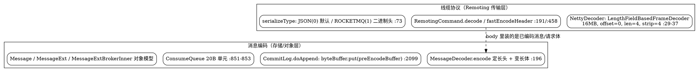

## Introduction

RocketMQ 的「消息协议」是理解它所有链路的地基，分两层：**线缆协议（Remoting 传输层）**规定了一个请求/响应报文如何被切成字节在 TCP 上收发；**消息编码（存储/对象层）**规定了一条消息在被持久化到 `CommitLog`、被派发进 `ConsumeQueue`、被包装成 Java 对象时各自是什么字节布局。两层都自研、都紧凑，且与 Kafka 的二进制协议、JMS 的臃肿协议都不同。

> 版本基线：**5.5.1**（tag `rocketmq-all-5.5.1`）。5.x 引入了 gRPC/Proxy 这条新面，但存量的 NameServer / Broker / 客户端内核仍是本篇剖析的 Remoting 私有协议。



线缆协议把一次 RPC 的请求头（code、opaque、flag、extFields）与 body 编码成「4 字节总长 + 4 字节（序列化类型<<24 | 头长）+ 头 + body」；消息编码则把业务消息落盘成一条「91 字节定长头（IPv4）+ 变长 body/topic/properties」的记录。两者通过 `RemotingCommand.body` 衔接：发消息时 body 是序列化后的消息体，拉消息时 body 是消息列表。

## 1. 线缆协议：Netty 私有 TCP 协议

### 1.1 帧结构（拆包与封装）

解码端 `NettyDecoder` 继承 `LengthFieldBasedFrameDecoder`，构造为 `super(FRAME_MAX_LENGTH, 0, 4, 0, 4)`（`NettyDecoder.java:29-37`）：

- `FRAME_MAX_LENGTH` 默认 16 MB（`com.rocketmq.remoting.frameMaxLength`，`:32-33`），防半包/粘包之外更防非法超大包撑爆内存；
- `lengthFieldOffset=0`、`lengthFieldLength=4`：第 0~4 字节是「总长」字段；
- `initialBytesToStrip=4`：**拆包后丢弃前 4 字节**，把剩下的 `[4B 头长+类型][头][body]` 交给 `RemotingCommand.decode`（`NettyDecoder.java:44-49`）。

编码端 `NettyEncoder.encode` 调 `remotingCommand.fastEncodeHeader(out)` 先写头部、再写 `body`（`NettyEncoder.java:34-49`）。`fastEncodeHeader` 先在 `out` 预留 8 个零字节（总长字段 + 头长字段），编码头部后回填（`RemotingCommand.java:458-477`）：

- `setInt(beginIndex, 4 + headerSize + bodySize)` → 总长 = 4（头长字段自身）+ 头长 + body 长；
- `setInt(beginIndex + 4, markProtocolType(headerSize, type))` → 头长字段 = `(serializeType << 24) | (headerSize & 0x00FFFFFF)`（`markProtocolType`，`:248-250`）。

所以**单条命令在线上的完整字节序**是：

```
+------------------------------------------------------------------+
| 4B 总长 (LengthFieldBasedFrameDecoder 帧，解码时 strip)            |
+------------------------------------------------------------------+
| 1B 序列化类型 | 3B 头长 (markProtocolType 合成)                    |  ← 4 字节
+------------------------------------------------------------------+
| headerData（JSON 或 ROCKETMQ 二进制头，长度 = 头长）               |
+------------------------------------------------------------------+
| body（可选，业务载荷）                                            |
+------------------------------------------------------------------+
```

解码侧对应：`decode` 读 `oriHeaderLen = readInt()`，拆出 `headerLength = getHeaderLength(oriHeaderLen) = oriHeaderLen & 0xFFFFFF`，拆出 `type = getProtocolType(oriHeaderLen) = (oriHeaderLen >> 24) & 0xFF`，再按类型解码头，`bodyLength = length - 4 - headerLength`（`RemotingCommand.java:191-210, 212-214, 236-238`）。

### 1.2 头的两种序列化：JSON 与 ROCKETMQ 二进制

服务端默认序列化类型由静态量决定：`serializeTypeConfigInThisServer = SerializeType.JSON`，可被系统属性 `rocketmq.serialize.type` 或环境变量 `ROCKETMQ_SERIALIZE_TYPE` 覆盖（`RemotingCommand.java:73-84`）。`SerializeType` 仅两个取值：`JSON((byte)0)`、`ROCKETMQ((byte)1)`（`SerializeType.java:20-22`）。

`headerEncode` 据此二选一（`RemotingCommand.java:421-428`）：

- **JSON 路径**：`RemotingSerializable.encode(this)` 用 fastjson2 把整个 `RemotingCommand`（code/language/version/opaque/flag/remark/extFields/serializeTypeCurrentRPC）序列化成 JSON；
- **ROCKETMQ 二进制路径**：`RocketMQSerializable.rocketMQProtocolEncode` 输出紧凑二进制，布局严格如下（`RocketMQSerializable.java:135-171`）：

```
short  code            (2)   命令码，如 SEND_MESSAGE=10
byte   language        (1)   LanguageCode，默认 JAVA
short  version         (2)   协议版本
int    opaque          (4)   请求 ID（配对用）
int    flag            (4)   位标记（响应位 / oneway 位）
int    remarkLen + remark     可选文本（0 表示空）
int    mapLenIndex(占位) + (FastCodesHeader.encode 直接字段) + extFields
```

其中 `extFields` 是 `HashMap<String,String>`，编码为「`short keyLen + key` + `int valLen + val`」逐对写入（`writeStr(useShortLength=true/false)`，`RocketMQSerializable.java:101-114, 160-169`）。**注意**：二进制头里**没有** JSON 那种「反射字段」——请求的业务参数全部落在 `extFields` 这个字符串 map 里。

### 1.3 业务参数如何进 extFields：反射 vs FastCodesHeader

发送/拉取等请求的 `customHeader`（如 `SendMessageRequestHeader`）在编码前由 `makeCustomHeaderToNet` 把每个非 static 字段通过反射塞进 `extFields`（`RemotingCommand.java:430-456`）；解码时 `decodeCommandCustomHeader` 再反向把 `extFields` 反射填回 `customHeader`（`RemotingCommand.java:282-345`）。这是为了兼容任意自定义头。

高频命令（发消息、拉消息）的 header 实现 `FastCodesHeader` 接口，走**免反射**的 `encode(out)` / `decode(extFields)` 直写（`RemotingCommand.java:157-159, 292-296`），避免每请求一次全字段反射，是热路径上的关键优化。

### 1.4 flag 的位语义

`flag` 是一个位图，不是状态码（`RemotingCommand.java:52-53`）：

- 第 0 位 `RPC_TYPE`：`markResponseType()` 置位，标记这是响应（`isResponseType` 据此判断，`:252-255, 541-544`）；
- 第 1 位 `RPC_ONEWAY`：`markOnewayRPC()` 置位，标记单向（不配对、不等响应，心跳即用此，`:512-521`）。

请求/响应配对靠 `opaque`（自增 ID）在 `responseTable` 里 Map 匹配——这部分在 [Remoting](/docs/CS/MQ/RocketMQ/Remoting.md) 已详述，本篇聚焦字节本身。

## 2. 命令码体系（RequestCode）

所有 RPC 的「动作类型」由 `code` 区分，`RequestCode` 是常量清单。按角色分群（5.5.1 真值）：

| 角色 | 常量 | code | 文件:行 |
|------|------|------|---------|
| 生产 | `SEND_MESSAGE` | 10 | `RequestCode.java:22` |
| 生产 | `SEND_MESSAGE_V2` | 310 | `RequestCode.java:173` |
| 生产 | `CONSUMER_SEND_MSG_BACK` | 36 | `RequestCode.java:56` |
| 事务 | `END_TRANSACTION` | 37 | `RequestCode.java:58` |
| 消费 | `PULL_MESSAGE` | 11 | `RequestCode.java:24` |
| 消费 | `LITE_PULL_MESSAGE` | 361 | `RequestCode.java:229` |
| 查询 | `QUERY_MESSAGE` | 12 | `RequestCode.java:26` |
| 偏移 | `SEARCH_OFFSET_BY_TIMESTAMP` | 29 | `RequestCode.java:44` |
| 偏移 | `GET_MAX_OFFSET` | 30 | `RequestCode.java:45` |
| 保活 | `HEART_BEAT` | 34 | `RequestCode.java:52` |
| 路由 | `GET_ROUTEINFO_BY_TOPIC` | 105 | `RequestCode.java:110` |
| 路由 | `REGISTER_BROKER` | 103 | `RequestCode.java:107` |
| 路由 | `UNREGISTER_BROKER` | 104 | `RequestCode.java:109` |
| 5.x | `CONTROLLER_REGISTER_BROKER` | 1003 | `RequestCode.java:261` |
| 5.x | `RAFT_BROKER_HEART_BEAT_EVENT_REQUEST` | 1018 | `RequestCode.java:294` |

要点：`SEND_MESSAGE_V2`(310) 是 `SEND_MESSAGE`(10) 的紧凑版，把 topic、queueId 等塞进 `extFields` 减少 JSON 体积；消费侧 `LITE_PULL_MESSAGE`(361) 是 5.x 轻量拉取；1003/1018 是 Controller HA 引入的，与 [Controller HA](/docs/CS/MQ/RocketMQ/ControllerHA.md) 的高可用选主语义相关。响应侧另有 `RemotingSysResponseCode`（`SYSTEM_ERROR` 等）。

## 3. 消息的物理编码（CommitLog 落盘格式）—— 核心

一条消息被写入 `CommitLog` 前已在 `MessageExtBrokerInner.getEncodedBuff()` 里预编码好，**落盘函数 `doAppend` 只是 `byteBuffer.put(preEncodeBuffer)` 把整段字节写进 mmap 缓冲**（`CommitLog.java:1990-2119, :2099`），并不在写路径上做序列化。真正的字节布局由 `MessageDecoder.encode` 决定（`MessageDecoder.java:196-305`）。

### 3.1 字节布局（IPv4，定长头 91 字节 + 变长体）

```
偏移  字段                      类型/长度        说明
0     TOTALSIZE                 int 4           整条消息长度（含自身）
4     MAGICCODE                 int 4           消息魔数
8     BODYCRC                   int 4           body 的 CRC32
12    QUEUEID                   int 4           逻辑队列 ID
16    FLAG                      int 4           业务 flag（同线缆 flag 不同语义）
20    QUEUEOFFSET               long 8          在 ConsumeQueue 中的序号
28    PHYSICALOFFSET            long 8          在 CommitLog 中的物理偏移
36    SYSFLAG                   int 4           系统标志（压缩/事务/IPv6…）
40    BORNTIMESTAMP             long 8          生产时间戳
48    BORNHOST                  IPv4: 4+4=8     IP(4)+端口(4)
       (IPv6: 16+4=20，由 SYSFLAG 的 BORNHOST_V6_FLAG 决定)
56/68 STORETIMESTAMP            long 8          存储时间戳（doAppend 锁内回填，:2085）
64/76 STOREHOSTADDRESS          IPv4: 4+4=8     Broker 地址（V6 扩到 20）
72/92 RECONSUMETIMES            int 4           重试次数
76/96 PREPAREDTRANSACTIONOFFSET long 8           事务 prepared 偏移
84/108 BODY                     int 4 + N       体长度 + 体字节
…     TOPIC                     byte 1 + M      主题长度(1) + 主题字节
…     PROPERTIES                short 2 + K     属性长度(2) + 属性字符串
```

定长头大小计算见 `MessageDecoder.java:217-234`：`storeSize = 4+4+4+4+4+8+8+4+8+bornhostLen+8+storehostLen+4+8 + (4+body) + (1+topic) + (2+properties)`。IPv4 下 bornhost+storehost=16，定长头累计 **91 字节**；IPv6 下各扩到 20，定长头累计 **115 字节**（`:204, 226-228`）。

### 3.2 三个魔数与文件尾填充

- `MESSAGE_MAGIC_CODE = -626843481`：普通消息魔数（`MessageDecoder.java:48`）；
- `MESSAGE_MAGIC_CODE_V2 = -626843477`：批量消息（`MessageExtBatch`）魔数（`:49`）；
- `BLANK_MAGIC_CODE = -875286124`：CommitLog 文件尾部不足一条消息时的**填充块**（`CommitLog.java:2057-2063`，只写 8 字节 TOTALSIZE+BLANK_MAGIC_CODE 即视为文件结束）。

`doAppend` 在锁内回填两个运行期才知道的值：写指针推进后回填 `PHYSICALOFFSET`（`CommitLog.java:2079-2080`），存储时间戳在锁内回填 `STORETIMESTAMP`（`:2085`）；若开启 `enabledAppendPropCRC` 还会在尾部追加整条消息的 CRC32 作为 `crc32ReservedLength` 校验段（`:2086-2094`）。

```dot
digraph commitlog_record {
  rankdir=LR;
  node [shape=box, style=rounded];
  subgraph cluster_fixed {
    label="定长头 (IPv4=91B / IPv6=115B)";
    f1 [label="TOTALSIZE+MAGICCODE+BODYCRC"];
    f2 [label="QUEUEID+FLAG+QUEUEOFFSET+PHYSICALOFFSET"];
    f3 [label="SYSFLAG+BORNTIMESTAMP+BORNHOST"];
    f4 [label="STORETIMESTAMP+STOREHOST+RECONSUMETIMES+PREPAREDTXOFFSET"];
  }
  subgraph cluster_var {
    label="变长体";
    v1 [label="BODY (int len + bytes)"];
    v2 [label="TOPIC (byte len + bytes)"];
    v3 [label="PROPERTIES (short len + kv-string)"];
  }
  f1 -> f2 -> f3 -> f4 -> v1 -> v2 -> v3;
}
```



## 4. ConsumeQueue 与 IndexFile 条目编码

`ReputMessageService` 异步把每条 CommitLog 记录派发成索引（派发细节见 [Store](/docs/CS/MQ/RocketMQ/Store.md)）。其中 **ConsumeQueue 条目是固定 20 字节**，`CQ_STORE_UNIT_SIZE = 20`（`ConsumeQueue.java:64`）：

- `putLong(offset)` 8 字节：CommitLog 物理偏移；
- `putInt(size)` 4 字节：消息在 CommitLog 中的长度；
- `putLong(tagsCode)` 8 字节：tag 的哈希值（Broker 读路径据此做 Tag 预筛，`ConsumeQueue.java:851-853`）。

20 字节定长使 ConsumeQueue 可以纯顺序、无锁地二分查找（`:296, 667`），是「一写多读」里读路径高性能的关键。IndexFile（按 Key/时间检索）则是 hashSlot + 头插反向链表结构，编码细节见 Store 篇，本篇不展开。

## 5. 消息对象模型与 Properties 编码

### 5.1 三个对象层次

- `Message`：生产者构造的消息，仅含 `topic/flag/properties/body/transactionId`（`Message.java:27-34`），`properties` 经 `putProperty` 维护（`:71-77`），用户属性受 `STRING_HASH_SET` 保护、不能占用系统键（`:85-99`）；
- `MessageExt`：服务端/消费者侧扩展，追加 `queueId/queueOffset/commitLogOffset/storeTimestamp/msgId/...` 等运行时字段；
- `MessageExtBrokerInner`：Broker 落盘前的内核形态，持 `encodedBuff` 预编码缓冲；批量场景用 `MessageExtBatch`。

### 5.2 Properties 字符串格式

`properties`（系统属性 + 用户属性）在落盘前被 `messageProperties2String` 压成**一条紧凑字符串**，规则：每对 `key + NAME_VALUE_SEPARATOR + value + PROPERTY_SEPARATOR` 顺序拼接，其中 `NAME_VALUE_SEPARATOR = 1`（`\u0001`）、`PROPERTY_SEPARATOR = 2`（`\u0002`）（`MessageDecoder.java:53-54, 605-635`）。解码走对称 `string2messageProperties`（`:638-657`）。这条字符串就是 §3.1 末尾 `PROPERTIES` 段的全部内容。

系统属性键（节选，`MessageConst.java`）：

| 键 | 常量 | 含义 |
|----|------|------|
| `KEYS` | `PROPERTY_KEYS` | 业务索引键（`:22`） |
| `TAGS` | `PROPERTY_TAGS` | 订阅标签（`:23`） |
| `WAIT` | `PROPERTY_WAIT_STORE_MSG_OK` | 是否等落盘确认（`:24`） |
| `DELAY` | `PROPERTY_DELAY_TIME_LEVEL` | 延迟级别（`:25`） |
| `TRAN_MSG` | `PROPERTY_TRANSACTION_PREPARED` | 是否事务 prepared（`:30`） |
| `PGROUP` | `PROPERTY_PRODUCER_GROUP` | 生产者组（`:31`） |
| `RECONSUME_TIME` | `PROPERTY_RECONSUME_TIME` | 重试次数（`:39`） |
| `UNIQ_KEY` | `PROPERTY_UNIQ_CLIENT_MESSAGE_ID_KEYIDX` | 生产者消息 ID（`:42`） |
| `TIMER_DELIVER_MS` | `PROPERTY_TIMER_DELIVER_MS` | 定时投递（`:74`） |

## 6. 两条「消息 ID」

RocketMQ 里有两个常被混淆的 ID，协议层编码位置不同：

1. **offsetMsgId（物理 ID / phyMsgId）**：Broker 落盘时生成，格式 = `storeHost(IP+端口) + physicOffset`，IPv4 下 16 字节（V6 下 28）转 hex 字符串（`CommitLog.java:2023-2031` 的 `msgIdSupplier`，借助 `MessageExt.socketAddress2ByteBuffer`）。它**定位消息在 CommitLog 的物理位置**，用于按 offset 回查、运维排查。
2. **UNIQ_KEY（业务 ID / client msgId）**：生产者侧 `MessageClientIDSetter.createUniqID()` 生成，作为 `PROPERTY_UNIQ_CLIENT_MESSAGE_ID_KEYIDX`（`UNIQ_KEY`）存入 properties（`MessageClientIDSetter.java:116-141`）；`LEN = ip.length + 2 + 4 + 4 + 2`，IPv4 下即 16 字节→32 hex 字符。它**由生产者保证唯一**，用于业务去重与幂等消费（详见 [端到端生命周期](/docs/CS/MQ/RocketMQ/MessageLifecycle.md) 的幂等防线）。

两者长度相同（IPv4 下都是 32 字符 hex）但语义不同：offsetMsgId 随落盘位置变化、重启换盘即失效；UNIQ_KEY 在消息创建时就固定、随消息体走。事务回查链路里 `getMsgId()` 取的是 offsetMsgId，`getUserProperty(UNIQ_KEY)` 取的是业务 ID（见 [事务消息](/docs/CS/MQ/RocketMQ/TransactionalMessage.md) 回查日志）。

## Links

- [IndexFile](/docs/CS/MQ/RocketMQ/IndexFile.md)
- [ACL](/docs/CS/MQ/RocketMQ/ACL.md)

- [Remoting（通信模块高层概览）](/docs/CS/MQ/RocketMQ/Remoting.md)
- [Store（存储引擎与派发）](/docs/CS/MQ/RocketMQ/Store.md)
- [TransactionalMessage（事务消息源码链路）](/docs/CS/MQ/RocketMQ/TransactionalMessage.md)
- [OPMessage（OP 消息实现原理）](/docs/CS/MQ/RocketMQ/OPMessage.md)
- [Namesrv（路由注册中心）](/docs/CS/MQ/RocketMQ/Namesrv.md)
- [Producer（生产端路径）](/docs/CS/MQ/RocketMQ/Producer.md)
- [BatchEncoding（批量编码：线缆子格式 / 物理批量 / inner batch）](/docs/CS/MQ/RocketMQ/BatchEncoding.md)
- [PopConsume（POP 无状态消费协议：extraInfo 票据 / ck-ack / Revive）](/docs/CS/MQ/RocketMQ/PopConsume.md)
- [ProxyProtocol（5.x gRPC Proxy 协议转换：gRPC→Remoting 四层栈）](/docs/CS/MQ/RocketMQ/ProxyProtocol.md)
- [TimerMessage（5.x 时间轮延迟消息 / 旧 18 级 SCHEDULE 对照）](/docs/CS/MQ/RocketMQ/TimerMessage.md)

## References

1. [RocketMQ 源码：rocketmq-remoting 模块](https://github.com/apache/rocketmq/tree/develop/remoting)
2. [RocketMQ 官方文档 - architecture](https://rocketmq.apache.org/docs/)
3. [RocketMQ技术内幕](https://book.douban.com/subject/35626441/)
