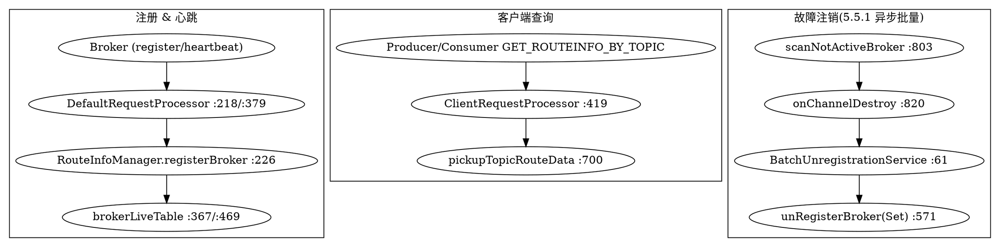

# RocketMQ NameServer

源码基线：RocketMQ 5.5.1（`namesrv` 模块）。NameServer 是 RocketMQ 的**无状态路由注册中心**：Broker 主动注册并周期心跳，Client 主动定时拉取，节点之间互不通信，以**最终一致**换取部署独立与高可用。

## Introduction
NameServer是一个几乎无状态节点，可集群部署，节点是对等的，节点之间无任何信息同步 ，客户端访问任意节点获取的消息路由信息是一致的

Name Server无状态的关键点在于，消息路由信息是存储在Broker Server上的。Broker Server会定时将本地缓存或者在文件中的消息路由信息同步到Name Server，Name Server只是提供了“读”的功能

Namesrv组件

- KVConfigManager：KV配置管理 key-value配置管理，增删改查
- RouteInfoManager：路由信息管理

- - 注册Broker，提供Broker信息（名字、角色编号、地址、集群名）
  - 注册Topic，提供Topic信息（Topic名、读写权限、队列情况）


NameServer不仅仅是存储了各个Broker的IP地址和端口，还存储了对应的Topic的路由数据


Name Server动态扩容/缩容需要地址服务的配置 以让客户端感知 实现动态寻址的效果

- 启动Producer/Consumer时若不设置Name Server的IP地址 默认开启地址服务动态寻址功能
- Broker除了不设置Name Server的IP 还需要显式开启地址服务的配置

## start

> 启动前注意环境变量`ROCKETMQ_HOME`的设置


Brokers send heart beats to name server every 30 seconds and name server update live broker table time stamp.
Name server scan live broker table every 10s and remove last time stamp > 120s brokers.

```java
public class NamesrvStartup {
    public static void main(String[] args) {
        main0(args);
        controllerManagerMain();
    }

    public static void main0(String[] args) {
        try {
            parseCommandlineAndConfigFile(args);
            createAndStartNamesrvController();
        } catch (Throwable e) {
            e.printStackTrace();
            System.exit(-1);
        }
    }

    public static NamesrvController createAndStartNamesrvController() throws Exception {

        NamesrvController controller = createNamesrvController();
        start(controller);
        NettyServerConfig serverConfig = controller.getNettyServerConfig();
        return controller;
    }
}
```


### createNamesrvController
```java
public static NamesrvController createNamesrvController() {

        final NamesrvController controller = new NamesrvController(namesrvConfig, nettyServerConfig, nettyClientConfig);
        // remember all configs to prevent discard
        controller.getConfiguration().registerConfig(properties);
        return controller;
    }
```

namesrvConfig, nettyServerConfig, nettyClientConfig
```java
public class NettyServerConfig implements Cloneable {

  private int serverWorkerThreads = 8;
  private int serverCallbackExecutorThreads = 0;
  private int serverSelectorThreads = 3;
  private int serverOnewaySemaphoreValue = 256;
  
}
```
### NamesrvController

initialize -> start ->

```java
public class NamesrvController {
  public boolean initialize() {
    loadConfig();
    initiateNetworkComponents(); // Netty 
    initiateThreadExecutors();
    registerProcessor();
    startScheduleService();
    initiateSslContext();
    initiateRpcHooks();
    return true;
  }

  private void initiateNetworkComponents() {
    this.remotingServer = new NettyRemotingServer(this.nettyServerConfig, this.brokerHousekeepingService);
    this.remotingClient = new NettyRemotingClient(this.nettyClientConfig);
  }

  private void initiateThreadExecutors() {
    this.defaultThreadPoolQueue = new LinkedBlockingQueue<>(this.namesrvConfig.getDefaultThreadPoolQueueCapacity());
    this.defaultExecutor = new ThreadPoolExecutor(this.namesrvConfig.getDefaultThreadPoolNums(), this.namesrvConfig.getDefaultThreadPoolNums(), 1000 * 60, TimeUnit.MILLISECONDS, this.defaultThreadPoolQueue, new ThreadFactoryImpl("RemotingExecutorThread_")) {
      @Override
      protected <T> RunnableFuture<T> newTaskFor(final Runnable runnable, final T value) {
        return new FutureTaskExt<>(runnable, value);
      }
    };

    this.clientRequestThreadPoolQueue = new LinkedBlockingQueue<>(this.namesrvConfig.getClientRequestThreadPoolQueueCapacity());
    this.clientRequestExecutor = new ThreadPoolExecutor(this.namesrvConfig.getClientRequestThreadPoolNums(), this.namesrvConfig.getClientRequestThreadPoolNums(), 1000 * 60, TimeUnit.MILLISECONDS, this.clientRequestThreadPoolQueue, new ThreadFactoryImpl("ClientRequestExecutorThread_")) {
      @Override
      protected <T> RunnableFuture<T> newTaskFor(final Runnable runnable, final T value) {
        return new FutureTaskExt<>(runnable, value);
      }
    };
  }

  private void registerProcessor() {
    if (namesrvConfig.isClusterTest()) {

      this.remotingServer.registerDefaultProcessor(new ClusterTestRequestProcessor(this, namesrvConfig.getProductEnvName()), this.defaultExecutor);
    } else {
      // Support get route info only temporarily
      ClientRequestProcessor clientRequestProcessor = new ClientRequestProcessor(this);
      this.remotingServer.registerProcessor(RequestCode.GET_ROUTEINFO_BY_TOPIC, clientRequestProcessor, this.clientRequestExecutor);

      this.remotingServer.registerDefaultProcessor(new DefaultRequestProcessor(this), this.defaultExecutor);
    }
  }
}
```


Three tasks

scanNotActiveBroker 处理不活跃的客户端链接

定时器周期性输出KV信息


```java
private void startScheduleService() {
    this.scanExecutorService.scheduleAtFixedRate(NamesrvController.this.routeInfoManager::scanNotActiveBroker,
            5, this.namesrvConfig.getScanNotActiveBrokerInterval(), TimeUnit.MILLISECONDS);

    this.scheduledExecutorService.scheduleAtFixedRate(NamesrvController.this.kvConfigManager::printAllPeriodically,
            1, 10, TimeUnit.MINUTES);

    this.scheduledExecutorService.scheduleAtFixedRate(() -> {
      try {
        NamesrvController.this.printWaterMark();
      } catch (Throwable e) {
        LOGGER.error("printWaterMark error.", e);
      }
    }, 10, 1, TimeUnit.SECONDS);
  }
```


监听通信运行状态

```java
public class BrokerHousekeepingService implements ChannelEventListener {

    private final NamesrvController namesrvController;

    public BrokerHousekeepingService(NamesrvController namesrvController) {
        this.namesrvController = namesrvController;
    }

    @Override
    public void onChannelConnect(String remoteAddr, Channel channel) {
    }

    @Override
    public void onChannelClose(String remoteAddr, Channel channel) {
        this.namesrvController.getRouteInfoManager().onChannelDestroy(channel);
    }

    @Override
    public void onChannelException(String remoteAddr, Channel channel) {
        this.namesrvController.getRouteInfoManager().onChannelDestroy(channel);
    }

    @Override
    public void onChannelIdle(String remoteAddr, Channel channel) {
        this.namesrvController.getRouteInfoManager().onChannelDestroy(channel);
    }

    @Override
    public void onChannelActive(String remoteAddr, Channel channel) {

    }
}
```


### DefaultRequestProcessor::processRequest

```java
public class DefaultRequestProcessor implements NettyRequestProcessor {
  @Override
  public RemotingCommand processRequest(ChannelHandlerContext ctx,
                                        RemotingCommand request) throws RemotingCommandException {

    if (ctx != null) {
      log.debug("receive request, {} {} {}",
              request.getCode(),
              RemotingHelper.parseChannelRemoteAddr(ctx.channel()),
              request);
    }

    switch (request.getCode()) {
      case RequestCode.PUT_KV_CONFIG:
        return this.putKVConfig(ctx, request);
      case RequestCode.GET_KV_CONFIG:
        return this.getKVConfig(ctx, request);
      case RequestCode.DELETE_KV_CONFIG:
        return this.deleteKVConfig(ctx, request);
      case RequestCode.QUERY_DATA_VERSION:
        return this.queryBrokerTopicConfig(ctx, request);
      case RequestCode.REGISTER_BROKER:
        return this.registerBroker(ctx, request);
      case RequestCode.UNREGISTER_BROKER:
        return this.unregisterBroker(ctx, request);
      case RequestCode.BROKER_HEARTBEAT:
        return this.brokerHeartbeat(ctx, request);
      case RequestCode.GET_BROKER_MEMBER_GROUP:
        return this.getBrokerMemberGroup(ctx, request);
      case RequestCode.GET_BROKER_CLUSTER_INFO:
        return this.getBrokerClusterInfo(ctx, request);
      case RequestCode.WIPE_WRITE_PERM_OF_BROKER:
        return this.wipeWritePermOfBroker(ctx, request);
      case RequestCode.ADD_WRITE_PERM_OF_BROKER:
        return this.addWritePermOfBroker(ctx, request);
      case RequestCode.GET_ALL_TOPIC_LIST_FROM_NAMESERVER:
        return this.getAllTopicListFromNameserver(ctx, request);
      case RequestCode.DELETE_TOPIC_IN_NAMESRV:
        return this.deleteTopicInNamesrv(ctx, request);
      case RequestCode.REGISTER_TOPIC_IN_NAMESRV:
        return this.registerTopicToNamesrv(ctx, request);
      case RequestCode.GET_KVLIST_BY_NAMESPACE:
        return this.getKVListByNamespace(ctx, request);
      case RequestCode.GET_TOPICS_BY_CLUSTER:
        return this.getTopicsByCluster(ctx, request);
      case RequestCode.GET_SYSTEM_TOPIC_LIST_FROM_NS:
        return this.getSystemTopicListFromNs(ctx, request);
      case RequestCode.GET_UNIT_TOPIC_LIST:
        return this.getUnitTopicList(ctx, request);
      case RequestCode.GET_HAS_UNIT_SUB_TOPIC_LIST:
        return this.getHasUnitSubTopicList(ctx, request);
      case RequestCode.GET_HAS_UNIT_SUB_UNUNIT_TOPIC_LIST:
        return this.getHasUnitSubUnUnitTopicList(ctx, request);
      case RequestCode.UPDATE_NAMESRV_CONFIG:
        return this.updateConfig(ctx, request);
      case RequestCode.GET_NAMESRV_CONFIG:
        return this.getConfig(ctx, request);
      case RequestCode.GET_CLIENT_CONFIG:
        return this.getClientConfigs(ctx, request);
      default:
        String error = " request type " + request.getCode() + " not supported";
        return RemotingCommand.createResponseCommand(RemotingSysResponseCode.REQUEST_CODE_NOT_SUPPORTED, error);
    }
  }
}
```

clients get latest route information by active

## Route

### RouteInfoManager

Name Server使用RouteInfoManager来管理消息主题配置信息

```java

public class RouteInfoManager {
  private final Map<String/* topic */, Map<String, QueueData>> topicQueueTable;
  private final Map<String/* brokerName */, BrokerData> brokerAddrTable;
  private final Map<String/* clusterName */, Set<String/* brokerName */>> clusterAddrTable;
  private final Map<BrokerAddrInfo/* brokerAddr */, BrokerLiveInfo> brokerLiveTable;
  private final Map<BrokerAddrInfo/* brokerAddr */, List<String>/* Filter Server */> filterServerTable;
  private final Map<String/* topic */, Map<String/*brokerName*/, TopicQueueMappingInfo>> topicQueueMappingInfoTable;

  private final BatchUnregistrationService unRegisterService;

  private final NamesrvController namesrvController;
  private final NamesrvConfig namesrvConfig;

  public RouteInfoManager(final NamesrvConfig namesrvConfig, NamesrvController namesrvController) {
    this.topicQueueTable = new ConcurrentHashMap<>(1024);
    this.brokerAddrTable = new ConcurrentHashMap<>(128);
    this.clusterAddrTable = new ConcurrentHashMap<>(32);
    this.brokerLiveTable = new ConcurrentHashMap<>(256);
    this.filterServerTable = new ConcurrentHashMap<>(256);
    this.topicQueueMappingInfoTable = new ConcurrentHashMap<>(1024);
    this.unRegisterService = new BatchUnregistrationService(this, namesrvConfig);
    this.namesrvConfig = namesrvConfig;
    this.namesrvController = namesrvController;
  }
}
```

Use [ReentrantReadWriteLock](/docs/CS/Java/JDK/Concurrency/Lock.md?id=lock)

### 五大路由表的写入语义

`RouteInfoManager` 用 5 张 `ConcurrentHashMap` 维护全量路由（构造器初始化于 `RouteInfoManager.java:84-94`），全部由一把 `ReentrantReadWriteLock`（`:71`）保护：

| 表 | Key | Value | 写入时机 |
| --- | --- | --- | --- |
| `topicQueueTable` | topic | `Map<brokerName, QueueData>` | broker 注册/心跳携带的 topic 配置变更时（`createAndUpdateQueueData`，`:477`） |
| `brokerAddrTable` | brokerName | `BrokerData`(brokerId→addr 映射) | `registerBroker`（`:248-253`） |
| `clusterAddrTable` | clusterName | `Set<brokerName>` | `registerBroker`（`:243-244`） |
| `brokerLiveTable` | `BrokerAddrInfo`(cluster+addr) | `BrokerLiveInfo`(心跳时间戳/超时/Channel) | 每次注册或心跳（`:367` / `updateBrokerInfoUpdateTimestamp:469`） |
| `filterServerTable` | `BrokerAddrInfo` | `List<String>`(filter server) | `registerBroker`（`:378-384`） |

此外 `topicQueueMappingInfoTable` 存静态 topic 映射（`registerBroker:352-362`），5.5.1 暂未启用静态 topic。

### registerBroker 在 RouteInfoManager 的内部写入（源码级）

`DefaultRequestProcessor.registerBroker`（:218）校验 CRC32 与版本后调用 `RouteInfoManager.registerBroker`（:226）。加**写锁**（`lock.writeLock().lockInterruptibly()`，`:240`）后依次：

1. **brokerAddrTable / clusterAddrTable**：首次注册新建 `BrokerData` 并 put（:248-253）；支持 Slave→Master 切换时先删旧 `brokerId→addr` 记录再 add（:273）。
2. **stateVersion 冲突检测**（:276-292）：若同 brokerId 已注册且旧 `stateVersion` 更新，则拒绝新注册并清理 `brokerLiveTable` 中冲突 addr。
3. **topicQueueTable**：仅 Master 或「最小 brokerId 的 prime slave」才写队列（`isMaster || isPrimeSlave`，:308），遍历 `TopicConfig` 调 `createAndUpdateQueueData`（:348）；开启 `deleteTopicWithBrokerRegistration` 时清理已下线 broker 的 topic（:320-336）。
4. **brokerLiveTable 心跳登记**（:367）：`put(new BrokerLiveInfo(now, timeoutMillis, dataVersion, channel, haServerAddr))`，`timeoutMillis` 默认 `DEFAULT_BROKER_CHANNEL_EXPIRED_TIME = 1000*60*2`（2 分钟，:70），可由注册请求头 `heartbeatTimeoutMillis` 覆盖。
5. **回填 masterAddr/haServerAddr**（:386-396）：非 master 从 `brokerAddrTable` 查 master 地址回填 `RegisterBrokerResult`，供 broker 间主从同步建链。

### 路由全景图（注册 / 心跳保活 / 查询 / 注销）



RouteInfoManager

#### registerBroker

receive register request
```java
public class DefaultRequestProcessor implements NettyRequestProcessor {
    public RemotingCommand processRequest(ChannelHandlerContext ctx,
                                          RemotingCommand request) throws RemotingCommandException {
        switch (request.getCode()) {
            // ...
            case RequestCode.REGISTER_BROKER:
                return this.registerBroker(ctx, request);
        }
    }
}
```


Route info is not real-time. The clients need to pull latest topic info in fix rate.

```java
public class DefaultRequestProcessor implements NettyRequestProcessor {
    public RemotingCommand registerBroker(ChannelHandlerContext ctx,
                                          RemotingCommand request) throws RemotingCommandException {
        final RemotingCommand response = RemotingCommand.createResponseCommand(RegisterBrokerResponseHeader.class);
        final RegisterBrokerResponseHeader responseHeader = (RegisterBrokerResponseHeader) response.readCustomHeader();
        final RegisterBrokerRequestHeader requestHeader =
                (RegisterBrokerRequestHeader) request.decodeCommandCustomHeader(RegisterBrokerRequestHeader.class);

        if (!checksum(ctx, request, requestHeader)) {
            response.setCode(ResponseCode.SYSTEM_ERROR);
            response.setRemark("crc32 not match");
            return response;
        }

        TopicConfigSerializeWrapper topicConfigWrapper = null;
        List<String> filterServerList = null;

        Version brokerVersion = MQVersion.value2Version(request.getVersion());
        if (brokerVersion.ordinal() >= MQVersion.Version.V3_0_11.ordinal()) {
            final RegisterBrokerBody registerBrokerBody = extractRegisterBrokerBodyFromRequest(request, requestHeader);
            topicConfigWrapper = registerBrokerBody.getTopicConfigSerializeWrapper();
            filterServerList = registerBrokerBody.getFilterServerList();
        } else {
            // RegisterBrokerBody of old version only contains TopicConfig.
            topicConfigWrapper = extractRegisterTopicConfigFromRequest(request);
        }

        RegisterBrokerResult result = this.namesrvController.getRouteInfoManager().registerBroker(
                requestHeader.getClusterName(),
                requestHeader.getBrokerAddr(),
                requestHeader.getBrokerName(),
                requestHeader.getBrokerId(),
                requestHeader.getHaServerAddr(),
                request.getExtFields().get(MixAll.ZONE_NAME),
                requestHeader.getHeartbeatTimeoutMillis(),
                requestHeader.getEnableActingMaster(),
                topicConfigWrapper,
                filterServerList,
                ctx.channel()
        );

        if (result == null) {
            // Register single topic route info should be after the broker completes the first registration.
            response.setCode(ResponseCode.SYSTEM_ERROR);
            response.setRemark("register broker failed");
            return response;
        }

        responseHeader.setHaServerAddr(result.getHaServerAddr());
        responseHeader.setMasterAddr(result.getMasterAddr());

        if (this.namesrvController.getNamesrvConfig().isReturnOrderTopicConfigToBroker()) {
            byte[] jsonValue = this.namesrvController.getKvConfigManager().getKVListByNamespace(NamesrvUtil.NAMESPACE_ORDER_TOPIC_CONFIG);
            response.setBody(jsonValue);
        }

        response.setCode(ResponseCode.SUCCESS);
        response.setRemark(null);
        return response;
    }
}
```

#### getRouteInfoByTopic

获取Topic的路由信息

```java

public class ClientRequestProcessor implements NettyRequestProcessor {
    protected NamesrvController namesrvController;

    public RemotingCommand getRouteInfoByTopic(ChannelHandlerContext ctx,
                                               RemotingCommand request) throws RemotingCommandException {
        final RemotingCommand response = RemotingCommand.createResponseCommand(null);
        final GetRouteInfoRequestHeader requestHeader =
                (GetRouteInfoRequestHeader) request.decodeCommandCustomHeader(GetRouteInfoRequestHeader.class);

        TopicRouteData topicRouteData = this.namesrvController.getRouteInfoManager().pickupTopicRouteData(requestHeader.getTopic());

        if (topicRouteData != null) {
            if (this.namesrvController.getNamesrvConfig().isOrderMessageEnable()) {
                String orderTopicConf =
                        this.namesrvController.getKvConfigManager().getKVConfig(NamesrvUtil.NAMESPACE_ORDER_TOPIC_CONFIG,
                                requestHeader.getTopic());
                topicRouteData.setOrderTopicConf(orderTopicConf);
            }

            byte[] content;
            Boolean standardJsonOnly = requestHeader.getAcceptStandardJsonOnly();
            if (request.getVersion() >= MQVersion.Version.V4_9_4.ordinal() || null != standardJsonOnly && standardJsonOnly) {
                content = topicRouteData.encode(SerializerFeature.BrowserCompatible,
                        SerializerFeature.QuoteFieldNames, SerializerFeature.SkipTransientField,
                        SerializerFeature.MapSortField);
            } else {
                content = topicRouteData.encode();
            }

            response.setBody(content);
            response.setCode(ResponseCode.SUCCESS);
            response.setRemark(null);
            return response;
        }

        response.setCode(ResponseCode.TOPIC_NOT_EXIST);
        response.setRemark("No topic route info in name server for the topic: " + requestHeader.getTopic()
                + FAQUrl.suggestTodo(FAQUrl.APPLY_TOPIC_URL));
        return response;
    }
}
```

## HouseKeep

> NameServer 的高可用不靠副本，而靠「Broker 自申报 + 定时扫描清理 + 客户端重试」。在 Controller 模式下它进一步退化为纯路由发现，master 地址的权威性来自 Controller 裁定，源码级见 [Controller HA](/docs/CS/MQ/RocketMQ/ControllerHA.md)。其内嵌部署（`enableControllerInNamesrv`）与 AutoSwitch 复制语意、容灾选举的纵深，见 [Controller Replication](/docs/CS/MQ/RocketMQ/ControllerReplication.md)。

### 连接断开感知：BrokerHousekeepingService

`NamesrvController` 把 `BrokerHousekeepingService`（实现 `ChannelEventListener`）注入 Netty Server（:104 `new NettyRemotingServer(... this.brokerHousekeepingService)`）。当 broker 连接 **close / exception / idle** 时，`onChannelClose/Exception/Idle` 都会调 `RouteInfoManager.onChannelDestroy(channel)`（已在「start」节代码块展示 :193-205）。

### 心跳超时踢除：scanNotActiveBroker

`NamesrvController.startScheduleService` 以 `scanNotActiveBrokerInterval`（默认 10s）周期跑 `RouteInfoManager.scanNotActiveBroker`（:803）：

```java
public void scanNotActiveBroker() {
    for (Entry<BrokerAddrInfo, BrokerLiveInfo> next : this.brokerLiveTable.entrySet()) {
        long last = next.getValue().getLastUpdateTimestamp();
        long timeoutMillis = next.getValue().getHeartbeatTimeoutMillis();
        if ((last + timeoutMillis) < System.currentTimeMillis()) {
            RemotingHelper.closeChannel(next.getValue().getChannel());
            this.onChannelDestroy(next.getKey());   // :812
        }
    }
}
```

判定标准是 `brokerLiveTable` 中该 broker 的 `lastUpdateTimestamp + heartbeatTimeoutMillis < now`。超时阈值默认 2 分钟（:70），可由注册请求头 `heartbeatTimeoutMillis` 覆盖。

### 5.5.1 改进：异步批量注销（BatchUnregistrationService）

`onChannelDestroy(BrokerAddrInfo)`（:820）先加读锁 `setupUnRegisterRequest` 凑出 `UnRegisterBrokerRequestHeader`，再 `submitUnRegisterBrokerRequest`（:837 → :104）→ **投递到 `BatchUnregistrationService` 的 `LinkedBlockingQueue`**（:42，容量 `getUnRegisterBrokerQueueCapacity`），**不直接删路由**。

后台 `BatchUnregistrationService extends ServiceThread`（:35）的 `run()`（:61）循环 `take()` 一个请求后 `drainTo` 把队列里其余请求一并收集，**批量**调 `RouteInfoManager.unRegisterBroker(Set)`（:71）。这样把「单 broker 掉线导致逐条加写锁清理」收敛成「批量一次写锁」，显著降低高并发掉线（如整机房断电）时的锁竞争——这是 5.5.1 相对旧版（每个 `onChannelDestroy` 直接拿写锁清理）的关键性能改进。

### 实际清理：unRegisterBroker(Set) / cleanTopicByUnRegisterRequests

`unRegisterBroker(Set<UnRegisterBrokerRequestHeader>)`（:571）加写锁后，对每个请求：从 `brokerLiveTable` / `filterServerTable` 删除 → 从 `brokerAddrTable` 的 `brokerAddrs` 移除该 addr（:601），若某 brokerName 下 addr 清空则连 `brokerAddrTable`/`clusterAddrTable` 一并移除（:606-633）→ 最后 `cleanTopicByUnRegisterRequests`（:652）遍历 `topicQueueTable` 删除该 broker 的 `QueueData`，并对开启 ActingMaster 且 `isNoMasterExists`（:687）的 broker 擦除 write perm（:676-680）。

### 5.x 新增轻量心跳：brokerHeartbeat

4.x 仅有 `REGISTER_BROKER`（注册即心跳，携带全量 topic 配置）；5.x 引入独立 `BROKER_HEARTBEAT` 请求码，`DefaultRequestProcessor.brokerHeartbeat`（:379）**只调 `updateBrokerInfoUpdateTimestamp`**（`RouteInfoManager:469`，仅 `setLastUpdateTimestamp(now)`）刷新存活时间戳，**不重传 topic 配置**。注册与保活职责由此分离：注册负责 topic 路由变更，心跳只负责「我还活着」。

### KVConfigManager：顺序 KV 持久化

`KVConfigManager` 用 `HashMap<namespace, HashMap<key,value>>`（:37）存配置，对外提供 `PUT/GET/DELETE_KV_CONFIG`（见 `DefaultRequestProcessor` 大 switch :232-237）。其持久化极简单：

- `load()`（:44）：启动从 `NamesrvConfig.getKvConfigPath()`（默认 `~/namesrv/kvConfig.json`）读文件 → `KVConfigSerializeWrapper.fromJson` → 灌入 `configTable`（:55）。
- `putKVConfig`（:61）/ `deleteKVConfig`（:114）：改内存后**立即 `persist()`**（:87/:131）。
- `persist()`（:90）：`toJson()` 后 `MixAll.string2File` 全量覆盖写回 `kvConfig.json`（:100）。

> 注意：KVConfig **无 WAL、无增量**，每次写都全量刷盘；它只存少量控制面配置（如顺序消息 topic 配置 `ORDER_TOPIC_CONFIG`、ACL 等），不在消息热路径上，故可接受。

### 客户端查路由：pickupTopicRouteData

Client 发 `GET_ROUTEINFO_BY_TOPIC` → `ClientRequestProcessor.getRouteInfoByTopic`（:419）→ `RouteInfoManager.pickupTopicRouteData`（:700）：加读锁，从 `topicQueueTable` 取 `QueueData` 列表、从 `brokerAddrTable` 克隆 `BrokerData`、合并 `filterServerTable` 与 `topicQueueMappingInfoTable`，组装成 `TopicRouteData`（含 `queueDatas`/`brokerDatas`/`filterServerTable`）返回。客户端**每 `pollNameServerInterval`（默认 30s）主动拉取一次**，故路由视图是最终一致、非实时。

## Summary

RocketMQ 选择自研 NameServer 而非使用 Zookeeper、Nacos，核心原因有两点：

1. **独立性**：不依赖外部组件，避免版本依赖与运维复杂度，类似 Kafka 抛弃 Zookeeper 的思路。
2. **轻量与高可用**：NameServer 之间不同步数据，Broker 向所有 NameServer 注册，只要有一个 NameServer 存活，就能提供服务（对比 Zookeeper 需要半数以上节点存活）。

这种设计以牺牲数据一致性为代价，但对 RocketMQ 而言，客户端只需获取一个可用 Broker 即可，无需完整路由表，因此是可接受的。


## Links

- [ACL](/docs/CS/MQ/RocketMQ/ACL.md)

- [RocketMQ](/docs/CS/MQ/RocketMQ/RocketMQ.md)
- [Broker](/docs/CS/MQ/RocketMQ/Broker.md)
- [Cluster](/docs/CS/MQ/RocketMQ/Cluster.md)
- [Remoting](/docs/CS/MQ/RocketMQ/Remoting.md)
- [Store](/docs/CS/MQ/RocketMQ/Store.md)
- [Producer](/docs/CS/MQ/RocketMQ/Producer.md)
- [Rebalance（Rebalance 负载均衡 / OffsetStore / 集群·广播 有状态消费）](/docs/CS/MQ/RocketMQ/Rebalance.md)

## References

- Apache RocketMQ 官方文档（NameServer 角色与架构）：https://rocketmq.apache.org/docs/domainModel/ ，设计哲学见源码 `NamesrvStartup` / `RouteInfoManager` 注释。
- RocketMQ GitHub 仓库 `namesrv` 模块：https://github.com/apache/rocketmq/tree/rocketmq-all-5.5.1/namesrv （`RouteInfoManager.java` / `DefaultRequestProcessor.java` / `kvconfig/KVConfigManager.java` / `routeinfo/BatchUnregistrationService.java`）
- 源码基线：RocketMQ 5.5.1，本地仓库 `E:/Projects/rocketmq-rocketmq-all-5.5.1`。
