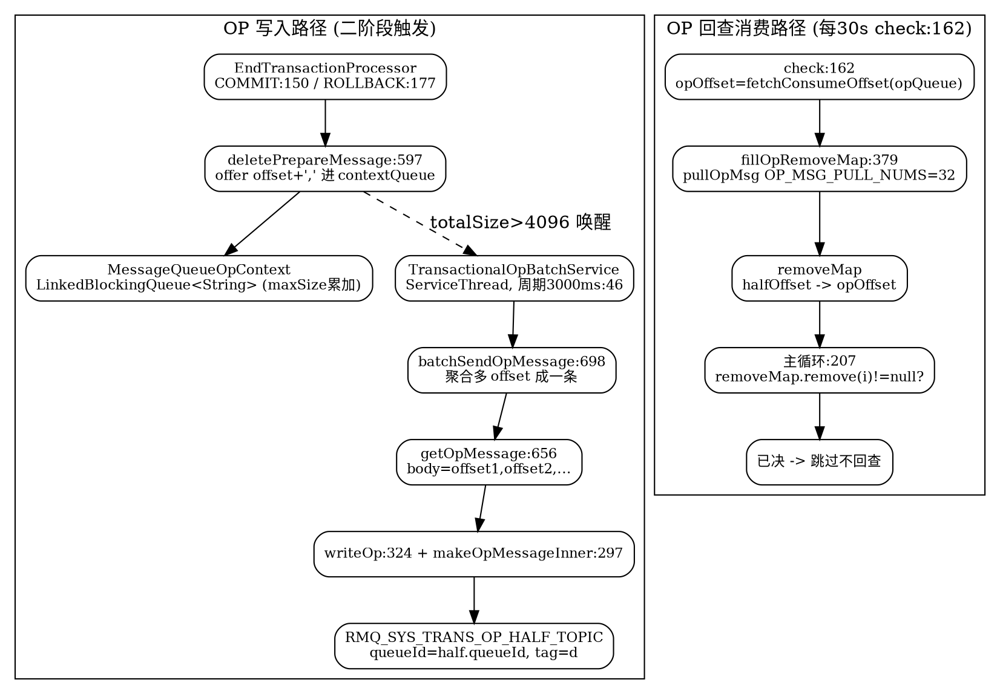

# RocketMQ Transactional OP Message — Internal "Resolved" Marking Mechanism

> 版本基线：RocketMQ **5.5.1**（tag `rocketmq-all-5.5.1`）。本文是 [TransactionalMessage](/docs/CS/MQ/RocketMQ/TransactionalMessage.md) 的细化拆解，聚焦 `RMQ_SYS_TRANS_OP_HALF_TOPIC` 之外那张"已决记账表"——**OP 消息**的实现原理。所有 `file:line` 均已 Read 真文件核验。

## Introduction

RocketMQ 事务消息的 half 消息一旦写入 commitlog，便受"顺序文件无法物理删除"的约束（详见 [TransactionalMessage](/docs/CS/MQ/RocketMQ/TransactionalMessage.md)）。因此 COMMIT/ROLLBACK 二阶段**并不删除** half 消息，而是写入一条专门的 **OP 消息（operation message）** 到 `RMQ_SYS_TRANS_OP_HALF_TOPIC`，把"哪些 half 已决"这件事**记一笔账**。回查线程每 30s 扫描 half 时，先读 OP 账本剔除已决项，避免对已提交/已回滚的消息重复回查。OP 消息本质是 half 的**逻辑删除标记**，其核心设计是：**批量聚合 + 独立消费进度 + 不可变对账**。

## 1. 物理定位：Topic / Queue / Tag / Body

OP 消息的全部静态元信息集中在 `TransactionalMessageUtil`：

| 维度 | 取值 | 源码 |
|---|---|---|
| Topic | `RMQ_SYS_TRANS_OP_HALF_TOPIC`（RocksDB 模式为 `RMQ_SYS_ROCKSDB_TRANS_OP_HALF_TOPIC`） | `TransactionalMessageUtil.java:37` / `:41` |
| Tag | `"d"`（`REMOVE_TAG`，即"remove/已决"标记） | `TransactionalMessageUtil.java:32` |
| QueueId | **与 half 消息的 queueId 对齐**（half 全部落在 queueId=0，故 OP 也在 queueId=0） | `getOpQueueByHalf:342` |
| Body | 多个 half 的 `queueOffset` 用 `,`（`OFFSET_SEPARATOR`）拼接，如 `"100,101,102,"` | `TransactionalMessageUtil.java:34` |

`buildOpTopic()` 始终返回系统 OP topic；`getOpQueueByHalf(queueId, brokerName)` 用 half 的 queueId 构造 `MessageQueue{topic=OP, brokerName, queueId}`，保证 OP 与 half **按分区一一对应**，回查时可按 queue 精确拉取（`TransactionalMessageBridge.java:342`，`getOpQueueByHalf`）。

## 2. 写入触发：二阶段 COMMIT / ROLLBACK

无论 COMMIT 还是 ROLLBACK，Broker 在把 half 处理完后都会调 `deletePrepareMessage` 打 OP：

- COMMIT：`EndTransactionProcessor` 先 `commitMessage` → `endMessageTransaction` → `sendFinalMessage`（把真实消息投递到真实 topic），成功后 `deletePrepareMessage(result)`（`EndTransactionProcessor.java:150`）。
- ROLLBACK：仅打 OP，不投递，处理完直接 `deletePrepareMessage(result)`（`EndTransactionProcessor.java:177`）。
- 二者最终都落到 `transactionalMessageService.deletePrepareMessage(prepareMessage)`（`EndTransactionProcessor.java:204`，非 RocksDB 模式；RocksDB 模式走 `getTransMessageRocksDBStore().deletePrepareMessage`，见 [TransactionalMessage](/docs/CS/MQ/RocketMQ/TransactionalMessage.md) 第 7 节分支）。

## 3. 写入缓冲：内存队列聚合

`deletePrepareMessage`（`TransactionalMessageServiceImpl.java:597`）并不直接落盘，而是做**内存聚合**：

1. 取 `deleteContext.get(queueId)` 上的 `MessageQueueOpContext`（`deleteContext` 是 `ConcurrentHashMap<Integer, MessageQueueOpContext>`，`:70`）。
2. 把 `half.queueOffset + ","` 作为一条 data `offer` 进 `contextQueue`（`LinkedBlockingQueue<String>`，容量 `queueLength`，`MessageQueueOpContext.java:25`），并累加 `totalSize`（`:610-612`）。
3. **阈值触发**：若 `totalSize > transactionOpMsgMaxSize`（默认 **4096** 字节，`BrokerConfig.java:312`），立即 `transactionalOpBatchService.wakeup()` 唤醒刷盘线程（`:613-614`）。
4. **兜底**：若 `offer` 超时失败，则同步 `getOpMessage` + `writeOp` 强制写一条 OP（`:623-624`）。

这一层缓冲的意义：单条 OP 消息可以承载**成百上千个** half offset，把高频小写入合并成低频大消息，避免 OP topic 被海量小消息淹没。

## 4. 批量刷盘：TransactionalOpBatchService

刷盘由独立后台线程 `TransactionalOpBatchService extends ServiceThread` 完成（`TransactionalOpBatchService.java:25`，由 `TransactionalMessageServiceImpl` 持有，字段 `transactionalOpBatchService`，`:72`）：

- `run()`（`:46`）：按 `transactionOpBatchInterval`（默认 **3000**ms，`BrokerConfig.java:314`）定时 `waitForRunning`；到点 `wakeup()`。
- `onWaitEnd()`（`:62`）：调用 `batchSendOpMessage()`。
- `batchSendOpMessage()`（`TransactionalMessageServiceImpl.java:698`）：遍历每个 queueId 的 `deleteContext`，跳过"缓冲为空"或"未攒够阈值且距上次写 < interval"的队列（继续攒，`:709-714`）；其余 `getOpMessage(queueId, null)` 构造一条聚合 OP 消息，`writeOp` 落盘（`:721-734`）。
- `getOpMessage()`（`:656`）：把 `contextQueue` 中多条 `offset,` 数据 poll 出来拼成一条 `,` 分隔 body，长度上限 `maxSize`（4096）；返回 `new Message(opTopic, REMOVE_TAG="d", body)`。
- `writeOp()`（`TransactionalMessageBridge.java:324`）：从 `opQueueMap`（`:74` 缓存）或 `getOpQueueByHalf`（`:342`）取 opQueue，`makeOpMessageInner`（`:297`，body 不变、topic 置为 OP topic）后 `putMessageReturnResult` → `store.putMessage` 落 commitlog（`:334`）。

> 关键参数：批量刷盘周期 `transactionOpBatchInterval=3000`ms 与单条上限 `transactionOpMsgMaxSize=4096`B 共同决定 OP 消息的"聚合度"；任一条件先满足即触发写盘（`deletePrepareMessage` 的 size 阈值唤醒，或定时周期到点）。

## 5. 回查消费：fillOpRemoveMap 建立 removeMap

回查线程 `check()`（`TransactionalMessageServiceImpl.java:162`，每 30s 由 `TransactionalMessageCheckService` 驱动）对每个 half queue：

1. `opQueue = getOpQueue(messageQueue)`，`opOffset = fetchConsumeOffset(opQueue)`（half 与 OP 有**各自独立**的消费进度，`:175-176`）。
2. `fillOpRemoveMap(removeMap, opQueue, opOffset, halfOffset, ...)`（`:187`）拉取 OP 建立对账表：
   - `pullOpMsg(opQueue, pullOffsetOfOp, OP_MSG_PULL_NUMS=32)`（`:381`，`pullOpMsg` 实际调 `transactionalMessageBridge.getOpMessage`，`:518`）。
   - 逐条 OP：取 body 按 `,` split（`:414`），对每个 `offset >= miniOffset`（halfOffset 下限，过滤过期项）执行 `removeMap.put(offsetValue, opQueueOffset)`（`:421`）—— 即 **halfOffset → opOffset** 映射。
3. 主循环（`:207`）：`if ((removedOpOffset = removeMap.remove(i)) != null)` —— 当前半消息 offset `i` 已在 removeMap，说明**已决**，直接跳过不回查（`:208-213`）。

OP 消费进度 `opOffset` 在推进（OFFSET_ILLEGAL 分支 `updateConsumeOffset`，`:389`；主循环尾部 `pullResult = pullOpMsg(opQueue, newOpOffset, 1)` 推进，`:341`），但 **OP 消息本身不被删除**，只是消费位点前移，保证 Broker 重启后仍可重建 removeMap 对账。

## 6. 进度与幂等

- **两条独立消费流**：half 的消费进度用于"扫到哪"，OP 的消费进度用于"哪些已决"。二者解耦，使回查既能增量扫描 half，又能全量对账历史 OP。
- **OP 不可变性**：OP 消息一旦写入即只增不改，回查只读取并推进 offset，从不物理删除 OP。这是"对账表"而非"删除队列"的本质区别。
- **丢弃与跳过不写 OP**：`needDiscard`（回查次数 ≥ `transactionCheckMax`，`:108`）和 `needSkip`（超过文件保留期，`:123`）的 half 直接 `resolveDiscardMsg` 丢弃，**不**产生 OP——它们本就不应再被投递。

## 7. RocksDB 模式分支

当 `isTransRocksDBEnable()` 为真时，half 与 OP 走 RocksDB 存储（`parseHalfMessageInner` 用 `RMQ_SYS_ROCKSDB_TRANS_HALF_TOPIC` / `buildOpTopicForRocksDB` 用 `RMQ_SYS_ROCKSDB_TRANS_OP_HALF_TOPIC`，`TransactionalMessageUtil.java:41/49`）。此时二阶段走 `EndTransactionProcessor.java:206` 的 `getTransMessageRocksDBStore().deletePrepareMessage`，是存储层的物理删除/标记路径，**不经过**本文第 3-4 节的 `deleteContext` 内存聚合队列。两种模式在"已决记账"的实现上完全分叉，但对外语义一致。

## 设计权衡小结

1. **为何用 OP 而非物理删**：commitlog 是顺序追加文件，half 无法原位擦除；OP 用"追加一条标记"替代"删除一条记录"，符合日志结构存储的不可变性。
2. **为何批量聚合**：高频二阶段会瞬时产生大量已决标记，逐条写 OP 会放大小消息与刷盘开销；`LinkedBlockingQueue` 缓冲 + 3s/4096B 阈值聚合，把 N 个小标记压成 1 条大 OP。
3. **为何 OP 与 half 同 queueId**：保证 OP 与 half 分区对齐，`pullOpMsg` 能按 queue 精确对账，避免跨分区全扫。
4. **为何 OP 只增不删**：消费位点前移即可重建 removeMap，OP 保留使重启/主从切换后对账不丢。

## Links

- [RocketMQ TransactionalMessage 源码级链路](/docs/CS/MQ/RocketMQ/TransactionalMessage.md)
- [RocketMQ 事务消息概念总览](/docs/CS/MQ/RocketMQ/Transaction.md)
- [RocketMQ 生产者：半消息与回查回调](/docs/CS/MQ/RocketMQ/Producer.md)
- [RocketMQ 端到端消息生命周期](/docs/CS/MQ/RocketMQ/MessageLifecycle.md)
- [RocketMQ 消息协议字节级详情](/docs/CS/MQ/RocketMQ/MessageProtocol.md)
- [RocketMQ 索引与架构枢纽](/docs/CS/MQ/RocketMQ/RocketMQ.md)

## References

- RocketMQ 官方事务消息文档：https://rocketmq.apache.org/docs/featureBehavior/04transactionmessage/
- 源码：`rocketmq-rocketmq-all-5.5.1/broker/src/main/java/org/apache/rocketmq/broker/transaction/queue/TransactionalMessageServiceImpl.java`
- 源码：`rocketmq-rocketmq-all-5.5.1/broker/src/main/java/org/apache/rocketmq/broker/transaction/queue/TransactionalMessageBridge.java`
- 源码：`rocketmq-rocketmq-all-5.5.1/broker/src/main/java/org/apache/rocketmq/broker/transaction/queue/TransactionalOpBatchService.java`
- 源码：`rocketmq-rocketmq-all-5.5.1/broker/src/main/java/org/apache/rocketmq/broker/transaction/queue/TransactionalMessageUtil.java`
- 源码：`rocketmq-rocketmq-all-5.5.1/broker/src/main/java/org/apache/rocketmq/broker/processor/EndTransactionProcessor.java`
- 源码：`rocketmq-rocketmq-all-5.5.1/common/src/main/java/org/apache/rocketmq/common/BrokerConfig.java`
