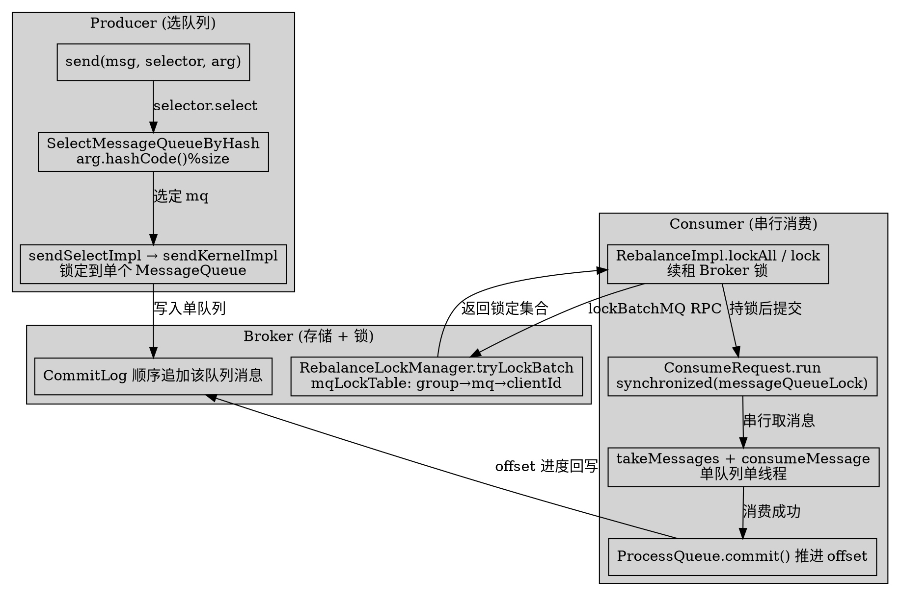
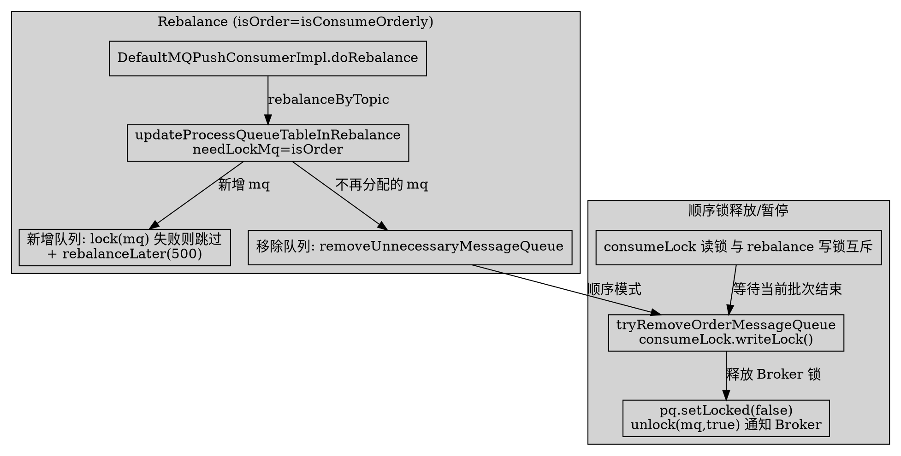

# Ordered Message Full Lifecycle

## Introduction

顺序消息（Ordered Message）是 RocketMQ 在「普通并发消息」之外提供的一种投递语义：在**同一个 MessageQueue 内**、由**单线程**消费，从而保证消息按发送顺序被处理。本页深挖生产者选队列、Broker 侧锁、消费者串行消费、与 Rebalance 的耦合，澄清「顺序只由存储保证」这一普遍误解。

> 版本基线：RocketMQ 5.5.1

**反直觉 / 纠偏点（务必先读）**：

- **存储层不提供顺序保证，顺序只存在于「单 MessageQueue 内 + 单线程消费」**。Broker 把消息顺序追加进 CommitLog（`Store.md` 写路径），但它对「哪个队列、哪条消息先被消费」没有任何全局排序；顺序完全靠「生产者把相关消息路由到同一队列」+「消费者对该队列加锁并串行消费」两件事合力达成。
- **`RebalanceLockManager`（Broker 侧）并没有 `lockAll/lock/unlock` 方法**，它只暴露 `tryLock` / `tryLockBatch` / `unlockBatch`（见第 2 节）。真正叫 `lockAll/lock/unlockAll` 的是客户端 `RebalanceImpl`（CLIENT 侧），它内部 RPC 调 Broker 的 `tryLockBatch`。
- **`LockCallback` 不属于 push 顺序消费的核心锁路径**。它在 5.5.1 里只用于 `AdminBrokerProcessor.lockBatchMQ` 的「严格模式跨副本加锁」（见第 2 节）。普通 push 消费者走的是同步 `MQClientAPIImpl.lockBatchMQ` 直接返回 `Set<MessageQueue>`，不经过 `LockCallback`。
- 任务描述提到的 `take` 方法在 5.5.1 的 `ConsumeRequest` 中**并不存在**，对应实现是 `ProcessQueue.takeMessages(int batchSize)`（见第 3 节）。

## 1. Producer 侧：选队列是唯一入口（全局顺序 vs 分区顺序）

RocketMQ 不提供任何「强制顺序」API；顺序的源头是**生产者把需要保序的消息塞进同一个 MessageQueue**。标准用法是 `producer.send(msg, messageQueueSelector, arg)`，其中 `arg` 即 sharding key。

### 1.1 选队列接口与实现

`MessageQueueSelector` 是函数式接口，只有 `select(mqs, msg, arg)` 一个方法（`client/.../client/producer/MessageQueueSelector.java:23`）：

```java
// client/.../client/producer/MessageQueueSelector.java:23-24
public interface MessageQueueSelector {
    MessageQueue select(final List<MessageQueue> mqs, final Message final Message msg, final Object arg);
}
```

5.5.1 提供两个开箱即用的实现：

- **`SelectMessageQueueByHash`**：`arg.hashCode() % mqs.size()` 取模（`client/.../client/producer/selector/SelectMessageQueueByHash.java:27-33`）。相同 `arg` 必然落到同一个队列，**这是分区顺序的事实标准实现**；注意它对负数 hashCode 做了 `Math.abs` 兜底。
- **`SelectMessageQueueByRandom`**：`random.nextInt(mqs.size())`，纯随机——**它不能用于顺序消息**，仅作对比（`client/.../client/producer/selector/SelectMessageQueueByRandom.java:28-32`）。

```java
// client/.../client/producer/selector/SelectMessageQueueByHash.java:26-33
@Override
public MessageQueue select(List<MessageQueue> mqs, Message msg, Object arg) {
    int value = arg.hashCode() % mqs.size();
    if (value < 0) {
        value = Math.abs(value);
    }
    return mqs.get(value);
}
```

### 1.2 sendSelectImpl：把 selector 结果作为目标队列

`DefaultMQProducerImpl` 的 `send(msg, selector, arg)` 公开重载最终落到 `sendSelectImpl`（`client/.../client/impl/producer/DefaultMQProducerImpl.java:1326` → `:1329`）。它先 `tryToFindTopicPublishInfo`，再用 selector 选出唯一 `MessageQueue`，最后 `sendKernelImpl` 单队列发送（`client/.../client/impl/producer/DefaultMQProducerImpl.java:1340-1363`）：

```java
// client/.../client/impl/producer/DefaultMQProducerImpl.java:1342-1360
MessageQueue mq = null;
try {
    List<MessageQueue> messageQueueList =
        mQClientFactory.getMQAdminImpl().parsePublishMessageQueues(topicPublishInfo.getMessageQueueList());
    Message userMessage = MessageAccessor.cloneMessage(msg);
    String userTopic = NamespaceUtil.withoutNamespace(userMessage.getTopic(), mQClientFactory.getClientConfig().getNamespace());
    userMessage.setTopic(userTopic);
    mq = mQClientFactory.getClientConfig().queueWithNamespace(selector.select(messageQueueList, userMessage, arg));
} catch (Throwable e) {
    throw new MQClientException("select message queue threw exception.", e);
}
// ... 超时判定 ...
if (mq != null) {
    return this.sendKernelImpl(msg, mq, communicationMode, sendCallback, null, timeout - costTime);
}
```

> **全局顺序 vs 分区顺序**：
> - **分区顺序（Partition Order）**：主题有多个队列，同一 sharding key（如订单 ID）经 `SelectMessageQueueByHash` 路由到**同一队列**，该 key 维度内有序；不同 key 之间无序。吞吐不受限。
> - **全局顺序（Global Order）**：把主题配成**单队列**（每个 Broker 仅 1 个写队列，甚至整个集群只有 1 个 MessageQueue）。此时所有消息都进同一队列，天然全局有序——但**吞吐被单队列单线程消费严重限制**，是顺序的代价。

## 2. Broker 侧：顺序消费锁（RebalanceLockManager）

顺序消费依赖 Broker 持有「哪个 clientId 拥有哪个队列的锁」的映射，防止两个 consumer 实例同时消费同一队列。锁映射为 `group → mq → clientId`，并带 60s 租约。

### 2.1 锁表与租约

`RebalanceLockManager` 的三层映射与常量（`broker/.../broker/client/rebalance/RebalanceLockManager.java:31-37`）：

```java
// broker/.../broker/client/rebalance/RebalanceLockManager.java:33-37
private final static long REBALANCE_LOCK_MAX_LIVE_TIME = Long.parseLong(System.getProperty(
    "rocketmq.broker.rebalance.lockMaxLiveTime", "60000"));
private final Lock lock = new ReentrantLock();
private final ConcurrentMap<String/* group */, ConcurrentHashMap<MessageQueue, LockEntry>> mqLockTable =
    new ConcurrentHashMap<>(1024);
```

核心方法（注意**不是** `lockAll/lock/unlock`，而是下面的命名）：

| 方法 | 作用 | file:line |
| ---- | ---- | ---- |
| `tryLock(group, mq, clientId)` | 单队列加锁：未锁/已过期则抢占，已被别人锁且未过期则失败 | `RebalanceLockManager.java:52-104` |
| `tryLockBatch(group, mqs, clientId)` | 批量加锁，返回成功锁定的 `Set<MessageQueue>` | `RebalanceLockManager.java:123-190` |
| `unlockBatch(group, mqs, clientId)` | 仅当 `clientId` 一致才移除锁条目 | `RebalanceLockManager.java:192-227` |
| `isLockAllExpired(group)` | 该 group 所有锁条目是否都已过期 | `RebalanceLockManager.java:39-50` |

`LockEntry` 的判定逻辑（`RebalanceLockManager.java:229-260`）：

```java
// broker/.../broker/client/rebalance/RebalanceLockManager.java:249-259
public boolean isLocked(final String clientId) {
    boolean eq = this.clientId.equals(clientId);
    return eq && !this.isExpired();
}
public boolean isExpired() {
    boolean expired =
        (System.currentTimeMillis() - this.lastUpdateTimestamp) > REBALANCE_LOCK_MAX_LIVE_TIME;
    return expired;
}
```

> **纠偏**：锁的「60s 租约」是 Broker 端的 `REBALANCE_LOCK_MAX_LIVE_TIME=60000ms`；而消费者端还有一份独立的 `ProcessQueue.REBALANCE_LOCK_MAX_LIVE_TIME=30000ms`（`client/.../client/impl/consumer/ProcessQueue.java:40-41`），两者**不是同一个值**——客户端认为锁 30s 过期就必须重新 `lockAll`，而 Broker 端 60s 才真正回收，这个时间差正是「rebalance 时锁可能短暂失效」的根因之一。

### 2.2 谁调用 tryLockBatch：AdminBrokerProcessor（含严格模式 + LockCallback）

客户端 `RebalanceImpl.lockAll` 通过 `MQClientAPIImpl.lockBatchMQ` 发出 RPC，落到 Broker 的 `AdminBrokerProcessor.lockBatchMQ`（`broker/.../broker/processor/AdminBrokerProcessor.java:1509`）。它先调用本地的 `RebalanceLockManager.tryLockBatch` 锁本 Broker，若开启 `lockInStrictMode` 则**跨副本**用 `LockCallback` 异步向其他副本加锁（`AdminBrokerProcessor.java:1519-1556`）：

```java
// broker/.../broker/processor/AdminBrokerProcessor.java:1515-1525
Set<MessageQueue> selfLockOKMQSet = this.brokerController.getRebalanceLockManager().tryLockBatch(
    requestBody.getConsumerGroup(), requestBody.getMqSet(), requestBody.getClientId());
if (requestBody.isOnlyThisBroker() || !brokerController.getBrokerConfig().isLockInStrictMode()) {
    lockOKMQSet = selfLockOKMQSet;
} else {
    // 严格模式：向同组其他副本发异步加锁，通过 LockCallback 回调聚合结果
    this.brokerController.getBrokerOuterAPI().lockBatchMQAsync(addrMap.get(brokerId),
        requestBody, 1000, new LockCallback() { ... });
}
```

> **纠偏（关键）**：`LockCallback`（`common/.../common/LockCallback.java:22-26`，只有 `onSuccess/onException`）**只服务于严格跨副本锁**，默认 `isLockInStrictMode=false` 时根本不触发。普通顺序消费的锁路径是「client `lockAll` → 同步 `lockBatchMQ` RPC → Broker `tryLockBatch`」，与 `LockCallback` 无关。

## 3. Consumer 侧：单队列单线程串行的两把锁

顺序消费靠**两把锁**保证「一个队列同一时刻只有一个线程在消费」：

1. **Broker 锁**（`RebalanceLockManager` + `ProcessQueue.isLocked`）：集群模式下，只有持有 Broker 锁的实例才允许消费该队列。
2. **本地锁**（`MessageQueueLock.messageQueueLock`）：实例内，每个 `MessageQueue` 对应一个 `Object` 监视器，确保实例内也不并发消费同一队列。

### 3.1 监听器与消费服务

`MessageListenerOrderly` 接口明确写着「One queue by one thread」（`client/.../client/consumer/listener/MessageListenerOrderly.java:23-24`）；与之相对的是 `MessageListenerConcurrently`（无序、可并发）。两者由 `ConsumeMessageOrderlyService` 承载。

`ConsumeMessageOrderlyService` 持有 `messageQueueLock = new MessageQueueLock()`（`ConsumeMessageOrderlyService.java:63`）和一个固定大小线程池 `consumeExecutor`（`:77-83`）。注意：**顺序消费的线程池虽然可有多个线程，但对同一队列的串行由本地锁保证，因此「多队列可并行、单队列必串行」**。

### 3.2 ConsumeRequest：本地锁 + 提交读锁串行消费

`submitConsumeRequest` 仅在 `dispatchToConsume=true` 时提交一个 `ConsumeRequest`（`ConsumeMessageOrderlyService.java:201-211`）；真正的串行在 `ConsumeRequest.run` 里——先 `messageQueueLock.fetchLockObject(mq)` 拿到该队列的监视器并 `synchronized`，再循环 `takeMessages` + 调用用户 `consumeMessage`（`ConsumeMessageOrderlyService.java:427-510`）：

```java
// client/.../client/impl/consumer/ConsumeMessageOrderlyService.java:434-500（节选）
final Object objLock = messageQueueLock.fetchLockObject(this.messageQueue);
synchronized (objLock) {
    if (MessageModel.BROADCASTING.equals(...) || this.processQueue.isLocked() && !this.processQueue.isLockExpired()) {
        for (boolean continueConsume = true; continueConsume; ) {
            // ... 再次检查 isDropped / isLocked / isLockExpired ...
            List<MessageExt> msgs = this.processQueue.takeMessages(consumeBatchSize);  // 取一批
            // ...
            this.processQueue.getConsumeLock().readLock().lock();   // 与 rebalance 的写锁互斥
            try {
                status = messageListener.consumeMessage(Collections.unmodifiableList(msgs), context);
            } finally {
                this.processQueue.getConsumeLock().readLock().unlock();
            }
        }
    } else {
        this.tryLockLaterAndReconsume(this.messageQueue, this.processQueue, 100);  // 未持锁→稍后重试
    }
}
```

`MessageQueueLock.fetchLockObject` 保证「同一 `MessageQueue` 拿到同一个 `Object`」（`client/.../client/impl/consumer/MessageQueueLock.java:30-54`），这就是单队列单线程的本地语义基石。

### 3.3 锁未获取 / 锁过期时的处理

- **集群模式、当前 ProcessQueue 未锁定**：`ConsumeMessageOrderlyService.java:445-450` 直接 `tryLockLaterAndReconsume(mq, pq, 10)` 后 `break`，本次不消费。
- **锁过期**（`isLockExpired()`，`ProcessQueue.java:64-65` 判据 `now - lastLockTimestamp > 30000ms`）：`:452-457` 同样 `tryLockLaterAndReconsume(...,10)`。
- **`tryLockLaterAndReconsume`**（`ConsumeMessageOrderlyService.java:226-239`）：延时任务里先 `lockOneMQ(mq)`（即 `RebalanceImpl.lock(mq)`），成功则 10ms 后重新提交消费，失败则 3000ms 后重试。
- **`lockMQPeriodically`**（`ConsumeMessageOrderlyService.java:220-224`）：集群模式下由 `start()` 的定时任务每 `REBALANCE_LOCK_INTERVAL=20000ms`（`ProcessQueue.java:42`）调用 `RebalanceImpl.lockAll()` 续租 Broker 锁。

> 注意 `brokerAllowSuspend` / `brokerLock` 是 **PullRequest 拉取参数**（长轮询拉消息用），并非顺序消费的「锁」语义；顺序锁的核心就是本节的本地 `messageQueueLock` + 远程 `RebalanceLockManager`。

## 4. 与 Rebalance 的强耦合：先锁后消费、变分配先释放

顺序消费与 Rebalance 深度绑定，链路如下：

- `DefaultMQPushConsumerImpl.doRebalance()` → `rebalanceImpl.doRebalance(this.isConsumeOrderly())`（`client/.../client/impl/consumer/DefaultMQPushConsumerImpl.java:1390-1392`）。`isConsumeOrderly()` 决定 `isOrder` 布尔（`DefaultMQPushConsumerImpl.java:1338`）。
- `RebalanceImpl.doRebalance(isOrder)` → `rebalanceByTopic(topic, isOrder)`（`RebalanceImpl.java:232-268`）→ `updateProcessQueueTableInRebalance(topic, allocateResultSet, isOrder)`（`RebalanceImpl.java:268-325, :426`）。**`isOrder` 作为 `needLockMq` 传入**。

### 4.1 顺序模式下「先 lock 再新增 ProcessQueue」

`updateProcessQueueTableInRebalance` 中，对新增且本地没有的队列，**若 `needLockMq` 且 `lock(mq)` 失败则跳过该队列、整体标记未平衡并 `rebalanceLater(500)`**（`RebalanceImpl.java:466-501`）：

```java
// client/.../client/impl/consumer/RebalanceImpl.java:466-501（节选）
for (MessageQueue mq : mqSet) {
    if (!this.processQueueTable.containsKey(mq)) {
        if (needLockMq && !this.lock(mq)) {           // 顺序模式：必须先拿到 Broker 锁
            log.warn("doRebalance, {}, add a new mq failed, {}, because lock failed", consumerGroup, mq);
            allMQLocked = false;
            continue;                                   // 锁没拿到→本次不消费该队列
        }
        this.removeDirtyOffset(mq);
        ProcessQueue pq = createProcessQueue();
        pq.setLocked(true);
        long nextOffset = this.computePullFromWhere(mq);
        // ... 放入 processQueueTable，构造 PullRequest 并 dispatchPullRequest ...
    }
}
if (!allMQLocked) {
    mQClientFactory.rebalanceLater(500);                // 稍后重试 rebalance
}
```

`RebalanceImpl.lock(mq)`（`RebalanceImpl.java:152-180`）内部即调用 `MQClientAPIImpl.lockBatchMQ`，成功后把 `ProcessQueue.setLocked(true)`。

### 4.2 分配变化时「先释放锁再移除」

当 rebalance 计算结果不再包含某队列时，`updateProcessQueueTableInRebalance` 先 `pq.setDropped(true)` 再 `removeUnnecessaryMessageQueue`（`RebalanceImpl.java:438-461`）。顺序模式下的实现 `RebalancePushImpl.removeUnnecessaryMessageQueue` 会**先把队列置非锁、再 `unlock(mq, true)` 通知 Broker 释放锁**，并持久化/清除 offset（`RebalancePushImpl.java:93-135`）：

```java
// client/.../client/impl/consumer/RebalancePushImpl.java:110-121（节选）
private boolean tryRemoveOrderMessageQueue(final MessageQueue mq, final ProcessQueue pq) {
    boolean forceUnlock = pq.isDropped() && System.currentTimeMillis() > pq.getLastLockTimestamp() + UNLOCK_DELAY_TIME_MILLS;
    if (forceUnlock || pq.getConsumeLock().writeLock().tryLock(500, TimeUnit.MILLISECONDS)) {
        try {
            // 持久化 offset、清除 offset
            pq.setLocked(false);
            RebalancePushImpl.this.unlock(mq, true);   // 向 Broker 释放顺序锁
            return true;
        } finally { ... }
    }
    return false;
}
```

> 这里的 `pq.getConsumeLock().writeLock()` 与第 3 节消费时的 `readLock()` 形成**读写互斥**：rebalance 要移除/释放队列时必须等当前消费批次结束，避免「边消费边丢锁」导致同一队列被两个实例短暂并发消费。

### 4.3 Shutdown 与集群模式的最终释放

`ConsumeMessageOrderlyService.shutdown` 在集群模式下调用 `unlockAllMQ()` → `RebalanceImpl.unlockAll(false)`（`ConsumeMessageOrderlyService.java:104-116`、`RebalanceImpl.java:93-126`），向所有相关 Broker 批量释放锁，确保实例退出后锁不残留。

## 5. 反直觉总结：顺序的边界与代价

| 维度 | 事实（5.5.1 真源码） |
| ---- | ---- |
| 顺序由谁保证 | 不是 Broker 存储，而是「生产者选同队列」+「消费者单队列单线程串行消费」 |
| 全局顺序 | 靠把主题配成单队列（吞吐受限），而非某种全局排序算法 |
| 分区顺序 | 靠 `SelectMessageQueueByHash` 把同 sharding key 路由到同队列 |
| rebalance / 锁失效时 | 可能**重复消费**，但**不丢序**（因为只有持锁者才推进 offset，且本地锁保证单线程） |
| 锁的租约不一致 | Broker 端 60s（`REBALANCE_LOCK_MAX_LIVE_TIME`）vs 客户端 30s（`ProcessQueue.REBALANCE_LOCK_MAX_LIVE_TIME`） |
| 严格跨副本锁 | 仅 `isLockInStrictMode=true` 才走 `LockCallback`，默认关闭 |

顺序消费的「不丢序」本质是：**offset 只在成功消费后由 `ProcessQueue.commit()` 推进**（`ConsumeMessageOrderlyService.java:288-302`），且消费被本地锁串行化；即使因锁过期/rebalance 导致某批次被重新投递，它仍会在同一队列内按原有次序被重新串行处理，只是下游需容忍重复。





## Links

- [Producer](/docs/CS/MQ/RocketMQ/Producer.md)
- [Consumer](/docs/CS/MQ/RocketMQ/Consumer.md)
- [Rebalance](/docs/CS/MQ/RocketMQ/Rebalance.md)
- [MessageLifecycle](/docs/CS/MQ/RocketMQ/MessageLifecycle.md)
- [Broker](/docs/CS/MQ/RocketMQ/Broker.md)
- [Store](/docs/CS/MQ/RocketMQ/Store.md)

## References

- `client/.../client/producer/MessageQueueSelector.java:23-24`（选队列接口）
- `client/.../client/producer/selector/SelectMessageQueueByHash.java:26-33`（按 sharding key 取模选队列）
- `client/.../client/producer/selector/SelectMessageQueueByRandom.java:28-32`（随机，不保序）
- `client/.../client/impl/producer/DefaultMQProducerImpl.java:1326-1368`（sendSelectImpl 选队列后单队列发送）
- `broker/.../broker/client/rebalance/RebalanceLockManager.java:31-37, 39-50, 52-227, 229-260`（mqLockTable / tryLock / tryLockBatch / unlockBatch / LockEntry）
- `broker/.../broker/processor/AdminBrokerProcessor.java:1509-1556`（lockBatchMQ 入口，含严格模式 LockCallback 跨副本锁）
- `common/.../common/LockCallback.java:22-26`（仅严格跨副本锁回调，非核心顺序锁路径）
- `client/.../client/impl/consumer/ConsumeMessageOrderlyService.java:53-112, 201-247, 274-345, 410-571`（messageQueueLock / submitConsumeRequest / ConsumeRequest.run / processConsumeResult）
- `client/.../client/impl/consumer/MessageListenerOrderly.java:23-34`（Orderly 监听器语义「one queue by one thread」）
- `client/.../client/impl/consumer/MessageQueueLock.java:26-54`（fetchLockObject 单队列单监视器）
- `client/.../client/impl/consumer/ProcessQueue.java:40-42, 64-65, 245, 312, 404`（REBALANCE_LOCK_MAX_LIVE_TIME / isLockExpired / takeMessages / consumeLock）
- `client/.../client/impl/consumer/RebalanceImpl.java:73-126, 152-226, 232-343, 426-506`（unlock / lock / lockAll / doRebalance / rebalanceByTopic / updateProcessQueueTableInRebalance）
- `client/.../client/impl/consumer/RebalancePushImpl.java:39, 93-141, 144-146`（removeUnnecessaryMessageQueue / tryRemoveOrderMessageQueue / clientRebalance / consumeType）
- `client/.../client/impl/consumer/DefaultMQPushConsumerImpl.java:1338, 1390-1399`（isConsumeOrderly / doRebalance 注入 isOrder）
