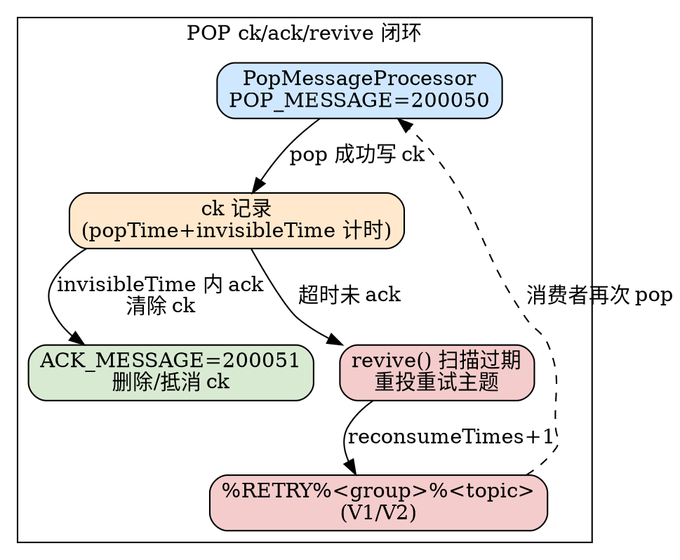
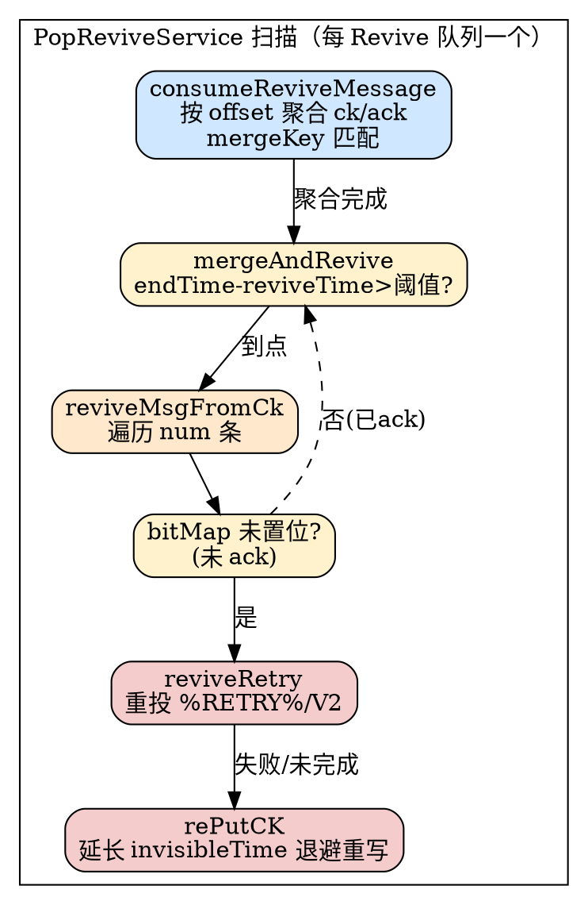

# Pop Consume Protocol

## Introduction

POP 消费是 RocketMQ 5.x 引入的**无状态轻量消费协议**，与 4.x 的 Pull/Push 消费模型并存但语义不同：客户端不再维护消费进度（offset），而是每次请求自带 `queueId`（或 `-1` 轮询）向 Broker 拉取一批消息，Broker 返回消息的同时下发一张 **`extraInfo` 确认票据**；客户端逐条处理完毕后再用 `ACK_MESSAGE` 凭票据确认单条消息。未被及时 ack 的消息由 Broker 端 `invisibleTime` 计时，超时后自动**复活（revive）重投**到独立的重试主题——这与传统 Pull 模型靠 `ConsumerOffsetManager` 提交位点、靠 `%RETRY%` reconsume 队列重试的链路截然不同。POP 是 5.x gRPC Proxy 面向多语言无状态客户端的默认消费面，也是「至少一次」投递在协议层的承载者。

本文基线为 RocketMQ 5.5.1 源码，聚焦**线缆协议面**（`RemotingCommand` 头部字段、`extraInfo` 票据编码、ck/ack 语义）与 **Revive 复活闭环**，与 [MessageProtocol（消息协议字节级详情）](/docs/CS/MQ/RocketMQ/MessageProtocol.md) 的通用帧/编码形成纵深互补。

## 1. 线缆命令码（5.x 专用 2000xx 段）

POP 系列命令码独立于 4.x 的 `SEND_MESSAGE=10` / `PULL_MESSAGE=11` 段，统一落在 `2000xx` 命名空间（`RequestCode.java:80-85`）：

| 命令码常量 | 值 | 方向 | 含义 |
| --- | --- | --- | --- |
| `POP_MESSAGE` | `200050` | Client → Broker | 拉取一批消息（无状态） |
| `ACK_MESSAGE` | `200051` | Client → Broker | 确认单条已消费（携带 `extraInfo` 票据） |
| `BATCH_ACK_MESSAGE` | `200151` | Client → Broker | 批量确认（body 为 `BatchAckMessageRequestBody`，含 `BitSet`） |
| `PEEK_MESSAGE` | `200052` | Client → Broker | 仅预览不下发 ck（不计入 invisible） |
| `NOTIFICATION` | `200054` | Client → Broker | 长轮询挂起，等新消息到达唤醒 |
| `CHANGE_MESSAGE_INVISIBLE_TIME` | `200053` | Client → Broker | 延长单条消息不可见时长（续期，避免误复活） |

所有 POP 头部均继承自 `TopicQueueRequestHeader`，走 [MessageProtocol](/docs/CS/MQ/RocketMQ/MessageProtocol.md) 描述的 `RemotingCommand` 通用帧（`NettyDecoder` 的 `LengthFieldBasedFrameDecoder(16MB,0,4,0,4)` 拆包）。

## 2. PopMessage 请求/响应头部字段

**请求头 `PopMessageRequestHeader`**（`PopMessageRequestHeader.java:31-61`）：

| 字段 | 类型 | 说明 |
| --- | --- | --- |
| `consumerGroup` | String | 消费组（`@CFNotNull`） |
| `topic` | String | 主题（`@CFNotNull`） |
| `queueId` | int | 指定队列；`-1` 表示由 Broker 轮询全部读队列 |
| `maxMsgNums` | int | 本次最多拉取条数 |
| `invisibleTime` | long | **不可见时长 = ack 超时**：消息 pop 后该时长内对其它 pop 不可见 |
| `pollTime` | long | 长轮询最大等待时间 |
| `bornTime` | long | 请求发出时间（用于判定超时漂移 `isTimeoutTooMuch`） |
| `initMode` | int | 初始化位点（`ConsumeInitMode.MIN/MAX`） |
| `expType` / `exp` | String | 消息过滤表达式（TAG/SQL92） |
| `order` | Boolean | **顺序 POP 标记**：`true` 时「不提交 offset、不重试、不 append checkpoint」（`PopMessageRequestHeader.java:53-58` 注释） |
| `attemptId` | String | 顺序消费同一 receive 尝试的关联 ID |

**响应头 `PopMessageResponseHeader`**（`PopMessageResponseHeader.java:26-41`）：

| 字段 | 类型 | 说明 |
| --- | --- | --- |
| `popTime` | long | 本次 pop 时间戳（ck 基准） |
| `invisibleTime` | long | 回传的不可见时长 |
| `reviveQid` | int | ck 落盘的 Revive 队列 ID（普通取模、顺序固定 `POP_ORDER_REVIVE_QUEUE`） |
| `restNum` | long | 队列剩余可消费消息数（长轮询 backlog 计数） |
| `startOffsetInfo` | String | 各队列起始 offset（格式 `retry@queueId@startOffset`，`;` 分隔） |
| `msgOffsetInfo` | String | 实际消息 offset 列表（格式 `retry@queueId@o1,o2,...`） |
| `orderCountInfo` | String | 顺序消费计数信息 |

**客户端状态枚举 `PopStatus`**（`PopStatus.java:19-37`）：`FOUND`（命中）、`NO_NEW_MSG`（轮询超时无新消息）、`POLLING_FULL`（轮询池满，勿立即重试）、`POLLING_NOT_FOUND`（轮询超时但未命中）。

## 3. extraInfo 确认票据（POP 协议核心）

POP 的「无状态」关键在 **`extraInfo`**——一张由 Broker 在 pop 响应中下发的、由 `KEY_SEPARATOR` 拼接的 8 字段字符串（`ExtraInfoUtil.buildExtraInfo`，`ExtraInfoUtil.java:126-140`），客户端 ack 时**原样回传**（`AckMessageRequestHeader.extraInfo`，`AckMessageRequestHeader.java:39-40`）。Broker 用 `ExtraInfoUtil.split` + `getXxx` 反解（`ExtraInfoUtil.java:38-124`）：

| 下标 | getter | 字段 | 含义 |
| --- | --- | --- | --- |
| `[0]` | `getCkQueueOffset` | ckQueueOffset | ck 在 Revive 主题的 offset（旧路径定位 ck） |
| `[1]` | `getPopTime` | popTime | pop 时间戳 |
| `[2]` | `getInvisibleTime` | invisibleTime | 不可见时长 |
| `[3]` | `getReviveQid` | reviveQid | Revive 队列 ID（`==POP_ORDER_REVIVE_QUEUE` 即顺序） |
| `[4]` | `getRetry` | retry | 主题类型：`0`=普通/`1`=V1 重试/`2`=V2 重试（`ExtraInfoUtil.java:333-341`） |
| `[5]` | `getBrokerName` | brokerName | 源 Broker 名 |
| `[6]` | `getQueueId` | queueId | 源队列 ID |
| `[7]` | `getQueueOffset` | msgQueueOffset | **被 ack 单条消息的 queue offset**（单条确认依据） |

> 顺序判定 `ExtraInfoUtil.isOrder`（`:329-331`）：`reviveQid == POP_ORDER_REVIVE_QUEUE` 即为顺序 POP。单条 ack 时只需 `extraInfo` + `requestHeader.offset`（消息 offset）即可唯一定位一条消息，无需客户端维护全局 offset——这正是 POP 无状态的协议基础。

## 4. ck / ack 语义与两条持久化路径

POP 不靠提交 offset 来「标记消费完成」，而是引入 **checkpoint（ck）**：每次 pop 成功后 Broker 记录一条 ck，代表「这批消息已被取出、等待 ack」；消费者 ack 单条 → ck 的 `bitMap` 对应位清零；`invisibleTime` 内全部 ack 则 ck 失效，否则复活重投。

RocketMQ 5.5.1 同时存在**两条 ck/ack 持久化路径**，由 `BrokerConfig.isPopConsumerKVServiceEnable()` 开关分派（`AckMessageProcessor.java:165-169`）：

### 4.1 新路径（默认，KV / RocksDB）

- ck 记录写入 **RocksDB KV 存储**（`PopConsumerService.popConsumerStore`，`PopConsumerService.java:100-104`），而非 CommitLog。
- 写入时机：`popAsync` 组装 `PopConsumerRecord` 后 `writeRecords`（`PopConsumerService.java:427-433`）。
- ack 路径：`isPopConsumerKVServiceEnable()` → `appendAckNew` → `popConsumerService.ackAsync(...)` **删除**该 ck 记录（`AckMessageProcessor.java:335-336`、`PopConsumerService.ackAsync:500-519`）。
- 复活：`revive(AtomicLong, maxCount)` 定时扫描 `visibilityTimeout`（= `popTime+invisibleTime`）过期的记录（`scanExpiredRecords`），逐条 `reviveRetry` 重投到重试主题（`PopConsumerService.java:570-663`）。
- 兼容导出：`transferToFsStore()` 可把 KV 过期记录反向导出为 Revive 主题的 ck 消息（`PopConsumerService.java:775-810`）。

### 4.2 旧路径（FS / Revive 主题）

- ck 序列化后作为一条消息写入 **`%REVIVE%_<cluster>` 主题**（`buildCkMsg`，`PopMessageProcessor.java:936-951`）：body 为 `JSON(PopCheckPoint)`、`tags=CK_TAG`、`deliverTimeMs = reviveTime - ackTimeInterval`（比 ack 早 `ackTimeInterval` 可见，保证扫描 ck 时 ack 已先到位）。
- ack 同样作为一条消息写入 Revive 主题（`appendAck`，`AckMessageProcessor.java:286-316`）：body 为 `JSON(AckMsg)`、`deliverTimeMs = popTime + invisibleTime = reviveTime`。
- 扫描：`PopReviveService` 拉取 Revive 主题，按 `mergeKey = topic+group+queueId+startOffset+popTime+brokerName` 聚合 ck/ack（`PopReviveService.java:411`），逐条 `PopCheckPoint` 比对 `bitMap`：ack 齐全 → 提交位点丢弃 ck；未齐全 → `reviveMsgFromCk` 重投（`PopReviveService.java:336-552`）。

两条路径**语义等价**：invisibleTime 内 ack 则清除 ck（不重投），超时未 ack 则重投到重试主题；差异仅在 ck/ack 是落 RocksDB 还是落 Revive 主题。

## 4.3 ck/ack 内存合并缓冲（PopBufferMergeService）

旧路径把每条 ck/ack 都作为消息写入 Revive 主题，会产生大量小 IO（一个 32 条消息的 pop 最多 1 条 ck + 32 条 ack）。RocketMQ 引入 **`PopBufferMergeService`** 做内存缓冲合并，降低 Revive 主题的写放大（`PopBufferMergeService.java:47`，继承 `ServiceThread`，`interval=5ms` 扫描）：

- **缓冲结构**：`buffer: ConcurrentHashMap<mergeKey, PopCheckPointWrapper>` 缓存未完成的 ck；`commitOffsets` 缓存已完成 ck 的位点提交队列（`PopBufferMergeService.java:49-52`）。`mergeKey = topic+cid+queueId+startOffset+popTime+brokerName`（`PopCheckPointWrapper.java:867`）。
- **写入缓冲**：`addCk`（`:490`）把 ck 暂存内存（受 `enablePopBufferMerge` 开关、`popCkMaxBufferSize`、`reviveTime` 余量与 `popCkStayBufferTimeOut` 约束）；`addAk`（`:534`）按 `mergeKey` 命中 ck，用 `markBitCAS` 以 CAS 方式置位 `bitMap` 第 `indexOfAck` 位（`:575-583`），批量 ack 则遍历 `ackOffsetList` 逐位置位（`:571-579`）。
- **定期落盘**：`scan`（`:226`）每 5ms 遍历缓冲，对「已完成的 ck」（`isCkDone`：所有 bit 置位，`:800`）或「停留超时的 ck」（`popCkStayBufferTimeOut`/`popCkStayBufferTime`，`:264-271`）调用 `putCkToStore`/`putAckToStore` 异步写入 Revive 主题（`:611-748`）；`isCkDoneForFinish` 判断「内存位图与已落盘位图异或」确认全部 ack 已落盘（`:810-819`）。
- **位点提交**：`commitOffset`（`:387`）在 ck 全部 ack 后把 `nextBeginOffset` 提交到 `ConsumerOffsetManager`，使源队列消费进度推进。

> 设计权衡：ck/ack 先在内存合并、延迟批量落盘，显著降低 Revive 主题写放大；只有在超时或完成时（`serving` 关闭前也会 `scan` 兜底，`:130-133`）才强制刷盘，保证「至少一次」不丢。注意新 KV 路径（RocksDB）不走该缓冲，二者互斥。

## 4.4 复活扫描与空洞处理（PopReviveService）

`PopReviveService` 是旧路径的「复活引擎」——每个 Revive 队列一个实例（继承 `ServiceThread`），周期性扫描 Revive 主题把超时未 ack 的消息重投重试主题（`PopReviveService.java:67`）：

- **聚合扫描 `consumeReviveMessage`**（`:336`）：从 `max(reviveOffset, consumeOffset)+1` 按 offset 顺序读 Revive 主题（offset 自修正，`:342`），对三类消息按 `mergeKey` 聚合——`CK_TAG` 存入 `map`、`ACK_TAG`/`BATCH_ACK_TAG` 找到对应 ck 并 `setBitMap` 置位 `indexOfAck`（`:386-458`）。`endTime` 取所有消息 `deliverTimeMs` 的最大值，作为「扫描水位」。
- **判定复活 `mergeAndRevive`**（`:499`）：对排序后的 ck 列表，若 `endTime - reviveTime <= ackTimeInterval + 1s`（尚未到复活点）则跳过（`:512`）；否则 `reviveMsgFromCk`。`reviveTime = popTime + invisibleTime`（`PopCheckPoint.java:83-84`）。
- **重投 `reviveMsgFromCk`**（`:556`）：遍历 ck 的 `num` 条消息，`bitMap` 未置位（即未 ack）的调用 `reviveRetry` 重投到 `%RETRY%<group>` 或 V2 重试主题（`reviveRetry` 见 `:107-113`，`reconsumeTimes` 在 body 内递增）；已 ack 的跳过。
- **退避重写 `rePutCK`**（`:608`）：重投失败或复活未完成时，重写一条「新 ck」并延长 `invisibleTime`（按 `ckRewriteIntervalsInSeconds[rePutTimes]` 退避 10s→7200s，`:69`），下次复活再试；超过 `ckRewriteIntervalsInSeconds.length` 且 `skipWhenCKRePutReachMaxTimes` 时丢弃（`:610-612`）。
- **空洞处理**：① Revive 主题 offset 自修正（`max(reviveOffset, consumeOffset)+1`，`:342`），容忍位点回退；② `mockCkForAck`（`:470`）处理「ack 先于 ck 到达」的乱序——当 `ackWaitTime > reviveAckWaitMs` 且 `enableSkipLongAwaitingAck` 时构造 `mockPoint`（num=0）跳过孤立 ack；③ 源队列空洞由 `PopCheckPoint.queueOffsetDiff`（`d` 字段）记录 offset 差值，使 `ackOffsetByIndex` 仍能正确映射（`:133`）。
- **提交位点**：全部 ck 处理完 `commitOffset` 推进 Revive 主题消费位点（`:550`）。

## 5. PopCheckPoint 与 AckMsg 编码

**`PopCheckPoint`**（ck 的 JSON 结构，`PopCheckPoint.java:24-49`，字段经 `@JSONField` 缩短）：

| JSON 键 | 字段 | 含义 |
| --- | --- | --- |
| `so` | startOffset | 本次 pop 在源队列的起始 offset |
| `pt` | popTime | pop 时间戳 |
| `it` | invisibleTime | 不可见时长 |
| `bm` | bitMap | 每条消息的 ack 位图（int） |
| `n` | num | 本次 pop 的消息数量（byte） |
| `q` | queueId | 源队列 ID |
| `t` | topic | 源主题 |
| `c` | cid | 消费组 |
| `ro` | reviveOffset | Revive 主题消费位点 |
| `d` | queueOffsetDiff | 新版本：处理空洞的 offset 差值列表 |
| `bn` | brokerName | 源 Broker |
| `rp` | rePutTimes | ck 重投次数 |
| `sp` | suspend | nack 不增 reconsume 次数 |

`indexOfAck`/`ackOffsetByIndex`（`PopCheckPoint.java:168-194`）实现「ack offset ↔ bitMap 位」的双向映射，新版本用 `queueOffsetDiff` 处理源队列空洞（消息被剔除导致 offset 不连续）。

**`AckMsg`**（ack 的 JSON 结构，`AckMsg.java`）：含 `topic`/`queueId`/`startOffset`/`ackOffset`/`popTime`/`brokerName`/`consumerGroup`，经 `genAckUniqueId` 生成唯一键（`PopMessageProcessor.java:148-154`）。

## 6. 顺序 POP（FIFO）

顺序 POP 通过 `order=true` 触发，与传统 Pull 顺序消费的最大差异在于**不依赖提交 offset 来保持顺序**，而是用 `ConsumerOrderInfoManager` 做**队列级阻塞**：

- `order=true` 时 PopMessageRequestHeader 注释明确三条约束：不提交 offset、不 pop retry（broker 无重投）、不 append checkpoint（`PopMessageRequestHeader.java:53-58`）。
- 阻塞逻辑：`setFifoBlocked` 写入 `ConsumerOrderInfoManager.update`，`isFifoBlocked` 经 `checkBlock` 判定该队列是否已被当前 attempt 占用（`PopConsumerService.java:283-299`）。
- `attemptId` 关联同一 receive 尝试：同一 attemptId 的重试在锁竞争时自旋等待而非快速失败（`tryLockForPop`，`PopConsumerService.java:480-497`）。
- 顺序 ck 固定写入 `POP_ORDER_REVIVE_QUEUE`（`PopMessageProcessor.java:495`），保证顺序复活。
- **管理器接口语义**（`ConsumerOrderInfoManager.java:36-108`）：`update`（pop 时记录接收状态、构建 `orderInfoBuilder`）、`checkBlock`（判定该队列是否需阻塞，保证同一队列消息按序消费）、`isAttemptIdMatched`（判定同一 receive 尝试的重试）、`commitAndNext`（ack 时提交并算出下一消费 offset，返回 `-1` 无效 / `-2` 无需提交 / `>=0` 需提交位点）。即顺序 POP 以「队列级阻塞 + attemptId 关联」替代提交 offset 来维持有序。
- **延时重试走顺序分支**：`ChangeInvisibleTimeProcessor.processChangeInvisibleTimeForOrder`（`:228`）/`ForOrderNew`（`:185`）对顺序 POP 不写 Revive 主题，而是 `ConsumerOrderInfoManager.updateNextVisibleTime` 直接更新可见时间（`:246`、`:215`），避免 ck 在顺序语义下失效。

## 7. POP 与传统 Pull/Push 对比

| 维度 | 传统 Pull（4.x） | POP（5.x） |
| --- | --- | --- |
| 客户端状态 | 需维护消费进度（rebalance + offset） | **无状态**，进度由 Broker 推进 |
| 确认粒度 | 提交队列级 offset | **单条 ack**（凭 `extraInfo` 票据） |
| 重试机制 | `%RETRY%` reconsume 队列 + reconsumeTimes | 独立重试主题 + Revive 复活重投 |
| 超时处理 | 依赖 offset 不提交 | `invisibleTime` 计时 + 自动复活 |
| 顺序保证 | 单队列单线程 + 提交 offset | `ConsumerOrderInfoManager` 队列阻塞 |
| 适用场景 | Java 原生消费者 | **多语言无状态客户端 / gRPC Proxy** |
| 线缆命令码 | `PULL_MESSAGE=11` | `POP_MESSAGE=200050` / `ACK_MESSAGE=200051` |

POP 的「至少一次」语义由此确立：消息 pop 后在 `invisibleTime` 内对其它 pop 不可见，正常 ack 即清除 ck；若消费者崩溃或处理超时，ck 到期自动复活重投——下游需自行保证**幂等消费**。

## 8. 长轮询推模式（PopLongPollingService 与客户端）

POP 名为「拉」，但通过**服务端长轮询**注入了「推」语义——这是它与传统 Pull 在交互上的关键差异，使消费者无需忙等即可在低延迟下拿到消息。`PopLongPollingService` 是承载者（继承 `ServiceThread`，`PopLongPollingService.java:55`）：

- **挂起 `polling`**（`:314`）：`PopMessageProcessor` 本次拉不到（或不足）消息时调用，把 `PopRequest` 挂入 `pollingMap`（`Caffeine` 缓存，key=`topic@cid@queueId`，`:78-81`），并 `remotingCommand.setSuspended(true)`（`:345`）；受 `maxPopPollingSize`/`popPollingSize` 限流，满则返回 `POLLING_FULL`（`:323-342`）。调用点在 `PopMessageProcessor.java:411` 与 `:578`。
- **超时兜底 `run`**（`:93`）：每 `20ms` 扫描挂起集合，对超时请求 `wakeUp` 重新处理（`:116-127`），返回 `POLLING_TIMEOUT` 而非永久阻塞。
- **唤醒 `wakeUp`**（`:263`）：消息到达时**重新调用 `processor.processRequest` 拉取并立即 `writeResponse`**（`:281-291`）——这就是「服务端挂起、有消息立即推送」的实现；通过 `pullMessageExecutor` 线程池异步执行，避免阻塞 IO 线程。
- **消息到达通知 `notifyMessageArriving`**（`:201-257`）：按 `topic+cid+queueId` 定位挂起请求并唤醒；支持 tag/SQL92 过滤（`:239-249`，不匹配则重新挂起）；`notifyLast`（构造参数 `false`，`PopMessageProcessor.java:120`）控制取队尾 `pollLast` 避免惊群（`:427-431`）。
- **重试主题回投唤醒 `notifyMessageArrivingWithRetryTopic`**（`:172`）：从 `%RETRY%`/Revive 重投的消息需转发唤醒**原始 topic** 的长轮询——因 POP 的重试主题本身不挂长轮询（`:181-199`，先取 `PROPERTY_ORIGIN_GROUP` 解析出 originTopic 再唤醒）。

**客户端入口**：`PopConsumer` 示例使用 `DefaultMQAdminExt.setMessageRequestMode(brokerAddr, topic, group, MessageRequestMode.POP, 8, 3000)` 把消费组切换为 POP 模式（`PopConsumer.java:54-64`，`8`=popSharedQueueCount，`3000`=invisibleTime ms），并 `setClientRebalance(false)` 把 rebalance 交由 Broker 侧（`:50`）。底层长轮询由 `MQClientAPIImpl.popMessage` 携带 `pollTime`/`bornTime` 实现，收到 `POLLING_SUC` 即挂起等待 Broker 唤醒。

```dot
digraph pop_longpolling {
  rankdir=LR;
  node [shape=box, style=rounded];
  C [label="Consumer\nPOP_MESSAGE\n(pollTime 挂起时长)", fillcolor="#cfe8ff", style="filled,rounded"];
  B [label="PopMessageProcessor\n本次无消息?", fillcolor="#fff2cc", style="filled,rounded"];
  LP [label="PopLongPollingService\npollingMap 挂起", fillcolor="#ffe8cc", style="filled,rounded"];
  W [label="notifyMessageArriving\n新消息到达唤醒", fillcolor="#d9ead3", style="filled,rounded"];
  WAKE [label="wakeUp\n重跑 processRequest\nwriteResponse", fillcolor="#d9ead3", style="filled,rounded"];
  C -> B [label="1 拉取"];
  B -> LP [label="2 无消息挂起"];
  B -> C [label="命中直接返回", style=dashed];
  LP -> W [label="3 消息到达"];
  W -> WAKE [label="4 唤醒"];
  WAKE -> C [label="5 推送响应"];
}
```

## 9. changeInvisibleTime 延时重试（CHANGE_MESSAGE_INVISIBLE_TIME）

当消费方处理较慢、担心 `invisibleTime` 到点后消息被误复活重投时，可主动发送 `CHANGE_MESSAGE_INVISIBLE_TIME=200053`（5.x 命令码段，位于 `RequestCode.java`）**延长**该消息的不可见时长。`ChangeInvisibleTimeProcessor` 是承载者（`ChangeInvisibleTimeProcessor.java:55`），其精妙之处在于**用「新 ck 覆盖旧 ck」而非原地修改**：

- **核心流程 `appendCheckPointThenAckOrigin`**（`:305`）：① 追加一条**新 ck**到 Revive 主题——`num=1`、`popTime=now`、`invisibleTime=新值`、指向同一 `startOffset`（`:312-327`）；② 随后 `ackOrigin`（`:258`）对**旧 ck** 追加一条 `ACK_TAG` 消息（`deliverTimeMs = 旧 popTime + 旧 invisibleTime`，`:287`），标记旧 ck 已完成。
- **效果**：旧 ck 在原 `reviveTime` 到点扫描时因 `bitMap` 已被 ack 置位而**不会误复活**；新 ck 接管剩余不可见期（新 `reviveTime = now + 新 invisibleTime`），期间正常 ack 新 ck 即清除。响应头回传新 `invisibleTime`/`popTime`/`reviveQid`（`:174-176`）。
- **新 KV 路径**：`isPopConsumerKVServiceEnable` → `popConsumerService.changeInvisibilityDuration`（`:149`）直接在 RocksDB 中更新可见时间，无需写 ck/ack。
- **顺序分支**：顺序 POP 仍走 `updateNextVisibleTime`（`:215`、`:246`），不写 Revive 主题。

> 该命令是 POP「至少一次」语义下消费者侧的**反压/保活**手段：处理耗时不可预估时主动续期，避免重复投递；与事务消息的「回查」不同，它不涉及二阶段，只是 ck 不可见窗口的延长。

## Links
- /docs/CS/MQ/RocketMQ/rocketmqClients.md

- [MessageProtocol（消息协议字节级详情）](/docs/CS/MQ/RocketMQ/MessageProtocol.md)
- [Store（CommitLog / ConsumeQueue 存储）](/docs/CS/MQ/RocketMQ/Store.md)
- [Consumer（消费模式总览）](/docs/CS/MQ/RocketMQ/Consumer.md)
- [MessageLifecycle（端到端消息生命周期）](/docs/CS/MQ/RocketMQ/MessageLifecycle.md)
- [Producer（生产端路径）](/docs/CS/MQ/RocketMQ/Producer.md)
- [RocketMQ（索引页）](/docs/CS/MQ/RocketMQ/RocketMQ.md)
- [ProxyProtocol（5.x gRPC Proxy 协议转换：POP 的 gRPC 入口如何翻译为内部 Remoting）](/docs/CS/MQ/RocketMQ/ProxyProtocol.md)
- [RetryDLQ（重试消息与死信队列：传统 %RETRY% 重投 vs POP Revive 复活）](/docs/CS/MQ/RocketMQ/RetryDLQ.md)

## References

- RocketMQ 5.5.1 源码：`remoting/.../protocol/RequestCode.java`、`.../header/PopMessageRequestHeader.java`、`.../header/PopMessageResponseHeader.java`、`.../header/AckMessageRequestHeader.java`、`.../header/ExtraInfoUtil.java`、`.../header/ChangeInvisibleTimeRequestHeader.java`
- `broker/.../processor/PopMessageProcessor.java`、`broker/.../processor/AckMessageProcessor.java`、`broker/.../processor/PopReviveService.java`、`broker/.../processor/ChangeInvisibleTimeProcessor.java`、`broker/.../processor/PopBufferMergeService.java`、`broker/.../longpolling/PopLongPollingService.java`、`broker/.../pop/PopConsumerService.java`、`broker/.../pop/orderly/ConsumerOrderInfoManager.java`
- `store/.../pop/PopCheckPoint.java`、`client/.../consumer/PopResult.java`、`client/.../consumer/PopStatus.java`、`example/.../simple/PopConsumer.java`
