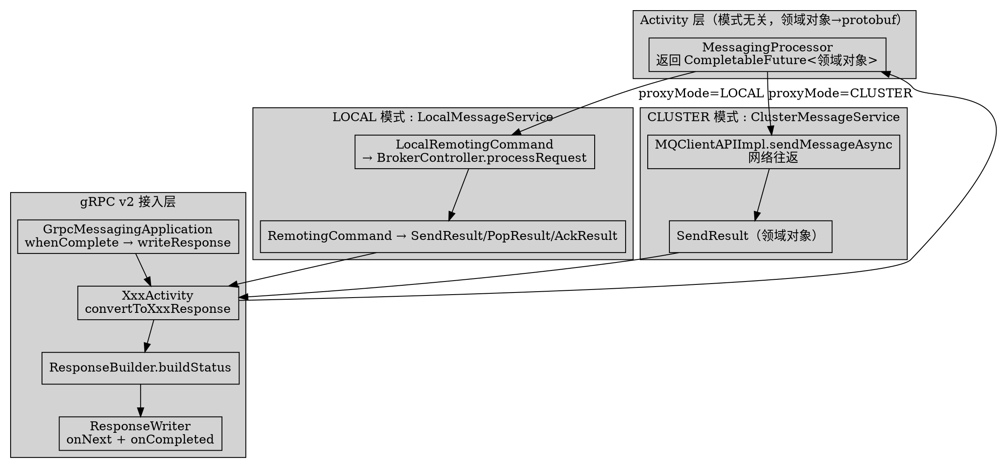
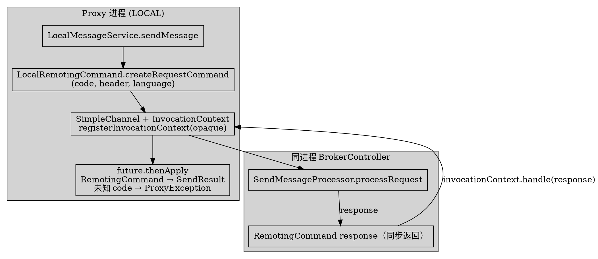

# Proxy Reverse Response and GrpcConverter

## Introduction

RocketMQ 5.x 的 Proxy 同时承担「gRPC 接入」与「Remoting/Broker 协议翻译」两种角色。本文深挖 **proxy 模块（含 grpc 子模块）的反向响应路径**：Proxy 收到内部 `RemotingCommand`（或本地 Broker 处理结果）后，如何归一为领域对象，再经 `ResponseBuilder` + `GrpcConverter` 转回 gRPC `Response` 流。所有 `file:line` 均基于 **RocketMQ 5.5.1** 真文件核验。

> 版本基线：RocketMQ 5.5.1

**纠偏点（先读，避免被 4.x 资料误导）：**
- 任务描述里的 `GrpcConverter.toSendResult` / `toReceiveMessageResponse` / `toAckResult` / `toChangeInvisibleTimeResponse` / `toQueryAssignmentResponse` 在 **5.5.1 全仓零命中**（`grep -r` 无结果）。5.5.1 的 `GrpcConverter` 只负责「消息体→protobuf」（`buildMessage` 等），响应对象的整体构造分散在 `XxxActivity` 里，错误码映射则集中在独立的 `ResponseBuilder`。
- 5.5.1 的 gRPC 错误**不是**用 gRPC 传输层 `StatusRuntimeException` 表达——正常应用错误被编码进 protobuf 内嵌的 `Status{code,message}` 字段，gRPC 传输态恒为 `OK`。`StatusRuntimeException` 只在客户端取消或极意外异常逃逸时出现。

## 1. 反向响应整体链路（三层 + 两种部署模式）

Proxy 的反向响应不是「`RemotingCommand` 逐字段→protobuf」，而是经过一层**领域对象归一**，再交给 gRPC 层。链路如下（以 sendMessage 为例）：

```text
gRPC Request
  │  GrpcMessagingApplication.sendMessage            (grpc/v2/GrpcMessagingApplication.java:239)
  ▼
SendMessageActivity.sendMessage  →  MessagingProcessor.sendMessage   (grpc/v2/producer/SendMessageActivity.java:79)
  │  返回 CompletableFuture<List<SendResult>>（领域对象，与模式无关）
  ▼
MessageService 实现（二选一）
  ├─ LOCAL : LocalMessageService  → brokerController.getXxxProcessor().processRequest(...) → RemotingCommand → 解析为 SendResult  (service/message/LocalMessageService.java:118)
  └─ CLUSTER: ClusterMessageService → mqClientAPIFactory.getClient().sendMessageAsync(...) → SendResult        (service/message/ClusterMessageService.java:69)
  ▼
SendMessageActivity.convertToSendMessageResponse    (grpc/v2/producer/SendMessageActivity.java:331)
  │  每个 SendResult → SendResultEntry(Status via ResponseBuilder) ，聚合顶层 Status
  ▼
ResponseBuilder.buildStatus(Code, msg)              (grpc/v2/common/ResponseBuilder.java:99)
  ▼
GrpcMessagingApplication.writeResponse → ResponseWriter.write → observer.onNext(resp) + observer.onCompleted()  (grpc/v2/GrpcMessagingApplication.java:182, grpc/v2/common/ResponseWriter.java:45)
```

`ResponseBuilder` 是**全局唯一的错误码→protobuf `Status` 映射中心**（`grpc/v2/common/ResponseBuilder.java:38`，单例 `getInstance()` 见 `:56`）。`GrpcConverter` 仅补足「消息体 / 资源 / 队列」的 protobuf 表达（`grpc/v2/common/GrpcConverter.java:51`）。



## 2. GrpcConverter 的真实职责（方法名纠偏）

`GrpcConverter`（`grpc/v2/common/GrpcConverter.java:51`）是单例工具类（`getInstance()` `:57`），但 5.5.1 里**只有消息/资源构造方法**，不存在任务里列举的那批 `toXxx` 响应方法：

| 真实存在的方法 | file:line | 作用 |
| ---- | ---- | ---- |
| `buildMessage(MessageExt)` | `GrpcConverter.java:96` | `MessageExt` → `apache.rocketmq.v2.Message`（消息体反向转换核心） |
| `buildSystemProperties(MessageExt)` | `:122` | 把 tag/keys/bodyDigest/messageType/timestamp/receiptHandle/traceContext 等塞进 `SystemProperties` |
| `buildMessageQueue(MessageExt, brokerName)` | `:68` | → `MessageQueue` |
| `buildResource(String)` | `:256` | 拆分 namespace / name → `Resource` |
| `buildExpressionType(FilterType)` | `:86` | TAG/SQL 映射 |
| `convertToGrpcMessageType(TopicMessageType)` | `:263` | 主题类型枚举映射 |

关键点：**`GrpcConverter.buildMessage` 是「领域对象→protobuf」的唯一消息入口**，被 `ReceiveMessageResponseStreamWriter.convertToMessage` 调用（`grpc/v2/consumer/ReceiveMessageResponseStreamWriter.java:121`）。响应里每一条消息都由此方法生成，而非从 `RemotingCommand` 直接映射。

## 3. LOCAL 模式桥接：LocalRemotingCommand 与进程内回调

LOCAL 模式下 Proxy 与 Broker 同进程，不走网络。桥接点是 `LocalRemotingCommand`（`service/message/LocalRemotingCommand.java:24`）：它只是 `RemotingCommand` 的薄子类，用来构造一个带 `code` / `customHeader` / `language` 的请求（`createRequestCommand` `:26`）——**它本身不持有 response**，response 是 `processRequest` 的同步返回值。

以 `sendMessage` 为例（`LocalMessageService.java:94-161`）：

```java
// service/message/LocalMessageService.java:110-127
RemotingCommand request = LocalRemotingCommand.createRequestCommand(RequestCode.SEND_MESSAGE, requestHeader, ctx.getLanguage());
request.setBody(body);
CompletableFuture<RemotingCommand> future = new CompletableFuture<>();
SimpleChannel channel = channelManager.createInvocationChannel(ctx);
InvocationContext invocationContext = new InvocationContext(future);
channel.registerInvocationContext(request.getOpaque(), invocationContext);   // 用 opaque 模拟 Netty 请求-响应关
ChannelHandlerContext simpleChannelHandlerContext = channel.getChannelHandlerContext();
try {
    RemotingCommand response = brokerController.getSendMessageProcessor().processRequest(simpleChannelHandlerContext, request);
    if (response != null) {
        invocationContext.handle(response);                                   // 把 response 回灌给 future
        channel.eraseInvocationContext(request.getOpaque());
    }
} catch (Exception e) {
    future.completeExceptionally(e);                                          // 本地调用抛异常 → 手工包成失败 future
}
// :128  thenApply 解析 RemotingCommand → SendResult 领域对象
```

桥接机制的两个反直觉细节：

1. **没有真实 Netty 连接**：`SimpleChannel` + `InvocationContext` + `registerInvocationContext(request.getOpaque(), ...)` 只是模拟 Netty 的 `opaque` 关联。正常 `processRequest` 同步返回 `response`，直接 `invocationContext.handle(response)` 唤醒 `future`；若 `processRequest` **抛异常**，则 `future.completeExceptionally(e)`（`:124`），异常靠上层 `ResponseBuilder.buildStatus(Throwable)` 转成 protobuf `Status`，而非依赖 Netty 的 `processResponseCommand` 解码。
2. **未知 response code 需手工包错误响应**：`thenApply` 里对未枚举的 code 直接抛 `ProxyException`：

```java
// service/message/LocalMessageService.java:149-152
default: {
    throw new ProxyException(ProxyExceptionCode.INTERNAL_SERVER_ERROR, r.getRemark());
}
```

`popMessage`（`:226-312`）、`ackMessage`（`:368-376`）、`changeInvisibleTime`（`:329-350`）、`recallMessage`（`:498-505`）走同样的「`processRequest` → 解析 `RemotingCommand`(code/remark/customHeader) → 领域对象 → 可能的 `ProxyException`」模式。`changeInvisibleTime`/`ackMessage` 直接用 `future.complete(response)`（同步返回），而 `sendMessage`/`popMessage` 用 `InvocationContext.handle` 走 opaque 关联。



## 4. CLUSTER 模式：经 MQClientAPIImpl 网络往返

CLUSTER 模式下 Proxy 作为远程客户端，通过 `mqClientAPIFactory.getClient()`（即 `MQClientAPIImpl` 封装）走网络：

```java
// service/message/ClusterMessageService.java:65-74
public CompletableFuture<List<SendResult>> sendMessage(ProxyContext ctx, AddressableMessageQueue messageQueue, ...) {
    ...
    future = this.mqClientAPIFactory.getClient().sendMessageAsync(...);   // 网络往返，返回领域对象 SendResult
    ...
}
```

`popMessage`/ `changeInvisibleTime` / `ackMessage` 同样走 `...Async`（`ClusterMessageService.java:112,138,149`）。**两种模式在 `MessageService` 这层就收敛为同一套领域对象**（`SendResult`/`PopResult`/`AckResult`），其后的 `Activity → ResponseBuilder` 路径完全一样、与部署模式无关。这也是「响应转换与模式解耦」的关键。

## 5. 错误码映射（ResponseBuilder）

`ResponseBuilder` 的静态映射表（`grpc/v2/common/ResponseBuilder.java:46-54`）把 `ResponseCode`/`ClientErrorCode` 翻译成 protobuf `Code`：

| 内部码 | → protobuf `Code` | file:line |
| ---- | ---- | ---- |
| `ResponseCode.SUCCESS` | `OK` | `:47` |
| `ResponseCode.SYSTEM_BUSY`（`RemotingSysResponseCode`） | `TOO_MANY_REQUESTS` | `:48` |
| `ResponseCode.REQUEST_CODE_NOT_SUPPORTED` | `NOT_IMPLEMENTED` | `:49` |
| `ResponseCode.SUBSCRIPTION_GROUP_NOT_EXIST` | `CONSUMER_GROUP_NOT_FOUND` | `:50` |
| `ResponseCode.LMQ_QUOTA_EXCEEDED` | `LITE_TOPIC_QUOTA_EXCEEDED` | `:51` |
| `ResponseCode.LITE_SUBSCRIPTION_QUOTA_EXCEEDED` | `LITE_SUBSCRIPTION_QUOTA_EXCEEDED` | `:52` |
| `ClientErrorCode.ACCESS_BROKER_TIMEOUT` | `PROXY_TIMEOUT` | `:53` |
| **未映射的任何 code** | `INTERNAL_SERVER_ERROR`（`buildCode` 默认值，`:117-119`） | `:118` |

注意两个纠偏：
- 任务提到的 `REMOTING_TIMEOUT` **不是**响应码映射项。`RemotingSysResponseCode` 里的 `SYSTEM_BUSY` 映射到 `TOO_MANY_REQUESTS`；超时类错误走**异常分支**——`RemotingTimeoutException` → `Code.PROXY_TIMEOUT`（`buildStatus` `:88-90`），以及 `ClientErrorCode.ACCESS_BROKER_TIMEOUT`（静态表 `:53`）。
- `buildStatus(Throwable)` 的分支顺序（`:67-97`）：① `ProxyException`→`GrpcProxyException`（携带 `Code`）→ 直接用其 `Code`+`message`；② `TopicRouteHelper.isTopicNotExistError` → `TOPIC_NOT_FOUND`；③ `MQBrokerException`/`MQClientException` → `buildCode(responseCode)` + `errorMessage`；④ `RemotingTimeoutException` → `PROXY_TIMEOUT`；⑤ 鉴权异常 → `UNAUTHORIZED`；⑥ 其余 → `INTERNAL_SERVER_ERROR`。

`buildStatus(Code, message)`（`:99`）与 `buildStatus(int remotingResponseCode, remark)`（`:106`）最终都产出 `Status.newBuilder().setCode(code).setMessage(message != null ? message : code.name())`——**message 透传规则**：remark 非空则透传 remark，空则回退为 `code.name()`。

Ack / ChangeInvisibleDuration 的响应构造见 `AckMessageActivity.convertToAckMessageResultEntry`（`grpc/v2/consumer/AckMessageActivity.java:92,163,171`）与 `ChangeInvisibleDurationActivity.convertToChangeInvisibleDurationResponse`（`grpc/v2/consumer/ChangeInvisibleDurationActivity.java:75`）：`AckStatus.OK` → `Code.OK`，否则 → `Code.INTERNAL_SERVER_ERROR`，多个 entry 的 code 集合 `>1` 时聚合为 `Code.MULTIPLE_RESULTS`（`AckMessageActivity.java:187-196`）。

## 6. 上下文 / 链路透传

| 透传项 | 来源 → 落点 | file:line |
| ---- | ---- | ---- |
| `language` | gRPC metadata `GrpcConstants.LANGUAGE` → `ProxyContext.setLanguage` → `LocalRemotingCommand.createRequestCommand(..., ctx.getLanguage())` → `RemotingCommand.setLanguage` | `ContextInitPipeline.java:36` → `LocalRemotingCommand.java:26-29` → `LocalMessageService.java:110` |
| `clientID` | metadata `CLIENT_ID` → context；Ack 时用于 `grpcChannelManager.getChannel(ctx.getClientID())` 取回真实 receiptHandle | `ContextInitPipeline.java:34` → `AckMessageActivity.java:200` |
| `traceContext` | 发送侧写入消息属性 `PROPERTY_TRACE_CONTEXT`（`SendMessageActivity.java:293-296`）→ Broker 存储 → 消费侧 `GrpcConverter.buildSystemProperties` 读回 `systemPropertiesBuilder.setTraceContext` | `GrpcConverter.java:239-242` |
| `opaque` | LOCAL 模式 `request.getOpaque()` 注册进 `SimpleChannel` 的 `InvocationContext`，用于进程内关联合成 response | `LocalMessageService.java:115,121,213,219` |

要点：`language`/`clientID`/`traceContext` 都是**随请求 metadata / 消息属性**逐跳下传与回填，其中 `traceContext` 是「消息级」而非「响应级」——它附着在每条 `Message` 的 `SystemProperties` 里随 `ReceiveMessageResponse` 回流，而不是放在顶层 `Status` 中。`opaque` 仅在 LOCAL 桥接内部用于模拟 Netty 请求-响应配对，不出现在 gRPC 响应里。

## 7. 异步 Future → gRPC response observer 时序

一元 RPC（sendMessage / ackMessage / changeInvisibleDuration / heartbeat / queryRoute）统一由 `GrpcMessagingApplication` 把 Activity 返回的 `CompletableFuture` 接上 `whenComplete`：

```java
// grpc/v2/GrpcMessagingApplication.java:246-248
() -> grpcMessagingActivity.sendMessage(context, request)
    .whenComplete((response, throwable) -> writeResponse(context, request, response, responseObserver, throwable, statusResponseCreator)),
```

`writeResponse`（`:182`）逻辑极简：有 `throwable` 就 `convertExceptionToStatus(t)`（→`ResponseBuilder.buildStatus(t)`）包成错误响应写出；否则直接写正常响应。`ResponseWriter.write`（`:45`）先 `observer.onNext(response)` 再 `observer.onCompleted()`——**gRPC 传输层始终 OK，错误在 `Status` 字段内**。

流式 RPC（`receiveMessage`）则不同，需把内部 `CompletableFuture<PopResult>` 展开为**多次 `onNext` + 末尾 `onCompleted`** 的时序（`ReceiveMessageResponseStreamWriter`，`grpc/v2/consumer/ReceiveMessageResponseStreamWriter.java`）：

- `FOUND`：先 `onNext(状态=OK)`（`:72`），再对 `messageFoundList` 逐条 `onNext(带 message)`（`:85`）；
- `POLLING_FULL` → `onNext(TOO_MANY_REQUESTS)`（`:98`）；`NO_NEW_MSG`/`POLLING_NOT_FOUND` → `onNext(MESSAGE_NOT_FOUND)`（`:105`）；
- 任意 `Throwable` 走 `buildStatus(t)` 写出（`:113-115`）；最终 `finally { onComplete() }`（`:116-118`），`onComplete()` 先补一个带 `deliveryTimestamp` 的空响应再 `observer.onCompleted()`（`:166-175`）。

`StatusRuntimeException` 在响应路径中**几乎不出现**：`ResponseWriter` 仅在其 `Status.CANCELLED`（客户端取消）时吞掉（`:62-67`）；真正逃逸的异常由 `GlobalExceptionInterceptor.closeWithException` 以 gRPC 传输错误关闭连接（`grpc/interceptor/GlobalExceptionInterceptor.java:89-108`），属于兜底而非常规错误通道。

## 8. 反直觉点汇总

1. **方法名不存在**：`GrpcConverter.toSendResult/toAckResult/...` 在 5.5.1 全仓零命中。5.5.1 的响应构造拆成「`XxxActivity` 拼装 protobuf 响应」+「`ResponseBuilder` 管错误码」+「`GrpcConverter` 只管消息体」三块，与 4.x 单 `GrpcConverter` 大类的资料截然不同。
2. **转换经过领域对象归一**：反向响应是「`RemotingCommand` → `SendResult`/`PopResult`/`AckResult`（领域对象）→ protobuf」，不是 `RemotingCommand` 逐字段→protobuf。两种部署模式在 `MessageService` 层就收敛为同一套领域对象。
3. **LOCAL 无真实连接，异常需手工包**：本地 `processRequest` 抛异常或返回未枚举 code 时，靠 `future.completeExceptionally` / `throw new ProxyException(...)`（`LocalMessageService.java:124,150,248,503`）上抛，再由 `ResponseBuilder.buildStatus(Throwable)` 译成 protobuf `Status`，没有 Netty 解码兜底。
4. **gRPC 错误用内嵌 `Status` 而非传输态**：正常应用错误编码进 `Status{code,message}` 字段，gRPC 传输态恒 `OK`；`StatusRuntimeException` 仅用于客户端取消兜底与极意外异常逃逸。
5. **响应时序因 RPC 类型而异**：一元 RPC 是「1 个 future → 1 次 `onNext` + `onCompleted`」；`receiveMessage` 流式是「1 个 `PopResult` → 多次 `onNext`（状态 + 每消息）+ 末尾 `onComplete`」。

## Links

- [ProxyProtocol](/docs/CS/MQ/RocketMQ/ProxyProtocol.md)
- [RocketMQ5](/docs/CS/MQ/RocketMQ/RocketMQ5.md)
- [Remoting](/docs/CS/MQ/RocketMQ/Remoting.md)
- [Producer](/docs/CS/MQ/RocketMQ/Producer.md)
- [Consumer](/docs/CS/MQ/RocketMQ/Consumer.md)
- [Broker](/docs/CS/MQ/RocketMQ/Broker.md)

## References

- `proxy/src/main/java/org/apache/rocketmq/proxy/grpc/v2/common/GrpcConverter.java:51,68,86,96,122,256,263`（单例与消息/资源构造方法）
- `proxy/src/main/java/org/apache/rocketmq/proxy/grpc/v2/common/ResponseBuilder.java:38,46-54,56,67-97,99,106,117-119`（错误码映射表与 buildStatus 分支）
- `proxy/src/main/java/org/apache/rocketmq/proxy/grpc/v2/common/ResponseWriter.java:28,45-70`（onNext + onCompleted 写入；CANCELLED 吞掉）
- `proxy/src/main/java/org/apache/rocketmq/proxy/grpc/v2/GrpcMessagingApplication.java:76,163-169,182-196,222-248`（writeResponse / convertExceptionToStatus / sendMessage 接线）
- `proxy/src/main/java/org/apache/rocketmq/proxy/grpc/v2/producer/SendMessageActivity.java:79,85,331-381`（convertToSendMessageResponse 与 SendStatus→Code）
- `proxy/src/main/java/org/apache/rocketmq/proxy/grpc/v2/consumer/ReceiveMessageResponseStreamWriter.java:42,56-119,121-175`（流式多 onNext + onComplete）
- `proxy/src/main/java/org/apache/rocketmq/proxy/grpc/v2/consumer/AckMessageActivity.java:51,92-108,110-196`（Ack 响应构造与 MULTIPLE_RESULTS 聚合）
- `proxy/src/main/java/org/apache/rocketmq/proxy/grpc/v2/consumer/ChangeInvisibleDurationActivity.java:42,67-79`（ChangeInvisibleDuration 响应构造）
- `proxy/src/main/java/org/apache/rocketmq/proxy/service/message/LocalMessageService.java:24,94-161,207-313,315-377,479-506`（LOCAL 模式 processRequest 桥接与领域对象解析）
- `proxy/src/main/java/org/apache/rocketmq/proxy/service/message/LocalRemotingCommand.java:24-35`（LocalRemotingCommand 构造）
- `proxy/src/main/java/org/apache/rocketmq/proxy/service/message/ClusterMessageService.java:55,65-74,112,138,149`（CLUSTER 模式 MQClientAPIImpl 网络往返）
- `proxy/src/main/java/org/apache/rocketmq/proxy/grpc/pipeline/ContextInitPipeline.java:28-43`（language/clientID 等 metadata → ProxyContext）
- `proxy/src/main/java/org/apache/rocketmq/proxy/grpc/interceptor/GlobalExceptionInterceptor.java:89-108`（StatusRuntimeException 兜底关闭）
