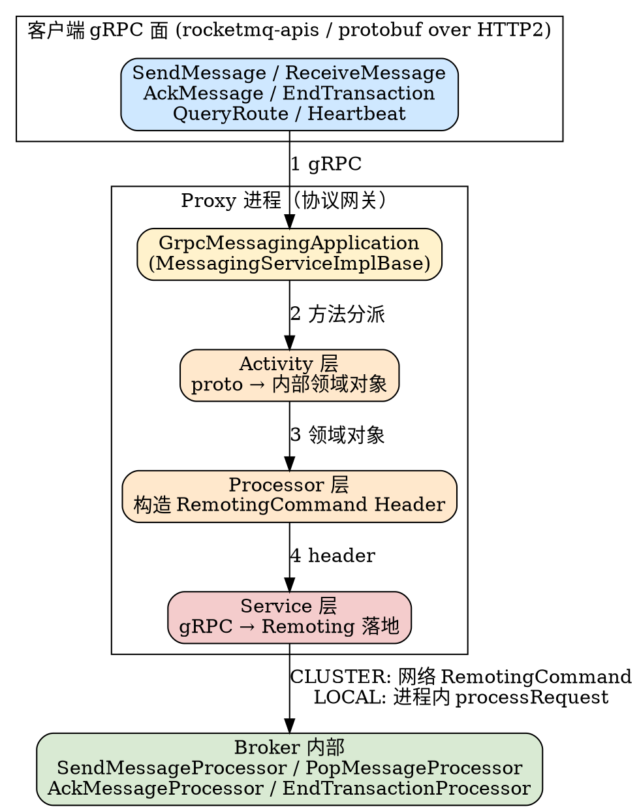
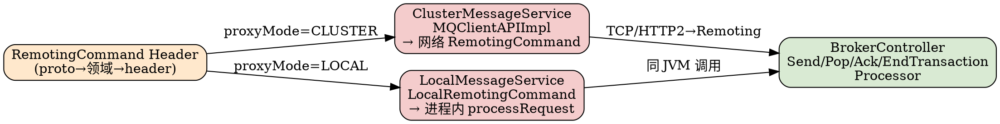

# RocketMQ 5.x gRPC Proxy Protocol Translation

## Introduction

RocketMQ 5.x 引入 **gRPC 协议面**：多语言 SDK（`rocketmq-clients`，独立于主仓库，见 [RocketMQ 5.x](/docs/CS/MQ/RocketMQ/RocketMQ5.md)）通过 `rocketmq-apis` 定义的 protobuf 接口与集群通信，底层走 HTTP/2。但 Broker 内部与 4.x 一样仍是自定义二进制 **Remoting**（Netty）协议。位于中间的 **Proxy** 本质上是一个「协议网关」——把 gRPC 调用翻译成内部 Remoting 命令，使 5.x 客户端无需理解 RocketMQ 老协议即可对接成熟的后端。

协议转换不是简单透传，而是 **四层栈**：proto 对象 → 内部领域对象 → RemotingCommand Header → 真正发出去的线缆帧。理解这条链路是理解 5.x 架构的关键。

## 1. gRPC 服务面（GrpcMessagingApplication）

`GrpcMessagingApplication` 是 gRPC 服务骨架，继承 `MessagingServiceGrpc.MessagingServiceImplBase`（`GrpcMessagingApplication.java:76`）。值得注意：**5.x 的 `rocketmq-apis` 把原 MessagingService / RouteService / TransactionService 三个 gRPC service 合并为单一 `MessagingServiceImplBase`**，因此一个类就承载了全部 5.x 客户端入口方法（`GrpcMessagingApplication.java:204-421`）：

| gRPC 方法 | 行号 | 说明 |
| --- | --- | --- |
| `queryRoute` | `:205` | 查路由（替代 4.x 客户端本地 NameServer 查询） |
| `heartbeat` | `:222` | 客户端心跳 / 注册 |
| `sendMessage` | `:239` | 发送 |
| `queryAssignment` | `:256` | 查询队列分配（轻量主题 / POP 用） |
| `receiveMessage` | `:274` | 消费（映射为 POP） |
| `ackMessage` | `:290` | 确认 |
| `forwardMessageToDeadLetterQueue` | `:307` | 投递死信 |
| `endTransaction` | `:324` | 事务二阶段提交 / 回滚 |
| `notifyClientTermination` | `:342` | 客户端下线通知 |
| `changeInvisibleDuration` | `:360` | 延长不可见时间（POP 续期） |
| `recallMessage` | `:385` | 5.5 召回消息 |
| `syncLiteSubscription` | `:404` | Lite Topic 订阅同步 |
| `telemetry` | `:424` | 双向流，下发设置 / 接收客户端遥测 |

请求按语义分派到 **5 个独立线程池**（`GrpcMessagingApplication.java:83-134`）：`routeThreadPoolExecutor`、`producerThreadPoolExecutor`、`consumerThreadPoolExecutor`、`clientManagerThreadPoolExecutor`、`transactionThreadPoolExecutor`；每个池有独立拒绝策略（`GrpcTaskRejectedExecutionHandler`，`:493`），拒绝时直接回 `TOO_MANY_REQUESTS` 而非阻塞 IO。认证 / 鉴权以 Pipeline 形式串在请求前（`create`，`:148-161`）。

## 2. proto → 内部领域对象（Activity 层）

Activity 层是协议转换的**第一道语义翻译**：把 protobuf 对象转成 RocketMQ 内部 `org.apache.rocketmq.common.message.Message` 等，再由 Processor 层构造 Remoting 命令。

### 2.1 SendMessage

`SendMessageActivity.sendMessage`（`SendMessageActivity.java:66`）把 `SendMessageRequest`（proto）转为内部消息：

- **消息体**：`buildMessage`（`:106-117`）逐条把 `apache.rocketmq.v2.Message` 转成 `org.apache.rocketmq.common.message.Message`，提取 body、topic、`getUserPropertiesMap` 等。
- **sysFlag**：`buildSysFlag`（`:119-132`）把 proto 编码转成内部标志位——`Encoding.GZIP` → `MessageSysFlag.COMPRESSED_FLAG`；`MessageType.TRANSACTION` → `MessageSysFlag.TRANSACTION_PREPARED_TYPE`（与 4.x 半消息同款 sysFlag）。
- **系统属性映射**：`buildMessageProperty`（`:198-312`）把 proto 的系统属性塞进内部 properties：tag（`setTags`）、keys（`setKeys`）、`PROPERTY_UNIQ_CLIENT_MESSAGE_ID_KEYIDX`（messageId）、`PROPERTY_TRANSACTION_PREPARED`（事务）、`PROPERTY_CHECK_IMMUNITY_TIME_IN_SECONDS`（回查豁免）、`PROPERTY_DELAY_TIME_LEVEL` / `PROPERTY_TIMER_DELIVER_MS`（延时，`:314-329` 的 `fillDelayMessageProperty`，支持延迟级别或精确时间轮）、`PROPERTY_SHARDING_KEY`（messageGroup 顺序键）、`PROPERTY_PRODUCER_GROUP`、`PROPERTY_BORN_HOST` / `PROPERTY_BORN_TIMESTAMP`。

> 关键设计：gRPC 里没有「producerGroup」字段，Proxy 用 **topicName 充当 producerGroup**（`SendMessageActivity.java:100` 注释 "here use topicName as producerGroup for transactional checker"），因为 5.x 事务回查是按 topic 维度路由的。

### 2.2 ReceiveMessage（→ POP）

`ReceiveMessageActivity.receiveMessage`（`ReceiveMessageActivity.java:61-174`）把 gRPC 消费请求翻译为 POP 参数：

- `invisibleDuration`（proto）→ `actualInvisibleTime`（`:106`），并支持 `autoRenew`（客户端保活续期，`:108`）。
- `filterExpression`（proto，含 expression + type）→ `FilterAPI.build` 构造内部 `SubscriptionData`（`:118-119`），类型通过 `GrpcConverter.buildExpressionType` 转换（SQL92 / TAG）。
- `batchSize` → pop 批大小（`:149`）；`fifo`（来自客户端 settings 的 `subscription.getFifo()`）→ `requestHeader.setOrder`（`:70`、`:154`，顺序 POP）；`attemptId`（`:156`）→ 顺序 POP 的恢复关联；`longPollingTimeout`（`:76-86`）→ `pollingTime`（带 min/max 限幅）。
- 最终调用 `messagingProcessor.popMessage`（`:142`），进入 Processor 层。

## 3. 协议转换映射表（gRPC → Remoting RequestCode）

Processor 层构造对应的 Remoting header，Service 层通过 `MQClientAPIImpl` 或进程内调用把 header 封成真正的 `RemotingCommand` 发往 Broker。完整映射：

| gRPC 方法 | 内部 Header | Remoting RequestCode | Broker Processor | 源码位置 |
| --- | --- | --- | --- | --- |
| `sendMessage`（单条） | `SendMessageRequestHeader` | `SEND_MESSAGE = 10` | `SendMessageProcessor` | `ProducerProcessor.java:96` / `ClusterMessageService.java:69` |
| `sendMessage`（批量） | `SendMessageRequestHeader` | `SEND_BATCH_MESSAGE = 320` | `SendMessageProcessor` | `ClusterMessageService.java:74`（按 `msgList.size()>1`） |
| `receiveMessage` | `PopMessageRequestHeader` | `POP_MESSAGE = 200050` | `PopMessageProcessor` | `ConsumerProcessor.java:150` / `ClusterMessageService.java:113` |
| `receiveMessage`（Lite） | `PopLiteMessageRequestHeader` | `POP_MESSAGE = 200050`（lite 变体） | `PopMessageProcessor` | `ConsumerProcessor.java:132` / `ClusterMessageService.java:123` |
| `ackMessage` | `AckMessageRequestHeader` | `ACK_MESSAGE = 200051` | `AckMessageProcessor` | `ConsumerProcessor.java:268` / `ClusterMessageService.java:150` |
| 批量 ack | `AckMessageRequestHeader`（多 extraInfo） | `BATCH_ACK_MESSAGE = 200151` | `AckMessageProcessor` | `ConsumerProcessor.java:288` / `ClusterMessageService.java:159` |
| `changeInvisibleDuration` | `ChangeInvisibleTimeRequestHeader` | `CHANGE_MESSAGE_INVISIBLE_TIME = 200053` | `ChangeInvisibleTimeProcessor` | `ClusterMessageService.java:138` |
| `endTransaction` | `EndTransactionRequestHeader` | `END_TRANSACTION = 37` | `EndTransactionProcessor` | `ClusterMessageService.java:93` |
| `queryRoute` | `GetRouteInfoRequestHeader` | `GET_ROUTEINFO_BY_TOPIC = 105` | `RouteInfoManager` | TopicRouteService 内部 |
| `heartbeat` | `HeartbeatRequestHeader` | `HEART_BEAT = 34` | `ClientManageProcessor` | ClientProcessor 内部 |

> 注意：gRPC 方法名与内部 RequestCode **不是一一对应**——批量发送、Lite 消费、批量 ack 都在同名 gRPC 方法下通过内部 header 种类或参数区分，最终落到不同的 RequestCode。POP 系列（2000xx 段）与 4.x 基础段（10/11/37/105）并存，详见 [POP 消费协议](/docs/CS/MQ/RocketMQ/PopConsume.md)。

## 4. Processor → Service 桥接

`ProducerProcessor.sendMessage`（`ProducerProcessor.java:69-126`）是典型桥接：选队列（`queueSelector`）→ `MessageClientIDSetter.setUniqID` 补 ID → `buildSendMessageRequestHeader` 构造 header（`:96`）→ `serviceManager.getMessageService().sendMessage`（`:99`）。`ConsumerProcessor` 对称：`popMessage`（`:150` / `:163`）构造 `PopMessageRequestHeader`、`ackMessage`（`:255-286`）从 `ReceiptHandle` 取 `extraInfo` / `offset` / `queueId` 构造 `AckMessageRequestHeader`（`:268-274`）——这里的 `extraInfo` 正是 [POP 消费协议](/docs/CS/MQ/RocketMQ/PopConsume.md) 中「确认票据」的字符串。

## 5. CLUSTER 与 LOCAL 两条落地路径

5.x Proxy 有 `proxyMode`（`ProxyConfig.java:90`，默认 `CLUSTER`），决定 gRPC 翻译出的 RemotingCommand **如何到达 Broker**：

### 5.1 CLUSTER（默认，独立进程）

`ClusterMessageService`（`ClusterMessageService.java:55`）持有 `MQClientAPIFactory`，通过 `mqClientAPIFactory.getClient()`（即 `MQClientAPIImpl`）把 header 真正封成 `RemotingCommand` 走 **网络** 发往 Broker：

- `sendMessageAsync`（`:69-78`）：单条 / 批量分别调用，内部按 `msgList.size()` 选 `SEND_MESSAGE` 或 `SEND_BATCH_MESSAGE`。
- `popMessageAsync`（`:114`）→ `POP_MESSAGE`。
- `ackMessageAsync`（`:151`）/ `batchAckMessageAsync`（`:163`）→ `ACK_MESSAGE` / `BATCH_ACK_MESSAGE`。
- `changeInvisibleTimeAsync`（`:140`）→ `CHANGE_MESSAGE_INVISIBLE_TIME`。
- `endTransactionOneway`（`:98`）→ `END_TRANSACTION`（事务回查提交走 oneway）。

此时 Proxy 与 Broker 是 **两个独立进程**，走标准 Remoting 线缆协议（见 [MessageProtocol](/docs/CS/MQ/RocketMQ/MessageProtocol.md)）。

### 5.2 LOCAL（Proxy 与 Broker 同进程）

`LocalMessageService`（`LocalMessageService.java:83`）**持有 `BrokerController` 引用**（`:85`），不发起网络调用，而是用 `LocalRemotingCommand.createRequestCommand(RequestCode.X, header, language)` 构造一个**内存版** `RemotingCommand`，然后**直接进程内调用** Broker 的各 Processor：

- `sendMessage` → `RequestCode.SEND_MESSAGE` + `brokerController.getSendMessageProcessor().processRequest`（`:110-118`）。
- `endTransaction` → `RequestCode.END_TRANSACTION` + `getEndTransactionProcessor().processRequest`（`:189-192`）。
- `popMessage` → `RequestCode.POP_MESSAGE` + `getPopMessageProcessor().processRequest`（`:209-216`）。
- `changeInvisibleTime` → `RequestCode.CHANGE_MESSAGE_INVISIBLETIME` + `getChangeInvisibleTimeProcessor().processRequestAsync`（`:320-324`）。
- `ackMessage` → `RequestCode.ACK_MESSAGE` + `getAckMessageProcessor().processRequest`（`:358-362`）。
- `batchAckMessage` → `RequestCode.BATCH_ACK_MESSAGE`（`:384`）；`recallMessage` → `RequestCode.RECALL_MESSAGE`（`:488`）。

> `LocalRemotingCommand` 是 Remoting 协议的**内存载体抽象**——它复用与网络版完全相同的 `RemotingCommand` 结构与 `CommandCustomHeader`，只是不走 Netty 编码，而是直接喂给 Broker 的 `processRequest`。这使得 LOCAL 模式下协议逻辑（校验、路由、存储）与 CLUSTER 模式**完全复用同一套 Processor 代码**，是 RocketMQ 5.x 把「Proxy 计算职责剥离」落到工程上的关键技巧：用同一抽象屏蔽「网络 vs 进程内」差异。

## 6. 双端口与部署

Proxy 同时暴露两类端口（`ProxyConfig.java`）：

- `grpcServerPort = 8081`（`:91`）：gRPC 服务端口，客户端 SDK 连接此端口，承载 `rocketmq-apis` 协议（HTTP/2 + protobuf）。`GrpcServer`（`GrpcServer.java:44-57`）包装 `io.grpc.Server`，支持 TLS（`ProxyAndTlsProtocolNegotiator`）。
- `remotingListenPort = 8080`（`:265`）：Proxy 自身对传统 Remoting 协议的监听端口，供非 gRPC 客户端或内部组件使用。

`proxyMode=CLUSTER` 时 Proxy 单独部署、通过 `remotingListenPort`（或 Broker 的 Remoting 端口）与 Broker 通信；`proxyMode=LOCAL` 时 Proxy 与 Broker 同进程（5.x 推荐的「融合部署」），走 LOCAL 进程内路径。

## 7. 设计总结

- **网关而非新协议**：gRPC 是 5.x 对外的「友好入口」（云原生、多语言、HTTP/2 流式），内部仍复用 4.x 成熟的 Remoting 命令体系（SEND/POP/ACK/END_TRANSACTION…），避免重写 Broker 存储与路由逻辑——向后兼容成本最低。
- **四层栈保证语义无损**：proto → 领域对象（Activity）承担「协议语义翻译」，header 构造（Processor）承担「命令定型」，Service 层（CLUSTER/LOCAL）承担「传输介质选择」，每层职责单一。
- **LOCAL 模式巧用抽象**：`LocalRemotingCommand` + `BrokerController.processRequest` 让同进程部署复用整个 Broker 处理链，是「Proxy 剥离计算」理念的工程实现。
- **POP 是消费面核心**：Proxy 消费的 gRPC 入口最终都映射到 POP 协议（无状态、extraInfo 票据、ck/ack 闭环），与 4.x 的 Pull 模型解耦，详情见 [POP 消费协议](/docs/CS/MQ/RocketMQ/PopConsume.md)。

## Links
- /docs/CS/MQ/RocketMQ/ProxyGrpcConverter.md
- /docs/CS/MQ/RocketMQ/rocketmqClients.md

- [MessageProtocol（消息协议字节级详情：线缆帧 / RemotingCommand 编码）](/docs/CS/MQ/RocketMQ/MessageProtocol.md)
- [PopConsume（POP 无状态消费协议：extraInfo 票据 / ck-ack / Revive）](/docs/CS/MQ/RocketMQ/PopConsume.md)
- [BatchEncoding（批量编码：批量发送对应 SEND_BATCH_MESSAGE）](/docs/CS/MQ/RocketMQ/BatchEncoding.md)
- [Remoting（通信模块：自定义编解码与 opaque 配对）](/docs/CS/MQ/RocketMQ/Remoting.md)
- [RocketMQ 5.x（Proxy 架构与 gRPC SDK 归属）](/docs/CS/MQ/RocketMQ/RocketMQ5.md)
- [RocketMQ（总索引与端到端消息路径）](/docs/CS/MQ/RocketMQ/RocketMQ.md)

## References

1. RocketMQ 5.5.1 源码：`proxy/grpc/v2/GrpcMessagingApplication.java`、`proxy/grpc/v2/producer/SendMessageActivity.java`、`proxy/grpc/v2/consumer/ReceiveMessageActivity.java`、`proxy/grpc/v2/consumer/AckMessageActivity.java`
2. `proxy/processor/ProducerProcessor.java`、`proxy/processor/ConsumerProcessor.java`、`proxy/processor/DefaultMessagingProcessor.java`
3. `proxy/service/message/ClusterMessageService.java`、`proxy/service/message/LocalMessageService.java`、`proxy/service/message/LocalRemotingCommand.java`
4. `proxy/config/ProxyConfig.java`、`proxy/grpc/GrpcServer.java`
5. `remoting/.../protocol/RequestCode.java`（SEND_MESSAGE=10 / SEND_BATCH_MESSAGE=320 / POP_MESSAGE=200050 / ACK_MESSAGE=200051 / BATCH_ACK_MESSAGE=200151 / CHANGE_MESSAGE_INVISIBLE_TIME=200053 / END_TRANSACTION=37 / GET_ROUTEINFO_BY_TOPIC=105 / HEART_BEAT=34）
