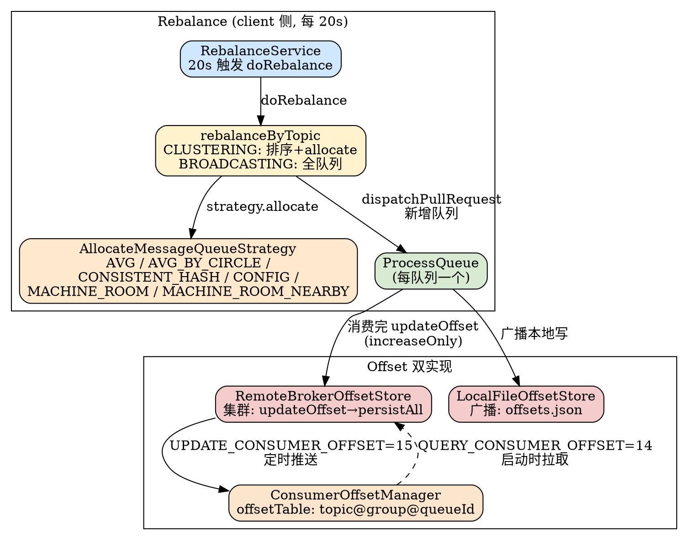

# Rebalance and Offset Management (Stateful Pull/Push Consumer)

## Introduction

RocketMQ 4.x 风格的「传统消费」是一套**有状态**（stateful）消费模型：消费进度（offset）由**消费者自己维护**——先通过 `RebalanceImpl` 在客户端完成队列分配（`AllocateMessageQueueStrategy`），拿到明确归属的 `MessageQueue`；消费线程池拉取消息 → 业务处理 → 把队列级 offset 提交回 Broker 或本地文件，进度随队列归属而推进。这与 [PopConsume（POP 无状态消费）](/docs/CS/MQ/RocketMQ/PopConsume.md) 形成鲜明对照：POP 把进度管理下沉到 Broker 侧的 ck/ack/Revive，客户端无状态、队列不固定归属。

本文聚焦 5.5.1 的**传统 Pull/Push 有状态消费主线**：Rebalance 触发与分配算法、集群/广播两种消费模式、Push 与 Pull/LitePull 的差异，以及最关键的**消费进度 offset 双实现**（`RemoteBrokerOffsetStore` 集群 / `LocalFileOffsetStore` 广播）与 Broker 侧 `ConsumerOffsetManager`，并与 [Store（CommitLog / ConsumeQueue）](/docs/CS/MQ/RocketMQ/Store.md)、[MessageProtocol（协议命令码）](/docs/CS/MQ/RocketMQ/MessageProtocol.md) 衔接。消费模式总览见 [Consumer（消费模型总览）](/docs/CS/MQ/RocketMQ/Consumer.md)。

## 1. Rebalance 触发与算法

### 1.1 触发入口：RebalanceService

客户端每隔 `20s`（可配 `rocketmq.client.rebalance.waitInterval`）触发一次 rebalance；若上轮未平衡（`balanced==false`），则缩短到 `minInterval=1000ms` 重试（`RebalanceService.java:25-53`）：

- `RebalanceService.run` 周期性调用 `mqClientFactory.doRebalance()`（`RebalanceService.java:51`）。
- `RebalanceImpl.doRebalance` 遍历当前订阅表 `subscriptionInner`，对每个 topic 决定走「客户端分配」还是「向 Broker 取分配结果」（`RebalanceImpl.java:232-262`）：
  - `clientRebalance(topic)` 默认 `true`（传统 Push/Pull 客户端自分配，`RebalanceImpl.java:228-230`）；POP 模式会被置为 false，改走 `getRebalanceResultFromBroker`（由 Broker 侧、即 [RocketMQ 5.x](/docs/CS/MQ/RocketMQ/RocketMQ5.md) 的 assignment 服务下发）。
  - 客户端路径调用 `rebalanceByTopic(topic, isOrder)`（`RebalanceImpl.java:245`、`268`）。

> 设计要点：rebalance 是**客户端自发、各自独立计算**的——每个实例都用相同的「topic 队列集 + 当前在线 consumerId 集」跑同一套 `AllocateMessageQueueStrategy`，因此只要路由信息一致，结果必然一致，无需中心协调。广播模式则跳过分配，每个实例直接吃下全部队列。

### 1.2 集群 vs 广播分配（rebalanceByTopic）

`rebalanceByTopic` 按 `messageModel` 分两支（`RebalanceImpl.java:268-343`）：

- **CLUSTERING（集群）**（`RebalanceImpl.java:287`）：向 NameServer 拉取在线 consumerId 列表 `findConsumerIdList`（`RebalanceImpl.java:297`），对 `mqAll`（topic 全部读队列）与 `cidAll`（全部 consumerId）各做排序（`RebalanceImpl.java:303-304`），再交给 `strategy.allocate(...)` 计算本实例应得的队列（`RebalanceImpl.java:310-314`）。**核心约束：一个队列只分给一个 consumer**。
- **BROADCASTING（广播）**（`RebalanceImpl.java:271`）：把 topic 的**全部队列**（`mqSet = topicSubscribeInfoTable.get(topic)`）直接作为 `allocateResultSet`，每个实例都消费全量；`isOrder=false`，不做锁（`RebalanceImpl.java:274`）。

两种模式算完都调用 `updateProcessQueueTableInRebalance` 增删本地 `ProcessQueue`，并 `dispatchPullRequest` 派发拉取请求（`RebalanceImpl.java:325-331`、`503`）。

### 1.3 分配策略枚举（`AllocateMessageQueueStrategy`）

接口仅两个方法：`allocate(consumerGroup, currentCID, mqAll, cidAll)` 与 `getName()`（`AllocateMessageQueueStrategy.java:36-48`）。5.5.1 内置 6 种实现（**注意：任务提到的 `AllocateMessageQueueByTag` 在本版本中并不存在**，是社区常见误解；真实实现如下）：

| 策略类 | getName | 语义 |
| --- | --- | --- |
| `AllocateMessageQueueAveragely` | `AVG` | **平均分配**：按 `index`/`mod` 把队列切成近似等长的连续段（`AllocateMessageQueueAveragely.java:39-46`），余数分摊给前 `mod` 个 consumer |
| `AllocateMessageQueueAveragelyByCircle` | `AVG_BY_CIRCLE` | **环形分配**：按 `i % cidAll.size() == index` 轮询取队列，保证绝对均匀（`AllocateMessageQueueAveragelyByCircle.java:38-42`） |
| `AllocateMessageQueueConsistentHash` | `CONSISTENT_HASH` | **一致性哈希**：把每个 consumer 作为哈希环上的 `ClientNode`（默认 10 个虚节点），每个队列 `routeNode(mq.toString())` 命中一个节点，consumer 上线/下线只影响相邻队列（`AllocateMessageQueueConsistentHash.java:60-78`） |
| `AllocateMessageQueueByConfig` | `CONFIG` | **按配置**：直接返回预设 `messageQueueList`，不做计算（`AllocateMessageQueueByConfig.java:26-29`），常用于灰度/固定绑定 |
| `AllocateMessageQueueByMachineRoom` | `MACHINE_ROOM` | **按机房**：只分配 `brokerName` 落在 `consumeridcs` 集合内的队列（`AllocateMessageQueueByMachineRoom.java:43-60`） |
| `AllocateMachineRoomNearby` | `MACHINE_ROOM_NEARBY-<inner>` | **机房就近**（代理类）：先按机房分组，把与当前 consumer 同机房的队列用内层策略分配；若某机房无存活 consumer，则该机房队列被全员共享（`AllocateMachineRoomNearby.java:92-107`） |

> 顺序消费（`isOrder=true`，`MessageListenerOrderly`）在 `updateMessageQueueTableInRebalance`（broker 分配路径）或 `updateProcessQueueTableInRebalance`（客户端路径）里对新增队列先 `lock(mq)` 拿 Broker 锁，失败则 `rebalanceLater(500)` 延后重试（`RebalanceImpl.java:468-471`、`623-626`）。锁由 `lockAll`/`unlockAll` 经 `LOCK_BATCH_MQ`/`UNLOCK_BATCH_MQ` 维护（`RebalanceImpl.java:152-226`），是顺序消费「单队列串行」的 broker 侧保证。

## 2. 消费模式：集群 vs 广播

`MessageModel` 枚举定义三态（`MessageModel.java:26-38`）：`BROADCASTING`、`CLUSTERING`、以及 `LITE_SELECTIVE`（5.x Lite 消费者专用，见 [Consumer](/docs/CS/MQ/RocketMQ/Consumer.md)）。

- **集群模式**：同 group 内多实例**分摊**队列、共享消费；offset 由 Broker 集中维护（`RemoteBrokerOffsetStore`），实例间互不重叠，天然负载均衡。OffsetStore 选择见 `DefaultMQPushConsumerImpl.start`（`Consumer.md:379-388`）：`CLUSTERING → new RemoteBrokerOffsetStore(...)`。
- **广播模式**：**每个实例消费全部队列**，彼此独立；offset 存本地（`LocalFileOffsetStore`），Broker 不感知（`Consumer.md:380-381`）。失败消息在 `ConsumeMessageConcurrentlyService.processConsumeResult` 的 `BROADCASTING` 分支直接丢弃、不回发重试（`ConsumeMessageConcurrentlyService.java:271-277`）。

## 3. Push vs Pull / LitePull

### 3.1 Push 消费（DefaultMQPushConsumer）

`DefaultMQPushConsumer` 本质是**对 Pull 的封装**：内部由 `PullMessageService` 线程按 `PullRequest` 长轮询拉取（`Consumer.md:455-487`），消息入 `ProcessQueue` 后提交到 `ConsumeMessageConcurrentlyService`/`ConsumeMessageOrderlyService` 线程池，`start()` 时装配 `RebalanceImpl`/OffsetStore/各消费服务（`Consumer.md:345-441`）。并发与顺序消费区别见 [Consumer](/docs/CS/MQ/RocketMQ/Consumer.md) 末尾。

### 3.2 Pull 消费（DefaultMQPullConsumer）

`DefaultMQPullConsumerImpl` 把拉取主动权交给用户：开发者手动 `pull(...)` 并**自行管理 offset**（`DefaultMQPullConsumerImpl.java:835` `updateOffset`、`117` `readOffset`、`:416` `persistAll`、`:643` `updateConsumeOffsetToBroker`）。其 OffsetStore 同样按 `MessageModel` 二选一（`DefaultMQPullConsumerImpl.java:731-741`），但**不自动 rebalance**——队列分配需用户调用 `fetchSubscribeMessageQueues` + 自定分配。

### 3.3 LitePull 消费（DefaultLitePullConsumer）

`DefaultLitePullConsumerImpl` 是 5.x 引入的轻量 Pull：支持 `subscribe` 自动 rebalance（`RebalanceLitePullImpl.java:79-90` `computePullFromWhere`、`161` `dispatchPullRequest`），但拉取仍由用户 `poll()` 驱动，offset 由 SDK 内部维护（`DefaultLitePullConsumerImpl.java:823`）。它是传统 Pull 与 Push 之间的折中，且是 [RocketMQ 5.x](/docs/CS/MQ/RocketMQ/RocketMQ5.md) 推行的「用户侧有状态但更简洁」的消费面。

> 三者关系：**Push = 自动 rebalance + 自动拉取 + 自动提交 offset**（最省心）；**Pull = 手动拉取 + 手动管 offset**（最灵活）；**LitePull = 自动 rebalance + 手动拉取 + 自动管 offset**（折中）。

## 4. 消费进度 Offset 管理（核心）

offset 管理是「有状态消费」的灵魂。其抽象接口 `OffsetStore` 定义 `updateOffset`/`readOffset`/`persistAll`/`persist`/`removeOffset`/`updateConsumeOffsetToBroker`（`OffsetStore.java:38-81`）。有两条实现路径，由 `MessageModel` 决定（见第 2 节）。

### 4.1 读策略 ReadOffsetType

`readOffset(mq, type)` 的 `type` 决定「内存优先」还是「落盘/Broker 优先」（`ReadOffsetType.java:19-32`）：

- `READ_FROM_MEMORY`：只查内存 `offsetTable`，无则返回 `-1`（`RemoteBrokerOffsetStore.java:89-95`）。
- `READ_FROM_STORE`：集群模式向 Broker `QUERY_CONSUMER_OFFSET` 拉取并回填内存，失败返回 `-1`/异常 `-2`（`RemoteBrokerOffsetStore.java:97-112`、`235-255`）；广播模式读本地 `offsets.json`（`LocalFileOffsetStore.java:116-130`）。
- `MEMORY_FIRST_THEN_STORE`：内存有则用之，无则降级到 STORE（`RemoteBrokerOffsetStore.java:88`）。

### 4.2 集群模式：RemoteBrokerOffsetStore

集群模式 offset 在 Broker 端集中存储（`RemoteBrokerOffsetStore.java:42-52`，内存 `offsetTable: MessageQueue → ControllableOffset`）：

- **更新**：`updateOffset(mq, offset, increaseOnly)` 写内存；并发消费用 `increaseOnly=true`（只增不减，`RemoteBrokerOffsetStore.java:59-74`、`ConsumeMessageConcurrentlyService.java:308`）。
- **持久化**：`persistAll(mqs)` 遍历 `offsetTable`，对每个队列 `updateConsumeOffsetToBroker` 推给 Broker（`RemoteBrokerOffsetStore.java:122-155`）。客户端定时任务每 `persistConsumerOffsetInterval`（默认 5s）调用 `persistAllConsumerOffset` 全量推送（`MQClientInstance.java:417-423`、`610-615`）。
- **推送命令**：`updateConsumeOffsetToBroker` 组装 `UpdateConsumerOffsetRequestHeader{topic, consumerGroup, queueId, commitOffset, brokerName}`，走 oneway/同步 `updateConsumerOffset`（`RemoteBrokerOffsetStore.java:207-233`）。
- **查询命令**：`fetchConsumeOffsetFromBroker` 组装 `QueryConsumerOffsetRequestHeader`，走 `queryConsumerOffset`（`RemoteBrokerOffsetStore.java:235-255`）。

> 拉消息时已携带内存 offset：在 `DefaultMQPushConsumerImpl.pullMessage` 里 `commitOffsetEnable = (CLUSTERING)` 时 `readOffset(READ_FROM_MEMORY)`，写入拉取请求的 `sysFlag`/`commitOffsetValue`（`Consumer.md:689-696`、`301-306`），实现「拉取即顺带上报进度」，减少独立上报开销。

### 4.3 广播模式：LocalFileOffsetStore

广播模式 offset 完全本地化（`LocalFileOffsetStore.java:42-60`）：

- 存储路径 `LOCAL_OFFSET_STORE_DIR`（默认 `${user.home}/.rocketmq_offsets`）+ `clientId/group/offsets.json`（`LocalFileOffsetStore.java:43-59`）。
- `load()` 启动时读 `offsets.json`（`LocalFileOffsetStore.java:63-75`）；`persistAll` 回写 JSON，带 `.bak` 容灾（`LocalFileOffsetStore.java:140-170`、`230-275`）。
- `updateConsumeOffsetToBroker` 是**空实现**（广播不上报 Broker，`LocalFileOffsetStore.java:211-214`），印证「Broker 不感知广播进度」。

### 4.4 进度计算：ProcessQueue → offset

offset 的实际数值来自 `ProcessQueue` 的剩余未消费消息：

- **并发消费**：`removeMessage(msgs)` 从 `msgTreeMap` 摘除已处理消息；若摘空则 `result = queueOffsetMax + 1`，否则取剩余最小 key（`ProcessQueue.java:187-223`）。该值经 `updateOffset(mq, offset, true)` 提交（`ConsumeMessageConcurrentlyService.java:306-309`）。
- **顺序消费**：`commit()` 取 `consumingMsgOrderlyTreeMap.lastKey() + 1`（`ProcessQueue.java:267-289`），经 `updateOffset(mq, commitOffset, false)` 提交（`ConsumeMessageOrderlyService.java:340-342`）。`increaseOnly=false` 是因为顺序消费回滚/重试会重设位点。

### 4.5 Broker 侧：ConsumerOffsetManager

Broker 用 `ConsumerOffsetManager` 维护集群消费的进度（`ConsumerOffsetManager.java:42-55`）：

- **数据结构**：`offsetTable: ConcurrentMap<topic@group, ConcurrentMap<queueId, offset>>`，分隔符 `TOPIC_GROUP_SEPARATOR="@"`（`ConsumerOffsetManager.java:44-49`）。落盘文件 `consumerOffset.json`（`configFilePath`/`BrokerPathConfigHelper.getConsumerOffsetPath`，`ConsumerOffsetManager.java:295-297`）。
- **提交**：`commitOffset(clientHost, group, topic, queueId, offset)` 以 `topic@group` 为 key 写入（`ConsumerOffsetManager.java:198-220`）；Broker 收到 `UPDATE_CONSUMER_OFFSET` 即调用它（`ConsumerManageProcessor.java:64`、`186-202`）。
- **查询**：`queryOffset(group, topic, queueId)` 读 `offsetTable`（`ConsumerOffsetManager.java:239-259`）；对应 `QUERY_CONSUMER_OFFSET`（`ConsumerManageProcessor.java:66`）。
- **清理**：`scanUnsubscribedTopic` 清理无订阅且落后很多的 offset（`ConsumerOffsetManager.java:106-124`）；`cleanOffset`/`removeOffset` 按 group 删除（`ConsumerOffsetManager.java:72-86`、`411-435`）。

> 命令码修正（以真源码为准）：本版本 `QUERY_CONSUMER_OFFSET = 14`、`UPDATE_CONSUMER_OFFSET = 15`（`RequestCode.java:28-29`），而非部分旧文档所述 25/26。它们与 `PULL_MESSAGE=11`、POP 的 `POP_MESSAGE=200050` 等同属 [Remoting（通信框架）](/docs/CS/MQ/RocketMQ/Remoting.md) 的 `RequestCode` 命名空间，与 [MessageProtocol（协议字节级）](/docs/CS/MQ/RocketMQ/MessageProtocol.md) 描述的 `RemotingCommand` 通用帧一致。

### 4.6 位点重置（resetOffset）

服务端/控制台触发重置时，`ConsumerOffsetManager` 提供 `resetOffsetTable` 中间态（`ConsumerOffsetManager.java:51-52`）：

- `assignResetOffset(topic, group, queueId, offset)` 写入重置表并覆盖 `offsetTable`（`ConsumerOffsetManager.java:437-453`）。
- `hasOffsetReset`/`queryThenEraseResetOffset`/`eraseResetOffset` 让重置生效一次后清除（`ConsumerOffsetManager.java:455-485`）。该特性受 `useServerSideResetOffset` 开关控制；开启时 Broker 直接拒绝客户端的越权 `UPDATE_CONSUMER_OFFSET`（`ConsumerManageProcessor.java:187-196`）。
- 普通拉取路径 `PullMessageProcessor` 拉取前会 `queryThenEraseResetOffset` 并把 `nextBeginOffset` 强制指向重置位点（`PullMessageProcessor.java:539-545`）；Admin 侧的 `resetOffset`/`resetOffsetInner` 还会经 `broker2Client.resetOffset` 主动推给在线消费者（`AdminBrokerProcessor.java:2219`、`2267`、`2243`）。

## 5. 与 POP 的对照（两条进度管理路径）

传统消费与 POP 是 RocketMQ 的**两条消费进度管理路径**，本质差异在「进度由谁、按什么粒度推进」：

| 维度 | 传统 Pull/Push（有状态） | POP（无状态，见 [PopConsume](/docs/CS/MQ/RocketMQ/PopConsume.md)） |
| --- | --- | --- |
| 队列归属 | Rebalance 明确固定归属，一个队列只属一个 consumer | 不固定归属，Broker 轮询分发（`setClientRebalance(false)`） |
| 进度粒度 | **队列级 offset**（批量、连续） | **单条 ack**（凭 `extraInfo` 票据） |
| 进度驱动 | 消费者 `updateOffset` → 定时 `persistAll` → Broker `ConsumerOffsetManager.commitOffset` | Broker 侧 ck/ack + Revive，`PopBufferMergeService.commitOffset` 最终也写 `ConsumerOffsetManager` |
| 重试/超时 | `%RETRY%` 重投 + reconsumeTimes；offset 不提交则重投 | `invisibleTime` 计时 + Revive 自动复活 |
| 顺序保证 | Broker 队列锁 `LOCK_BATCH_MQ` + 客户端单线程串行 | `ConsumerOrderInfoManager` 队列级阻塞 |
| 命令码 | `UPDATE_CONSUMER_OFFSET=15` / `QUERY_CONSUMER_OFFSET=14` | `POP_MESSAGE=200050` / `ACK_MESSAGE=200051` |
| Store 衔接 | 进度存 `consumerOffset.json`（与 [Store](/docs/CS/MQ/RocketMQ/Store.md) 的队列 offset 语义同源） | ck 落 Revive 主题 / RocksDB |

> 关键交汇点：**两条路径最终都落到 Broker 的 `ConsumerOffsetManager`**——传统路径由 `RemoteBrokerOffsetStore.persistAll` 写入，POP 路径由 `PopBufferMergeService.commitOffset` 在 ck 全部 ack 后写入（见 [PopConsume](/docs/CS/MQ/RocketMQ/PopConsume.md) §4.3）。区别在于推进的**中间机制**：传统靠「队列归属 + 提交 offset」，POP 靠「ck 计时 + 单条 ack」。端到端不丢三道防线见 [MessageLifecycle（消息生命周期）](/docs/CS/MQ/RocketMQ/MessageLifecycle.md)。

```dot
digraph traditional_vs_pop {
  rankdir=LR;
  node [shape=box, style=rounded];
  subgraph cluster_trad { label="传统 Pull/Push (有状态)";
    T1 [label="Rebalance 固定队列归属", fillcolor="#cfe8ff", style="filled,rounded"];
    T2 [label="ProcessQueue + 消费线程池", fillcolor="#d9ead3", style="filled,rounded"];
    T3 [label="updateOffset 队列级位点", fillcolor="#ffe8cc", style="filled,rounded"];
    T4 [label="persistAll→ConsumerOffsetManager", fillcolor="#f4cccc", style="filled,rounded"];
  }
  subgraph cluster_pop { label="POP (无状态, 见 PopConsume)";
    P1 [label="Broker 轮询分发队列", fillcolor="#cfe8ff", style="filled,rounded"];
    P2 [label="ck 计时 + 单条 ack", fillcolor="#d9ead3", style="filled,rounded"];
    P3 [label="Revive 复活 / 重试主题", fillcolor="#ffe8cc", style="filled,rounded"];
    P4 [label="PopBufferMergeService.commitOffset", fillcolor="#f4cccc", style="filled,rounded"];
  }
  T1 -> T2 -> T3 -> T4 [label="队列归属驱动"];
  P1 -> P2 -> P3 -> P4 [label="ck/ack 驱动"];
  T4 -> B [label="topic@group@queueId", style=dashed];
  P4 -> B [label="topic@group@queueId", style=dashed];
  B [label="ConsumerOffsetManager\n(两条路径最终汇合点)", fillcolor="#fce5cd", style="filled,rounded"];
}
```

## 6. 与存储 / 协议衔接

- **协议面**：`UPDATE_CONSUMER_OFFSET=15` / `QUERY_CONSUMER_OFFSET=14` 属 [Remoting](/docs/CS/MQ/RocketMQ/Remoting.md) 的 4.x `RequestCode` 段，请求头 `UpdateConsumerOffsetRequestHeader`/`QueryConsumerOffsetRequestHeader` 走 [MessageProtocol](/docs/CS/MQ/RocketMQ/MessageProtocol.md) 描述的 `RemotingCommand` 通用帧；由 `ConsumerManageProcessor` 在 Broker 端承接（`ConsumerManageProcessor.java:64-66`、`186-202`）。这与 POP 的 `2000xx` 命令码、`%RETRY%` 重试主题共同构成 RocketMQ 多消费协议栈。
- **存储面**：`ConsumerOffsetManager.offsetTable` 的 `topic@group` 维度与 [Store](/docs/CS/MQ/RocketMQ/Store.md) 中 ConsumeQueue 的 `topic@queueId` 维度正交——前者记录「消费到哪」，后者记录「消息存在哪」；`scanUnsubscribedTopic` 用 `getMinOffsetInQueue` 判定落后量（`ConsumerOffsetManager.java:132`）把两者关联校验。

## Links

- [OrderedMessage](/docs/CS/MQ/RocketMQ/OrderedMessage.md)

- [Consumer（消费模型总览）](/docs/CS/MQ/RocketMQ/Consumer.md)
- [PopConsume（POP 无状态消费协议）](/docs/CS/MQ/RocketMQ/PopConsume.md)
- [Store（CommitLog / ConsumeQueue 存储）](/docs/CS/MQ/RocketMQ/Store.md)
- [MessageProtocol（消息协议字节级详情）](/docs/CS/MQ/RocketMQ/MessageProtocol.md)
- [Broker（Broker 侧组件）](/docs/CS/MQ/RocketMQ/Broker.md)
- [Remoting（通信框架与 RequestCode）](/docs/CS/MQ/RocketMQ/Remoting.md)
- [MessageLifecycle（端到端消息生命周期）](/docs/CS/MQ/RocketMQ/MessageLifecycle.md)
- [RocketMQ 5.x（5.x 新特性索引）](/docs/CS/MQ/RocketMQ/RocketMQ5.md)

## References

- 客户端：`client/.../impl/consumer/RebalanceImpl.java`、`client/.../impl/consumer/RebalanceService.java`、`client/.../impl/consumer/RebalancePushImpl.java`、`client/.../impl/consumer/RebalanceLitePullImpl.java`、`client/.../impl/consumer/RebalancePullImpl.java`、`client/.../impl/consumer/DefaultMQPushConsumerImpl.java`、`client/.../impl/consumer/DefaultMQPullConsumerImpl.java`、`client/.../impl/consumer/DefaultLitePullConsumerImpl.java`
- 分配策略：`client/.../consumer/AllocateMessageQueueStrategy.java`、`client/.../consumer/rebalance/AllocateMessageQueueAveragely.java`、`AllocateMessageQueueAveragelyByCircle.java`、`AllocateMessageQueueConsistentHash.java`、`AllocateMessageQueueByConfig.java`、`AllocateMessageQueueByMachineRoom.java`、`AllocateMachineRoomNearby.java`
- 消费进度：`client/.../consumer/store/OffsetStore.java`、`RemoteBrokerOffsetStore.java`、`LocalFileOffsetStore.java`、`ReadOffsetType.java`、`client/.../impl/consumer/ProcessQueue.java`、`ConsumeMessageConcurrentlyService.java`、`ConsumeMessageOrderlyService.java`、`client/.../impl/factory/MQClientInstance.java`
- 协议 / 枚举：`remoting/.../protocol/RequestCode.java`、`remoting/.../protocol/heartbeat/MessageModel.java`
- Broker 侧：`broker/.../offset/ConsumerOffsetManager.java`、`broker/.../processor/ConsumerManageProcessor.java`、`PullMessageProcessor.java`、`AdminBrokerProcessor.java`
