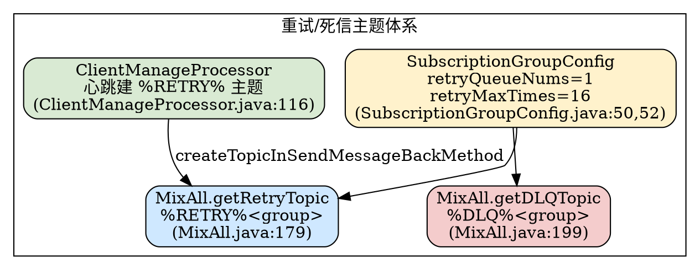
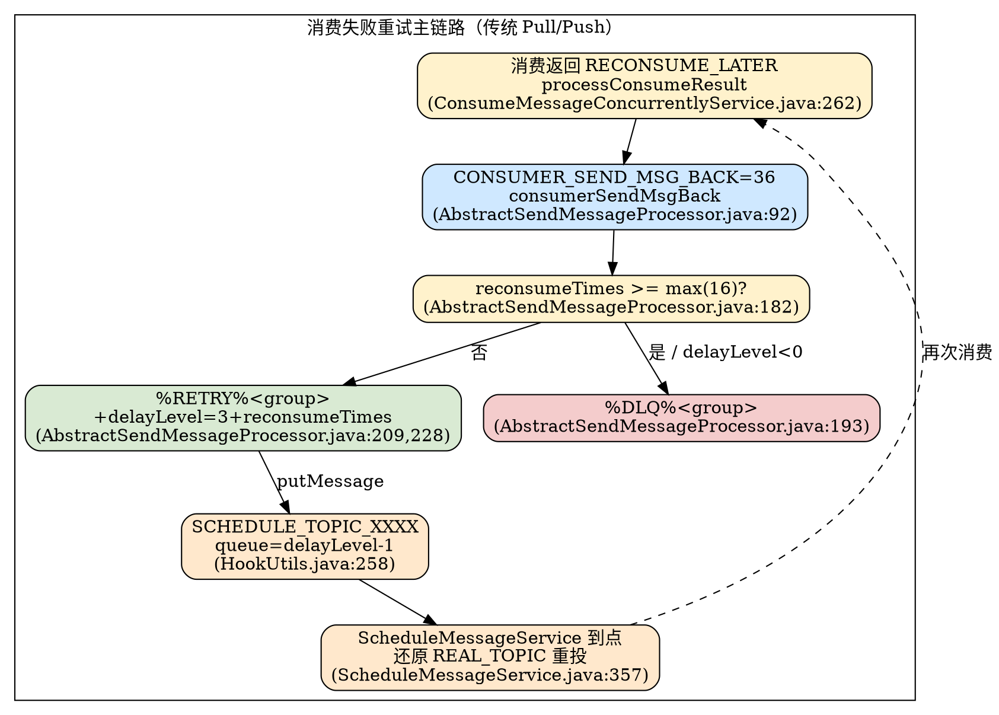

# Retry & DLQ（重试消息与死信队列，5.5.1）

## Introduction

RocketMQ 的消费重试与死信机制，是保证「至少一次（at-least-once）」投递语义的最后一道工程兜底：当消费者返回 `RECONSUME_LATER`、或处理抛异常时，消息不会丢失，而是被重新投递——按阶梯延迟多次重试，耗尽阈值后落入**死信队列（DLQ）**等待人工干预。

本文基线为 `rocketmq-all-5.5.1` 源码，聚焦**传统 Pull/Push 消费（4.x 模型）**的重试主链路：从 `MixAll.getRetryTopic` / `getDLQTopic` 的主题命名，到 `SendMessageProcessor` 处理 `CONSUMER_SEND_MSG_BACK` 命令的 broker 端逻辑，再到 `reconsumeTimes` 递增、`maxReconsumeTimes`（默认 16）到顶转死信、`delayLevel` 阶梯延迟重投，最后明确与 [PopConsume（POP 无状态复活）](/docs/CS/MQ/RocketMQ/PopConsume.md) 是「两条完全不同的重试/重投路径」。

所有 `file:line` 均来自 `E:/Projects/rocketmq-rocketmq-all-5.5.1` 真实源码，已用 Grep/Glob/Read 逐项核实。

## 1. 重试主题体系（%RETRY% 与 %DLQ%）

重试主题与死信主题都以消费组为单位、**按前缀拼接消费组名**生成，定义在 `MixAll`：

- 前缀常量：`RETRY_GROUP_TOPIC_PREFIX = "%RETRY%"`（`MixAll.java:103`）、`DLQ_GROUP_TOPIC_PREFIX = "%DLQ%"`（`MixAll.java:104`）。
- 重试主题：`getRetryTopic(consumerGroup)` 返回 `"%RETRY%" + consumerGroup`（`MixAll.java:179-181`）。
- 死信主题：`getDLQTopic(consumerGroup)` 返回 `"%DLQ%" + consumerGroup`（`MixAll.java:199-201`）。

**队列数量**由两个订阅组配置控制，默认值见 `SubscriptionGroupConfig`：

- `retryQueueNums = 1`：每个消费组的重试主题只有 1 个队列（`SubscriptionGroupConfig.java:50`）；broker 在 `consumerSendMsgBack` 里用 `random.nextInt(subscriptionGroupConfig.getRetryQueueNums())` 选队列（`AbstractSendMessageProcessor.java:133`）。
- `retryMaxTimes = 16`：默认最大重试次数（`SubscriptionGroupConfig.java:52`），对应源码里常说的「默认最多 16 次」。
- `DLQ_NUMS_PER_GROUP = 1`：死信主题固定 1 个队列（`AbstractSendMessageProcessor.java:79`），写入 DLQ 时 `randomQueueId(DLQ_NUMS_PER_GROUP)`（`AbstractSendMessageProcessor.java:194`、`SendMessageProcessor.java:220`）。

重试主题在**消费者心跳注册时即被创建**：`ClientManageProcessor` 收到 `HEART_BEAT` 后，用 `MixAll.getRetryTopic(groupName)` + `retryQueueNums` 调 `createTopicInSendMessageBackMethod` 建主题（`ClientManageProcessor.java:116-118`）。这保证了消费者还没开始重试时，主题已存在。



## 2. 发送端重试 vs 服务端重试（两条独立的重试）

RocketMQ 有**两层互不相干**的重试，容易混淆：

### 2.1 发送端重试（生产者客户端）

仅 **SYNC 模式**有客户端自动重试，由 `DefaultMQProducerImpl.sendDefaultImpl` 控制总次数：

```java
int timesTotal = communicationMode == CommunicationMode.SYNC
        ? 1 + this.defaultMQProducer.getRetryTimesWhenSendFailed() : 1;  // DefaultMQProducerImpl.java:756
```

- `retryTimesWhenSendFailed`（默认 2，即 SYNC 共发 1+2=3 次）：失败/超时换队列重发（`selectOneMessageQueue(..., resetIndex=true)`，`DefaultMQProducerImpl.java:765`）。
- 若 broker 返回非 `SEND_OK` 且 `isRetryAnotherBrokerWhenNotStoreOK()` 为真，则换 broker 重试（`DefaultMQProducerImpl.java:799-801`）。
- ASYNC / ONEWAY 的 `timesTotal = 1`，**没有**客户端重试（`DefaultMQProducerImpl.java:756`、`793-804`）。

> 发送端重试解决的是「消息没成功落盘」，**不涉及消费失败**，与本文的 DLQ 无关；详见 [Producer（send / FaultStrategy 源码级）](/docs/CS/MQ/RocketMQ/Producer.md)。

### 2.2 服务端消费重试（本文主线）

消费失败时，由**消费者把消息发回 broker**，broker 写入 `%RETRY%<group>` 主题，再由消费者重新拉取——这才是 DLQ 的入口。二者的根本差异：发送端重试作用于「生产链路」，服务端重试作用于「消费链路」，阈值、主题、延迟机制全部独立。整体消费语义与 [MessageLifecycle（端到端消息生命周期）](/docs/CS/MQ/RocketMQ/MessageLifecycle.md) 的 Stage 4 衔接。

## 3. 消费失败重试主链路（CONSUMER_SEND_MSG_BACK）

### 3.1 客户端触发 sendMessageBack

并发消费在 `ConsumeMessageConcurrentlyService.processConsumeResult` 中判定：返回 `RECONSUME_LATER` 时 `ackIndex = -1`，对每条失败消息调 `sendMessageBack(msg, context)`（`ConsumeMessageConcurrentlyService.java:262-289`）。`sendMessageBack` 取出 `context.getDelayLevelWhenNextConsume()`（业务可通过 `ConsumeConcurrentlyContext.setDelayLevelWhenNextConsume` 自定义），再调 `defaultMQPushConsumerImpl.sendMessageBack`（`ConsumeMessageConcurrentlyService.java:316-322`）。

`DefaultMQPushConsumerImpl.sendMessageBack` 走 `consumerSendMessageBack` RPC；若 broker 不可达或抛错，则降级为 `sendMessageBackAsNormalMessage`——直接 `producer.send` 一条新消息到 `%RETRY%` 主题（`DefaultMQPushConsumerImpl.java:759-802`），并自带 `setDelayTimeLevel(3 + reconsumeTimes)`（`DefaultMQPushConsumerImpl.java:799`）。降级路径后续由 broker 的 `handleRetryAndDLQ` 兜底判死信。

### 3.2 Broker 命令分派

`SendMessageProcessor.processRequest` 对 `RequestCode.CONSUMER_SEND_MSG_BACK`（值 `36`，`RequestCode.java:56`）直接转交 `consumerSendMsgBack`（`SendMessageProcessor.java:93-94`）。该方法实现在 `AbstractSendMessageProcessor.consumerSendMsgBack`（`AbstractSendMessageProcessor.java:92`）：

1. 转发到 master：`peekMasterBroker()`，从节点收到请求会转主（`AbstractSendMessageProcessor.java:98-104`）。
2. 校验订阅组；若 `retryQueueNums <= 0` 直接返回 SUCCESS，不做任何重试（`AbstractSendMessageProcessor.java:126-130`）。
3. 确保 `%RETRY%<group>` 主题存在：`createTopicInSendMessageBackMethod(newTopic, retryQueueNums, ...)`（`AbstractSendMessageProcessor.java:132,141-144`）。
4. 按请求里的 `offset` 回查原始消息：`lookMessageByOffset(requestHeader.getOffset())`（`AbstractSendMessageProcessor.java:158`）；首次补 `PROPERTY_RETRY_TOPIC` 记录原始业务主题（`AbstractSendMessageProcessor.java:165-167`）。
5. 计算 `maxReconsumeTimes`：优先订阅组 `retryMaxTimes`，版本 >= V3_4_9 且请求头带 `maxReconsumeTimes` 时以客户端为准（`AbstractSendMessageProcessor.java:173-179`）。
6. **死信判定**：`msgExt.getReconsumeTimes() >= maxReconsumeTimes || delayLevel < 0`（`AbstractSendMessageProcessor.java:182-183`）。成立则 `isDLQ = true`，`newTopic = MixAll.getDLQTopic(group)`，建 DLQ 主题、清延迟（`AbstractSendMessageProcessor.java:192-206`）。
7. 否则（正常重试）：若 `delayLevel == 0` 则按 `3 + reconsumeTimes` 计算阶梯延迟（`AbstractSendMessageProcessor.java:208-209`）；`msgExt.setDelayTimeLevel(delayLevel)`（`AbstractSendMessageProcessor.java:212`）。
8. 组装 `MessageExtBrokerInner`，**关键递增** `setReconsumeTimes(msgExt.getReconsumeTimes() + 1)`（`AbstractSendMessageProcessor.java:228`），保留 `PROPERTY_RETRY_TOPIC`（`AbstractSendMessageProcessor.java:244-247`），写入重试/死信主题 `putMessage(msgInner)`（`AbstractSendMessageProcessor.java:237`）。命中 DLQ 时打 `DLQ_LOG` 并累加统计（`AbstractSendMessageProcessor.java:256-273`）。

> 注意 `reconsumeTimes` 的两种来源：broker 端 `consumerSendMsgBack` 真正负责「+1」并持久化（`AbstractSendMessageProcessor.java:228`）；客户端降级路径 `sendMessageBackAsNormalMessage` 也在属性里 +1（`DefaultMQPushConsumerImpl.java:796`）。二者最终都落到同一条 `%RETRY%` 消息的 `reconsumeTimes` 字段。

### 3.3 第二条进死信的安全网（handleRetryAndDLQ）

`SendMessageProcessor.sendMessage` 在落盘前调 `handleRetryAndDLQ`（`SendMessageProcessor.java:271`），专门处理「消息主题本身以 `%RETRY%` 开头」的情况（即降级 `sendMessageBackAsNormalMessage` 发来的普通 SEND_MESSAGE）：

- 解析 `groupName = KeyBuilder.parseGroup(newTopic)`，`maxReconsumeTimes` 同样取自订阅组（`SendMessageProcessor.java:185-198`）。
- 顺序消费保护：若组仍有未过期的 rebalance 锁（有序消息），`isLockAllExpired` 为假，则 `sendRetryMessageToDeadLetterQueueDirectly = true`，**直接转 DLQ** 不再重试（`SendMessageProcessor.java:202-208`）。
- 若 `reconsumeTimes > maxReconsumeTimes` 或强制转死信，则置 `PROPERTY_DELAY_TIME_LEVEL = "-1"`、`newTopic = getDLQTopic`、建 DLQ 主题（`SendMessageProcessor.java:210-224`）。

这样无论走 `CONSUMER_SEND_MSG_BACK` 命令还是普通降级发送，超阈值的消息最终都会被导向 `%DLQ%<group>`。

## 4. 延迟级别阶梯重试（delayLevel 与 ScheduleService）

消费重试的「阶梯延迟」复用了 RocketMQ 的**定时消息**机制：每条重试消息带一个 `delayLevel`，落到 `SCHEDULE_TOPIC_XXXX` 的对应队列，到点再被 `ScheduleMessageService` 重投回 `%RETRY%` 主题。

- **默认延迟级别表** `messageDelayLevel`：`"1s 5s 10s 30s 1m 2m 3m 4m 5m 6m 7m 8m 9m 10m 20m 30m 1h 2h"`——共 18 级（`MessageStoreConfig.java:262`，默认值在 docs 中同款）。
- **默认层级映射**：broker 在 `consumerSendMsgBack` 中 `delayLevel = 0` 时按 `3 + reconsumeTimes` 推出（`AbstractSendMessageProcessor.java:208-209`）。即第 1 次失败 `reconsumeTimes=0` → level 3（10s），第 2 次 → level 4（30s），第 3 次 → level 5（1m）…… 直到接近 level 18（2h）。
- **落盘路由**：`HookUtils.transformDelayLevelMessage` 在 `putMessage` 前执行——先封顶 `delayLevel`（`:250`），把真实主题/队列备份进 `PROPERTY_REAL_TOPIC` / `PROPERTY_REAL_QUEUE_ID`（`:254-255`），再把主题改为 `RMQ_SYS_SCHEDULE_TOPIC = "SCHEDULE_TOPIC_XXXX"`、队列改为 `delayLevel2QueueId(delayLevel) = delayLevel - 1`（`HookUtils.java:258-259`，`ScheduleMessageService.java:103-105`）。
- **到点重投**：`ScheduleMessageService` 的 `DeliverDelayedMessageTimerTask` 到点触发，重建消息并把主题还原为 `PROPERTY_REAL_TOPIC`（即 `%RETRY%<group>`），清空延迟相关属性（`ScheduleMessageService.java:350-357`）。于是消息重新进入 `%RETRY%` 主题，被原消费组再次拉取消费。

> 这条「`%RETRY%` 主题 + `SCHEDULE_TOPIC_XXXX` 阶梯延迟」链路，正是消费重试与 [Store（CommitLog / ConsumeQueue 存储）](/docs/CS/MQ/RocketMQ/Store.md) 中定时消息引擎的复用点。新 5.x 另提供 `CustomizedRetryPolicy` / `ExponentialRetryPolicy`（与 `messageDelayLevel` 兼容的自定义退避），属 5.x 重试策略扩展，不在本文 4.x 主链路范围。



## 5. 死信队列 DLQ（需人工干预）

当 `reconsumeTimes` 达到 `maxReconsumeTimes`（默认 16），消息被写入 `%DLQ%<group>`，队列数恒为 1（`DLQ_NUMS_PER_GROUP = 1`，`AbstractSendMessageProcessor.java:79`）。写入点有两处：

- 命令路径：`consumerSendMsgBack` 判死信后 `getDLQTopic` + `createTopicInSendMessageBackMethod(..., DLQ_NUMS_PER_GROUP, ...)`（`AbstractSendMessageProcessor.java:192-199`）。
- 安全网路径：`handleRetryAndDLQ` 在 `reconsumeTimes > maxReconsumeTimes` 或有序消息强制转死信时写到 DLQ（`SendMessageProcessor.java:210-224`）。

**5.5.1 中 DLQ 没有自动重投/自动消费逻辑**：`AdminBrokerProcessor` 不存在 `handleResendDeadLetter` 之类的自动重发命令（全文 Grep `ResendDeadLetter`/`resendDeadLetter` 无命中）。死信消息只能：

- 由运维通过 `mqadmin` / `DefaultMQAdminExtImpl`（`tools` 模块）等旁路工具读取、重发或清理；
- 或由业务编写一个**独立消费者**订阅 `%DLQ%<group>` 主题做人工/旁路处理（`DefaultMQPushConsumer` 可正常订阅死信主题，因 `MixAll` 仅屏蔽 `%RETRY%`/`%DLQ%` 作为普通业务主题路由，见 `MixAll.java:578-579`）。

> 死信是「终止态」，不会回到原业务主题；幂等键必须能跨重试与死信复用，否则死信消费仍会重复生效（与 [MessageLifecycle（幂等消费）](/docs/CS/MQ/RocketMQ/MessageLifecycle.md) 第 6 节一致）。`ConsumerSendMsgBackRequestHeader` 携带 `maxReconsumeTimes` 字段（`ConsumerSendMsgBackRequestHeader.java:45,100-105`），使 5.x 客户端可在请求头覆盖组级阈值。

## 6. 与 POP 复活机制对照（两条重投路径，重点）

RocketMQ 5.5.1 存在**两条互不相同的失败重投路径**，理解其差异是避免误用的关键：

| 维度 | 传统消费（本文） | POP 消费（[PopConsume](/docs/CS/MQ/RocketMQ/PopConsume.md)） |
| --- | --- | --- |
| 重试载体 | `%RETRY%<group>` 主题 + `SCHEDULE_TOPIC_XXXX` 阶梯延迟 | 独立重试主题（V1 `%RETRY%<group>%<topic>` / V2）+ Revive 主题（`%REVIVE%_<cluster>`） |
| 状态模型 | **有状态**：依赖 `ConsumerOffsetManager` 提交 offset 推进进度 | **无状态**：每次 pop 带 `extraInfo` 票据，单条 `ACK_MESSAGE` 确认 |
| 失败重投触发 | 消费者 `sendMessageBack` → `CONSUMER_SEND_MSG_BACK` 命令 | `invisibleTime` 超时，broker `PopReviveService` 复活重投 |
| 重试计数 | `reconsumeTimes` 字段，broker 端 +1，到 16 转 DLQ | ck 的 `rePutTimes` / bitMap 未置位即重投，不限固定次数 |
| 顶到死信 | `reconsumeTimes >= maxReconsumeTimes` → `%DLQ%<group>` | 同样可落 `%DLQ%`，但复活判定在 Revive 扫描而非 send-back |
| 线缆命令码 | `CONSUMER_SEND_MSG_BACK = 36` | `POP_MESSAGE=200050` / `ACK_MESSAGE=200051` |
| 确认粒度 | 队列级 offset 提交 | 单条 ack（`extraInfo` 票据，见 [PopConsume](/docs/CS/MQ/RocketMQ/PopConsume.md) 第 3 节） |

核心差异一句话：**传统模型是「有状态 offset 推进 + broker 代发 `%RETRY%` 定时重投」；POP 模型是「无状态 extraInfo 票据 + ck/ack 超时自动复活」**。前者重投由消费者主动发起（`CONSUMER_SEND_MSG_BACK`），后者重投由 broker 在 `invisibleTime` 到点后自动发起（Revive 扫描）。两者都可能在耗尽后落入 `%DLQ%`，但判定与触发机制完全不同，不能混为一谈。POP 的协议细节与 ck/ack 编码见 [PopConsume（POP 无状态消费协议）](/docs/CS/MQ/RocketMQ/PopConsume.md) 与 [MessageProtocol（消息协议字节级详情）](/docs/CS/MQ/RocketMQ/MessageProtocol.md)。

> broker 端处理两种路径的代码也分属不同 Processor：`SendMessageProcessor` / `AbstractSendMessageProcessor` 负责传统 `CONSUMER_SEND_MSG_BACK` 与 `handleRetryAndDLQ`；`PopMessageProcessor` / `AckMessageProcessor` / `PopReviveService` 负责 POP 复活，详见 [Broker（各 Processor 总览）](/docs/CS/MQ/RocketMQ/Broker.md) 与 [Remoting（命令码与协议帧）](/docs/CS/MQ/RocketMQ/Remoting.md)。

## Links

- [PopConsume（POP 无状态消费协议：extraInfo 票据 / ck-ack / Revive 复活）](/docs/CS/MQ/RocketMQ/PopConsume.md)
- [Consumer（PullMessageService / PushConsumer / Order / Rebalance 源码级）](/docs/CS/MQ/RocketMQ/Consumer.md)
- [Store（CommitLog / ConsumeQueue / IndexFile 存储引擎）](/docs/CS/MQ/RocketMQ/Store.md)
- [MessageLifecycle（端到端消息生命周期：不丢失与幂等）](/docs/CS/MQ/RocketMQ/MessageLifecycle.md)
- [Producer（send / sendKernelImpl / FaultStrategy 源码级）](/docs/CS/MQ/RocketMQ/Producer.md)
- [Broker（SendMessageProcessor / PullMessageProcessor / 各 Processor 总览）](/docs/CS/MQ/RocketMQ/Broker.md)

## References

- `common/.../MixAll.java`：`RETRY_GROUP_TOPIC_PREFIX`(:103)、`DLQ_GROUP_TOPIC_PREFIX`(:104)、`getRetryTopic`(:179)、`getDLQTopic`(:199)、系统主题屏蔽(:578)
- `remoting/.../protocol/subscription/SubscriptionGroupConfig.java`：`retryQueueNums=1`(:50)、`retryMaxTimes=16`(:52)
- `remoting/.../protocol/RequestCode.java`：`CONSUMER_SEND_MSG_BACK=36`(:56)
- `remoting/.../protocol/header/ConsumerSendMsgBackRequestHeader.java`：`maxReconsumeTimes` 字段(:45,100)
- `client/.../impl/producer/DefaultMQProducerImpl.java`：发送端重试 `timesTotal`(:756)、`retryAnotherBrokerWhenNotStoreOK`(:799)
- `client/.../impl/consumer/DefaultMQPushConsumerImpl.java`：`sendMessageBack`(:759)、降级 `sendMessageBackAsNormalMessage`(:787)、`setDelayTimeLevel(3+reconsumeTimes)`(:799)
- `client/.../impl/consumer/ConsumeMessageConcurrentlyService.java`：`processConsumeResult` RECONSUME_LATER(:262)、`sendMessageBack`(:316)
- `broker/.../processor/SendMessageProcessor.java`：命令分派(:93)、`handleRetryAndDLQ`(:181)、调用点(:271)
- `broker/.../processor/AbstractSendMessageProcessor.java`：`consumerSendMsgBack`(:92)、`DLQ_NUMS_PER_GROUP=1`(:79)、死信判定(:182)、默认 delayLevel(:209)、`reconsumeTimes+1`(:228)
- `broker/.../processor/ClientManageProcessor.java`：心跳建 `%RETRY%` 主题(:116)
- `broker/.../util/HookUtils.java`：`transformDelayLevelMessage` 路由到 `SCHEDULE_TOPIC_XXXX`(:250-259)
- `broker/.../schedule/ScheduleMessageService.java`：`delayLevel2QueueId`(:103)、到点还原 `REAL_TOPIC` 重投(:357)
- `store/.../config/MessageStoreConfig.java`：默认 `messageDelayLevel` 18 级(:262)
