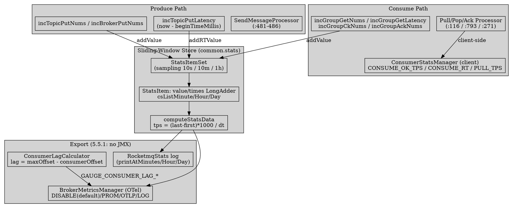

# Stats & Monitoring

## Introduction

RocketMQ 5.5.1 的统计与监控体系由**两套互相独立、互不共享计数**的系统组成：服务端 `BrokerStatsManager`（基于 `org.apache.rocketmq.common.stats` 的滑动时间窗口累加）与客户端 `ConsumerStatsManager`/`ConsumeStatus`；外加 5.x 新增的 OpenTelemetry 指标管线 `BrokerMetricsManager`。本页所有 `file:line` 均基于 **RocketMQ 5.5.1** 真文件核验。

> 版本基线：RocketMQ 5.5.1

**纠偏（先读，均为真源码反例）：**
1. 任务描述里的 `PUT_TPS`/`GET_TPS`/`PUT_QPS`/`GET_QPS`/`GROUP_GET_QPS`/`GROUP_ACK_QPS`/`MSG_PUT_TOTAL`/`INNER_ACC` 等 key **在 5.5.1 中均不存在**（`Stats.java` 与 `BrokerStatsManager.java` 全仓 grep 零命中）。真正的 key 是 `TOPIC_PUT_NUMS`、`GROUP_GET_NUMS`、`BROKER_PUT_NUMS` 等（见 `Stats.java:21-49`）。"TPS/QPS" 是**事后对滑动窗口算出来的速率**，不是被存储的 key。
2. 任务描述的 "initExports / JMX MBean（`org.apache.rocketmq.common.stats`）" 在 5.5.1 **不成立**：全仓 grep `MBean|JmxReporter|registerMBean` 零命中，5.5.1 已无 JMX 暴露；当前暴露方式是① legacy 日志（`RocketmqStats` logger）② OpenTelemetry 管线（含 Prometheus）。
3. Consumer lag（消费滞后）**不是 broker 主动算出来的推送值**，而是按需由 `maxOffset − consumerOffset`（offset 差值）推导（见 `ConsumerLagCalculator.java:405-412`）。

## 1. 统计 Key 的真实定义（先纠偏再用真名）

真实 key 常量定义在 `common/.../stats/Stats.java:21-49`，`BrokerStatsManager` 通过 `@Deprecated` 别名再导出一遍（`BrokerStatsManager.java:47-115`）。核心集合：

| 真名（字面字符串） | 含义 | 定义位置 |
| ---- | ---- | ---- |
| `TOPIC_PUT_NUMS` / `TOPIC_PUT_SIZE` | 按 topic 累计写入条数/字节 | `Stats.java:25-26` |
| `GROUP_GET_NUMS` / `GROUP_GET_SIZE` | 按 group@topic 累计拉取条数/字节 | `Stats.java:27-28` |
| `BROKER_PUT_NUMS` / `BROKER_GET_NUMS` | 全 broker 写入/拉取条数（key=clusterName） | `Stats.java:30-31` |
| `SNDBCK_PUT_NUMS` | 发回（send-back / retry）条数 | `Stats.java:29` |
| `GROUP_CK_NUMS` / `GROUP_ACK_NUMS` | 顺序消费 CK / ACK 条数（Pop 体系） | `Stats.java:48-49` |
| `GROUP_GET_LATENCY` / `TOPIC_PUT_LATENCY` | 消费/写入 RT（走 `RTStatsItem`） | `Stats.java:46-47` |
| `QUEUE_PUT_NUMS`…`QUEUE_GET_SIZE` | 队列级明细（需 `enableDetailStat`） | `Stats.java:21-24` |
| `DLQ_PUT_NUMS` / `BROKER_ACK_NUMS` / `BROKER_CK_NUMS` | 5.5.1 新增（非 @Deprecated） | `BrokerStatsManager.java:77-82` |

`BrokerStatsManager.init()`（`BrokerStatsManager.java:170-291`）把这些 key 逐个 `new StatsItemSet(...)` 注入 `statsTable`（一个 `HashMap<String, StatsItemSet>`，`:143`）。注意 `QUEUE_*` 仅在 `enableQueueStat == brokerConfig.isEnableDetailStat()`（默认 true，`:157`、`:177-182`）时才创建——关掉 `enableDetailStat` 即不收集队列级明细。

> 反例：任务示例中的 `INNER_ACC`、`MSG_PUT_TOTAL`、`GROUP_GET_QPS` 非字符串常量也非代码引用，全部为错觉。5.5.1 里与 "ACCOUNT" 相关的是另一套基于 `StatisticsManager` 的计费统计（`BrokerStatsManager.java:149, 235-284`），key 形如 `ACCOUNT_SEND`/`ACCOUNT_RCV`，与 TPS 统计无关。

## 2. 计数入口（inc 方法 → StatsItemSet）

所有 `inc*` 方法最终落到 `StatsItemSet.addValue(statsKey, incValue, incTimes)` 或 `addRTValue(...)`（`StatsItemSet.java:159-171`）。key 用 `buildStatsKey` 拼成 `topic@group` / `topic@queueId` / `topic@queueId@group`（`BrokerStatsManager.java:466-508`）。代表性入口：

| 入口方法 | file:line | 调用方（真名） |
| ---- | ---- | ---- |
| `incTopicPutNums` / `incTopicPutSize` | `BrokerStatsManager.java:439-449` | `SendMessageProcessor.java:481-483` |
| `incBrokerPutNums(topic, n)` | `BrokerStatsManager.java:539-542`（内部再调 `:535-537` 无参版） | `SendMessageProcessor.java:484` |
| `incGroupGetNums(group, topic, n)` | `BrokerStatsManager.java:451-454` | `DefaultPullMessageResultHandler.java:116`、`PopMessageProcessor.java:793`、`PeekMessageProcessor.java:179`、`PopReviveService.java:249` |
| `incBrokerGetNums(topic, n)` | `BrokerStatsManager.java:544-547` | `PopMessageProcessor.java:792` |
| `incGroupCkNums` / `incGroupAckNums` | `BrokerStatsManager.java:456-464` | `PopMessageProcessor.java:972`、`AckMessageProcessor.java:271` |
| `incSendBackNums(group, topic)` | `BrokerStatsManager.java:595-598` | 重试/发回路径 |

以写入为例，`SendMessageProcessor.handlePutMessageResult` 在 sendOK 时（`SendMessageProcessor.java:474-486`）一次性累加：`incTopicPutNums` → `incTopicPutSize` → `incBrokerPutNums` → `incTopicPutLatency`。注意 `incBrokerPutNums(topic, n)`（`:539`）同时累加 `BROKER_PUT_NUMS` 和 `BROKER_PUT_NUMS_WITHOUT_SYSTEM_TOPIC`（`:564-569`，系统 topic 过滤）——这是 5.5.1 用来区分系统 topic 流量的设计。

## 3. 滑动时间窗口与 TPS/RT 计算（核心机制）

`StatsItemSet.init()`（`StatsItemSet.java:48-109`）挂 6 个定时任务：每 **10s** 采样、每 **10min** 采样、每 **1h** 采样，以及分钟/小时/天粒度的日志打印。每个 `StatsItem` 维护 3 个 `LinkedList<CallSnapshot>`（`StatsItem.java:33-37`）——`csListMinute` / `csListHour` / `csListDay`。

### 3.1 采样与窗口

```java
// common/.../stats/StatsItem.java:156-167
public void samplingInSeconds() {
    synchronized (this.csListMinute) {
        if (this.csListMinute.size() == 0)
            this.csListMinute.add(new CallSnapshot(System.currentTimeMillis() - 10 * 1000, 0, 0));
        this.csListMinute.add(new CallSnapshot(System.currentTimeMillis(), this.times.sum(), this.value.sum()));
        if (this.csListMinute.size() > 7) this.csListMinute.removeFirst();   // 保留最近 7 个 → 约 60s 窗口
    }
}
```
- 分钟窗口：`samplingInSeconds` 每 10s 一帧、保留 7 帧 → **约 60 秒**（`StatsItem.java:156-167`）。
- 小时窗口：`samplingInMinutes` 每 10min 一帧、保留 7 帧 → **约 70 分钟**（`StatsItem.java:169-180`）。
- 天窗口：`samplingInHour` 每 1h 一帧、保留 25 帧 → **约 25 小时**（`StatsItem.java:182-193`）。

### 3.2 TPS 是窗口均值，不是瞬时值

```java
// common/.../stats/StatsItem.java:53-79
private static StatsSnapshot computeStatsData(final LinkedList<CallSnapshot> csList) {
    synchronized (csList) {
        CallSnapshot first = csList.getFirst();
        CallSnapshot last  = csList.getLast();
        long sum = last.getValue() - first.getValue();
        double tps = (sum * 1000.0d) / (last.getTimestamp() - first.getTimestamp()); // 总量 / 时间跨度(ms)
        ...
    }
}
```
`getTps()` 取的是 `csListMinute`（`getStatsDataInMinute`，`StatsItem.java:81-83`），即约 60 秒窗口内的**平均**速率。`tpsTopicPutNums`/`tpsGroupGetNums`（`BrokerStatsManager.java:600-607`）就是拿这个快照算出来的。**反直觉点：所谓 "TPS" 是近 1 分钟均值，不是某一秒的瞬时 TPS**；窗口越大（hour/day）平滑越狠。

### 3.3 RT = 结束时间 − 开始时间，走 RTStatsItem

写入 RT 在 `SendMessageProcessor.java:485-486` 记录：

```java
this.brokerController.getBrokerStatsManager().incTopicPutLatency(msg.getTopic(), queueIdInt,
    (int) (this.brokerController.getMessageStore().now() - beginTimeMillis));
```

`beginTimeMillis` 是请求进入处理管线时打的时间戳，RT = `now − beginTimeMillis`。消费 RT 同理，`incGroupGetLatency` 在 `DefaultPullMessageResultHandler.java:142`、`PopMessageProcessor.java:456/609`、`PeekMessageProcessor.java:189` 调用。`addRTValue` 走 `getAndCreateRTStatsItem`（`:214-216`）→ 创建 `RTStatsItem`（`RTStatsItem.java:26-41`）。RT 的快照打印与 `StatsItem` 唯一区别在于 `statPrintDetail` 输出 **`TIMES / AVGRT`**（`AVGRT = sum / times`，`RTStatsItem.java:38-40`），而非 TPS/SUM——因为对响应时间而言 TPS 无意义。

## 4. 消费侧统计：客户端体系（与服务端正交）

消费统计有**两套独立来源**，互不共享：

- **服务端**（`BrokerStatsManager`）：只统计 broker 视角的 `GROUP_GET_*`、`GROUP_CK_*`、`GROUP_ACK_*`——即"被拉/被 ACK 了多少"，不关心消费成败。
- **客户端**（`ConsumerStatsManager` + `ConsumeStatus`，在 `client` 模块）：统计消费结果。

`ConsumerStatsManager`（`client/.../stat/ConsumerStatsManager.java:24-90`）用 5 个 `StatsItemSet`：

```java
private static final String TOPIC_AND_GROUP_CONSUME_OK_TPS   = "CONSUME_OK_TPS";
private static final String TOPIC_AND_GROUP_CONSUME_FAILED_TPS = "CONSUME_FAILED_TPS";
private static final String TOPIC_AND_GROUP_CONSUME_RT       = "CONSUME_RT";
private static final String TOPIC_AND_GROUP_PULL_TPS         = "PULL_TPS";
private static final String TOPIC_AND_GROUP_PULL_RT          = "PULL_RT";
```
入口方法 `incPullRT/incPullTPS/incConsumeRT/incConsumeOKTPS/incConsumeFailedTPS`（`:73-90`，同样用 `topic@group` 作 key）。`consumeStatus(group, topic)` 把快照聚合成 `ConsumeStatus`（`ConsumerStatsManager.java:92+` → `ConsumeStatus.java:20-76`），其字段即任务所述：**pullRT / pullTPS / consumeRT / consumeOKTPS / consumeFailedTPS / consumeFailedMsgs**。这些 CK/RT/TPS/失败数全部来自**客户端本地累加**，与 broker 的 `GROUP_GET_*` 不是同一笔账——这是排查"消费慢"时最容易踩的坑。

## 5. 消费滞后（Consumer Lag）是 offset 差值，不是统计

broker 侧没有 "lag 计数器"。5.x 由 `ConsumerLagCalculator`（`broker/.../metrics/ConsumerLagCalculator.java`）**按需**从 offset 推导：

```java
// ConsumerLagCalculator.java:405-412（非 Pop 路径）
long brokerOffset  = messageStore.getMaxOffsetInQueue(topic, queueId);   // 队列最大 offset
long consumerOffset = offsetManager.queryOffset(group, topic, queueId);  // 消费进度
if (consumerOffset < 0) consumerOffset = brokerOffset;
long lag = calculateMessageCount(group, topic, queueId, consumerOffset, brokerOffset);
...
// calculateMessageCount:522
public long calculateMessageCount(String group, String topic, int queueId, long from, long to) {
    long count = to - from;   // lag = brokerOffset - consumerOffset
    ...
}
```
对 Pop 消费还会叠加 `inFlightNum`（`ConsumerLagCalculator.java:399`）与 `PopInflightMessageCounter`。结果经 `BrokerMetricsManager` 暴露为 `GAUGE_CONSUMER_LAG_MESSAGES` / `GAUGE_CONSUMER_LAG_LATENCY`（`BrokerMetricsManager.java` 静态导入）。**关键点：lag 是 `(maxOffset − consumerOffset)` 的派生量，broker 从不主动推送它**；慢消费/积压本质是 offset 差距，不是独立统计指标。

## 6. 指标暴露：日志 + OpenTelemetry（无 JMX）

### 6.1 Legacy：打印到日志

`StatsItemSet` 的 `printAtMinutes/Hour/Day`（`StatsItem.java:195-209`）经 `ROCKETMQ_STATS_LOGGER_NAME = "RocketmqStats"` logger 输出（`LoggerName.java:37`）。可用 `mqadmin statsAll`（`tools/.../StatsAllSubCommand.java`，基于 `getStatsDataInMinute` 等）读取。**5.5.1 没有 JMX MBean 暴露**（全仓零命中）。

### 6.2 现代：OpenTelemetry 管线

`BrokerController` 在构造时 `new BrokerMetricsManager(this)`（`BrokerController.java:962`）。它基于 `io.opentelemetry` SDK，导出器类型由 `MetricsExporterType`（`common/.../metrics/MetricsExporterType.java:21-25`）枚举：

```java
public enum MetricsExporterType {
    DISABLE(0), OTLP_GRPC(1), PROM(2), LOG(3);
}
```

`BrokerMetricsManager` 在 `:342-449` 据 `brokerConfig.getMetricsExporterType()` 分支装配：
- `PROM` → `PrometheusHttpServer.builder()`（`:437-443`）暴露 Prometheus 拉取端点；
- `OTLP_GRPC` → `OtlpGrpcMetricExporter`（`:374-413`）；
- `LOG` → `OtlpJsonLoggingMetricExporter` + `PeriodicMetricReader`（`:444-449`）；
- `DISABLE` → 直接 return（`:343-345`）。

写入/消费的现代指标在同一处理路径并行累加：例如 `SendMessageProcessor.java:488-496` 在 legacy `inc*` 之外，还调 `brokerMetricsManager.getMessagesInTotal().add(...)`、`getThroughputInTotal()`、`getMessageSize().record(...)`（OTel `LongCounter` / `LongHistogram`）。

### 6.3 开关（先核实）

- `metricsExporterType`：默认 **`DISABLE`**（`BrokerConfig.java:403`），即 Prometheus/OTel 默认关闭，需显式配置才出数据（`BrokerConfig.java:1844-1858`）。
- `enableDetailStat`（默认 `true`，`BrokerConfig.java:324`）：控制是否收集 `QUEUE_*` 队列级明细（`BrokerStatsManager.java:157`）。
- `msgTraceEnable` / `isTraceOn()`（`BrokerConfig.java:808`）：属于**消息轨迹（Trace）**体系，与本节统计计数无关，勿混淆。
- Opentelemetry Prometheus 依赖确已随包发布：`pom.xml:1015-1016` 引入 `opentelemetry-exporter-prometheus`（version `1.47.0-alpha`）。**结论：5.5.1 已经内置 Prometheus exporter，只是默认关闭**，彻底推翻"5.5.1 仍仅 JMX"的假设。



## Links

- [Broker](/docs/CS/MQ/RocketMQ/Broker.md)
- [Store](/docs/CS/MQ/RocketMQ/Store.md)
- [Consumer](/docs/CS/MQ/RocketMQ/Consumer.md)
- [Producer](/docs/CS/MQ/RocketMQ/Producer.md)
- [FlowControl](/docs/CS/MQ/RocketMQ/FlowControl.md)
- [RocketMQ5](/docs/CS/MQ/RocketMQ/RocketMQ5.md)

## References

- `common/src/main/java/org/apache/rocketmq/common/stats/Stats.java:21-49`（真实 key 常量；无 PUT_TPS/GET_TPS 等）
- `store/src/main/java/org/apache/rocketmq/store/stats/BrokerStatsManager.java:47-115`（key 别名与新增 key）、`:143,170-291`（statsTable/init）、`:439-598`（inc* 计数入口）、`:600-607`（tps* 计算）、`:812-826`（StatsType 枚举）
- `common/src/main/java/org/apache/rocketmq/common/stats/StatsItemSet.java:31-278`（init 采样/打印定时、addValue/addRTValue、getAndCreateRTStatsItem）
- `common/src/main/java/org/apache/rocketmq/common/stats/StatsItem.java:28-267`（value/times LongAdder、csList* 滑动窗口、computeStatsData TPS 公式、samplingIn* 窗口长度）
- `common/src/main/java/org/apache/rocketmq/common/stats/RTStatsItem.java:26-41`（RT 专属 AVGRT 打印）
- `broker/src/main/java/org/apache/rocketmq/broker/processor/SendMessageProcessor.java:474-496`（incTopicPutNums/incBrokerPutNums/incTopicPutLatency + OTel messagesInTotal）
- `broker/src/main/java/org/apache/rocketmq/broker/processor/DefaultPullMessageResultHandler.java:116,142`（incGroupGetNums/incGroupGetLatency）
- `broker/src/main/java/org/apache/rocketmq/broker/processor/PopMessageProcessor.java:456,609,792,793,972`（pop 消费计数 + CK）
- `broker/src/main/java/org/apache/rocketmq/broker/processor/AckMessageProcessor.java:271`（incGroupAckNums）
- `client/src/main/java/org/apache/rocketmq/client/stat/ConsumerStatsManager.java:24-90`（客户端 CONSUME_OK_TPS/CONSUME_RT/PULL_TPS 等）
- `remoting/src/main/java/org/apache/rocketmq/remoting/protocol/body/ConsumeStatus.java:20-76`（pullRT/consumeRT/consumeOKTPS/consumeFailedTPS/consumeFailedMsgs）
- `broker/src/main/java/org/apache/rocketmq/broker/metrics/ConsumerLagCalculator.java:229-293,385-412,522-524`（lag = brokerOffset − consumerOffset 派生）
- `broker/src/main/java/org/apache/rocketmq/broker/metrics/BrokerMetricsManager.java:130-131,342-449,637-648,756-795`（OTel 管线与 PROM/OTLP/LOG 装配、latency histogram）
- `common/src/main/java/org/apache/rocketmq/common/metrics/MetricsExporterType.java:21-53`（DISABLE/OTLP_GRPC/PROM/LOG）
- `common/src/main/java/org/apache/rocketmq/common/BrokerConfig.java:324,403,808,1452-1457,1844-1858`（enableDetailStat / metricsExporterType 默认 DISABLE / isTraceOn）
- `broker/src/main/java/org/apache/rocketmq/broker/BrokerController.java:320,529-533,962`（BrokerMetricsManager 装配）
- `pom.xml:138,1015-1016`（opentelemetry-exporter-prometheus 依赖，随包发布）
- 反例核验：全仓 grep `MBean|JmxReporter|registerMBean|PUT_TPS|GET_TPS|GROUP_GET_QPS|MSG_PUT_TOTAL|INNER_ACC` 均零命中（5.5.1 不存在）
